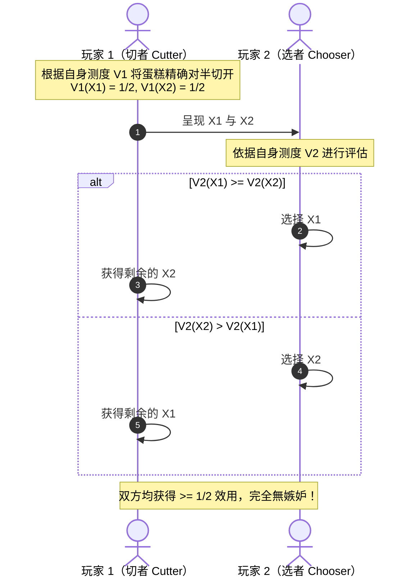
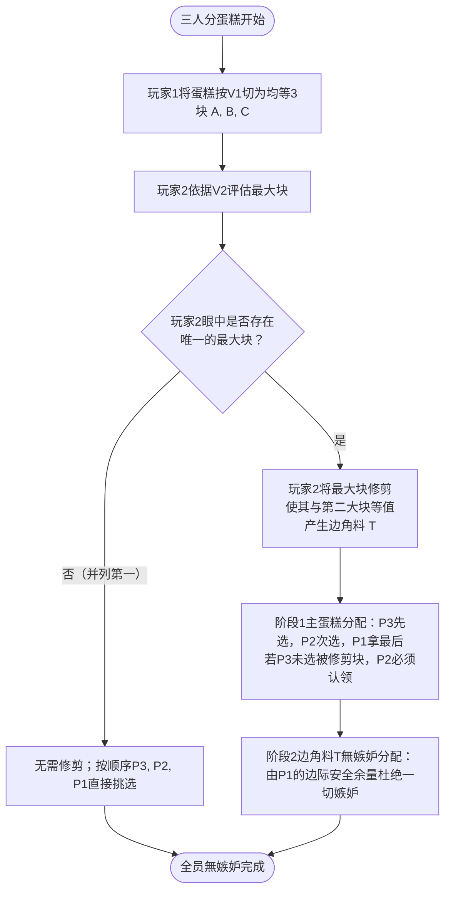

在分家产、离婚财产分割、合租室友分摊房租，乃至国际领海划分的场景中，人类社会始终面临着一个古老而深刻的命题——<strong>“公平（Fairness）”</strong>。

童年时期，长辈教会我们最朴素的智慧是“一人切，一人选（Cut and Choose）”：切蛋糕的人尽力将其一分为二，选蛋糕的人优先拿走自己中意的那块。这种简单的规则确保了两人各自心满意足，谁也不会心生抱怨。

然而，当参与者扩展到 <strong>3 人甚至 $n$ 人</strong> 时，问题变得极其复杂。
更棘手的是，若蛋糕并非均匀质地，而是左半边铺满浓郁巧克力、右半边缀满新鲜草莓，而每个人有着截然不同的<strong>主观偏好（主观价值测度非对称）</strong>：有人对草莓过敏，有人视巧克力如命。若按物理体积均等切成三块，分到草莓的人可能感到极不公平。

是否存在一种严谨的数学演算法，能让所有人按照各自内心独一无二的价值评价体系，不仅每个人都认为自己得到了足够多的一份，而且<strong>没有任何一个人嫉妒他人的份额</strong>？

这正是现代数学与计算机科学中最富魅力的交叉领域之一——<strong>“公平分割理论（Fair Division Theory）”</strong>，俗称<strong>“切蛋糕问题（Cake-Cutting Problem）”</strong>。

自1940年代波兰数学家胡戈·斯坦豪斯（Hugo Steinhaus）提出该问题以来，切蛋糕从一个民间趣题演化为融合测度论、代数拓扑学（不动点定理与斯佩納引理）、演算法复杂度与机制设计的显学。2016年，计算机科学家阿齐兹（Haris Aziz）与麦肯齐（Simon Mackenzie）取得了划时代突破，首次提出了面向任意 $n$ 个人的有限步“無嫉妒分割演算法”。

本文将从测度论的主观价值建模出发，深度剖析比例性与無嫉妒性的本质分歧、塞尔里奇-康威（Selfridge-Conway）三人無嫉妒经典规约、斯佩納引理在合租房租分配中的拓扑应用、分担脏活累活的 Chore 分割，以及不可分物品分配的前沿进展。

---

## 1. “公平”的公理化建模：测度论视角

### 1.1 蛋糕的连续空间表征

数学上，蛋糕通常被抽象为实数轴上的单位闭区间 $X = [0, 1]$，或更一般地表示为 $d$ 维欧氏空间中的紧致可测子集 $X \subset \mathbb{R}^d$。蛋糕的任意切块（Slice）对应于波雷尔 $\sigma$-代数中的可测子集 $A \in \mathcal{B}(X)$。

### 1.2 个人主观偏好的非原子性機率测度

设参与者集合为 $\{1, 2, \dots, n\}$。每位参与者 $i$ 拥有一套私密的<strong>主观价值测度（Value Measure）</strong> $V_i: \mathcal{B}(X) \to [0, 1]$，满足以下测度论公理：
1. <strong>归一性</strong>：$V_i(X) = 1$，$V_i(\emptyset) = 0$。
2. <strong>非负性</strong>：对任意切块 $A$，有 $V_i(A) \ge 0$。
3. <strong>可加性</strong>：若 $A \cap B = \emptyset$，则 $V_i(A \cup B) = V_i(A) + V_i(B)$。
4. <strong>非原子性（可分割性）</strong>：对于任意 $V_i(A) > 0$ 及标量 $\alpha \in [0, 1]$，存在子切块 $B \subset A$ 使得 $V_i(B) = \alpha V_i(A)$。这在物理上意味着刀具可无限精细地在任意连续坐标处切下。

若 $V_i$ 对勒贝格测度绝对连续，则存在可积的<strong>价值密度函数</strong> $v_i(x)$，使得 $V_i(A) = \int_A v_i(x) \, dx$。该框架的精妙之处在于<strong>各人的偏好互不干涉</strong>：你之蜜糖，我之砒霜；每个人仅依照自身内心的尺子来衡量世界。

---

## 2. 公平性的四大标尺：比例性 vs 無嫉妒性

将蛋糕切分为 $n$ 块互不相交的分配方案 $(X_1, X_2, \dots, X_n)$，衡量其是否公平有以下四个核心维度：

| 公平性标准 | 数学定义 | 直观含义 | 求解难度 |
| :---: | :---: | :---: | :---: |
| <strong>比例性 (PROP)</strong> | $\forall i, \quad V_i(X_i) \ge \frac{1}{n}$ | 每个人按自身标准均分得至少 $1/n$ 价值 | 较易（1940年代已解） |
| <strong>無嫉妒性 (EF)</strong> | $\forall i, j, \quad V_i(X_i) \ge V_i(X_j)$ | 没有任何人认为别人的份额优于自己 | 极难（现代数学核心） |
| <strong>均等性 (EQ)</strong> | $\forall i, j, \quad V_i(X_i) = V_j(X_j)$ | 全员体验到的主观数值完全相等 | 需效用可比假设 |
| <strong>帕累托最优 (PE)</strong> | 不存在在不损害他人前提下提升某人效用的重组 | 资源无浪费，交易余量用尽 | 经济学基础标尺 |

### 比例性与無嫉妒性的本质分野
在 $n=2$ 时，若 $V_1(X_1) \ge 1/2$，则剩余部分 $V_1(X_2) \le 1/2$，自然不会嫉妒对方，比例性与無嫉妒性重合。

然而，<strong>在 $n \ge 3$ 时，满足比例性并不意味着消除嫉妒！</strong>
设 Alice、Bob、Charlie 三人分蛋糕。Alice 眼中各块价值为：
- 自己的 $X_1$：$0.35$ （$> 1/3$，满足比例性！）
- Bob 的 $X_2$：$0.50$
- Charlie 的 $X_3$：$0.15$

Alice 虽然拿到了超过三分之一的份额，但她眼睁睁看着 Bob 拿走了她心目中价值 $50\%$ 的大块，内心依然充满强烈的<strong>嫉妒（Envy）</strong>。無嫉妒性（Envy-Freeness）要求全员在成对比较中均無嫉妒，是远比比例性严苛的高阶文明准则。

---

## 3. 经典二人规约：“一人切，一人选”的博弈余热

对于 $n=2$，“一人切，一人选”完美解决了问题：

值得注意的是，从賽局理論的信息租金（Information Rent）来看，<strong>“选者（Chooser）”占据绝对战略优势</strong>：切者出于自保，只能保守切出严格相等的两半，其主观效用被锁死在 $50\%$；而选者若偏好与切者不同，可轻易揽获 $80\%$ 乃至 $100\%$ 的超额主观剩余！

---

## 4. 三人终极优雅：塞尔里奇-康威（Selfridge-Conway）规约

1960年左右，约翰·塞尔里奇与约翰·霍顿·康威独立发现了仅需至多 5 次切割的三人無嫉妒离散规约。

### 4.1 阶段一：主蛋糕切块与修剪（Trimming）
1. <strong>$P_1$ 均分三份</strong>：$V_1(A) = V_1(B) = V_1(C) = 1/3$。
2. <strong>$P_2$ 判定与修剪</strong>：若 $A$ 是唯一的最大块，$P_2$ 将 $A$ 边缘削下一小片 $T$（边角料暂存一旁），使得剩余主块 $A'$ 与第二大块在 $P_2$ 眼中价值并列第一。
3. <strong>分配顺序</strong>：$P_3$ 先挑，$P_2$ 第二个挑（规定：若 $P_3$ 没拿 $A'$，$P_2$ 必须拿走 $A'$），$P_1$ 拿走最后一块。
   - $P_3$ 先选，無嫉妒。
   - $P_2$ 眼中有两块并列最大，必能拿到其一，無嫉妒。
   - $P_1$ 眼中 $B$ 与 $C$ 均为 $1/3$，而被削弱的 $A'$ 必已被他人领走，$P_1$ 必拿到未动过的 $B$ 或 $C$（价值 $1/3$），同样無嫉妒！

### 4.2 阶段二：边角料 $T$ 的無嫉妒再分配
定义阶段一领走 $A'$ 者为 $T_{\text{in}}$，另一位非 $P_1$ 玩家为 $T_{\text{out}}$。
1. $T_{\text{out}}$ 将 $T$ 均切为三块 $T_1, T_2, T_3$。
2. 挑选顺序：$T_{\text{in}}$ 先选，$P_1$ 第二个选，$T_{\text{out}}$ 拿剩余。
- <strong>天才之处在于 $P_1$ 绝不会嫉妒 $T_{\text{in}}$</strong>：因为在 $P_1$ 眼中，$A' \cup T$ 原本就等于 $1/3$。哪怕把整个 $T$ 全给 $T_{\text{in}}$，$T_{\text{in}}$ 的总价值也才刚追平 $P_1$ 手中的完整块！因此哪怕 $T_{\text{in}}$ 优先挑走了最好的边角料，$P_1$ 也绝不嫉妒。

---

## 5. 拓扑学的神来之笔：斯佩納引理与合租房租分配

公平分割理论不仅用于切食品，还广泛应用于合租室友的房租与房间分配（Rental Harmony）。

3位室友合租一套总租金 3 万元的三居室（主卧带独卫、次卧朝南、小暗室）。每个人对金钱和居住品质的权衡不同。数学家苏（Francis Su）于1999年借助代数拓扑中的<strong>斯佩納引理（Sperner's Lemma）</strong>证明：<strong>无论室友们的喜好有多么奇特，永远存在一种租金定价组合，使得每个人恰好挑选不同的房间，全员零嫉妒！</strong>

斯佩納引理通过将租金单体（Simplex）离散三角剖分，并以室友的最佳选择着色，在连续极限下逼近布劳威尔不动点，完美确立了市场出清与心理無嫉妒的共存解。

---

## 6. 不可分物品与前沿：納許社會福利的奇迹

现实生活中的遗产（房产、汽车、名画）不可物理切割。在不可分资产分配中，完全無嫉妒通常无法实现（如仅有一枚钻戒）。

现代演算法理论提出了<strong>EF1（至多排除一件物品后無嫉妒）</strong>与<strong>EFX（排除任意一件物品后無嫉妒）</strong>概念。2016年，Caragiannis 等人证明了里程碑定理：
$$
\max \prod_{i=1}^n V_i(X_i)
$$
<strong>最大化納許社會福利（MNW，效用几何平均数）的分配方案，必然同时满足 EF1 和帕累托最优！</strong>

---

## 7. 结语

公平分割的数学揭示了一个极其深刻的哲理：<strong>公平绝非千篇一律的平均主义，而是对个体差异与主观价值的最大化尊重</strong>。通过精巧的机制设计，博弈规则能够化解人类原始的嫉妒，让差异成为彼此双赢的源泉。
