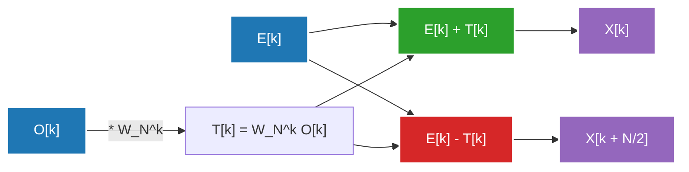

## 1. مقدمة: تحويلات فورييه والإشارات

يتغير الصوت والضوء وإشارات الراديو التي تتبادلها الهواتف مع الزمن أو المكان. يتيح تحليل فورييه دراسة هذه الإشارات ومعالجتها من خلال مكوناتها الترددية.

يمثل هذا التحليل الإشارات بدوال مثلثية أو دوال أسية مركبة. يتطلب تقارب المتسلسلة ووجود التحويل المستمر شروطاً؛ فلا توجد مبرهنة واحدة تجيز تحليل كل موجة بلا قيود. بالاستناد إلى [مقدمة متسلسلات فورييه وتحويلها](/ar/p/fourier-series-and-transform/)، نركز هنا على DFT لبيانات منتهية وكيفية حسابه. تصف القيم في المجال الترددي المقادير والأطوار، لكن قراءة السعات تتطلب مراعاة التطبيع وفترة الرصد أيضاً.

يتطلب الحساب المباشر لتحويل DFT ذي $N$ نقطة عدد عمليات من رتبة $O(N^2)$. قد يكفي ذلك للبيانات الصغيرة، لكنه مكلف عندما يكبر $N$. **تحويل فورييه السريع (FFT)** اسم لعائلة خوارزميات تحسب DFT نفسه بكفاءة. تتطلب طريقة الأساس 2 المشتقة هنا $O(N\log N)$ عملية. لا يعني FFT بذاته تحويلاً مختلفاً أو تقريباً.

سنميز التحويل المستمر عن DFT المنتهي، ونشتق تفكيك كولي–توكي وعملية الفراشة، وننفذ نسخة عودية ببايثون ونختبرها، ثم نشرح دورها في التطبيقات.

---

## 2. من التحويل المستمر إلى DFT المنتهي

فهم DFT هو نقطة البداية لفهم خوارزميات FFT.

### تحويل فورييه المستمر

عندما يقاس التردد $f$ بالهرتز والزمن $t$ بالثواني، يكون أحد الاصطلاحات كما يلي. مثلاً، إذا كان $\int_{-\infty}^{\infty}|x(t)|\,dt<\infty$، يتقارب هذا التكامل تقارباً مطلقاً لكل $f$ حقيقي.

$$ X(f) = \int_{-\infty}^{\infty} x(t) e^{-j 2\pi f t} dt $$

هنا $j^2=-1$؛ و$j$ هي الوحدة التخيلية نفسها التي يرمز إليها عادة بـ$i$ في الرياضيات. تمثل $X(f)$ وزناً ذا قيمة مركبة في طيف مستمر، لا سعة مكون واحد من إشارة دورية مباشرة. تستخدم الحسابات العملية عينات متساوية التباعد وفترة رصد منتهية. أخذ العينات واختيار الفترة عمليتان منفصلتان عن التحويل المستمر نفسه.

### DFT لمتتالية منتهية

لنفترض $x[n]=x(nT_s)$ حيث $n=0,\ldots,N-1$ وفاصل أخذ العينات $T_s>0$. يعرف DFT لهذه المتتالية كما يلي، حيث $N$ عدد صحيح موجب. ينطبق أيضاً على أي متتالية مركبة، دون افتراض وجود تحويل مستمر.

$$ X[k] = \sum_{n=0}^{N-1} x[n] e^{-j \frac{2\pi}{N} k n} \quad (k = 0, 1, ..., N-1) $$

أما DFT العكسي الموافق فهو التالي. لا يتضمن التحويل الأمامي عامل قياس، بينما يتضمن العكسي $1/N$.

$$ x[n]=\frac{1}{N}\sum_{k=0}^{N-1}X[k]e^{j\frac{2\pi}{N}kn}\quad(n=0,\ldots,N-1) $$

معدل أخذ العينات $f_s=1/T_s$، وتباعد الخانات الترددية (*bins*) هو $f_s/N$ هرتز. يمكن تفسير الخانات ذات $k>N/2$ كترددات $(k-N)f_s/N$ هرتز؛ وعندما يكون $N$ زوجياً، تمثل $k=N/2$ مكون نايكويست. قد يسبب أخذ العينات تراكباً طيفياً (*aliasing*)، وقد تسبب فترة الرصد المنتهية تسرباً طيفياً. تتطلب استعادة إشارة مستمرة افتراضات مثل محدودية النطاق الترددي. احتواء الفترة على عدد صحيح من دورات موجة جيبية يجعل ترددها مطابقاً لخانة ويجنب التسرب؛ لكنه لا يضمن وحده إعادة بناء الإشارة المستمرة بدقة تامة.

نضع $W_N=e^{-j2\pi/N}$، وهو **عامل الدوران (twiddle factor)**، لتبسيط التعبير:

$$ X[k] = \sum_{n=0}^{N-1} x[n] W_N^{kn} $$

يجمع الحساب المباشر $N$ حداً لكل واحد من المخرجات $N$. يعطي العد البسيط $N^2$ عملية ضرب مركبة و$N(N-1)$ عملية جمع. يمكن حذف الضرب بعوامل بسيطة مثل 1، لكن الطريقة تظل من رتبة $O(N^2)$. عند $N=1,000,000$ نحصل على $N^2=10^{12}$، ولذلك يهم تحسين الحساب للبيانات الكبيرة. يعتمد زمن التنفيذ الفعلي أيضاً على العتاد والتنفيذ البرمجي.

---

## 3. اشتقاق FFT لكولي–توكي

نشر كولي وتوكي تفكيك DFT إلى تحويلات أصغر وعمماه في 1965. توضح ورقة تنفيذ FFTW أن [غاوس](/ar/p/gauss/) عرف أفكاراً مرتبطة بذلك في 1805. نشتق هنا FFT حديثاً بالأساس 2 مع التقسيم الزمني (DIT, Decimation-in-Time)، عندما يكون $N=2^p$ و$p$ عدداً صحيحاً غير سالب. لا تقتصر خوارزميات FFT عموماً على أطوال تساوي قوى العدد 2.

### فصل الفهارس الزوجية والفردية

ينطبق التقسيم التالي عندما $N\ge2$. أما الحالة الأساسية $N=1$ فهي ببساطة $X[0]=x[0]$. نفصل حدود DFT بحسب كون $n$ زوجياً أو فردياً.

$$ X[k] = \sum_{n=0}^{N-1} x[n] W_N^{kn} $$

نكتب $n=2m$ للفهارس الزوجية و$n=2m+1$ للفردية، حيث $m=0,1,\ldots,N/2-1$.

$$ X[k] = \sum_{m=0}^{N/2-1} x[2m] W_N^{k(2m)} + \sum_{m=0}^{N/2-1} x[2m+1] W_N^{k(2m+1)} $$

نستخدم $W_N^2=e^{-j4\pi/N}=e^{-j2\pi/(N/2)}=W_{N/2}$، ونخرج $W_N^k$ من مجموع الفهارس الفردية.

$$ X[k] = \sum_{m=0}^{N/2-1} x[2m] W_{N/2}^{km} + W_N^k \sum_{m=0}^{N/2-1} x[2m+1] W_{N/2}^{km} $$

للمجموعين المعنيان التاليان:

- الأول هو DFT ذو $N/2$ نقطة للمتتالية $x[0],x[2],x[4],\ldots$، ونرمز إليه بـ$E[k]$.
- المجموع في الحد الثاني هو DFT ذو $N/2$ نقطة للمتتالية $x[1],x[3],x[5],\ldots$، ونرمز إليه بـ$O[k]$.

إذن:

$$ X[k] = E[k] + W_N^k O[k] $$

### الاستفادة من الدورية

لأن $E$ و$O$ هما DFT ذو $N/2$ نقطة، يتكرران بدور $N/2$: أي $E[k+N/2]=E[k]$ و$O[k+N/2]=O[k]$. كذلك $W_N^{k+N/2}=W_N^k e^{-j\pi}=-W_N^k$.

نأخذ الآن $k=0,\ldots,N/2-1$. لنفس $k$، يحسب خرج النصف الأول $X[k]$ وخرج النصف الثاني $X[k+N/2]$ كزوج باستخدام المعادلة السابقة و:

$$ X[k + N/2] = E[k] - W_N^k O[k] $$

نحسب DFT مرتين بطول $N/2$، ثم نستخدم حاصل الضرب بعامل الدوران نفسه لتكوين المجموع والفرق. لا يعني هذا مجرد تنصيف العمل كله مرة واحدة. تكلف عملية الدمج $O(N)$؛ وبالاستمرار عودياً حتى الطول 1 نحصل على علاقة العودية لعدد العمليات:

$$ T(N)=2T(N/2)+O(N)=O(N\log_2 N)\quad(N\ge2),\qquad T(1)=O(1) $$

---

## 4. عملية الفراشة

تسمى الوحدة التي تحسب $X[k]$ و$X[k+N/2]$ معاً **الفراشة**، لأن تدفق بياناتها يشبه جناحين. يظهر مخطط الأساس 2 حاصل الضرب المشترك وعملية الطرح بوضوح.



تبدأ بعض تطبيقات DIT التكرارية بالأساس 2 بإعادة ترتيب المدخلات عبر عكس ترتيب بتات كل فهرس (*bit-reversed order*)، ثم تنفذ فراشات بطول 2، 4، 8، وهكذا. عندما $N=8$ يكون ترتيب الفهارس $(0,4,2,6,1,5,3,7)$. أما التنفيذ العودي أدناه فيعالج هذا الترتيب ضمنياً بتكرار فصل الفهارس الزوجية والفردية، ويعيد النتائج بالترتيب المعتاد. لا تنفذ إعادة ترتيب إضافية كهذه قبل استدعائه. يعتمد موضع إعادة الترتيب على DIT أو DIF وطريقة التنفيذ.

---

## 5. التنفيذ ببايثون والمقارنة

NumPy مكتبة خارجية للحساب العددي، وليست جزءاً من مكتبة بايثون القياسية. يقبل هذا التنفيذ التعليمي متتالية أحادية البعد من قيم عددية منتهية، بطول $2^p$ حيث $p$ عدد صحيح غير سالب. يدعم المدخلات الحقيقية والمركبة ويعيد قيماً مركبة. للأطوال الأخرى يمكن استخدام مكتبة FFT عامة الغرض.

### التنفيذ العودي

```python
import numpy as np

def custom_fft(x):
    """FFT عودي DIT بالأساس 2 لمتتالية منتهية أحادية البعد بطول 2^p."""
    x = np.asarray(x, dtype=np.complex128)
    if x.ndim != 1:
        raise ValueError("Input must be one-dimensional")
    N = x.size
    if N == 0 or (N & (N - 1)) != 0:
        raise ValueError("Length must be a positive power of two")
    if not np.all(np.isfinite(x)):
        raise ValueError("Input must contain only finite values")

    def recurse(values):
        n = values.size
        if n == 1:
            return values.copy()
        even = recurse(values[::2])
        odd = recurse(values[1::2])
        # استخدام الناتج الفردي المضروب بعامل الدوران في المجموع والفرق
        twiddled = np.exp(-2j * np.pi * np.arange(n // 2) / n) * odd
        return np.concatenate((even + twiddled, even - twiddled))

    return recurse(x)
```

### المقارنة مع NumPy

```python
# التشغيل في الجلسة نفسها بعد الكود السابق
fs = 1024
t = np.arange(fs) / fs
signal = 3 * np.sin(2 * np.pi * 50 * t) + np.sin(2 * np.pi * 120 * t)

fft_custom_result = custom_fft(signal)
fft_numpy_result = np.fft.fft(signal)
max_error = np.max(np.abs(fft_custom_result - fft_numpy_result))
agrees = np.allclose(fft_custom_result, fft_numpy_result,
                     rtol=1e-12, atol=1e-10)
print("NumPy agreement:", agrees)
print("Maximum absolute error:", max_error)

# التحقق أيضاً من الحفاظ على الأجزاء التخيلية
complex_signal = np.array([1 + 2j, 3 - 4j, -2 + 0.5j, 0.25j])
print("Complex input agreement:", np.allclose(
    custom_fft(complex_signal), np.fft.fft(complex_signal),
    rtol=1e-12, atol=1e-10))
```

في بيئة التحقق يطبع المثال `NumPy agreement: True` و`Complex input agreement: True`. يختلف الخطأ المطلق الأقصى بحسب البيئة والتقريب العددي. تفحص هذه المقارنة التطابق للمدخلات المختارة؛ وليست برهاناً عاماً على الصحة ولا قياساً للسرعة. تأتي الصحة من الحفاظ على تفكيك DFT في كل خطوة عودية. ومع الدقة المنتهية يبقى التقريب العددي واحتمال تجاوز السعة عند القيم الكبيرة جداً.

يحافظ استخدام `complex128` على الأجزاء التخيلية، خلافاً لـ`dtype=float` في التنفيذ الأصلي. ترفض صراحة المدخلات الفارغة والمصفوفات ثنائية البعد والأطوال التي لا تساوي قوى العدد 2 وقيم NaN واللانهاية. يعيد العنصر الواحد DFT ذا نقطة واحدة لقيمته نفسها.

يستدعي NumPy 2.3.5 المستخدم في التحقق تنفيذ PocketFFT عبر `numpy.fft`. استبدل NumPy تنفيذه السابق المبني على FFTPACK في الإصدار 1.17. ليست المكتبات السريعة بالضرورة غير عودية. يعتمد الأداء أيضاً على ترتيب الحساب ونقل البيانات والذاكرة المخبئية وSIMD؛ ولا يحقق هذا المثال القصير أداء مكتبة مخصصة للاستخدام الفعلي.

---

## 6. التطبيقات: الصوت والصورة والاتصالات

يجب التمييز بين التمثيل في المجال الترددي وFFT بوصفه طريقة لحساب تحويل. يرتبط DCT وMDCT بتحويلات فورييه، لكنهما ليسا التحويل نفسه الذي يمثله DFT المحسوب بواسطة FFT.

### ضغط الصوت: MP3 وAAC

يستفيد الترميز الصوتي الإدراكي من الإخفاء المعتمد على الزمن والتردد لجعل ضجيج التكميم أقل قابلية للسماع. تعتمد قابلية السماع على الإشارة وظروف الترميز؛ فليس كل صوت خافت قريب من صوت عالٍ غير مسموع دائماً. هذا ضغط مع فقد، لذا لا يلزم أن تطابق البيانات المفكوكة ترميزياً الأصل بتاً ببت.

بنك مرشحات التحليل الرئيسي في MP3 هجين من بنك متعدد الأطوار وMDCT. يستخدم الترميز التحويلي في AAC الأساسي MDCT أيضاً. **MDCT** هو **تحويل جيب التمام المتقطع المعدل (modified discrete cosine transform)**، وليس FFT محسناً. قد يستخدم المرمز FFT منفصلاً للتحليل الصوتي النفسي: يظهر مخطط Fraunhofer تحويل FFT للتحليل منفصلاً عن مسار MDCT الرئيسي. نوع التحويل والخوارزمية السريعة المستخدمة في مرحلة معالجة معينة مفهومان مختلفان.

### ضغط الصور: JPEG

يمكن دراسة الصور من خلال الترددات المكانية. تقابل التغيرات الناعمة في السطوع ترددات منخفضة، بينما تسهم التغيرات السريعة عند الحواف والأنسجة في ترددات أعلى.

تقسم الطريقة الأساسية لـJPEG المعتاد مع الفقد عينات كل مكون من الصورة إلى كتل $8\times8$، وتطبق DCT ثنائي الأبعاد ثم تكمم المعاملات الناتجة. غالباً ما تتركز طاقة الصور الطبيعية في الترددات المكانية المنخفضة. لذلك قد يجعل التكميم الأخشن لمعاملات التردد العالي عدداً أكبر منها صفراً. لا يعني التكميم ببساطة حذف كل الترددات العالية، ويعتمد تدهور الصورة على محتواها والإعدادات. لا يجوز مساواة DCT مباشرة بـFFT.

في OFDM يجمع DFT العكسي لدى المرسل الحوامل الفرعية ويمكن حسابه بواسطة IFFT؛ ويمكن حساب DFT لدى المستقبل بواسطة FFT. تستخدم إعادة بناء صور MRI الأساسية من بيانات فضاء k على شبكة ديكارتية مأخوذة العينات بالكامل تحويلات FFT عكسية متعددة الأبعاد أيضاً. يتطلب أخذ العينات غير الديكارتي والآثار الفيزيائية الإضافية معالجة أخرى. يستخدم تحليل التردد كذلك مع البيانات الزلزالية والفلكية، وتختلف الطريقة بحسب البيانات والهدف.

---

## 7. الخلاصة

تستفيد خوارزميات FFT من دورية DFT وتماثله للحصول على التحويل نفسه بعمليات أقل. يحسب DIT بالأساس 2 تحويلات DFT للفهارس الزوجية والفردية عودياً ثم يدمجها بالفراشات، بتعقيد $O(N\log N)$.

ينبغي توضيح شروط الطول، والتعامل مع المدخلات المركبة، وترتيب الترددات، والتطبيع وأخطاء الفاصلة العائمة. وفي التطبيقات أيضاً، يوضح تمييز تحويلات DFT وDCT وMDCT عن حسابها باستخدام FFT العلاقة بين الرياضيات والتقنية.

تشرح مقالات أخرى في هذه المدونة موضوعات مرتبطة بتحليل فورييه ومعالجة الإشارات.

## المراجع

- [MIT 6.341 Lecture 19: DFT وDIT/DIF وعدد العمليات وعكس ترتيب البتات](https://ocw.mit.edu/courses/6-341-discrete-time-signal-processing-fall-2005/4ee39a5e74c9f5099ac516ce57215c96_lec19.pdf)
- [Frigo وJohnson، The Design and Implementation of FFTW3: التفكيك والتاريخ والترتيب في §II](https://www.fftw.org/~fftw/fftw-paper-ieee.pdf)
- [NumPy 2.3: تعريف fft واصطلاحاته](https://numpy.org/doc/2.3/reference/generated/numpy.fft.fft.html)
- [ملاحظات NumPy 1.17: الانتقال إلى PocketFFT](https://numpy.org/doc/2.3/release/1.17.0-notes.html)
- [مصدر NumPy 2.3.5: استدعاءات PocketFFT](https://raw.githubusercontent.com/numpy/numpy/v2.3.5/numpy/fft/_pocketfft.py)
- [Brandenburg، MP3 and AAC Explained: §1 و§3.3 و§4.2 والشكل 2](https://www.iis.fraunhofer.de/content/dam/iis/de/doc/ame/conference/AES-17-Conference_mp3-and-AAC-explained_AES17.pdf)
- [ITU-T T.81: تحويل DCT والتكميم في JPEG ضمن §4.2–4.3](https://www.w3.org/Graphics/JPEG/itu-t81.pdf)
- [MathWorks: مقدمة OFDM](https://www.mathworks.com/help/comm/gs/introduction-to-ofdm.html)
- [Larson Lab، Principles of MRI: إعادة البناء من عينات ديكارتية كاملة](https://larsonlab.github.io/MRI-education-resources/Image%20Reconstruction.html)
