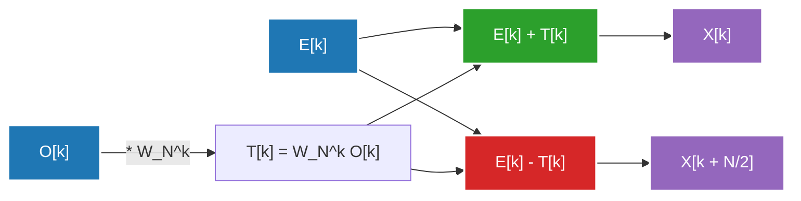

## 1. Einführung: Fourier-Transformationen und Signale

Schall, Licht und die Funksignale von Smartphones verändern sich zeitlich oder räumlich. Die Fourier-Analyse ermöglicht es, solche Signale anhand ihrer Frequenzkomponenten zu untersuchen und zu verarbeiten.

Sie stellt Signale durch trigonometrische Funktionen oder komplexe Exponentialfunktionen dar. Die Konvergenz einer Reihe und die Existenz einer kontinuierlichen Transformation erfordern Voraussetzungen; es gibt keinen einzelnen Satz, nach dem sich jede beliebige Welle ohne Einschränkungen zerlegen lässt. Aufbauend auf der [Einführung in Fourier-Reihen und -Transformationen](/de/p/fourier-series-and-transform/) betrachten wir die DFT endlicher Daten und ihre Berechnung. Die Werte im Frequenzbereich beschreiben Beträge und Phasen. Zum Ablesen von Amplituden müssen auch die Normierung und das Beobachtungsintervall berücksichtigt werden.

Die direkte Berechnung einer DFT mit $N$ Punkten erfordert $O(N^2)$ Operationen. Für kleine Datenmengen kann das genügen, bei großem $N$ aber aufwendig sein. Die **schnelle Fourier-Transformation (FFT)** bezeichnet eine Familie von Algorithmen, die dieselbe DFT effizient berechnen. Das hier hergeleitete Radix-2-Verfahren benötigt $O(N\log N)$ Operationen. FFT bedeutet für sich genommen weder eine andere Transformation noch eine Näherung.

Wir unterscheiden die kontinuierliche Transformation von der endlichen DFT, leiten die Cooley–Tukey-Zerlegung und den Butterfly her, implementieren und prüfen eine rekursive Python-Version und erläutern ihre Rolle in Anwendungen.

---

## 2. Von der kontinuierlichen Transformation zur endlichen DFT

Um FFT-Algorithmen zu verstehen, muss man zunächst die DFT verstehen.

### Kontinuierliche Fourier-Transformation

Mit der Frequenz $f$ in Hertz und der Zeit $t$ in Sekunden lautet eine Konvention wie folgt. Gilt beispielsweise $\int_{-\infty}^{\infty}|x(t)|\,dt<\infty$, so konvergiert dieses Integral für jedes reelle $f$ absolut.

$$ X(f) = \int_{-\infty}^{\infty} x(t) e^{-j 2\pi f t} dt $$

Dabei ist $j^2=-1$; $j$ ist dieselbe imaginäre Einheit, die in der Mathematik meist als $i$ geschrieben wird. $X(f)$ ist ein komplexes Gewicht in einem kontinuierlichen Spektrum und nicht unmittelbar die Amplitude einer einzelnen Komponente eines periodischen Signals. Praktische Berechnungen verwenden gleichmäßig verteilte Abtastwerte und ein endliches Beobachtungsintervall. Die Abtastung und die Auswahl dieses Intervalls sind von der kontinuierlichen Transformation selbst zu unterscheiden.

### DFT einer endlichen Folge

Sei $x[n]=x(nT_s)$ für $n=0,\ldots,N-1$ mit Abtastintervall $T_s>0$. Die DFT dieser endlichen Folge ist unten definiert; $N$ ist eine positive ganze Zahl. Sie gilt auch für jede komplexe Folge, ohne die Existenz einer kontinuierlichen Transformation vorauszusetzen.

$$ X[k] = \sum_{n=0}^{N-1} x[n] e^{-j \frac{2\pi}{N} k n} \quad (k = 0, 1, ..., N-1) $$

Die zugehörige inverse DFT lautet wie folgt. Die Vorwärtstransformation ist unskaliert, die Rücktransformation enthält den Faktor $1/N$.

$$ x[n]=\frac{1}{N}\sum_{k=0}^{N-1}X[k]e^{j\frac{2\pi}{N}kn}\quad(n=0,\ldots,N-1) $$

Die Abtastrate ist $f_s=1/T_s$, der Abstand der Frequenzbins beträgt $f_s/N$ Hz. Bins mit $k>N/2$ lassen sich als Frequenzen $(k-N)f_s/N$ Hz interpretieren; bei geradem $N$ ist $k=N/2$ die Nyquist-Komponente. Abtastung kann Aliasing verursachen, ein endliches Beobachtungsintervall spektrale Leckeffekte. Die Rekonstruktion eines kontinuierlichen Signals erfordert Voraussetzungen wie Bandbegrenzung. Eine ganzzahlige Anzahl von Perioden einer Sinusschwingung im Intervall richtet deren Frequenz an einem Bin aus und vermeidet Leckeffekte; dies allein garantiert keine perfekte Rekonstruktion eines kontinuierlichen Signals.

Wir setzen $W_N=e^{-j2\pi/N}$, den **Drehfaktor (Twiddle-Faktor)**, um den Ausdruck zu vereinfachen:

$$ X[k] = \sum_{n=0}^{N-1} x[n] W_N^{kn} $$

Die direkte Berechnung summiert für jeden der $N$ Ausgabewerte jeweils $N$ Terme. Eine einfache Zählung ergibt $N^2$ komplexe Multiplikationen und $N(N-1)$ Additionen. Multiplikationen mit trivialen Faktoren wie 1 lassen sich weglassen, aber die direkte Methode bleibt in $O(N^2)$. Für $N=1.000.000$ gilt $N^2=10^{12}$; bei großen Datenmengen ist eine effizientere Berechnung daher wichtig. Die tatsächliche Laufzeit hängt auch von Hardware und Implementierung ab.

---

## 3. Herleitung der Cooley–Tukey-FFT

Cooley und Tukey veröffentlichten und verbreiteten 1965 die Zerlegung in kleinere DFTs. Der Aufsatz zur FFTW-Implementierung erklärt, dass [Gauß](/de/p/gauss/) verwandte Ideen bereits 1805 kannte. Wir leiten eine moderne Radix-2-FFT mit Zeitdezimation (DIT, Decimation-in-Time) für $N=2^p$ her, wobei $p$ eine nichtnegative ganze Zahl ist. FFT-Algorithmen im Allgemeinen sind nicht auf Zweierpotenzlängen beschränkt.

### Aufteilung nach geraden und ungeraden Indizes

Die folgende Aufteilung gilt für $N\ge2$. Im Basisfall $N=1$ gilt einfach $X[0]=x[0]$. Wir trennen die DFT nach Termen mit geradem und ungeradem $n$.

$$ X[k] = \sum_{n=0}^{N-1} x[n] W_N^{kn} $$

Wir schreiben $n=2m$ für gerade und $n=2m+1$ für ungerade Indizes mit $m=0,1,\ldots,N/2-1$.

$$ X[k] = \sum_{m=0}^{N/2-1} x[2m] W_N^{k(2m)} + \sum_{m=0}^{N/2-1} x[2m+1] W_N^{k(2m+1)} $$

Wir verwenden $W_N^2=e^{-j4\pi/N}=e^{-j2\pi/(N/2)}=W_{N/2}$ und ziehen $W_N^k$ vor die Summe mit ungeraden Indizes.

$$ X[k] = \sum_{m=0}^{N/2-1} x[2m] W_{N/2}^{km} + W_N^k \sum_{m=0}^{N/2-1} x[2m+1] W_{N/2}^{km} $$

Die beiden Summen haben folgende Bedeutung:

- Die erste ist die $N/2$-Punkt-DFT von $x[0],x[2],x[4],\ldots$, bezeichnet als $E[k]$.
- Die Summe im zweiten Term ist die $N/2$-Punkt-DFT von $x[1],x[3],x[5],\ldots$, bezeichnet als $O[k]$.

Somit:

$$ X[k] = E[k] + W_N^k O[k] $$

### Nutzung der Periodizität

Als $N/2$-Punkt-DFTs wiederholen sich $E$ und $O$ mit der Periode $N/2$: $E[k+N/2]=E[k]$ und $O[k+N/2]=O[k]$. Außerdem gilt $W_N^{k+N/2}=W_N^k e^{-j\pi}=-W_N^k$.

Wir wählen nun $k=0,\ldots,N/2-1$. Für dasselbe $k$ werden der Ausgabewert der ersten Hälfte $X[k]$ und jener der zweiten Hälfte $X[k+N/2]$ gemeinsam mit der vorigen Gleichung und folgender Gleichung berechnet:

$$ X[k + N/2] = E[k] - W_N^k O[k] $$

Wir berechnen zwei DFTs der Länge $N/2$ und nutzen beim Bilden von Summe und Differenz dasselbe Produkt mit dem Drehfaktor. Der gesamte Aufwand wird also nicht bloß einmal halbiert. Das Zusammenführen kostet $O(N)$; die Rekursion bis zur Länge 1 führt zu folgender Rekurrenz für die Anzahl der Operationen:

$$ T(N)=2T(N/2)+O(N)=O(N\log_2 N)\quad(N\ge2),\qquad T(1)=O(1) $$

---

## 4. Butterfly-Operation

Die Grundeinheit, die $X[k]$ und $X[k+N/2]$ gemeinsam berechnet, heißt **Butterfly**, da ihr Datenfluss an Schmetterlingsflügel erinnert. Das Radix-2-Schema zeigt das gemeinsam genutzte Produkt und die Subtraktion ausdrücklich.



Einige iterative Radix-2-DIT-Implementierungen ordnen die Eingabe zunächst durch Umkehrung der Bitreihenfolge jedes Index um (*bit-reversed order*) und führen dann Butterflies der Längen 2, 4, 8 usw. aus. Bei $N=8$ lautet die Indexreihenfolge $(0,4,2,6,1,5,3,7)$. Die folgende rekursive Implementierung behandelt diese Reihenfolge implizit durch wiederholte Trennung gerader und ungerader Indizes und gibt die Ergebnisse in normaler Reihenfolge zurück. Führen Sie vor dem Aufruf keine zusätzliche Bitreihenfolgeumkehr durch. Die Position der Umordnung hängt von DIT, DIF und der Implementierung ab.

---

## 5. Python-Implementierung und Vergleich

NumPy ist eine externe Bibliothek für numerische Berechnungen und kein Bestandteil der Python-Standardbibliothek. Diese Implementierung zu Lehrzwecken akzeptiert eine eindimensionale Folge endlicher numerischer Werte mit Länge $2^p$, wobei $p$ eine nichtnegative ganze Zahl ist. Sie unterstützt reelle und komplexe Eingaben und liefert komplexe Werte. Für andere Längen kann eine allgemeine FFT-Bibliothek verwendet werden.

### Rekursive Implementierung

```python
import numpy as np

def custom_fft(x):
    """Radix-2-DIT-FFT für eine endliche 1D-Folge mit Zweierpotenzlänge."""
    x = np.asarray(x, dtype=np.complex128)
    if x.ndim != 1:
        raise ValueError("Input must be one-dimensional")
    N = x.size
    if N == 0 or (N & (N - 1)) != 0:
        raise ValueError("Length must be a positive power of two")
    if not np.all(np.isfinite(x)):
        raise ValueError("Input must contain only finite values")

    def recurse(values):
        n = values.size
        if n == 1:
            return values.copy()
        even = recurse(values[::2])
        odd = recurse(values[1::2])
        # Ungerades Ergebnis mit Drehfaktor für Summe und Differenz gemeinsam nutzen
        twiddled = np.exp(-2j * np.pi * np.arange(n // 2) / n) * odd
        return np.concatenate((even + twiddled, even - twiddled))

    return recurse(x)
```

### Vergleich mit NumPy

```python
# In derselben Sitzung wie den vorigen Code ausführen
fs = 1024
t = np.arange(fs) / fs
signal = 3 * np.sin(2 * np.pi * 50 * t) + np.sin(2 * np.pi * 120 * t)

fft_custom_result = custom_fft(signal)
fft_numpy_result = np.fft.fft(signal)
max_error = np.max(np.abs(fft_custom_result - fft_numpy_result))
agrees = np.allclose(fft_custom_result, fft_numpy_result,
                     rtol=1e-12, atol=1e-10)
print("NumPy agreement:", agrees)
print("Maximum absolute error:", max_error)

# Auch den Erhalt der Imaginärteile prüfen
complex_signal = np.array([1 + 2j, 3 - 4j, -2 + 0.5j, 0.25j])
print("Complex input agreement:", np.allclose(
    custom_fft(complex_signal), np.fft.fft(complex_signal),
    rtol=1e-12, atol=1e-10))
```

In der Prüfumgebung gibt das Beispiel `NumPy agreement: True` und `Complex input agreement: True` aus. Der maximale absolute Fehler hängt von Umgebung und Rundung ab. Dieser Vergleich prüft die Übereinstimmung für die gewählten Eingaben; er ist weder ein allgemeiner Korrektheitsbeweis noch eine Geschwindigkeitsmessung. Die Korrektheit folgt daraus, dass jeder rekursive Schritt die DFT-Zerlegung erhält. Bei endlicher Genauigkeit bleiben Rundungsfehler und ein möglicher Überlauf bei zu großen Werten zu beachten.

Mit `complex128` bleiben die Imaginärteile erhalten, anders als beim ursprünglichen `dtype=float`. Leere Eingaben, zweidimensionale Arrays, Längen, die keine Zweierpotenzen sind, NaN und Unendlich werden ausdrücklich zurückgewiesen. Ein einzelnes Element liefert seine eigene Einpunkt-DFT.

Das zur Prüfung verwendete NumPy 2.3.5 ruft über `numpy.fft` PocketFFT auf. NumPy ersetzte die frühere FFTPACK-basierte Implementierung mit Version 1.17. Schnelle Bibliotheken sind nicht zwangsläufig nichtrekursiv. Die Leistung hängt auch von Berechnungsreihenfolge, Datenbewegung, Caches und SIMD ab; dieses kurze Python-Beispiel erreicht nicht dieselbe Leistung wie eine Produktionsbibliothek.

---

## 6. Anwendungen: Audio, Bilder und Kommunikation

Die Darstellung im Frequenzbereich ist von der FFT als Berechnungsverfahren zu unterscheiden. DCT und MDCT sind verwandte Transformationen, aber nicht dieselbe Transformation wie die mittels FFT berechnete DFT.

### Audiokompression: MP3 und AAC

Die wahrnehmungsbasierte Audiokodierung nutzt zeit- und frequenzabhängige Maskierung, um Quantisierungsrauschen weniger hörbar zu machen. Die Hörbarkeit hängt vom Signal und den Kodierungsbedingungen ab; ein leiser Ton nahe einem lauten ist nicht immer unhörbar. Die Kompression ist verlustbehaftet, sodass die dekodierten Daten nicht zwingend Bit für Bit dem Original entsprechen.

Die Hauptanalysefilterbank von MP3 ist eine Kombination aus einer Polyphasenfilterbank und einer MDCT. Auch die Transformationskodierung des grundlegenden AAC-Verfahrens verwendet MDCT. **MDCT** steht für **modifizierte diskrete Kosinustransformation (modified discrete cosine transform)**, nicht für eine verbesserte FFT. Ein Encoder kann daneben FFT zur psychoakustischen Analyse nutzen: Das Fraunhofer-Diagramm zeigt eine Analyse-FFT getrennt vom MDCT-Hauptpfad. Die verwendete Transformation und der schnelle Algorithmus einer Verarbeitungsstufe sind unterschiedliche Begriffe.

### Bildkompression: JPEG

Bilder lassen sich anhand räumlicher Frequenzen betrachten. Sanfte Helligkeitsänderungen entsprechen niedrigen Frequenzen; schnelle Änderungen an Konturen oder Texturen tragen höhere Frequenzen bei.

Das Basisverfahren des üblichen verlustbehafteten JPEG teilt die Abtastwerte jeder Bildkomponente in $8\times8$-Blöcke, wendet eine zweidimensionale DCT an und quantisiert die erhaltenen Koeffizienten. Bei natürlichen Bildern liegt häufig viel Energie in niedrigen räumlichen Frequenzen. Eine gröbere Quantisierung hochfrequenter Koeffizienten kann daher mehr davon auf null setzen. Quantisierung bedeutet nicht einfach, alle hohen Frequenzen zu verwerfen; die sichtbare Verschlechterung hängt von Bild und Einstellungen ab. DCT darf nicht unmittelbar mit FFT gleichgesetzt werden.

Bei OFDM kombiniert die inverse DFT des Senders die Unterträger und kann durch IFFT berechnet werden; die DFT des Empfängers lässt sich durch FFT berechnen. Auch die grundlegende MRT-Rekonstruktion aus vollständig abgetasteten kartesischen k-Raum-Daten nutzt mehrdimensionale inverse FFTs. Nichtkartesische Abtastung und zusätzliche physikalische Effekte erfordern weitere Verarbeitung. Frequenzanalyse wird auch für seismische und astronomische Daten eingesetzt; die Methoden hängen von Daten und Zweck ab.

---

## 7. Zusammenfassung

FFT-Algorithmen nutzen die Periodizität und Symmetrie der DFT, um dieselbe Transformation mit weniger Operationen zu erhalten. Radix-2-DIT berechnet rekursiv die DFTs der geraden und ungeraden Indizes und kombiniert sie mit Butterflies. Daraus ergibt sich die Komplexität $O(N\log N)$.

Längenbeschränkungen, komplexe Eingaben, Frequenzreihenfolge, Normierung und Gleitkommafehler sollten klar benannt werden. Auch in Anwendungen hilft die Unterscheidung der Transformationen DFT, DCT und MDCT von ihrer FFT-Berechnung, den Zusammenhang zwischen Mathematik und Technik zu verstehen.

Weitere Artikel dieses Blogs erläutern verwandte Themen der Fourier-Analyse und Signalverarbeitung.

## Quellen

- [MIT 6.341 Lecture 19: DFT, DIT/DIF, Operationszahlen und Bitreihenfolgeumkehr](https://ocw.mit.edu/courses/6-341-discrete-time-signal-processing-fall-2005/4ee39a5e74c9f5099ac516ce57215c96_lec19.pdf)
- [Frigo und Johnson, The Design and Implementation of FFTW3: Zerlegung, Geschichte und Reihenfolge in §II](https://www.fftw.org/~fftw/fftw-paper-ieee.pdf)
- [NumPy 2.3: fft und Konventionen](https://numpy.org/doc/2.3/reference/generated/numpy.fft.fft.html)
- [NumPy 1.17: Umstellung auf PocketFFT](https://numpy.org/doc/2.3/release/1.17.0-notes.html)
- [NumPy 2.3.5: Quellcode der PocketFFT-Aufrufe](https://raw.githubusercontent.com/numpy/numpy/v2.3.5/numpy/fft/_pocketfft.py)
- [Brandenburg, MP3 and AAC Explained: §1, §3.3, §4.2 und Abbildung 2](https://www.iis.fraunhofer.de/content/dam/iis/de/doc/ame/conference/AES-17-Conference_mp3-and-AAC-explained_AES17.pdf)
- [ITU-T T.81: DCT und JPEG-Quantisierung in §4.2–4.3](https://www.w3.org/Graphics/JPEG/itu-t81.pdf)
- [MathWorks: Einführung in OFDM](https://www.mathworks.com/help/comm/gs/introduction-to-ofdm.html)
- [Larson Lab, Principles of MRI: Rekonstruktion aus vollständig abgetasteten kartesischen Daten](https://larsonlab.github.io/MRI-education-resources/Image%20Reconstruction.html)
