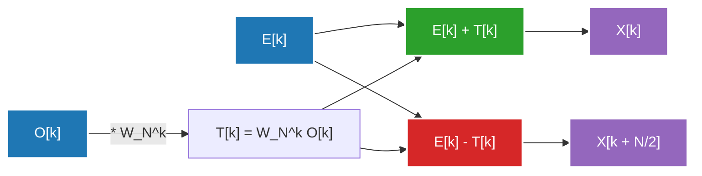

## 1. Introduction: Fourier Transforms and Signals

Sound, light, and the radio signals exchanged by smartphones vary over time or space. Fourier analysis provides ways to study and process these signals in terms of frequency components.

It represents signals using trigonometric functions or complex exponentials. Convergence of a series and existence of a continuous transform require conditions; there is no single theorem saying that every wave can be decomposed without qualifications. Building on the [introduction to Fourier series and transforms](/en/p/fourier-series-and-transform/), this article focuses on the DFT of finite data and how to compute it. Frequency-domain values describe magnitudes and phases, but reading amplitudes also requires attention to normalization and the observation interval.

Direct evaluation of an $N$-point DFT requires $O(N^2)$ operations. This can be adequate for small data, but expensive when $N$ is large. The **fast Fourier transform (FFT)** is a family of algorithms for computing the same DFT efficiently. The radix-2 method derived here uses $O(N\log N)$ operations. FFT does not itself mean a different transform or an approximation.

We distinguish the continuous transform from the finite DFT, derive the Cooley–Tukey construction and butterfly, implement and check a recursive Python version, and explain its role in applications.

---

## 2. From the Continuous Transform to the Finite DFT

Understanding the DFT is the starting point for understanding FFT algorithms.

### Continuous Fourier Transform

With frequency $f$ in hertz and time $t$ in seconds, one convention is the following. For example, if $\int_{-\infty}^{\infty}|x(t)|\,dt<\infty$, this integral converges absolutely for every real $f$.

$$ X(f) = \int_{-\infty}^{\infty} x(t) e^{-j 2\pi f t} dt $$

Here $j^2=-1$; $j$ is the same imaginary unit commonly written $i$ in mathematics. $X(f)$ is a complex-valued weight in a continuous spectrum, not directly the amplitude of one component of a periodic signal. Practical computation uses equally spaced samples and a finite observation interval. Sampling and selecting that interval are separate operations from the continuous transform itself.

### DFT of a Finite Sequence

Suppose $x[n]=x(nT_s)$ for $n=0,\ldots,N-1$, with sampling interval $T_s>0$. The DFT of this finite sequence is defined below, where $N$ is a positive integer. It also applies to any complex sequence without assuming that a continuous transform exists.

$$ X[k] = \sum_{n=0}^{N-1} x[n] e^{-j \frac{2\pi}{N} k n} \quad (k = 0, 1, ..., N-1) $$

The corresponding inverse DFT is as follows. The forward transform is unscaled, and the inverse carries the factor $1/N$.

$$ x[n]=\frac{1}{N}\sum_{k=0}^{N-1}X[k]e^{j\frac{2\pi}{N}kn}\quad(n=0,\ldots,N-1) $$

The sampling rate is $f_s=1/T_s$, and frequency bins are spaced $f_s/N$ Hz apart. Bins with $k>N/2$ can be interpreted as frequencies $(k-N)f_s/N$ Hz; for even $N$, $k=N/2$ is the Nyquist component. Sampling can cause aliasing, while a finite observation interval can cause spectral leakage. Recovering a continuous signal requires assumptions such as band limitation. Having an integer number of sinusoidal cycles in the interval aligns that sinusoid with a bin and avoids leakage; this alone does not guarantee perfect reconstruction of a continuous signal.

Set $W_N=e^{-j2\pi/N}$, the **twiddle factor**, to simplify the expression:

$$ X[k] = \sum_{n=0}^{N-1} x[n] W_N^{kn} $$

Direct computation sums $N$ terms for each of $N$ outputs. A simple count gives $N^2$ complex multiplications and $N(N-1)$ additions. Multiplications by trivial factors such as 1 can be omitted, but the direct method remains $O(N^2)$. For $N=1,000,000$, $N^2=10^{12}$, so improving the computation matters for large data. Actual running time also depends on the hardware and implementation.

---

## 3. Deriving the Cooley–Tukey FFT

Cooley and Tukey published and popularized the decomposition into smaller DFTs in 1965. The FFTW implementation paper explains that related ideas were known to [Gauss](/en/p/gauss/) in 1805. We derive a modern radix-2 decimation-in-time (DIT) FFT for $N=2^p$, where $p$ is a nonnegative integer. FFT algorithms in general are not restricted to power-of-two lengths.

### Splitting Even and Odd Indices

The following split applies for $N\ge2$. The base case $N=1$ is simply $X[0]=x[0]$. Separate the DFT into terms with even and odd $n$.

$$ X[k] = \sum_{n=0}^{N-1} x[n] W_N^{kn} $$

Write $n=2m$ for even indices and $n=2m+1$ for odd indices, with $m=0,1,\ldots,N/2-1$.

$$ X[k] = \sum_{m=0}^{N/2-1} x[2m] W_N^{k(2m)} + \sum_{m=0}^{N/2-1} x[2m+1] W_N^{k(2m+1)} $$

Use $W_N^2=e^{-j4\pi/N}=e^{-j2\pi/(N/2)}=W_{N/2}$, and take $W_N^k$ outside the odd-indexed sum.

$$ X[k] = \sum_{m=0}^{N/2-1} x[2m] W_{N/2}^{km} + W_N^k \sum_{m=0}^{N/2-1} x[2m+1] W_{N/2}^{km} $$

The two sums have the following meanings:

- The first is the $N/2$-point DFT of $x[0],x[2],x[4],\ldots$, denoted $E[k]$.
- The sum in the second term is the $N/2$-point DFT of $x[1],x[3],x[5],\ldots$, denoted $O[k]$.

Thus:

$$ X[k] = E[k] + W_N^k O[k] $$

### Using Periodicity

As $N/2$-point DFTs, $E$ and $O$ repeat with period $N/2$: $E[k+N/2]=E[k]$ and $O[k+N/2]=O[k]$. Also, $W_N^{k+N/2}=W_N^k e^{-j\pi}=-W_N^k$.

Now take $k=0,\ldots,N/2-1$. For the same $k$, the first-half output $X[k]$ and second-half output $X[k+N/2]$ are computed as a pair using the preceding equation and:

$$ X[k + N/2] = E[k] - W_N^k O[k] $$

Compute two DFTs of length $N/2$, then share the twiddle-factor product when taking the sum and difference. This does not mean that the entire computation is merely halved once. Combining the results costs $O(N)$, so recursion down to length 1 gives the operation-count recurrence:

$$ T(N)=2T(N/2)+O(N)=O(N\log_2 N)\quad(N\ge2),\qquad T(1)=O(1) $$

---

## 4. The Butterfly Operation

The basic unit that computes $X[k]$ and $X[k+N/2]$ together is called a **butterfly**, because its data flow resembles a butterfly's wings. The radix-2 flow below makes the shared product and subtraction explicit.



Some iterative radix-2 DIT implementations first arrange the input in bit-reversed order and then apply butterflies of length 2, 4, 8, and so on. For $N=8$, the bit-reversed index order is $(0,4,2,6,1,5,3,7)$. The recursive implementation below handles this ordering implicitly by repeatedly splitting even and odd indices and returns outputs in normal order. Do not apply a separate bit reversal before calling it. The placement of reordering depends on DIT versus DIF and on the implementation.

---

## 5. Python Implementation and Comparison

NumPy is a separate numerical library, not part of Python's standard library. This educational implementation accepts a one-dimensional sequence of finite numeric values whose length is a positive power of two. It supports real and complex inputs and returns complex values. Use a general-purpose FFT library for other lengths.

### Recursive Implementation

```python
import numpy as np

def custom_fft(x):
    """Radix-2 DIT FFT for a finite 1D sequence of positive power-of-two length."""
    x = np.asarray(x, dtype=np.complex128)
    if x.ndim != 1:
        raise ValueError("Input must be one-dimensional")
    N = x.size
    if N == 0 or (N & (N - 1)) != 0:
        raise ValueError("Length must be a positive power of two")
    if not np.all(np.isfinite(x)):
        raise ValueError("Input must contain only finite values")

    def recurse(values):
        n = values.size
        if n == 1:
            return values.copy()
        even = recurse(values[::2])
        odd = recurse(values[1::2])
        # Share the twiddled odd-index result between the sum and difference
        twiddled = np.exp(-2j * np.pi * np.arange(n // 2) / n) * odd
        return np.concatenate((even + twiddled, even - twiddled))

    return recurse(x)
```

### Comparison with NumPy

```python
# Run in the same session as the preceding code
fs = 1024
t = np.arange(fs) / fs
signal = 3 * np.sin(2 * np.pi * 50 * t) + np.sin(2 * np.pi * 120 * t)

fft_custom_result = custom_fft(signal)
fft_numpy_result = np.fft.fft(signal)
max_error = np.max(np.abs(fft_custom_result - fft_numpy_result))
agrees = np.allclose(fft_custom_result, fft_numpy_result,
                     rtol=1e-12, atol=1e-10)
print("NumPy agreement:", agrees)
print("Maximum absolute error:", max_error)

# Also check that imaginary parts are preserved
complex_signal = np.array([1 + 2j, 3 - 4j, -2 + 0.5j, 0.25j])
print("Complex input agreement:", np.allclose(
    custom_fft(complex_signal), np.fft.fft(complex_signal),
    rtol=1e-12, atol=1e-10))
```

In the validation environment, the example prints `NumPy agreement: True` and `Complex input agreement: True`. Maximum absolute error varies with the environment and rounding. This checks agreement for the chosen inputs; it is not a proof of general correctness or a speed benchmark. Correctness follows from preserving the DFT decomposition at each recursive step. Finite precision still entails rounding and possible overflow for values that are too large.

Using `complex128` preserves imaginary parts, unlike the original implementation's `dtype=float`. Empty input, two-dimensional arrays, non-power-of-two lengths, NaN and infinity are explicitly rejected. A single element returns its own one-point DFT.

The NumPy 2.3.5 used for validation calls the PocketFFT implementation through `numpy.fft`. NumPy replaced its earlier FFTPACK-based implementation in version 1.17. Fast libraries are not necessarily nonrecursive. Performance also depends on computation order, data movement, caches and SIMD; this short Python example does not have the same performance as a production library.

---

## 6. Applications: Audio, Images and Communications

Distinguish a frequency-domain representation from FFT as a way of computing a transform. DCT and MDCT are related transforms, but they are not the same transform as the DFT computed by FFT.

### Audio Compression: MP3 and AAC

Perceptual audio coding uses frequency- and time-dependent masking to make quantization noise less audible. Audibility depends on the signal and coding conditions; it is not an absolute rule that a quiet sound near a loud one is always inaudible. This is lossy compression, so decoded data need not be bit-for-bit identical to the original.

The main MP3 analysis filter bank is a hybrid of a polyphase filter bank and an MDCT. Basic AAC transform coding also uses MDCT. **MDCT** stands for **modified discrete cosine transform**, not an improved FFT. An encoder can separately use FFT for psychoacoustic analysis: Fraunhofer's MP3 encoder diagram shows an analysis FFT apart from the main MDCT path. The transform being used and the fast algorithm used in a particular processing stage are separate concepts.

### Image Compression: JPEG

Images can be viewed in terms of spatial frequencies. Smooth changes in brightness correspond to low frequencies, while rapid changes at edges or textures contribute higher frequencies.

The baseline method of ordinary lossy JPEG divides each image component's samples into $8\times8$ blocks, applies a two-dimensional DCT and quantizes the resulting coefficients. Natural images often concentrate energy at lower spatial frequencies. Coarse quantization of high-frequency coefficients can therefore make more of them zero. Quantization is not simply discarding all high frequencies, and visual degradation depends on the image and settings. DCT should not be directly equated with FFT.

In OFDM communications, the transmitter's inverse DFT combines subcarriers and can be computed by IFFT; the receiver's DFT can be computed by FFT. Basic MRI reconstruction from fully sampled Cartesian k-space data also uses multidimensional inverse FFTs. Non-Cartesian sampling and additional physical effects require further processing. Frequency analysis is also used for seismic and astronomical data, with methods depending on the data and purpose.

---

## 7. Conclusion

FFT algorithms exploit DFT periodicity and symmetry to obtain the same transform with fewer operations. Radix-2 DIT recursively computes the even- and odd-indexed DFTs and combines them with butterflies, giving $O(N\log N)$ complexity.

Specify length restrictions, complex input handling, frequency ordering, normalization and floating-point errors. In applications, distinguishing DFT, DCT and MDCT transforms from FFT computation also clarifies the relationship between mathematics and technology.

Other articles on this blog explain related Fourier analysis and signal-processing topics.

## References

- [MIT 6.341 Lecture 19: DFT, DIT/DIF, operation counts and bit reversal](https://ocw.mit.edu/courses/6-341-discrete-time-signal-processing-fall-2005/4ee39a5e74c9f5099ac516ce57215c96_lec19.pdf)
- [Frigo and Johnson, The Design and Implementation of FFTW3: decomposition, history and ordering in §II](https://www.fftw.org/~fftw/fftw-paper-ieee.pdf)
- [NumPy 2.3: fft and its conventions](https://numpy.org/doc/2.3/reference/generated/numpy.fft.fft.html)
- [NumPy 1.17 release notes: replacement by PocketFFT](https://numpy.org/doc/2.3/release/1.17.0-notes.html)
- [NumPy 2.3.5 source: PocketFFT calls](https://raw.githubusercontent.com/numpy/numpy/v2.3.5/numpy/fft/_pocketfft.py)
- [Brandenburg, MP3 and AAC Explained: §1, §3.3, §4.2 and Figure 2](https://www.iis.fraunhofer.de/content/dam/iis/de/doc/ame/conference/AES-17-Conference_mp3-and-AAC-explained_AES17.pdf)
- [ITU-T T.81: JPEG DCT and quantization in §4.2–4.3](https://www.w3.org/Graphics/JPEG/itu-t81.pdf)
- [MathWorks: Introduction to OFDM](https://www.mathworks.com/help/comm/gs/introduction-to-ofdm.html)
- [Larson Lab, Principles of MRI: reconstruction from fully sampled Cartesian data](https://larsonlab.github.io/MRI-education-resources/Image%20Reconstruction.html)
