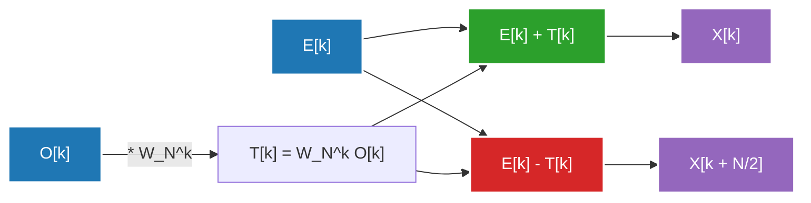

## 1. Introducción: transformadas de Fourier y señales

El sonido, la luz y las señales de radio que intercambian los teléfonos varían en el tiempo o en el espacio. El análisis de Fourier permite estudiar y procesar esas señales mediante sus componentes de frecuencia.

Representa señales con funciones trigonométricas o exponenciales complejas. La convergencia de una serie y la existencia de una transformada continua requieren condiciones; no existe un único teorema que permita descomponer cualquier onda sin restricciones. A partir de la [introducción a las series y la transformada de Fourier](/es/p/fourier-series-and-transform/), nos centramos en la DFT de datos finitos y su cálculo. Los valores en frecuencia describen magnitudes y fases, pero leer amplitudes exige atender también a la normalización y al intervalo de observación.

Evaluar directamente una DFT de $N$ puntos requiere $O(N^2)$ operaciones. Puede bastar para datos pequeños, pero resultar costoso para $N$ grande. La **transformada rápida de Fourier (FFT)** es una familia de algoritmos que calculan la misma DFT eficientemente. El método de base 2 que derivamos necesita $O(N\log N)$ operaciones. FFT no significa por sí misma otra transformación ni una aproximación.

Distinguimos la transformada continua de la DFT finita, derivamos la descomposición de Cooley–Tukey y la mariposa, implementamos y comprobamos una versión recursiva en Python y explicamos su función en las aplicaciones.

---

## 2. De la transformada continua a la DFT finita

Para comprender los algoritmos FFT, primero debemos entender la DFT.

### Transformada continua de Fourier

Con frecuencia $f$ en hercios y tiempo $t$ en segundos, una convención es la siguiente. Por ejemplo, si $\int_{-\infty}^{\infty}|x(t)|\,dt<\infty$, la integral converge absolutamente para todo $f$ real.

$$ X(f) = \int_{-\infty}^{\infty} x(t) e^{-j 2\pi f t} dt $$

Aquí $j^2=-1$; $j$ es la misma unidad imaginaria que suele escribirse $i$ en matemáticas. $X(f)$ es un peso complejo de un espectro continuo, no directamente la amplitud de una componente individual de una señal periódica. En la práctica se usan muestras equiespaciadas y un intervalo de observación finito. Muestrear y seleccionar ese intervalo son operaciones distintas de la propia transformada continua.

### DFT de una secuencia finita

Supongamos $x[n]=x(nT_s)$, con $n=0,\ldots,N-1$ e intervalo de muestreo $T_s>0$. La DFT de esa secuencia se define abajo, donde $N$ es un entero positivo. También se aplica a cualquier secuencia compleja, sin exigir que exista una transformada continua.

$$ X[k] = \sum_{n=0}^{N-1} x[n] e^{-j \frac{2\pi}{N} k n} \quad (k = 0, 1, ..., N-1) $$

La DFT inversa correspondiente es la siguiente. La directa no lleva factor de escala, y la inversa incluye $1/N$.

$$ x[n]=\frac{1}{N}\sum_{k=0}^{N-1}X[k]e^{j\frac{2\pi}{N}kn}\quad(n=0,\ldots,N-1) $$

La frecuencia de muestreo es $f_s=1/T_s$ y los bins están separados $f_s/N$ Hz. Los bins con $k>N/2$ se interpretan como frecuencias $(k-N)f_s/N$ Hz; para $N$ par, $k=N/2$ es la componente de Nyquist. El muestreo puede causar aliasing y el intervalo finito puede causar fuga espectral. Recuperar una señal continua exige hipótesis como la limitación de banda. Un número entero de ciclos de una sinusoide en el intervalo la alinea con un bin y evita la fuga, pero no garantiza por sí solo la reconstrucción perfecta de una señal continua.

Definimos $W_N=e^{-j2\pi/N}$, el **factor de rotación (twiddle factor)**, para simplificar:

$$ X[k] = \sum_{n=0}^{N-1} x[n] W_N^{kn} $$

El cálculo directo suma $N$ términos para cada uno de $N$ resultados. Un recuento sencillo da $N^2$ multiplicaciones complejas y $N(N-1)$ sumas. Pueden omitirse multiplicaciones por factores triviales, como 1, pero el método sigue siendo $O(N^2)$. Para $N=1.000.000$, $N^2=10^{12}$, por lo que mejorar el cálculo importa con datos grandes. El tiempo real de ejecución depende también del hardware y de la implementación.

---

## 3. Derivación de la FFT de Cooley–Tukey

Cooley y Tukey publicaron y popularizaron en 1965 la descomposición en DFT más pequeñas. El artículo sobre la implementación de FFTW explica que [Gauss](/es/p/gauss/) ya conocía ideas relacionadas en 1805. Derivamos una FFT moderna de base 2 con decimación en el tiempo (DIT), para $N=2^p$, donde $p$ es un entero no negativo. Los algoritmos FFT en general no se limitan a longitudes que sean potencias de dos.

### Separación de índices pares e impares

La separación siguiente vale para $N\ge2$. El caso base $N=1$ es simplemente $X[0]=x[0]$. Separamos la DFT según los índices $n$ pares e impares.

$$ X[k] = \sum_{n=0}^{N-1} x[n] W_N^{kn} $$

Escribimos $n=2m$ para los pares y $n=2m+1$ para los impares, con $m=0,1,\ldots,N/2-1$.

$$ X[k] = \sum_{m=0}^{N/2-1} x[2m] W_N^{k(2m)} + \sum_{m=0}^{N/2-1} x[2m+1] W_N^{k(2m+1)} $$

Usamos $W_N^2=e^{-j4\pi/N}=e^{-j2\pi/(N/2)}=W_{N/2}$ y extraemos $W_N^k$ de la suma de índices impares.

$$ X[k] = \sum_{m=0}^{N/2-1} x[2m] W_{N/2}^{km} + W_N^k \sum_{m=0}^{N/2-1} x[2m+1] W_{N/2}^{km} $$

Las sumas tienen estos significados:

- La primera es la DFT de $N/2$ puntos de $x[0],x[2],x[4],\ldots$, denotada $E[k]$.
- La suma del segundo término es la DFT de $N/2$ puntos de $x[1],x[3],x[5],\ldots$, denotada $O[k]$.

Así:

$$ X[k] = E[k] + W_N^k O[k] $$

### Uso de la periodicidad

Como DFT de $N/2$ puntos, $E$ y $O$ se repiten con período $N/2$: $E[k+N/2]=E[k]$ y $O[k+N/2]=O[k]$. Además, $W_N^{k+N/2}=W_N^k e^{-j\pi}=-W_N^k$.

Ahora tomamos $k=0,\ldots,N/2-1$. Para el mismo $k$, el resultado de la primera mitad $X[k]$ y el de la segunda $X[k+N/2]$ se calculan como un par, mediante la ecuación anterior y:

$$ X[k + N/2] = E[k] - W_N^k O[k] $$

Calculamos dos DFT de longitud $N/2$ y compartimos el producto por el factor de rotación para formar la suma y la diferencia. Esto no significa simplemente reducir una vez a la mitad todo el cálculo. La combinación cuesta $O(N)$; al repetir la recursión hasta longitud 1 obtenemos la recurrencia para el número de operaciones:

$$ T(N)=2T(N/2)+O(N)=O(N\log_2 N)\quad(N\ge2),\qquad T(1)=O(1) $$

---

## 4. Operación de mariposa

La unidad que calcula conjuntamente $X[k]$ y $X[k+N/2]$ se llama **mariposa**, porque su flujo de datos se asemeja a unas alas. El esquema de base 2 explicita el producto compartido y la resta.



Algunas implementaciones iterativas DIT de base 2 ordenan primero la entrada mediante una permutación por inversión del orden de los bits (*bit-reversed order*), y después aplican mariposas de longitud 2, 4, 8, etc. Para $N=8$, el orden de índices es $(0,4,2,6,1,5,3,7)$. La implementación recursiva siguiente trata ese orden implícitamente al separar repetidamente índices pares e impares, y devuelve los resultados en orden normal. No aplique otra permutación de este tipo antes de llamarla. La posición de la reordenación depende de DIT, DIF y de la implementación.

---

## 5. Implementación en Python y comparación

NumPy es una biblioteca numérica externa, no parte de la biblioteca estándar de Python. Esta implementación didáctica acepta una secuencia unidimensional de valores numéricos finitos, cuya longitud sea $2^p$ con un entero $p\ge0$. Admite entradas reales y complejas y devuelve valores complejos. Para otras longitudes se puede utilizar una biblioteca FFT de uso general.

### Implementación recursiva

```python
import numpy as np

def custom_fft(x):
    """FFT DIT de base 2 para una secuencia 1D finita de longitud potencia de dos."""
    x = np.asarray(x, dtype=np.complex128)
    if x.ndim != 1:
        raise ValueError("Input must be one-dimensional")
    N = x.size
    if N == 0 or (N & (N - 1)) != 0:
        raise ValueError("Length must be a positive power of two")
    if not np.all(np.isfinite(x)):
        raise ValueError("Input must contain only finite values")

    def recurse(values):
        n = values.size
        if n == 1:
            return values.copy()
        even = recurse(values[::2])
        odd = recurse(values[1::2])
        # Compartir el resultado impar multiplicado por el factor de rotación
        twiddled = np.exp(-2j * np.pi * np.arange(n // 2) / n) * odd
        return np.concatenate((even + twiddled, even - twiddled))

    return recurse(x)
```

### Comparación con NumPy

```python
# Ejecutar en la misma sesión que el bloque anterior
fs = 1024
t = np.arange(fs) / fs
signal = 3 * np.sin(2 * np.pi * 50 * t) + np.sin(2 * np.pi * 120 * t)

fft_custom_result = custom_fft(signal)
fft_numpy_result = np.fft.fft(signal)
max_error = np.max(np.abs(fft_custom_result - fft_numpy_result))
agrees = np.allclose(fft_custom_result, fft_numpy_result,
                     rtol=1e-12, atol=1e-10)
print("NumPy agreement:", agrees)
print("Maximum absolute error:", max_error)

# Comprobar también que se conservan las partes imaginarias
complex_signal = np.array([1 + 2j, 3 - 4j, -2 + 0.5j, 0.25j])
print("Complex input agreement:", np.allclose(
    custom_fft(complex_signal), np.fft.fft(complex_signal),
    rtol=1e-12, atol=1e-10))
```

En el entorno de validación se imprimen `NumPy agreement: True` y `Complex input agreement: True`. El error absoluto máximo varía según el entorno y el redondeo. La comparación comprueba concordancia para las entradas elegidas; no es una demostración general de corrección ni una medición de velocidad. La corrección se debe a que cada paso recursivo conserva la descomposición de la DFT. La precisión finita sigue implicando redondeo y posible desbordamiento para valores demasiado grandes.

El uso de `complex128` conserva las partes imaginarias, a diferencia del `dtype=float` original. Se rechazan explícitamente entradas vacías, matrices bidimensionales, longitudes que no sean potencias de dos, NaN e infinito. Un solo elemento devuelve su propia DFT de un punto.

NumPy 2.3.5, usado en la validación, llama a PocketFFT mediante `numpy.fft`. NumPy sustituyó su implementación anterior basada en FFTPACK en la versión 1.17. Las bibliotecas rápidas no son necesariamente no recursivas. Su rendimiento depende también del orden de cálculo, el movimiento de datos, las cachés y SIMD; este breve código Python no tiene el mismo rendimiento que una biblioteca de producción.

---

## 6. Aplicaciones: audio, imágenes y comunicaciones

Distinga la representación en frecuencia de FFT como forma de calcular una transformada. DCT y MDCT son transformadas relacionadas, pero distintas de la DFT calculada mediante FFT.

### Compresión de audio: MP3 y AAC

La codificación perceptual de audio utiliza el enmascaramiento dependiente del tiempo y la frecuencia para hacer menos audible el ruido de cuantificación. La audibilidad depende de la señal y de las condiciones de codificación; no es una regla absoluta que un sonido débil próximo a uno fuerte siempre sea inaudible. La compresión es con pérdidas, por lo que los datos decodificados no tienen por qué ser idénticos bit a bit al original.

El banco de filtros de análisis principal de MP3 es un híbrido de un banco polifásico y una MDCT. La codificación por transformada de AAC básico también utiliza MDCT. **MDCT** significa **transformada de coseno discreta modificada (modified discrete cosine transform)**, no una FFT mejorada. Un codificador puede usar FFT por separado para el análisis psicoacústico: el diagrama de Fraunhofer muestra una FFT de análisis distinta de la ruta principal MDCT. El tipo de transformada y el algoritmo rápido usado en una etapa de procesamiento son conceptos separados.

### Compresión de imágenes: JPEG

Las imágenes pueden entenderse mediante frecuencias espaciales. Los cambios suaves de brillo corresponden a frecuencias bajas; los bordes y texturas con cambios rápidos aportan frecuencias más altas.

El método básico del JPEG habitual con pérdidas divide las muestras de cada componente de imagen en bloques $8\times8$, aplica una DCT bidimensional y cuantifica los coeficientes. Las imágenes naturales suelen concentrar energía en las frecuencias espaciales bajas. Una cuantificación más gruesa de los coeficientes de alta frecuencia puede hacer que más de ellos sean cero. Cuantificar no consiste simplemente en descartar todas las frecuencias altas, y la degradación visual depende de la imagen y de los ajustes. DCT no debe equipararse directamente con FFT.

En OFDM, la DFT inversa del transmisor combina subportadoras y puede calcularse mediante IFFT; la DFT del receptor puede calcularse mediante FFT. La reconstrucción básica de RM a partir de un espacio k cartesiano completamente muestreado también usa FFT inversas multidimensionales. El muestreo no cartesiano y efectos físicos adicionales requieren más procesamiento. El análisis de frecuencia se utiliza también con datos sísmicos y astronómicos, con métodos que dependen de los datos y del objetivo.

---

## 7. Conclusión

Los algoritmos FFT aprovechan la periodicidad y simetría de la DFT para obtener la misma transformada con menos operaciones. DIT de base 2 calcula recursivamente las DFT de índices pares e impares y las combina con mariposas, con complejidad $O(N\log N)$.

Especifique restricciones de longitud, tratamiento de entradas complejas, orden de frecuencias, normalización y errores de coma flotante. Distinguir las transformadas DFT, DCT y MDCT de su cálculo mediante FFT aclara la relación entre matemáticas y tecnología.

Otros artículos del blog explican temas relacionados con el análisis de Fourier y el procesamiento de señales.

## Referencias

- [MIT 6.341 Lecture 19: DFT, DIT/DIF, operaciones e inversión del orden de bits](https://ocw.mit.edu/courses/6-341-discrete-time-signal-processing-fall-2005/4ee39a5e74c9f5099ac516ce57215c96_lec19.pdf)
- [Frigo y Johnson, The Design and Implementation of FFTW3: descomposición, historia y orden de cálculo en §II](https://www.fftw.org/~fftw/fftw-paper-ieee.pdf)
- [NumPy 2.3: fft y sus convenciones](https://numpy.org/doc/2.3/reference/generated/numpy.fft.fft.html)
- [Notas de NumPy 1.17: sustitución por PocketFFT](https://numpy.org/doc/2.3/release/1.17.0-notes.html)
- [Código de NumPy 2.3.5: llamadas a PocketFFT](https://raw.githubusercontent.com/numpy/numpy/v2.3.5/numpy/fft/_pocketfft.py)
- [Brandenburg, MP3 and AAC Explained: §1, §3.3, §4.2 y figura2](https://www.iis.fraunhofer.de/content/dam/iis/de/doc/ame/conference/AES-17-Conference_mp3-and-AAC-explained_AES17.pdf)
- [ITU-T T.81: DCT y cuantificación JPEG en §4.2–4.3](https://www.w3.org/Graphics/JPEG/itu-t81.pdf)
- [MathWorks: introducción a OFDM](https://www.mathworks.com/help/comm/gs/introduction-to-ofdm.html)
- [Larson Lab, Principles of MRI: reconstrucción con muestreo cartesiano completo](https://larsonlab.github.io/MRI-education-resources/Image%20Reconstruction.html)
