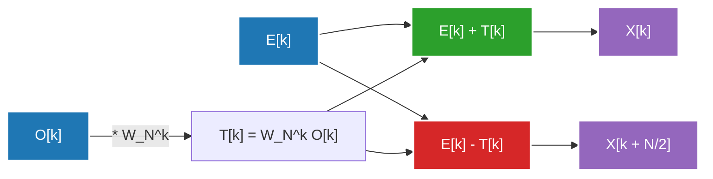

## 1. Introduction : transformées de Fourier et signaux

Le son, la lumière et les signaux radio échangés par les téléphones varient dans le temps ou dans l’espace. L’analyse de Fourier permet d’étudier et de traiter ces signaux à travers leurs composantes fréquentielles.

Elle représente les signaux à l’aide de fonctions trigonométriques ou d’exponentielles complexes. La convergence d’une série et l’existence d’une transformée continue exigent des conditions : aucun théorème unique ne permet de décomposer toute onde sans restriction. À partir de l’[introduction aux séries et à la transformée de Fourier](/fr/p/fourier-series-and-transform/), nous nous concentrons sur la DFT de données finies et sur son calcul. Les valeurs fréquentielles décrivent des modules et des phases ; lire des amplitudes exige aussi de tenir compte de la normalisation et de l’intervalle d’observation.

L’évaluation directe d’une DFT à $N$ points demande $O(N^2)$ opérations. Elle peut suffire pour de petites données, mais devient coûteuse lorsque $N$ augmente. La **transformée de Fourier rapide (FFT)** désigne une famille d’algorithmes qui calculent efficacement la même DFT. La méthode de base 2 dérivée ici utilise $O(N\log N)$ opérations. Le terme FFT ne désigne pas en lui-même une autre transformée ni une approximation.

Nous distinguons la transformée continue de la DFT finie, dérivons la décomposition de Cooley–Tukey et le papillon, implémentons et vérifions une version récursive en Python, puis précisons son rôle dans les applications.

---

## 2. De la transformée continue à la DFT finie

Comprendre la DFT est le point de départ pour comprendre les algorithmes FFT.

### Transformée de Fourier continue

Avec la fréquence $f$ en hertz et le temps $t$ en secondes, une convention est la suivante. Par exemple, si $\int_{-\infty}^{\infty}|x(t)|\,dt<\infty$, cette intégrale converge absolument pour tout réel $f$.

$$ X(f) = \int_{-\infty}^{\infty} x(t) e^{-j 2\pi f t} dt $$

Ici $j^2=-1$ ; $j$ est la même unité imaginaire que celle généralement notée $i$ en mathématiques. $X(f)$ est un poids complexe dans un spectre continu, pas directement l’amplitude d’une composante d’un signal périodique. En pratique, le calcul utilise des échantillons régulièrement espacés et un intervalle d’observation fini. L’échantillonnage et la sélection de cet intervalle sont des opérations distinctes de la transformée continue elle-même.

### DFT d’une suite finie

Supposons $x[n]=x(nT_s)$ pour $n=0,\ldots,N-1$, avec une période d’échantillonnage $T_s>0$. La DFT de cette suite finie est définie ci-dessous, où $N$ est un entier strictement positif. Elle s’applique aussi à toute suite complexe, sans supposer l’existence d’une transformée continue.

$$ X[k] = \sum_{n=0}^{N-1} x[n] e^{-j \frac{2\pi}{N} k n} \quad (k = 0, 1, ..., N-1) $$

La DFT inverse correspondante est la suivante. La transformée directe n’est pas mise à l’échelle et l’inverse comporte le facteur $1/N$.

$$ x[n]=\frac{1}{N}\sum_{k=0}^{N-1}X[k]e^{j\frac{2\pi}{N}kn}\quad(n=0,\ldots,N-1) $$

La fréquence d’échantillonnage est $f_s=1/T_s$, et les cases fréquentielles (*bins*) sont espacées de $f_s/N$ Hz. Celles d’indice $k>N/2$ s’interprètent comme des fréquences $(k-N)f_s/N$ Hz ; pour $N$ pair, $k=N/2$ est la composante de Nyquist. L’échantillonnage peut causer du repliement spectral et l’intervalle fini des fuites spectrales. Reconstruire un signal continu exige des hypothèses comme la limitation de bande. Un nombre entier de périodes d’une sinusoïde dans l’intervalle aligne celle-ci sur une case et évite les fuites ; cela ne garantit pas, à lui seul, la reconstruction parfaite d’un signal continu.

Posons $W_N=e^{-j2\pi/N}$, le **facteur de rotation (twiddle factor)**, pour simplifier l’expression :

$$ X[k] = \sum_{n=0}^{N-1} x[n] W_N^{kn} $$

Le calcul direct additionne $N$ termes pour chacune des $N$ sorties. Un décompte simple donne $N^2$ multiplications complexes et $N(N-1)$ additions. On peut omettre les multiplications par des facteurs triviaux tels que 1, mais la méthode reste en $O(N^2)$. Pour $N=1\,000\,000$, on obtient $N^2=10^{12}$ : améliorer le calcul importe pour de grandes données. Le temps d’exécution dépend aussi du matériel et de l’implémentation.

---

## 3. Dérivation de la FFT de Cooley–Tukey

Cooley et Tukey ont publié et popularisé la décomposition en DFT plus petites en 1965. L’article sur l’implémentation de FFTW explique que [Gauss](/fr/p/gauss/) connaissait des idées apparentées en 1805. Nous dérivons une FFT moderne de base 2 à décimation temporelle (DIT, Decimation-in-Time), pour $N=2^p$, où $p$ est un entier positif ou nul. Les algorithmes FFT en général ne se limitent pas aux longueurs qui sont des puissances de deux.

### Séparation des indices pairs et impairs

La séparation suivante s’applique à $N\ge2$. Le cas de base $N=1$ est simplement $X[0]=x[0]$. Séparons les termes de la DFT selon la parité de $n$.

$$ X[k] = \sum_{n=0}^{N-1} x[n] W_N^{kn} $$

Écrivons $n=2m$ pour les indices pairs et $n=2m+1$ pour les impairs, avec $m=0,1,\ldots,N/2-1$.

$$ X[k] = \sum_{m=0}^{N/2-1} x[2m] W_N^{k(2m)} + \sum_{m=0}^{N/2-1} x[2m+1] W_N^{k(2m+1)} $$

Utilisons $W_N^2=e^{-j4\pi/N}=e^{-j2\pi/(N/2)}=W_{N/2}$ et sortons $W_N^k$ de la somme des indices impairs.

$$ X[k] = \sum_{m=0}^{N/2-1} x[2m] W_{N/2}^{km} + W_N^k \sum_{m=0}^{N/2-1} x[2m+1] W_{N/2}^{km} $$

Les deux sommes ont les significations suivantes :

- La première est la DFT à $N/2$ points de $x[0],x[2],x[4],\ldots$, notée $E[k]$.
- La somme du second terme est la DFT à $N/2$ points de $x[1],x[3],x[5],\ldots$, notée $O[k]$.

Ainsi :

$$ X[k] = E[k] + W_N^k O[k] $$

### Exploitation de la périodicité

En tant que DFT à $N/2$ points, $E$ et $O$ se répètent avec une période de $N/2$ : $E[k+N/2]=E[k]$ et $O[k+N/2]=O[k]$. De plus, $W_N^{k+N/2}=W_N^k e^{-j\pi}=-W_N^k$.

Prenons maintenant $k=0,\ldots,N/2-1$. Pour un même $k$, la sortie de la première moitié $X[k]$ et celle de la seconde $X[k+N/2]$ se calculent ensemble avec l’équation précédente et :

$$ X[k + N/2] = E[k] - W_N^k O[k] $$

Nous calculons deux DFT de longueur $N/2$, puis partageons le produit par le facteur de rotation pour former la somme et la différence. Cela ne signifie pas simplement diviser une seule fois l’ensemble du travail par deux. La combinaison coûte $O(N)$ ; la récursion jusqu’à la longueur 1 donne la récurrence du nombre d’opérations :

$$ T(N)=2T(N/2)+O(N)=O(N\log_2 N)\quad(N\ge2),\qquad T(1)=O(1) $$

---

## 4. Opération papillon

L’unité qui calcule ensemble $X[k]$ et $X[k+N/2]$ est appelée **papillon**, car son flux de données ressemble à des ailes. Le schéma de base 2 ci-dessous explicite le produit partagé et la soustraction.



Certaines implémentations itératives DIT de base 2 commencent par permuter l’entrée en inversant l’ordre des bits de chaque indice (*bit-reversed order*), puis appliquent des papillons de longueur 2, 4, 8, etc. Pour $N=8$, l’ordre des indices est $(0,4,2,6,1,5,3,7)$. L’implémentation récursive suivante traite cet ordre implicitement en séparant successivement les indices pairs et impairs et renvoie les sorties dans l’ordre normal. N’effectuez pas une autre permutation de ce type avant de l’appeler. La position du réarrangement dépend de DIT, DIF et de l’implémentation.

---

## 5. Implémentation en Python et comparaison

NumPy est une bibliothèque numérique externe, qui ne fait pas partie de la bibliothèque standard de Python. Cette implémentation pédagogique accepte une suite unidimensionnelle de valeurs numériques finies, de longueur $2^p$, avec $p$ entier positif ou nul. Elle gère les entrées réelles et complexes et renvoie des valeurs complexes. Pour d’autres longueurs, utilisez une bibliothèque FFT généraliste.

### Implémentation récursive

```python
import numpy as np

def custom_fft(x):
    """FFT DIT de base 2 pour une suite 1D finie de longueur puissance de deux."""
    x = np.asarray(x, dtype=np.complex128)
    if x.ndim != 1:
        raise ValueError("Input must be one-dimensional")
    N = x.size
    if N == 0 or (N & (N - 1)) != 0:
        raise ValueError("Length must be a positive power of two")
    if not np.all(np.isfinite(x)):
        raise ValueError("Input must contain only finite values")

    def recurse(values):
        n = values.size
        if n == 1:
            return values.copy()
        even = recurse(values[::2])
        odd = recurse(values[1::2])
        # Partager le résultat impair multiplié par le facteur de rotation
        twiddled = np.exp(-2j * np.pi * np.arange(n // 2) / n) * odd
        return np.concatenate((even + twiddled, even - twiddled))

    return recurse(x)
```

### Comparaison avec NumPy

```python
# Exécuter dans la même session que le bloc précédent
fs = 1024
t = np.arange(fs) / fs
signal = 3 * np.sin(2 * np.pi * 50 * t) + np.sin(2 * np.pi * 120 * t)

fft_custom_result = custom_fft(signal)
fft_numpy_result = np.fft.fft(signal)
max_error = np.max(np.abs(fft_custom_result - fft_numpy_result))
agrees = np.allclose(fft_custom_result, fft_numpy_result,
                     rtol=1e-12, atol=1e-10)
print("NumPy agreement:", agrees)
print("Maximum absolute error:", max_error)

# Vérifier aussi la conservation des parties imaginaires
complex_signal = np.array([1 + 2j, 3 - 4j, -2 + 0.5j, 0.25j])
print("Complex input agreement:", np.allclose(
    custom_fft(complex_signal), np.fft.fft(complex_signal),
    rtol=1e-12, atol=1e-10))
```

Dans l’environnement de validation, l’exemple affiche `NumPy agreement: True` et `Complex input agreement: True`. L’erreur absolue maximale varie avec l’environnement et les arrondis. La comparaison vérifie la concordance pour les entrées choisies ; ce n’est ni une preuve générale de correction ni une mesure de vitesse. La correction repose sur la conservation de la décomposition de la DFT à chaque étape récursive. La précision finie implique toujours des arrondis et un dépassement de capacité possible pour des valeurs trop grandes.

L’utilisation de `complex128` conserve les parties imaginaires, contrairement au `dtype=float` initial. Les entrées vides, les tableaux bidimensionnels, les longueurs qui ne sont pas des puissances de deux, NaN et l’infini sont explicitement rejetés. Un élément unique renvoie sa propre DFT à un point.

NumPy 2.3.5, utilisé pour la validation, appelle PocketFFT via `numpy.fft`. NumPy a remplacé l’ancienne implémentation fondée sur FFTPACK en version 1.17. Les bibliothèques rapides ne sont pas nécessairement non récursives. Les performances dépendent aussi de l’ordre des calculs, des déplacements de données, des caches et de SIMD ; ce court exemple n’a pas les mêmes performances qu’une bibliothèque de production.

---

## 6. Applications : audio, images et communications

Il faut distinguer la représentation fréquentielle de la FFT en tant que méthode de calcul. DCT et MDCT sont des transformées apparentées, mais distinctes de la DFT calculée par FFT.

### Compression audio : MP3 et AAC

Le codage perceptuel de l’audio utilise un masquage dépendant du temps et de la fréquence pour rendre le bruit de quantification moins audible. L’audibilité dépend du signal et des conditions de codage ; un son faible proche d’un son fort n’est pas toujours inaudible. Il s’agit de compression avec pertes : les données décodées ne sont pas nécessairement identiques à l’original bit à bit.

Le banc de filtres d’analyse principal du MP3 est hybride : il combine un banc polyphasé et une MDCT. Le codage par transformée de l’AAC de base utilise aussi une MDCT. **MDCT** signifie **transformée en cosinus discrète modifiée (modified discrete cosine transform)**, et non une FFT améliorée. Un encodeur peut employer séparément une FFT pour l’analyse psychoacoustique : le schéma de Fraunhofer montre une FFT d’analyse distincte du trajet principal MDCT. La transformée utilisée et l’algorithme rapide d’une étape de traitement sont des concepts séparés.

### Compression d’image : JPEG

Les images peuvent être étudiées en termes de fréquences spatiales. Les variations douces de luminosité correspondent aux basses fréquences ; les variations rapides des contours et textures apportent des fréquences plus élevées.

La méthode de base du JPEG habituel avec pertes divise les échantillons de chaque composante d’image en blocs $8\times8$, applique une DCT bidimensionnelle et quantifie les coefficients obtenus. L’énergie des images naturelles se concentre souvent aux basses fréquences spatiales. Une quantification plus grossière des coefficients de haute fréquence peut donc en annuler davantage. Quantifier ne consiste pas simplement à supprimer toutes les hautes fréquences, et la dégradation visuelle dépend de l’image et des réglages. La DCT ne doit pas être directement assimilée à la FFT.

En OFDM, la DFT inverse de l’émetteur combine les sous-porteuses et peut être calculée par IFFT ; la DFT du récepteur peut être calculée par FFT. La reconstruction IRM de base à partir de données de l’espace k cartésien entièrement échantillonné utilise aussi des FFT inverses multidimensionnelles. L’échantillonnage non cartésien et les effets physiques supplémentaires demandent d’autres traitements. L’analyse fréquentielle sert aussi aux données sismiques et astronomiques, avec des méthodes qui dépendent des données et du but recherché.

---

## 7. Conclusion

Les algorithmes FFT exploitent la périodicité et la symétrie de la DFT pour obtenir la même transformée avec moins d’opérations. La DIT de base 2 calcule récursivement les DFT des indices pairs et impairs et les combine par des papillons, avec une complexité de $O(N\log N)$.

Précisez les restrictions de longueur, le traitement des entrées complexes, l’ordre des fréquences, la normalisation et les erreurs en virgule flottante. Dans les applications, distinguer les transformées DFT, DCT et MDCT de leur calcul par FFT aide à comprendre le lien entre mathématiques et technologie.

D’autres articles de ce blog présentent des sujets liés à l’analyse de Fourier et au traitement du signal.

## Références

- [MIT 6.341 Lecture 19 : DFT, DIT/DIF, opérations et inversion de l’ordre des bits](https://ocw.mit.edu/courses/6-341-discrete-time-signal-processing-fall-2005/4ee39a5e74c9f5099ac516ce57215c96_lec19.pdf)
- [Frigo et Johnson, The Design and Implementation of FFTW3 : décomposition, histoire et ordre dans §II](https://www.fftw.org/~fftw/fftw-paper-ieee.pdf)
- [NumPy 2.3 : fft et conventions](https://numpy.org/doc/2.3/reference/generated/numpy.fft.fft.html)
- [Notes de NumPy 1.17 : remplacement par PocketFFT](https://numpy.org/doc/2.3/release/1.17.0-notes.html)
- [Code de NumPy 2.3.5 : appels à PocketFFT](https://raw.githubusercontent.com/numpy/numpy/v2.3.5/numpy/fft/_pocketfft.py)
- [Brandenburg, MP3 and AAC Explained : §1, §3.3, §4.2 et figure 2](https://www.iis.fraunhofer.de/content/dam/iis/de/doc/ame/conference/AES-17-Conference_mp3-and-AAC-explained_AES17.pdf)
- [ITU-T T.81 : DCT et quantification JPEG dans §4.2–4.3](https://www.w3.org/Graphics/JPEG/itu-t81.pdf)
- [MathWorks : introduction à l’OFDM](https://www.mathworks.com/help/comm/gs/introduction-to-ofdm.html)
- [Larson Lab, Principles of MRI : reconstruction cartésienne entièrement échantillonnée](https://larsonlab.github.io/MRI-education-resources/Image%20Reconstruction.html)
