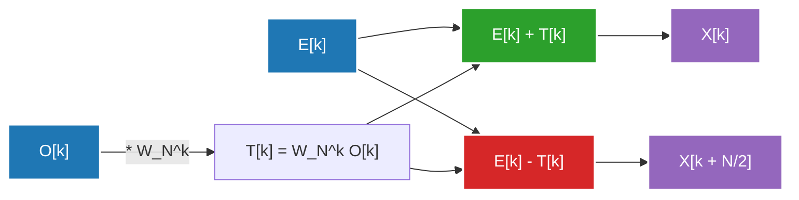

## 1. परिचय: फूरियर रूपांतरण और सिग्नल

ध्वनि, प्रकाश और स्मार्टफोन द्वारा भेजे व प्राप्त किए जाने वाले रेडियो सिग्नल समय या स्थान के साथ बदलते हैं। फूरियर विश्लेषण इन सिग्नलों को उनके आवृत्ति घटकों के माध्यम से समझने और संसाधित करने के तरीके देता है।

इसमें सिग्नलों को त्रिकोणमितीय फलनों या सम्मिश्र घातांकीय फलनों से व्यक्त किया जाता है। श्रेणी के अभिसरण और सतत रूपांतरण के अस्तित्व के लिए शर्तें आवश्यक हैं; ऐसा कोई एक प्रमेय नहीं है जो हर तरंग के बिना किसी शर्त विघटन का दावा करता हो। [फूरियर श्रेणी और रूपांतरण के परिचय](/hi/p/fourier-series-and-transform/) के आधार पर यहाँ हम परिमित डेटा के DFT और उसकी गणना पर ध्यान देंगे। आवृत्ति डोमेन के मान परिमाण और कला (phase) बताते हैं, लेकिन आयाम पढ़ने के लिए सामान्यीकरण और अवलोकन अंतराल का भी ध्यान रखना पड़ता है।

$N$ बिंदुओं के DFT की सीधी गणना में $O(N^2)$ संक्रियाएँ लगती हैं। छोटे डेटा के लिए यह पर्याप्त हो सकती है, लेकिन बड़े $N$ के लिए महँगी पड़ती है। **फास्ट फूरियर ट्रांसफॉर्म (FFT)** उसी DFT की कुशल गणना करने वाले एल्गोरिथमों का परिवार है। यहाँ प्राप्त आधार-2 विधि $O(N\log N)$ संक्रियाएँ लेती है। FFT अपने आप में न कोई अलग रूपांतरण है, न कोई सन्निकटन।

हम सतत रूपांतरण और परिमित DFT में अंतर करेंगे, कूली–टकी विघटन और बटरफ्लाई संक्रिया प्राप्त करेंगे, Python में पुनरावर्ती रूप लागू करके जाँचेंगे और अनुप्रयोगों में उसकी भूमिका समझेंगे।

---

## 2. सतत रूपांतरण से परिमित DFT तक

FFT एल्गोरिथमों को समझने का पहला कदम DFT को समझना है।

### सतत फूरियर रूपांतरण

आवृत्ति $f$ को हर्ट्ज़ और समय $t$ को सेकंड में मापने पर एक प्रचलित परिभाषा निम्न है। उदाहरण के लिए, यदि $\int_{-\infty}^{\infty}|x(t)|\,dt<\infty$, तो यह समाकल हर वास्तविक $f$ के लिए निरपेक्ष रूप से अभिसरित होता है।

$$ X(f) = \int_{-\infty}^{\infty} x(t) e^{-j 2\pi f t} dt $$

यहाँ $j^2=-1$ है; $j$ वही काल्पनिक इकाई है जिसे गणित में सामान्यतः $i$ लिखा जाता है। $X(f)$ सतत स्पेक्ट्रम में सम्मिश्र मान वाला भार है, किसी आवर्ती सिग्नल के एक घटक का सीधे-सीधे आयाम नहीं। व्यावहारिक गणना में समान अंतराल वाले नमूने और परिमित अवलोकन अंतराल लिए जाते हैं। नमूना लेना और वह अंतराल चुनना, स्वयं सतत रूपांतरण से अलग संक्रियाएँ हैं।

### परिमित अनुक्रम का DFT

मान लें कि नमूनाकरण अंतराल $T_s>0$ पर $x[n]=x(nT_s)$, जहाँ $n=0,\ldots,N-1$, प्राप्त होता है। इस परिमित अनुक्रम का DFT नीचे परिभाषित है; $N$ धनात्मक पूर्णांक है। यह परिभाषा किसी भी सम्मिश्र अनुक्रम पर लागू होती है और सतत रूपांतरण के अस्तित्व को पूर्वशर्त नहीं बनाती।

$$ X[k] = \sum_{n=0}^{N-1} x[n] e^{-j \frac{2\pi}{N} k n} \quad (k = 0, 1, ..., N-1) $$

संबंधित प्रतिलोम DFT निम्न है। अग्र रूपांतरण में पैमाना गुणक नहीं है और प्रतिलोम में $1/N$ है।

$$ x[n]=\frac{1}{N}\sum_{k=0}^{N-1}X[k]e^{j\frac{2\pi}{N}kn}\quad(n=0,\ldots,N-1) $$

नमूनाकरण दर $f_s=1/T_s$ है और आवृत्ति बिनों का अंतर $f_s/N$ Hz है। $k>N/2$ वाले बिनों को $(k-N)f_s/N$ Hz की आवृत्तियों के रूप में समझा जा सकता है; सम $N$ के लिए $k=N/2$ नाइक्विस्ट घटक है। नमूनाकरण से एलियसिंग और परिमित अवलोकन अंतराल से स्पेक्ट्रल लीकेज हो सकता है। सतत सिग्नल की पुनर्रचना के लिए बैंड-सीमित होने जैसी धारणाएँ चाहिए। अंतराल में किसी साइन तरंग के चक्रों की संख्या पूर्णांक होने से उसकी आवृत्ति बिन से मेल खाती है और लीकेज बचता है; केवल इससे सतत सिग्नल की पूर्ण पुनर्रचना की गारंटी नहीं मिलती।

$W_N=e^{-j2\pi/N}$ को **घूर्णन गुणक (twiddle factor)** लिखने से व्यंजक सरल होता है:

$$ X[k] = \sum_{n=0}^{N-1} x[n] W_N^{kn} $$

सीधी गणना में $N$ आउटपुटों में से प्रत्येक के लिए $N$ पद जोड़े जाते हैं। सरल गिनती से $N^2$ सम्मिश्र गुणन और $N(N-1)$ जोड़ मिलते हैं। 1 जैसे साधारण गुणकों के साथ गुणन छोड़े जा सकते हैं, पर विधि का क्रम $O(N^2)$ रहता है। $N=1,000,000$ पर $N^2=10^{12}$ होता है, इसलिए बड़े डेटा में गणना विधि को बेहतर करना महत्वपूर्ण है। वास्तविक निष्पादन समय हार्डवेयर और कार्यान्वयन पर भी निर्भर करता है।

---

## 3. कूली–टकी FFT की व्युत्पत्ति

कूली और टकी ने 1965 में छोटे DFT में विघटन की विधि प्रकाशित करके प्रचलित की। FFTW के कार्यान्वयन संबंधी शोधपत्र के अनुसार [गॉस](/hi/p/gauss/) को 1805 में संबंधित विचार ज्ञात थे। हम $N=2^p$, जहाँ $p$ ऋणेतर पूर्णांक है, के लिए आधुनिक आधार-2 डेसीमेशन-इन-टाइम (DIT) FFT प्राप्त करेंगे। सामान्य FFT एल्गोरिथम केवल 2 की घात वाली लंबाइयों तक सीमित नहीं हैं।

### सम और विषम सूचकांकों में विभाजन

निम्न विभाजन $N\ge2$ के लिए है। आधार स्थिति $N=1$ में केवल $X[0]=x[0]$ होता है। DFT को सम और विषम $n$ वाले पदों में बाँटें।

$$ X[k] = \sum_{n=0}^{N-1} x[n] W_N^{kn} $$

सम सूचकांकों के लिए $n=2m$ और विषम के लिए $n=2m+1$ लिखें, जहाँ $m=0,1,\ldots,N/2-1$ है।

$$ X[k] = \sum_{m=0}^{N/2-1} x[2m] W_N^{k(2m)} + \sum_{m=0}^{N/2-1} x[2m+1] W_N^{k(2m+1)} $$

$W_N^2=e^{-j4\pi/N}=e^{-j2\pi/(N/2)}=W_{N/2}$ का उपयोग करें और विषम सूचकांकों वाले योग से $W_N^k$ बाहर निकालें।

$$ X[k] = \sum_{m=0}^{N/2-1} x[2m] W_{N/2}^{km} + W_N^k \sum_{m=0}^{N/2-1} x[2m+1] W_{N/2}^{km} $$

इन योगों का अर्थ है:

- पहला योग $x[0],x[2],x[4],\ldots$ का $N/2$-बिंदु DFT है, जिसे $E[k]$ लिखते हैं।
- दूसरे पद का योग $x[1],x[3],x[5],\ldots$ का $N/2$-बिंदु DFT है, जिसे $O[k]$ लिखते हैं।

इस प्रकार:

$$ X[k] = E[k] + W_N^k O[k] $$

### आवर्तिता का उपयोग

$N/2$-बिंदु DFT होने के कारण $E$ और $O$, $N/2$ के आवर्त से दोहराते हैं: $E[k+N/2]=E[k]$ और $O[k+N/2]=O[k]$। साथ ही, $W_N^{k+N/2}=W_N^k e^{-j\pi}=-W_N^k$ है।

अब $k=0,\ldots,N/2-1$ लें। उसी $k$ के लिए पहले आधे का आउटपुट $X[k]$ और दूसरे आधे का $X[k+N/2]$ पिछले समीकरण तथा निम्न समीकरण से जोड़ी में मिलते हैं:

$$ X[k + N/2] = E[k] - W_N^k O[k] $$

दो $N/2$-लंबाई वाले DFT की गणना करें, फिर योग और अंतर बनाते समय घूर्णन गुणक के साथ गुणनफल का साझा उपयोग करें। इसका अर्थ पूरे काम को केवल एक बार आधा कर देना नहीं है। संयोजन की लागत $O(N)$ है; लंबाई 1 तक पुनरावर्तन करने पर संक्रियाओं की संख्या का पुनरावृत्ति संबंध मिलता है:

$$ T(N)=2T(N/2)+O(N)=O(N\log_2 N)\quad(N\ge2),\qquad T(1)=O(1) $$

---

## 4. बटरफ्लाई संक्रिया

$X[k]$ और $X[k+N/2]$ की एक साथ गणना करने वाली इकाई **बटरफ्लाई** कहलाती है, क्योंकि उसका डेटा प्रवाह तितली के पंखों जैसा दिखता है। आधार-2 के इस चित्र में साझा गुणनफल और घटाव स्पष्ट हैं।



कुछ पुनरावृत्तीय (*iterative*) आधार-2 DIT कार्यान्वयन पहले हर सूचकांक के बिटों का क्रम उलटकर इनपुट की पुनर्व्यवस्था करते हैं (*bit-reversed order*), फिर लंबाई 2, 4, 8 आदि की बटरफ्लाई संक्रियाएँ लगाते हैं। $N=8$ पर सूचकांक क्रम $(0,4,2,6,1,5,3,7)$ होता है। नीचे का पुनरावर्ती (*recursive*) कार्यान्वयन सम और विषम सूचकांकों को बार-बार अलग करके इस क्रम को अप्रत्यक्ष रूप से संभालता है और सामान्य क्रम में आउटपुट लौटाता है। इसे बुलाने से पहले अलग से यह बिट-क्रम पुनर्व्यवस्था न करें। पुनर्व्यवस्था की जगह DIT, DIF और कार्यान्वयन पर निर्भर होती है।

---

## 5. Python कार्यान्वयन और तुलना

NumPy एक बाहरी संख्यात्मक लाइब्रेरी है, Python की मानक लाइब्रेरी का भाग नहीं। यह शैक्षिक कार्यान्वयन परिमित संख्यात्मक मानों का एक-विमीय अनुक्रम लेता है, जिसकी लंबाई $2^p$ है और $p$ ऋणेतर पूर्णांक है। वास्तविक और सम्मिश्र दोनों इनपुट स्वीकार होते हैं तथा आउटपुट सम्मिश्र होता है। अन्य लंबाइयों के लिए सामान्य प्रयोजन की FFT लाइब्रेरी इस्तेमाल करें।

### पुनरावर्ती कार्यान्वयन

```python
import numpy as np

def custom_fft(x):
    """परिमित एक-विमीय अनुक्रम के लिए आधार-2 DIT FFT; लंबाई 2 की घात हो।"""
    x = np.asarray(x, dtype=np.complex128)
    if x.ndim != 1:
        raise ValueError("Input must be one-dimensional")
    N = x.size
    if N == 0 or (N & (N - 1)) != 0:
        raise ValueError("Length must be a positive power of two")
    if not np.all(np.isfinite(x)):
        raise ValueError("Input must contain only finite values")

    def recurse(values):
        n = values.size
        if n == 1:
            return values.copy()
        even = recurse(values[::2])
        odd = recurse(values[1::2])
        # घूर्णन गुणक वाले विषम परिणाम को योग और अंतर में साझा करें
        twiddled = np.exp(-2j * np.pi * np.arange(n // 2) / n) * odd
        return np.concatenate((even + twiddled, even - twiddled))

    return recurse(x)
```

### NumPy से तुलना

```python
# पिछले कोड वाले सत्र में ही चलाएँ
fs = 1024
t = np.arange(fs) / fs
signal = 3 * np.sin(2 * np.pi * 50 * t) + np.sin(2 * np.pi * 120 * t)

fft_custom_result = custom_fft(signal)
fft_numpy_result = np.fft.fft(signal)
max_error = np.max(np.abs(fft_custom_result - fft_numpy_result))
agrees = np.allclose(fft_custom_result, fft_numpy_result,
                     rtol=1e-12, atol=1e-10)
print("NumPy agreement:", agrees)
print("Maximum absolute error:", max_error)

# काल्पनिक भाग के बने रहने की भी जाँच करें
complex_signal = np.array([1 + 2j, 3 - 4j, -2 + 0.5j, 0.25j])
print("Complex input agreement:", np.allclose(
    custom_fft(complex_signal), np.fft.fft(complex_signal),
    rtol=1e-12, atol=1e-10))
```

जाँच के वातावरण में उदाहरण `NumPy agreement: True` और `Complex input agreement: True` छापता है। अधिकतम निरपेक्ष त्रुटि वातावरण और पूर्णांकन पर निर्भर करती है। यह चुने हुए इनपुटों में मेल की जाँच है, सामान्य शुद्धता का प्रमाण या गति की तुलना नहीं। शुद्धता का आधार प्रत्येक पुनरावर्ती चरण में DFT विघटन का बना रहना है। परिमित परिशुद्धता में पूर्णांकन और बहुत बड़े मानों के लिए ओवरफ़्लो का ध्यान रखना पड़ता है।

`complex128` इस्तेमाल करने से काल्पनिक भाग बना रहता है, मूल `dtype=float` के विपरीत। खाली इनपुट, द्विविमीय ऐरे, 2 की घात न होने वाली लंबाइयाँ, NaN और अनंत मान स्पष्ट रूप से अस्वीकार होते हैं। एक अकेला तत्व अपना एक-बिंदु DFT लौटाता है।

जाँच में प्रयुक्त NumPy 2.3.5 का `numpy.fft`, PocketFFT को बुलाता है। NumPy ने संस्करण 1.17 में पुराने FFTPACK-आधारित कार्यान्वयन को बदला था। तेज लाइब्रेरियाँ अनिवार्यतः गैर-पुनरावर्ती नहीं होतीं। प्रदर्शन गणना क्रम, डेटा स्थानांतरण, कैश और SIMD पर भी निर्भर करता है; यह छोटा Python उदाहरण व्यावहारिक लाइब्रेरी जितना तेज नहीं है।

---

## 6. अनुप्रयोग: ऑडियो, चित्र और संचार

आवृत्ति डोमेन में निरूपण और रूपांतरण की गणना करने वाले FFT को अलग समझें। DCT और MDCT संबंधित रूपांतरण हैं, लेकिन FFT से गणना किए जाने वाले DFT के समान रूपांतरण नहीं हैं।

### ऑडियो संपीड़न: MP3 और AAC

श्रवण-आधारित ऑडियो कोडिंग, समय और आवृत्ति पर निर्भर मास्किंग का उपयोग करके क्वांटाइज़ेशन शोर को कम सुनाई देने योग्य बनाती है। सुनाई देना सिग्नल और कोडिंग की स्थितियों पर निर्भर है; तेज ध्वनि के पास की धीमी ध्वनि हमेशा अश्रव्य हो, ऐसा निरपेक्ष नियम नहीं। यह हानियुक्त संपीड़न है, इसलिए डिकोड किया डेटा मूल से बिट-दर-बिट समान होना आवश्यक नहीं।

MP3 का मुख्य विश्लेषण फ़िल्टर बैंक, पॉलीफ़ेज़ फ़िल्टर बैंक और MDCT का संकर है। बुनियादी AAC की रूपांतरण कोडिंग भी MDCT इस्तेमाल करती है। **MDCT** का अर्थ **संशोधित विविक्त कोसाइन रूपांतरण (modified discrete cosine transform)** है, FFT का बेहतर संस्करण नहीं। एनकोडर मनोध्वनिक विश्लेषण के लिए अलग से FFT इस्तेमाल कर सकता है: Fraunhofer के चित्र में विश्लेषण वाली FFT, मुख्य MDCT पथ से अलग है। रूपांतरण का प्रकार और किसी प्रसंस्करण चरण में प्रयुक्त तेज एल्गोरिथम अलग अवधारणाएँ हैं।

### चित्र संपीड़न: JPEG

चित्रों को स्थानिक आवृत्तियों के माध्यम से समझा जा सकता है। चमक में सुचारू बदलाव कम आवृत्तियों के अनुरूप होते हैं; किनारों और बनावट में तेज बदलाव उच्च आवृत्तियों का योगदान देते हैं।

सामान्य हानियुक्त JPEG की आधारभूत विधि में हर चित्र घटक के नमूने $8\times8$ ब्लॉक में बाँटे जाते हैं, द्विविमीय DCT लगाया जाता है और प्राप्त गुणांकों का क्वांटाइज़ेशन होता है। प्राकृतिक चित्रों की ऊर्जा अक्सर कम स्थानिक आवृत्तियों में केंद्रित होती है। उच्च-आवृत्ति गुणांकों का मोटा क्वांटाइज़ेशन करने पर अधिक गुणांक शून्य हो सकते हैं। क्वांटाइज़ेशन केवल सभी उच्च आवृत्तियाँ हटा देना नहीं है; दृश्य गुणवत्ता का ह्रास चित्र और सेटिंग पर निर्भर करता है। DCT को सीधे FFT के समान नहीं मानना चाहिए।

OFDM में प्रेषक का प्रतिलोम DFT उपवाहकों को जोड़ता है और उसे IFFT से गणना किया जा सकता है; ग्राही का DFT, FFT से गणना किया जा सकता है। पूर्ण रूप से नमूनाकृत कार्तीय k-स्थान डेटा से बुनियादी MRI पुनर्निर्माण में भी बहुविमीय प्रतिलोम FFT लगते हैं। गैर-कार्तीय नमूनाकरण और अतिरिक्त भौतिक प्रभावों के लिए आगे की प्रक्रिया चाहिए। भूकंपीय और खगोलीय डेटा में भी आवृत्ति विश्लेषण का उपयोग होता है; विधि डेटा और उद्देश्य पर निर्भर है।

---

## 7. निष्कर्ष

FFT एल्गोरिथम DFT की आवर्तिता और सममिति का उपयोग करके उसी रूपांतरण को कम संक्रियाओं में प्राप्त करते हैं। आधार-2 DIT सम और विषम सूचकांकों के DFT को पुनरावर्ती रूप से गणना करके बटरफ्लाई से जोड़ता है, जिससे जटिलता $O(N\log N)$ होती है।

लंबाई की शर्तें, सम्मिश्र इनपुट, आवृत्तियों का क्रम, सामान्यीकरण और फ़्लोटिंग-पॉइंट त्रुटियाँ स्पष्ट करें। अनुप्रयोगों में भी DFT, DCT और MDCT रूपांतरणों को FFT गणना से अलग समझने पर गणित और तकनीक का संबंध स्पष्ट होता है।

इस ब्लॉग के दूसरे लेख फूरियर विश्लेषण और सिग्नल प्रसंस्करण से जुड़े विषय समझाते हैं।

## संदर्भ

- [MIT 6.341 Lecture 19: DFT, DIT/DIF, संक्रिया संख्या और बिट क्रम उलटना](https://ocw.mit.edu/courses/6-341-discrete-time-signal-processing-fall-2005/4ee39a5e74c9f5099ac516ce57215c96_lec19.pdf)
- [Frigo और Johnson, The Design and Implementation of FFTW3: §II में विघटन, इतिहास और क्रम](https://www.fftw.org/~fftw/fftw-paper-ieee.pdf)
- [NumPy 2.3: fft और परिभाषा की परिपाटियाँ](https://numpy.org/doc/2.3/reference/generated/numpy.fft.fft.html)
- [NumPy 1.17 के विवरण: PocketFFT से प्रतिस्थापन](https://numpy.org/doc/2.3/release/1.17.0-notes.html)
- [NumPy 2.3.5 का स्रोत: PocketFFT कॉल](https://raw.githubusercontent.com/numpy/numpy/v2.3.5/numpy/fft/_pocketfft.py)
- [Brandenburg, MP3 and AAC Explained: §1, §3.3, §4.2 और चित्र 2](https://www.iis.fraunhofer.de/content/dam/iis/de/doc/ame/conference/AES-17-Conference_mp3-and-AAC-explained_AES17.pdf)
- [ITU-T T.81: §4.2–4.3 में JPEG का DCT और क्वांटाइज़ेशन](https://www.w3.org/Graphics/JPEG/itu-t81.pdf)
- [MathWorks: OFDM का परिचय](https://www.mathworks.com/help/comm/gs/introduction-to-ofdm.html)
- [Larson Lab, Principles of MRI: पूर्ण कार्तीय नमूनों से पुनर्निर्माण](https://larsonlab.github.io/MRI-education-resources/Image%20Reconstruction.html)
