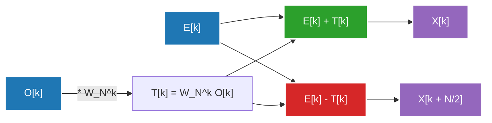

## 1. Pendahuluan: transformasi Fourier dan sinyal

Suara, cahaya, dan sinyal radio yang dipertukarkan ponsel berubah terhadap waktu atau ruang. Analisis Fourier memungkinkan kita mempelajari dan memproses sinyal tersebut melalui komponen frekuensinya.

Analisis ini merepresentasikan sinyal menggunakan fungsi trigonometri atau eksponensial kompleks. Konvergensi deret dan keberadaan transformasi kontinu memerlukan syarat; tidak ada satu teorema yang menyatakan bahwa setiap gelombang dapat diuraikan tanpa batasan. Berdasarkan [pengantar deret dan transformasi Fourier](/id/p/fourier-series-and-transform/), artikel ini berfokus pada DFT data berhingga dan cara menghitungnya. Nilai dalam domain frekuensi menjelaskan magnitudo dan fase, tetapi pembacaan amplitudo juga harus memperhatikan normalisasi dan interval pengamatan.

Perhitungan langsung DFT $N$ titik memerlukan $O(N^2)$ operasi. Cara ini dapat memadai untuk data kecil, tetapi mahal ketika $N$ besar. **Transformasi Fourier cepat (FFT)** adalah keluarga algoritma untuk menghitung DFT yang sama secara efisien. Metode radix-2 yang diturunkan di sini menggunakan $O(N\log N)$ operasi. FFT sendiri tidak berarti transformasi yang berbeda atau suatu pendekatan.

Kita membedakan transformasi kontinu dari DFT berhingga, menurunkan dekomposisi Cooley–Tukey dan operasi kupu-kupu, mengimplementasikan serta memeriksa versi rekursif dalam Python, lalu menjelaskan perannya dalam aplikasi.

---

## 2. Dari transformasi kontinu ke DFT berhingga

Memahami DFT adalah langkah awal untuk memahami algoritma FFT.

### Transformasi Fourier kontinu

Dengan frekuensi $f$ dalam hertz dan waktu $t$ dalam detik, salah satu konvensinya adalah sebagai berikut. Misalnya, jika $\int_{-\infty}^{\infty}|x(t)|\,dt<\infty$, integral ini konvergen mutlak untuk setiap $f$ real.

$$ X(f) = \int_{-\infty}^{\infty} x(t) e^{-j 2\pi f t} dt $$

Di sini $j^2=-1$; $j$ adalah satuan imajiner yang sama dengan $i$ yang lazim digunakan dalam matematika. $X(f)$ merupakan bobot bernilai kompleks dalam spektrum kontinu, bukan langsung amplitudo satu komponen sinyal periodik. Perhitungan praktis menggunakan sampel berjarak seragam dan interval pengamatan berhingga. Pengambilan sampel dan pemilihan interval tersebut merupakan operasi yang berbeda dari transformasi kontinu itu sendiri.

### DFT suatu barisan berhingga

Misalkan $x[n]=x(nT_s)$ untuk $n=0,\ldots,N-1$, dengan interval pengambilan sampel $T_s>0$. DFT barisan berhingga ini didefinisikan di bawah, dengan $N$ bilangan bulat positif. Definisi ini juga berlaku untuk sembarang barisan kompleks tanpa mensyaratkan keberadaan transformasi kontinu.

$$ X[k] = \sum_{n=0}^{N-1} x[n] e^{-j \frac{2\pi}{N} k n} \quad (k = 0, 1, ..., N-1) $$

DFT invers yang bersesuaian adalah sebagai berikut. Transformasi maju tidak diberi faktor skala, sedangkan inversnya menyertakan $1/N$.

$$ x[n]=\frac{1}{N}\sum_{k=0}^{N-1}X[k]e^{j\frac{2\pi}{N}kn}\quad(n=0,\ldots,N-1) $$

Laju pengambilan sampel adalah $f_s=1/T_s$, dan jarak antarbin frekuensi adalah $f_s/N$ Hz. Bin dengan $k>N/2$ dapat ditafsirkan sebagai frekuensi $(k-N)f_s/N$ Hz; untuk $N$ genap, $k=N/2$ merupakan komponen Nyquist. Pengambilan sampel dapat menyebabkan aliasing, sedangkan interval pengamatan berhingga dapat menyebabkan kebocoran spektral. Pemulihan sinyal kontinu memerlukan asumsi seperti keterbatasan pita frekuensi. Sejumlah bulat periode sinus dalam interval akan menempatkan frekuensinya tepat pada bin sehingga menghindari kebocoran; hal itu saja tidak menjamin rekonstruksi sempurna sinyal kontinu.

Tetapkan $W_N=e^{-j2\pi/N}$, **faktor rotasi (twiddle factor)**, untuk menyederhanakan bentuknya:

$$ X[k] = \sum_{n=0}^{N-1} x[n] W_N^{kn} $$

Perhitungan langsung menjumlahkan $N$ suku untuk masing-masing dari $N$ keluaran. Penghitungan sederhana menghasilkan $N^2$ perkalian kompleks dan $N(N-1)$ penjumlahan. Perkalian dengan faktor trivial seperti 1 dapat dihilangkan, tetapi metode langsung tetap berorde $O(N^2)$. Untuk $N=1.000.000$, berlaku $N^2=10^{12}$, sehingga perbaikan metode komputasi penting untuk data besar. Waktu eksekusi juga bergantung pada perangkat keras dan implementasinya.

---

## 3. Penurunan FFT Cooley–Tukey

Cooley dan Tukey menerbitkan dan memopulerkan dekomposisi menjadi DFT yang lebih kecil pada 1965. Makalah implementasi FFTW menjelaskan bahwa [Gauss](/id/p/gauss/) telah mengetahui gagasan terkait pada 1805. Kita menurunkan FFT radix-2 modern dengan desimasi dalam waktu (DIT, Decimation-in-Time), untuk $N=2^p$, dengan $p$ bilangan bulat tak negatif. Algoritma FFT secara umum tidak terbatas pada panjang berupa pangkat dua.

### Memisahkan indeks genap dan ganjil

Pemisahan berikut berlaku untuk $N\ge2$. Kasus dasar $N=1$ cukup berupa $X[0]=x[0]$. Pisahkan suku DFT menurut $n$ genap dan ganjil.

$$ X[k] = \sum_{n=0}^{N-1} x[n] W_N^{kn} $$

Tuliskan $n=2m$ untuk indeks genap dan $n=2m+1$ untuk indeks ganjil, dengan $m=0,1,\ldots,N/2-1$.

$$ X[k] = \sum_{m=0}^{N/2-1} x[2m] W_N^{k(2m)} + \sum_{m=0}^{N/2-1} x[2m+1] W_N^{k(2m+1)} $$

Gunakan $W_N^2=e^{-j4\pi/N}=e^{-j2\pi/(N/2)}=W_{N/2}$ dan keluarkan $W_N^k$ dari penjumlahan berindeks ganjil.

$$ X[k] = \sum_{m=0}^{N/2-1} x[2m] W_{N/2}^{km} + W_N^k \sum_{m=0}^{N/2-1} x[2m+1] W_{N/2}^{km} $$

Kedua penjumlahan itu memiliki makna berikut:

- Penjumlahan pertama adalah DFT $N/2$ titik dari $x[0],x[2],x[4],\ldots$, yang dilambangkan $E[k]$.
- Penjumlahan dalam suku kedua adalah DFT $N/2$ titik dari $x[1],x[3],x[5],\ldots$, yang dilambangkan $O[k]$.

Dengan demikian:

$$ X[k] = E[k] + W_N^k O[k] $$

### Memanfaatkan periodisitas

Sebagai DFT $N/2$ titik, $E$ dan $O$ berulang dengan periode $N/2$: $E[k+N/2]=E[k]$ dan $O[k+N/2]=O[k]$. Selain itu, $W_N^{k+N/2}=W_N^k e^{-j\pi}=-W_N^k$.

Sekarang ambil $k=0,\ldots,N/2-1$. Untuk $k$ yang sama, keluaran paruh pertama $X[k]$ dan paruh kedua $X[k+N/2]$ dihitung berpasangan menggunakan persamaan sebelumnya dan:

$$ X[k + N/2] = E[k] - W_N^k O[k] $$

Hitung dua DFT sepanjang $N/2$, lalu gunakan bersama hasil perkalian faktor rotasi untuk membentuk jumlah dan selisih. Ini tidak sekadar membagi dua seluruh pekerjaan sekali saja. Penggabungan memerlukan $O(N)$ operasi; rekursi hingga panjang 1 menghasilkan relasi rekurensi jumlah operasi:

$$ T(N)=2T(N/2)+O(N)=O(N\log_2 N)\quad(N\ge2),\qquad T(1)=O(1) $$

---

## 4. Operasi kupu-kupu

Unit yang menghitung $X[k]$ dan $X[k+N/2]$ secara bersamaan disebut **kupu-kupu**, karena aliran datanya menyerupai sayap. Diagram radix-2 berikut memperjelas hasil perkalian yang digunakan bersama dan operasi pengurangan.



Sebagian implementasi DIT radix-2 iteratif terlebih dahulu mengatur masukan dengan membalik urutan bit pada setiap indeks (*bit-reversed order*), kemudian menerapkan kupu-kupu sepanjang 2, 4, 8, dan seterusnya. Untuk $N=8$, urutan indeksnya adalah $(0,4,2,6,1,5,3,7)$. Implementasi rekursif di bawah menangani urutan ini secara implisit dengan berulang kali memisahkan indeks genap dan ganjil, lalu mengembalikan keluaran dalam urutan biasa. Jangan lakukan permutasi semacam ini lagi sebelum memanggilnya. Letak pengurutan ulang bergantung pada DIT, DIF, dan implementasinya.

---

## 5. Implementasi Python dan perbandingan

NumPy merupakan pustaka numerik eksternal, bukan bagian dari pustaka standar Python. Implementasi untuk pembelajaran ini menerima barisan satu dimensi berisi nilai numerik berhingga dengan panjang $2^p$, dengan $p$ bilangan bulat tak negatif. Masukan real maupun kompleks didukung dan keluarannya bernilai kompleks. Untuk panjang lain, gunakan pustaka FFT serbaguna.

### Implementasi rekursif

```python
import numpy as np

def custom_fft(x):
    """FFT DIT radix-2 untuk barisan 1D berhingga dengan panjang pangkat dua."""
    x = np.asarray(x, dtype=np.complex128)
    if x.ndim != 1:
        raise ValueError("Input must be one-dimensional")
    N = x.size
    if N == 0 or (N & (N - 1)) != 0:
        raise ValueError("Length must be a positive power of two")
    if not np.all(np.isfinite(x)):
        raise ValueError("Input must contain only finite values")

    def recurse(values):
        n = values.size
        if n == 1:
            return values.copy()
        even = recurse(values[::2])
        odd = recurse(values[1::2])
        # Gunakan hasil ganjil yang dikalikan faktor rotasi untuk jumlah dan selisih
        twiddled = np.exp(-2j * np.pi * np.arange(n // 2) / n) * odd
        return np.concatenate((even + twiddled, even - twiddled))

    return recurse(x)
```

### Perbandingan dengan NumPy

```python
# Jalankan dalam sesi yang sama dengan blok sebelumnya
fs = 1024
t = np.arange(fs) / fs
signal = 3 * np.sin(2 * np.pi * 50 * t) + np.sin(2 * np.pi * 120 * t)

fft_custom_result = custom_fft(signal)
fft_numpy_result = np.fft.fft(signal)
max_error = np.max(np.abs(fft_custom_result - fft_numpy_result))
agrees = np.allclose(fft_custom_result, fft_numpy_result,
                     rtol=1e-12, atol=1e-10)
print("NumPy agreement:", agrees)
print("Maximum absolute error:", max_error)

# Periksa juga bahwa bagian imajiner tetap dipertahankan
complex_signal = np.array([1 + 2j, 3 - 4j, -2 + 0.5j, 0.25j])
print("Complex input agreement:", np.allclose(
    custom_fft(complex_signal), np.fft.fft(complex_signal),
    rtol=1e-12, atol=1e-10))
```

Dalam lingkungan validasi, contoh ini mencetak `NumPy agreement: True` dan `Complex input agreement: True`. Galat mutlak maksimum berubah menurut lingkungan dan pembulatan. Perbandingan ini memeriksa kecocokan pada masukan yang dipilih; ini bukan bukti kebenaran umum maupun pengukuran kecepatan. Kebenaran algoritma berasal dari dipertahankannya dekomposisi DFT pada setiap langkah rekursif. Presisi berhingga tetap menimbulkan pembulatan serta kemungkinan luapan untuk nilai yang terlalu besar.

Penggunaan `complex128` mempertahankan bagian imajiner, berbeda dari `dtype=float` pada implementasi awal. Masukan kosong, larik dua dimensi, panjang yang bukan pangkat dua, NaN, dan tak hingga ditolak secara eksplisit. Satu elemen mengembalikan DFT satu titik dari nilainya sendiri.

NumPy 2.3.5 yang digunakan dalam validasi memanggil PocketFFT melalui `numpy.fft`. NumPy mengganti implementasi lama berbasis FFTPACK pada versi 1.17. Pustaka yang cepat tidak harus nonrekursif. Kinerja juga bergantung pada urutan perhitungan, perpindahan data, cache, dan SIMD; contoh Python pendek ini tidak memiliki kinerja yang sama dengan pustaka produksi.

---

## 6. Aplikasi: audio, gambar, dan komunikasi

Bedakan representasi domain frekuensi dari FFT sebagai cara menghitung transformasi. DCT dan MDCT merupakan transformasi yang berkaitan, tetapi berbeda dari DFT yang dihitung dengan FFT.

### Kompresi audio: MP3 dan AAC

Pengodean audio perseptual menggunakan penyamaran (*masking*) yang bergantung pada frekuensi dan waktu untuk membuat derau kuantisasi kurang terdengar. Keterdengaran bergantung pada sinyal dan kondisi pengodean; bukan aturan mutlak bahwa bunyi lemah di dekat bunyi keras selalu tidak terdengar. Kompresi ini bersifat lossy, sehingga data hasil dekode tidak harus identik dengan aslinya bit demi bit.

Bank filter analisis utama MP3 merupakan gabungan bank filter polifase dan MDCT. Pengodean transformasi AAC dasar juga menggunakan MDCT. **MDCT** adalah **transformasi kosinus diskret termodifikasi (modified discrete cosine transform)**, bukan FFT yang disempurnakan. Sebuah enkoder dapat menggunakan FFT secara terpisah untuk analisis psikoakustik: diagram Fraunhofer memperlihatkan FFT analisis yang terpisah dari jalur utama MDCT. Jenis transformasi dan algoritma cepat dalam suatu tahap pemrosesan merupakan konsep yang berbeda.

### Kompresi gambar: JPEG

Gambar dapat dipelajari melalui frekuensi spasial. Perubahan kecerahan yang halus bersesuaian dengan frekuensi rendah; perubahan cepat pada tepi dan tekstur menyumbangkan frekuensi yang lebih tinggi.

Metode dasar JPEG lossy yang lazim membagi sampel setiap komponen gambar menjadi blok $8\times8$, menerapkan DCT dua dimensi, dan mengkuantisasi koefisien hasilnya. Gambar alami sering memusatkan energi pada frekuensi spasial rendah. Kuantisasi yang lebih kasar pada koefisien frekuensi tinggi dapat membuat lebih banyak koefisien menjadi nol. Kuantisasi tidak sekadar membuang semua frekuensi tinggi, dan penurunan kualitas visual bergantung pada gambar serta pengaturannya. DCT tidak boleh disamakan langsung dengan FFT.

Dalam OFDM, DFT invers pemancar menggabungkan subpembawa dan dapat dihitung dengan IFFT; DFT penerima dapat dihitung dengan FFT. Rekonstruksi MRI dasar dari data ruang k Kartesius yang diambil sampelnya secara lengkap juga menggunakan FFT invers multidimensi. Pengambilan sampel non-Kartesius dan efek fisik tambahan memerlukan pemrosesan lebih lanjut. Analisis frekuensi juga digunakan pada data seismik dan astronomi, dengan metode yang bergantung pada data serta tujuannya.

---

## 7. Kesimpulan

Algoritma FFT memanfaatkan periodisitas dan simetri DFT untuk memperoleh transformasi yang sama dengan lebih sedikit operasi. DIT radix-2 menghitung secara rekursif DFT indeks genap dan ganjil, lalu menggabungkannya melalui operasi kupu-kupu, dengan kompleksitas $O(N\log N)$.

Nyatakan batasan panjang, penanganan masukan kompleks, urutan frekuensi, normalisasi, dan galat bilangan titik mengambang secara jelas. Dalam aplikasi, membedakan transformasi DFT, DCT, dan MDCT dari perhitungan FFT juga memperjelas hubungan matematika dengan teknologi.

Artikel lain di blog ini membahas topik terkait analisis Fourier dan pemrosesan sinyal.

## Referensi

- [MIT 6.341 Lecture 19: DFT, DIT/DIF, jumlah operasi, dan pembalikan urutan bit](https://ocw.mit.edu/courses/6-341-discrete-time-signal-processing-fall-2005/4ee39a5e74c9f5099ac516ce57215c96_lec19.pdf)
- [Frigo dan Johnson, The Design and Implementation of FFTW3: dekomposisi, sejarah, dan urutan dalam §II](https://www.fftw.org/~fftw/fftw-paper-ieee.pdf)
- [NumPy 2.3: fft dan konvensinya](https://numpy.org/doc/2.3/reference/generated/numpy.fft.fft.html)
- [Catatan NumPy 1.17: penggantian dengan PocketFFT](https://numpy.org/doc/2.3/release/1.17.0-notes.html)
- [Kode sumber NumPy 2.3.5: pemanggilan PocketFFT](https://raw.githubusercontent.com/numpy/numpy/v2.3.5/numpy/fft/_pocketfft.py)
- [Brandenburg, MP3 and AAC Explained: §1, §3.3, §4.2, dan gambar 2](https://www.iis.fraunhofer.de/content/dam/iis/de/doc/ame/conference/AES-17-Conference_mp3-and-AAC-explained_AES17.pdf)
- [ITU-T T.81: DCT dan kuantisasi JPEG dalam §4.2–4.3](https://www.w3.org/Graphics/JPEG/itu-t81.pdf)
- [MathWorks: pengantar OFDM](https://www.mathworks.com/help/comm/gs/introduction-to-ofdm.html)
- [Larson Lab, Principles of MRI: rekonstruksi dari sampel Kartesius lengkap](https://larsonlab.github.io/MRI-education-resources/Image%20Reconstruction.html)
