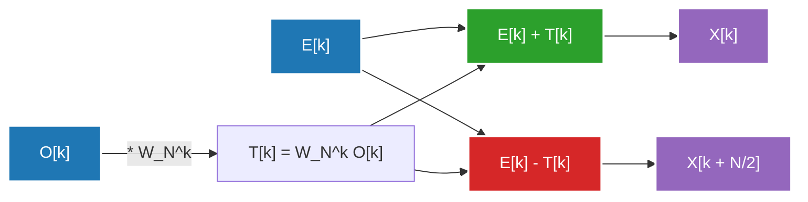

## 1. 들어가며: 푸리에 변환과 신호

소리, 빛, 스마트폰이 주고받는 전파 신호는 시간이나 공간에 따라 변합니다. 푸리에 해석은 이런 신호를 주파수 성분으로 연구하고 처리하는 방법을 제공합니다.

삼각함수나 복소지수함수의 성분으로 신호를 표현하지만, 급수의 수렴이나 연속 변환의 존재에는 조건이 필요합니다. 어떤 파동이든 조건 없이 분해된다는 하나의 정리가 있는 것은 아닙니다. [푸리에 급수와 변환의 소개](/ko/p/fourier-series-and-transform/)를 바탕으로, 여기서는 유한 데이터의 DFT와 그 계산 방법을 다룹니다. 주파수 영역의 값으로 크기와 위상을 살펴볼 수 있지만, 진폭을 읽을 때는 정규화와 관측 구간의 조건에도 주의해야 합니다.

$N$점 DFT를 정의대로 직접 계산하면 $O(N^2)$번의 연산이 필요합니다. 작은 데이터에는 충분할 수 있지만 $N$이 크면 부담이 됩니다. **고속 푸리에 변환(FFT)**은 같은 DFT를 효율적으로 계산하는 알고리즘의 총칭입니다. 여기서 유도하는 기수2 방법은 $O(N\log N)$의 연산량을 가집니다. FFT 자체가 다른 변환이나 근사를 뜻하는 것은 아닙니다.

연속 변환과 유한 DFT를 구분하고, 쿨리–튜키 분할과 나비 연산을 유도한 뒤, 재귀적 Python 구현과 검증 및 응용에서의 역할을 설명합니다.

---

## 2. 연속 변환에서 유한 DFT로

FFT 알고리즘을 이해하려면 DFT부터 이해해야 합니다.

### 연속 푸리에 변환

주파수 $f$를 Hz, 시간 $t$를 초로 나타내면 다음 규약을 사용할 수 있습니다. 예를 들어 $\int_{-\infty}^{\infty}|x(t)|\,dt<\infty$이면 이 적분은 모든 실수 $f$에서 절대수렴합니다.

$$ X(f) = \int_{-\infty}^{\infty} x(t) e^{-j 2\pi f t} dt $$

$j^2=-1$이며 $j$는 수학에서 흔히 $i$로 쓰는 것과 같은 허수단위입니다. $X(f)$는 연속 스펙트럼의 복솟값 가중치로, 주기신호의 단일 성분 진폭과 직접 동일하지 않습니다. 실제 계산에서는 등간격 표본과 유한한 관측 구간을 사용하지만, 표본화와 구간을 잘라내는 일은 연속 변환 자체와는 다른 연산입니다.

### 유한 수열의 DFT

표본화 간격 $T_s>0$에서 $x[n]=x(nT_s)$, $n=0,\ldots,N-1$을 얻었다고 합시다. 이 유한 수열의 DFT는 다음과 같이 정의하며, $N$은 양의 정수입니다. 연속 변환이 존재한다는 가정 없이 임의의 복소수 수열에도 정의할 수 있습니다.

$$ X[k] = \sum_{n=0}^{N-1} x[n] e^{-j \frac{2\pi}{N} k n} \quad (k = 0, 1, ..., N-1) $$

대응하는 역DFT는 다음과 같습니다. 순변환은 크기를 조정하지 않고 역변환에 $1/N$을 곱합니다.

$$ x[n]=\frac{1}{N}\sum_{k=0}^{N-1}X[k]e^{j\frac{2\pi}{N}kn}\quad(n=0,\ldots,N-1) $$

표본화 주파수는 $f_s=1/T_s$이고 주파수 빈의 간격은 $f_s/N$ Hz입니다. $k>N/2$인 빈은 $(k-N)f_s/N$ Hz의 주파수로 해석할 수 있으며, 짝수 길이의 $k=N/2$는 나이퀴스트 성분입니다. 표본화는 에일리어싱을, 유한한 관측 구간은 스펙트럼 누설을 일으킬 수 있습니다. 연속 신호를 복원하려면 대역 제한 등의 가정이 필요합니다. 관측 구간에 정수 개의 정현파 주기가 들어맞으면 빈에 대응하여 누설을 피할 수 있지만, 그 사실만으로 연속 신호의 완전 복원이 보장되지는 않습니다.

$W_N=e^{-j2\pi/N}$을 **회전 인자(twiddle factor)**로 두면 다음과 같이 간단히 쓸 수 있습니다.

$$ X[k] = \sum_{n=0}^{N-1} x[n] W_N^{kn} $$

직접 계산은 각 출력에서 $N$개 항을 더하고 출력도 $N$개이므로, 단순 계산에서는 복소수 곱셈 $N^2$번과 덧셈 $N(N-1)$번이 필요합니다. 1과 같은 자명한 인자와의 곱셈을 생략할 수 있어도 직접법의 차수는 $O(N^2)$입니다. $N=1,000,000$이면 $N^2=10^{12}$이므로 큰 데이터에서는 계산 방법의 개선이 중요합니다. 실제 실행 시간은 하드웨어와 구현에도 좌우됩니다.

---

## 3. 쿨리–튜키 FFT 유도

쿨리와 튜키는 DFT를 작은 DFT들로 나누는 방법을 1965년에 발표하고 널리 알렸습니다. FFTW 구현 논문은 [가우스](/ko/p/gauss/)도 1805년에 관련 생각을 알고 있었다고 설명합니다. 여기서는 $N=2^p$, $p$가 0 이상의 정수인 경우의 현대적인 기수2 시간 솎음(Decimation-in-Time, DIT) FFT를 유도합니다. FFT 알고리즘 전체가 2의 거듭제곱 길이로 제한되는 것은 아닙니다.

### 짝수와 홀수 인덱스 분할

다음 분할은 $N\ge2$인 경우입니다. $N=1$은 $X[0]=x[0]$으로 끝나는 기저 사례입니다. DFT를 $n$이 짝수인 항과 홀수인 항으로 나눕니다.

$$ X[k] = \sum_{n=0}^{N-1} x[n] W_N^{kn} $$

짝수 인덱스는 $n=2m$, 홀수 인덱스는 $n=2m+1$로 쓰며, $m=0,1,\ldots,N/2-1$입니다.

$$ X[k] = \sum_{m=0}^{N/2-1} x[2m] W_N^{k(2m)} + \sum_{m=0}^{N/2-1} x[2m+1] W_N^{k(2m+1)} $$

$W_N^2=e^{-j4\pi/N}=e^{-j2\pi/(N/2)}=W_{N/2}$를 이용하고, 홀수 인덱스 합에서 $W_N^k$를 밖으로 꺼냅니다.

$$ X[k] = \sum_{m=0}^{N/2-1} x[2m] W_{N/2}^{km} + W_N^k \sum_{m=0}^{N/2-1} x[2m+1] W_{N/2}^{km} $$

두 합의 의미는 다음과 같습니다.

- 첫째 항은 $x[0],x[2],x[4],\ldots$의 $N/2$점 DFT이며 $E[k]$로 씁니다.
- 둘째 항의 합은 $x[1],x[3],x[5],\ldots$의 $N/2$점 DFT이며 $O[k]$로 씁니다.

따라서 다음과 같습니다.

$$ X[k] = E[k] + W_N^k O[k] $$

### 주기성 이용

$E$와 $O$는 $N/2$점 DFT이므로 $N/2$를 주기로 반복됩니다. 즉 $E[k+N/2]=E[k]$, $O[k+N/2]=O[k]$입니다. 또한 $W_N^{k+N/2}=W_N^k e^{-j\pi}=-W_N^k$입니다.

이제 $k=0,\ldots,N/2-1$로 둡니다. 같은 $k$에 대해 앞부분 출력 $X[k]$와 뒷부분 출력 $X[k+N/2]$를 앞의 식과 다음 식으로 함께 계산합니다.

$$ X[k + N/2] = E[k] - W_N^k O[k] $$

길이 $N/2$인 DFT 두 개를 구하고 회전 인자를 곱한 결과를 합과 차에서 공유합니다. 전체 계산량이 한 번에 단순히 절반이 된다는 뜻은 아닙니다. 결합 비용이 $O(N)$이므로 길이1까지 재귀적으로 나누면 연산량은 다음 점화식으로 평가됩니다.

$$ T(N)=2T(N/2)+O(N)=O(N\log_2 N)\quad(N\ge2),\qquad T(1)=O(1) $$

---

## 4. 나비 연산

$X[k]$와 $X[k+N/2]$를 동시에 계산하는 기본 단위를 **나비 연산**이라고 합니다. 데이터 흐름이 나비 날개처럼 보이기 때문입니다. 다음 기수2 그림은 공유하는 곱과 뺄셈을 명확히 표시합니다.



일부 반복형 기수2 DIT 구현은 인덱스의 이진 자릿수 순서를 뒤집는 비트 역순(bit-reversed order)으로 입력을 먼저 배치한 뒤, 길이2, 4, 8 등의 나비 연산을 수행합니다. $N=8$의 비트 역순 인덱스는 $(0,4,2,6,1,5,3,7)$입니다. 아래 재귀 구현은 짝수·홀수 인덱스를 반복해서 나누어 이 순서를 암묵적으로 처리하고 정상 순서의 출력을 반환합니다. 호출 전에 별도의 비트 역순 재배열을 적용하지 않습니다. 재배열 위치는 DIT, DIF와 구현 방식에 따라 달라집니다.

---

## 5. Python 구현과 비교

NumPy는 별도로 사용하는 수치 계산 라이브러리이며 Python 표준 라이브러리가 아닙니다. 이 교육용 구현은 유한한 숫자로 이루어진 1차원 수열을 받으며, 길이는 $2^p$인 양의 정수여야 합니다($p\ge0$). 실수와 복소수 입력을 모두 지원하고 출력은 복소수입니다. 다른 길이에는 범용 FFT 라이브러리를 사용할 수 있습니다.

### 재귀 구현

```python
import numpy as np

def custom_fft(x):
    """유한한 1차원 수열을 받는 양의 2의 거듭제곱 길이 기수2 DIT FFT."""
    x = np.asarray(x, dtype=np.complex128)
    if x.ndim != 1:
        raise ValueError("Input must be one-dimensional")
    N = x.size
    if N == 0 or (N & (N - 1)) != 0:
        raise ValueError("Length must be a positive power of two")
    if not np.all(np.isfinite(x)):
        raise ValueError("Input must contain only finite values")

    def recurse(values):
        n = values.size
        if n == 1:
            return values.copy()
        even = recurse(values[::2])
        odd = recurse(values[1::2])
        # 회전 인자를 곱한 홀수 쪽 결과를 합과 차에서 공유한다
        twiddled = np.exp(-2j * np.pi * np.arange(n // 2) / n) * odd
        return np.concatenate((even + twiddled, even - twiddled))

    return recurse(x)
```

### NumPy와 비교

```python
# 앞 코드와 같은 세션에서 실행한다
fs = 1024
t = np.arange(fs) / fs
signal = 3 * np.sin(2 * np.pi * 50 * t) + np.sin(2 * np.pi * 120 * t)

fft_custom_result = custom_fft(signal)
fft_numpy_result = np.fft.fft(signal)
max_error = np.max(np.abs(fft_custom_result - fft_numpy_result))
agrees = np.allclose(fft_custom_result, fft_numpy_result,
                     rtol=1e-12, atol=1e-10)
print("NumPy agreement:", agrees)
print("Maximum absolute error:", max_error)

# 허수부를 보존하는지도 확인한다
complex_signal = np.array([1 + 2j, 3 - 4j, -2 + 0.5j, 0.25j])
print("Complex input agreement:", np.allclose(
    custom_fft(complex_signal), np.fft.fft(complex_signal),
    rtol=1e-12, atol=1e-10))
```

검증 환경에서는 `NumPy agreement: True`와 `Complex input agreement: True`가 출력됩니다. 최대 절대오차는 환경과 반올림에 따라 달라집니다. 이 비교는 선택한 입력에서 수치적으로 일치하는지 확인하는 것이며 일반적인 정확성의 증명이나 속도 벤치마크는 아닙니다. 정확성의 이유는 재귀의 각 단계에서 DFT 분할을 유지한다는 데 있습니다. 유한 정밀도에서는 반올림과 너무 큰 값의 오버플로를 별도로 고려해야 합니다.

`complex128`을 사용하므로 기존 구현의 `dtype=float`와 달리 허수부를 버리지 않습니다. 빈 입력, 2차원 배열, 2의 거듭제곱이 아닌 길이, NaN과 무한대를 명시적으로 거부합니다. 단일 원소는 그 자체의 1점 DFT를 반환합니다.

검증에 사용한 NumPy 2.3.5의 `numpy.fft`는 PocketFFT 구현을 호출합니다. NumPy는 1.17에서 기존 FFTPACK 기반 구현을 교체했습니다. 빠른 라이브러리가 반드시 비재귀적인 것은 아닙니다. 성능은 계산 순서, 데이터 이동, 캐시와 SIMD에도 좌우되며 이 짧은 Python 예제가 실용 라이브러리와 같은 성능을 갖지는 않습니다.

---

## 6. 응용: 오디오·이미지·통신

주파수 영역 표현과 변환을 계산하는 방법인 FFT를 구분해야 합니다. DCT와 MDCT는 관련 변환이지만 FFT가 계산하는 DFT와 같은 변환은 아닙니다.

### 오디오 압축: MP3와 AAC

지각 오디오 부호화는 주파수와 시간에 따른 마스킹을 이용해 양자화 잡음이 덜 들리게 하는 것을 목표로 합니다. 들리는 정도는 신호와 부호화 조건에 따라 달라지며, 큰 소리 근처의 작은 소리가 언제나 들리지 않는다는 절대적인 규칙은 아닙니다. 손실 압축이므로 복호화한 데이터가 원본과 비트 단위로 같지는 않습니다.

MP3의 주 분석 필터 뱅크는 다상 필터 뱅크와 MDCT를 결합한 하이브리드 구조입니다. 기본적인 AAC 변환 부호화도 MDCT를 사용합니다. **MDCT**는 **수정 이산 코사인 변환(modified discrete cosine transform)**의 약자이며 FFT의 개량판이라는 뜻이 아닙니다. 반면 부호기의 심리음향 분석 등에 별도의 FFT를 쓰는 구성도 있습니다. Fraunhofer의 MP3 부호기 그림은 주 경로의 MDCT와 분석용 FFT를 구분합니다. 변환의 종류와 각 처리 단계에서 사용하는 빠른 계산 알고리즘은 별개의 개념입니다.

### 이미지 압축: JPEG

이미지는 공간 주파수의 관점에서 볼 수 있습니다. 밝기가 완만하게 변하는 부분은 저주파에 대응하고, 경계나 질감처럼 빠르게 변하는 부분은 더 높은 주파수 성분을 만듭니다.

일반적인 손실 JPEG의 기본 방식은 각 이미지 성분의 표본을 $8\times8$ 블록으로 나누고 2차원 DCT를 수행한 뒤 각 계수를 양자화합니다. 자연 영상은 낮은 공간 주파수에 에너지가 집중되는 경우가 많습니다. 고주파 계수를 거칠게 양자화하면 0이 되는 계수가 늘어날 수 있습니다. 그러나 양자화는 모든 고주파를 단순히 버리는 연산이 아니며, 시각적 손실은 영상과 설정에 따라 달라집니다. DCT를 FFT와 직접 동일시할 수는 없습니다.

OFDM 통신에서는 송신기의 역DFT로 부반송파를 합성하고 이를 IFFT로 계산할 수 있으며, 수신기의 DFT는 FFT로 계산할 수 있습니다. 완전히 표본화된 직교 격자(Cartesian) k공간 데이터의 기본 MRI 영상 재구성에도 다차원 역FFT가 쓰입니다. 비Cartesian 표본화나 추가 물리 효과에는 다른 처리가 필요합니다. 지진파와 천문 데이터에도 주파수 해석이 쓰이지만 구체적인 방법은 데이터와 목적에 따라 달라집니다.

---

## 7. 정리

FFT 알고리즘은 DFT의 주기성과 대칭성을 이용해 더 적은 연산으로 같은 변환을 얻습니다. 기수2 DIT는 짝수·홀수 인덱스의 DFT를 재귀적으로 구하고 나비 연산으로 결합하여 $O(N\log N)$을 실현합니다.

길이 조건, 복소수 입력, 주파수 순서, 정규화와 부동소수점 오차를 명확히 해야 합니다. 응용에서도 DFT·DCT·MDCT라는 변환과 FFT라는 계산 알고리즘을 구분하면 수학과 기술의 관계를 이해하기 쉽습니다.

관련 푸리에 해석과 신호 처리 주제는 이 블로그의 다른 글에서도 설명합니다.

## 참고 자료

- [MIT 6.341 Lecture 19: DFT, DIT/DIF, 연산량과 비트 역순](https://ocw.mit.edu/courses/6-341-discrete-time-signal-processing-fall-2005/4ee39a5e74c9f5099ac516ce57215c96_lec19.pdf)
- [Frigo·Johnson, The Design and Implementation of FFTW3: §II의 분할·역사·계산 순서](https://www.fftw.org/~fftw/fftw-paper-ieee.pdf)
- [NumPy 2.3: fft 정의와 규약](https://numpy.org/doc/2.3/reference/generated/numpy.fft.fft.html)
- [NumPy 1.17 릴리스 노트: PocketFFT로 교체](https://numpy.org/doc/2.3/release/1.17.0-notes.html)
- [NumPy 2.3.5 소스: PocketFFT 호출](https://raw.githubusercontent.com/numpy/numpy/v2.3.5/numpy/fft/_pocketfft.py)
- [Brandenburg, MP3 and AAC Explained: §1, §3.3, §4.2와 그림2](https://www.iis.fraunhofer.de/content/dam/iis/de/doc/ame/conference/AES-17-Conference_mp3-and-AAC-explained_AES17.pdf)
- [ITU-T T.81: JPEG의 DCT와 양자화(§4.2–4.3)](https://www.w3.org/Graphics/JPEG/itu-t81.pdf)
- [MathWorks: OFDM 소개](https://www.mathworks.com/help/comm/gs/introduction-to-ofdm.html)
- [Larson Lab, Principles of MRI: 완전한 Cartesian 표본의 재구성](https://larsonlab.github.io/MRI-education-resources/Image%20Reconstruction.html)
