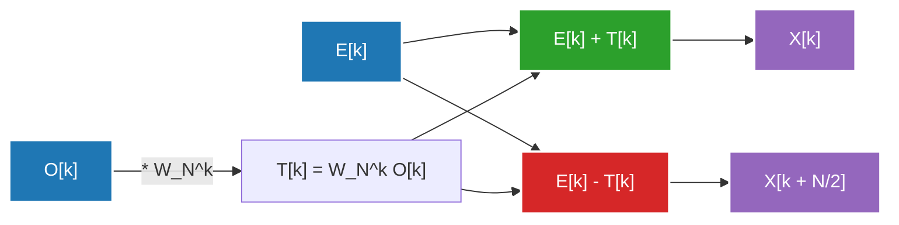

## 1. はじめに：フーリエ変換の世界への誘い

私たちの日常生活は、波（シグナル）に囲まれています。耳に届く音声、目に入る光、スマートフォンがやり取りする電波、これらはすべて時間的あるいは空間的に変動する「波」です。しかし、これらの波をそのままの形で解析したり処理したりするのは非常に困難です。そこで登場するのが<strong>フーリエ変換（Fourier Transform）</strong>です。

フーリエ解析は、信号を三角関数や複素指数関数の成分で表す方法です。級数の収束や連続変換の存在には条件があり、「どんな波でも無条件に分解できる」という一つの定理ではありません。[フーリエ級数と変換の解説](/p/fourier-series-and-transform/)を踏まえ、本記事では有限個のデータのDFTと、その計算法に注目します。周波数領域の値から大きさや位相を調べられますが、振幅の読み取りには正規化や観測区間の条件も必要です。

有限長 $N$ のDFTを定義どおりに計算すると $O(N^2)$ の演算が必要です。小さいデータでは十分でも、$N$ が大きいと負担になります。**高速フーリエ変換（FFT）**は、同じDFTを効率よく計算するアルゴリズムの総称です。ここで導く基数2の方法は $O(N\log N)$ の計算量を持ち、FFTそのものが別の変換や近似を意味するわけではありません。

本記事では、連続変換と有限DFTの違い、クーリー・テューキー型の導出、バタフライ演算、再帰的なPython実装と検証、応用での役割を説明します。

---

## 2. 連続から離散フーリエ変換（DFT）への移行

FFTを理解するためには、まず離散フーリエ変換（DFT）を理解する必要があります。

### 連続フーリエ変換（CFT）

周波数 $f$ をHz、時間 $t$ を秒とする規約では、連続フーリエ変換は次の形です。例えば $\int_{-\infty}^{\infty}|x(t)|\,dt<\infty$ なら、この積分はすべての実数 $f$ で絶対収束します。

$$ X(f) = \int_{-\infty}^{\infty} x(t) e^{-j 2\pi f t} dt $$

$j^2=-1$ で、$j$ は数学で使う $i$ と同じ虚数単位です。$X(f)$ は連続スペクトルの複素数値の重みであり、周期信号の単一成分の振幅とそのまま同じものではありません。現実の計算では等間隔の標本と有限の観測区間を用いますが、標本化と切り出しはそれぞれ連続変換とは別の操作です。

### 有限列の離散フーリエ変換（DFT）

$T_s>0$ の間隔で $x[n]=x(nT_s)$（$n=0,\ldots,N-1$）を得たとします。DFTは、その有限列に対して次のように定義します。ここで $N$ は正の整数です。任意の複素数列にも定義でき、連続変換の存在を前提にしません。

$$ X[k] = \sum_{n=0}^{N-1} x[n] e^{-j \frac{2\pi}{N} k n} \quad (k = 0, 1, ..., N-1) $$

対応する逆DFTは次のとおりです。順変換は正規化せず、逆変換で $1/N$ を掛けます。

$$ x[n]=\frac{1}{N}\sum_{k=0}^{N-1}X[k]e^{j\frac{2\pi}{N}kn}\quad(n=0,\ldots,N-1) $$

標本化周波数は $f_s=1/T_s$、周波数ビンの間隔は $f_s/N$ Hzです。$k>N/2$ のビンは周波数 $(k-N)f_s/N$ Hzとして解釈でき、偶数長の $k=N/2$ はナイキスト成分です。標本化による折り返しと、有限時間の切り出しによるスペクトル漏れに注意が必要です。連続信号の復元には帯域制限などの仮定が必要です。正弦波が観測区間に整数周期で収まることは、周波数がビンに一致して漏れを避ける条件であり、それだけで連続信号の完全な復元を保証するものではありません。

ここで、$W_N = e^{-j \frac{2\pi}{N}}$ と置くと（これを回転因子、またはひねり係数と呼びます）、式はよりシンプルになります。

$$ X[k] = \sum_{n=0}^{N-1} x[n] W_N^{kn} $$

直接法は各 $k$ で $N$ 項を足し、出力が $N$ 個あるため、単純な数え方では複素数乗算 $N^2$ 回と加算 $N(N-1)$ 回を使います。1などの自明な回転因子との乗算を省くことはできますが、直接法のオーダーは $O(N^2)$ です。$N=1,000,000$ なら $N^2=10^{12}$ となり、大規模データを高速に扱うには計算法の改善が重要になります。実際の処理時間は機械や実装にも依存します。

---

## 3. FFTアルゴリズムの数学的導出：クーリー・テューキー型

クーリーとテューキーは1965年に、DFTを小さいDFTへ分ける方法を発表し広く普及させました。FFTWの実装論文は、同種の考え方が[ガウス](/p/gauss/)によって1805年にも知られていたことを説明しています。ここでは現代の基数2の時間間引き（DIT）FFTを、$N=2^p$（$p$ は0以上の整数）の場合に導きます。FFT全般が2のべき乗長に限定されるわけではありません。

### 偶数と奇数への分割（分割統治法）

以下の分割は $N\ge2$ の場合です。$N=1$ は $X[0]=x[0]$ で終了します。DFTの式を、$n$ が偶数の場合と奇数の場合に分けます。

$$ X[k] = \sum_{n=0}^{N-1} x[n] W_N^{kn} $$

$n = 2m$（偶数インデックス）と $n = 2m + 1$（奇数インデックス）に分割します。ただし $m = 0, 1, ..., N/2 - 1$ です。

$$ X[k] = \sum_{m=0}^{N/2-1} x[2m] W_N^{k(2m)} + \sum_{m=0}^{N/2-1} x[2m+1] W_N^{k(2m+1)} $$

ここで、回転因子の性質 $W_N^{2} = e^{-j \frac{4\pi}{N}} = e^{-j \frac{2\pi}{N/2}} = W_{N/2}$ を利用します。また、右辺第2項から $W_N^k$ をくくり出します。

$$ X[k] = \sum_{m=0}^{N/2-1} x[2m] W_{N/2}^{km} + W_N^k \sum_{m=0}^{N/2-1} x[2m+1] W_{N/2}^{km} $$

この式の各項は次のDFTです。

- 第一項は、元のデータのうち偶数番目のデータ群 $x[0], x[2], x[4], ...$ の $N/2$ 点DFTです（これを $E[k]$ とします）。
- 第二項のシグマ部分は、奇数番目のデータ群 $x[1], x[3], x[5], ...$ の $N/2$ 点DFTです（これを $O[k]$ とします）。

つまり、次のように書けます。

$$ X[k] = E[k] + W_N^k O[k] $$

### 周期性の活用

ここで、$E[k]$ と $O[k]$ は $N/2$ 点のDFTであるため、周期 $N/2$ を持ちます。つまり、$E[k + N/2] = E[k]$ であり、$O[k + N/2] = O[k]$ です。
さらに、回転因子には $W_N^{k + N/2} = W_N^k \cdot e^{-j\pi} = -W_N^k$ という性質があります。

ここでは $k=0,\ldots,N/2-1$ と置きます。同じ $k$ に対し、前半の $X[k]$ と後半の $X[k+N/2]$ は、上の式と次の式で対にして計算できます。

$$ X[k + N/2] = E[k] - W_N^k O[k] $$

$N/2$ 点DFTを二つ求め、各 $k$ で回転因子との積を共有して和と差を計算します。全体の計算量が単に一度で半分になるという意味ではありません。組み合わせは $O(N)$ なので、再帰をサイズ1まで続けた演算数は次の漸化式で評価できます。

$$ T(N)=2T(N/2)+O(N)=O(N\log_2 N)\quad(N\ge2),\qquad T(1)=O(1) $$

---

## 4. バタフライ演算の図解

上記の $X[k]$ と $X[k + N/2]$ を同時に計算する基本単位を<strong>バタフライ演算（Butterfly Operation）</strong>と呼びます。計算の流れが蝶の羽のように見えることから名付けられました。

以下に、基数2のバタフライ演算のデータフローを示します。



反復型の基数2 DIT FFTには、入力をビット反転順に並べてから、長さ2、4、8、…のバタフライを実行する実装があります。$N=8$ のビット反転順は $(0,4,2,6,1,5,3,7)$ です。一方、以下の再帰実装は偶数・奇数添字を再帰的に分けることで同じ順序を暗黙に扱い、通常順の出力を返します。呼び出す前に別のビット反転を行う必要はありません。並べ替えの位置はDIT・DIFや実装方式によって異なります。

---

## 5. PythonによるFFTの実装と比較

NumPyはPython標準ライブラリではなく、別途利用する数値計算ライブラリです。以下はNumPyを使う教育用の再帰実装で、有限値の1次元数値列を受け取り、長さが正の2のべき乗の場合にDFTを計算します。実数も複素数も扱い、出力は複素数です。一般の長さはNumPyのFFTを利用できます。

### 自作FFTの実装

```python
import numpy as np

def custom_fft(x):
    """有限値の1次元列を受け取る、正の2のべき乗長の基数2 DIT FFT。"""
    x = np.asarray(x, dtype=np.complex128)
    if x.ndim != 1:
        raise ValueError("Input must be one-dimensional")
    N = x.size
    if N == 0 or (N & (N - 1)) != 0:
        raise ValueError("Length must be a positive power of two")
    if not np.all(np.isfinite(x)):
        raise ValueError("Input must contain only finite values")

    def recurse(values):
        n = values.size
        if n == 1:
            return values.copy()
        even = recurse(values[::2])
        odd = recurse(values[1::2])
        # 回転因子を掛けた奇数側の結果を、和と差の両方で共有する
        twiddled = np.exp(-2j * np.pi * np.arange(n // 2) / n) * odd
        return np.concatenate((even + twiddled, even - twiddled))

    return recurse(x)
```

### numpy.fftとの比較テスト

```python
# 前のコードと同じセッションで実行する
fs = 1024
t = np.arange(fs) / fs
signal = 3 * np.sin(2 * np.pi * 50 * t) + np.sin(2 * np.pi * 120 * t)

fft_custom_result = custom_fft(signal)
fft_numpy_result = np.fft.fft(signal)
max_error = np.max(np.abs(fft_custom_result - fft_numpy_result))
agrees = np.allclose(fft_custom_result, fft_numpy_result,
                     rtol=1e-12, atol=1e-10)
print("NumPy agreement:", agrees)
print("Maximum absolute error:", max_error)

# 虚部を保ったまま計算できることも確認する
complex_signal = np.array([1 + 2j, 3 - 4j, -2 + 0.5j, 0.25j])
print("Complex input agreement:", np.allclose(
    custom_fft(complex_signal), np.fft.fft(complex_signal),
    rtol=1e-12, atol=1e-10))
```

検証環境では `NumPy agreement: True` と `Complex input agreement: True` になりました。最大絶対誤差は環境や丸めによって変わります。この比較は選んだ入力での数値的一致の確認であり、一般の正しさの証明や速度比較ではありません。正しさの理由は、前節のDFT分割を各再帰段階で保つことにあります。有限精度のため丸めや、大きすぎる値でのオーバーフローには別途配慮が必要です。


この例は入力を `complex128` にするので、元の実装の `dtype=float` と異なり虚部を捨てません。空列、2次元配列、2のべき乗でない長さ、NaN・無限大は明示的に拒否します。単一要素はその値のDFTを返します。

検証に用いたNumPy 2.3.5の `numpy.fft` はPocketFFT系の実装を呼び出します。NumPy 1.17で従来のFFTPACKベースから置き換えられました。「FFTライブラリは高速化のため必ず非再帰になる」とは限りません。実用上の速度は、計算順序、データ移動、キャッシュ、SIMDなどにも依存し、この短いPythonコードが実用ライブラリと同じ性能を持つわけではありません。

---

## 6. 実社会におけるFFTの応用：音声と画像

応用では、周波数への表現と、その計算法としてのFFTを区別することが重要です。DCTやMDCTも関連する変換ですが、FFTで計算するDFTと同じ変換ではありません。

### 音声圧縮（MP3, AAC）

知覚音声符号化は、周波数や時間に依存するマスキングを利用し、量子化雑音を聞き取りにくくすることを目指します。聞こえ方は信号や符号化条件に依存し、大きな音の近くの小さな音が常に聞こえなくなるという絶対的な規則ではありません。非可逆圧縮なので、元のデータとビット単位で一致するわけでもありません。

MP3の主な分析フィルタバンクは、ポリフェーズフィルタバンクとMDCTを組み合わせるハイブリッド方式です。基本的なAACの変換符号化もMDCTを使います。MDCTは **Modified Discrete Cosine Transform（変形離散コサイン変換）** の略で、FFTの「改良版」という意味ではありません。一方、エンコーダの心理音響分析などにFFTを使う構成もあり、Fraunhoferの解説のMP3エンコーダ図では主経路のMDCTと別の分析用FFTが描かれています。変換の種類と、各処理の実装に使う高速計算法を分けて理解できます。

### 画像圧縮（JPEG）

画像は「空間的な波」として捉えることができます。ピクセルの明るさが滑らかに変化する部分は「低周波」、輪郭やテクスチャなど急激に色が変化する部分は「高周波」です。
通常の非可逆JPEGの基本方式では、各画像成分の標本を $8\times8$ ブロックに分けて2次元DCTを行い、得られた各係数を量子化します。自然画像では低い空間周波数にエネルギーが集まりやすく、高周波係数を粗く量子化すると0になるものが増える場合があります。ただし、量子化は単に「高周波をすべて切り捨てる」操作ではなく、画質の低下も画像や設定に依存します。DCTをFFTと直接同一視することはできません。

無線通信のOFDMでは、複数のサブキャリアを合成する送信側の逆DFTをIFFTで、受信側のDFTをFFTで計算できます。MRIでも、完全なCartesian格子のk空間データからの基本的な画像再構成に多次元の逆FFTが使われます。非Cartesian標本化や追加の物理効果を扱うには別の処理が必要です。地震波や天文データなどにも周波数解析は利用されますが、具体的な手法はデータと目的によります。

---

## 7. まとめ

FFTは、DFTの周期性と対称性を使って同じ結果を少ない演算で求める計算法です。基数2のDITでは、偶数・奇数添字のDFTを再帰的に求め、バタフライで結合することで $O(N\log N)$ を実現します。

実装では、長さの条件、複素数、周波数の順序、正規化、浮動小数点誤差を明確にすることが重要です。音声・画像・通信への応用でも、DFT、DCT、MDCTという変換と、FFTという計算アルゴリズムを区別すると、数学と技術の関係が見通しやすくなります。

関連するフーリエ解析や信号処理のトピックについても、本ブログの別記事でさらに詳しく解説していきますので、ぜひそちらもご覧ください。


## 参考資料

- [MIT 6.341 Lecture 19：DFT・DIT/DIF・演算量・ビット反転](https://ocw.mit.edu/courses/6-341-discrete-time-signal-processing-fall-2005/4ee39a5e74c9f5099ac516ce57215c96_lec19.pdf)
- [Frigo・Johnson, The Design and Implementation of FFTW3：§IIの分割・履歴・計算順序](https://www.fftw.org/~fftw/fftw-paper-ieee.pdf)
- [NumPy 2.3：fftの定義と規約](https://numpy.org/doc/2.3/reference/generated/numpy.fft.fft.html)
- [NumPy 1.17リリースノート：PocketFFTへの置き換え](https://numpy.org/doc/2.3/release/1.17.0-notes.html)
- [NumPy 2.3.5のソース：PocketFFT呼び出し](https://raw.githubusercontent.com/numpy/numpy/v2.3.5/numpy/fft/_pocketfft.py)
- [Brandenburg, MP3 and AAC Explained：§1、§3.3、§4.2、図2](https://www.iis.fraunhofer.de/content/dam/iis/de/doc/ame/conference/AES-17-Conference_mp3-and-AAC-explained_AES17.pdf)
- [ITU-T T.81：JPEGのDCTと量子化（§4.2–4.3）](https://www.w3.org/Graphics/JPEG/itu-t81.pdf)
- [MathWorks：OFDMの紹介](https://www.mathworks.com/help/comm/gs/introduction-to-ofdm.html)
- [Larson Lab, Principles of MRI：完全なCartesian標本からの再構成](https://larsonlab.github.io/MRI-education-resources/Image%20Reconstruction.html)
