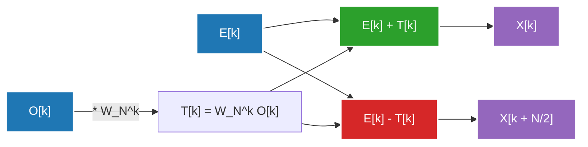

## 1. Introdução: transformadas de Fourier e sinais

O som, a luz e os sinais de rádio trocados pelos telemóveis variam no tempo ou no espaço. A análise de Fourier permite estudar e processar estes sinais através das suas componentes de frequência.

Representa sinais por funções trigonométricas ou exponenciais complexas. A convergência de uma série e a existência de uma transformada contínua exigem condições: não há um único teorema que permita decompor qualquer onda sem restrições. Partindo da [introdução às séries e à transformada de Fourier](/pt/p/fourier-series-and-transform/), focamo-nos na DFT de dados finitos e no seu cálculo. Os valores no domínio da frequência descrevem módulos e fases, mas a leitura de amplitudes depende também da normalização e do intervalo de observação.

O cálculo direto de uma DFT de $N$ pontos exige $O(N^2)$ operações. Pode ser suficiente para poucos dados, mas dispendioso quando $N$ é grande. A **transformada rápida de Fourier (FFT)** é uma família de algoritmos que calculam eficientemente a mesma DFT. O método de base 2 aqui deduzido usa $O(N\log N)$ operações. A FFT não é, por si só, outra transformada nem uma aproximação.

Distinguimos a transformada contínua da DFT finita, deduzimos a decomposição de Cooley–Tukey e a operação borboleta, implementamos e verificamos uma versão recursiva em Python e explicamos o seu papel nas aplicações.

---

## 2. Da transformada contínua à DFT finita

Compreender a DFT é o ponto de partida para compreender os algoritmos FFT.

### Transformada contínua de Fourier

Com frequência $f$ em hertz e tempo $t$ em segundos, uma convenção é a seguinte. Por exemplo, se $\int_{-\infty}^{\infty}|x(t)|\,dt<\infty$, a integral converge absolutamente para todo o $f$ real.

$$ X(f) = \int_{-\infty}^{\infty} x(t) e^{-j 2\pi f t} dt $$

Aqui $j^2=-1$; $j$ é a mesma unidade imaginária que em matemática se costuma escrever $i$. $X(f)$ é um peso complexo num espectro contínuo, não diretamente a amplitude de uma componente de um sinal periódico. Na prática, usam-se amostras igualmente espaçadas e um intervalo de observação finito. A amostragem e a seleção desse intervalo são operações distintas da própria transformada contínua.

### DFT de uma sequência finita

Suponhamos $x[n]=x(nT_s)$ para $n=0,\ldots,N-1$, com intervalo de amostragem $T_s>0$. A DFT desta sequência finita define-se abaixo, sendo $N$ um inteiro positivo. Também se aplica a qualquer sequência complexa, sem exigir a existência de uma transformada contínua.

$$ X[k] = \sum_{n=0}^{N-1} x[n] e^{-j \frac{2\pi}{N} k n} \quad (k = 0, 1, ..., N-1) $$

A DFT inversa correspondente é a seguinte. A transformada direta não tem fator de escala; a inversa inclui $1/N$.

$$ x[n]=\frac{1}{N}\sum_{k=0}^{N-1}X[k]e^{j\frac{2\pi}{N}kn}\quad(n=0,\ldots,N-1) $$

A frequência de amostragem é $f_s=1/T_s$ e a separação entre bins é $f_s/N$ Hz. Os bins com $k>N/2$ interpretam-se como frequências $(k-N)f_s/N$ Hz; para $N$ par, $k=N/2$ é a componente de Nyquist. A amostragem pode causar aliasing e o intervalo finito pode causar fuga espectral. Recuperar um sinal contínuo exige hipóteses como a limitação de banda. Um número inteiro de ciclos de uma sinusoide no intervalo alinha-a com um bin e evita a fuga, mas não garante, por si só, a reconstrução perfeita de um sinal contínuo.

Definindo $W_N=e^{-j2\pi/N}$, o **fator de rotação (twiddle factor)**, simplificamos a expressão:

$$ X[k] = \sum_{n=0}^{N-1} x[n] W_N^{kn} $$

O cálculo direto soma $N$ termos para cada uma de $N$ saídas. Uma contagem simples dá $N^2$ multiplicações complexas e $N(N-1)$ adições. Podem omitir-se multiplicações por fatores triviais, como 1, mas o método continua a ser $O(N^2)$. Para $N=1.000.000$, temos $N^2=10^{12}$; melhorar o cálculo é importante para dados grandes. O tempo de execução depende também do equipamento e da implementação.

---

## 3. Dedução da FFT de Cooley–Tukey

Cooley e Tukey publicaram e popularizaram a decomposição em DFT menores em 1965. O artigo sobre a implementação de FFTW explica que [Gauss](/pt/p/gauss/) já conhecia ideias relacionadas em 1805. Deduzimos uma FFT moderna de base 2 por dizimação no tempo (DIT, Decimation-in-Time), para $N=2^p$, com $p$ inteiro não negativo. Os algoritmos FFT em geral não estão limitados a comprimentos que sejam potências de dois.

### Separação de índices pares e ímpares

A separação seguinte aplica-se a $N\ge2$. O caso base $N=1$ é simplesmente $X[0]=x[0]$. Separamos a DFT nos termos em que $n$ é par e ímpar.

$$ X[k] = \sum_{n=0}^{N-1} x[n] W_N^{kn} $$

Escrevemos $n=2m$ para os índices pares e $n=2m+1$ para os ímpares, com $m=0,1,\ldots,N/2-1$.

$$ X[k] = \sum_{m=0}^{N/2-1} x[2m] W_N^{k(2m)} + \sum_{m=0}^{N/2-1} x[2m+1] W_N^{k(2m+1)} $$

Usamos $W_N^2=e^{-j4\pi/N}=e^{-j2\pi/(N/2)}=W_{N/2}$ e colocamos $W_N^k$ em evidência na soma dos índices ímpares.

$$ X[k] = \sum_{m=0}^{N/2-1} x[2m] W_{N/2}^{km} + W_N^k \sum_{m=0}^{N/2-1} x[2m+1] W_{N/2}^{km} $$

As duas somas têm estes significados:

- A primeira é a DFT de $N/2$ pontos de $x[0],x[2],x[4],\ldots$, designada $E[k]$.
- A soma no segundo termo é a DFT de $N/2$ pontos de $x[1],x[3],x[5],\ldots$, designada $O[k]$.

Assim:

$$ X[k] = E[k] + W_N^k O[k] $$

### Aproveitamento da periodicidade

Sendo DFT de $N/2$ pontos, $E$ e $O$ repetem-se com período $N/2$: $E[k+N/2]=E[k]$ e $O[k+N/2]=O[k]$. Além disso, $W_N^{k+N/2}=W_N^k e^{-j\pi}=-W_N^k$.

Tomamos agora $k=0,\ldots,N/2-1$. Para o mesmo $k$, calculamos em conjunto a saída da primeira metade $X[k]$ e a da segunda $X[k+N/2]$, usando a equação anterior e:

$$ X[k + N/2] = E[k] - W_N^k O[k] $$

Calculamos duas DFT de comprimento $N/2$ e partilhamos o produto pelo fator de rotação ao formar a soma e a diferença. Isto não significa reduzir simplesmente todo o cálculo a metade uma única vez. A combinação custa $O(N)$; a recursão até ao comprimento 1 dá a recorrência para o número de operações:

$$ T(N)=2T(N/2)+O(N)=O(N\log_2 N)\quad(N\ge2),\qquad T(1)=O(1) $$

---

## 4. Operação borboleta

A unidade que calcula em conjunto $X[k]$ e $X[k+N/2]$ chama-se **borboleta**, porque o fluxo de dados se assemelha às suas asas. O esquema de base 2 torna explícitos o produto partilhado e a subtração.



Algumas implementações iterativas DIT de base 2 começam por permutar a entrada invertendo a ordem dos bits de cada índice (*bit-reversed order*) e depois aplicam borboletas de comprimento 2, 4, 8, etc. Para $N=8$, a ordem dos índices é $(0,4,2,6,1,5,3,7)$. A implementação recursiva abaixo trata essa ordem implicitamente ao separar repetidamente índices pares e ímpares e devolve as saídas na ordem normal. Não aplique outra permutação destas antes de a chamar. A posição da reordenação depende de DIT, DIF e da implementação.

---

## 5. Implementação em Python e comparação

NumPy é uma biblioteca numérica externa, não faz parte da biblioteca padrão de Python. Esta implementação didática recebe uma sequência unidimensional de valores numéricos finitos, com comprimento $2^p$, sendo $p\ge0$ um inteiro. Aceita entradas reais e complexas e devolve valores complexos. Para outros comprimentos, pode usar uma biblioteca FFT de uso geral.

### Implementação recursiva

```python
import numpy as np

def custom_fft(x):
    """FFT DIT de base 2 para uma sequência 1D finita de comprimento potência de dois."""
    x = np.asarray(x, dtype=np.complex128)
    if x.ndim != 1:
        raise ValueError("Input must be one-dimensional")
    N = x.size
    if N == 0 or (N & (N - 1)) != 0:
        raise ValueError("Length must be a positive power of two")
    if not np.all(np.isfinite(x)):
        raise ValueError("Input must contain only finite values")

    def recurse(values):
        n = values.size
        if n == 1:
            return values.copy()
        even = recurse(values[::2])
        odd = recurse(values[1::2])
        # Partilhar o resultado ímpar com o fator de rotação entre soma e diferença
        twiddled = np.exp(-2j * np.pi * np.arange(n // 2) / n) * odd
        return np.concatenate((even + twiddled, even - twiddled))

    return recurse(x)
```

### Comparação com NumPy

```python
# Executar na mesma sessão que o bloco anterior
fs = 1024
t = np.arange(fs) / fs
signal = 3 * np.sin(2 * np.pi * 50 * t) + np.sin(2 * np.pi * 120 * t)

fft_custom_result = custom_fft(signal)
fft_numpy_result = np.fft.fft(signal)
max_error = np.max(np.abs(fft_custom_result - fft_numpy_result))
agrees = np.allclose(fft_custom_result, fft_numpy_result,
                     rtol=1e-12, atol=1e-10)
print("NumPy agreement:", agrees)
print("Maximum absolute error:", max_error)

# Verificar também a preservação das partes imaginárias
complex_signal = np.array([1 + 2j, 3 - 4j, -2 + 0.5j, 0.25j])
print("Complex input agreement:", np.allclose(
    custom_fft(complex_signal), np.fft.fft(complex_signal),
    rtol=1e-12, atol=1e-10))
```

No ambiente de validação, o exemplo escreve `NumPy agreement: True` e `Complex input agreement: True`. O erro absoluto máximo varia com o ambiente e o arredondamento. Esta comparação verifica a concordância para as entradas escolhidas; não é uma prova geral de correção nem uma medição de velocidade. A correção decorre de preservar a decomposição da DFT em cada passo recursivo. A precisão finita continua a implicar arredondamento e possível transbordo para valores demasiado grandes.

Usar `complex128` preserva as partes imaginárias, ao contrário do `dtype=float` original. São explicitamente rejeitadas entradas vazias, matrizes bidimensionais, comprimentos que não sejam potências de dois, NaN e infinito. Um único elemento devolve a sua própria DFT de um ponto.

O NumPy 2.3.5 utilizado na validação chama PocketFFT através de `numpy.fft`. Na versão 1.17, NumPy substituiu a implementação anterior baseada em FFTPACK. As bibliotecas rápidas não são necessariamente não recursivas. O desempenho depende também da ordem de cálculo, do movimento de dados, das caches e de SIMD; este exemplo curto não tem o mesmo desempenho que uma biblioteca de produção.

---

## 6. Aplicações: áudio, imagem e comunicações

Convém distinguir a representação no domínio da frequência da FFT enquanto método de cálculo. DCT e MDCT são transformadas relacionadas, mas não são a mesma transformada que a DFT calculada por FFT.

### Compressão de áudio: MP3 e AAC

A codificação percetual de áudio utiliza mascaramento dependente do tempo e da frequência para tornar o ruído de quantização menos audível. A audibilidade depende do sinal e das condições de codificação; não é uma regra absoluta que um som fraco junto de um som forte seja sempre inaudível. A compressão é com perdas, pelo que os dados descodificados não têm de ser idênticos ao original bit a bit.

O principal banco de filtros de análise do MP3 é híbrido: combina um banco polifásico com MDCT. A codificação por transformada do AAC básico também usa MDCT. **MDCT** significa **transformada discreta do cosseno modificada (modified discrete cosine transform)**, não uma FFT melhorada. Um codificador pode usar separadamente FFT na análise psicoacústica: o diagrama de Fraunhofer apresenta uma FFT de análise distinta do percurso principal MDCT. A transformada utilizada e o algoritmo rápido de uma determinada etapa são conceitos diferentes.

### Compressão de imagem: JPEG

As imagens podem ser vistas em termos de frequências espaciais. Alterações suaves de luminosidade correspondem a frequências baixas; mudanças rápidas em contornos e texturas contribuem para frequências mais altas.

O método básico do JPEG habitual com perdas divide as amostras de cada componente da imagem em blocos $8\times8$, aplica uma DCT bidimensional e quantiza os coeficientes. Nas imagens naturais, a energia concentra-se frequentemente nas frequências espaciais baixas. Uma quantização mais grosseira dos coeficientes de alta frequência pode, assim, tornar mais coeficientes nulos. Quantizar não é simplesmente eliminar todas as frequências altas, e a degradação visual depende da imagem e das definições. A DCT não deve ser equiparada diretamente à FFT.

Em OFDM, a DFT inversa do emissor combina subportadoras e pode ser calculada por IFFT; a DFT do recetor pode ser calculada por FFT. A reconstrução básica de imagens de ressonância magnética a partir de dados do espaço k cartesiano completamente amostrado também usa FFT inversas multidimensionais. A amostragem não cartesiana e efeitos físicos adicionais exigem mais processamento. A análise de frequências também é usada em dados sísmicos e astronómicos, com métodos que dependem dos dados e do objetivo.

---

## 7. Conclusão

Os algoritmos FFT exploram a periodicidade e a simetria da DFT para obter a mesma transformada com menos operações. A DIT de base 2 calcula recursivamente as DFT dos índices pares e ímpares e combina-as com borboletas, com complexidade $O(N\log N)$.

É importante explicitar as restrições de comprimento, o tratamento de entradas complexas, a ordem das frequências, a normalização e os erros de vírgula flutuante. Nas aplicações, distinguir as transformadas DFT, DCT e MDCT do cálculo por FFT ajuda a compreender a relação entre matemática e tecnologia.

Outros artigos deste blog explicam temas relacionados com a análise de Fourier e o processamento de sinais.

## Referências

- [MIT 6.341 Lecture 19: DFT, DIT/DIF, operações e inversão da ordem dos bits](https://ocw.mit.edu/courses/6-341-discrete-time-signal-processing-fall-2005/4ee39a5e74c9f5099ac516ce57215c96_lec19.pdf)
- [Frigo e Johnson, The Design and Implementation of FFTW3: decomposição, história e ordem em §II](https://www.fftw.org/~fftw/fftw-paper-ieee.pdf)
- [NumPy 2.3: fft e convenções](https://numpy.org/doc/2.3/reference/generated/numpy.fft.fft.html)
- [Notas de NumPy 1.17: substituição por PocketFFT](https://numpy.org/doc/2.3/release/1.17.0-notes.html)
- [Código de NumPy 2.3.5: chamadas a PocketFFT](https://raw.githubusercontent.com/numpy/numpy/v2.3.5/numpy/fft/_pocketfft.py)
- [Brandenburg, MP3 and AAC Explained: §1, §3.3, §4.2 e figura 2](https://www.iis.fraunhofer.de/content/dam/iis/de/doc/ame/conference/AES-17-Conference_mp3-and-AAC-explained_AES17.pdf)
- [ITU-T T.81: DCT e quantização JPEG em §4.2–4.3](https://www.w3.org/Graphics/JPEG/itu-t81.pdf)
- [MathWorks: introdução a OFDM](https://www.mathworks.com/help/comm/gs/introduction-to-ofdm.html)
- [Larson Lab, Principles of MRI: reconstrução com amostragem cartesiana completa](https://larsonlab.github.io/MRI-education-resources/Image%20Reconstruction.html)
