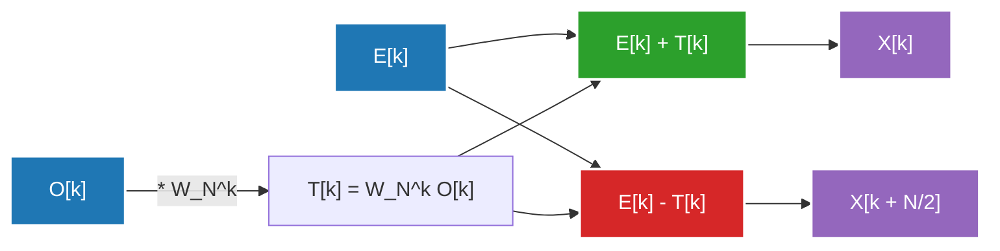

## 1. Введение: преобразования Фурье и сигналы

Звук, свет и радиосигналы смартфонов изменяются во времени или пространстве. Анализ Фурье позволяет изучать и обрабатывать такие сигналы через их частотные компоненты.

Он представляет сигналы с помощью тригонометрических функций или комплексных экспонент. Сходимость ряда и существование непрерывного преобразования требуют условий; нет единой теоремы о безусловном разложении любой волны. Опираясь на [введение в ряды и преобразование Фурье](/ru/p/fourier-series-and-transform/), сосредоточимся на ДПФ конечных данных и его вычислении. Частотные значения описывают модули и фазы, но для определения амплитуд нужно учитывать нормировку и интервал наблюдения.

Прямое вычисление ДПФ из $N$ точек требует $O(N^2)$ операций. Для небольших данных этого может быть достаточно, но при большом $N$ вычисления становятся затратными. **Быстрое преобразование Фурье (БПФ, FFT)** — семейство алгоритмов эффективного вычисления того же ДПФ. Выводимый здесь метод по основанию 2 требует $O(N\log N)$ операций. Само БПФ не означает ни другого преобразования, ни приближения.

Мы различим непрерывное преобразование и конечное ДПФ, выведем разложение Кули–Тьюки и операцию «бабочка», реализуем и проверим рекурсивную версию на Python и объясним её роль в приложениях.

---

## 2. От непрерывного преобразования к конечному ДПФ

Понимание ДПФ — отправная точка для понимания алгоритмов БПФ.

### Непрерывное преобразование Фурье

При частоте $f$ в герцах и времени $t$ в секундах одна из конвенций имеет следующий вид. Например, если $\int_{-\infty}^{\infty}|x(t)|\,dt<\infty$, этот интеграл сходится абсолютно для любого действительного $f$.

$$ X(f) = \int_{-\infty}^{\infty} x(t) e^{-j 2\pi f t} dt $$

Здесь $j^2=-1$; $j$ — та же мнимая единица, которую в математике обычно обозначают $i$. Величина $X(f)$ — комплексный вес в непрерывном спектре, а не непосредственно амплитуда отдельной компоненты периодического сигнала. На практике используются равноотстоящие отсчёты и конечный интервал наблюдения. Взятие отсчётов и выбор интервала — операции, отличные от самого непрерывного преобразования.

### ДПФ конечной последовательности

Пусть $x[n]=x(nT_s)$ для $n=0,\ldots,N-1$ с интервалом дискретизации $T_s>0$. ДПФ этой конечной последовательности определено ниже, где $N$ — положительное целое число. Оно также определено для любой комплексной последовательности и не предполагает существования непрерывного преобразования.

$$ X[k] = \sum_{n=0}^{N-1} x[n] e^{-j \frac{2\pi}{N} k n} \quad (k = 0, 1, ..., N-1) $$

Соответствующее обратное ДПФ имеет следующий вид. Прямое преобразование не масштабируется, а обратное содержит множитель $1/N$.

$$ x[n]=\frac{1}{N}\sum_{k=0}^{N-1}X[k]e^{j\frac{2\pi}{N}kn}\quad(n=0,\ldots,N-1) $$

Частота дискретизации равна $f_s=1/T_s$, шаг частотных отсчётов (*bins*) — $f_s/N$ Гц. Отсчёты с $k>N/2$ можно интерпретировать как частоты $(k-N)f_s/N$ Гц; при чётном $N$ индекс $k=N/2$ соответствует компоненте Найквиста. Дискретизация может вызвать наложение спектров (*aliasing*), а конечный интервал наблюдения — спектральную утечку. Для восстановления непрерывного сигнала нужны предположения, например ограниченность полосы. Целое число периодов синусоиды в интервале совмещает её частоту с частотным отсчётом и устраняет утечку; само по себе это не гарантирует точного восстановления непрерывного сигнала.

Введём $W_N=e^{-j2\pi/N}$ — **поворачивающий множитель (twiddle factor)**:

$$ X[k] = \sum_{n=0}^{N-1} x[n] W_N^{kn} $$

Прямой метод суммирует $N$ слагаемых для каждого из $N$ выходных значений. Простой подсчёт даёт $N^2$ комплексных умножений и $N(N-1)$ сложений. Умножения на тривиальные множители, например 1, можно пропустить, но порядок остаётся $O(N^2)$. При $N=1\,000\,000$ получаем $N^2=10^{12}$, поэтому для больших данных важно улучшать способ вычисления. Фактическое время зависит также от оборудования и реализации.

---

## 3. Вывод БПФ Кули–Тьюки

Кули и Тьюки опубликовали и популяризовали разложение на меньшие ДПФ в 1965 году. Статья о реализации FFTW поясняет, что [Гауссу](/ru/p/gauss/) были известны связанные идеи в 1805 году. Выведем современное БПФ по основанию 2 с прореживанием по времени (DIT, Decimation-in-Time) для $N=2^p$, где $p$ — неотрицательное целое число. Алгоритмы БПФ в целом не ограничены длинами, равными степеням двойки.

### Разделение чётных и нечётных индексов

Следующее разбиение относится к $N\ge2$. Базовый случай $N=1$ — просто $X[0]=x[0]$. Разделим ДПФ на слагаемые с чётным и нечётным $n$.

$$ X[k] = \sum_{n=0}^{N-1} x[n] W_N^{kn} $$

Запишем $n=2m$ для чётных индексов и $n=2m+1$ для нечётных, где $m=0,1,\ldots,N/2-1$.

$$ X[k] = \sum_{m=0}^{N/2-1} x[2m] W_N^{k(2m)} + \sum_{m=0}^{N/2-1} x[2m+1] W_N^{k(2m+1)} $$

Используем $W_N^2=e^{-j4\pi/N}=e^{-j2\pi/(N/2)}=W_{N/2}$ и вынесем $W_N^k$ за сумму с нечётными индексами.

$$ X[k] = \sum_{m=0}^{N/2-1} x[2m] W_{N/2}^{km} + W_N^k \sum_{m=0}^{N/2-1} x[2m+1] W_{N/2}^{km} $$

Две суммы имеют следующий смысл:

- Первая — ДПФ из $N/2$ точек последовательности $x[0],x[2],x[4],\ldots$; обозначим его $E[k]$.
- Сумма во втором слагаемом — ДПФ из $N/2$ точек последовательности $x[1],x[3],x[5],\ldots$; обозначим его $O[k]$.

Следовательно:

$$ X[k] = E[k] + W_N^k O[k] $$

### Использование периодичности

Как ДПФ из $N/2$ точек, $E$ и $O$ повторяются с периодом $N/2$: $E[k+N/2]=E[k]$ и $O[k+N/2]=O[k]$. Кроме того, $W_N^{k+N/2}=W_N^k e^{-j\pi}=-W_N^k$.

Теперь возьмём $k=0,\ldots,N/2-1$. Для одного и того же $k$ выход первой половины $X[k]$ и второй половины $X[k+N/2]$ вычисляются попарно по предыдущей формуле и следующему равенству:

$$ X[k + N/2] = E[k] - W_N^k O[k] $$

Вычисляем два ДПФ длины $N/2$, затем используем одно и то же произведение с поворачивающим множителем в сумме и разности. Это не означает, что весь объём работы просто один раз сокращается вдвое. Объединение требует $O(N)$ операций; рекурсия до длины 1 даёт рекуррентное соотношение для числа операций:

$$ T(N)=2T(N/2)+O(N)=O(N\log_2 N)\quad(N\ge2),\qquad T(1)=O(1) $$

---

## 4. Операция «бабочка»

Базовый блок, совместно вычисляющий $X[k]$ и $X[k+N/2]$, называют **«бабочкой»**, поскольку его поток данных напоминает крылья. На схеме по основанию 2 явно показаны общее произведение и вычитание.



Некоторые итеративные реализации DIT по основанию 2 сначала переставляют входные данные, обращая порядок битов каждого индекса (*bit-reversed order*), затем выполняют «бабочки» длины 2, 4, 8 и далее. Для $N=8$ порядок индексов — $(0,4,2,6,1,5,3,7)$. Приведённая ниже рекурсивная реализация неявно учитывает этот порядок повторным разделением чётных и нечётных индексов и возвращает выходы в обычном порядке. Не выполняйте дополнительную бит-реверсивную перестановку перед её вызовом. Место перестановки зависит от DIT, DIF и реализации.

---

## 5. Реализация на Python и сравнение

NumPy — внешняя библиотека численных вычислений, а не часть стандартной библиотеки Python. Эта учебная реализация принимает одномерную последовательность конечных числовых значений длины $2^p$, где $p$ — неотрицательное целое число. Она поддерживает действительные и комплексные входы и возвращает комплексные значения. Для других длин используйте библиотеку БПФ общего назначения.

### Рекурсивная реализация

```python
import numpy as np

def custom_fft(x):
    """БПФ DIT по основанию 2 для конечной 1D-последовательности длины 2^p."""
    x = np.asarray(x, dtype=np.complex128)
    if x.ndim != 1:
        raise ValueError("Input must be one-dimensional")
    N = x.size
    if N == 0 or (N & (N - 1)) != 0:
        raise ValueError("Length must be a positive power of two")
    if not np.all(np.isfinite(x)):
        raise ValueError("Input must contain only finite values")

    def recurse(values):
        n = values.size
        if n == 1:
            return values.copy()
        even = recurse(values[::2])
        odd = recurse(values[1::2])
        # Использовать нечётный результат с множителем в сумме и разности
        twiddled = np.exp(-2j * np.pi * np.arange(n // 2) / n) * odd
        return np.concatenate((even + twiddled, even - twiddled))

    return recurse(x)
```

### Сравнение с NumPy

```python
# Выполнить в той же сессии, что и предыдущий блок
fs = 1024
t = np.arange(fs) / fs
signal = 3 * np.sin(2 * np.pi * 50 * t) + np.sin(2 * np.pi * 120 * t)

fft_custom_result = custom_fft(signal)
fft_numpy_result = np.fft.fft(signal)
max_error = np.max(np.abs(fft_custom_result - fft_numpy_result))
agrees = np.allclose(fft_custom_result, fft_numpy_result,
                     rtol=1e-12, atol=1e-10)
print("NumPy agreement:", agrees)
print("Maximum absolute error:", max_error)

# Проверить также сохранение мнимых частей
complex_signal = np.array([1 + 2j, 3 - 4j, -2 + 0.5j, 0.25j])
print("Complex input agreement:", np.allclose(
    custom_fft(complex_signal), np.fft.fft(complex_signal),
    rtol=1e-12, atol=1e-10))
```

В проверочном окружении пример выводит `NumPy agreement: True` и `Complex input agreement: True`. Максимальная абсолютная погрешность зависит от окружения и округления. Сравнение проверяет совпадение для выбранных входов; это не общее доказательство корректности и не измерение скорости. Корректность следует из сохранения разложения ДПФ на каждом шаге рекурсии. При конечной точности остаются округление и возможность переполнения для слишком больших значений.

Использование `complex128` сохраняет мнимые части, в отличие от исходного `dtype=float`. Пустой ввод, двумерные массивы, длины, не равные степеням двойки, NaN и бесконечность явно отклоняются. Единственный элемент возвращает собственное одноточечное ДПФ.

Использованный для проверки NumPy 2.3.5 вызывает PocketFFT через `numpy.fft`. В версии 1.17 NumPy заменил прежнюю реализацию на основе FFTPACK. Быстрые библиотеки не обязательно нерекурсивны. Производительность также зависит от порядка вычислений, перемещения данных, кэшей и SIMD; этот короткий пример не имеет той же производительности, что промышленная библиотека.

---

## 6. Применения: звук, изображения и связь

Следует различать частотное представление и БПФ как способ вычисления преобразования. ДКП (DCT) и MDCT — родственные преобразования, но они отличаются от ДПФ, вычисляемого с помощью БПФ.

### Сжатие звука: MP3 и AAC

Перцептивное кодирование звука использует зависящую от времени и частоты маскировку, чтобы сделать шум квантования менее слышимым. Слышимость зависит от сигнала и условий кодирования; тихий звук рядом с громким не обязательно всегда неслышим. Это сжатие с потерями, поэтому декодированные данные не обязаны побитно совпадать с исходными.

Основной анализирующий банк фильтров MP3 — гибрид полифазного банка фильтров и MDCT. Базовое преобразовательное кодирование AAC также использует MDCT. **MDCT** означает **модифицированное дискретное косинусное преобразование (modified discrete cosine transform)**, а не улучшенное БПФ. Кодер может отдельно применять БПФ для психоакустического анализа: на схеме Fraunhofer анализирующее БПФ отделено от основного тракта MDCT. Вид преобразования и быстрый алгоритм отдельного этапа обработки — разные понятия.

### Сжатие изображений: JPEG

Изображения можно рассматривать через пространственные частоты. Плавные изменения яркости соответствуют низким частотам; быстрые изменения на границах и в текстурах дают вклад в более высокие частоты.

Базовый метод обычного JPEG с потерями делит отсчёты каждой компоненты изображения на блоки $8\times8$, применяет двумерное ДКП и квантует полученные коэффициенты. В естественных изображениях энергия часто сосредоточена на низких пространственных частотах. Более грубое квантование высокочастотных коэффициентов может поэтому обнулить большее их число. Квантование — не просто отбрасывание всех высоких частот, а визуальное ухудшение зависит от изображения и настроек. ДКП нельзя напрямую отождествлять с БПФ.

В OFDM обратное ДПФ передатчика объединяет поднесущие и может вычисляться с помощью IFFT; ДПФ приёмника — с помощью FFT. Базовая реконструкция МРТ по полностью дискретизированным данным декартова k-пространства также использует многомерные обратные БПФ. Недекартова дискретизация и дополнительные физические эффекты требуют дальнейшей обработки. Частотный анализ применяется и к сейсмическим и астрономическим данным; методы зависят от данных и цели.

---

## 7. Заключение

Алгоритмы БПФ используют периодичность и симметрию ДПФ для получения того же преобразования за меньшее число операций. DIT по основанию 2 рекурсивно вычисляет ДПФ чётных и нечётных индексов и объединяет их «бабочками», давая сложность $O(N\log N)$.

Явно указывайте ограничения длины, обработку комплексных входов, порядок частот, нормировку и ошибки плавающей точки. В приложениях различение преобразований ДПФ, ДКП, MDCT и вычисления посредством БПФ также помогает понять связь математики и технологии.

Другие статьи блога объясняют связанные темы анализа Фурье и обработки сигналов.

## Источники

- [MIT 6.341 Lecture 19: ДПФ, DIT/DIF, число операций и обращение порядка битов](https://ocw.mit.edu/courses/6-341-discrete-time-signal-processing-fall-2005/4ee39a5e74c9f5099ac516ce57215c96_lec19.pdf)
- [Frigo и Johnson, The Design and Implementation of FFTW3: разложение, история и порядок в §II](https://www.fftw.org/~fftw/fftw-paper-ieee.pdf)
- [NumPy 2.3: fft и соглашения](https://numpy.org/doc/2.3/reference/generated/numpy.fft.fft.html)
- [Примечания NumPy 1.17: переход на PocketFFT](https://numpy.org/doc/2.3/release/1.17.0-notes.html)
- [Исходный код NumPy 2.3.5: вызовы PocketFFT](https://raw.githubusercontent.com/numpy/numpy/v2.3.5/numpy/fft/_pocketfft.py)
- [Brandenburg, MP3 and AAC Explained: §1, §3.3, §4.2 и рисунок 2](https://www.iis.fraunhofer.de/content/dam/iis/de/doc/ame/conference/AES-17-Conference_mp3-and-AAC-explained_AES17.pdf)
- [ITU-T T.81: ДКП и квантование JPEG в §4.2–4.3](https://www.w3.org/Graphics/JPEG/itu-t81.pdf)
- [MathWorks: введение в OFDM](https://www.mathworks.com/help/comm/gs/introduction-to-ofdm.html)
- [Larson Lab, Principles of MRI: реконструкция по полным декартовым отсчётам](https://larsonlab.github.io/MRI-education-resources/Image%20Reconstruction.html)
