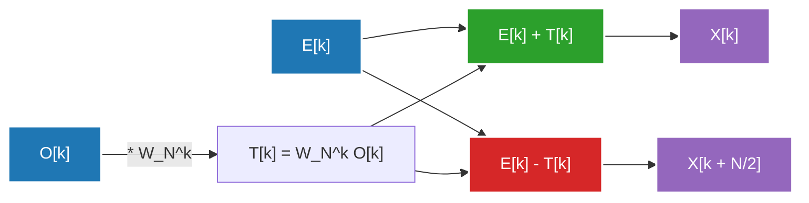

## 1. 引言：傅里叶变换与信号

声音、光以及智能手机收发的电磁信号，都随时间或空间变化。傅里叶分析提供了从频率成分的角度研究和处理这些信号的方法。

它用三角函数或复指数函数的成分表示信号。但级数的收敛和连续变换的存在都需要条件，并不存在一个声称“任何波都能无条件分解”的通用定理。在[傅里叶级数与变换的介绍](/zh-cn/p/fourier-series-and-transform/)基础上，本文重点讨论有限数据的DFT及其计算方法。频域值可以帮助分析大小和相位，但读取振幅还需要注意归一化和观测区间的条件。

按定义直接计算 $N$ 点DFT，需要 $O(N^2)$ 次运算。数据较少时可能足够，但 $N$ 很大时开销会增加。**快速傅里叶变换（FFT）**是高效计算同一个DFT的一类算法。本文推导的基2方法需要 $O(N\log N)$ 次运算。FFT本身不是另一种变换，也不意味着一种近似。

下文区分连续变换和有限DFT，推导库利–图基分解和蝶形运算，给出递归Python实现及检验，并说明它在应用中的角色。

---

## 2. 从连续变换到有限DFT

理解FFT算法，需要先理解DFT。

### 连续傅里叶变换

当频率 $f$ 的单位为Hz、时间 $t$ 的单位为秒时，可以采用下面的约定。例如，如果 $\int_{-\infty}^{\infty}|x(t)|\,dt<\infty$，该积分对所有实数 $f$ 都绝对收敛。

$$ X(f) = \int_{-\infty}^{\infty} x(t) e^{-j 2\pi f t} dt $$

这里 $j^2=-1$，$j$ 就是数学中通常写成 $i$ 的虚数单位。$X(f)$ 是连续频谱中的复值权重，不能直接等同于周期信号单个成分的振幅。实际计算采用等间隔采样和有限观测区间，但采样、截取区间与连续变换本身是不同的操作。

### 有限序列的DFT

设采样间隔 $T_s>0$，得到 $x[n]=x(nT_s)$，其中 $n=0,\ldots,N-1$。这个有限序列的DFT定义如下，$N$ 是正整数。它也适用于任意复数序列，不以连续变换的存在为前提。

$$ X[k] = \sum_{n=0}^{N-1} x[n] e^{-j \frac{2\pi}{N} k n} \quad (k = 0, 1, ..., N-1) $$

对应的逆DFT如下。正变换不缩放，逆变换乘以 $1/N$。

$$ x[n]=\frac{1}{N}\sum_{k=0}^{N-1}X[k]e^{j\frac{2\pi}{N}kn}\quad(n=0,\ldots,N-1) $$

采样频率为 $f_s=1/T_s$，频率格点间隔为 $f_s/N$ Hz。$k>N/2$ 的格点可解释为频率 $(k-N)f_s/N$ Hz；偶数长度时，$k=N/2$ 是奈奎斯特成分。采样可能造成混叠，而有限观测区间可能造成频谱泄漏。还原连续信号需要带限等假设。正弦波在区间中恰好完成整数个周期，会与格点对齐并避免泄漏，但仅凭这一点不能保证连续信号的完全重建。

令 $W_N=e^{-j2\pi/N}$，称为**旋转因子（twiddle factor）**，可简化为：

$$ X[k] = \sum_{n=0}^{N-1} x[n] W_N^{kn} $$

直接法为每个输出求 $N$ 项之和，共有 $N$ 个输出。简单计数得到 $N^2$ 次复数乘法和 $N(N-1)$ 次加法。可以省略与1等特殊因子的乘法，但直接法的复杂度仍为 $O(N^2)$。当 $N=1,000,000$ 时，$N^2=10^{12}$，因此大数据的计算方法很重要。实际运行时间也取决于硬件和实现。

---

## 3. 推导库利–图基FFT

库利和图基在1965年发表并推广了把DFT分解成较小DFT的方法。FFTW实现论文介绍，[高斯](/zh-cn/p/gauss/)在1805年就已知相关思想。这里推导现代的基2按时间抽取（DIT）FFT，假设 $N=2^p$，$p$ 为非负整数。FFT算法并非普遍要求长度为2的幂。

### 拆分偶数与奇数索引

下面的拆分用于 $N\ge2$。$N=1$ 是基本情况，直接有 $X[0]=x[0]$。把DFT按偶数和奇数 $n$ 拆开：

$$ X[k] = \sum_{n=0}^{N-1} x[n] W_N^{kn} $$

偶数索引写成 $n=2m$，奇数索引写成 $n=2m+1$，其中 $m=0,1,\ldots,N/2-1$。

$$ X[k] = \sum_{m=0}^{N/2-1} x[2m] W_N^{k(2m)} + \sum_{m=0}^{N/2-1} x[2m+1] W_N^{k(2m+1)} $$

利用 $W_N^2=e^{-j4\pi/N}=e^{-j2\pi/(N/2)}=W_{N/2}$，并从奇数项之和中提取 $W_N^k$：

$$ X[k] = \sum_{m=0}^{N/2-1} x[2m] W_{N/2}^{km} + W_N^k \sum_{m=0}^{N/2-1} x[2m+1] W_{N/2}^{km} $$

这两个和分别表示：

- 第一项是 $x[0],x[2],x[4],\ldots$ 的 $N/2$ 点DFT，记为 $E[k]$。
- 第二项中的求和是 $x[1],x[3],x[5],\ldots$ 的 $N/2$ 点DFT，记为 $O[k]$。

因此：

$$ X[k] = E[k] + W_N^k O[k] $$

### 利用周期性

作为 $N/2$ 点DFT，$E$ 和 $O$ 以 $N/2$ 为周期，即 $E[k+N/2]=E[k]$，$O[k+N/2]=O[k]$。此外，$W_N^{k+N/2}=W_N^k e^{-j\pi}=-W_N^k$。

现在令 $k=0,\ldots,N/2-1$。对同一个 $k$，前半部输出 $X[k]$ 和后半部输出 $X[k+N/2]$，由上式和下式配对计算：

$$ X[k + N/2] = E[k] - W_N^k O[k] $$

先计算两个长度为 $N/2$ 的DFT，再共享旋转因子乘积来计算和与差。这并不意味着整个计算只需要一次性减半。合并需要 $O(N)$ 次运算，因此递归至长度1时，运算量满足：

$$ T(N)=2T(N/2)+O(N)=O(N\log_2 N)\quad(N\ge2),\qquad T(1)=O(1) $$

---

## 4. 蝶形运算

同时计算 $X[k]$ 和 $X[k+N/2]$ 的基本单元称为**蝶形运算**，因为数据流看起来像蝴蝶的翅膀。下图明确标出共享乘积与减法。



有些迭代基2 DIT实现先把输入排成按位倒序（bit-reversed order），再依次进行长度2、4、8等蝶形运算。$N=8$ 的按位倒序为 $(0,4,2,6,1,5,3,7)$。下面的递归实现通过反复拆分偶数和奇数索引，隐式处理相应顺序，并按正常顺序返回输出。调用前不应再额外进行一次按位倒序。重排的位置取决于DIT、DIF和具体实现。

---

## 5. Python实现与比较

NumPy是需要单独使用的数值计算库，不属于Python标准库。这个教学实现接收由有限数值构成的一维序列，要求长度是正的2的幂。输入可以是实数或复数，输出为复数。其他长度可以使用通用FFT库。

### 递归实现

```python
import numpy as np

def custom_fft(x):
    """接收有限数值一维序列的基2 DIT FFT，长度为正的2的幂。"""
    x = np.asarray(x, dtype=np.complex128)
    if x.ndim != 1:
        raise ValueError("Input must be one-dimensional")
    N = x.size
    if N == 0 or (N & (N - 1)) != 0:
        raise ValueError("Length must be a positive power of two")
    if not np.all(np.isfinite(x)):
        raise ValueError("Input must contain only finite values")

    def recurse(values):
        n = values.size
        if n == 1:
            return values.copy()
        even = recurse(values[::2])
        odd = recurse(values[1::2])
        # 旋转因子乘以奇数侧结果后，在和与差之间共享该乘积
        twiddled = np.exp(-2j * np.pi * np.arange(n // 2) / n) * odd
        return np.concatenate((even + twiddled, even - twiddled))

    return recurse(x)
```

### 与NumPy比较

```python
# 在运行前一代码块的同一个会话中执行
fs = 1024
t = np.arange(fs) / fs
signal = 3 * np.sin(2 * np.pi * 50 * t) + np.sin(2 * np.pi * 120 * t)

fft_custom_result = custom_fft(signal)
fft_numpy_result = np.fft.fft(signal)
max_error = np.max(np.abs(fft_custom_result - fft_numpy_result))
agrees = np.allclose(fft_custom_result, fft_numpy_result,
                     rtol=1e-12, atol=1e-10)
print("NumPy agreement:", agrees)
print("Maximum absolute error:", max_error)

# 也检查计算时是否保留虚部
complex_signal = np.array([1 + 2j, 3 - 4j, -2 + 0.5j, 0.25j])
print("Complex input agreement:", np.allclose(
    custom_fft(complex_signal), np.fft.fft(complex_signal),
    rtol=1e-12, atol=1e-10))
```

在检验环境中，程序输出 `NumPy agreement: True` 和 `Complex input agreement: True`。最大绝对误差随环境和舍入而变化。这只是对所选输入的数值一致性检查，不是一般正确性的证明，也不是速度基准测试。正确性来自每一步递归都保持前面的DFT分解。有限精度仍会带来舍入，以及数值过大时的溢出。

使用 `complex128` 可以保留虚部，而原实现的 `dtype=float` 会丢弃虚部。程序明确拒绝空输入、二维数组、长度不是2的幂的序列以及NaN和无穷大。单个元素返回它自身的一点DFT。

用于检验的NumPy 2.3.5通过 `numpy.fft` 调用PocketFFT实现。NumPy在1.17版替换了之前基于FFTPACK的实现。快速库并不一定采用非递归实现。性能还取决于计算顺序、数据移动、缓存和SIMD；这段简短Python示例并不具有生产级库的相同性能。

---

## 6. 应用：音频、图像与通信

要区分频域表示与作为计算方法的FFT。DCT和MDCT是相关变换，但不同于FFT所计算的DFT。

### 音频压缩：MP3与AAC

感知音频编码利用随频率和时间变化的掩蔽效应，使量化噪声更不易被听见。可听性取决于信号和编码条件，并不是大声音附近的小声音总会消失的绝对规则。这是有损压缩，解码数据不必与原始数据逐位相同。

MP3的主分析滤波器组是多相滤波器组与MDCT组成的混合结构。基本AAC变换编码也采用MDCT。**MDCT**表示**修正离散余弦变换（modified discrete cosine transform）**，不是FFT的改良版。编码器可以另外在心理声学分析中使用FFT：Fraunhofer的MP3编码器框图把分析用FFT与主路径中的MDCT分开表示。变换的种类与某个处理步骤使用的快速计算算法，是两回事。

### 图像压缩：JPEG

图像可以从空间频率的角度理解。亮度的平缓变化对应低频，边缘或纹理等快速变化会产生较高频成分。

通常的有损JPEG基本方式把各图像成分的采样值分成 $8\times8$ 块，进行二维DCT，并量化所得系数。自然图像的能量往往集中在较低空间频率。对高频系数作较粗量化，可能使其中更多系数成为0。但量化不是简单地丢弃全部高频，视觉损失也依赖图像和设置。不能把DCT直接等同于FFT。

OFDM通信中，发送端用逆DFT合成子载波，可由IFFT计算；接收端DFT可由FFT计算。对于完整采样的Cartesian（笛卡尔）k空间数据，基本MRI图像重建也使用多维逆FFT。非Cartesian采样或额外物理效应需要进一步处理。地震和天文数据也使用频率分析，但具体方法取决于数据和目标。

---

## 7. 总结

FFT算法利用DFT的周期性与对称性，以更少运算得到同一个变换。基2 DIT递归计算偶数、奇数索引的DFT，再以蝶形运算合并，实现 $O(N\log N)$ 复杂度。

实现中需要明确长度限制、复数输入、频率顺序、归一化和浮点误差。在应用中，区分DFT、DCT、MDCT等变换与FFT计算方法，也能帮助理解数学与技术的联系。

本博客的其他文章还介绍了相关傅里叶分析和信号处理主题。

## 参考资料

- [MIT 6.341 Lecture 19：DFT、DIT/DIF、运算量与按位倒序](https://ocw.mit.edu/courses/6-341-discrete-time-signal-processing-fall-2005/4ee39a5e74c9f5099ac516ce57215c96_lec19.pdf)
- [Frigo与Johnson, The Design and Implementation of FFTW3：§II的分解、历史与计算顺序](https://www.fftw.org/~fftw/fftw-paper-ieee.pdf)
- [NumPy 2.3：fft的定义与约定](https://numpy.org/doc/2.3/reference/generated/numpy.fft.fft.html)
- [NumPy 1.17发布说明：替换为PocketFFT](https://numpy.org/doc/2.3/release/1.17.0-notes.html)
- [NumPy 2.3.5源代码：PocketFFT调用](https://raw.githubusercontent.com/numpy/numpy/v2.3.5/numpy/fft/_pocketfft.py)
- [Brandenburg, MP3 and AAC Explained：§1、§3.3、§4.2及图2](https://www.iis.fraunhofer.de/content/dam/iis/de/doc/ame/conference/AES-17-Conference_mp3-and-AAC-explained_AES17.pdf)
- [ITU-T T.81：JPEG的DCT与量化（§4.2–4.3）](https://www.w3.org/Graphics/JPEG/itu-t81.pdf)
- [MathWorks：OFDM介绍](https://www.mathworks.com/help/comm/gs/introduction-to-ofdm.html)
- [Larson Lab, Principles of MRI：由完整Cartesian采样重建](https://larsonlab.github.io/MRI-education-resources/Image%20Reconstruction.html)
