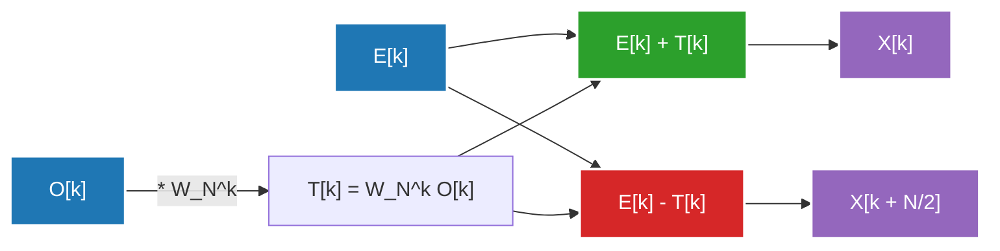

## 1. 引言：傅立葉轉換與訊號

聲音、光以及智慧型手機收發的電磁訊號，都隨時間或空間變化。傅立葉分析提供了從頻率成分的角度研究、處理這些訊號的方法。

它用三角函數或複指數函數的成分表示訊號。不過，級數的收斂和連續轉換的存在都需要條件，並不存在一個宣稱「任何波都能無條件分解」的通用定理。在[傅立葉級數與轉換的介紹](/zh-tw/p/fourier-series-and-transform/)基礎上，本文著重有限資料的DFT與其計算方法。頻域值可用來分析大小與相位，但讀取振幅還需要注意正規化與觀測區間的條件。

依定義直接計算 $N$ 點DFT，需要 $O(N^2)$ 次運算。資料較少時可能足夠，但 $N$ 很大時開銷會增加。**快速傅立葉轉換（FFT）**是高效率計算同一個DFT的一類演算法。本文推導的基數2方法需要 $O(N\log N)$ 次運算。FFT本身不是另一種轉換，也不代表一種近似。

下文區分連續轉換與有限DFT，推導庫利–圖基分解與蝴蝶運算，提供遞迴Python實作和檢驗，並說明它在應用中的角色。

---

## 2. 從連續轉換到有限DFT

理解FFT演算法，需要先理解DFT。

### 連續傅立葉轉換

若頻率 $f$ 的單位為Hz、時間 $t$ 的單位為秒，可採用下列慣例。例如，若 $\int_{-\infty}^{\infty}|x(t)|\,dt<\infty$，此積分對所有實數 $f$ 都絕對收斂。

$$ X(f) = \int_{-\infty}^{\infty} x(t) e^{-j 2\pi f t} dt $$

這裡 $j^2=-1$，$j$ 就是數學中通常寫成 $i$ 的虛數單位。$X(f)$ 是連續頻譜中的複值權重，不能直接等同於週期訊號單一成分的振幅。實際計算採用等間隔取樣和有限觀測區間；取樣、截取區間與連續轉換本身是不同的操作。

### 有限序列的DFT

設取樣間隔 $T_s>0$，得到 $x[n]=x(nT_s)$，其中 $n=0,\ldots,N-1$。這個有限序列的DFT定義如下，$N$ 為正整數。它也適用於任意複數序列，不以連續轉換存在為前提。

$$ X[k] = \sum_{n=0}^{N-1} x[n] e^{-j \frac{2\pi}{N} k n} \quad (k = 0, 1, ..., N-1) $$

對應的反DFT如下。正轉換不縮放，反轉換乘上 $1/N$。

$$ x[n]=\frac{1}{N}\sum_{k=0}^{N-1}X[k]e^{j\frac{2\pi}{N}kn}\quad(n=0,\ldots,N-1) $$

取樣頻率為 $f_s=1/T_s$，頻率格點間隔為 $f_s/N$ Hz。$k>N/2$ 的格點可解釋為頻率 $(k-N)f_s/N$ Hz；偶數長度時，$k=N/2$ 是奈奎斯特成分。取樣可能造成混疊，有限觀測區間則可能造成頻譜洩漏。還原連續訊號需要帶限等假設。正弦波在區間內恰好完成整數個週期，會對齊格點並避免洩漏，但單憑這點不能保證連續訊號的完整重建。

令 $W_N=e^{-j2\pi/N}$，稱為**旋轉因子（twiddle factor）**，可簡化為：

$$ X[k] = \sum_{n=0}^{N-1} x[n] W_N^{kn} $$

直接法對每個輸出加總 $N$ 項，共有 $N$ 個輸出。簡單計數得到 $N^2$ 次複數乘法與 $N(N-1)$ 次加法。可以省略與1等特殊因子的乘法，但直接法仍是 $O(N^2)$。當 $N=1,000,000$ 時，$N^2=10^{12}$，所以大量資料的計算方法很重要。實際執行時間也取決於硬體與實作。

---

## 3. 推導庫利–圖基FFT

庫利與圖基在1965年發表並推廣了將DFT分解為較小DFT的方法。FFTW實作論文介紹，[高斯](/zh-tw/p/gauss/)在1805年就已知相關想法。這裡推導現代的基數2時間抽取（DIT）FFT，假設 $N=2^p$，$p$ 為非負整數。FFT演算法並非全都要求長度為2的冪次。

### 分割偶數與奇數索引

下列分割用於 $N\ge2$。$N=1$ 是基本情況，直接有 $X[0]=x[0]$。將DFT依偶數與奇數 $n$ 拆開：

$$ X[k] = \sum_{n=0}^{N-1} x[n] W_N^{kn} $$

偶數索引寫成 $n=2m$，奇數索引寫成 $n=2m+1$，其中 $m=0,1,\ldots,N/2-1$。

$$ X[k] = \sum_{m=0}^{N/2-1} x[2m] W_N^{k(2m)} + \sum_{m=0}^{N/2-1} x[2m+1] W_N^{k(2m+1)} $$

利用 $W_N^2=e^{-j4\pi/N}=e^{-j2\pi/(N/2)}=W_{N/2}$，並從奇數項之和中提出 $W_N^k$：

$$ X[k] = \sum_{m=0}^{N/2-1} x[2m] W_{N/2}^{km} + W_N^k \sum_{m=0}^{N/2-1} x[2m+1] W_{N/2}^{km} $$

這兩個和分別表示：

- 第一項是 $x[0],x[2],x[4],\ldots$ 的 $N/2$ 點DFT，記為 $E[k]$。
- 第二項中的求和是 $x[1],x[3],x[5],\ldots$ 的 $N/2$ 點DFT，記為 $O[k]$。

因此：

$$ X[k] = E[k] + W_N^k O[k] $$

### 利用週期性

作為 $N/2$ 點DFT，$E$ 與 $O$ 都以 $N/2$ 為週期：$E[k+N/2]=E[k]$、$O[k+N/2]=O[k]$。此外，$W_N^{k+N/2}=W_N^k e^{-j\pi}=-W_N^k$。

現在令 $k=0,\ldots,N/2-1$。對同一個 $k$，前半部輸出 $X[k]$ 與後半部輸出 $X[k+N/2]$，以先前公式和下式成對計算：

$$ X[k + N/2] = E[k] - W_N^k O[k] $$

先計算兩個長度為 $N/2$ 的DFT，再共用旋轉因子的乘積計算和與差。這並不表示整個計算只需一次性減半。合併需要 $O(N)$ 次運算，因此遞迴到長度1時，運算量滿足下列遞迴關係：

$$ T(N)=2T(N/2)+O(N)=O(N\log_2 N)\quad(N\ge2),\qquad T(1)=O(1) $$

---

## 4. 蝴蝶運算

同時計算 $X[k]$ 與 $X[k+N/2]$ 的基本單位稱為**蝴蝶運算**，因為資料流看起來像蝴蝶的翅膀。下圖明確標出共用的乘積與減法。



部分迭代式（非遞迴）的基數2 DIT實作，先將輸入排成位元反轉順序（bit-reversed order），再依序進行長度2、4、8等蝴蝶運算。$N=8$ 的位元反轉索引順序為 $(0,4,2,6,1,5,3,7)$。下方遞迴實作反覆分割偶數與奇數索引，隱含地處理對應順序，並以正常順序回傳輸出。呼叫前不應額外再做一次位元反轉。重排的位置取決於DIT、DIF與實作方式。

---

## 5. Python實作與比較

NumPy是另外使用的數值計算函式庫，不屬於Python標準函式庫。這個教學實作接受由有限數值構成的一維序列，要求長度是正的2的冪次。輸入可以是實數或複數，輸出為複數。其他長度可使用通用FFT函式庫。

### 遞迴實作

```python
import numpy as np

def custom_fft(x):
    """接受有限數值一維序列的基數2 DIT FFT，長度為正的2的冪次。"""
    x = np.asarray(x, dtype=np.complex128)
    if x.ndim != 1:
        raise ValueError("Input must be one-dimensional")
    N = x.size
    if N == 0 or (N & (N - 1)) != 0:
        raise ValueError("Length must be a positive power of two")
    if not np.all(np.isfinite(x)):
        raise ValueError("Input must contain only finite values")

    def recurse(values):
        n = values.size
        if n == 1:
            return values.copy()
        even = recurse(values[::2])
        odd = recurse(values[1::2])
        # 將旋轉因子乘上奇數側結果，在和與差之間共用此乘積
        twiddled = np.exp(-2j * np.pi * np.arange(n // 2) / n) * odd
        return np.concatenate((even + twiddled, even - twiddled))

    return recurse(x)
```

### 與NumPy比較

```python
# 在執行前一個程式碼區塊的同一個工作階段中執行
fs = 1024
t = np.arange(fs) / fs
signal = 3 * np.sin(2 * np.pi * 50 * t) + np.sin(2 * np.pi * 120 * t)

fft_custom_result = custom_fft(signal)
fft_numpy_result = np.fft.fft(signal)
max_error = np.max(np.abs(fft_custom_result - fft_numpy_result))
agrees = np.allclose(fft_custom_result, fft_numpy_result,
                     rtol=1e-12, atol=1e-10)
print("NumPy agreement:", agrees)
print("Maximum absolute error:", max_error)

# 也檢查計算時是否保留虛部
complex_signal = np.array([1 + 2j, 3 - 4j, -2 + 0.5j, 0.25j])
print("Complex input agreement:", np.allclose(
    custom_fft(complex_signal), np.fft.fft(complex_signal),
    rtol=1e-12, atol=1e-10))
```

在驗證環境中，程式輸出 `NumPy agreement: True` 與 `Complex input agreement: True`。最大絕對誤差會隨環境與捨入而變化。這只是對所選輸入的數值一致性檢查，不是一般正確性的證明，也不是速度基準測試。正確性的理由是每一層遞迴都維持先前的DFT分解。有限精度仍會造成捨入，以及數值過大時的溢位。

使用 `complex128` 可保留虛部，而原本的 `dtype=float` 會捨棄虛部。程式明確拒絕空輸入、二維陣列、非2的冪次長度、NaN與無窮大。單一元素會回傳它本身的一點DFT。

驗證所用的NumPy 2.3.5透過 `numpy.fft` 呼叫PocketFFT實作。NumPy在1.17版替換了原本以FFTPACK為基礎的實作。快速函式庫未必都採用非遞迴方法。效能也取決於計算順序、資料搬移、快取與SIMD；這段簡短的Python範例不具備與正式函式庫相同的效能。

---

## 6. 應用：音訊、影像與通訊

需要區分頻域表示與計算方法FFT。DCT及MDCT是相關轉換，卻不同於FFT所計算的DFT。

### 音訊壓縮：MP3與AAC

感知音訊編碼利用隨頻率、時間而變的遮蔽效應，使量化雜訊較不易被聽見。可聽性取決於訊號與編碼條件，並不是大聲音附近的小聲音總會消失的絕對規則。這是有損壓縮，解碼資料不必和原資料逐位元相同。

MP3的主分析濾波器組是多相濾波器組與MDCT構成的混合結構。基本AAC轉換編碼也採用MDCT。**MDCT**代表**修正離散餘弦轉換（modified discrete cosine transform）**，不是FFT的改良版。編碼器可以另外在心理聲學分析中使用FFT：Fraunhofer的MP3編碼器方塊圖，將分析用FFT與主路徑中的MDCT分開表示。轉換的種類和特定處理步驟使用的快速計算演算法，是不同概念。

### 影像壓縮：JPEG

影像可以從空間頻率的角度理解。亮度的平緩變化對應低頻，邊緣與紋理等快速變化則會產生較高頻成分。

一般有損JPEG的基本方式將各影像成分的取樣值分成 $8\times8$ 區塊，進行二維DCT，再量化所得係數。自然影像的能量通常集中在較低空間頻率。對高頻係數進行較粗量化，可能使更多係數成為0。但量化不等於單純捨棄全部高頻，視覺損失也依影像及設定而異。不能將DCT直接等同FFT。

在OFDM通訊中，發送端以反DFT合成子載波，可用IFFT計算；接收端DFT可用FFT計算。對於完整取樣的Cartesian（笛卡兒）k空間資料，基本MRI影像重建也使用多維反FFT。非Cartesian取樣或額外物理效應需要進一步處理。地震與天文資料也使用頻率分析，但具體方法取決於資料和目的。

---

## 7. 結語

FFT演算法利用DFT的週期性與對稱性，以較少運算得到相同轉換。基數2 DIT遞迴計算偶數、奇數索引的DFT，再用蝴蝶運算合併，實現 $O(N\log N)$ 複雜度。

實作需要明確指定長度限制、複數輸入、頻率順序、正規化與浮點誤差。在應用中，區分DFT、DCT、MDCT等轉換和FFT計算方法，也能幫助理解數學與技術的聯繫。

本部落格的其他文章也介紹相關的傅立葉分析和訊號處理主題。

## 參考資料

- [MIT 6.341 Lecture 19：DFT、DIT/DIF、運算量與位元反轉](https://ocw.mit.edu/courses/6-341-discrete-time-signal-processing-fall-2005/4ee39a5e74c9f5099ac516ce57215c96_lec19.pdf)
- [Frigo與Johnson, The Design and Implementation of FFTW3：§II的分解、歷史與計算順序](https://www.fftw.org/~fftw/fftw-paper-ieee.pdf)
- [NumPy 2.3：fft定義與慣例](https://numpy.org/doc/2.3/reference/generated/numpy.fft.fft.html)
- [NumPy 1.17發布說明：替換為PocketFFT](https://numpy.org/doc/2.3/release/1.17.0-notes.html)
- [NumPy 2.3.5原始碼：PocketFFT呼叫](https://raw.githubusercontent.com/numpy/numpy/v2.3.5/numpy/fft/_pocketfft.py)
- [Brandenburg, MP3 and AAC Explained：§1、§3.3、§4.2及圖2](https://www.iis.fraunhofer.de/content/dam/iis/de/doc/ame/conference/AES-17-Conference_mp3-and-AAC-explained_AES17.pdf)
- [ITU-T T.81：JPEG的DCT與量化（§4.2–4.3）](https://www.w3.org/Graphics/JPEG/itu-t81.pdf)
- [MathWorks：OFDM介紹](https://www.mathworks.com/help/comm/gs/introduction-to-ofdm.html)
- [Larson Lab, Principles of MRI：由完整Cartesian取樣重建](https://larsonlab.github.io/MRI-education-resources/Image%20Reconstruction.html)
