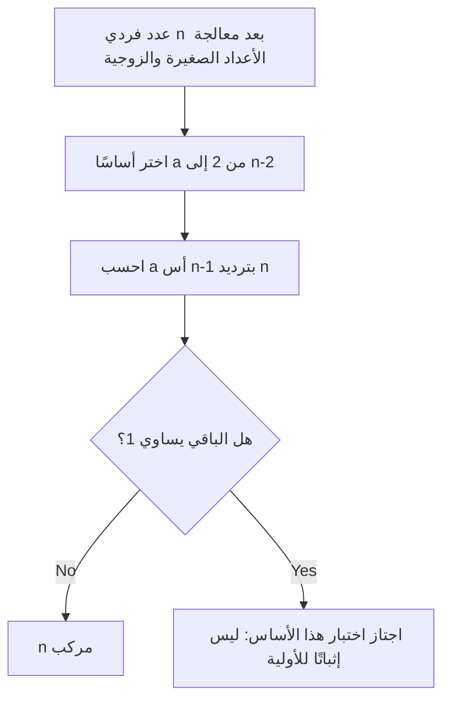
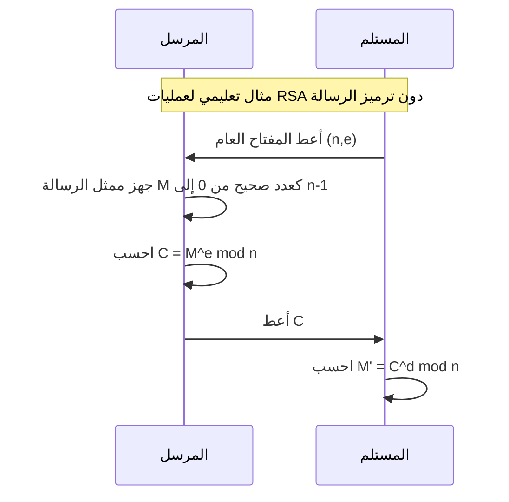

تصف مبرهنة فيرما الصغرى خصائص القوى بترديد عدد أولي. وهي تعطي شرطًا لازمًا للأولية، وتساعد على فهم صحة فك تشفير RSA. لكن صحة فك التشفير وحدها لا تضمن السرية. يميز هذا المقال بين المبرهنة والأمثلة والإثبات واختبارات الأولية والتطبيق في RSA.

## مبرهنة فيرما الصغرى

لعدد أولي $p$ وعدد صحيح $a$ يحقق $p\nmid a$:

$$ a^{p-1}\equiv1\pmod p. $$

يعني التطابق أن الفرق بين الطرفين من مضاعفات المقياس. هنا تعطي القوة باقيًا يساوي 1 عند القسمة على $p$. والصيغة الصالحة لكل عدد صحيح $a$ هي:

$$ a^p\equiv a\pmod p. $$

إذا كان $p\nmid a$ نضرب التطابق الأول في $a$. وإذا كان $p\mid a$، فكلا طرفي التطابق الثاني متطابق مع الصفر. يتطلب حذف الشرط التحقق من هذه الحالة على نحو منفصل أيضًا.

### أمثلة

- $p=5$، $a=2$: $2^4=16=5\cdot3+1$.
- $p=7$، $a=3$: $3^6=729=7\cdot104+1$.

يحقق المثالان الفرضيات ويعطيان باقيًا يساوي 1. حتى عندما يكون المقياس أوليًا، فإن الأساس الذي يقبل القسمة عليه لا يدخل ضمن العبارة الأولى.

## الإثبات بتبديل البواقي

نضرب كل عنصر من $S=\{1,2,\ldots,p-1\}$ في $a$، ثم نأخذ الباقي بترديد $p$. لا يوجد باقي صفر. إذا كان $ia\equiv ja\pmod p$، فبما أن $a$ و $p$ أوليان فيما بينهما يمكن اختزال العامل $a$، فنحصل على $i\equiv j\pmod p$. الفهارس موجبة وأصغر من المقياس، لذلك $i=j$.

إذن البواقي الناتجة إعادة ترتيب للبواقي غير الصفرية الأصلية. وبضرب جميع العناصر:

$$ a^{p-1}(p-1)!\equiv(p-1)!\pmod p. $$

بما أن $(p-1)!$ و $p$ أوليان فيما بينهما، نضرب بالمعكوس الضربي لاختزال العامل المشترك فنحصل على المبرهنة. لا تسمح التطابقات بالقسمة على عامل اعتباطي دون شروط.

## اختبار فيرما يفحص شرطًا لازمًا

نعالج أولًا الأعداد الصحيحة الأصغر من 2 على أنها غير أولية، و2 و3 على أنهما أوليان، وسائر الأعداد الزوجية على أنها مركبة. للعدد الفردي المتبقي $n>3$ نختار أساسًا $a$ يحقق $2\le a\le n-2$.

$$ a^{n-1}\not\equiv1\pmod n $$

يعني أن $n$ مركب. أما إذا كان الباقي 1، فالاختبار بهذا الأساس لم يكتشف مخالفة للشرط اللازم؛ ولم تثبت الأولية.

مثلًا، $341=11\cdot31$ مركب لكنه يجتاز الاختبار للأساس 2. يسمى مثل هذا العدد أوليًا كاذبًا بالنسبة إلى ذلك الأساس. وعدد كارمايكل عدد مركب يحقق تطابق فيرما **لكل أساس أولي نسبيًا مع ذلك العدد**. أصغر مثال، $561=3\cdot11\cdot17$، يجتاز اختبار الأساس 2 لكنه يفشل عند الأساس 3 الذي ليس أوليًا نسبيًا معه.

لا يعطي تجريب عدة أسس عشوائية حدًا صغيرًا موحدًا لاحتمال الاجتياز الخاطئ لكل الأعداد المركبة. يميز [الفصل 4 من HAC](https://cacr.uwaterloo.ca/hac/about/chap4.pdf) بين Fermat وMiller–Rabin. لعدد مركب فردي ثابت، لا يتجاوز احتمال اجتياز $k$ اختبارات ميلر–رابين خطأً، باستخدام أسس عشوائية مستقلة وموزعة بانتظام، القيمة $4^{-k}$. هذا ليس احتمال كون العدد مركبًا بعد اجتياز الاختبار، ولا ينطبق الحد تلقائيًا على أسس ثابتة اعتباطية. انظر [المقال المفصل عن اختبارات الأولية](https://kenji.blog/ar/p/cpp-fast-prime-testing-miller-rabin/).

## شروط صحة فك تشفير RSA

نختار عددين أوليين مختلفين $p,q$ ونضع $n=pq$. باستخدام دالة أويلر $\varphi(n)=(p-1)(q-1)$، يختار هذا البناء التعليمي أسًا عامًا يحقق $1<e<\varphi(n)$ و $\gcd(e,\varphi(n))=1$. ومعكوسه هو الأس الخاص الموجب $d$:

$$ ed\equiv1\pmod{\varphi(n)}. $$

المفتاح العام هو $(n,e)$، والتمثيل المبسط للمفتاح الخاص هو $(n,d)$. قد تتضمن المفاتيح الخاصة الفعلية عوامل لتسريع الحساب، وهي سرية أيضًا. العمليات الرياضية على ممثل هو عدد صحيح $0\le M<n$ هي:

$$ C=M^e\bmod n,\qquad M'=C^d\bmod n. $$

إذا كان $\gcd(M,n)=1$، فإن [مبرهنة أويلر](https://dlmf.nist.gov/27.2#E8) تعطي $M^{\varphi(n)}\equiv1\pmod n$. ولأن $ed=1+t\varphi(n)$ لعدد صحيح غير سالب $t$، يستعيد فك التشفير الممثل الأصلي.

لتشمل النتيجة الممثلين غير الأوليين نسبيًا مع المقياس، ننظر بترديد كل عدد أولي. إذا كان $p\mid M$، فإن $M^{ed}$ و $M$ كلاهما متطابق مع الصفر. وإلا، تعطينا مبرهنة فيرما الصغرى والعلاقة $p-1\mid ed-1$ التطابق المطلوب. وينطبق الاستدلال نفسه بترديد $q$. وبمبرهنة الباقي الصينية:

$$ M^{ed}\equiv M\pmod p,\quad M^{ed}\equiv M\pmod q
\quad\Longrightarrow\quad M^{ed}\equiv M\pmod n. $$

هكذا يُستعاد كل ممثل، بما في ذلك الصفر ومضاعفات العوامل. تحليل المقياس إلى عوامله يتيح حساب الأس الخاص، لكن هذا لا يعني أنه ثبت التكافؤ في الصعوبة بين العكس العام لعملية RSA وتحليل العدد إلى عوامله.

## التمييز بين الصحة والأمان

RSA دون ترميز الرسالة في المخطط حتمي ولا يكفي كمخطط تشفير آمن. يميز [القسمان 5 و7 من RFC 8017](https://www.rfc-editor.org/rfc/rfc8017.html) بين العمليات الأساسية ومخططات التشفير. يتطلب الاستخدام الفعلي مكتبة مدققة، ومخططًا مناسبًا مثل RSAES-OAEP، ومعلمات صحيحة، وعشوائية آمنة، وإدارة للمفاتيح. وRSASSA-PSS مخطط توقيع مستقل.

تعطي مبرهنة فيرما الصغرى أساسًا لفهم الحساب المعياري ورياضيات RSA. ينبغي التمييز بين المبرهنة واختبارات الأولية والمفاتيح الصالحة والمخططات التشفيرية العملية. وتشرح [مقدمة RSA](https://kenji.blog/ar/p/rsa-encryption-math-explained-for-beginners/) هذه الفروق بمزيد من التفصيل.
