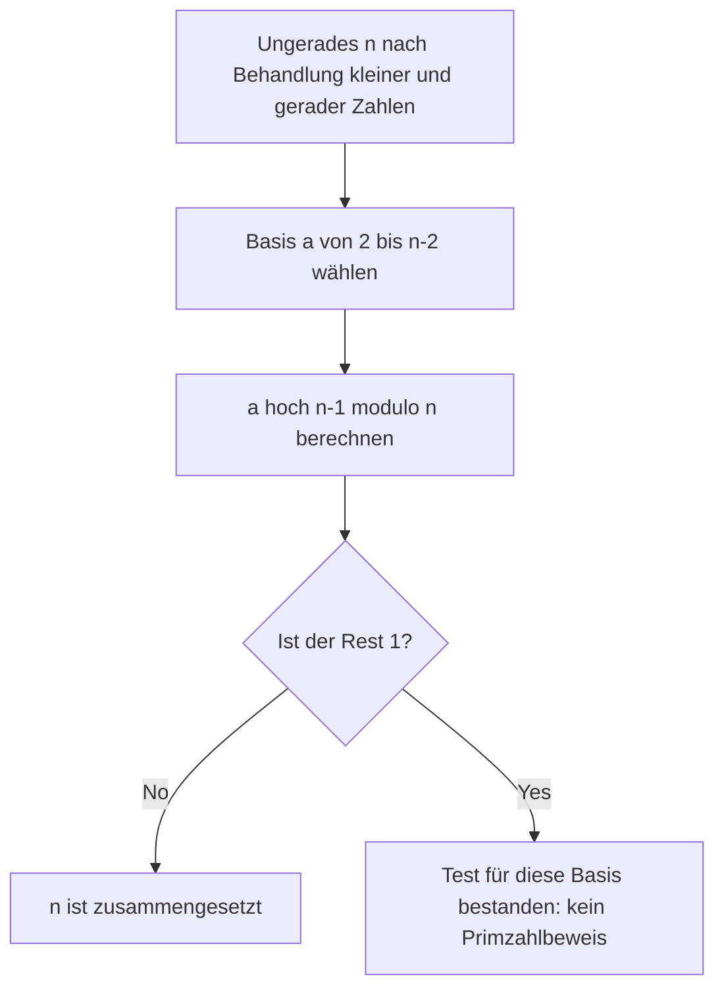
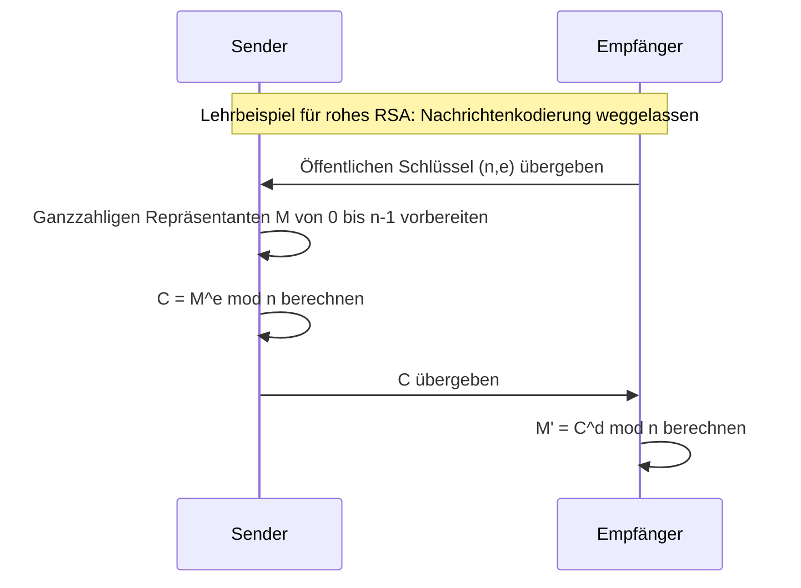

Der kleine Satz von Fermat beschreibt Potenzen modulo einer Primzahl. Er liefert eine notwendige Bedingung für Primalität und hilft zu erklären, warum die RSA-Entschlüsselung korrekt ist. Korrekte Entschlüsselung allein garantiert jedoch keine Vertraulichkeit. Dieser Artikel unterscheidet den Satz, Beispiele, den Beweis, Primzahltests und die Anwendung auf RSA.

## Der kleine Satz von Fermat

Für eine Primzahl $p$ und eine ganze Zahl $a$ mit $p\nmid a$ gilt:

$$ a^{p-1}\equiv1\pmod p. $$

Kongruenz bedeutet, dass die Differenz beider Seiten ein Vielfaches des Modulus ist. Hier lässt die Potenz bei Division durch $p$ den Rest 1. Eine für jede ganze Zahl $a$ gültige Form lautet:

$$ a^p\equiv a\pmod p. $$

Falls $p\nmid a$, multiplizieren wir die erste Kongruenz mit $a$. Falls $p\mid a$, sind beide Seiten der zweiten Kongruenz kongruent zu null. Um die Bedingung wegzulassen, muss auch dieser Fall gesondert geprüft werden.

### Beispiele

- $p=5$, $a=2$: $2^4=16=5\cdot3+1$.
- $p=7$, $a=3$: $3^6=729=7\cdot104+1$.

Beide Beispiele erfüllen die Voraussetzungen und liefern Rest 1. Selbst bei einem Primzahlmodulus fällt eine durch ihn teilbare Basis nicht unter die erste Aussage.

## Beweis durch Permutation der Reste

Wir multiplizieren jedes Element von $S=\{1,2,\ldots,p-1\}$ mit $a$ und reduzieren modulo $p$. Kein resultierender Rest ist null. Gilt $ia\equiv ja\pmod p$, können wir wegen der Teilerfremdheit von $a$ und $p$ den Faktor $a$ kürzen und erhalten $i\equiv j\pmod p$. Die Indizes sind positiv und kleiner als der Modulus, also ist $i=j$.

Die resultierenden Reste bilden somit eine Permutation der ursprünglichen von null verschiedenen Reste. Durch Multiplikation aller Elemente folgt:

$$ a^{p-1}(p-1)!\equiv(p-1)!\pmod p. $$

Da $(p-1)!$ zu $p$ teilerfremd ist, können wir mit seinem Inversen multiplizieren und den gemeinsamen Faktor kürzen. Daraus folgt der Satz. In Kongruenzen darf man nicht ohne Bedingungen durch einen beliebigen Faktor teilen.

## Der Fermat-Test prüft eine notwendige Bedingung

Zunächst behandeln wir ganze Zahlen unter 2 als nicht prim, 2 und 3 als prim und alle übrigen geraden Zahlen als zusammengesetzt. Für eine verbleibende ungerade Zahl $n>3$ wählen wir eine Basis $a$ mit $2\le a\le n-2$.

$$ a^{n-1}\not\equiv1\pmod n $$

zeigt, dass $n$ zusammengesetzt ist. Ist der Rest dagegen 1, hat der Test mit dieser Basis lediglich keinen Verstoß gegen die notwendige Bedingung gefunden; die Primalität ist damit nicht bewiesen.

Zum Beispiel ist $341=11\cdot31$ zusammengesetzt, besteht aber den Test zur Basis 2. Eine solche Zahl heißt Pseudoprimzahl zu dieser Basis. Eine Carmichael-Zahl ist zusammengesetzt und erfüllt die Fermat-Kongruenz für **jede zur Zahl teilerfremde Basis**. Das kleinste Beispiel $561=3\cdot11\cdot17$ besteht den Test zur Basis 2, scheitert aber an der nicht teilerfremden Basis 3.

Mehrere zufällige Basen liefern keine einheitlich kleine Fehlerschranke für alle zusammengesetzten Zahlen. [HAC, Kapitel 4](https://cacr.uwaterloo.ca/hac/about/chap4.pdf) unterscheidet Fermat und Miller–Rabin. Für eine feste ungerade zusammengesetzte Zahl beträgt die Wahrscheinlichkeit, $k$ Miller–Rabin-Tests mit unabhängigen, gleichverteilten zufälligen Basen fälschlich zu bestehen, höchstens $4^{-k}$. Dies ist nicht die Wahrscheinlichkeit, dass eine Zahl nach bestandenem Test zusammengesetzt ist. Die Schranke gilt auch nicht automatisch für beliebige feste Basen. Siehe den [ausführlichen Artikel zu Primzahltests](https://kenji.blog/de/p/cpp-fast-prime-testing-miller-rabin/).

## Bedingungen für korrekte RSA-Entschlüsselung

Wir wählen verschiedene Primzahlen $p,q$ und setzen $n=pq$. Mit der eulerschen Phi-Funktion $\varphi(n)=(p-1)(q-1)$ wählen wir in dieser Lehrkonstruktion einen öffentlichen Exponenten mit $1<e<\varphi(n)$ und $\gcd(e,\varphi(n))=1$. Sein Inverses ist der positive private Exponent $d$:

$$ ed\equiv1\pmod{\varphi(n)}. $$

Der öffentliche Schlüssel ist $(n,e)$, eine vereinfachte Darstellung des privaten Schlüssels ist $(n,d)$. Reale private Schlüssel können Faktoren für schnellere Berechnungen enthalten; auch diese sind geheim. Die mathematischen Operationen für einen ganzzahligen Repräsentanten $0\le M<n$ lauten:

$$ C=M^e\bmod n,\qquad M'=C^d\bmod n. $$

Ist $\gcd(M,n)=1$, ergibt der [Satz von Euler](https://dlmf.nist.gov/27.2#E8) die Kongruenz $M^{\varphi(n)}\equiv1\pmod n$. Da $ed=1+t\varphi(n)$ für eine nichtnegative ganze Zahl $t$ gilt, stellt die Entschlüsselung den ursprünglichen Repräsentanten wieder her.

Für nicht teilerfremde Repräsentanten betrachten wir jede Primzahl als Modulus. Falls $p\mid M$, sind $M^{ed}$ und $M$ beide kongruent zu null. Andernfalls liefern der kleine Satz von Fermat und $p-1\mid ed-1$ die erforderliche Kongruenz. Dasselbe gilt modulo $q$. Nach dem chinesischen Restsatz folgt:

$$ M^{ed}\equiv M\pmod p,\quad M^{ed}\equiv M\pmod q
\quad\Longrightarrow\quad M^{ed}\equiv M\pmod n. $$

Damit werden alle Repräsentanten wiederhergestellt, einschließlich null und der Vielfachen der Faktoren. Durch Faktorisieren des Modulus lässt sich der private Exponent berechnen. Das bedeutet jedoch nicht, dass die allgemeine RSA-Inversion und die Faktorisierung nachweislich gleich schwierig sind.

## Korrektheit und Sicherheit unterscheiden

Das rohe RSA im Diagramm ist deterministisch und reicht als sicheres Verschlüsselungsverfahren nicht aus. [Abschnitte 5 und 7 von RFC 8017](https://www.rfc-editor.org/rfc/rfc8017.html) unterscheiden Primitive und Verschlüsselungsverfahren. Für den praktischen Einsatz benötigt man eine auditierte Bibliothek, ein geeignetes Verfahren wie RSAES-OAEP, passende Parameter, sichere Zufallswerte und Schlüsselverwaltung. RSASSA-PSS ist ein eigenständiges Signaturverfahren.

Der kleine Satz von Fermat bildet eine Grundlage für das Verständnis modularer Arithmetik und der RSA-Mathematik. Satz, Primzahltest, gültige Schlüssel und praktische kryptographische Verfahren müssen auseinandergehalten werden. Die [RSA-Einführung](https://kenji.blog/de/p/rsa-encryption-math-explained-for-beginners/) erläutert diese Unterschiede genauer.
