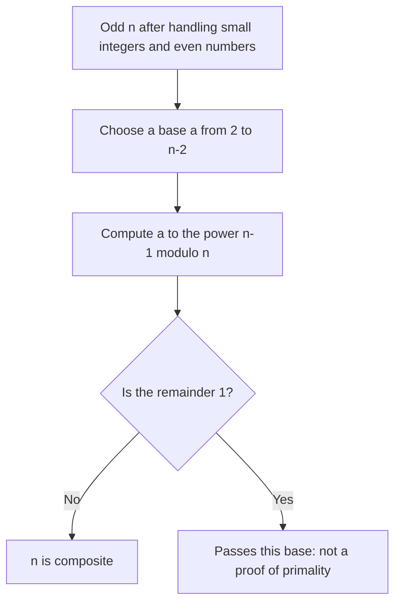
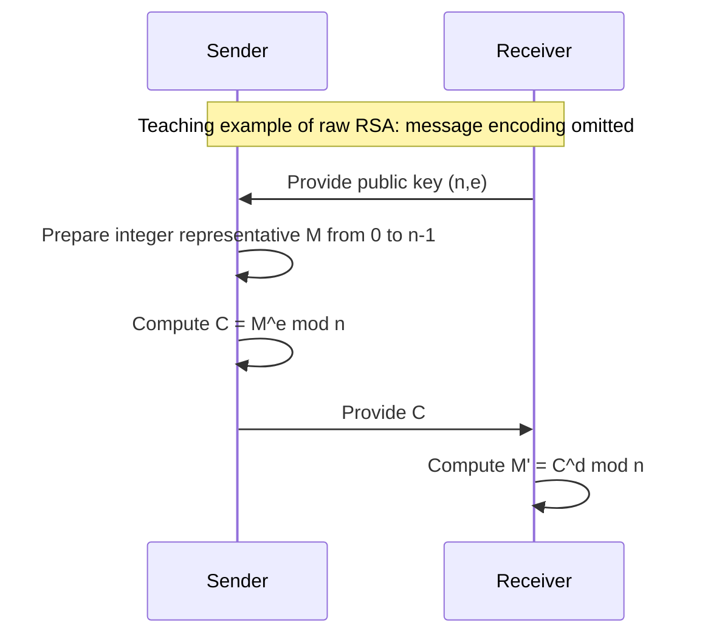

Fermat's little theorem describes powers modulo a prime. It leads to a necessary condition for primality and helps explain why RSA decryption is correct. Correct decryption alone does not guarantee confidentiality. This article distinguishes the theorem, examples, proof, primality testing, and its use in RSA.

## Fermat's little theorem

For a prime $p$ and an integer $a$ with $p\nmid a$:

$$ a^{p-1}\equiv1\pmod p. $$

Congruence means that the difference between the two sides is a multiple of the modulus. Here, the power leaves remainder 1 when divided by $p$. A form valid for every integer $a$ is:

$$ a^p\equiv a\pmod p. $$

If $p\nmid a$, multiply the first congruence by $a$. If $p\mid a$, both sides of the second congruence are congruent to zero. Removing the condition requires checking this case separately too.

### Examples

- $p=5$, $a=2$: $2^4=16=5\cdot3+1$.
- $p=7$, $a=3$: $3^6=729=7\cdot104+1$.

Both satisfy the assumptions and leave remainder 1. Even with a prime modulus, a base divisible by it falls outside the first statement.

## Proof by permuting the residues

Multiply every element of $S=\{1,2,\ldots,p-1\}$ by $a$ and reduce modulo $p$. None of the resulting residues is zero. If $ia\equiv ja\pmod p$, coprimality of $a$ and $p$ allows cancellation of $a$, giving $i\equiv j\pmod p$. Since the indices are positive and below the modulus, $i=j$.

Thus the resulting residues permute the original nonzero residues. Multiplying all the elements gives:

$$ a^{p-1}(p-1)!\equiv(p-1)!\pmod p. $$

Since $(p-1)!$ is coprime to $p$, multiply by its inverse to cancel the common factor and obtain the theorem. Congruences do not permit division by an arbitrary factor without conditions.

## The Fermat test checks a necessary condition

First handle integers below 2 as nonprime, 2 and 3 as prime, and all other even integers as composite. For a remaining odd $n>3$, choose a base $a$ with $2\le a\le n-2$.

$$ a^{n-1}\not\equiv1\pmod n $$

implies that $n$ is composite. If the congruence instead holds, the base has only failed to violate a necessary condition; primality has not been proved.

For example, $341=11\cdot31$ is composite but passes base 2. Such a number is a pseudoprime to that base. A Carmichael number is composite and satisfies the Fermat congruence for **every base coprime to the number**. The smallest example, $561=3\cdot11\cdot17$, passes base 2 but fails base 3, which is not coprime to it.

Trying several random bases does not give a uniformly small false-positive bound for every composite. [HAC Chapter 4](https://cacr.uwaterloo.ca/hac/about/chap4.pdf) distinguishes Fermat and Miller–Rabin. For a fixed odd composite, $k$ Miller–Rabin tests with independent uniformly random bases have false-positive probability at most $4^{-k}$. This is not the probability of compositeness after passing, nor does it automatically apply to arbitrary fixed bases. See the [detailed primality-testing article](https://kenji.blog/en/p/cpp-fast-prime-testing-miller-rabin/).

## Conditions for correct RSA decryption

Choose distinct primes $p,q$ and set $n=pq$. Using the totient $\varphi(n)=(p-1)(q-1)$, this teaching construction selects a public exponent with $1<e<\varphi(n)$ and $\gcd(e,\varphi(n))=1$. The positive private exponent $d$ is its inverse:

$$ ed\equiv1\pmod{\varphi(n)}. $$

The public key is $(n,e)$, and a simplified private-key representation is $(n,d)$. Actual private keys may include factors that speed up computation; these are secret too. The mathematical operations on an integer representative $0\le M<n$ are:

$$ C=M^e\bmod n,\qquad M'=C^d\bmod n. $$

If $\gcd(M,n)=1$, [Euler's theorem](https://dlmf.nist.gov/27.2#E8) gives $M^{\varphi(n)}\equiv1\pmod n$. Since $ed=1+t\varphi(n)$ for some nonnegative integer $t$, decryption restores the original representative.

To include representatives that are not coprime, work modulo each prime. If $p\mid M$, both $M^{ed}$ and $M$ are congruent to zero. Otherwise, Fermat's little theorem and $p-1\mid ed-1$ give the required congruence. The same argument holds modulo $q$. By the Chinese remainder theorem:

$$ M^{ed}\equiv M\pmod p,\quad M^{ed}\equiv M\pmod q
\quad\Longrightarrow\quad M^{ed}\equiv M\pmod n. $$

This recovers every representative, including zero and multiples of the factors. Factoring the modulus allows computation of the private exponent, but this does not mean that general RSA inversion and factoring have been proved equivalent in difficulty.

## Separate correctness from security

Raw RSA in the diagram is deterministic and insufficient as a secure encryption scheme. [Sections 5 and 7 of RFC 8017](https://www.rfc-editor.org/rfc/rfc8017.html) distinguish primitives from encryption schemes. Production use requires an audited library, an appropriate scheme such as RSAES-OAEP, suitable parameters, secure randomness, and key management. RSASSA-PSS is a separate signature scheme.

Fermat's little theorem provides a foundation for understanding modular arithmetic and the mathematics of RSA. Keep the theorem, primality testing, valid keys, and practical cryptographic schemes distinct. The [RSA introduction](https://kenji.blog/en/p/rsa-encryption-math-explained-for-beginners/) explains this distinction further.
