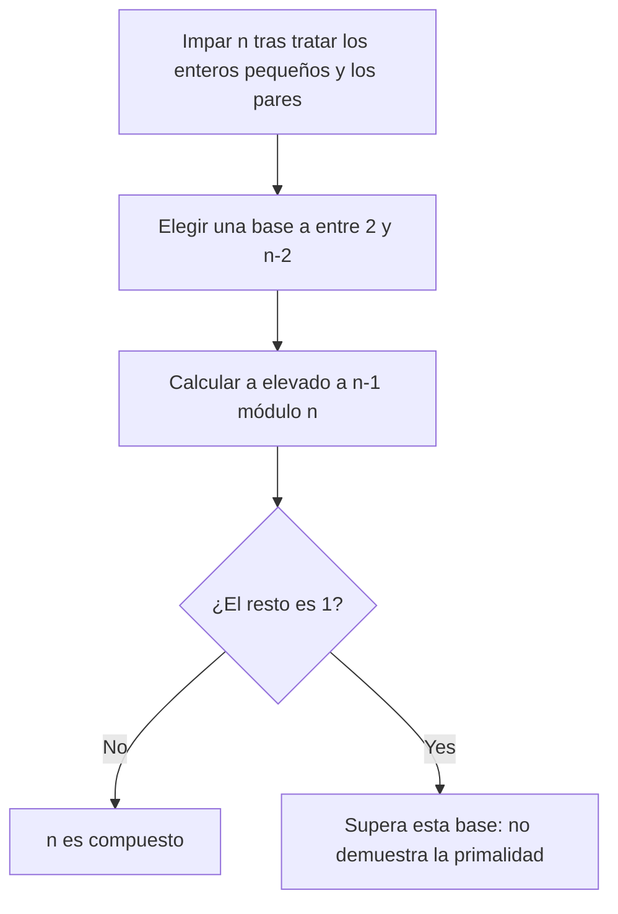
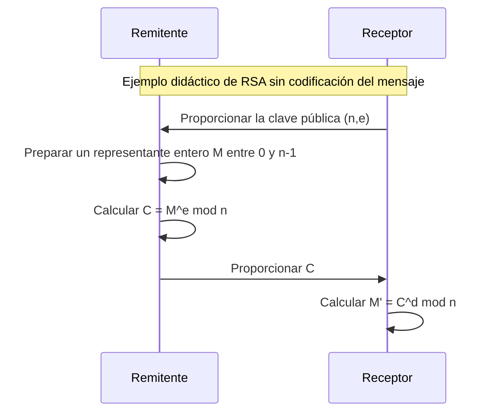

El pequeño teorema de Fermat describe las potencias módulo un primo. Proporciona una condición necesaria de primalidad y ayuda a explicar la corrección del descifrado RSA. Que el descifrado sea correcto no garantiza por sí solo la confidencialidad. Este artículo distingue el teorema, los ejemplos, la demostración, los tests de primalidad y su aplicación a RSA.

## El pequeño teorema de Fermat

Para un primo $p$ y un entero $a$ con $p\nmid a$:

$$ a^{p-1}\equiv1\pmod p. $$

La congruencia indica que la diferencia entre ambos miembros es múltiplo del módulo. Aquí, la potencia deja resto 1 al dividirla por $p$. Una forma válida para todo entero $a$ es:

$$ a^p\equiv a\pmod p. $$

Si $p\nmid a$, multiplicamos la primera congruencia por $a$. Si $p\mid a$, ambos miembros de la segunda son congruentes con cero. Eliminar la condición exige comprobar también este caso por separado.

### Ejemplos

- $p=5$, $a=2$: $2^4=16=5\cdot3+1$.
- $p=7$, $a=3$: $3^6=729=7\cdot104+1$.

Ambos ejemplos cumplen las hipótesis y dejan resto 1. Aunque el módulo sea primo, una base divisible por él queda fuera del primer enunciado.

## Demostración mediante una permutación de los restos

Multiplicamos cada elemento de $S=\{1,2,\ldots,p-1\}$ por $a$ y reducimos módulo $p$. Ningún resto es cero. Si $ia\equiv ja\pmod p$, como $a$ y $p$ son coprimos, podemos cancelar el factor $a$ y obtener $i\equiv j\pmod p$. Los índices son positivos y menores que el módulo, por lo que $i=j$.

Así, los restos obtenidos forman una permutación de los restos no nulos originales. Multiplicando todos los elementos:

$$ a^{p-1}(p-1)!\equiv(p-1)!\pmod p. $$

Como $(p-1)!$ es coprimo con $p$, multiplicamos por su inverso para cancelar el factor común y obtener el teorema. Las congruencias no permiten dividir por un factor arbitrario sin condiciones.

## El test de Fermat comprueba una condición necesaria

Primero se tratan los enteros menores que 2 como no primos, el 2 y el 3 como primos, y los demás pares como compuestos. Para un impar restante $n>3$, elegimos una base $a$ con $2\le a\le n-2$.

$$ a^{n-1}\not\equiv1\pmod n $$

implica que $n$ es compuesto. Si, en cambio, el resto es 1, el test con esa base no ha detectado ninguna infracción de la condición necesaria; no se ha demostrado la primalidad.

Por ejemplo, $341=11\cdot31$ es compuesto, pero supera el test con base 2. Un número así es un pseudoprimo para esa base. Un número de Carmichael es compuesto y satisface la congruencia de Fermat para **toda base coprima con el número**. El menor ejemplo, $561=3\cdot11\cdot17$, supera la base 2, pero falla con la base 3, que no es coprima con él.

Probar varias bases aleatorias no da una cota pequeña y uniforme de falsos positivos para todos los compuestos. [El capítulo 4 de HAC](https://cacr.uwaterloo.ca/hac/about/chap4.pdf) distingue Fermat de Miller–Rabin. Para un compuesto impar fijo, $k$ tests de Miller–Rabin con bases aleatorias independientes y uniformes tienen una probabilidad de falso positivo de como máximo $4^{-k}$. No es la probabilidad de que el número sea compuesto después de superar el test, ni se aplica automáticamente a bases fijas arbitrarias. Véase el [artículo detallado sobre tests de primalidad](https://kenji.blog/es/p/cpp-fast-prime-testing-miller-rabin/).

## Condiciones para que el descifrado RSA sea correcto

Elegimos primos distintos $p,q$ y establecemos $n=pq$. Usando la función totiente $\varphi(n)=(p-1)(q-1)$, esta construcción didáctica elige un exponente público con $1<e<\varphi(n)$ y $\gcd(e,\varphi(n))=1$. Su inverso es el exponente privado positivo $d$:

$$ ed\equiv1\pmod{\varphi(n)}. $$

La clave pública es $(n,e)$ y una representación simplificada de la clave privada es $(n,d)$. Las claves privadas reales pueden incluir factores que aceleran los cálculos; también son secretos. Las operaciones matemáticas sobre un representante entero $0\le M<n$ son:

$$ C=M^e\bmod n,\qquad M'=C^d\bmod n. $$

Si $\gcd(M,n)=1$, [el teorema de Euler](https://dlmf.nist.gov/27.2#E8) da $M^{\varphi(n)}\equiv1\pmod n$. Como $ed=1+t\varphi(n)$ para algún entero no negativo $t$, el descifrado recupera el representante original.

Para incluir representantes que no sean coprimos con el módulo, trabajamos módulo cada primo. Si $p\mid M$, tanto $M^{ed}$ como $M$ son congruentes con cero. En caso contrario, el pequeño teorema de Fermat y $p-1\mid ed-1$ dan la congruencia necesaria. El mismo argumento vale módulo $q$. Por el teorema chino del resto:

$$ M^{ed}\equiv M\pmod p,\quad M^{ed}\equiv M\pmod q
\quad\Longrightarrow\quad M^{ed}\equiv M\pmod n. $$

Esto recupera todos los representantes, incluidos el cero y los múltiplos de los factores. Factorizar el módulo permite calcular el exponente privado, pero no significa que la inversión general de RSA y la factorización hayan sido demostradas equivalentes en dificultad.

## Separar corrección y seguridad

El RSA mostrado en el diagrama, sin codificación del mensaje, es determinista e insuficiente como esquema de cifrado seguro. [Las secciones 5 y 7 de RFC 8017](https://www.rfc-editor.org/rfc/rfc8017.html) distinguen las primitivas de los esquemas de cifrado. El uso en producción requiere una biblioteca auditada, un esquema apropiado como RSAES-OAEP, parámetros adecuados, aleatoriedad segura y gestión de claves. RSASSA-PSS es un esquema de firma distinto.

El pequeño teorema de Fermat proporciona una base para comprender la aritmética modular y las matemáticas de RSA. Conviene distinguir el teorema, los tests de primalidad, las claves válidas y los esquemas criptográficos prácticos. La [introducción a RSA](https://kenji.blog/es/p/rsa-encryption-math-explained-for-beginners/) explica estas diferencias con más detalle.
