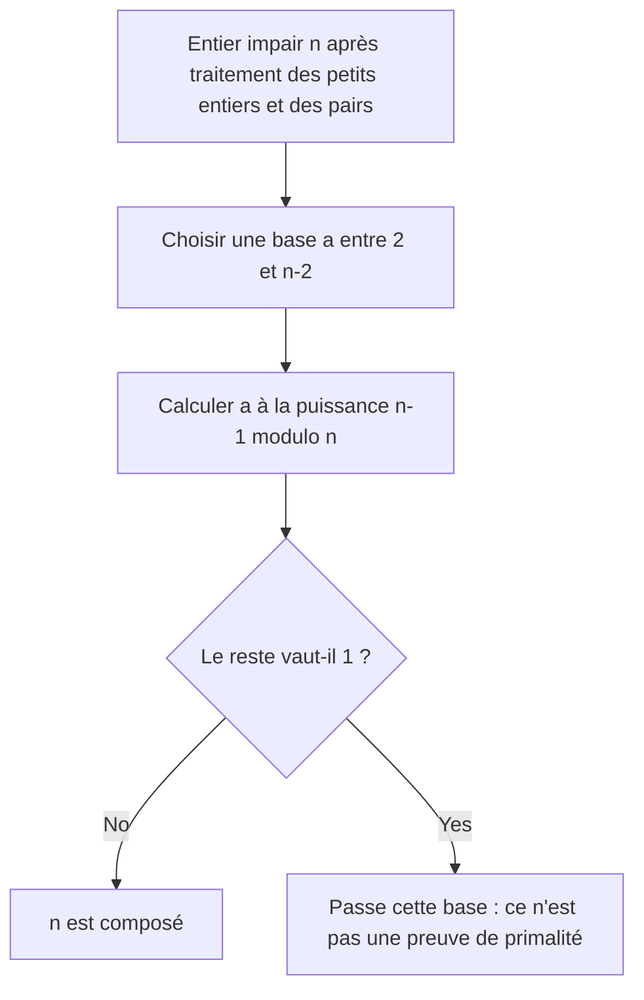
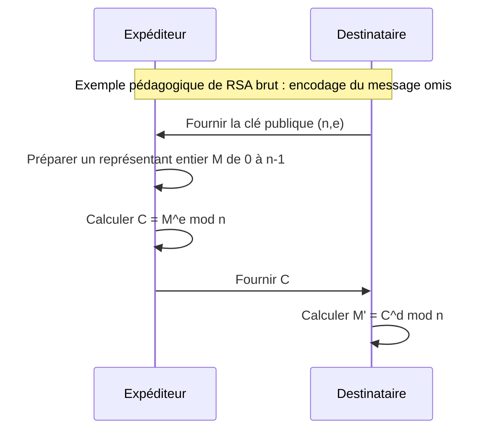

Le petit théorème de Fermat décrit les puissances modulo un nombre premier. Il fournit une condition nécessaire de primalité et aide à comprendre la correction du déchiffrement RSA. Un déchiffrement correct ne garantit pas à lui seul la confidentialité. Cet article distingue le théorème, les exemples, la démonstration, les tests de primalité et l'application à RSA.

## Le petit théorème de Fermat

Pour un nombre premier $p$ et un entier $a$ tels que $p\nmid a$ :

$$ a^{p-1}\equiv1\pmod p. $$

Une congruence signifie que la différence entre les deux membres est un multiple du module. Ici, la puissance donne un reste de 1 dans la division par $p$. Une forme valable pour tout entier $a$ est :

$$ a^p\equiv a\pmod p. $$

Si $p\nmid a$, on multiplie la première congruence par $a$. Si $p\mid a$, les deux membres de la seconde sont congrus à zéro. Supprimer la condition exige donc de vérifier aussi ce cas séparément.

### Exemples

- $p=5$, $a=2$ : $2^4=16=5\cdot3+1$.
- $p=7$, $a=3$ : $3^6=729=7\cdot104+1$.

Les deux exemples satisfont les hypothèses et donnent un reste de 1. Même si le module est premier, une base divisible par celui-ci sort du cadre du premier énoncé.

## Démonstration par permutation des restes

Multiplions chaque élément de $S=\{1,2,\ldots,p-1\}$ par $a$, puis réduisons modulo $p$. Aucun reste n'est nul. Si $ia\equiv ja\pmod p$, puisque $a$ et $p$ sont premiers entre eux, on peut simplifier par le facteur $a$ pour obtenir $i\equiv j\pmod p$. Les indices sont positifs et inférieurs au module, donc $i=j$.

Les restes obtenus forment ainsi une permutation des restes non nuls initiaux. En multipliant tous les éléments :

$$ a^{p-1}(p-1)!\equiv(p-1)!\pmod p. $$

Puisque $(p-1)!$ est premier avec $p$, on multiplie par son inverse pour éliminer le facteur commun et obtenir le théorème. Une congruence ne permet pas de diviser par un facteur quelconque sans condition.

## Le test de Fermat vérifie une condition nécessaire

On traite d'abord les entiers inférieurs à 2 comme non premiers, 2 et 3 comme premiers, et les autres entiers pairs comme composés. Pour un entier impair restant $n>3$, on choisit une base $a$ telle que $2\le a\le n-2$.

$$ a^{n-1}\not\equiv1\pmod n $$

implique que $n$ est composé. Si, au contraire, le reste vaut 1, le test avec cette base n'a détecté aucune violation de la condition nécessaire ; la primalité n'a pas été démontrée.

Par exemple, $341=11\cdot31$ est composé, mais passe le test en base 2. Un tel nombre est pseudopremier pour cette base. Un nombre de Carmichael est composé et satisfait la congruence de Fermat pour **toute base première avec ce nombre**. Le plus petit exemple, $561=3\cdot11\cdot17$, passe la base 2 mais échoue en base 3, qui n'est pas première avec lui.

Essayer plusieurs bases aléatoires ne fournit pas une petite borne uniforme de faux positifs pour tous les composés. [Le chapitre 4 du HAC](https://cacr.uwaterloo.ca/hac/about/chap4.pdf) distingue Fermat de Miller–Rabin. Pour un composé impair fixé, $k$ tests de Miller–Rabin avec des bases aléatoires indépendantes et uniformes ont une probabilité de faux positif d'au plus $4^{-k}$. Ce n'est pas la probabilité que le nombre soit composé après avoir passé le test, et la borne ne s'applique pas automatiquement à des bases fixes quelconques. Voir l'[article détaillé sur les tests de primalité](https://kenji.blog/fr/p/cpp-fast-prime-testing-miller-rabin/).

## Conditions d'un déchiffrement RSA correct

On choisit des nombres premiers distincts $p,q$ et on pose $n=pq$. Avec l'indicatrice d'Euler $\varphi(n)=(p-1)(q-1)$, cette construction pédagogique choisit un exposant public tel que $1<e<\varphi(n)$ et $\gcd(e,\varphi(n))=1$. Son inverse est l'exposant privé positif $d$ :

$$ ed\equiv1\pmod{\varphi(n)}. $$

La clé publique est $(n,e)$ et une représentation simplifiée de la clé privée est $(n,d)$. Les clés privées réelles peuvent contenir des facteurs qui accélèrent les calculs ; ils sont eux aussi secrets. Les opérations mathématiques sur un représentant entier $0\le M<n$ sont :

$$ C=M^e\bmod n,\qquad M'=C^d\bmod n. $$

Si $\gcd(M,n)=1$, [le théorème d'Euler](https://dlmf.nist.gov/27.2#E8) donne $M^{\varphi(n)}\equiv1\pmod n$. Puisque $ed=1+t\varphi(n)$ pour un certain entier non négatif $t$, le déchiffrement restitue le représentant initial.

Pour inclure les représentants non premiers avec le module, on raisonne modulo chaque nombre premier. Si $p\mid M$, alors $M^{ed}$ et $M$ sont tous deux congrus à zéro. Sinon, le petit théorème de Fermat et $p-1\mid ed-1$ donnent la congruence voulue. Le même raisonnement vaut modulo $q$. Par le théorème des restes chinois :

$$ M^{ed}\equiv M\pmod p,\quad M^{ed}\equiv M\pmod q
\quad\Longrightarrow\quad M^{ed}\equiv M\pmod n. $$

Cela restitue tous les représentants, y compris zéro et les multiples des facteurs. Factoriser le module permet de calculer l'exposant privé, mais cela ne signifie pas que l'inversion générale de RSA et la factorisation ont été démontrées équivalentes en difficulté.

## Séparer correction et sécurité

Le RSA brut du diagramme est déterministe et ne suffit pas à constituer un schéma de chiffrement sûr. [Les sections 5 et 7 du RFC 8017](https://www.rfc-editor.org/rfc/rfc8017.html) distinguent les primitives des schémas de chiffrement. Un usage en production exige une bibliothèque auditée, un schéma approprié tel que RSAES-OAEP, des paramètres adaptés, un aléa sûr et une gestion des clés. RSASSA-PSS est un schéma de signature distinct.

Le petit théorème de Fermat fournit une base pour comprendre l'arithmétique modulaire et les mathématiques de RSA. Il faut distinguer le théorème, les tests de primalité, les clés valides et les schémas cryptographiques pratiques. L'[introduction à RSA](https://kenji.blog/fr/p/rsa-encryption-math-explained-for-beginners/) explique davantage cette distinction.
