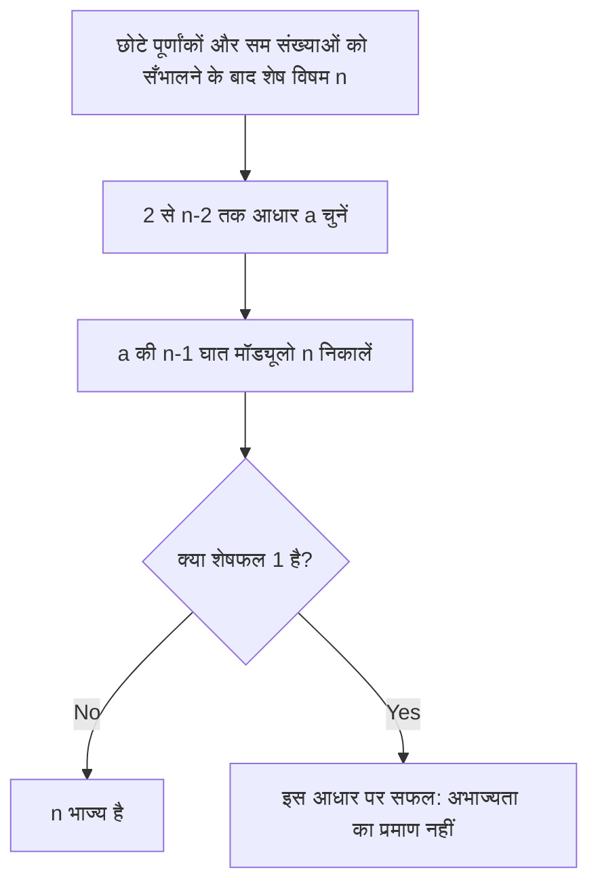
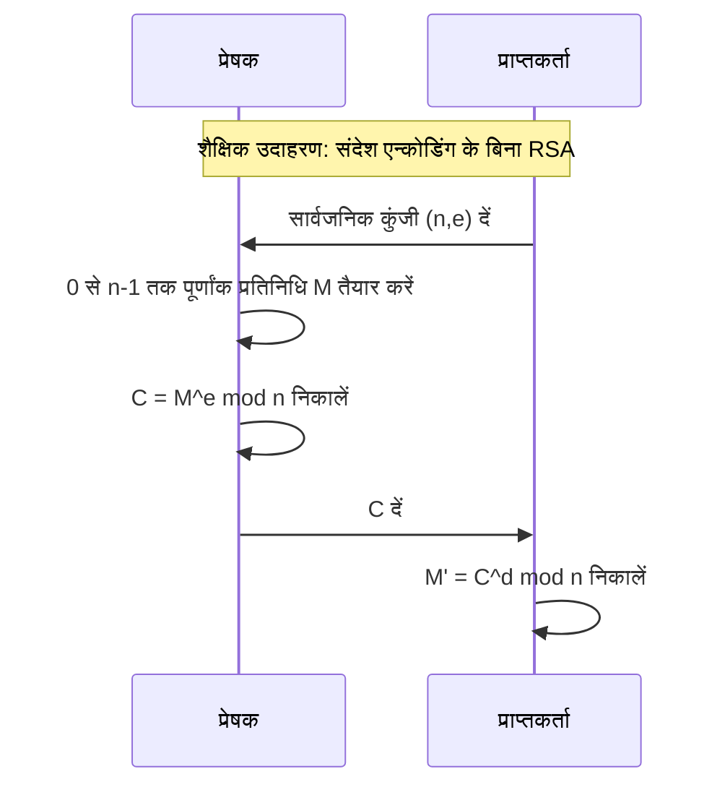

फर्मेट का छोटा प्रमेय किसी अभाज्य संख्या के मॉड्यूलो घात लेने का गुण बताता है। यह अभाज्यता की आवश्यक शर्त देता है और RSA में डिक्रिप्शन की शुद्धता समझने में मदद करता है। केवल सही डिक्रिप्शन से गोपनीयता सुनिश्चित नहीं होती। यह लेख प्रमेय, उदाहरण, प्रमाण, अभाज्यता परीक्षण और RSA में उसके अनुप्रयोग को अलग-अलग समझाता है।

## फर्मेट का छोटा प्रमेय

अभाज्य $p$ और पूर्णांक $a$ के लिए, यदि $p\nmid a$ है, तो:

$$ a^{p-1}\equiv1\pmod p. $$

सर्वांगसमता का अर्थ है कि दोनों पक्षों का अंतर मॉड्यूलस का गुणज है। यहाँ घात लेने के बाद $p$ से भाग देने पर शेषफल 1 मिलता है। हर पूर्णांक $a$ के लिए मान्य रूप है:

$$ a^p\equiv a\pmod p. $$

यदि $p\nmid a$ है, तो पहली सर्वांगसमता को $a$ से गुणा करें। यदि $p\mid a$ है, तो दूसरी सर्वांगसमता के दोनों पक्ष शून्य के सर्वांगसम हैं। शर्त हटाने के लिए इस मामले की अलग से जाँच भी आवश्यक है।

### उदाहरण

- $p=5$, $a=2$: $2^4=16=5\cdot3+1$।
- $p=7$, $a=3$: $3^6=729=7\cdot104+1$।

दोनों उदाहरण परिकल्पनाएँ पूरी करते हैं और शेषफल 1 देते हैं। मॉड्यूलस अभाज्य होने पर भी, उससे विभाज्य आधार पहले कथन के दायरे में नहीं आता।

## शेषफलों के क्रमचय से प्रमाण

$S=\{1,2,\ldots,p-1\}$ के प्रत्येक तत्व को $a$ से गुणा करके मॉड्यूलो $p$ में घटाएँ। कोई शेषफल शून्य नहीं है। यदि $ia\equiv ja\pmod p$ है, तो $a$ और $p$ के सह-अभाज्य होने से गुणक $a$ काटकर $i\equiv j\pmod p$ मिलता है। सूचकांक धनात्मक हैं और मॉड्यूलस से छोटे हैं, इसलिए $i=j$ है।

अतः प्राप्त शेषफल मूल अशून्य शेषफलों का क्रमचय हैं। सभी तत्वों का गुणनफल लेने पर:

$$ a^{p-1}(p-1)!\equiv(p-1)!\pmod p. $$

चूँकि $(p-1)!$ और $p$ सह-अभाज्य हैं, उसके व्युत्क्रम से गुणा करके साझा गुणक काट सकते हैं और प्रमेय प्राप्त होता है। सर्वांगसमता में किसी भी गुणक से बिना शर्त भाग देना मान्य नहीं है।

## फर्मेट परीक्षण आवश्यक शर्त जाँचता है

पहले 2 से छोटे पूर्णांकों को अभाज्य नहीं, 2 और 3 को अभाज्य, और बाकी सम संख्याओं को भाज्य मानकर सँभालें। शेष विषम $n>3$ के लिए आधार $a$ चुनें, जहाँ $2\le a\le n-2$ हो।

$$ a^{n-1}\not\equiv1\pmod n $$

होने से सिद्ध होता है कि $n$ भाज्य है। इसके विपरीत, शेषफल 1 होने पर उस आधार के परीक्षण में केवल आवश्यक शर्त का उल्लंघन नहीं मिला है; अभाज्यता सिद्ध नहीं हुई है।

उदाहरण के लिए, $341=11\cdot31$ भाज्य है, लेकिन आधार 2 पर सफल होता है। ऐसी संख्या उस आधार के लिए छद्म-अभाज्य कहलाती है। कारमाइकल संख्या ऐसी भाज्य संख्या है जो **उस संख्या के साथ सह-अभाज्य हर आधार** के लिए फर्मेट की सर्वांगसमता संतुष्ट करती है। सबसे छोटा उदाहरण $561=3\cdot11\cdot17$ आधार 2 पर सफल होता है, लेकिन आधार 3 पर विफल होता है, जो उसके साथ सह-अभाज्य नहीं है।

कई यादृच्छिक आधार आज़माने से सभी भाज्य संख्याओं के लिए गलत तरीके से सफल होने की प्रायिकता की एक समान छोटी सीमा नहीं मिलती। [HAC का अध्याय 4](https://cacr.uwaterloo.ca/hac/about/chap4.pdf) Fermat और Miller–Rabin में अंतर करता है। एक निश्चित विषम भाज्य संख्या के लिए, स्वतंत्र और एकसमान यादृच्छिक आधारों वाले $k$ Miller–Rabin परीक्षणों में गलत तरीके से सफल होने की प्रायिकता अधिकतम $4^{-k}$ है। यह सफल परीक्षण के बाद संख्या के भाज्य होने की प्रायिकता नहीं है, और मनमाने निश्चित आधारों पर यह सीमा स्वतः लागू नहीं होती। [अभाज्यता परीक्षण का विस्तृत लेख](https://kenji.blog/hi/p/cpp-fast-prime-testing-miller-rabin/) भी देखें।

## RSA में सही डिक्रिप्शन की शर्तें

भिन्न अभाज्य संख्याएँ $p,q$ चुनें और $n=pq$ रखें। टोटिएंट फलन $\varphi(n)=(p-1)(q-1)$ का उपयोग करते हुए इस शैक्षिक निर्माण में सार्वजनिक घातांक $1<e<\varphi(n)$ और $\gcd(e,\varphi(n))=1$ संतुष्ट करता है। उसका व्युत्क्रम धनात्मक निजी घातांक $d$ है:

$$ ed\equiv1\pmod{\varphi(n)}. $$

सार्वजनिक कुंजी $(n,e)$ और निजी कुंजी का सरल रूप $(n,d)$ है। वास्तविक निजी कुंजी में गणना तेज़ करने वाले गुणनखंड भी हो सकते हैं; वे भी गोपनीय हैं। पूर्णांक प्रतिनिधि $0\le M<n$ पर गणितीय संक्रियाएँ हैं:

$$ C=M^e\bmod n,\qquad M'=C^d\bmod n. $$

यदि $\gcd(M,n)=1$ है, तो [यूलर का प्रमेय](https://dlmf.nist.gov/27.2#E8) $M^{\varphi(n)}\equiv1\pmod n$ देता है। किसी गैर-ऋणात्मक पूर्णांक $t$ के लिए $ed=1+t\varphi(n)$ होने से डिक्रिप्शन मूल प्रतिनिधि वापस देता है।

सह-अभाज्य न होने वाले प्रतिनिधियों को भी शामिल करने के लिए प्रत्येक अभाज्य को मॉड्यूलस मानकर देखें। यदि $p\mid M$ है, तो $M^{ed}$ और $M$ दोनों शून्य के सर्वांगसम हैं। अन्यथा फर्मेट के छोटे प्रमेय और $p-1\mid ed-1$ से वांछित सर्वांगसमता मिलती है। यही तर्क मॉड्यूलो $q$ में लागू होता है। चीनी शेषफल प्रमेय से:

$$ M^{ed}\equiv M\pmod p,\quad M^{ed}\equiv M\pmod q
\quad\Longrightarrow\quad M^{ed}\equiv M\pmod n. $$

इससे शून्य और गुणनखंडों के गुणजों सहित सभी प्रतिनिधि पुनः मिलते हैं। मॉड्यूलस का गुणनखंडन करने से निजी घातांक निकाला जा सकता है, लेकिन इससे यह नहीं निकलता कि सामान्य RSA का उलटा निकालने और गुणनखंडन करने की कठिनाई समतुल्य सिद्ध हो चुकी है।

## शुद्धता और सुरक्षा अलग रखें

चित्र में संदेश एन्कोडिंग के बिना RSA नियतात्मक है और सुरक्षित एन्क्रिप्शन योजना के लिए पर्याप्त नहीं है। [RFC 8017 के भाग 5 और 7](https://www.rfc-editor.org/rfc/rfc8017.html) प्रिमिटिव और एन्क्रिप्शन योजना को अलग करते हैं। वास्तविक उपयोग में ऑडिट की गई लाइब्रेरी, RSAES-OAEP जैसी उपयुक्त योजना, सही पैरामीटर, सुरक्षित यादृच्छिकता और कुंजी प्रबंधन चाहिए। RSASSA-PSS एक अलग हस्ताक्षर योजना है।

फर्मेट का छोटा प्रमेय मॉड्यूलर अंकगणित और RSA के गणित को समझने का आधार देता है। प्रमेय, अभाज्यता परीक्षण, वैध कुंजियों और व्यावहारिक क्रिप्टोग्राफिक योजनाओं को अलग समझें। [RSA का परिचय](https://kenji.blog/hi/p/rsa-encryption-math-explained-for-beginners/) इस अंतर को और स्पष्ट करता है।
