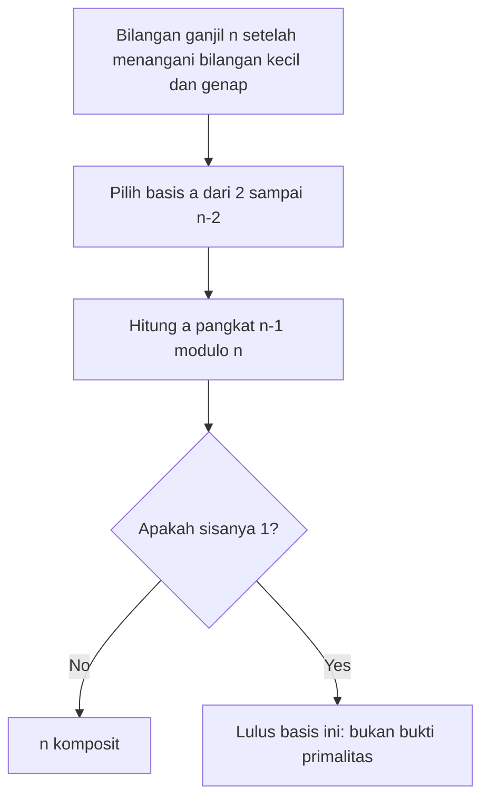
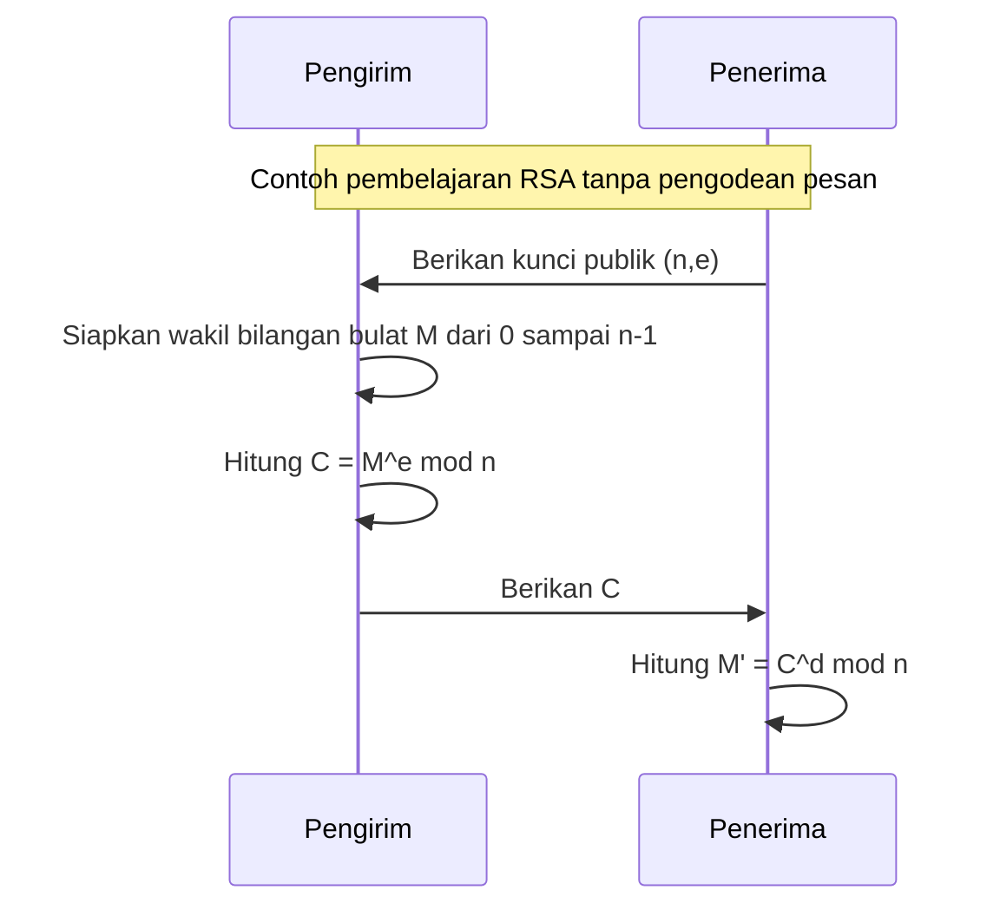

Teorema kecil Fermat menjelaskan sifat perpangkatan modulo bilangan prima. Teorema ini memberi syarat perlu bagi primalitas dan membantu menjelaskan kebenaran dekripsi RSA. Dekripsi yang benar saja tidak menjamin kerahasiaan. Artikel ini membedakan teorema, contoh, pembuktian, uji primalitas, dan penerapannya pada RSA.

## Teorema kecil Fermat

Untuk prima $p$ dan bilangan bulat $a$ dengan $p\nmid a$:

$$ a^{p-1}\equiv1\pmod p. $$

Kongruensi berarti selisih kedua ruas merupakan kelipatan modulus. Di sini, hasil perpangkatan bersisa 1 saat dibagi $p$. Bentuk yang berlaku bagi setiap bilangan bulat $a$ adalah:

$$ a^p\equiv a\pmod p. $$

Jika $p\nmid a$, kalikan kongruensi pertama dengan $a$. Jika $p\mid a$, kedua ruas kongruensi kedua kongruen dengan nol. Menghapus syarat tersebut juga memerlukan pemeriksaan kasus ini secara terpisah.

### Contoh

- $p=5$, $a=2$: $2^4=16=5\cdot3+1$.
- $p=7$, $a=3$: $3^6=729=7\cdot104+1$.

Kedua contoh memenuhi asumsi dan bersisa 1. Meskipun modulusnya prima, basis yang habis dibagi modulus tidak termasuk dalam pernyataan pertama.

## Pembuktian melalui permutasi residu

Kalikan setiap anggota $S=\{1,2,\ldots,p-1\}$ dengan $a$, lalu reduksi modulo $p$. Tidak ada residu yang nol. Jika $ia\equiv ja\pmod p$, karena $a$ dan $p$ saling prima, faktor $a$ dapat dicoret sehingga diperoleh $i\equiv j\pmod p$. Indeksnya positif dan lebih kecil dari modulus, sehingga $i=j$.

Jadi, residu yang dihasilkan merupakan permutasi residu tak nol semula. Dengan mengalikan semua anggota:

$$ a^{p-1}(p-1)!\equiv(p-1)!\pmod p. $$

Karena $(p-1)!$ saling prima dengan $p$, kalikan dengan inversnya untuk mencoret faktor bersama dan memperoleh teorema. Kongruensi tidak mengizinkan pembagian dengan faktor sembarang tanpa syarat.

## Uji Fermat memeriksa syarat perlu

Pertama, tangani bilangan bulat kurang dari 2 sebagai bukan prima, 2 dan 3 sebagai prima, serta bilangan genap lainnya sebagai komposit. Untuk bilangan ganjil yang tersisa $n>3$, pilih basis $a$ dengan $2\le a\le n-2$.

$$ a^{n-1}\not\equiv1\pmod n $$

menunjukkan bahwa $n$ komposit. Sebaliknya, jika sisanya 1, uji pada basis tersebut hanya tidak menemukan pelanggaran syarat perlu; primalitas belum terbukti.

Contohnya, $341=11\cdot31$ komposit, tetapi lulus uji pada basis 2. Bilangan seperti ini disebut prima semu terhadap basis tersebut. Bilangan Carmichael adalah komposit yang memenuhi kongruensi Fermat untuk **setiap basis yang saling prima dengan bilangan itu**. Contoh terkecil, $561=3\cdot11\cdot17$, lulus basis 2 tetapi gagal pada basis 3 yang tidak saling prima dengannya.

Mencoba beberapa basis acak tidak memberi batas kecil yang seragam untuk peluang positif palsu bagi semua komposit. [HAC Bab 4](https://cacr.uwaterloo.ca/hac/about/chap4.pdf) membedakan Fermat dan Miller–Rabin. Untuk satu komposit ganjil tetap, $k$ uji Miller–Rabin dengan basis acak seragam dan independen memiliki peluang positif palsu paling besar $4^{-k}$. Ini bukan peluang bahwa bilangan tersebut komposit setelah lulus uji, dan batasnya tidak otomatis berlaku untuk basis tetap sembarang. Lihat [artikel uji primalitas yang lebih rinci](https://kenji.blog/id/p/cpp-fast-prime-testing-miller-rabin/).

## Syarat agar dekripsi RSA benar

Pilih prima berbeda $p,q$ dan tetapkan $n=pq$. Dengan fungsi totien $\varphi(n)=(p-1)(q-1)$, konstruksi pembelajaran ini memilih eksponen publik dengan $1<e<\varphi(n)$ dan $\gcd(e,\varphi(n))=1$. Inversnya adalah eksponen privat positif $d$:

$$ ed\equiv1\pmod{\varphi(n)}. $$

Kunci publik adalah $(n,e)$, dan bentuk sederhana kunci privat adalah $(n,d)$. Kunci privat nyata dapat memuat faktor untuk mempercepat perhitungan; faktor tersebut juga rahasia. Operasi matematika pada wakil pesan berupa bilangan bulat $0\le M<n$ adalah:

$$ C=M^e\bmod n,\qquad M'=C^d\bmod n. $$

Jika $\gcd(M,n)=1$, [teorema Euler](https://dlmf.nist.gov/27.2#E8) memberikan $M^{\varphi(n)}\equiv1\pmod n$. Karena $ed=1+t\varphi(n)$ untuk suatu bilangan bulat tak negatif $t$, dekripsi memulihkan wakil semula.

Untuk menyertakan wakil yang tidak saling prima dengan modulus, tinjau modulo setiap prima. Jika $p\mid M$, maka $M^{ed}$ dan $M$ sama-sama kongruen dengan nol. Jika tidak, teorema kecil Fermat dan $p-1\mid ed-1$ memberikan kongruensi yang diperlukan. Argumen yang sama berlaku modulo $q$. Dari teorema sisa Tiongkok:

$$ M^{ed}\equiv M\pmod p,\quad M^{ed}\equiv M\pmod q
\quad\Longrightarrow\quad M^{ed}\equiv M\pmod n. $$

Ini memulihkan semua wakil, termasuk nol dan kelipatan faktor-faktornya. Memfaktorkan modulus memungkinkan perhitungan eksponen privat, tetapi tidak berarti inversi RSA secara umum dan faktorisasi telah terbukti setara dalam kesulitannya.

## Membedakan kebenaran dan keamanan

RSA tanpa pengodean pesan pada diagram bersifat deterministik dan tidak cukup sebagai skema enkripsi yang aman. [Bagian 5 dan 7 RFC 8017](https://www.rfc-editor.org/rfc/rfc8017.html) membedakan primitif dan skema enkripsi. Penggunaan produksi memerlukan pustaka yang diaudit, skema yang sesuai seperti RSAES-OAEP, parameter yang tepat, keacakan aman, dan pengelolaan kunci. RSASSA-PSS adalah skema tanda tangan yang terpisah.

Teorema kecil Fermat memberi dasar untuk memahami aritmetika modular dan matematika RSA. Bedakan teorema, uji primalitas, kunci yang valid, dan skema kriptografi praktis. [Pengantar RSA](https://kenji.blog/id/p/rsa-encryption-math-explained-for-beginners/) menjelaskan perbedaan ini lebih lanjut.
