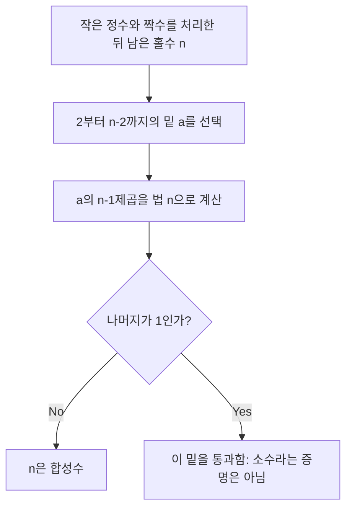
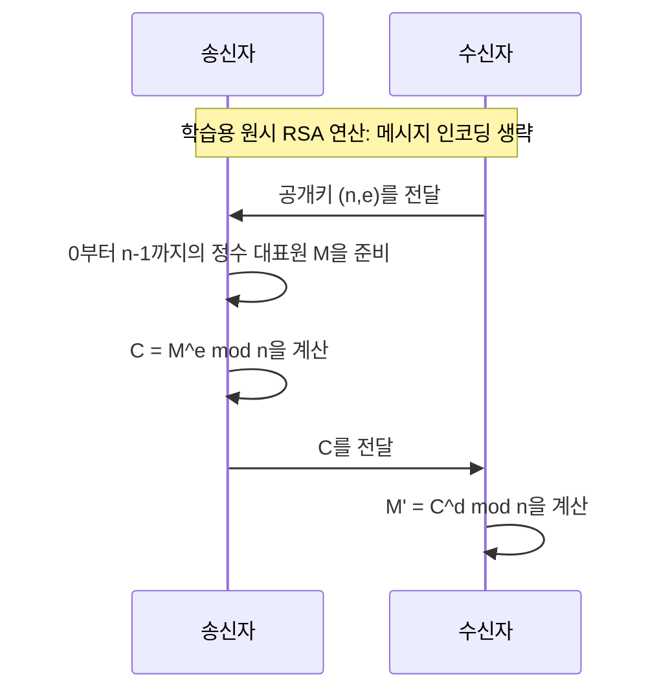

페르마의 소정리는 소수를 법으로 하는 거듭제곱의 성질을 설명합니다. 소수 판정의 필요조건을 제공하며 RSA 복호화가 올바른 이유를 이해하는 데도 도움이 됩니다. 하지만 올바르게 복호화할 수 있다는 사실만으로 통신의 기밀성이 보장되지는 않습니다. 이 글에서는 정리, 예시, 증명, 소수 판정과 RSA에 대한 응용을 구분하여 설명합니다.

## 페르마의 소정리

소수 $p$와 정수 $a$가 $p\nmid a$를 만족하면 다음이 성립합니다.

$$ a^{p-1}\equiv1\pmod p. $$

합동은 양변의 차가 법의 배수라는 뜻입니다. 여기서는 거듭제곱한 값을 $p$로 나눈 나머지가 1임을 나타냅니다. 모든 정수 $a$에 대해 성립하는 형태는 다음과 같습니다.

$$ a^p\equiv a\pmod p. $$

$p\nmid a$이면 첫 번째 합동식에 $a$를 곱합니다. $p\mid a$이면 두 번째 합동식의 양변이 모두 0과 합동입니다. 조건을 없애려면 이 경우도 따로 확인해야 합니다.

### 예시

- $p=5$, $a=2$: $2^4=16=5\cdot3+1$.
- $p=7$, $a=3$: $3^6=729=7\cdot104+1$.

두 예시는 모두 정리의 가정을 만족하며 나머지가 1입니다. 법이 소수이더라도 밑이 그 배수이면 첫 번째 명제의 적용 대상이 아닙니다.

## 나머지의 순열을 이용한 증명

$S=\{1,2,\ldots,p-1\}$의 각 원소에 $a$를 곱하고 법 $p$에 대한 나머지를 구합니다. 나머지가 0인 경우는 없습니다. $ia\equiv ja\pmod p$이면 $a$와 $p$가 서로소이므로 인자 $a$를 약분하여 $i\equiv j\pmod p$를 얻습니다. 첨자는 법보다 작은 양의 정수이므로 $i=j$입니다.

따라서 얻은 나머지는 원래의 0이 아닌 나머지들을 재배열한 것입니다. 모든 원소를 곱하면 다음을 얻습니다.

$$ a^{p-1}(p-1)!\equiv(p-1)!\pmod p. $$

$(p-1)!$과 $p$가 서로소이므로 그 역원을 곱해 공통 인자를 약분하면 정리가 나옵니다. 합동식에서 임의의 인자로 조건 없이 나눌 수 있는 것은 아닙니다.

## 페르마 테스트는 필요조건을 검사합니다

먼저 2보다 작은 정수는 소수가 아니고, 2와 3은 소수이며, 그 밖의 짝수는 합성수라고 처리합니다. 남은 홀수 $n>3$에 대해 $2\le a\le n-2$인 밑 $a$를 선택합니다.

$$ a^{n-1}\not\equiv1\pmod n $$

위와 같이 합동이 아니면 $n$은 합성수입니다. 반대로 나머지가 1이면 그 밑에서는 필요조건 위반이 발견되지 않았다는 뜻일 뿐, 소수임을 증명한 것은 아닙니다.

예를 들어 $341=11\cdot31$은 합성수이지만 밑 2의 테스트를 통과합니다. 이런 수를 해당 밑에 대한 유사소수라고 합니다. 카마이클 수는 **그 수와 서로소인 모든 밑**에 대해 페르마 합동식을 만족하는 합성수입니다. 가장 작은 예인 $561=3\cdot11\cdot17$은 밑 2를 통과하지만, 서로소가 아닌 밑 3에서는 통과하지 못합니다.

여러 무작위 밑을 시도한다고 해서 모든 합성수에 대해 잘못 통과할 확률의 작고 일률적인 상한이 보장되지는 않습니다. [HAC 4장](https://cacr.uwaterloo.ca/hac/about/chap4.pdf)은 Fermat와 Miller–Rabin을 구분합니다. 고정된 홀수 합성수에 대해 독립적이고 균등한 무작위 밑으로 $k$번 Miller–Rabin 테스트를 수행하면 잘못 통과할 확률은 최대 $4^{-k}$입니다. 이는 통과한 뒤 그 수가 합성수일 확률과 같지 않으며, 임의의 고정 밑에 자동으로 적용되는 상한도 아닙니다. [소수 판정에 관한 자세한 글](https://kenji.blog/ko/p/cpp-fast-prime-testing-miller-rabin/)도 참고하세요.

## RSA가 올바르게 복호화되는 조건

서로 다른 소수 $p,q$를 선택하고 $n=pq$로 둡니다. 오일러 피 함수 $\varphi(n)=(p-1)(q-1)$를 이용하여, 이 학습용 구성에서는 $1<e<\varphi(n)$과 $\gcd(e,\varphi(n))=1$을 만족하는 공개 지수를 선택합니다. 그 역원인 양의 정수가 비밀 지수 $d$입니다.

$$ ed\equiv1\pmod{\varphi(n)}. $$

공개키는 $(n,e)$이고 비밀키의 단순화된 표현은 $(n,d)$입니다. 실제 비밀키에는 계산을 빠르게 하는 인수가 포함될 수도 있으며, 이 값들도 비밀입니다. 정수 메시지 대표원 $0\le M<n$에 대한 수학적 연산은 다음과 같습니다.

$$ C=M^e\bmod n,\qquad M'=C^d\bmod n. $$

$\gcd(M,n)=1$이면 [오일러의 정리](https://dlmf.nist.gov/27.2#E8)에 따라 $M^{\varphi(n)}\equiv1\pmod n$입니다. 어떤 음이 아닌 정수 $t$에 대해 $ed=1+t\varphi(n)$로 쓸 수 있으므로 복호화는 원래 대표원을 복원합니다.

서로소가 아닌 대표원까지 포함하려면 각 소수를 법으로 하여 생각합니다. $p\mid M$이면 $M^{ed}$와 $M$은 모두 0과 합동입니다. 그렇지 않으면 페르마의 소정리와 $p-1\mid ed-1$로부터 필요한 합동식이 나옵니다. 법 $q$에서도 마찬가지입니다. 중국인의 나머지 정리에 따라 다음을 얻습니다.

$$ M^{ed}\equiv M\pmod p,\quad M^{ed}\equiv M\pmod q
\quad\Longrightarrow\quad M^{ed}\equiv M\pmod n. $$

따라서 0과 인수의 배수를 포함한 모든 대표원이 복원됩니다. 법을 소인수분해하면 비밀 지수를 계산할 수 있지만, 일반적인 RSA 역산과 소인수분해의 어려움이 동등하다고 증명된 것은 아닙니다.

## 정확성과 안전성을 구분하기

그림의 원시 RSA는 결정적 연산이며 안전한 암호화 방식으로는 충분하지 않습니다. [RFC 8017의 5절과 7절](https://www.rfc-editor.org/rfc/rfc8017.html)은 프리미티브와 암호화 방식을 구분합니다. 실제 사용에는 감사를 거친 라이브러리, RSAES-OAEP 같은 적절한 방식, 알맞은 매개변수, 안전한 난수와 키 관리가 필요합니다. RSASSA-PSS는 별도의 서명 방식입니다.

페르마의 소정리는 모듈러 연산과 RSA의 수학을 이해하는 기초입니다. 정리, 소수 판정, 유효한 키, 실제 암호 방식을 구분해야 합니다. [RSA 입문 해설](https://kenji.blog/ko/p/rsa-encryption-math-explained-for-beginners/)에서 이 차이를 더 설명합니다.
