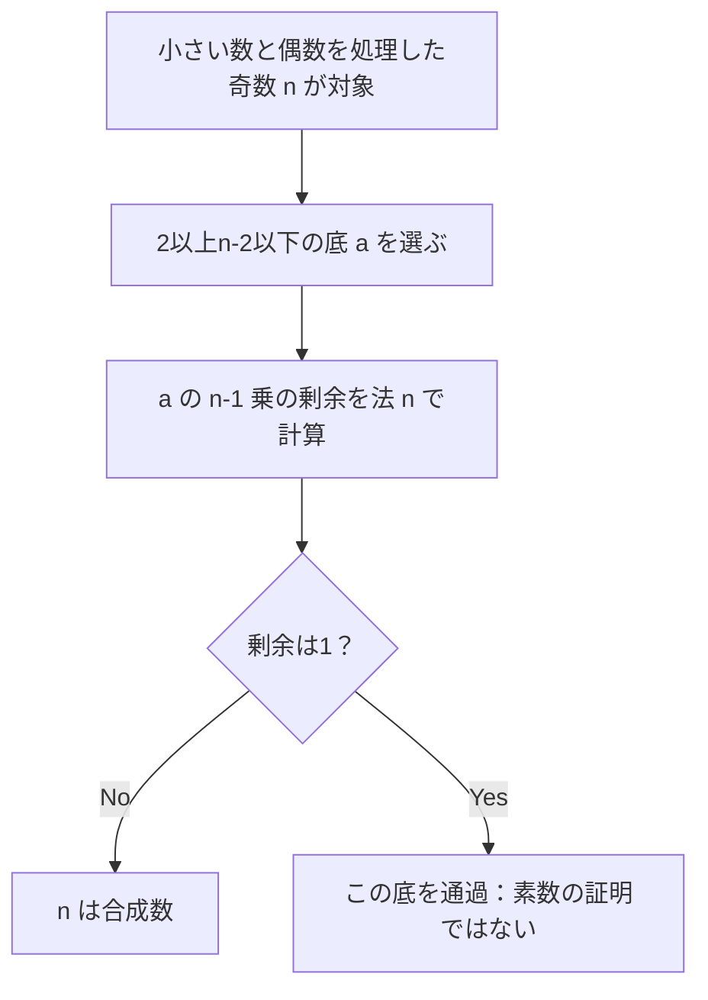
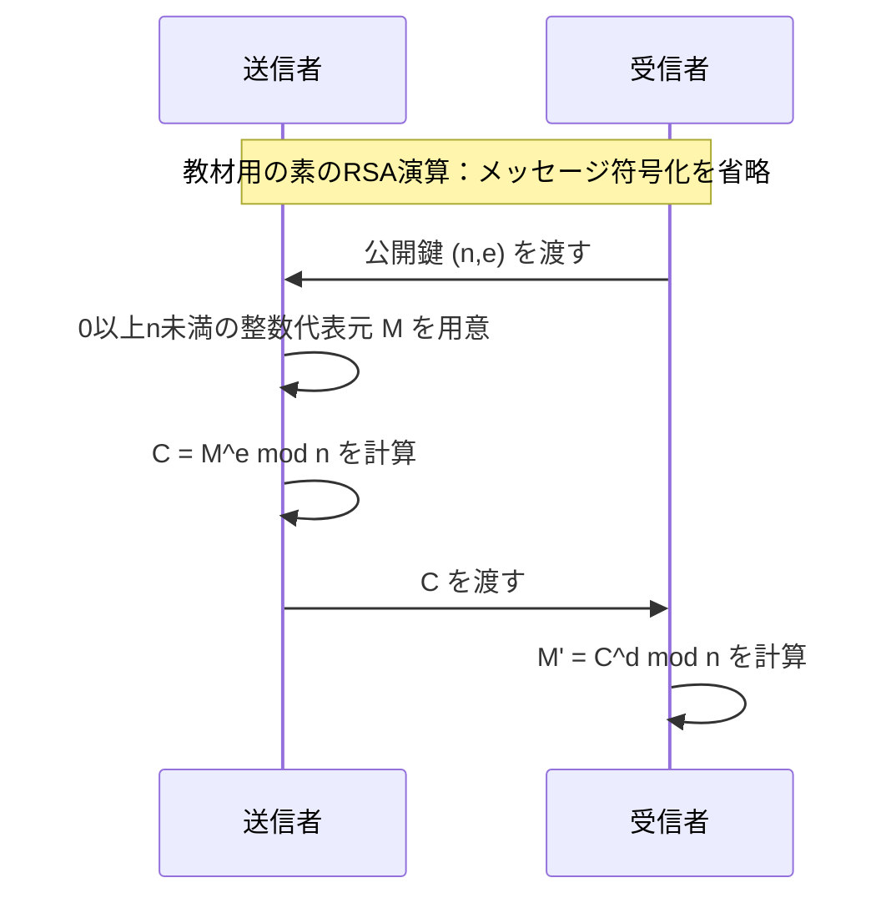

フェルマーの小定理は、素数を法とするべき乗の性質です。素数判定の必要条件とRSAの復号の正当性につながります。ただし、正しく復号できることだけでは通信の機密性を保証できません。この記事では、定理、具体例、証明、素数判定とRSAへの応用を区別して説明します。

## フェルマーの小定理

$p$ が素数、$a$ が整数で $p\nmid a$ のとき、

$$ a^{p-1}\equiv1\pmod p. $$

合同とは、両辺の差が法の倍数であることです。ここではべき乗を $p$ で割った余りが1になることを表します。すべての整数 $a$ に対して成り立つ形は、

$$ a^p\equiv a\pmod p. $$

$p\nmid a$ なら前の式に $a$ を掛けます。$p\mid a$ の場合は、後の式の両辺が0に合同です。条件を外すには、この場合も別に確認する必要があります。

### 具体例

- $p=5$、$a=2$：$2^4=16=5\cdot3+1$。
- $p=7$、$a=3$：$3^6=729=7\cdot104+1$。

どちらも定理の条件を満たし、余りは1です。素数でも底がその倍数なら第一の式の対象外です。

## 剰余の並べ替えによる証明

$S=\{1,2,\ldots,p-1\}$ の各要素を $a$ 倍し、法 $p$ の剰余を取ります。積の剰余は0になりません。また、$ia\equiv ja\pmod p$ なら、$a$ と $p$ が互いに素なので $a$ を約分して $i\equiv j\pmod p$ が得られます。添字は1以上で法未満なので $i=j$ です。

したがって得られた剰余は元の非零剰余の並べ替えです。各要素を掛け合わせると、

$$ a^{p-1}(p-1)!\equiv(p-1)!\pmod p. $$

$(p-1)!$ は $p$ と互いに素なので、この因子の逆元を掛けて約分できます。これで定理が得られます。合同式では一般の因子を無条件に割り算できるわけではありません。

## フェルマーテストは必要条件の検査

まず2未満は素数ではなく、2と3は素数、それ以外の偶数は合成数と処理します。残った奇数 $n>3$ について、底 $a$ を $2\le a\le n-2$ から選びます。

$$ a^{n-1}\not\equiv1\pmod n $$

ならば $n$ は合成数です。一方、等式が成立しても、その底で必要条件に違反しなかっただけで、素数と証明したことにはなりません。

例えば $341=11\cdot31$ は合成数ですが底2を通過します。このような数を、その底に対する擬素数と呼びます。カーマイケル数は、**その数と互いに素なすべての底**でフェルマーの合同式を満たす合成数です。最小の例 $561=3\cdot11\cdot17$ は底2を通過しますが、互いに素でない底3では通過しません。

複数のランダムな底を試すだけで、すべての合成数に一律の小さな誤通過率が得られるとは言えません。[HAC第4章](https://cacr.uwaterloo.ca/hac/about/chap4.pdf)は、FermatとMiller–Rabinを区別しています。固定した奇合成数に対するMiller–Rabinでは、独立・一様なランダム底による $k$ 回の検査の誤通過率は $4^{-k}$ 以下です。これは通過後に合成数である確率そのものではなく、任意の固定底へそのまま適用する上限でもありません。[素数判定の詳しい解説](https://kenji.blog/p/cpp-fast-prime-testing-miller-rabin/)も参照してください。

## RSAの復号が成り立つ条件

異なる素数 $p,q$ を選び、$n=pq$ とします。トーティエント $\varphi(n)=(p-1)(q-1)$ を用い、教材では $1<e<\varphi(n)$、$\gcd(e,\varphi(n))=1$ を満たす公開指数を選びます。その逆元となる正の秘密指数を $d$ とします。

$$ ed\equiv1\pmod{\varphi(n)}. $$

公開鍵は $(n,e)$、秘密鍵の簡略表現は $(n,d)$ です。実際の秘密鍵には計算を速くする因数などを含むこともあり、それらも秘密です。整数代表元 $0\le M<n$ に対する数学的な操作は、

$$ C=M^e\bmod n,\qquad M'=C^d\bmod n. $$

$\gcd(M,n)=1$ なら、[オイラーの定理](https://dlmf.nist.gov/27.2#E8)から $M^{\varphi(n)}\equiv1\pmod n$ です。非負整数 $t$ に対して $ed=1+t\varphi(n)$ と書けるので、復号は元の代表元に戻ります。

互いに素でない代表元も含めるには、各素数を法として考えます。$p\mid M$ なら $M^{ed}$ と $M$ はともに0に合同です。そうでなければフェルマーの小定理と $p-1\mid ed-1$ により両者は合同です。法 $q$ でも同じです。中国剰余定理から、

$$ M^{ed}\equiv M\pmod p,\quad M^{ed}\equiv M\pmod q
\quad\Longrightarrow\quad M^{ed}\equiv M\pmod n. $$

これで0や因数の倍数を含むすべての代表元を復元できます。素因数分解ができれば秘密指数を計算できますが、一般のRSA反転と素因数分解の困難さが同値と証明されたという意味ではありません。

## 正当性と安全性を分ける

図の素のRSAは決定的な演算であり、安全な暗号化方式としては不十分です。[RFC8017のSection5と7](https://www.rfc-editor.org/rfc/rfc8017.html)は、プリミティブと暗号化方式を区別しています。実用では監査されたライブラリ、RSAES-OAEPなど適切な方式、パラメータ、安全な乱数、鍵管理が必要です。RSASSA-PSSは署名用の別方式です。

フェルマーの小定理は剰余計算とRSAの数学を理解する基礎です。定理、素数判定、正しい鍵、実用の暗号方式という段階を混同せずに考えましょう。[RSAの入門解説](https://kenji.blog/p/rsa-encryption-math-explained-for-beginners/)では、この違いをさらに説明しています。
