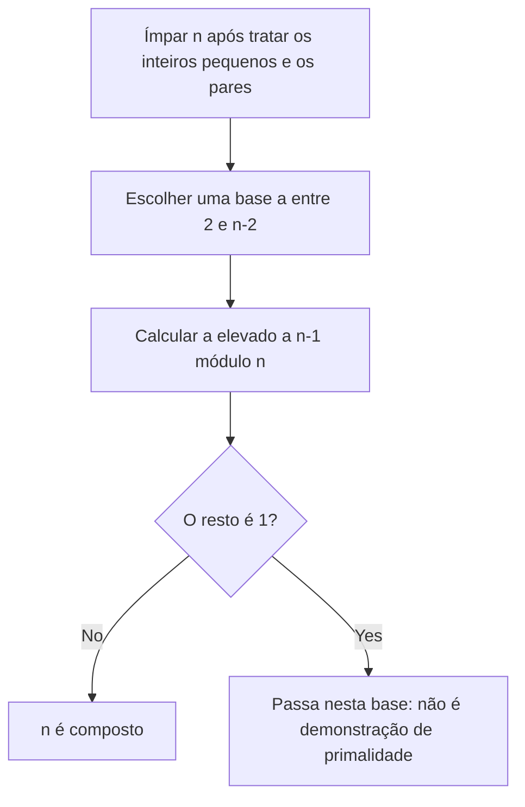
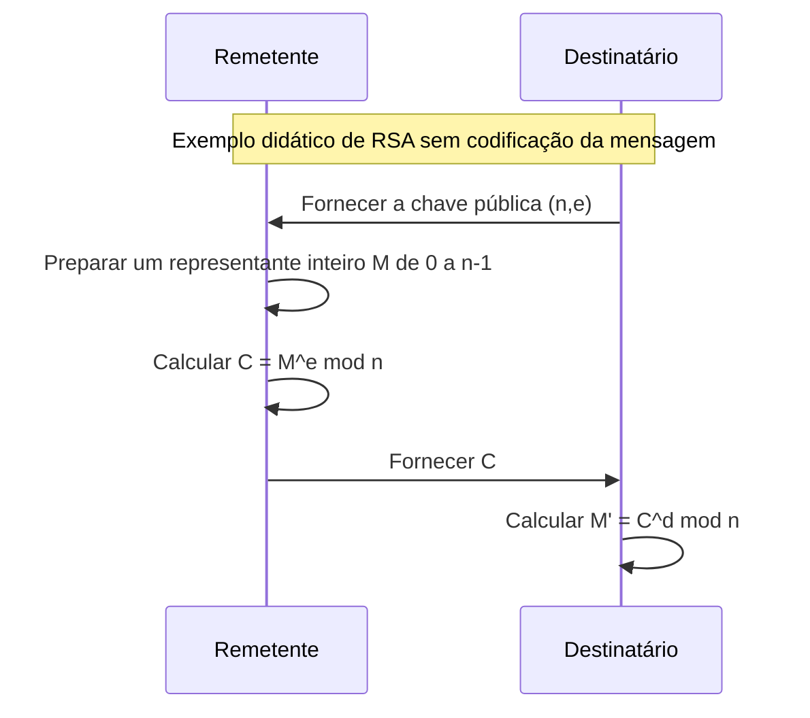

O pequeno teorema de Fermat descreve potências módulo um primo. Ele fornece uma condição necessária para a primalidade e ajuda a explicar a correção da decifração RSA. Decifrar corretamente, por si só, não garante confidencialidade. Este artigo distingue o teorema, os exemplos, a demonstração, os testes de primalidade e sua aplicação ao RSA.

## O pequeno teorema de Fermat

Para um primo $p$ e um inteiro $a$ com $p\nmid a$:

$$ a^{p-1}\equiv1\pmod p. $$

Congruência significa que a diferença entre os dois membros é múltipla do módulo. Aqui, a potência deixa resto 1 na divisão por $p$. Uma forma válida para todo inteiro $a$ é:

$$ a^p\equiv a\pmod p. $$

Se $p\nmid a$, multiplicamos a primeira congruência por $a$. Se $p\mid a$, os dois membros da segunda são congruentes a zero. Retirar a condição exige verificar esse caso separadamente também.

### Exemplos

- $p=5$, $a=2$: $2^4=16=5\cdot3+1$.
- $p=7$, $a=3$: $3^6=729=7\cdot104+1$.

Ambos satisfazem as hipóteses e deixam resto 1. Mesmo com módulo primo, uma base divisível por ele fica fora do primeiro enunciado.

## Demonstração por permutação dos restos

Multiplicamos cada elemento de $S=\{1,2,\ldots,p-1\}$ por $a$ e reduzimos módulo $p$. Nenhum resto é zero. Se $ia\equiv ja\pmod p$, como $a$ e $p$ são coprimos, podemos cancelar o fator $a$ e obter $i\equiv j\pmod p$. Os índices são positivos e menores que o módulo, portanto $i=j$.

Assim, os restos obtidos formam uma permutação dos restos não nulos originais. Multiplicando todos os elementos:

$$ a^{p-1}(p-1)!\equiv(p-1)!\pmod p. $$

Como $(p-1)!$ é coprimo com $p$, multiplicamos por seu inverso para cancelar o fator comum e obter o teorema. Congruências não permitem dividir por um fator arbitrário sem condições.

## O teste de Fermat verifica uma condição necessária

Primeiro, os inteiros menores que 2 são tratados como não primos, 2 e 3 como primos, e os demais pares como compostos. Para um ímpar restante $n>3$, escolhemos uma base $a$ com $2\le a\le n-2$.

$$ a^{n-1}\not\equiv1\pmod n $$

implica que $n$ é composto. Se, em vez disso, o resto for 1, o teste com essa base não detectou uma violação da condição necessária; a primalidade não foi demonstrada.

Por exemplo, $341=11\cdot31$ é composto, mas passa no teste de base 2. Um número assim é pseudoprimo para essa base. Um número de Carmichael é composto e satisfaz a congruência de Fermat para **toda base coprima com o número**. O menor exemplo, $561=3\cdot11\cdot17$, passa na base 2, mas falha na base 3, que não é coprima com ele.

Testar várias bases aleatórias não fornece um limite pequeno e uniforme de falsos positivos para todos os compostos. [O capítulo 4 do HAC](https://cacr.uwaterloo.ca/hac/about/chap4.pdf) distingue Fermat de Miller–Rabin. Para um composto ímpar fixo, $k$ testes de Miller–Rabin com bases aleatórias independentes e uniformes têm probabilidade de falso positivo de no máximo $4^{-k}$. Essa não é a probabilidade de o número ser composto depois de passar no teste, nem o limite se aplica automaticamente a bases fixas arbitrárias. Veja o [artigo detalhado sobre testes de primalidade](https://kenji.blog/pt/p/cpp-fast-prime-testing-miller-rabin/).

## Condições para a decifração correta do RSA

Escolhemos primos distintos $p,q$ e definimos $n=pq$. Usando a função totiente $\varphi(n)=(p-1)(q-1)$, esta construção didática escolhe um expoente público com $1<e<\varphi(n)$ e $\gcd(e,\varphi(n))=1$. Seu inverso é o expoente privado positivo $d$:

$$ ed\equiv1\pmod{\varphi(n)}. $$

A chave pública é $(n,e)$, e uma representação simplificada da chave privada é $(n,d)$. Chaves privadas reais podem incluir fatores que aceleram os cálculos; eles também são secretos. As operações matemáticas sobre um representante inteiro $0\le M<n$ são:

$$ C=M^e\bmod n,\qquad M'=C^d\bmod n. $$

Se $\gcd(M,n)=1$, [o teorema de Euler](https://dlmf.nist.gov/27.2#E8) fornece $M^{\varphi(n)}\equiv1\pmod n$. Como $ed=1+t\varphi(n)$ para algum inteiro não negativo $t$, a decifração recupera o representante original.

Para incluir representantes que não sejam coprimos com o módulo, trabalhamos módulo cada primo. Se $p\mid M$, tanto $M^{ed}$ quanto $M$ são congruentes a zero. Caso contrário, o pequeno teorema de Fermat e $p-1\mid ed-1$ fornecem a congruência necessária. O mesmo argumento vale módulo $q$. Pelo teorema chinês do resto:

$$ M^{ed}\equiv M\pmod p,\quad M^{ed}\equiv M\pmod q
\quad\Longrightarrow\quad M^{ed}\equiv M\pmod n. $$

Isso recupera todos os representantes, inclusive zero e múltiplos dos fatores. Fatorar o módulo permite calcular o expoente privado, mas não significa que a inversão geral do RSA e a fatoração tenham sido demonstradas equivalentes em dificuldade.

## Separar correção e segurança

O RSA do diagrama, sem codificação da mensagem, é determinístico e insuficiente como esquema de cifração seguro. [As seções 5 e 7 do RFC 8017](https://www.rfc-editor.org/rfc/rfc8017.html) distinguem primitivas de esquemas de cifração. O uso em produção exige uma biblioteca auditada, um esquema apropriado como RSAES-OAEP, parâmetros adequados, aleatoriedade segura e gestão de chaves. RSASSA-PSS é um esquema de assinatura separado.

O pequeno teorema de Fermat fornece uma base para entender a aritmética modular e a matemática do RSA. É preciso distinguir o teorema, os testes de primalidade, as chaves válidas e os esquemas criptográficos práticos. A [introdução ao RSA](https://kenji.blog/pt/p/rsa-encryption-math-explained-for-beginners/) explica melhor essa distinção.
