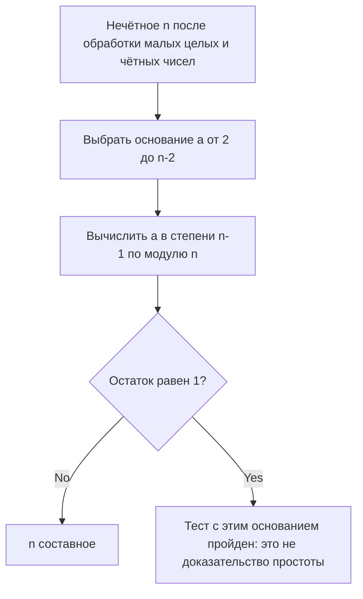
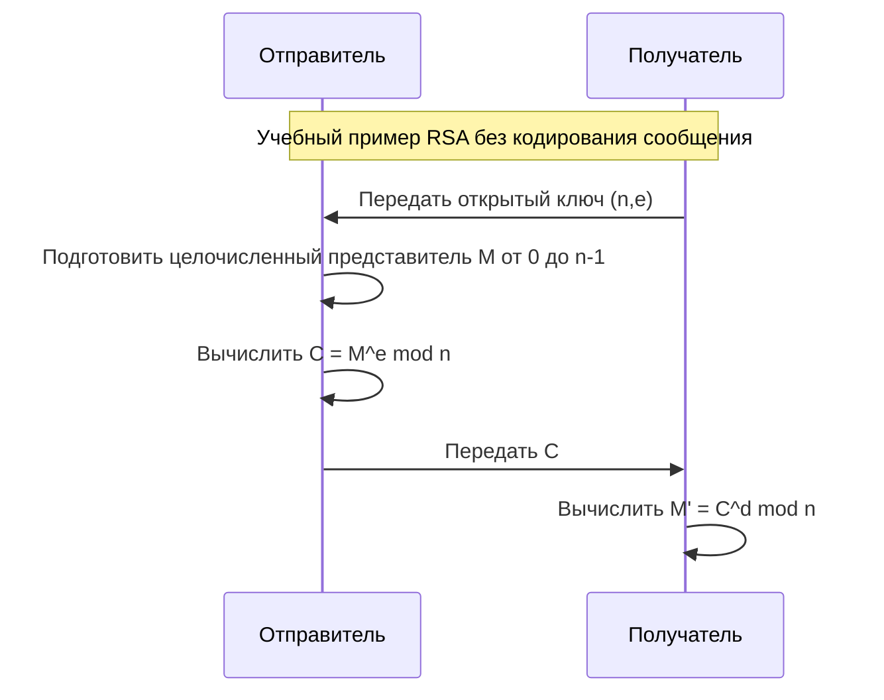

Малая теорема Ферма описывает степени по простому модулю. Она даёт необходимое условие простоты и помогает объяснить корректность расшифрования RSA. Одно лишь корректное расшифрование не гарантирует конфиденциальность. В статье различаются теорема, примеры, доказательство, тесты простоты и применение к RSA.

## Малая теорема Ферма

Для простого $p$ и целого $a$, удовлетворяющего $p\nmid a$:

$$ a^{p-1}\equiv1\pmod p. $$

Сравнение означает, что разность обеих частей кратна модулю. Здесь степень даёт остаток 1 при делении на $p$. Форма, верная для любого целого $a$:

$$ a^p\equiv a\pmod p. $$

Если $p\nmid a$, умножаем первое сравнение на $a$. Если $p\mid a$, обе части второго сравнения сравнимы с нулём. Чтобы снять условие, необходимо отдельно проверить и этот случай.

### Примеры

- $p=5$, $a=2$: $2^4=16=5\cdot3+1$.
- $p=7$, $a=3$: $3^6=729=7\cdot104+1$.

Оба примера удовлетворяют предпосылкам и дают остаток 1. Даже при простом модуле основание, делящееся на него, не подпадает под первое утверждение.

## Доказательство перестановкой остатков

Умножим каждый элемент $S=\{1,2,\ldots,p-1\}$ на $a$ и приведём по модулю $p$. Нулевых остатков нет. Если $ia\equiv ja\pmod p$, то благодаря взаимной простоте $a$ и $p$ можно сократить множитель $a$ и получить $i\equiv j\pmod p$. Индексы положительны и меньше модуля, поэтому $i=j$.

Полученные остатки образуют перестановку исходных ненулевых остатков. Перемножая все элементы, получаем:

$$ a^{p-1}(p-1)!\equiv(p-1)!\pmod p. $$

Числа $(p-1)!$ и $p$ взаимно просты, поэтому умножением на обратный элемент можно сократить общий множитель и получить теорему. В сравнениях нельзя без условий делить на произвольный множитель.

## Тест Ферма проверяет необходимое условие

Сначала обрабатываем целые числа меньше 2 как непростые, 2 и 3 как простые, а остальные чётные числа как составные. Для оставшегося нечётного $n>3$ выбираем основание $a$ с $2\le a\le n-2$.

$$ a^{n-1}\not\equiv1\pmod n $$

означает, что $n$ составное. Если же остаток равен 1, тест с этим основанием лишь не обнаружил нарушения необходимого условия; простота не доказана.

Например, $341=11\cdot31$ составное, но проходит тест с основанием 2. Такое число называют псевдопростым по этому основанию. Число Кармайкла составное и удовлетворяет сравнению Ферма для **каждого основания, взаимно простого с этим числом**. Наименьший пример $561=3\cdot11\cdot17$ проходит тест с основанием 2, но не с основанием 3, которое не взаимно просто с ним.

Несколько случайных оснований не дают единой малой границы вероятности ложного прохождения для всех составных чисел. [Глава 4 HAC](https://cacr.uwaterloo.ca/hac/about/chap4.pdf) различает тесты Ферма и Миллера—Рабина. Для фиксированного нечётного составного числа вероятность ошибочного прохождения $k$ тестов Миллера—Рабина с независимыми равномерно случайными основаниями не превышает $4^{-k}$. Это не вероятность составности числа после успешного теста, и граница не переносится автоматически на произвольные фиксированные основания. См. [подробную статью о тестах простоты](https://kenji.blog/ru/p/cpp-fast-prime-testing-miller-rabin/).

## Условия корректного расшифрования RSA

Выбираем различные простые $p,q$ и полагаем $n=pq$. С помощью функции Эйлера $\varphi(n)=(p-1)(q-1)$ в этом учебном построении выбираем открытый показатель с $1<e<\varphi(n)$ и $\gcd(e,\varphi(n))=1$. Обратный к нему элемент — положительный закрытый показатель $d$:

$$ ed\equiv1\pmod{\varphi(n)}. $$

Открытый ключ — $(n,e)$, а упрощённое представление закрытого ключа — $(n,d)$. Реальные закрытые ключи могут включать множители для ускорения вычислений; они тоже секретны. Математические операции над целочисленным представителем $0\le M<n$ имеют вид:

$$ C=M^e\bmod n,\qquad M'=C^d\bmod n. $$

Если $\gcd(M,n)=1$, [теорема Эйлера](https://dlmf.nist.gov/27.2#E8) даёт $M^{\varphi(n)}\equiv1\pmod n$. Поскольку $ed=1+t\varphi(n)$ для некоторого неотрицательного целого $t$, расшифрование восстанавливает исходный представитель.

Чтобы охватить представителей, не взаимно простых с модулем, рассуждаем по модулю каждого простого числа. Если $p\mid M$, то $M^{ed}$ и $M$ оба сравнимы с нулём. Иначе малая теорема Ферма и $p-1\mid ed-1$ дают нужное сравнение. Тот же аргумент верен по модулю $q$. По китайской теореме об остатках:

$$ M^{ed}\equiv M\pmod p,\quad M^{ed}\equiv M\pmod q
\quad\Longrightarrow\quad M^{ed}\equiv M\pmod n. $$

Так восстанавливаются все представители, включая ноль и числа, кратные множителям. Факторизация модуля позволяет вычислить закрытый показатель, но это не означает, что общая задача обращения RSA и факторизация доказанно эквивалентны по сложности.

## Различать корректность и безопасность

RSA без кодирования сообщения на диаграмме детерминирован и недостаточен как схема безопасного шифрования. [Разделы 5 и 7 RFC 8017](https://www.rfc-editor.org/rfc/rfc8017.html) различают примитивы и схемы шифрования. Для реального применения нужны проверенная аудитом библиотека, подходящая схема, например RSAES-OAEP, корректные параметры, безопасная случайность и управление ключами. RSASSA-PSS — отдельная схема подписи.

Малая теорема Ферма даёт основу для понимания модульной арифметики и математики RSA. Следует различать теорему, тесты простоты, корректные ключи и практические криптографические схемы. Во [введении в RSA](https://kenji.blog/ru/p/rsa-encryption-math-explained-for-beginners/) эти различия объясняются подробнее.
