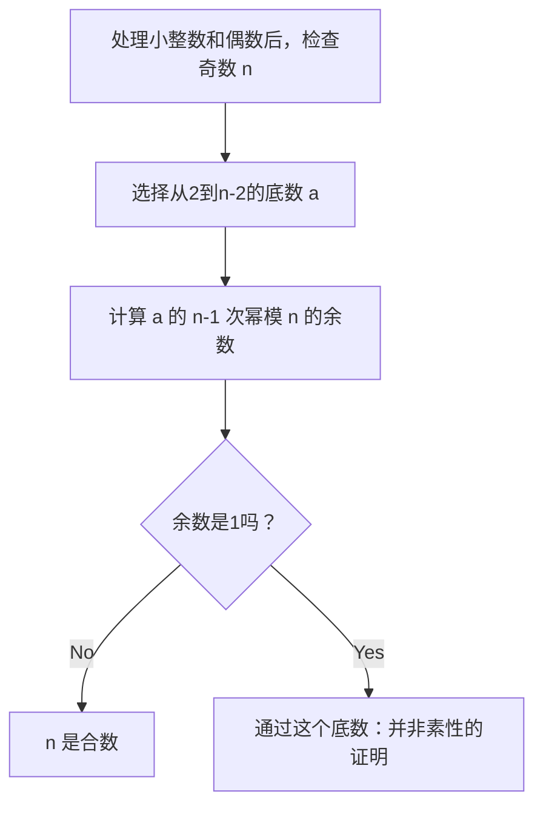
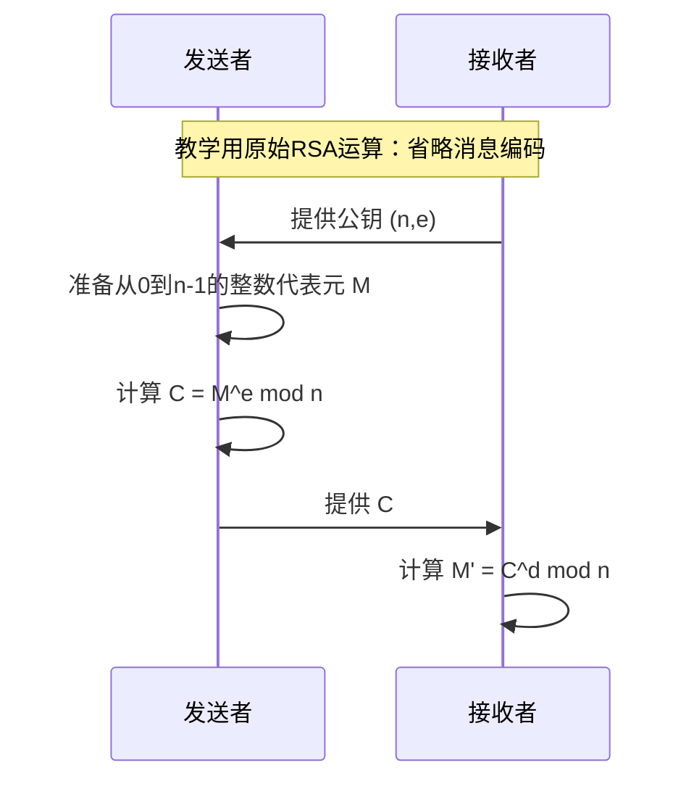

费马小定理描述以素数为模的幂运算性质。它给出了素性判定的一个必要条件，也有助于理解RSA解密的正确性。但正确解密本身并不能保证通信的机密性。本文区分定理、实例、证明、素性检验及其在RSA中的应用。

## 费马小定理

设 $p$ 为素数，$a$ 为整数且 $p\nmid a$，则：

$$ a^{p-1}\equiv1\pmod p. $$

同余表示两边之差是模数的倍数。这里表示该幂除以 $p$ 后余数为1。对所有整数 $a$ 都成立的形式为：

$$ a^p\equiv a\pmod p. $$

若 $p\nmid a$，将前一个同余式乘以 $a$ 即可。若 $p\mid a$，后一个同余式的两边都与零同余。去掉条件时，也必须单独检查这种情况。

### 实例

- $p=5$，$a=2$：$2^4=16=5\cdot3+1$。
- $p=7$，$a=3$：$3^6=729=7\cdot104+1$。

两例都满足定理的假设，余数为1。即使模数是素数，若底数是它的倍数，也不适用第一个结论。

## 用余数的排列证明

将 $S=\{1,2,\ldots,p-1\}$ 中的每个元素乘以 $a$，再取模 $p$ 的余数。结果不会为零。若 $ia\equiv ja\pmod p$，由于 $a$ 与 $p$ 互素，可以约去因子 $a$，得到 $i\equiv j\pmod p$。下标是小于模数的正整数，所以 $i=j$。

因此，得到的余数是原来非零余数的一个排列。把所有元素相乘，有：

$$ a^{p-1}(p-1)!\equiv(p-1)!\pmod p. $$

由于 $(p-1)!$ 与 $p$ 互素，可乘以其逆元约去公共因子，得出定理。同余式中不能不加条件地除以任意因子。

## 费马检验只检查必要条件

先处理小于2的整数为非素数、2和3为素数、其余偶数为合数。对于剩下的奇数 $n>3$，选择底数 $a$，满足 $2\le a\le n-2$。

$$ a^{n-1}\not\equiv1\pmod n $$

若出现上述不满足同余的情况，则 $n$ 是合数。若同余式成立，只能说明该底数未发现必要条件遭到违反，并不构成素性的证明。

例如 $341=11\cdot31$ 是合数，却通过底数2的检验。这种数称为相应底数的伪素数。卡迈克尔数是对**所有与该数互素的底数**都满足费马同余式的合数。最小的例子 $561=3\cdot11\cdot17$ 通过底数2，但不能通过与它不互素的底数3。

尝试多个随机底数，并不能为每个合数提供统一且很小的误通过概率上限。[HAC第4章](https://cacr.uwaterloo.ca/hac/about/chap4.pdf)区分了Fermat和Miller–Rabin。对于一个固定的奇合数，使用独立、均匀随机底数的 $k$ 次Miller–Rabin检验，其误通过概率不超过 $4^{-k}$。这并非通过检验后该数为合数的概率，也不能自动用于任意固定底数。另见[素性检验详解](https://kenji.blog/zh-cn/p/cpp-fast-prime-testing-miller-rabin/)。

## RSA正确解密的条件

选择不同的素数 $p,q$，令 $n=pq$。使用欧拉函数 $\varphi(n)=(p-1)(q-1)$，在这个教学构造中，选择满足 $1<e<\varphi(n)$ 和 $\gcd(e,\varphi(n))=1$ 的公开指数。其逆元是正的私有指数 $d$：

$$ ed\equiv1\pmod{\varphi(n)}. $$

公钥为 $(n,e)$，私钥的简化表示为 $(n,d)$。实际私钥还可能包含加速计算的因子，这些也必须保密。对整数消息代表元 $0\le M<n$，数学运算为：

$$ C=M^e\bmod n,\qquad M'=C^d\bmod n. $$

若 $\gcd(M,n)=1$，[欧拉定理](https://dlmf.nist.gov/27.2#E8)给出 $M^{\varphi(n)}\equiv1\pmod n$。由于对某个非负整数 $t$ 有 $ed=1+t\varphi(n)$，解密就会恢复原代表元。

为包含不互素的代表元，分别考虑以每个素数为模的情况。若 $p\mid M$，则 $M^{ed}$ 与 $M$ 都与零同余。否则，费马小定理和 $p-1\mid ed-1$ 给出所需同余式。模 $q$ 时同理。由中国剩余定理：

$$ M^{ed}\equiv M\pmod p,\quad M^{ed}\equiv M\pmod q
\quad\Longrightarrow\quad M^{ed}\equiv M\pmod n. $$

这样可恢复包括零和因子倍数在内的所有代表元。分解模数能计算私有指数，但这并不意味着一般RSA求逆与整数分解在困难程度上已被证明等价。

## 区分正确性与安全性

图中的原始RSA是确定性运算，不能单独构成安全的加密方案。[RFC 8017第5节和第7节](https://www.rfc-editor.org/rfc/rfc8017.html)区分了原语和加密方案。实际使用需要经审计的库、RSAES-OAEP等合适的方案、正确的参数、安全的随机数及密钥管理。RSASSA-PSS是另一种用于签名的方案。

费马小定理是理解模运算和RSA数学原理的基础。应区分定理、素性检验、有效密钥和实际密码方案。[RSA入门解说](https://kenji.blog/zh-cn/p/rsa-encryption-math-explained-for-beginners/)进一步说明了这些差别。
