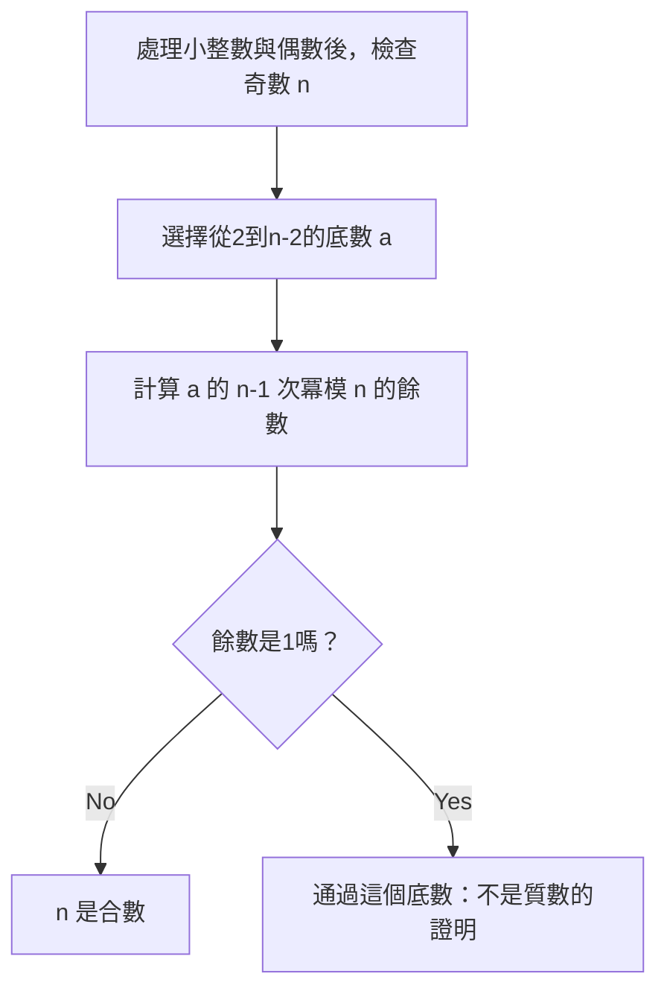
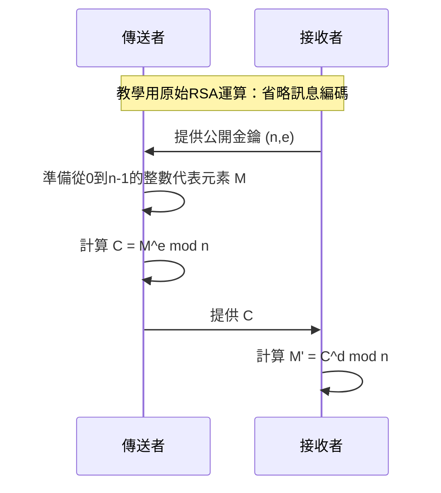

費馬小定理描述以質數為模的冪次運算性質。它提供質數判定的必要條件，也有助於理解RSA解密的正確性。但能夠正確解密，本身並不保證通訊的機密性。本文分別說明定理、實例、證明、質數檢驗及其在RSA中的應用。

## 費馬小定理

設 $p$ 為質數，$a$ 為整數且 $p\nmid a$，則：

$$ a^{p-1}\equiv1\pmod p. $$

同餘表示兩邊之差是模數的倍數。此處表示該冪除以 $p$ 後，餘數為1。對所有整數 $a$ 都成立的形式是：

$$ a^p\equiv a\pmod p. $$

若 $p\nmid a$，將前一個同餘式乘以 $a$。若 $p\mid a$，後一個同餘式的兩邊都與零同餘。移除條件時，也必須另行確認這種情況。

### 實例

- $p=5$，$a=2$：$2^4=16=5\cdot3+1$。
- $p=7$，$a=3$：$3^6=729=7\cdot104+1$。

兩例都滿足定理的假設，餘數為1。即使模數是質數，若底數是它的倍數，也不適用第一個結論。

## 以餘數的排列證明

將 $S=\{1,2,\ldots,p-1\}$ 中的各個元素乘以 $a$，再取模 $p$ 的餘數。所得餘數不會為零。若 $ia\equiv ja\pmod p$，由於 $a$ 與 $p$ 互質，可約去因子 $a$，得到 $i\equiv j\pmod p$。索引是小於模數的正整數，因此 $i=j$。

所以所得餘數是原本非零餘數的一個排列。將各元素相乘，得到：

$$ a^{p-1}(p-1)!\equiv(p-1)!\pmod p. $$

因為 $(p-1)!$ 與 $p$ 互質，可乘以其反元素約去共同因子，定理即得證。同餘式不能無條件地除以任意因子。

## 費馬檢驗只檢查必要條件

先將小於2的整數判為非質數、2和3判為質數，其餘偶數判為合數。對剩下的奇數 $n>3$，選擇底數 $a$，使 $2\le a\le n-2$。

$$ a^{n-1}\not\equiv1\pmod n $$

若出現上述不同餘的情況，則 $n$ 是合數。若同餘式成立，只表示該底數沒有發現必要條件遭到違反，並不是質數的證明。

例如 $341=11\cdot31$ 是合數，卻通過底數2的檢驗。這種數稱為對應底數的偽質數。卡邁克爾數是對**所有與該數互質的底數**都滿足費馬同餘式的合數。最小的例子 $561=3\cdot11\cdot17$ 通過底數2，但無法通過與它不互質的底數3。

嘗試多個隨機底數，並不能為所有合數提供一致且很小的誤通過機率上限。[HAC第4章](https://cacr.uwaterloo.ca/hac/about/chap4.pdf)區分Fermat與Miller–Rabin。對固定的奇合數，使用獨立且均勻隨機底數的 $k$ 次Miller–Rabin檢驗，其誤通過機率不超過 $4^{-k}$。這並不是通過檢驗後該數為合數的機率，也不能直接套用至任意固定底數。另見[質數判定詳解](https://kenji.blog/zh-tw/p/cpp-fast-prime-testing-miller-rabin/)。

## RSA正確解密的條件

選取相異質數 $p,q$，令 $n=pq$。使用尤拉函數 $\varphi(n)=(p-1)(q-1)$，在這個教學構造中，選擇滿足 $1<e<\varphi(n)$ 與 $\gcd(e,\varphi(n))=1$ 的公開指數。它的反元素是正的私密指數 $d$：

$$ ed\equiv1\pmod{\varphi(n)}. $$

公開金鑰是 $(n,e)$，私密金鑰的簡化表示為 $(n,d)$。實際的私密金鑰也可能包含加速計算的因子，這些也必須保密。對整數訊息代表元素 $0\le M<n$，其數學運算為：

$$ C=M^e\bmod n,\qquad M'=C^d\bmod n. $$

若 $\gcd(M,n)=1$，[尤拉定理](https://dlmf.nist.gov/27.2#E8)給出 $M^{\varphi(n)}\equiv1\pmod n$。對某個非負整數 $t$ 有 $ed=1+t\varphi(n)$，因此解密會還原原本的代表元素。

為涵蓋不互質的代表元素，分別以各質數為模來考慮。若 $p\mid M$，則 $M^{ed}$ 與 $M$ 都與零同餘。否則，由費馬小定理與 $p-1\mid ed-1$ 可得所需同餘式。模 $q$ 時同理。由中國剩餘定理可得：

$$ M^{ed}\equiv M\pmod p,\quad M^{ed}\equiv M\pmod q
\quad\Longrightarrow\quad M^{ed}\equiv M\pmod n. $$

因此可以還原所有代表元素，包括零及因子的倍數。將模數分解成因數便能計算私密指數，但一般RSA反演與整數分解在困難程度上是否等價，並未獲得證明。

## 區分正確性與安全性

圖中的原始RSA是確定性的運算，單獨使用不足以構成安全的加密方案。[RFC 8017第5節與第7節](https://www.rfc-editor.org/rfc/rfc8017.html)區分原語與加密方案。實際使用時，需要經稽核的函式庫、RSAES-OAEP等適當方案、正確參數、安全亂數及金鑰管理。RSASSA-PSS是另一種用於簽章的方案。

費馬小定理是理解模運算與RSA數學的基礎。應分清定理、質數檢驗、有效金鑰及實際密碼方案。[RSA入門解說](https://kenji.blog/zh-tw/p/rsa-encryption-math-explained-for-beginners/)進一步說明這些差別。
