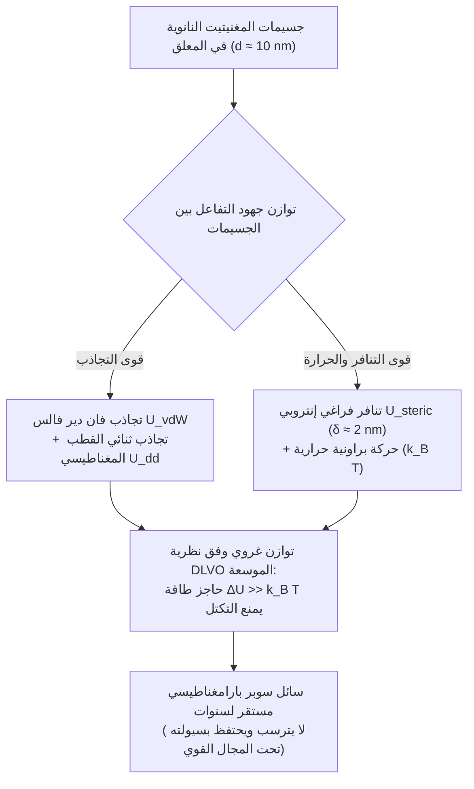
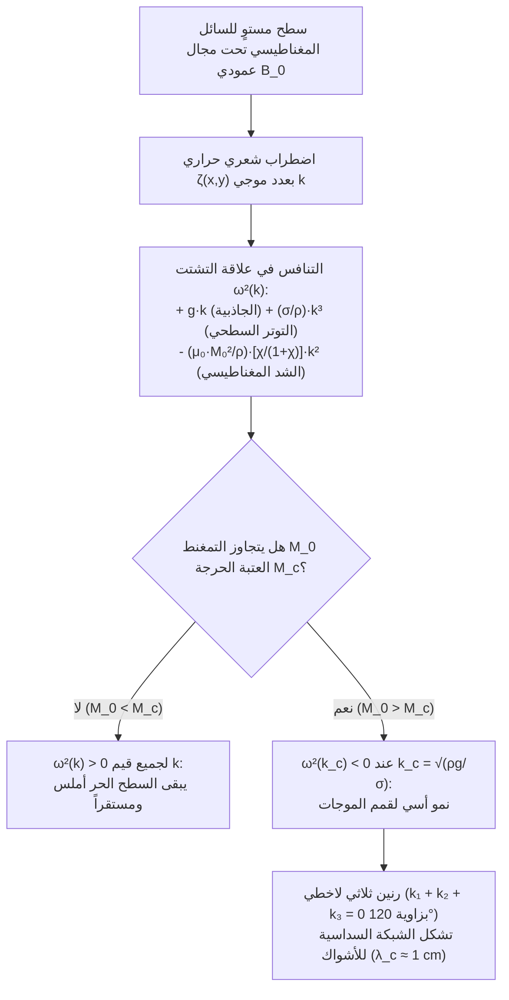

## 1. لماذا لا توجد مغانط سائلة في الطبيعة؟ — حاجز درجة حرارة كوري

عندما نُقرّب مغناطيس نيوديميوم قوياً من وعاء يحتوي على سائل أسود فاحم ونشاهد هذا السائل يتحدى الجاذبية الأرضية فوراً، منتصباً على شكل غابة متناظرة من الأشواك المخروطية الحادة، يبدو هذا <strong>السائل المغناطيسي (Ferrofluid)</strong> وكأنه كائن فضائي حي.

ولكن لماذا لا يمكننا ببساطة صهر مغناطيس حديدي عادي في بوتقة للحصول على «مغناطيس سائل»؟ تكمن الإجابة في قانون أساسي من قوانين الفيزياء الكمومية والإحصائية: <strong>درجة حرارة كوري ($T_C$)</strong>.

تنشأ المغناطيسية الحديدية (Ferromagnetism) من <strong>تفاعل التبادل الكمومي لهايزنبرغ (Exchange Interaction)</strong> الذي يصطف بموجبه اللف المغزلي (Spin) للإلكترونات المتجاورة $\mathbf{S}_i$ و$\mathbf{S}_j$ بشكل متوازٍ:

$$\mathcal{H}_{\text{ex}} = -2 J_{\text{ex}} \sum_{\langle i,j \rangle} \mathbf{S}_i \cdot \mathbf{S}_j \quad (J_{\text{ex}} > 0)$$

إن اقتران التبادل هذا حساس للغاية للمسافة الذرية البينية وللتهيج الحراري. فإذا سخّنا معدناً مغناطيسياً حديدياً فوق درجة حرارة كوري $T_C$ الخاصة به، تتغلب الطاقة الحرارية $k_B T$ على طاقة التبادل $J_{\text{ex}}$، فينهار الاصطفاف التلقائي للسبينات ويتحول المعدن إلى مادة <strong>مغناطيسية مسايرة (Paramagnetic)</strong> عشوائية.

وكما يوضح الجدول التالي، فإن درجة حرارة كوري $T_C$ لجميع العناصر والأكاسيد المغناطيسية الحديدية المعروفة تقع <strong>أقل</strong> بمئات الدرجات من نقطة انصهارها $T_m$:

| المادة | درجة حرارة كوري $T_C$ ($\text{K}$) | نقطة الانصهار $T_m$ ($\text{K}$) | الحالة الفيزيائية للمصهور ($T > T_m$) |
| :--- | :--- | :--- | :--- |
| <strong>الحديد ($\text{Fe}$)</strong> | $1043\,\text{K}$ ($770\,^\circ\text{C}$) | $1811\,\text{K}$ ($1538\,^\circ\text{C}$) | سائل بارامغناطيسي غير ممغنط |
| <strong>الكوبالت ($\text{Co}$)</strong> | $1388\,\text{K}$ ($1115\,^\circ\text{C}$) | $1768\,\text{K}$ ($1495\,^\circ\text{C}$) | سائل بارامغناطيسي غير ممغنط |
| <strong>النيكل ($\text{Ni}$)</strong> | $627\,\text{K}$ ($354\,^\circ\text{C}$) | $1728\,\text{K}$ ($1455\,^\circ\text{C}$) | سائل بارامغناطيسي غير ممغنط |
| <strong>الغادولينيوم ($\text{Gd}$)</strong> | $292\,\text{K}$ ($19\,^\circ\text{C}$) | $1585\,\text{K}$ ($1312\,^\circ\text{C}$) | سائل بارامغناطيسي غير ممغنط |
| <strong>المغنيتيت ($\text{Fe}_3\text{O}_4$)</strong> | $858\,\text{K}$ ($585\,^\circ\text{C}$) | $1870\,\text{K}$ ($1597\,^\circ\text{C}$) | سائل بارامغناطيسي غير ممغنط |

يفقد الحديد المنصهر مغناطيسيته الحديدية بالكامل قبل أن ينصهر بـ $768\,\text{K}$ ($T_C \ll T_m$). لذلك لا يوجد في الطبيعة أي سائل متجانس أحادي الطور يمتلك مغناطيسية حديدية عند درجة حرارة الغرفة.

كيف تمكن إذن مهندس وكالة ناسا (NASA) <strong>ستيفن بابيل (Stephen Papell)</strong> في عام 1963 من ابتكار أول سائل مغناطيسي في العالم لضخ وقود الصواريخ السائل في انعدام الجاذبية باستخدام المجالات المغناطيسية؟ تمثّل الحل العبقري لبابيل في الالتفاف حول حاجز كوري عبر تصميم <strong>معلق غروي ثلاثي المكونات</strong>:

1. <strong>جسيمات نانوية مغناطيسية ($\sim 5\%$ حجماً)</strong>: بلورات نانوية صلبة من المغنيتيت ($\text{Fe}_3\text{O}_4$) أو الماغهيميت ($\gamma\text{-Fe}_2\text{O}_3$) بقطر نموذجي $d \approx 10\,\text{nm}$، تعمل تحت درجة حرارة كوري بكثير وتحتفظ بتمغنطها القوي.
2. <strong>طبقة خافض للتوتر السطحي / Surfactant ($\sim 10\%$ حجماً)</strong>: غلاف جزيئي بسمك $\delta \approx 2\,\text{nm}$ (مثل حمض الأوليك $\text{C}_{18}\text{H}_{34}\text{O}_2$)، يرتبط رأسه القطبي كيميائياً بسطح الجسيم النانوي بينما يمتد ذيله الهيدروكربوني في المذيب.
3. <strong>سائل حامل ($\sim 85\%$ حجماً)</strong>: مذيب عضوي (كيروسين، زيت اصطناعي، إستر) أو ماء، حيث تحافظ الحركة البراونية الحرارية على الجسيمات النانوية معلقة إلى ما لا نهاية.

---

## 2. الفيزياء النانوية للمغناطيسية: حد النطاق الواحد لكيتل والمغناطيسية المسايرة الفائقة للانجفان

لماذا يجب أن يكون قطر جسيمات المغنيتيت قريباً تحديداً من $d \approx 10\,\text{nm}$؟ لو قمنا بمجرد خلط مسحوق حديد ميكرومتري ($d \approx 1\text{–}10\,\mu\text{m}$) في الزيت، لترسبت الحبيبات فوراً ولتكتلت في كتلة صلبة عند تقريب مغناطيس.

### 2.1 القطر الحرج لكيتل للجسيمات أحادية النطاق

ينقسم المغناطيس العياني إلى عدة <strong>نطاقات مغناطيسية لفايس (Weiss Domains)</strong> تفصل بينها جدران بلوخ لتقليل الطاقة المغناطيسية الساكنة للمجال المزيل للتمغنط ($\propto d^3$). غير أن إنشاء جدار نطاق يستهلك طاقة تبادل وتباين مناحٍ تتناسب مع مساحة المقطع ($\propto d^2$). وتحت قطر حرج $d_{\text{sd}}$ (حَسَبه تشارلز كيتل Charles Kittel)، يصبح تكوين الجدار غير مجدٍ طاقياً:

$$d_{\text{sd}} = \frac{36 \sqrt{A_{\text{ex}} K}}{\mu_0 M_d^2}$$

حيث $A_{\text{ex}} \approx 10^{-11}\,\text{J/m}$ صلابة التبادل، $K \approx 1.35 \times 10^4\,\text{J/m}^3$ ثابت التباين المغناطيسي البلوري، و$M_d \approx 4.46 \times 10^5\,\text{A/m}$ تمغنط التشبع للمغنيتيت الكتلي $\text{Fe}_3\text{O}_4$. بالنسبة للمغنيتيت، يبلغ $d_{\text{sd}} \approx 25\text{–}30\,\text{nm}$. وبالتالي فإن جسيماً نانوياً بقطر $d = 10\,\text{nm}$ هو حتماً <strong>جسيم أحادي النطاق (Single-Domain Particle)</strong>: تدور جميع سبيناته الذرية البالغ عددها $\sim 10^4$ معاً كثنائي قطب مغناطيسي عملاق واحد $m = M_d V = M_d \frac{\pi}{6}d^3 \approx 2.3 \times 10^{-19}\,\text{A}\cdot\text{m}^2$ ($\sim 25\,000$ مغنيطون بور $\mu_B$).

### 2.2 استرخاء نيل وبراون، والمغناطيسية المسايرة الفائقة

هل يظل هذا العزم العملاق $m$ مقيداً على طول المحور السهل للبلورة؟ عند $d = 10\,\text{nm}$، يكون الحجم $V \approx 5.24 \times 10^{-25}\,\text{m}^3$ ضئيلاً جداً بحيث يكون حاجز طاقة التباين $E_B = K V \approx 7 \times 10^{-21}\,\text{J}$ مقارباً للطاقة الحرارية $k_B T \approx 4.14 \times 10^{-21}\,\text{J}$ عند درجة حرارة الغرفة ($T = 300\,\text{K}$)!

ونتيجة لذلك، ينقلب العزم المغناطيسي تلقائياً وباستمرار بفعل التقلبات الحرارية عبر آليتين متوازيتين:
1. <strong>استرخاء نيل ($\tau_N$)</strong>: يدور متجه العزم المغناطيسي داخلياً ضمن الشبكة البلورية الساكنة متجاوزاً الحاجز $K V$:
   $$\tau_N = \tau_0 \exp\left(\frac{K V}{k_B T}\right)$$
   ومع $\tau_0 \approx 10^{-9}\,\text{s}$، يبلغ زمن الاسترخاء لجسيم مغنيتيت بقطر $10\,\text{nm}$ قيمة فائقة القصر $\tau_N \approx 5 \times 10^{-9}\,\text{s}$ (بضع نانوثوانٍ).
2. <strong>استرخاء براون ($\tau_B$)</strong>: يدور الجسيم النانوي بأكمله مع غلافه الجزيئي (الحجم الهيدروديناميكي $V_H = \frac{\pi}{6}(d + 2\delta)^3$) فيزيائياً داخل المائع ذي اللزوجة $\eta$:
   $$\tau_B = \frac{3 \eta V_H}{k_B T}$$
   ويخضع الزمن الفعال للعلاقة $\frac{1}{\tau_{\text{eff}}} = \frac{1}{\tau_N} + \frac{1}{\tau_B}$.

في غياب مجال خارجي ($\mathbf{H} = \mathbf{0}$)، تتبعثر اتجاهات العزوم حرارياً خلال نانوثوانٍ: فلا يظهر السائل المغناطيسي <strong>أي تمغنط متبقٍ ($M_r = 0$) ولا أي قوة قاهرة ($H_c = 0$)</strong> (انعدام التخلف المغناطيسي). ولكن عند تطبيق مجال $\mathbf{H}$، يستجيب كل جسيم بعزمه العملاق البالغ $25\,000\,\mu_B$، مولداً قابلية تمغنط ابتدائية $\chi_i$ أكبر بآلاف المرات من المواد البارامغناطيسية العادية. تُعرف هذه الظاهرة باسم <strong>المغناطيسية المسايرة الفائقة (Superparamagnetism)</strong>، وتُوصف بدقة بواسطة <strong>دالة لانجفان $\mathcal{L}(\xi)$</strong>:

$$M(H) = \phi M_d \mathcal{L}(\xi) = M_s \left( \coth \xi - \frac{1}{\xi} \right), \qquad \xi = \frac{\mu_0 m H}{k_B T} = \frac{\mu_0 M_d V H}{k_B T}$$

حيث $\phi$ الكسر الحجمي للمادة المغناطيسية و$M_s = \phi M_d$ تمغنط التشبع للسائل. وفي المجالات الضعيفة ($\xi \ll 1$)، يعطي التقريب $\mathcal{L}(\xi) \approx \xi / 3$ القابلية الابتدائية $\chi_i = \frac{\mu_0 \phi M_d^2 V}{3 k_B T} \sim 1\text{–}5$.

---

## 3. الاستقرار الغروي: نظرية DLVO الموسعة والمقارنة مع الموائع المغناطيسية الريولوجية (MRF)

لمنع الجسيمات النانوية من التجلط والتلاصق غير العكوس، يجب أن يمتلك جهد التفاعل الكلي $U_{\text{total}}(l)$ كدالة للمسافة السطحية المعيارية $l = 2s / d$ حاجز تنافر مرتفعاً $\Delta U \gg 15\,k_B T$:

$$U_{\text{total}}(l) = U_{\text{vdW}}(l) + U_{\text{dd}}(l) + U_{\text{steric}}(l)$$

1. <strong>تجاذب لندن–فان دير فالس ($U_{\text{vdW}}$)</strong>: تجاذب كمومي قصير المدى (ثابت هامكر $A_H \approx 10^{-19}\,\text{J}$) يتباعد إلى $-\infty$ عند التلامس ($l \to 0$):
   $$U_{\text{vdW}}(l) = -\frac{A_H}{6}\left[ \frac{2}{l^2 + 4l} + \frac{2}{(l+2)^2} + \ln\left(\frac{l^2 + 4l}{(l+2)^2}\right) \right]$$
2. <strong>تفاعل ثنائي القطب المغناطيسي ($U_{\text{dd}}$)</strong>: في وضعية الرأس للذيل، يتجاذب ثنائيا قطب بطاقة $U_{\text{dd}}^{\text{min}}(s) = -\frac{\mu_0 m^2}{2\pi (d + s)^3}$.
3. <strong>التنافر الفراغي لماكور–روزينزويغ ($U_{\text{steric}}$)</strong>: عندما تقترب الجسيمات لمسافة $s < 2\delta$، تنضغط سلاسل حمض الأوليك (كثافة التطعيم $\xi_s \approx 10^{18}\,\text{chains/m}^2$). يؤدي انخفاض إنتروبيا التشكيل للسلاسل البوليمرية إلى توليد تنافر إنتروبي قوي:
   $$U_{\text{steric}}(l) = \frac{\pi d^2 \xi_s k_B T}{2} \left[ 2 - \frac{l+2}{t}\ln\left(\frac{1+t}{1+l/2}\right) - \frac{l}{t} \right] \quad \left(\text{عند } l < 2t,\; t = \frac{2\delta}{d}\right)$$

هذا الدرع الفراغي بسمك $\delta \approx 2\,\text{nm}$ هو ما يميز جذرياً <strong>السائل المغناطيسي (FF)</strong> عن <strong>المائع المغناطيسي الريولوجي (MRF)</strong>:

| الخاصية | السائل المغناطيسي (Ferrofluid - FF) | المائع المغناطيسي الريولوجي (MRF) |
| :--- | :--- | :--- |
| <strong>قطر الجسيمات $d$</strong> | $5\text{–}15\,\text{nm}$ (جسيمات نانوية) | $1\text{–}10\,\mu\text{m}$ (أكبر بـ $1000$ مرة، ميكروية) |
| <strong>الحالة المغناطيسية</strong> | أحادي النطاق (سوبر بارامغناطيسي) | متعدد النطاقات (فرومغناطيسي) |
| <strong>الطاقة المهيمنة</strong> | الحركة الحرارية ($k_B T > U_{\text{dd}}$) | التجاذب ثنائي القطب ($U_{\text{dd}} \gg k_B T$) |
| <strong>السلوك تحت المجال $\mathbf{H}$</strong> | <strong>يبقى سائلاً!</strong> يشكّل أشواك روزينزويغ | <strong>يتصلب خلال أجزاء من الثانية!</strong> سلاسل صلبة |
| <strong>التطبيقات النموذجية</strong> | أختام الفراغ، تبريد مكبرات الصوت، الفن الحركي | ممتصات الصدمات الذكية (MagneRide)، المكابح |

---

## 4. الهيدروديناميكا المغناطيسية (FHD) وعدم استقرار كاولي–روزينزويغ

لماذا ينتصب السطح الحر للسائل المغناطيسي فجأة على شكل شبكة منتظمة من القمم المخروطية عند تسليط مجال مغناطيسي عمودي؟ تأتي الإجابة من <strong>الهيدروديناميكا المغناطيسية للسوائل المغناطيسية (Ferrohydrodynamics - FHD)</strong> التي صاغها رونالد روزينزويغ.

### 4.1 قوة كيلفن الحجمية ومعادلة برنولي المعممة

في مائع قابل للتمغنط وغير موصل كهربائياً موضوع في مجال $\mathbf{H}$، يتأثر كل عنصر حجمي ذي تمغنط $\mathbf{M}$ بـ <strong>كثافة قوة كيلفن المغناطيسية</strong>:

$$\mathbf{f}_m = \mu_0 (\mathbf{M} \cdot \nabla)\mathbf{H}$$

وبتكامل معادلة أويلر-نافييه-ستوكس المستقرة وغير الدوامية لمائع غير قابل للانضغاط على طول خط انسياب، نحصل على <strong>معادلة برنولي المعممة للهيدروديناميكا المغناطيسية</strong>:

$$p^* + \frac{1}{2}\rho v^2 + \rho g z - \mu_0 \int_0^H M(H')\,dH' = \text{const}$$

علاوة على ذلك، عند السطح البيني الحر بين السائل المغناطيسي والهواء، يضيف قفز موتر إجهادات ماكسويل شدّاً مغناطيسياً عمودياً إلى شرط الاتصال ليونغ-لابلاس:

$$p^* - p_0 = \sigma \kappa - \frac{1}{2}\mu_0 M_n^2$$

حيث $p_0$ الضغط الجوي، $\sigma$ التوتر السطحي، $\kappa \approx -\nabla_\perp^2 \zeta$ متوسط انحناء السطح، و$M_n = \mathbf{M} \cdot \mathbf{n}$ المركبة العمودية للتمغنط. يعمل الحد $-\frac{1}{2}\mu_0 M_n^2$ بمثابة <strong>سحب مغناطيسي نحو الخارج</strong>: فأي نتوء صغير $\zeta(x,y) > 0$ على السطح يُركّز خطوط المجال المغناطيسي (تأثير مانعة الصواعق)، مما يزيد $M_n$ محلياً ويسحب السائل إلى الأعلى بقوة أكبر!

### 4.2 تحليل الاستقرار الخطي وعلاقة التشتت (كاولي وروزينزويغ، 1967)

في عام 1967، درس م. كاولي (M. D. Cowley) ور. روزينزويغ (R. E. Rosensweig) طبقة مستوية من السائل المغناطيسي تحت مجال مغناطيسي عمودي منتظم $\mathbf{B}_0 = B_0 \hat{\mathbf{z}}$ تتعرض لموجة سطحية صغيرة $\zeta(\mathbf{r}_\perp, t) = \zeta_0 e^{i(\mathbf{k}\cdot\mathbf{r}_\perp - \omega t)}$ بعدد موجي $k = |\mathbf{k}| = 2\pi / \lambda$.

يقود الحل المشترك لمعادلات ماكسويل ($\nabla \cdot \mathbf{B} = 0$، $\nabla \times \mathbf{H} = \mathbf{0}$) ومعادلة برنولي FHD إلى <strong>علاقة التشتت لكاولي–روزينزويغ</strong> الشهيرة:

$$\omega^2(k) = g k + \frac{\sigma}{\rho} k^3 - \frac{\mu_0 M_0^2}{\rho}\left(\frac{\chi_{\text{eff}}}{1 + \chi_{\text{eff}}}\right) k^2$$

حيث $\chi_{\text{eff}}$ القابلية الهندسية الفعالة. تعبر الحدود الثلاثة عن صراع بين ثلاث قوى:
* $+g k$ (خطي في $k$): <strong>قوة الإرجاع التثاقلية (الجاذبية)</strong> التي تثبت الأمواج الطويلة ($k \to 0$).
* $+\frac{\sigma}{\rho}k^3$ (تكعيبي في $k$): <strong>قوة الإرجاع الشعرية (التوتر السطحي)</strong> التي تثبت الأمواج القصيرة ($k \to \infty$).
* $-\frac{\mu_0 M_0^2}{\rho}\frac{\chi_{\text{eff}}}{1+\chi_{\text{eff}}}k^2$ (تربيعي في $k$، <strong>سالب!</strong>): <strong>الشد المغناطيسي المزيل للاستقرار</strong> عند الأطوال الموجية المتوسطة!

عندما يتجاوز التمغنط $M_0$ عتبة حرجة $M_c$، يصبح المنحنى $\omega^2(k)$ سالباً ($\omega^2 < 0$) حول عدد موجي حرج $k_c$. يصبح التردد $\omega = \pm i \gamma$ تخيلياً صرفاً وتنمو السعة $\zeta(t) \propto e^{+\gamma t}$ أسياً!

ومن شرطي العتبة $\omega^2(k_c) = 0$ و$\left.\frac{\partial (\omega^2)}{\partial k}\right|_{k = k_c} = 0$، نستنتج المعاملات الحرجة لـ <strong>عدم استقرار روزينزويغ</strong>:

1. <strong>العدد الموجي الحرج $k_c$ والطول الموجي الحرج $\lambda_c$ (المسافة بين الأشواك)</strong>:
   $$k_c = \sqrt{\frac{\rho g}{\sigma}} = \frac{1}{\ell_c} \implies \lambda_c = \frac{2\pi}{k_c} = 2\pi \sqrt{\frac{\sigma}{\rho g}}$$
   لسائل مغناطيسي نموذجي ($\rho \approx 1200\,\text{kg/m}^3$، $\sigma \approx 0.026\,\text{N/m}$، $g = 9.81\,\text{m/s}^2$)، يبلغ الطول الشعري $\ell_c \approx 1.5\,\text{mm}$ والمسافة الفاصلة بين قمتين متجاورتين $\lambda_c \approx 9.3\,\text{mm}$ (حوالي $1\,\text{cm}$)!
2. <strong>التمغنط الحرج $M_c$ لظهور الأشواك</strong>:
   $$M_c^2 = \frac{2}{\mu_0}\left(1 + \frac{1}{\chi_{\text{eff}}}\right)\sqrt{\rho g \sigma}$$

### 4.3 لماذا تتشكل شبكة سداسية؟ (الرنين الثلاثي اللاخطي)

تحدد النظرية الخطية مقدار $k_c$، لكنها لا تحدد اتجاه المتجه $\mathbf{k}$. لماذا تنتظم الأشواك في <strong>شبكة سداسية ثنائية الأبعاد (Hexagonal Lattice)</strong> متقنة؟

في المفكوك اللاخطي للطاقة الحرة السطحية $\mathcal{F}[\zeta]$، يكسر المجال المغناطيسي العمودي تماثل الانعكاس بين القمة والقاع ($\zeta \to -\zeta$)، مولداً حداً تكعيبياً للتفاعل الرنيني بين ثلاث متجهات موجية:

$$\Delta \mathcal{F}_3 \propto - \sum_{\mathbf{k}_1 + \mathbf{k}_2 + \mathbf{k}_3 = \mathbf{0}} A_{\mathbf{k}_1} A_{\mathbf{k}_2} A_{\mathbf{k}_3}$$

ولكي يكون مجموع ثلاثة متجهات متساوية الطول $|\mathbf{k}_1| = |\mathbf{k}_2| = |\mathbf{k}_3| = k_c$ مساوياً للصفر ($\mathbf{k}_1 + \mathbf{k}_2 + \mathbf{k}_3 = \mathbf{0}$)، يجب أن تشكل مثلثاً متساوي الأضلاع، أي أن تكون الزاوية بينها $120^\circ$ بالضبط! إن تراكب ثلاث موجات مستوية بزاوية $120^\circ$ يولّد في الفضاء الحقيقي <strong>النمط السداسي الشهير لأشواك روزينزويغ</strong>.

---

## 5. التطبيقات المتقدمة في الصناعة والطب والفن الحركي

تؤدي السوائل المغناطيسية دوراً حيوياً في العديد من التقنيات الحديثة:

1. <strong>أختام الفراغ الدوارة في صناعة أشباه الموصلات والأقراص الصلبة</strong>: في غرف الفراغ الفائق (UHV) لتصنيع الرقائق الإلكترونية، يثبت مغناطيس حلقي حلقة سائلة من السائل المغناطيسي في الفجوة الميكرومترية حول الأعمدة الدوارة بسرعة $10\,000\,\text{rpm}$، مما يحقق إحكاماً تاماً دون احتكاك صلب أو تآكل.
2. <strong>تبريد وتخميد مكبرات الصوت عالية الدقة (Hi-Fi)</strong>: يوضع السائل المغناطيسي في الفجوة المغناطيسية حول ملف الصوت (Voice Coil)، فينقل الحرارة بكفاءة تفوق الهواء بـ $5$ مرات ويخمد بلزوجته الرنين الميكانيكي غير المرغوب فيه للغشاء.
3. <strong>فرط الحرارة المغناطيسي وتوجيه الأدوية في علاج الأورام</strong>: تُوجه جسيمات $\text{Fe}_3\text{O}_4$ المتوافقة حيوياً نحو الورم وتُعرض لمجال مغناطيسي متناوب عالي التردد ($f \approx 100\text{–}500\,\text{kHz}$)، فتبدد حرارة عبر استرخاء نيل وبراون ترفع حرارة الورم موضعياً إلى $42\text{–}45\,^\circ\text{C}$ لتدمير الخلايا السرطانية انتقائياً.
4. <strong>الفن الحركي (ساتشيكو كوداما Sachiko Kodama)</strong>: تقوم الفيزيائية والفنانة اليابانية ساتشيكو كوداما (*Protrude, Flow*) بمزامنة مغانط كهربائية مع الموسيقى لنحت السوائل المغناطيسية في أبراج عضوية من الأشواك تتراقص في الوقت الفعلي.

إن كل شوكة تنتصب على سطح السائل المغناطيسي هي تجسيد مرئي للتوازن الدقيق بين تفاعل التبادل الكمومي لهايزنبرغ، وإنتروبيا الغرويات، ومعادلات ماكسويل ونافييه-ستوكس المقترنة.
