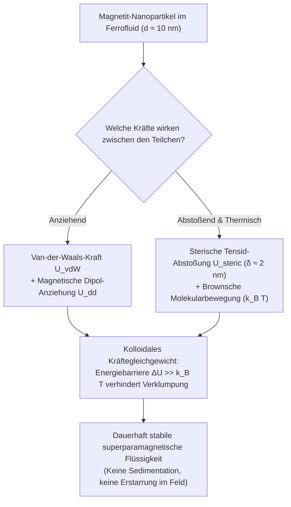
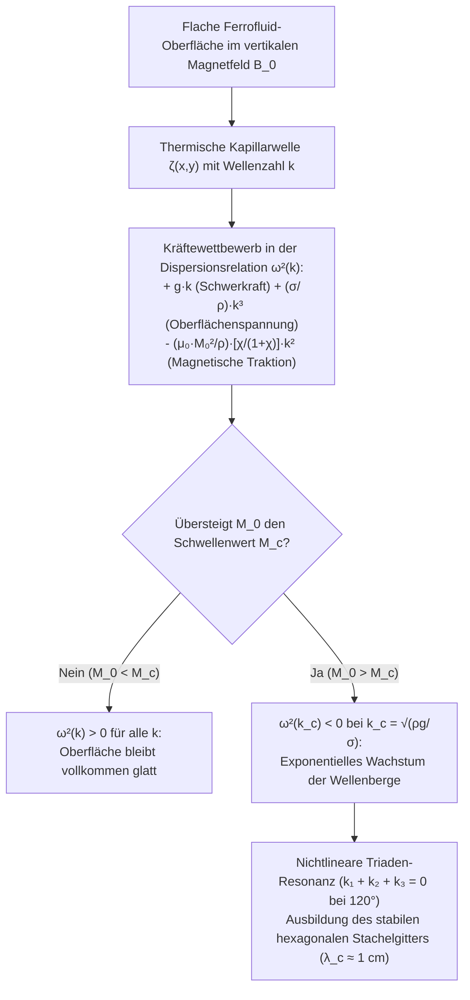

## 1. Warum gibt es in der Natur keine flüssigen Magnete? — Die Barriere der Curie-Temperatur

Wenn man in einem Wissenschaftsmuseum oder in einem Physik-Video sieht, wie sich eine tiefschwarze Flüssigkeit bei Annäherung eines Neodym-Magneten plötzlich gegen die Schwerkraft aufrichtet und ein symmetrisches Muster aus spitzen Dornen bildet, wirkt diese <strong>magnetische Flüssigkeit (Ferrofluid)</strong> fast wie ein außerirdischer Organismus.

Doch warum können wir nicht einfach einen gewöhnlichen Eisenmagneten in einem Schmelztiegel schmelzen, um einen „flüssigen Magneten“ zu erhalten? Die Antwort liegt in einem fundamentalen Gesetz der Quanten- und statistischen Physik: der <strong>Curie-Temperatur ($T_C$)</strong>.

Ferromagnetismus entsteht durch die quantenmechanische <strong>Heisenberg-Austauschwechselwirkung (Exchange Interaction)</strong>, die benachbarte Elektronenspins $\mathbf{S}_i$ und $\mathbf{S}_j$ parallel ausrichtet:

$$\mathcal{H}_{\text{ex}} = -2 J_{\text{ex}} \sum_{\langle i,j \rangle} \mathbf{S}_i \cdot \mathbf{S}_j \quad (J_{\text{ex}} > 0)$$

Diese Austauschkopplung reagiert extrem empfindlich auf den Atomabstand und die thermische Bewegung. Erhitzt man ein ferromagnetisches Metall über seine Curie-Temperatur $T_C$, übertrifft die thermische Agitation $k_B T$ die Austauschenergie $J_{\text{ex}}$. Die spontane Spinordnung bricht zusammen, und das Material wird zu einem gewöhnlichen <strong>Paramagneten</strong>.

Wie die folgende Tabelle zeigt, liegt die Curie-Temperatur $T_C$ aller bekannten ferromagnetischen Elemente und Oxide um hunderte Kelvin <strong>unterhalb</strong> ihrer Schmelztemperatur $T_m$:

| Material | Curie-Temperatur $T_C$ ($\text{K}$) | Schmelzpunkt $T_m$ ($\text{K}$) | Zustand der Schmelze ($T > T_m$) |
| :--- | :--- | :--- | :--- |
| <strong>Eisen ($\text{Fe}$)</strong> | $1043\,\text{K}$ ($770\,^\circ\text{C}$) | $1811\,\text{K}$ ($1538\,^\circ\text{C}$) | Unmagnetische paramagnetische Schmelze |
| <strong>Kobalt ($\text{Co}$)</strong> | $1388\,\text{K}$ ($1115\,^\circ\text{C}$) | $1768\,\text{K}$ ($1495\,^\circ\text{C}$) | Unmagnetische paramagnetische Schmelze |
| <strong>Nickel ($\text{Ni}$)</strong> | $627\,\text{K}$ ($354\,^\circ\text{C}$) | $1728\,\text{K}$ ($1455\,^\circ\text{C}$) | Unmagnetische paramagnetische Schmelze |
| <strong>Gadolinium ($\text{Gd}$)</strong> | $292\,\text{K}$ ($19\,^\circ\text{C}$) | $1585\,\text{K}$ ($1312\,^\circ\text{C}$) | Unmagnetische paramagnetische Schmelze |
| <strong>Magnetit ($\text{Fe}_3\text{O}_4$)</strong> | $858\,\text{K}$ ($585\,^\circ\text{C}$) | $1870\,\text{K}$ ($1597\,^\circ\text{C}$) | Unmagnetische paramagnetische Schmelze |

Geschmolzenes Eisen verliert seinen Ferromagnetismus also schon $768\,\text{K}$ bevor es überhaupt flüssig wird ($T_C \ll T_m$). Eine einphasige ferromagnetische Flüssigkeit existiert bei Raumtemperatur in der Natur nicht.

Wie gelang es dem NASA-Ingenieur <strong>Stephen Papell</strong> im Jahr 1963 dennoch, das erste Ferrofluid der Welt zu entwickeln, um flüssigen Raketentreibstoff in der Schwerelosigkeit des Weltraums mittels Magnetfeldern in die Triebwerke zu pumpen? Papells genialer Kunstgriff bestand darin, das Problem der Curie-Temperatur durch ein <strong>dreikomponentiges kolloidales System</strong> zu umgehen:

1. <strong>Magnetische Nanopartikel ($\sim 5\,\text{Vol.-}\%$)</strong>: Winzige Einkristalle aus Magnetit ($\text{Fe}_3\text{O}_4$) oder Maghemit ($\gamma\text{-Fe}_2\text{O}_3$) mit einem typischen Durchmesser von $d \approx 10\,\text{nm}$, die weit unterhalb ihrer Curie-Temperatur bleiben und daher fest und stark magnetisch sind.
2. <strong>Tensidhülle / Surfactant ($\sim 10\,\text{Vol.-}\%$)</strong>: Eine etwa $\delta \approx 2\,\text{nm}$ dicke molekulare Schutzschicht (z. B. Ölsäure, $\text{C}_{18}\text{H}_{34}\text{O}_2$), deren polare Kopfgruppe chemisch an die Nanopartikeloberfläche bindet, während die unpolare Kohlenwasserstoffkette in die Flüssigkeit ragt.
3. <strong>Trägerflüssigkeit ($\sim 85\,\text{Vol.-}\%$)</strong>: Ein organisches Lösungsmittel (Kerosin, Ester, Kohlenwasserstofföl) oder Wasser, in dem die beschichteten Nanopartikel durch Brownsche Molekularbewegung dauerhaft schweben.

---

## 2. Nanophysik des Magnetismus: Eindomänen-Limit und Langevin-Superparamagnetismus

Warum müssen die Magnetitpartikel im Ferrofluid ausgerechnet $d \approx 10\,\text{nm}$ klein sein? Würde man einfach feines Eisenpulver im Mikrometerbereich ($d \approx 1\text{–}10\,\mu\text{m}$) in Öl rühren, würden die Körner sofort zu Boden sinken und bei Anlegen eines Magnetfelds zu einem starren Klumpen verklumpen.

### 2.1 Kittel-Grenzgröße für magnetische Eindomänenpartikel

Ein großer Ferromagnet spaltet sich in viele <strong>Weißsche Bezirke (magnetische Domänen)</strong> auf, die durch Bloch-Wände getrennt sind, um die magnetostatische Streufeldenergie ($\propto d^3$) zu minimieren. Das Erzeugen einer Domänenwand kostet jedoch Austausch- und Anisotropieenergie pro Fläche ($\propto d^2$). Unterschreitet der Partikeldurchmesser $d$ einen kritischen Schwellenwert $d_{\text{sd}}$ (nach Charles Kittel), ist die Bildung einer Domänenwand energetisch ungünstiger als das Streufeld:

$$d_{\text{sd}} = \frac{36 \sqrt{A_{\text{ex}} K}}{\mu_0 M_d^2}$$

Hierbei ist $A_{\text{ex}} \approx 10^{-11}\,\text{J/m}$ die Austauschsteifigkeit, $K \approx 1.35 \times 10^4\,\text{J/m}^3$ die magnetokristalline Anisotropiekonstante und $M_d \approx 4.46 \times 10^5\,\text{A/m}$ die Sättigungsmagnetisierung des Festkörpers $\text{Fe}_3\text{O}_4$. Für Magnetit liegt $d_{\text{sd}}$ bei etwa $25\text{–}30\,\text{nm}$ (und für metallisches Eisen bei $\sim 15\,\text{nm}$). Ein Nanopartikel mit $d = 10\,\text{nm}$ ist folglich ein <strong>Eindomänenpartikel (Single-Domain Particle)</strong>: Alle $\sim 10^4$ Spins im Partikel sind starr gekoppelt und bilden ein einziges gigantisches magnetisches Dipolmoment $m = M_d V = M_d \frac{\pi}{6}d^3 \approx 2.3 \times 10^{-19}\,\text{A}\cdot\text{m}^2$ (rund $25\,000$ Bohrsche Magnetonen $\mu_B$).

### 2.2 Néel- und Brown-Relaxation sowie Superparamagnetismus

Wird dieses riesige magnetische Moment $m$ durch eine Energiebarriere $E_B = K V$ entlang der leichten Kristallachse festgehalten? Bei $d = 10\,\text{nm}$ ist das Volumen $V \approx 5.24 \times 10^{-25}\,\text{m}^3$ so winzig, dass die Anisotropiebarriere $K V \approx 7 \times 10^{-21}\,\text{J}$ bei Raumtemperatur ($T = 300\,\text{K}$) kaum größer ist als die thermische Energie $k_B T \approx 4.14 \times 10^{-21}\,\text{J}$!

Infolgedessen klappt das magnetische Moment durch thermische Fluktuationen ständig spontan um. Es wirken zwei parallele Relaxationsmechanismen:
1. <strong>Néel-Relaxation ($\tau_N$)</strong>: Das magnetische Moment rotiert im Inneren des Kristallgitters über die Anisotropiebarriere hinweg, während das Partikel selbst ruht:
   $$\tau_N = \tau_0 \exp\left(\frac{K V}{k_B T}\right)$$
   Mit $\tau_0 \approx 10^{-9}\,\text{s}$ ergibt sich für $10\,\text{nm}$-Magnetit eine extrem kurze Relaxationszeit von $\tau_N \approx 5 \times 10^{-9}\,\text{s}$ (wenige Nanosekunden).
2. <strong>Brown-Relaxation ($\tau_B$)</strong>: Das gesamte Nanopartikel samt seiner Tensidhülle (hydrodynamisches Volumen $V_H = \frac{\pi}{6}(d + 2\delta)^3$) dreht sich physisch in der Trägerflüssigkeit der Viskosität $\eta$:
   $$\tau_B = \frac{3 \eta V_H}{k_B T}$$
   Die effektive Relaxationszeit folgt aus $\frac{1}{\tau_{\text{eff}}} = \frac{1}{\tau_N} + \frac{1}{\tau_B}$ und wird von dem jeweils schnelleren Prozess dominiert.

Da die Momente ohne äußeres Feld ($\mathbf{H} = \mathbf{0}$) innerhalb von Nanosekunden thermisch statistisch verteilt werden, zeigt ein Ferrofluid <strong>keinerlei Remanenz ($M_r = 0$) und keinerlei Koerzitivfeldstärke ($H_c = 0$)</strong> — die Hystereseschleife schrumpft zu einer einzigen geschwungenen Kurve durch den Ursprung. Weil jedoch jedes einzelne Teilchen das riesige Moment von $25\,000\,\mu_B$ trägt, ist die magnetische Anfangssuszeptibilität $\chi_i$ um Größenordnungen höher als bei normalen Paramagneten. Dieses Phänomen heißt <strong>Superparamagnetismus</strong> und folgt exakt der klassischen <strong>Langevin-Funktion $\mathcal{L}(\xi)$</strong>:

$$M(H) = \phi M_d \mathcal{L}(\xi) = M_s \left( \coth \xi - \frac{1}{\xi} \right), \qquad \xi = \frac{\mu_0 m H}{k_B T} = \frac{\mu_0 M_d V H}{k_B T}$$

wobei $\phi$ der Volumenbruch der Magnetkerne und $M_s = \phi M_d$ die Sättigungsmagnetisierung des Ferrofluids ist. Für kleine Felder ($\xi \ll 1$) liefert die Taylor-Entwicklung $\mathcal{L}(\xi) \approx \xi / 3$ eine lineare Suszeptibilität $\chi_i = \left.\frac{\partial M}{\partial H}\right|_{H\to 0} = \frac{\mu_0 \phi M_d^2 V}{3 k_B T} \sim 1\text{–}5$.

---

## 3. Kolloidale Stabilität: Die erweiterte DLVO-Theorie und der Vergleich mit MR-Fluiden

Damit ein Ferrofluid über Jahre hinweg stabil bleibt, ohne dass die Nanopartikel verklumpen (Koagulation) oder sich absetzen, muss das Gesamtwechselwirkungspotential $U_{\text{total}}(l)$ zweier Partikel als Funktion ihres normierten Oberflächenabstands $l = 2s / d$ (mit Oberflächenabstand $s$) eine hohe Energiebarriere $\Delta U \gg 15\,k_B T$ aufweisen:

$$U_{\text{total}}(l) = U_{\text{vdW}}(l) + U_{\text{dd}}(l) + U_{\text{steric}}(l)$$

1. <strong>London–van-der-Waals-Anziehung ($U_{\text{vdW}}$)</strong>: Kurzreichweitige Quantenfluktuationen der Elektronenhüllen erzeugen eine starke Anziehung (Hamaker-Konstante $A_H \approx 10^{-19}\,\text{J}$), die bei direktem Kontakt ($l \to 0$) nach $-\infty$ divergiert und zu irreversibler Verklumpung führen würde:
   $$U_{\text{vdW}}(l) = -\frac{A_H}{6}\left[ \frac{2}{l^2 + 4l} + \frac{2}{(l+2)^2} + \ln\left(\frac{l^2 + 4l}{(l+2)^2}\right) \right]$$
2. <strong>Magnetische Dipol-Dipol-Wechselwirkung ($U_{\text{dd}}$)</strong>: Bei Kopf-an-Schwanz-Ausrichtung ziehen sich zwei magnetische Momente an mit $U_{\text{dd}}^{\text{min}}(s) = -\frac{\mu_0 m^2}{2\pi (d + s)^3}$.
3. <strong>Sterische Abstoßung nach Mackor–Rosensweig ($U_{\text{steric}}$)</strong>: Sobald sich zwei Partikel auf $s < 2\delta$ nähern, durchdringen sich ihre Tensidschichten (Oberflächendichte $\xi_s \approx 10^{18}\,\text{Ketten/m}^2$). Die Kompression der Polymerketten verringert deren Konfigurationsentropie drastisch und erzeugt einen starken osmotisch-entropischen Abstoßungsdruck:
   $$U_{\text{steric}}(l) = \frac{\pi d^2 \xi_s k_B T}{2} \left[ 2 - \frac{l+2}{t}\ln\left(\frac{1+t}{1+l/2}\right) - \frac{l}{t} \right] \quad \left(\text{für } l < 2t,\; t = \frac{2\delta}{d}\right)$$

Genau diese $\delta \approx 2\,\text{nm}$ dicke Ölsäureschicht verhindert, dass die Partikel jemals in die tiefe van-der-Waals-Falle stürzen! Dadurch unterscheidet sich ein echtes <strong>Ferrofluid (FF)</strong> fundamental von einer <strong>magnetorheologischen Flüssigkeit (MRF)</strong>:

| Eigenschaft | Ferrofluid (FF) | Magnetorheologische Flüssigkeit (MRF) |
| :--- | :--- | :--- |
| <strong>Partikeldurchmesser $d$</strong> | $5\text{–}15\,\text{nm}$ (Nanopartikel) | $1\text{–}10\,\mu\text{m}$ ($1000\times$ größer, Mikropartikel) |
| <strong>Magnetischer Zustand</strong> | Eindomänen-Superparamagnetismus | Multidomänen-Ferromagnetismus |
| <strong>Dominante Energie</strong> | Thermische Bewegung dominiert ($k_B T > U_{\text{dd}}$) | Magnetische Dipolkraft dominiert ($U_{\text{dd}} \gg k_B T$) |
| <strong>Verhalten im Magnetfeld</strong> | <strong>Bleibt flüssig!</strong> Bildet Rosensweig-Stacheln | <strong>Erstarrt in Millisekunden!</strong> Bildet feste Partikelketten |
| <strong>Typische Anwendungen</strong> | Vakuumdichtungen, Lautsprecherkühlung, Kunst | Adaptive Stoßdämpfer (MagneRide), Kupplungen, Bremsen |

---

## 4. Ferrohydrodynamik (FHD) und die Cowley–Rosensweig-Normalfeld-Instabilität

Warum bilden sich nun die berühmten Stacheln, wenn man einen Magneten senkrecht unter eine Schale mit Ferrofluid hält? Die Antwort liefert die <strong>Ferrohydrodynamik (FHD)</strong>, deren Grundgleichungen in den 1960er Jahren von Ronald E. Rosensweig formuliert wurden.

### 4.1 Kelvin-Kraftdichte und die verallgemeinerte FHD-Bernoulli-Gleichung

In einer magnetisierbaren, elektrisch nichtleitenden Flüssigkeit wirkt auf jedes Volumenelement mit der Magnetisierung $\mathbf{M}$ im Magnetfeld $\mathbf{H}$ die <strong>Kelvin-Magnetkraftdichte</strong>:

$$\mathbf{f}_m = \mu_0 (\mathbf{M} \cdot \nabla)\mathbf{H}$$

Für eine stationäre, wirbelfreie und inkompressible Strömung ($\nabla \cdot \mathbf{v} = 0$) lautet die um das Magnetfeld erweiterte Navier-Stokes-Gleichung $\rho (\mathbf{v} \cdot \nabla)\mathbf{v} = -\nabla p^* + \eta \nabla^2 \mathbf{v} + \rho \mathbf{g} + \mu_0 M(H)\nabla H$. Die Integration entlang einer Stromlinie führt auf die berühmte <strong>verallgemeinerte Bernoulli-Gleichung der Ferrohydrodynamik</strong>:

$$p^* + \frac{1}{2}\rho v^2 + \rho g z - \mu_0 \int_0^H M(H')\,dH' = \text{const}$$

Darüber hinaus tritt an der freien Grenzfläche zwischen Ferrofluid und Luft ein zusätzlicher magnetischer Normalspannungssprung auf. Die modifizierte Young-Laplace-Randbedingung an der freien Oberfläche lautet:

$$p^* - p_0 = \sigma \kappa - \frac{1}{2}\mu_0 M_n^2$$

Hierbei ist $p_0$ der Atmosphärendruck, $\sigma$ die Oberflächenspannung, $\kappa \approx -\nabla_\perp^2 \zeta$ die mittlere Oberflächenkrümmung und $M_n = \mathbf{M} \cdot \mathbf{n}$ die Normalkomponente der Magnetisierung. Der Term $-\frac{1}{2}\mu_0 M_n^2$ wirkt als nach außen gerichtete <strong>magnetische Traktionsspannung</strong>: Überall dort, wo eine kleine Erhebung $\zeta(x,y) > 0$ auf der Flüssigkeitsoberfläche entsteht, bündeln sich die Magnetfeldlinien wie an einem Blitzableiter, was $M_n$ verstärkt und die Flüssigkeit noch weiter nach oben zieht!

### 4.2 Lineare Stabilitätsanalyse und Dispersionsrelation (Cowley & Rosensweig, 1967)

Im Jahr 1967 untersuchten M. D. Cowley und R. E. Rosensweig eine ebene Ferrofluidschicht unter einem homogenen vertikalen Magnetfeld $\mathbf{B}_0 = B_0 \hat{\mathbf{z}}$. Man betrachtet eine kleine ebene Oberflächenwelle $\zeta(\mathbf{r}_\perp, t) = \zeta_0 e^{i(\mathbf{k}\cdot\mathbf{r}_\perp - \omega t)}$ mit dem Wellenvektor $k = |\mathbf{k}| = 2\pi / \lambda$.

Während Schwerkraft ($\rho g$) und Oberflächenspannung ($\sigma$) versuchen, die Oberfläche wieder glattzuziehen, treibt die magnetische Feldlinienkonzentration die Welle an. Die Störungsrechnung der Maxwell-Gleichungen ($\nabla \cdot \mathbf{B} = 0$, $\nabla \times \mathbf{H} = \mathbf{0}$) und der FHD-Bernoulli-Gleichung liefert die exakte <strong>Cowley–Rosensweig-Dispersionsrelation</strong>:

$$\omega^2(k) = g k + \frac{\sigma}{\rho} k^3 - \frac{\mu_0 M_0^2}{\rho}\left(\frac{\chi_{\text{eff}}}{1 + \chi_{\text{eff}}}\right) k^2$$

wobei $\chi_{\text{eff}}$ die effektive geometrische Suszeptibilität aus den differentiellen Permeabilitäten der Flüssigkeit ist. Jeder der drei Terme in $\omega^2(k)$ hat eine klare physikalische Bedeutung:
* $+g k$ (linear in $k$): <strong>Stabilisierung durch die Schwerkraft</strong> bei langen Wellenlängen (kleines $k$).
* $+\frac{\sigma}{\rho}k^3$ (kubisch in $k$): <strong>Stabilisierung durch die Oberflächenspannung</strong> bei kurzen Wellenlängen (großes $k$).
* $-\frac{\mu_0 M_0^2}{\rho}\frac{\chi_{\text{eff}}}{1+\chi_{\text{eff}}}k^2$ (quadratisch in $k$, <strong>negativ!</strong>): <strong>Destabilisierung durch die magnetische Energie</strong> bei mittleren Wellenlängen!

Solange das Magnetfeld schwach ist, gilt $\omega^2(k) > 0$ für alle $k$: Oberflächenwellen breiten sich normal aus, die Oberfläche bleibt flach. Überschreitet die Magnetisierung jedoch einen kritischen Schwellenwert $M_c$, berührt die Kurve $\omega^2(k)$ bei einer kritischen Wellenzahl $k_c$ die Nullachse und wird negativ ($\omega^2 < 0$). Da $\omega = \pm i \gamma$ imaginär wird, wächst die Oberflächenstörung $\zeta(t) \propto e^{+\gamma t}$ exponentiell an!

Durch die Bedingungen $\omega^2(k_c) = 0$ und $\left.\frac{\partial (\omega^2)}{\partial k}\right|_{k = k_c} = 0$ erhalten wir sofort die kritischen Parameter der <strong>Normalfeld-Instabilität (Rosensweig-Instabilität)</strong>:

1. <strong>Kritische Wellenzahl $k_c$ und kritische Wellenlänge $\lambda_c$ (Spitzenabstand)</strong>:
   $$k_c = \sqrt{\frac{\rho g}{\sigma}} = \frac{1}{\ell_c} \implies \lambda_c = \frac{2\pi}{k_c} = 2\pi \sqrt{\frac{\sigma}{\rho g}}$$
   Für ein typisches Ferrofluid ($\rho \approx 1200\,\text{kg/m}^3$, $\sigma \approx 0.026\,\text{N/m}$, $g = 9.81\,\text{m/s}^2$) beträgt die Kapillarlänge $\ell_c \approx 1.5\,\text{mm}$ und der Abstand zwischen benachbarten Stacheln exakt $\lambda_c \approx 9.3\,\text{mm}$ (etwa $1\,\text{cm}$)!
2. <strong>Kritische Magnetisierung $M_c$ für das Einsetzen der Stachelbildung</strong>:
   $$M_c^2 = \frac{2}{\mu_0}\left(1 + \frac{1}{\chi_{\text{eff}}}\right)\sqrt{\rho g \sigma}$$

### 4.3 Warum entsteht ein hexagonales Gitter? (Nichtlineare Triaden-Resonanz)

Die lineare Theorie erklärt zwar den Abstand $\lambda_c$, lässt aber die Richtung des Wellenvektors $\mathbf{k}$ offen. Warum ordnen sich die Stacheln fast immer in einem perfekten <strong>zweidimensionalen Sechseckgitter (Hexagonal Lattice)</strong> an?

In der nichtlinearen Störungstheorie der freien Energie $\mathcal{F}[\zeta]$ bricht das senkrechte Magnetfeld die Spiegelsymmetrie zwischen Wellenbergen und Wellentälern ($\zeta \to -\zeta$ ist nicht symmetrisch, da sich Feldlinien an Spitzen stärker bündeln als in Mulden). Dadurch entsteht in der Landau-Entwicklung der Amplitude $A_{\mathbf{k}}$ ein kubischer Wechselwirkungsterm dreier Wellenvektoren:

$$\Delta \mathcal{F}_3 \propto - \sum_{\mathbf{k}_1 + \mathbf{k}_2 + \mathbf{k}_3 = \mathbf{0}} A_{\mathbf{k}_1} A_{\mathbf{k}_2} A_{\mathbf{k}_3}$$

Damit drei Wellenvektoren gleichen Betrags $|\mathbf{k}_1| = |\mathbf{k}_2| = |\mathbf{k}_3| = k_c$ die Resonanzbedingung $\mathbf{k}_1 + \mathbf{k}_2 + \mathbf{k}_3 = \mathbf{0}$ erfüllen, müssen sie ein gleichseitiges Dreieck bilden — also im Winkel von exakt $120^\circ$ zueinander stehen! Die Überlagerung dreier solcher ebener Wellen unter $120^\circ$ erzeugt im Ortsraum genau das berühmte <strong>hexagonale Rosensweig-Stachelgitter</strong> (über eine subkritische transkritische Bifurkation mit kleiner Hysterese beim Auf- und Abbau der Stacheln).

---

## 5. Hightech-Anwendungen in Industrie, Medizin und Kunst

Ferrofluide sind weit mehr als nur ein faszinierendes Schauexperiment — sie sind in zahlreichen Schlüsseltechnologien unverzichtbar:

1. <strong>Rotations-Vakuumdichtungen in der Halbleiterfertigung und in Festplatten</strong>: Wie dichtet man eine mit $10\,000\,\text{U/min}$ rotierende Antriebswelle ab, die in eine Ultrahochvakuumkammer (UHV) für die Chip-Lithografie führt? Ein mechanischer Gummiring würde durch Reibung verschleißen und Partikel abreiben. Bei einer <strong>Ferrofluid-Dichtung</strong> hält ein fokussiertes Ringmagnetfeld einen flüssigen O-Ring aus Ferrofluid im Mikrometerspalt um die Welle fest. Der flüssige Ring widersteht Druckdifferenzen von mehreren Bar völlig reibungsfrei und hermetisch dicht über Jahre hinweg.
2. <strong>Kühlung und Dämpfung von Hochleistungs-Lautsprechern</strong>: In den engen Luftspalt um die Schwingspule (Voice Coil) von Hochtönern wird Ferrofluid eingebracht, das durch den Permanentmagneten des Lautsprechers von selbst an Ort und Stelle gehalten wird. Da Ferrofluid die Wärme etwa $5\times$ besser leitet als Luft, schützt es die Spule bei hoher Leistung vor dem Durchbrennen und dämpft zugleich unerwünschte mechanische Eigenresonanzen der Membran.
3. <strong>Biomedizin: Magnetische Hyperthermie und gezielter Wirkstofftransport</strong>: Biokompatibel beschichtete $\text{Fe}_3\text{O}_4$-Nanopartikel können mittels äußerer Magnetfeldgradienten gezielt in Tumorgewebe geleitet werden (Magnetic Drug Targeting). Legt man anschließend ein hochfrequentes magnetisches Wechselfeld ($f \approx 100\text{–}500\,\text{kHz}$) an, erzeugen Néel- und Brown-Relaxationsverluste gezielte lokale Wärme ($42\text{–}45\,^\circ\text{C}$), die Krebszellen selektiv abtötet, ohne gesundes Nachbargewebe zu schädigen.
4. <strong>Kinetische Medienkunst (Sachiko Kodama)</strong>: Künstlerinnen wie die japanische Physikerin und Medienkünstlerin Sachiko Kodama (Projekt *Protrude, Flow*) steuern Elektromagnete synchron zu Musik und lassen Ferrofluide zu organisch pulsierenden, dreidimensionalen Türmen und Stachelskulpturen heranwachsen.

Jeder einzelne Dorn auf der Oberfläche eines Ferrofluids ist eine direkt sichtbare, eingefrorene Gleichgewichtslösung aus Quanten-Austauschwechselwirkung, kolloidaler Entropie und den gekoppelten Gleichungen von Maxwell und Navier-Stokes.
