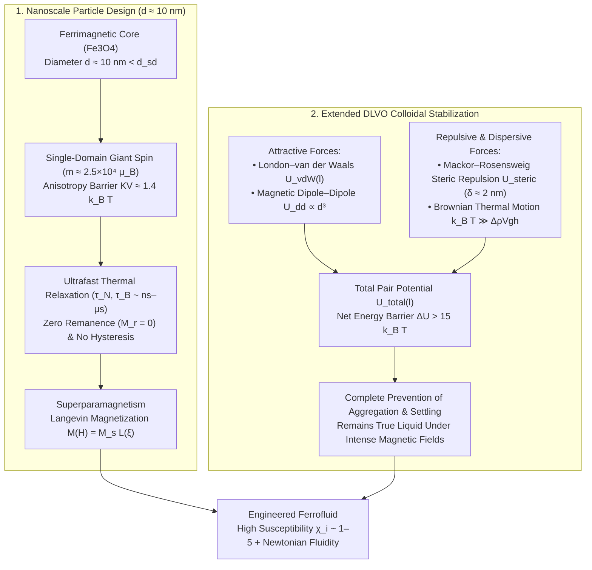
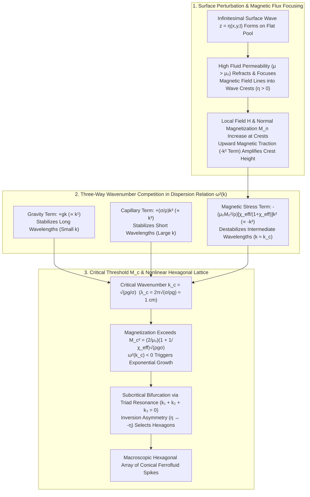

Bring a rare-earth neodymium magnet beneath a Petri dish filled with a jet-black liquid, and the flat meniscus instantly erupts into a geometrically pristine hexagonal array of sharp, gleaming liquid spikes. Move the magnet laterally, and the forest of peaks undulates like a living organism; withdraw the magnetic field, and the spikes collapse seamlessly back into a mirror-smooth puddle without leaving a trace of solid residue. This striking material—a staple of science museums, kinetic sculptures, and high-vacuum semiconductor manufacturing—is a <strong>ferrofluid</strong>, a colloidal suspension that unites the macroscopic fluidity of a liquid with the intense magnetic susceptibility of a solid ferromagnet.

Yet from the standpoint of fundamental condensed-matter physics, the very existence of a "liquid magnet" at room temperature poses a profound paradox. In nature, no single-component liquid exhibits ferromagnetism. Why does melting a bar of iron destroy its magnetism long before it liquefies? How did NASA engineers in the 1960s bypass this thermodynamic barrier by engineering a three-component nanoscale colloid? And when a vertical magnetic field is applied to this colloid, why does the free surface not simply bulge upward as a smooth dome, but instead spontaneously fracture into a hexagonal lattice of sharp conical peaks governed by a universal critical wavelength?

In this comprehensive article, we derive the physics of ferrofluids across four distinct length scales:
1. <strong>The Atomic & Crystalline Scale ($\sim 0.1\,\text{nm}$)</strong>: Why the Heisenberg exchange interaction succumbs to thermal agitation at the Curie temperature $T_C \ll T_m$ in all metallic elements.
2. <strong>The Nanoparticle Scale ($d \approx 10\,\text{nm}$)</strong>: Single-domain micromagnetics, Néel and Brownian relaxation dynamics, and the statistical mechanics of <strong>Langevin superparamagnetism</strong>.
3. <strong>The Colloidal Interface Scale ($\delta \approx 2\,\text{nm}$)</strong>: <strong>Extended DLVO theory</strong> and how <strong>Mackor–Rosensweig entropic steric repulsion</strong> from grafted surfactant monolayers prevents van der Waals and magnetic dipole aggregation, distinguishing ferrofluids from magnetorheological (MR) fluids.
4. <strong>The Continuum Macroscopic Scale ($\lambda_c \approx 1\,\text{cm}$)</strong>: <strong>Ferrohydrodynamics (FHD)</strong>, the Kelvin magnetic body force, the generalized ferrohydrodynamic Bernoulli equation, the Maxwell stress tensor jump across a magnetizable interface, and the complete mathematical derivation of the <strong>Cowley–Rosensweig (normal-field) instability</strong> linear dispersion relation $\omega^2(k)$ and its subcritical bifurcation into hexagonal spikes.

Finally, we examine how these equations translate into indispensable industrial and biomedical technologies: zero-leakage rotary vacuum seals in semiconductor wafer fabrication, thermomagnetic voice-coil cooling and viscous damping in high-fidelity loudspeakers, magnetic hyperthermia for targeted oncology, and kinetic ferrofluid art.

---

## 1. Why Nature Has No Liquid Magnets: The Curie Temperature Barrier

### 1.1 Heisenberg Exchange Interaction vs. Thermal Agitation

In solid ferromagnetic elements such as iron ($\text{Fe}$), cobalt ($\text{Co}$), and nickel ($\text{Ni}$), spontaneous magnetization arises from the quantum-mechanical <strong>Heisenberg exchange interaction</strong> between unpaired $3d$ electron spins $\mathbf{S}_i$ and $\mathbf{S}_j$ on neighboring lattice sites. The exchange Hamiltonian takes the form:

$$\mathcal{H}_{\text{ex}} = -2 J_{\text{ex}} \sum_{\langle i,j \rangle} \mathbf{S}_i \cdot \mathbf{S}_j$$

where $J_{\text{ex}} > 0$ is the exchange integral, which depends sensitively on the interatomic spacing and orbital overlap. When $J_{\text{ex}} > 0$, parallel alignment of adjacent spins minimizes the electrostatic Coulomb repulsion via Pauli exclusion antisymmetrization of the spatial wavefunction.

However, as the absolute temperature $T$ rises, thermal agitation introduces random spin fluctuations of characteristic energy $k_B T$ (where $k_B = 1.380649 \times 10^{-23}\,\text{J/K}$ is the Boltzmann constant). At a critical threshold known as the <strong>Curie temperature ($T_C$)</strong>, thermal entropy overwhelms the exchange coupling $J_{\text{ex}}$, triggering a continuous (second-order) phase transition from a long-range ordered <strong>ferromagnet</strong> (or <strong>ferrimagnet</strong>) to a disordered <strong>paramagnet</strong> whose spontaneous magnetization vanishes ($M_s \to 0$).

### 1.2 The Universal Gap Between $T_C$ and the Melting Point $T_m$

What happens if we attempt to create a natural ferromagnetic liquid by melting a block of iron or magnetite in a crucible? A comparison of the Curie temperature $T_C$ and the melting point $T_m$ across ferromagnetic metals and ferrimagnetic oxides reveals a universal thermodynamic hierarchy:

| Ferromagnetic / Ferrimagnetic Material | Curie Temperature $T_C$ ($\text{K}$ / ${}^\circ\text{C}$) | Melting Point $T_m$ ($\text{K}$ / ${}^\circ\text{C}$) | Thermal Gap $T_m - T_C$ ($\text{K}$) | Magnetic State in the Liquid Phase ($T > T_m$) |
| :--- | :--- | :--- | :--- | :--- |
| <strong>Iron ($\text{Fe}$)</strong> | $1043\,\text{K}$ ($770\,^\circ\text{C}$) | $1811\,\text{K}$ ($1538\,^\circ\text{C}$) | $+768\,\text{K}$ | Unmagnetized paramagnetic liquid |
| <strong>Cobalt ($\text{Co}$)</strong> | $1388\,\text{K}$ ($1115\,^\circ\text{C}$) | $1768\,\text{K}$ ($1495\,^\circ\text{C}$) | $+380\,\text{K}$ | Unmagnetized paramagnetic liquid |
| <strong>Nickel ($\text{Ni}$)</strong> | $627\,\text{K}$ ($354\,^\circ\text{C}$) | $1728\,\text{K}$ ($1455\,^\circ\text{C}$) | $+1101\,\text{K}$ | Unmagnetized paramagnetic liquid |
| <strong>Gadolinium ($\text{Gd}$)</strong> | $292\,\text{K}$ ($19\,^\circ\text{C}$) | $1585\,\text{K}$ ($1312\,^\circ\text{C}$) | $+1293\,\text{K}$ | Unmagnetized paramagnetic liquid |
| <strong>Magnetite ($\text{Fe}_3\text{O}_4$)</strong> | $858\,\text{K}$ ($585\,^\circ\text{C}$) | $1870\,\text{K}$ ($1597\,^\circ\text{C}$) | $+1012\,\text{K}$ | Unmagnetized paramagnetic liquid |

In every single substance, <strong>the Curie temperature $T_C$ lies hundreds to over a thousand kelvins below the melting point $T_m$ ($T_C \ll T_m$)</strong>. The cohesive binding energy holding the crystalline lattice together is substantially stronger than the delicate interatomic spin-exchange integral $J_{\text{ex}}$. Consequently, long before a ferromagnetic solid absorbs enough thermal energy to melt into a liquid, its magnetic order is completely destroyed. (While exotic undercooled metallic melts such as $\text{Co}_{80}\text{Pd}_{20}$ have shown transient short-range magnetic correlations near $1500\,\text{K}$ in containerless levitation experiments, no homogeneous single-phase ferromagnetic liquid exists at ambient conditions.)

Conversely, ordinary paramagnetic liquids—such as aqueous solutions of iron(III) chloride ($\text{FeCl}_3$) or cryogenic liquid oxygen ($\text{O}_2$ at $90\,\text{K}$)—possess tiny volume magnetic susceptibilities of order $\chi \sim 10^{-4}$ to $10^{-3}$. Their magnetic response is three to four orders of magnitude too weak to produce macroscopic surface instabilities under standard permanent magnets.

### 1.3 Stephen Papell's 1963 NASA Invention: The Three-Component Colloidal Solution

The breakthrough that circumvented the $T_C \ll T_m$ barrier came in 1963 from <strong>Stephen S. Papell</strong> at NASA's Lewis Research Center (now Glenn Research Center). Papell was investigating a critical aerospace propulsion problem: in the weightlessness (microgravity) of orbital spaceflight, liquid rocket propellants float freely inside fuel tanks rather than settling over the pump inlet, causing vapor ingestion and engine starvation. Papell reasoned that if liquid rocket fuel could be rendered strongly magnetic, an external magnetic field gradient near the tank outlet could draw the propellant directly into the feed line without mechanical pumps or moving parts.

Since no pure molecular liquid is ferromagnetic, Papell's insight—subsequently refined and commercialized by <strong>Ronald E. Rosensweig</strong> and colleagues—was to construct a <strong>heterogeneous colloidal suspension</strong> composed of three distinct components:

1. <strong>Single-Domain Ferrimagnetic Nanoparticles (Volume Fraction $\phi \approx 3\%\text{–}15\%$)</strong>
   Crystalline nanoparticles of <strong>magnetite ($\text{Fe}_3\text{O}_4$)</strong> or <strong>maghemite ($\gamma\text{-Fe}_2\text{O}_3$)</strong> with an inverse spinel structure, synthesized via chemical co-precipitation of ferrous ($\text{Fe}^{2+}$) and ferric ($\text{Fe}^{3+}$) salts in an alkaline medium:
   $$\text{Fe}^{2+} + 2\text{Fe}^{3+} + 8\text{OH}^- \longrightarrow \text{Fe}_3\text{O}_4\downarrow + 4\text{H}_2\text{O}$$
   Crucially, the particle core diameter is restricted to a narrow distribution around <strong>$d \approx 10\,\text{nm}$ ($5\text{–}15\,\text{nm}$)</strong>. Because each nanoparticle remains a solid crystal well below its Curie point ($T = 300\,\text{K} \ll T_C = 858\,\text{K}$), it retains its full spontaneous bulk magnetization ($M_d \approx 4.46 \times 10^5\,\text{A/m}$ for magnetite).
2. <strong>Amphiphilic Surfactant Monolayer (Coating Thickness $\delta \approx 2\,\text{nm}$)</strong>
   A long-chain surface-active agent—classically <strong>oleic acid</strong> ($\text{CH}_3(\text{CH}_2)_7\text{CH}=\text{CH}(\text{CH}_2)_7\text{COOH}$, chain length $\delta \approx 2\,\text{nm}$)—whose polar carboxylic headgroup ($-\text{COOH}$) chemisorbs onto the iron oxide surface while its non-polar hydrocarbon tail extends outward into the solvent, forming a dense elastic steric bumper around every nanoparticle.
3. <strong>Carrier Liquid (Volume Fraction $80\%\text{–}90\%$)</strong>
   The continuous liquid matrix—such as kerosene, mineral oil, synthetic esters, perfluoropolyether (PFPE), silicone oil, or water (using a surfactant bilayer or ionic stabilization)—which imparts macroscopic fluidity, viscosity $\eta$, density $\rho$, and surface tension $\sigma$ to the composite system.

---

## 2. Nanoscale Magnetism: Single-Domain Physics and Superparamagnetism

Why must the magnetic nanoparticles in a ferrofluid have a diameter of $d \approx 10\,\text{nm}$ rather than $100\,\text{nm}$ or $1\,\mu\text{m}$? The answer lies in the micromagnetics of <strong>single-domain particles</strong> and the thermal kinetics of <strong>superparamagnetism</strong>.

### 2.1 Transition from Multi-Domain to Single-Domain Nanoparticles

A macroscopic piece of magnetite or iron subdivides its interior into numerous <strong>magnetic domains</strong> separated by <strong>Bloch domain walls</strong> of width $\delta_w \sim \pi\sqrt{A_{\text{ex}}/K}$, where $A_{\text{ex}} \sim 10^{-11}\,\text{J/m}$ is the exchange stiffness and $K$ is the magnetocrystalline anisotropy constant. Forming domains reduces the long-range magnetostatic (demagnetizing) stray-field energy, which scales with particle volume ($\Delta E_{\text{ms}} \propto \mu_0 M_d^2 d^3$), at the cost of introducing domain-wall surface energy ($\Delta E_w \propto \sigma_w d^2$, where $\sigma_w = 4\sqrt{A_{\text{ex}} K}$ is the wall energy per unit area).

As the particle diameter $d$ shrinks, the surface-to-volume ratio $1/d$ grows until the energy cost of creating a domain wall exceeds the magnetostatic energy saved. Below Kittel's <strong>critical single-domain diameter $d_{\text{sd}}$</strong>,

$$d_{\text{sd}} \approx \frac{36 \sqrt{A_{\text{ex}} K}}{\mu_0 M_d^2}$$

it becomes energetically impossible to nucleate a domain wall. For $\text{Fe}_3\text{O}_4$ ($d_{\text{sd}} \approx 80\text{–}120\,\text{nm}$ depending on aspect ratio), a nanoparticle of diameter $d = 10\,\text{nm}$ is unconditionally a <strong>single-domain particle</strong>: all $\sim 10^4$ iron-ion spins inside the crystal remain locked in uniform alignment, endowing the nanoparticle with a permanent giant magnetic dipole moment of magnitude:

$$m = M_d V = M_d \left(\frac{\pi}{6}d^3\right) \approx (4.46 \times 10^5\,\text{A/m}) \times (5.24 \times 10^{-25}\,\text{m}^3) \approx 2.34 \times 10^{-19}\,\text{A}\cdot\text{m}^2 \approx 2.5 \times 10^4\,\mu_B$$

where $\mu_B = 9.274 \times 10^{-24}\,\text{J/T}$ is the Bohr magneton.

### 2.2 Néel Relaxation and Brownian Relaxation: Erasing Magnetic Hysteresis

If these single-domain nanoparticles behaved as rigid miniature bar magnets with fixed orientation, they would retain remanent magnetization ($M_r \neq 0$) and coercivity ($H_c \neq 0$) even in zero applied field, causing irreversible magnetic flocculation.

However, at $d = 10\,\text{nm}$, the magnetocrystalline anisotropy energy barrier $\Delta E_a = K V$ that pins the magnetic moment $\mathbf{m}$ along the crystal's easy axis becomes comparable to the ambient thermal energy $k_B T$. Taking $K \approx 1.1 \times 10^4\,\text{J/m}^3$ for magnetite at $T = 300\,\text{K}$ ($k_B T \approx 4.14 \times 10^{-21}\,\text{J}$):

$$K V = (1.1 \times 10^4\,\text{J/m}^3) \times \left(\frac{\pi}{6}(10^{-8}\,\text{m})^3\right) \approx 5.76 \times 10^{-21}\,\text{J} \approx 1.39\,k_B T$$

Because the barrier $KV$ is on the order of $1\,k_B T$, the dipole moment $\mathbf{m}$ reorients spontaneously via two parallel relaxation pathways:

1. <strong>Néel Relaxation (Internal Spin Rotation)</strong>
   The magnetic moment vector $\mathbf{m}$ flips internally across the anisotropy barrier $KV$ via thermal fluctuations while the physical crystal lattice remains stationary. Derived by Louis Néel (1949), the characteristic <strong>Néel relaxation time $\tau_N$</strong> obeys an exponential Arrhenius law:
   $$\tau_N = \tau_0 \exp\left(\frac{K V}{k_B T}\right)$$
   where $\tau_0 \sim 10^{-9}\text{–}10^{-10}\,\text{s}$ is the Larmor attempt period. For $d = 10\,\text{nm}$ ($KV/k_B T \approx 1.4$), $\tau_N \approx 4 \times 10^{-9}\,\text{s}$ (a few nanoseconds!). Notice the extreme cubic sensitivity to diameter $V \propto d^3$: if the particle diameter doubles to $d = 20\,\text{nm}$, $KV/k_B T$ jumps by a factor of $2^3 = 8$ to $11.1$, increasing $\tau_N$ to $\sim 10^{-4}\,\text{s}$; at $d = 30\,\text{nm}$, $KV/k_B T \approx 37.5$ and $\tau_N \sim 10^7\,\text{s}$ (months to years), locking the moment into a blocked ferromagnetic state.
2. <strong>Brownian Relaxation (Rigid-Body Particle Rotation)</strong>
   If the magnetic moment is frozen to the crystal lattice ($KV \gg k_B T$), the dipole can still reorient by <strong>physical rotation of the entire coated nanoparticle</strong> against the viscous drag of the carrier liquid. With hydrodynamic volume $V_H = \frac{\pi}{6}(d + 2\delta)^3$ (including the surfactant layer of thickness $\delta$) and carrier viscosity $\eta$, the Einstein–Debye rotational diffusion equation yields the <strong>Brownian relaxation time $\tau_B$</strong>:
   $$\tau_B = \frac{3 \eta V_H}{k_B T}$$
   In a low-viscosity hydrocarbon or aqueous carrier ($\eta \sim 10^{-3}\text{–}10^{-2}\,\text{Pa}\cdot\text{s}$) with $d + 2\delta \approx 14\,\text{nm}$, $\tau_B \sim 10^{-6}\text{–}10^{-5}\,\text{s}$ (microseconds).

The effective relaxation rate of the colloid is the sum of both rates:

$$\frac{1}{\tau_{\text{eff}}} = \frac{1}{\tau_N} + \frac{1}{\tau_B} \implies \tau_{\text{eff}} = \frac{\tau_N \tau_B}{\tau_N + \tau_B}$$

Because $\tau_{\text{eff}} \sim 10^{-9}\text{–}10^{-6}\,\text{s}$ is vastly shorter than any macroscopic measurement or fluid-dynamic timescale, removing the external magnetic field $\mathbf{H}$ causes the nanoparticle moments to randomize almost instantaneously. Consequently, a ferrofluid exhibits <strong>zero remanence ($M_r = 0$) and zero coercivity ($H_c = 0$)</strong>: its $M\text{–}H$ curve is completely hysteresis-free.

### 2.3 Langevin Theory of Superparamagnetism

In an external magnetic field $\mathbf{H}$, each nanoparticle dipole $\mathbf{m}$ experiences a Zeeman torque tending to align it with $\mathbf{H}$ (potential energy $U_Z = -\mu_0 \mathbf{m}\cdot\mathbf{H} = -\mu_0 m H \cos\theta$), opposed by thermal rotational diffusion. Integrating the Boltzmann probability distribution $P(\theta) \propto \exp(\xi \cos\theta)\sin\theta$ over all solid angles yields Paul Langevin's classical equation for the macroscopic magnetization $M(H)$:

$$M(H) = n m \langle \cos\theta \rangle = \phi M_d \mathcal{L}(\xi) = M_s \left( \coth\xi - \frac{1}{\xi} \right)$$

where:
- $n$ is the number density of nanoparticles and $\phi = n V$ is the solid magnetic volume fraction,
- $M_s = \phi M_d$ is the saturation magnetization of the ferrofluid as a whole,
- $\mathcal{L}(\xi) = \coth\xi - \frac{1}{\xi}$ is the <strong>Langevin function</strong>, and
- $\xi$ is the dimensionless <strong>Langevin parameter</strong> measuring the ratio of Zeeman magnetic energy to thermal energy:

$$\xi \equiv \frac{\mu_0 m H}{k_B T} = \frac{\mu_0 M_d \left(\frac{\pi}{6}d^3\right) H}{k_B T}$$

Expanding $\mathcal{L}(\xi)$ in the two asymptotic regimes reveals why Bean and Livingston (1959) coined the term <strong>superparamagnetism</strong>:
- <strong>Low-Field Linear Regime ($\xi \ll 1$)</strong>: Using the Taylor expansion $\mathcal{L}(\xi) = \frac{\xi}{3} - \frac{\xi^3}{45} + \mathcal{O}(\xi^5)$, we obtain $M \approx \chi_i H$, where the <strong>initial magnetic susceptibility $\chi_i$</strong> obeys a Curie law:
  $$\chi_i = \left.\frac{\partial M}{\partial H}\right|_{H \to 0} = \frac{\mu_0 n m^2}{3 k_B T} = \frac{\mu_0 \phi M_d^2 V}{3 k_B T}$$
  Because $\chi_i$ scales with the <strong>square of the magnetic moment ($m^2$)</strong>, replacing individual atomic spins ($m \sim 1\,\mu_B$) with single-domain nanoparticles ($m \sim 2.5 \times 10^4\,\mu_B$) amplifies the susceptibility per unit volume by four to five orders of magnitude! While an ordinary paramagnetic salt solution has $\chi_i \sim 10^{-4}$, a typical commercial ferrofluid ($\phi \approx 0.07\text{–}0.10$) achieves $\chi_i \sim 0.5\text{–}5.0$.
- <strong>High-Field Saturation Regime ($\xi \gg 1$)</strong>: As $\xi \to \infty$, $\coth\xi \to 1$ and $\mathcal{L}(\xi) \approx 1 - \frac{1}{\xi}$, so the magnetization saturates smoothly at $M_s = \phi M_d$ (typically $\mu_0 M_s \approx 20\text{–}90\,\text{mT}$) at modest applied fields of $B \sim 0.2\text{–}0.5\,\text{T}$.

---

## 3. Colloidal Stability: Extended DLVO Theory and Steric Repulsion

To function as a true homogeneous liquid rather than a settling slurry, a ferrofluid must remain stable against four distinct destabilizing mechanisms: (1) gravitational sedimentation, (2) magnetic gradient sedimentation, (3) London–van der Waals dispersion attraction, and (4) magnetic dipole–dipole attraction.

### 3.1 Stability Against Gravitational and Magnetic-Gradient Sedimentation

In a gravitational field $g$, the barometric height distribution of nanoparticles of buoyant mass $\Delta m = \Delta\rho V = (\rho_p - \rho_f)V$ has a characteristic sedimentation decay length $l_g = \frac{k_B T}{\Delta\rho V g}$. For magnetite ($\rho_p = 5180\,\text{kg/m}^3$) in hydrocarbon oil ($\rho_f = 800\,\text{kg/m}^3$) at $d = 10\,\text{nm}$, $l_g \approx 18\,\text{cm}$, ensuring that Brownian translational diffusion keeps the nanoparticles uniformly suspended against gravity.

A far stricter constraint arises in a strong <strong>magnetic field gradient $\nabla H$</strong>, which pulls each particle toward the field maximum with a Kelvin force $\mathbf{F}_m = \mu_0(\mathbf{m}\cdot\nabla)\mathbf{H}$. Preventing irreversible phase separation in a magnetic seal or loudspeaker gap over a field excursion $\Delta H$ requires that the thermal energy $k_B T$ exceed the magnetic potential well $\mu_0 m \Delta H$:

$$\frac{\mu_0 m \Delta H}{k_B T} = \frac{\mu_0 M_d \left(\frac{\pi}{6}d^3\right)\Delta H}{k_B T} \lesssim 1 \implies d \lesssim \left(\frac{6 k_B T}{\pi \mu_0 M_d \Delta H}\right)^{1/3}$$

For $\Delta H \sim 4 \times 10^5\,\text{A/m}$ ($\mu_0 \Delta H \approx 0.5\,\text{T}$), this criterion mandates $d \lesssim 8\text{–}10\,\text{nm}$.

### 3.2 Extended DLVO Pair Potential and Mackor–Rosensweig Steric Repulsion

When two spherical nanoparticles of diameter $d = 2R$ approach one another to a center-to-center distance $r$ (surface-to-surface separation $s = r - d$, or dimensionless separation $l \equiv \frac{2s}{d} = \frac{s}{R}$), their interaction is governed by the <strong>extended DLVO (Derjaguin–Landau–Verwey–Overbeek) pair potential</strong>:

$$U_{\text{total}}(l) = U_{\text{vdW}}(l) + U_{\text{dd}}(l) + U_{\text{steric}}(l)$$

Let us examine the three competing terms:

1. <strong>London–van der Waals Attraction $U_{\text{vdW}}(l)$</strong>
   Correlated quantum dipole fluctuations between iron oxide cores generate a universal short-range attraction given by the exact Hamaker formula for two equal spheres:
   $$U_{\text{vdW}}(l) = -\frac{A_H}{6} \left[ \frac{2}{l^2 + 4l} + \frac{2}{(l + 2)^2} + \ln\left(\frac{l^2 + 4l}{(l + 2)^2}\right) \right]$$
   where $A_H \approx 10^{-19}\,\text{J} \approx 24\,k_B T$ is the effective Hamaker constant of $\text{Fe}_3\text{O}_4$ across a hydrocarbon medium. Notice two critical features of $U_{\text{vdW}}(l)$: first, it is <strong>scale-invariant</strong> (it depends only on the dimensionless ratio $l = 2s/d$, independent of absolute particle size $d$); second, as bare surfaces touch ($l \to 0$), $U_{\text{vdW}}(l) \sim -\frac{A_H}{6l} \to -\infty$, creating an infinitely deep primary potential well that causes permanent coagulation on contact.
2. <strong>Magnetic Dipole–Dipole Attraction $U_{\text{dd}}(l)$</strong>
   Two aligned dipoles in a head-to-tail configuration ($\rightarrow\rightarrow$) experience a maximum directional attraction:
   $$U_{\text{dd}}(l) = -\frac{\mu_0 m^2}{2\pi r^3} = -\frac{\mu_0 \pi M_d^2 d^3}{36 (l + 2)^3}$$
   Unlike van der Waals attraction, $U_{\text{dd}}$ scales with <strong>particle volume ($d^3$)</strong>. At $d = 10\,\text{nm}$, even at close contact ($l = 0$), the dipole energy is only $|U_{\text{dd}}(0)| = \frac{\mu_0 \pi M_d^2 d^3}{288} \approx 2.2\,k_B T$, and when separated by two surfactant layers ($s = 2\delta = 4\,\text{nm}$, so $l = 0.8$), it drops to $|U_{\text{dd}}(0.8)| \approx 0.8\,k_B T < k_B T$.
3. <strong>Mackor–Rosensweig Entropic Steric Repulsion $U_{\text{steric}}(l)$</strong>
   To prevent nanoparticles from entering the singular van der Waals well as $l \to 0$, each particle is grafted with a dense brush of surfactant chains (e.g., oleic acid of length $\delta \approx 2\,\text{nm}$ and surface grafting density $\xi_{\text{surf}} \approx 2 \times 10^{18}\,\text{chains/m}^2$). When two particles approach closer than $s < 2\delta$ (i.e., $l < 2t$, where $t \equiv \frac{2\delta}{d} = \frac{\delta}{R}$ is the dimensionless coating thickness ratio), the interpenetrating hydrocarbon chains are compressed into a smaller volume, severely restricting their conformational degrees of freedom.
   By $\Delta F = \Delta U - T\Delta S$, this loss of configurational entropy ($\Delta S < 0$) produces a steep rise in Helmholtz free energy ($\Delta F > 0$). Using the <strong>Mackor–Rosensweig rigid-rod model</strong>, the entropic steric repulsion potential between two spheres for $l \le 2t$ is:
   $$U_{\text{steric}}(l) = \frac{\pi d^2 \xi_{\text{surf}} k_B T}{2} \left[ 2 - \frac{l + 2}{t}\ln\left(\frac{1 + t}{1 + l/2}\right) - \frac{l}{t} \right]$$

For a $d = 10\,\text{nm}$ magnetite core coated with $\delta = 2\,\text{nm}$ of oleic acid ($t = 2\delta/d = 0.4$), the steric barrier $U_{\text{steric}}(l)$ rises to $+15\,k_B T\text{–}+25\,k_B T$ at $l \approx 0.4$, completely screening the primary van der Waals minimum and ensuring indefinite colloidal stability.

### 3.3 Ferrofluids (FF) vs. Magnetorheological (MR) Fluids

It is instructive to contrast <strong>ferrofluids (FF)</strong> with <strong>magnetorheological (MR) fluids</strong>, which are often confused in popular accounts. Their divergent behavior is governed by the dimensionless <strong>magnetic dipolar coupling parameter $\lambda_{\text{dd}}$</strong>:

$$\lambda_{\text{dd}} \equiv \frac{|U_{\text{dd}}(s = 2\delta)|}{k_B T} = \frac{\mu_0 \pi M_d^2 d^3}{36 k_B T (2 + 2\delta/d)^3}$$

| Physical Property | Ferrofluid (FF) | Magnetorheological (MR) Fluid |
| :--- | :--- | :--- |
| <strong>Particle Composition & Size $d$</strong> | $\text{Fe}_3\text{O}_4$ or $\gamma\text{-Fe}_2\text{O}_3$, <strong>$d \approx 5\text{–}15\,\text{nm}$</strong> (nanoscale) | Carbonyl iron ($\text{Fe}$), <strong>$d \approx 1\text{–}10\,\mu\text{m}$</strong> (micron-scale) |
| <strong>Magnetic Domain Structure</strong> | <strong>Single-domain (superparamagnetic)</strong> | <strong>Multi-domain (soft ferromagnetic)</strong>, $\mu_0 M_d \approx 2.1\,\text{T}$ |
| <strong>Dipolar Coupling Parameter $\lambda_{\text{dd}}$</strong> | $\lambda_{\text{dd}} \lesssim 1$ (thermal motion $k_B T$ dominates) | $\lambda_{\text{dd}} \sim 10^6\text{–}10^9 \gg 1$ (dipolar attraction dominates) |
| <strong>Microstructure in Applied Field $\mathbf{H}$</strong> | Particles remain individually dispersed; only moments align | Particles self-assemble into rigid <strong>fibrous chains & columns</strong> |
| <strong>Rheological Behavior in Field</strong> | Remains a <strong>low-viscosity Newtonian liquid</strong>; forms surface spikes | Transitions in $\sim 1\,\text{ms}$ to a <strong>Bingham plastic semi-solid</strong> with huge yield stress $\tau_y(H) \sim 50\text{–}100\,\text{kPa}$ |
| <strong>Gravitational Stability</strong> | <strong>Never settles</strong> (Brownian motion $k_B T \gg \Delta\rho V g h$) | Settles rapidly under gravity (requires thixotropic additives) |
| <strong>Primary Engineering Applications</strong> | Rotary vacuum seals, loudspeaker voice-coil cooling, kinetic art | Adaptive automotive dampers (MagneRide), clutches, seismic dampers |

Because MR fluid particles are $10^2\text{–}10^3$ times larger in diameter than ferrofluid nanoparticles, their volume $V \propto d^3$ and dipolar coupling $\lambda_{\text{dd}}$ are $10^6\text{–}10^9$ times larger. When a magnetic field is applied, MR fluid particles lock together into rigid chains spanning the gap, requiring a large shear <strong>yield stress $\tau_y(H)$</strong> ($\tau = \tau_y(H)\operatorname{sgn}(\dot{\gamma}) + \eta\dot{\gamma}$) to flow. By contrast, a ferrofluid is specifically engineered so that $\lambda_{\text{dd}} \lesssim 1$: it <strong>never solidifies</strong> in a magnetic field, allowing its free surface to deform smoothly into the sharp geometric spikes of the Rosensweig instability.

---

## 4. Ferrohydrodynamics (FHD): Kelvin Body Force, Generalized Bernoulli Equation, and Maxwell Stress Tensor

On length scales much larger than the interparticle spacing ($\gg 10\,\text{nm}$), a ferrofluid behaves as a continuous, electrically non-conducting ($\mathbf{J} = \mathbf{0}$), magnetizable medium governed by the equations of <strong>Ferrohydrodynamics (FHD)</strong>, formulated by Neuringer and Rosensweig (1964).

*(Note: Unlike <strong>Magnetohydrodynamics (MHD)</strong>—which describes electrically conducting plasmas or liquid metals subject to the Lorentz force $\mathbf{J} \times \mathbf{B}$—a ferrofluid has no free electric currents; its magnetic body force arises entirely from spatial gradients of the magnetization $\mathbf{M}$ and magnetic field $\mathbf{H}$.)*

### 4.1 Magnetostatic Maxwell Equations and the Kelvin Magnetic Body Force

In a current-free magnetostatic system, the magnetic field intensity $\mathbf{H}$ and magnetic flux density $\mathbf{B}$ satisfy:

$$\nabla \times \mathbf{H} = \mathbf{0}, \qquad \nabla \cdot \mathbf{B} = 0, \qquad \mathbf{B} = \mu_0(\mathbf{H} + \mathbf{M})$$

Because the superparamagnetic relaxation time $\tau_{\text{eff}} \sim 10^{-6}\,\text{s}$ is much shorter than hydrodynamic timescales, the magnetization vector $\mathbf{M}$ remains collinear with the local magnetic field $\mathbf{H}$ (the <strong>quasi-equilibrium collinear approximation</strong>):

$$\mathbf{M}(\mathbf{r}, t) = \frac{M(H)}{H}\mathbf{H}(\mathbf{r}, t) = \chi(H)\mathbf{H}(\mathbf{r}, t)$$

Summing the dipole force $\mu_0(\mathbf{m}\cdot\nabla)\mathbf{H}$ over all nanoparticles per unit volume yields the macroscopic <strong>Kelvin magnetic body force density $\mathbf{f}_m$</strong>:

$$\mathbf{f}_m = \mu_0 (\mathbf{M} \cdot \nabla)\mathbf{H}$$

Using the vector identity $\nabla(\mathbf{H}\cdot\mathbf{H}) = 2(\mathbf{H}\cdot\nabla)\mathbf{H} + 2\mathbf{H}\times(\nabla\times\mathbf{H})$ together with Ampère's current-free law $\nabla \times \mathbf{H} = \mathbf{0}$, we obtain $(\mathbf{H}\cdot\nabla)\mathbf{H} = \frac{1}{2}\nabla(H^2) = H\nabla H$. Substituting the collinearity relation $\mathbf{M} = \frac{M(H)}{H}\mathbf{H}$ transforms the Kelvin force into a remarkably simple form proportional to the gradient of the scalar field magnitude $H = |\mathbf{H}|$:

$$\mathbf{f}_m = \mu_0 \frac{M(H)}{H}(\mathbf{H}\cdot\nabla)\mathbf{H} = \mu_0 M(H)\nabla H$$

For an isothermal, homogeneous ferrofluid where $M = M(H)$ is a function of $H$ alone, the chain rule of calculus allows $\mathbf{f}_m$ to be written as an exact spatial gradient:

$$\mathbf{f}_m = \nabla\left(\mu_0 \int_0^H M(H')\,dH'\right) \equiv \nabla p_m$$

where $p_m \equiv \mu_0 \int_0^H M(H')\,dH'$ is the <strong>fluid-magnetic pressure</strong>. This equation reveals a fundamental physical principle: <strong>a uniform magnetic field ($\nabla H = \mathbf{0}$) exerts zero net translational force on a homogeneous bulk ferrofluid; translational attraction occurs only in the presence of a magnetic field gradient ($\nabla H \neq \mathbf{0}$), pulling the liquid toward regions of higher field intensity $H$.</strong>

### 4.2 The Ferrohydrodynamic Navier–Stokes and Generalized Bernoulli Equations

For an incompressible ($\nabla\cdot\mathbf{v} = 0$, constant density $\rho$) Newtonian ferrofluid of dynamic viscosity $\eta$, the momentum conservation equation (<strong>Rosensweig's FHD equation of motion</strong>) reads:

$$\rho\left(\frac{\partial \mathbf{v}}{\partial t} + (\mathbf{v}\cdot\nabla)\mathbf{v}\right) = -\nabla p^* + \eta \nabla^2 \mathbf{v} + \mu_0 M(H)\nabla H - \rho g \mathbf{e}_z$$

Here $p^* = p + p_s$ is the composite fluid pressure incorporating the thermodynamic pressure $p$ and the magnetostrictive pressure $p_s = -\mu_0 \int_0^H \rho\left(\frac{\partial M}{\partial \rho}\right)_{H,T}dH'$.

For an inviscid ($\eta \to 0$), irrotational ($\nabla\times\mathbf{v} = \mathbf{0} \implies \mathbf{v} = \nabla\Phi$) flow—or for a static fluid in hydrostatic equilibrium ($\mathbf{v} = \mathbf{0}$)—every term in the momentum equation is a gradient. Integrating spatially yields the <strong>Generalized Ferrohydrodynamic Bernoulli Equation</strong>:

$$\rho\frac{\partial \Phi}{\partial t} + p^* + \frac{1}{2}\rho v^2 + \rho g z - \mu_0 \int_0^H M(H')\,dH' = \text{const}$$

or in steady / static form:

$$p^* + \frac{1}{2}\rho v^2 + \rho g z - \mu_0 \int_0^H M(H')\,dH' = \text{const}$$

Notice the negative sign in front of the magnetic work integral $-\mu_0 \int_0^H M(H')\,dH'$. In regions where the magnetic field $H$ is strong, this magnetic term becomes strongly negative; to keep the Bernoulli sum constant, either the internal pressure $p^*$ or the gravitational elevation $\rho g z$ must increase.

### 4.3 The Maxwell Stress Tensor and the Interfacial Normal-Stress Jump

To connect the pressure $p^*$ just inside the ferrofluid (Medium 1, magnetization $\mathbf{M}$) to the atmospheric pressure $p_0$ in the non-magnetic air above it (Medium 2, $\mathbf{M}_2 = \mathbf{0}$), we must evaluate the jump in the total <strong>hydro-magnetic stress tensor $\mathbf{T}$</strong> across the free surface. Including the <strong>Maxwell stress tensor</strong> in a polarizable medium, the total stress tensor is:

$$\mathbf{T} = -\left(p^* + \frac{1}{2}\mu_0 H^2\right)\mathbf{I} + \mathbf{H}\mathbf{B}^T = -\left(p^* + \frac{1}{2}\mu_0 H^2\right)\mathbf{I} + \mu_0 \mathbf{H}(\mathbf{H} + \mathbf{M})^T$$

Let $\mathbf{n}$ be the outward unit normal vector pointing from the ferrofluid into the air, and $\mathbf{t}$ be any unit tangent vector on the interface. Across the current-free interface, magnetostatics enforces continuity of the tangential magnetic field $H_t = \mathbf{H}\cdot\mathbf{t}$ and continuity of the normal magnetic flux density $B_n = \mathbf{B}\cdot\mathbf{n}$:

$$H_{2t} = H_{1t} \equiv H_t, \qquad B_{2n} = B_{1n} \implies \mu_0 H_{2n} = \mu_0(H_{1n} + M_n) \implies H_{2n} - H_{1n} = M_n$$

where $M_n = \mathbf{M}\cdot\mathbf{n}$ is the component of the ferrofluid magnetization normal to the interface.
Balancing the normal traction jump $\mathbf{n}\cdot(\mathbf{T}_2 - \mathbf{T}_1)\cdot\mathbf{n}$ against the Young–Laplace capillary pressure $\sigma \kappa$ (where $\sigma$ is the surface tension and $\kappa = \nabla_s\cdot\mathbf{n}$ is twice the mean curvature of the surface) gives:

$$\left(p^* - p_0\right) + \frac{1}{2}\mu_0\left(H_{1n}^2 + H_{1t}^2 - H_{2n}^2 - H_{2t}^2\right) + \mu_0\left(H_{2n}^2 - H_{1n}(H_{1n} + M_n)\right) = \sigma\kappa$$

Substituting $H_{1t} = H_{2t}$ and $H_{2n} = H_{1n} + M_n$, all cross terms cancel algebraically, leaving a profound result:

$$p^* - p_0 = \sigma \kappa - \frac{1}{2}\mu_0 M_n^2 \equiv \sigma \kappa - p_n$$

Here $p_n \equiv \frac{1}{2}\mu_0 M_n^2 \ge 0$ is the <strong>magnetic normal traction (magnetic normal stress)</strong>. Because $-p_n$ appears with a minus sign relative to $\sigma\kappa$, <strong>any normal component of magnetization $M_n$ at the free surface exerts an outward tensile pull on the interface toward the air</strong>, directly opposing surface tension and driving surface spike formation!

---

## 5. Mathematical Derivation of the Rosensweig Instability: How Spikes Emerge

We now have all the theoretical machinery required to derive the <strong>Cowley–Rosensweig (Normal-Field) Instability (1967)</strong> from first principles and explain why a flat pool of ferrofluid erupts into a hexagonal array of sharp spikes above a critical vertical magnetic field.

### 5.1 Physical Mechanism: Magnetic Flux Focusing at Wave Crests

Consider an infinitely deep pool of ferrofluid occupying the lower half-space $z < 0$ with an initially flat horizontal free surface at $z = 0$, subjected to a uniform vertical magnetic field $\mathbf{B}_0 = B_0 \mathbf{e}_z$. In the unperturbed base state, the field inside the fluid ($z < 0$) is $\mathbf{H}_0 = H_0 \mathbf{e}_z$ with magnetization $\mathbf{M}_0 = M_0 \mathbf{e}_z$, while in the air above ($z > 0$) $\mathbf{H}_{2,0} = (H_0 + M_0)\mathbf{e}_z = (B_0/\mu_0)\mathbf{e}_z$.

Suppose a small sinusoidal capillary-gravity wave perturbs the free surface:

$$z = \eta(x, y, t) = \hat{\eta}\,e^{i(\mathbf{k}\cdot\mathbf{r}_\perp - \omega t)}$$

where $\mathbf{r}_\perp = (x, y)$, $\mathbf{k} = (k_x, k_y)$ is the horizontal wavevector of magnitude $k = |\mathbf{k}| = \frac{2\pi}{\lambda}$, and $\omega$ is the angular frequency.

Why does a vertical magnetic field destabilize this wave? Because the ferrofluid has a much higher magnetic permeability $\mu = \mu_0(1 + \chi) > \mu_0$ than air, magnetic field lines prefer to travel through the raised ferrofluid rather than through the air gap (the principle of minimum magnetic reluctance). Consequently:
- At a <strong>wave crest ($\eta > 0$)</strong>, magnetic flux lines refract and <strong>concentrate (focus)</strong> into the peak, increasing the local field intensity $H$ and the normal magnetization $M_n$ above their unperturbed values $H_0, M_0$.
- At a <strong>wave trough ($\eta < 0$)</strong>, magnetic flux lines diverge away from the depression, decreasing the local field $H$ and $M_n$.

By the generalized Bernoulli equation and the interfacial normal stress jump $p^* - p_0 = \sigma\kappa - \frac{1}{2}\mu_0 M_n^2$, the enhanced magnetic field and normal magnetization at the crest pull the fluid upward even more strongly, while the weakened field at the trough allows the fluid to sink further. This creates a <strong>runaway positive feedback loop</strong>!

### 5.2 Linear Perturbation Analysis and the Dispersion Relation $\omega^2(k)$

Let us derive the exact linear dispersion relation $\omega^2(k)$ governing this instability.
For small perturbations around the static state ($\mathbf{v} = \nabla\Phi$ with $|\Phi| \ll 1$, $\mathbf{H}_1 = H_0\mathbf{e}_z - \nabla\psi_1$ in $z < 0$, and $\mathbf{H}_2 = (H_0 + M_0)\mathbf{e}_z - \nabla\psi_2$ in $z > 0$), the velocity potential $\Phi$ satisfies Laplace's equation $\nabla^2\Phi = 0$ in $z < 0$ with kinematic boundary condition $\frac{\partial\eta}{\partial t} = \left.\frac{\partial\Phi}{\partial z}\right|_{z=0}$, yielding:

$$\Phi(\mathbf{r}_\perp, z, t) = -\frac{i\omega}{k}\,\hat{\eta}\,e^{k z}\,e^{i(\mathbf{k}\cdot\mathbf{r}_\perp - \omega t)} \quad (z < 0)$$

Inside the ferrofluid ($z < 0$), linearizing the constitutive law $\mathbf{M}(\mathbf{H})$ around $\mathbf{H}_0 = H_0\mathbf{e}_z$ introduces two distinct susceptibilities: the <strong>chord susceptibility</strong> $\chi_c \equiv \frac{M_0}{H_0}$ for horizontal field perturbations $\mathbf{h}_\perp = -\nabla_\perp\psi_1$, and the <strong>differential (tangent) susceptibility</strong> $\chi_t \equiv \left.\frac{\partial M}{\partial H}\right|_{H_0}$ for vertical field perturbations $h_z = -\frac{\partial\psi_1}{\partial z}$. Thus $\nabla\cdot\mathbf{B}_1 = 0$ gives an anisotropic Laplace equation for the interior magnetic scalar potential $\psi_1$:

$$(1 + \chi_c)\left(\frac{\partial^2\psi_1}{\partial x^2} + \frac{\partial^2\psi_1}{\partial y^2}\right) + (1 + \chi_t)\frac{\partial^2\psi_1}{\partial z^2} = 0 \quad (z < 0)$$

while in the air above ($z > 0$), $\nabla^2\psi_2 = 0$. The decaying normal-mode solutions as $z \to \mp\infty$ are:

$$\psi_1 = \hat{\psi}_1\,e^{\tilde{k} z}\,e^{i(\mathbf{k}\cdot\mathbf{r}_\perp - \omega t)} \;\;(z < 0), \qquad \psi_2 = \hat{\psi}_2\,e^{-k z}\,e^{i(\mathbf{k}\cdot\mathbf{r}_\perp - \omega t)} \;\;(z > 0)$$

where $\tilde{k} \equiv k\sqrt{\frac{1 + \chi_c}{1 + \chi_t}}$.
At the perturbed interface $z = \eta(x, y, t)$, the unit normal to linear order in $\eta$ is $\mathbf{n} \approx -\nabla_\perp\eta + \mathbf{e}_z = -i\mathbf{k}\eta + \mathbf{e}_z$, and the linearized curvature is $\kappa \approx -\nabla_\perp^2\eta = k^2\eta$. Enforcing continuity of the tangential field $\llbracket \mathbf{H}\cdot\mathbf{t} \rrbracket = 0$ and normal flux density $\llbracket \mathbf{B}\cdot\mathbf{n} \rrbracket = 0$ at $z = \eta$ yields two linear algebraic equations for $\hat{\psi}_1$ and $\hat{\psi}_2$:

$$\hat{\psi}_1 - \hat{\psi}_2 = M_0\hat{\eta}, \qquad (1 + \chi_t)\tilde{k}\hat{\psi}_1 + k\hat{\psi}_2 = 0$$

Solving this system determines the perturbed magnetic field at the interface in terms of the surface elevation $\hat{\eta}$:

$$\hat{\psi}_1 = \frac{M_0}{1 + \chi_{\text{eff}}}\,\hat{\eta}, \qquad \text{where} \quad \chi_{\text{eff}} \equiv \sqrt{(1 + \chi_c)(1 + \chi_t)} - 1$$

Here $\chi_{\text{eff}}$ is the <strong>effective geometric-mean susceptibility</strong> (which reduces simply to $\chi_{\text{eff}} = \chi$ for a linear magnetic fluid with $M = \chi H$).
Finally, linearizing the unsteady ferrohydrodynamic Bernoulli equation and normal-stress boundary condition at $z = \eta$:

$$\rho\frac{\partial\Phi}{\partial t} + \rho g \eta - \mu_0 M_0 h_{1z} - \mu_0 M_0 \left(\frac{\partial M}{\partial H}\right)_{H_0} h_{1z} = -\sigma\nabla_\perp^2\eta + \mu_0 M_0 \chi_t h_{1z}$$

and substituting $\Phi$ and $h_{1z} = -\frac{\partial\psi_1}{\partial z} = -\tilde{k}\hat{\psi}_1$ produces the celebrated <strong>Cowley–Rosensweig Linear Dispersion Relation</strong>:

$$\omega^2(k) = g k + \frac{\sigma}{\rho} k^3 - \frac{\mu_0 M_0^2}{\rho}\,\frac{\chi_{\text{eff}}}{1 + \chi_{\text{eff}}}\,k^2$$

### 5.3 The Three-Way Competition of Scales and Critical Parameters $(k_c, \lambda_c, M_c)$

Examine the structure of the dispersion relation $\omega^2(k)$:

$$\underbrace{\omega^2(k)}_{\substack{\text{Restoring stiffness} \\ (\omega^2 > 0:\text{ stable waves}) \\ (\omega^2 < 0:\text{ exponential instability})}} = \underbrace{g k}_{\substack{\text{① Gravity } (\propto k^1) \\ \text{Stabilizes long }\lambda}} + \underbrace{\frac{\sigma}{\rho} k^3}_{\substack{\text{② Surface Tension } (\propto k^3) \\ \text{Stabilizes short }\lambda}} - \underbrace{\frac{\mu_0 M_0^2}{\rho}\frac{\chi_{\text{eff}}}{1 + \chi_{\text{eff}}} k^2}_{\substack{\text{③ Magnetic Stress } (\propto -k^2) \\ \text{Destabilizes intermediate }\lambda}}$$

Each of the three physical forces scales with a distinct power of the wavenumber $k = 2\pi/\lambda$:
1. <strong>Gravity ($+g k \propto k^1$)</strong>: At very small wavenumbers ($k \to 0$, long wavelengths $\lambda \to \infty$), the linear $k^1$ term dominates over $k^2$ and $k^3$. Lifting broad, heavy slabs of liquid requires immense gravitational potential energy, so <strong>gravity stabilizes long wavelengths</strong>.
2. <strong>Surface Tension ($+\frac{\sigma}{\rho}k^3 \propto k^3$)</strong>: At very large wavenumbers ($k \to \infty$, short wavelengths $\lambda \to 0$), the cubic $k^3$ term dominates over $k^1$ and $k^2$. Sharp, microscopic ripples create enormous surface area and curvature $\kappa \propto k^2$, so <strong>capillarity stabilizes short wavelengths</strong>.
3. <strong>Magnetic Normal Traction ($-\propto M_0^2 k^2$)</strong>: Scaling quadratically with $-k^2$, the destabilizing magnetic stress operates precisely in the <strong>intermediate wavenumber window</strong> between gravity and surface tension!

Because the wave amplitude evolves as $\eta(t) \propto e^{-i\omega t}$, the flat surface is stable as long as $\omega^2(k) > 0$ for all $k > 0$ (propagating capillary-gravity waves with real frequency $\omega$). As the applied magnetic field—and hence $M_0$—is gradually increased, the negative $-k^2$ term pulls the $\omega^2(k)$ curve downward until its minimum touches zero at a unique <strong>critical wavenumber $k_c$</strong> and <strong>critical magnetization $M_c$</strong>:

$$\left.\frac{\partial (\omega^2)}{\partial k}\right|_{k = k_c} = 0, \qquad \omega^2(k_c) = 0$$

Differentiating $\omega^2(k)$ with respect to $k$ and combining with $\omega^2(k_c) = 0$:

$$g + \frac{3\sigma}{\rho}k_c^2 - 2\left(\frac{\mu_0 M_c^2}{\rho}\frac{\chi_{\text{eff}}}{1 + \chi_{\text{eff}}}\right)k_c = 0 \quad \text{and} \quad \left(\frac{\mu_0 M_c^2}{\rho}\frac{\chi_{\text{eff}}}{1 + \chi_{\text{eff}}}\right)k_c = g + \frac{\sigma}{\rho}k_c^2$$

Eliminating the magnetic term yields $g + \frac{3\sigma}{\rho}k_c^2 = 2\left(g + \frac{\sigma}{\rho}k_c^2\right)$, which simplifies to the <strong>critical wavenumber $k_c$ and critical wavelength $\lambda_c$</strong>:

$$k_c = \sqrt{\frac{\rho g}{\sigma}} = \frac{1}{l_c}, \qquad \lambda_c = \frac{2\pi}{k_c} = 2\pi\sqrt{\frac{\sigma}{\rho g}} = 2\pi l_c$$

where $l_c = \sqrt{\sigma/\rho g}$ is the capillary length of the fluid! Remarkably, <strong>the spacing between adjacent spikes at the onset of instability depends only on gravity, fluid density, and surface tension</strong>. For a typical hydrocarbon-based ferrofluid ($\rho = 1200\,\text{kg/m}^3$, $\sigma = 0.026\,\text{N/m}$, $g = 9.81\,\text{m/s}^2$):

$$l_c = \sqrt{\frac{0.026}{1200 \times 9.81}} \approx 1.49\,\text{mm} \implies \lambda_c = 2\pi l_c \approx 9.34\,\text{mm} \approx 1\,\text{cm}$$

Substituting $k_c = \sqrt{\rho g/\sigma}$ back into $\omega^2(k_c) = 0$ gives the <strong>critical magnetization $M_c$</strong> required to trigger the eruption of spikes:

$$M_c^2 = \frac{2}{\mu_0}\left(1 + \frac{1}{\chi_{\text{eff}}}\right)\sqrt{\rho g \sigma}$$

For $M_0 > M_c$ (typically corresponding to an external magnetic flux density $B_c \approx 8\text{–}15\,\text{mT}$), $\omega^2(k)$ becomes negative over a band of wavenumbers around $k_c$. Modes in this band acquire a purely imaginary frequency $\omega = i\gamma$ with positive growth rate $\gamma(k) = \sqrt{-\omega^2(k)} > 0$, causing perturbations to grow exponentially as $e^{+\gamma t}$.

### 5.4 Nonlinear Pattern Selection: Hexagonal Lattices, Subcritical Bifurcation, and Hysteresis

Linear stability theory explains why the unstable modes have wavelength $\lambda_c \approx 1\,\text{cm}$, but because the dispersion relation depends only on the wavevector magnitude $k = |\mathbf{k}|$, any orientation of $\mathbf{k}$ in the horizontal $(x, y)$ plane is equally unstable. Why does the fluid choose a <strong>hexagonal lattice of spikes</strong> rather than parallel stripes (rolls) or a square lattice?

As shown by Gailitis (1977) via weakly nonlinear Landau amplitude expansion of the hydromagnetic free energy $\mathcal{F}$, the ferrofluid-air interface lacks up-down inversion symmetry ($\eta \to -\eta$): magnetic flux concentrates sharply at narrow upward crests ($\eta > 0$) while spreading out across broad, rounded troughs ($\eta < 0$). Because of this broken inversion symmetry, expanding the free energy $\mathcal{F}$ in powers of the complex wave amplitudes $A_j$ of three modes $\mathbf{k}_1, \mathbf{k}_2, \mathbf{k}_3$ separated by $120^\circ$ ($\mathbf{k}_1 + \mathbf{k}_2 + \mathbf{k}_3 = \mathbf{0}$ with $|\mathbf{k}_j| = k_c$) produces a <strong>non-vanishing cubic resonant interaction term</strong>:

$$\mathcal{F}(\{A_j\}) = \frac{1}{2}\epsilon \left(|A_1|^2 + |A_2|^2 + |A_3|^2\right) - \gamma_3 \left(A_1 A_2 A_3 + A_1^* A_2^* A_3^*\right) + \frac{1}{4}\sum_{i,j=1}^3 g_{ij}|A_i|^2|A_j|^2$$

where $\epsilon = \frac{M_c^2 - M_0^2}{M_c^2}$ is the dimensionless control parameter and $\gamma_3 > 0$ is the three-wave triad coupling coefficient.

This cubic term $-\gamma_3(A_1 A_2 A_3 + \text{c.c.})$ has two dramatic physical consequences:
1. <strong>Selection of the Hexagonal Lattice</strong>: Only a triad of wavevectors at $120^\circ$ satisfying $\mathbf{k}_1 + \mathbf{k}_2 + \mathbf{k}_3 = \mathbf{0}$ can activate the negative cubic term to lower the free energy $\mathcal{F}$. Their superposition $\eta(\mathbf{r}_\perp) = 2A\sum_{j=1}^3 \cos(\mathbf{k}_j\cdot\mathbf{r}_\perp)$ forms a <strong>hexagonal lattice of sharp peaks</strong>. (At much higher magnetic fields well above $H_c$, the quartic coupling coefficients $g_{ij}$ can drive a secondary transition from hexagons to a square lattice.)
2. <strong>Subcritical (First-Order) Bifurcation and Structural Hysteresis</strong>: Because of the $-\gamma_3 A^3$ term in $\mathcal{F}(A) = \frac{3}{2}\epsilon A^2 - 2\gamma_3 A^3 + \frac{9}{4}\bar{g}A^4$, as the magnetic field is increased past the linear threshold $H_c$ ($\epsilon = 0$), the spike amplitude does not grow continuously from zero; instead, it <strong>jumps discontinuously</strong> to a finite height $A_+ > 0$. Conversely, when the field is subsequently lowered below $H_c$, the hexagonal spikes persist down to a lower saddle-node bifurcation field $H_{\text{sn}} < H_c$ before collapsing back to a flat surface—producing <strong>structural hysteresis</strong> even though the underlying superparamagnetic fluid has zero magnetic hysteresis!

---

## 6. High-Tech Engineering, Biomedical, and Artistic Applications

### 6.1 Zero-Leakage Ferrofluid Rotary Vacuum Seals in Semiconductor Manufacturing

The largest industrial market for ferrofluids—pioneered by Ferrofluidics Corporation and led globally today by companies such as <strong>Ferrotec</strong>—is the <strong>ferrofluid rotary shaft seal (magnetic fluid vacuum seal)</strong>.
In semiconductor wafer fabrication equipment (molecular beam epitaxy, sputtering, plasma etching, chemical vapor deposition, and ion implantation), robotic wafer-handling arms and rotating anodes inside an ultra-high-vacuum (UHV) chamber ($p_{\text{vac}} \sim 10^{-5}\text{–}10^{-7}\,\text{Pa}$) must be driven by electric motors located outside in ambient air ($p_{\text{atm}} = 101.3\,\text{kPa}$).

Conventional elastomeric O-rings suffer from mechanical friction, wear-particle generation (which fatally contaminates nanometer-scale integrated circuits), outgassing, and helium leakage. A ferrofluid rotary seal eliminates all solid-to-solid rubbing contact:
- A permanent ring magnet and precision-machined magnetically permeable pole pieces surround a rotating magnetic stainless-steel shaft, leaving a radial clearance gap of only $0.05\text{–}0.15\,\text{mm}$.
- Concentric teeth machined into the pole pieces or shaft focus the magnetic flux into intense local field maxima $H_{\text{max}}$ across each tooth gap.
- A drop of ultra-low-vapor-pressure ferrofluid (typically perfluoropolyether or synthetic hydrocarbon carrier with vapor pressure $< 10^{-8}\,\text{Pa}$) is injected into each tooth gap, forming a hermetic <strong>"liquid O-ring"</strong> suspended entirely by the Kelvin magnetic force.

By our generalized ferrohydrodynamic Bernoulli equation, the maximum pressure differential $\Delta p_{\text{max}}$ that a single stage can withstand before gas bursts through the liquid ring is:

$$\Delta p_{\text{max}} = \mu_0 \int_{H_{\text{min}}}^{H_{\text{max}}} M(H')\,dH' \approx \mu_0 M_s H_{\text{max}}$$

With $\mu_0 M_s \approx 0.05\,\text{T}$ and $H_{\text{max}} \approx 8 \times 10^5\,\text{A/m}$, a single liquid O-ring stage supports $\Delta p_{\text{max}} \approx 0.03\text{–}0.05\,\text{MPa}$ ($0.3\text{–}0.5\,\text{atm}$). By stacking $10$ to $25$ teeth in series along the shaft, a multi-stage ferrofluid seal withstands several atmospheres of pressure differential with <strong>zero measurable leakage</strong> ($< 10^{-11}\,\text{Pa}\cdot\text{m}^3/\text{s}$ helium leak rate), zero particle generation, negligible viscous torque, and maintenance-free operation at thousands of RPM for years. Similar exclusion seals protect computer hard disk drive (HDD) spindles from sub-micron dust particles.

### 6.2 Loudspeaker Voice-Coil Cooling, Centering, and Viscous Damping

In high-performance electrodynamic loudspeakers (particularly dome tweeters and studio monitors), over $95\%$ of the electrical amplifier power delivered to the voice coil is dissipated as Joule heat ($P = I^2 R$), driving coil temperatures above $200\,^\circ\text{C}$. This causes <strong>thermal power compression</strong> (as the copper wire resistance rises with temperature, attenuating acoustic output) and eventual voice-coil burnout. Normally, the voice coil is separated from the surrounding steel pole piece by a narrow air gap ($0.2\text{–}0.5\,\text{mm}$), and stagnant air is a poor thermal conductor ($k_{\text{air}} \approx 0.026\,\text{W/(m}\cdot\text{K)}$).

Injecting a tailored ester-based ferrofluid directly into the permanent magnet's air gap ($B \approx 1.0\text{–}1.5\,\text{T}$) holds the liquid permanently in place around the voice coil without seals, performing three simultaneous acoustic functions:
1. <strong>Passive & Thermomagnetic Heat Transfer</strong>: The ferrofluid has a thermal conductivity $5\text{–}10\times$ higher than air, conducting heat directly from the voice coil into the massive metal magnet structure. Moreover, because the magnetization $M(T)$ decreases with rising temperature (pyromagnetic coefficient $\left|\frac{\partial M}{\partial T}\right| > 0$), hot fluid near the voice coil is less strongly attracted to the gap center than cooler fluid at the periphery. This drives <strong>self-pumping thermomagnetic convection</strong>, tripling the continuous power-handling capacity of the driver.
2. <strong>Viscous Mechanical Damping</strong>: By selecting the carrier viscosity $\eta$, acoustic engineers damp the fundamental mechanical resonance peak $f_0$ of the tweeter dome, flattening the frequency response and improving transient impulse decay.
3. <strong>Magnetic Centering</strong>: As the voice coil moves axially, hydrodynamic and magnetostatic restoring pressures help keep the coil centered in the gap, preventing voice-coil rub.

### 6.3 Biomedical Oncology (Magnetic Hyperthermia) and Kinetic Art

In nanomedicine, biocompatible aqueous ferrofluids composed of <strong>Superparamagnetic Iron Oxide Nanoparticles (SPIONs)</strong> coated with dextran, citrate, or polyethylene glycol (PEG) are used as high-contrast $T_2$-weighted MRI agents, magnetic drug-delivery vehicles, and mediators for <strong>magnetic hyperthermia cancer therapy</strong>. When SPIONs accumulated inside a solid tumor are exposed to an external alternating magnetic field ($f \approx 100\text{–}500\,\text{kHz}$, amplitude $H_0 \sim 10\,\text{kA/m}$), phase lag between the oscillating field and the nanoparticle magnetization (governed by Néel and Brownian relaxation times via the imaginary susceptibility $\chi''(\omega) = \chi_0 \frac{\omega\tau_{\text{eff}}}{1 + (\omega\tau_{\text{eff}})^2}$) dissipates electromagnetic energy into localized heat:

$$P_{\text{heat}} = \mu_0 \pi f H_0^2 \chi''(\omega) = \mu_0 \pi f H_0^2 \chi_0 \frac{2\pi f \tau_{\text{eff}}}{1 + (2\pi f \tau_{\text{eff}})^2}$$

This selectively raises the tumor temperature to $42\text{–}45\,^\circ\text{C}$, inducing apoptosis in malignant cells while sparing healthy surrounding tissue.

At the intersection of physics and contemporary art, Japanese media artist <strong>Sachiko Kodama</strong> pioneered dynamic ferrofluid sculptures such as *Protrude, Flow* (2001) and *Morpho Towers* (2006). By coupling computer-controlled electromagnets and helical iron cores to real-time acoustic analyzers, Kodama's installations modulate the local magnetic field across the Rosensweig threshold $H_c$, causing liquid spikes to sprout, climb spiral towers, and dance in synchronization with music and human voices—turning the nonlinear partial differential equations of ferrohydrodynamics into breathtaking living sculpture.

---

## 7. Conclusion: A Multi-Scale Symphony of Physical Law

When a dark puddle of ferrofluid leaps into a crown of geometric spikes above a magnet, we are witnessing a seamless synthesis of physics across eight orders of magnitude in length:
- <strong>At $10^{-10}\,\text{m}$</strong>, quantum exchange coupling inside solid $\text{Fe}_3\text{O}_4$ nanocrystals preserves ferrimagnetic spin alignment well below the Curie point $T_C$.
- <strong>At $10^{-8}\,\text{m}$</strong>, restricting the crystal diameter to $d \approx 10\,\text{nm}$ eliminates domain walls and lowers the anisotropy barrier $KV \approx k_B T$, unleashing nanosecond Néel relaxation and hysteresis-free <strong>Langevin superparamagnetism</strong>.
- <strong>At $2 \times 10^{-9}\,\text{m}$</strong>, grafted oleic acid chains generate <strong>Mackor–Rosensweig entropic steric repulsion</strong>, erecting a $+20\,k_B T$ barrier that defeats van der Waals and dipolar aggregation so the colloid remains a true liquid even in intense fields.
- <strong>At $10^{-2}\,\text{m}$</strong>, magnetic flux focusing at free-surface wave crests generates a destabilizing normal traction ($\propto -k^2$) that overcomes both gravity ($\propto k^1$) and surface tension ($\propto k^3$) at the capillary wavenumber $k_c = \sqrt{\rho g/\sigma}$, triggering the <strong>Cowley–Rosensweig instability</strong> and its triad-resonant subcritical bifurcation into a hexagonal lattice of sharp spikes.
