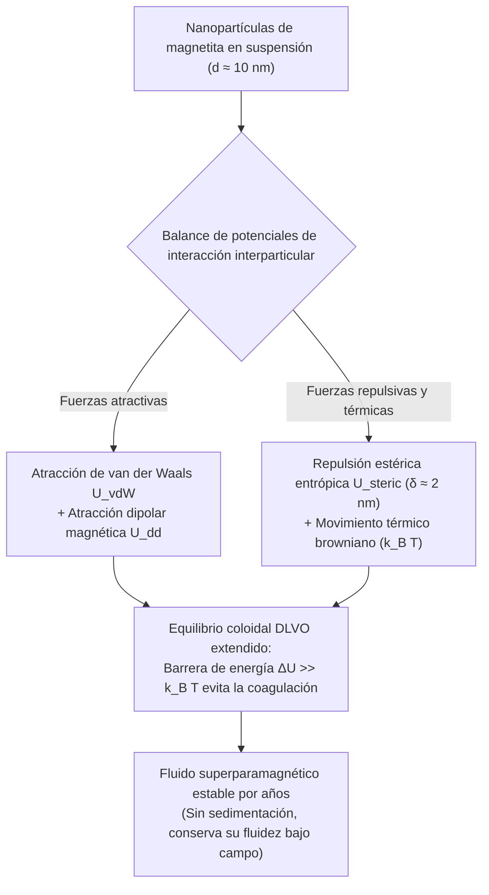
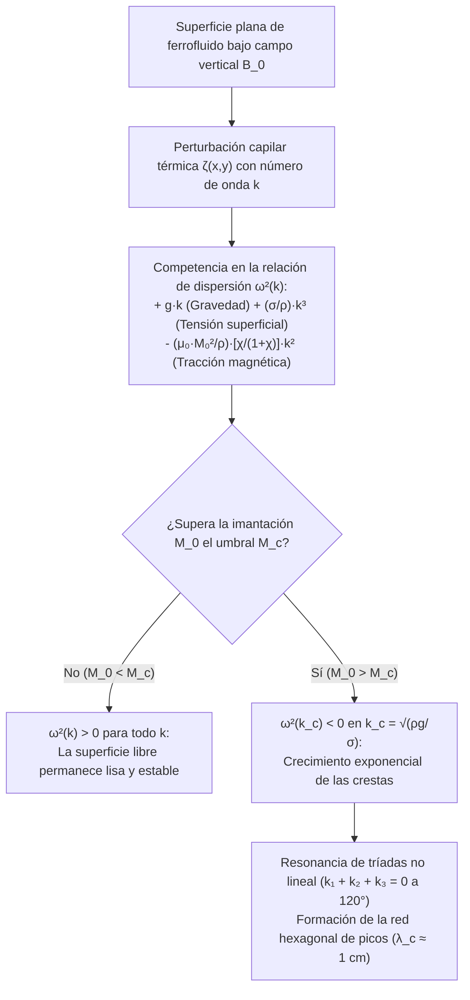

## 1. ¿Por qué no existen imanes líquidos en la naturaleza? — La barrera de la temperatura de Curie

Cuando acercamos un potente imán de neodimio a un recipiente con un líquido negro azabache y observamos cómo el fluido desafía instantáneamente la gravedad levantándose en un bosque geométrico de espinas puntiagudas, este <strong>líquido magnético (ferrofluido)</strong> parece cobrar vida propia.

Pero ¿por qué no podemos simplemente fundir un imán de hierro en un crisol para obtener un «imán líquido»? La respuesta radica en un límite fundamental de la física cuántica y estadística: la <strong>temperatura de Curie ($T_C$)</strong>.

El ferromagnetismo surge de la <strong>interacción de canje cuántica de Heisenberg (Exchange Interaction)</strong>, que alinea paralelamente los espines electrónicos vecinos $\mathbf{S}_i$ y $\mathbf{S}_j$:

$$\mathcal{H}_{\text{ex}} = -2 J_{\text{ex}} \sum_{\langle i,j \rangle} \mathbf{S}_i \cdot \mathbf{S}_j \quad (J_{\text{ex}} > 0)$$

Este acoplamiento de canje es extremadamente sensible a la distancia interatómica y a la agitación térmica. Si calentamos un metal ferromagnético por encima de su temperatura de Curie $T_C$, la energía térmica $k_B T$ supera la energía de canje $J_{\text{ex}}$. El orden espontáneo de espines colapsa y el material se convierte en un simple <strong>paramagneto</strong> desordenado.

Como muestra la siguiente tabla, la temperatura de Curie $T_C$ de todos los elementos y óxidos ferromagnéticos conocidos se sitúa cientos de grados <strong>por debajo</strong> de su punto de fusión $T_m$:

| Material | Temperatura de Curie $T_C$ ($\text{K}$) | Punto de fusión $T_m$ ($\text{K}$) | Estado al fundirse ($T > T_m$) |
| :--- | :--- | :--- | :--- |
| <strong>Hierro ($\text{Fe}$)</strong> | $1043\,\text{K}$ ($770\,^\circ\text{C}$) | $1811\,\text{K}$ ($1538\,^\circ\text{C}$) | Líquido paramagnético no magnético |
| <strong>Cobalto ($\text{Co}$)</strong> | $1388\,\text{K}$ ($1115\,^\circ\text{C}$) | $1768\,\text{K}$ ($1495\,^\circ\text{C}$) | Líquido paramagnético no magnético |
| <strong>Níquel ($\text{Ni}$)</strong> | $627\,\text{K}$ ($354\,^\circ\text{C}$) | $1728\,\text{K}$ ($1455\,^\circ\text{C}$) | Líquido paramagnético no magnético |
| <strong>Gadolinio ($\text{Gd}$)</strong> | $292\,\text{K}$ ($19\,^\circ\text{C}$) | $1585\,\text{K}$ ($1312\,^\circ\text{C}$) | Líquido paramagnético no magnético |
| <strong>Magnetita ($\text{Fe}_3\text{O}_4$)</strong> | $858\,\text{K}$ ($585\,^\circ\text{C}$) | $1870\,\text{K}$ ($1597\,^\circ\text{C}$) | Líquido paramagnético no magnético |

El hierro fundido pierde todo su ferromagnetismo $768\,\text{K}$ antes siquiera de volverse líquido ($T_C \ll T_m$). No existe ningún líquido monofásico ferromagnético en la naturaleza a temperatura ambiente.

¿Cómo logró entonces el ingeniero de la NASA <strong>Stephen Papell</strong> en 1963 inventar el primer ferrofluido del mundo para bombear combustible líquido de cohetes en gravedad cero mediante campos magnéticos? La brillante solución de Papell fue sortear la barrera de Curie diseñando una <strong>suspensión coloidal de tres componentes</strong>:

1. <strong>Nanopartículas magnéticas ($\sim 5\%$ en volumen)</strong>: Nanocristales sólidos de magnetita ($\text{Fe}_3\text{O}_4$) o maghemita ($\gamma\text{-Fe}_2\text{O}_3$) con un diámetro típico de $d \approx 10\,\text{nm}$, que operan muy por debajo de su punto de Curie y conservan su imantación intensa.
2. <strong>Capa de surfactante / tensioactivo ($\sim 10\%$ en volumen)</strong>: Una cubierta molecular de $\delta \approx 2\,\text{nm}$ de espesor (como ácido oleico, $\text{C}_{18}\text{H}_{34}\text{O}_2$), cuya cabeza polar se une químicamente a la superficie de la nanopartícula mientras su cola hidrocarbonada se extiende hacia el solvente.
3. <strong>Líquido portador ($\sim 85\%$ en volumen)</strong>: Un solvente orgánico (queroseno, aceite sintético, éster) o agua, donde el movimiento browniano mantiene las nanopartículas suspendidas indefinidamente.

---

## 2. Nanofísica del magnetismo: Límite monodominio y superparamagnetismo de Langevin

¿Por qué las nanopartículas deben medir específicamente $d \approx 10\,\text{nm}$? Si simplemente mezcláramos polvo de hierro micrométrico ($d \approx 1\text{–}10\,\mu\text{m}$) en aceite, las partículas sedimentarían de inmediato y se aglomerarían en un bloque rígido al acercar un imán.

### 2.1 Diámetro crítico de Kittel para partículas monodominio

Un imán macroscópico se divide en múltiples <strong>dominios magnéticos de Weiss</strong> separados por paredes de Bloch para minimizar la energía magnetostática del campo desmagnetizante ($\propto d^3$). Sin embargo, crear una pared de dominio cuesta energía de canje y anisotropía proporcional al área ($\propto d^2$). Por debajo de un diámetro crítico $d_{\text{sd}}$ (calculado por Charles Kittel), crear una pared cuesta más energía de la que ahorra:

$$d_{\text{sd}} = \frac{36 \sqrt{A_{\text{ex}} K}}{\mu_0 M_d^2}$$

donde $A_{\text{ex}} \approx 10^{-11}\,\text{J/m}$ es la rigidez de canje, $K \approx 1.35 \times 10^4\,\text{J/m}^3$ la constante de anisotropía magnetocristalina y $M_d \approx 4.46 \times 10^5\,\text{A/m}$ la imantación de saturación de la magnetita masiva $\text{Fe}_3\text{O}_4$. Para la magnetita, $d_{\text{sd}} \approx 25\text{–}30\,\text{nm}$. Por tanto, una nanopartícula de $d = 10\,\text{nm}$ es estrictamente una <strong>partícula monodominio (Single-Domain Particle)</strong>: sus $\sim 10^4$ espines atómicos giran al unísono como un único dipolo magnético gigante $m = M_d V = M_d \frac{\pi}{6}d^3 \approx 2.3 \times 10^{-19}\,\text{A}\cdot\text{m}^2$ ($\sim 25\,000$ magnetones de Bohr $\mu_B$).

### 2.2 Relajación de Néel y de Brown, y superparamagnetismo

¿Queda este momento gigante $m$ bloqueado a lo largo del eje fácil del cristal? Para $d = 10\,\text{nm}$, el volumen $V \approx 5.24 \times 10^{-25}\,\text{m}^3$ es tan pequeño que la barrera de energía de anisotropía $E_B = K V \approx 7 \times 10^{-21}\,\text{J}$ es comparable a la energía térmica $k_B T \approx 4.14 \times 10^{-21}\,\text{J}$ a temperatura ambiente ($T = 300\,\text{K}$).

Como resultado, el momento magnético se invierte espontáneamente mediante dos mecanismos paralelos:
1. <strong>Relajación de Néel ($\tau_N$)</strong>: El vector momento magnético rota internamente dentro de la red cristalina saltando la barrera $K V$:
   $$\tau_N = \tau_0 \exp\left(\frac{K V}{k_B T}\right)$$
   Con $\tau_0 \approx 10^{-9}\,\text{s}$, para magnetita de $10\,\text{nm}$ se obtiene un tiempo ultracorto $\tau_N \approx 5 \times 10^{-9}\,\text{s}$ (pocos nanosegundos).
2. <strong>Relajación de Brown ($\tau_B$)</strong>: La nanopartícula entera junto con su capa de surfactante (volumen hidrodinámico $V_H = \frac{\pi}{6}(d + 2\delta)^3$) gira físicamente dentro del fluido de viscosidad $\eta$:
   $$\tau_B = \frac{3 \eta V_H}{k_B T}$$
   La tasa efectiva cumple $\frac{1}{\tau_{\text{eff}}} = \frac{1}{\tau_N} + \frac{1}{\tau_B}$.

En ausencia de campo externo ($\mathbf{H} = \mathbf{0}$), los momentos se desordenan térmicamente en nanosegundos: el ferrofluido no presenta <strong>remanencia ($M_r = 0$) ni coercitividad ($H_c = 0$)</strong> (cero histéresis). Pero al aplicar un campo $\mathbf{H}$, cada partícula responde con su momento gigante de $25\,000\,\mu_B$, generando una susceptibilidad inicial $\chi_i$ miles de veces mayor que la de un paramagneto ordinario. Este fenómeno es el <strong>superparamagnetismo</strong>, regido por la <strong>función de Langevin $\mathcal{L}(\xi)$</strong>:

$$M(H) = \phi M_d \mathcal{L}(\xi) = M_s \left( \coth \xi - \frac{1}{\xi} \right), \qquad \xi = \frac{\mu_0 m H}{k_B T} = \frac{\mu_0 M_d V H}{k_B T}$$

donde $\phi$ es la fracción volumétrica magnética y $M_s = \phi M_d$ la imantación de saturación del fluido. Para campos débiles ($\xi \ll 1$), $\mathcal{L}(\xi) \approx \xi / 3$ produce la susceptibilidad inicial $\chi_i = \frac{\mu_0 \phi M_d^2 V}{3 k_B T} \sim 1\text{–}5$.

---

## 3. Estabilidad coloidal: Teoría DLVO extendida y comparación con fluidos MR

Para evitar que las nanopartículas coagulen irreversiblemente, el potencial de interacción total $U_{\text{total}}(l)$ en función de la separación superficial normalizada $l = 2s / d$ debe poseer una barrera repulsiva $\Delta U \gg 15\,k_B T$:

$$U_{\text{total}}(l) = U_{\text{vdW}}(l) + U_{\text{dd}}(l) + U_{\text{steric}}(l)$$

1. <strong>Atracción de London–van der Waals ($U_{\text{vdW}}$)</strong>: Atracción cuántica de corto alcance (constante de Hamaker $A_H \approx 10^{-19}\,\text{J}$) que diverge a $-\infty$ en contacto ($l \to 0$):
   $$U_{\text{vdW}}(l) = -\frac{A_H}{6}\left[ \frac{2}{l^2 + 4l} + \frac{2}{(l+2)^2} + \ln\left(\frac{l^2 + 4l}{(l+2)^2}\right) \right]$$
2. <strong>Interacción dipolo-dipolo magnético ($U_{\text{dd}}$)</strong>: En alineación cabeza-cola, dos dipolos se atraen con $U_{\text{dd}}^{\text{min}}(s) = -\frac{\mu_0 m^2}{2\pi (d + s)^3}$.
3. <strong>Repulsión estérica de Mackor–Rosensweig ($U_{\text{steric}}$)</strong>: Cuando $s < 2\delta$, las cadenas de surfactante (densidad superficial $\xi_s \approx 10^{18}\,\text{cadenas/m}^2$) se comprimen. La reducción de entropía conformacional de las colas poliméricas genera una intensa repulsión entrópica:
   $$U_{\text{steric}}(l) = \frac{\pi d^2 \xi_s k_B T}{2} \left[ 2 - \frac{l+2}{t}\ln\left(\frac{1+t}{1+l/2}\right) - \frac{l}{t} \right] \quad \left(\text{para } l < 2t,\; t = \frac{2\delta}{d}\right)$$

Este escudo estérico de $\delta \approx 2\,\text{nm}$ distingue radicalmente a un <strong>ferrofluido (FF)</strong> de un <strong>fluido magnetorreológico (MRF)</strong>:

| Característica | Ferrofluido (FF) | Fluido Magnetorreológico (MRF) |
| :--- | :--- | :--- |
| <strong>Diámetro de partícula $d$</strong> | $5\text{–}15\,\text{nm}$ (nanopartículas) | $1\text{–}10\,\mu\text{m}$ ($1000\times$ mayor, micropartículas) |
| <strong>Estado magnético</strong> | Monodominio superparamagnético | Multidominio ferromagnético |
| <strong>Energía dominante</strong> | Agitación térmica ($k_B T > U_{\text{dd}}$) | Atracción dipolar ($U_{\text{dd}} \gg k_B T$) |
| <strong>Comportamiento bajo campo $\mathbf{H}$</strong> | <strong>¡Permanece líquido!</strong> Forma picos de Rosensweig | <strong>¡Se solidifica en milisegundos!</strong> Cadenas rígidas |
| <strong>Aplicaciones típicas</strong> | Sellos de vacío, refrigeración de altavoces, arte | Amortiguadores activos (MagneRide), frenos, embragues |

---

## 4. Ferrohidrodinámica (FHD) y la inestabilidad de campo normal de Cowley–Rosensweig

¿Por qué la superficie libre de un ferrofluido se eriza formando un patrón geométrico de espinas al aplicar un campo magnético vertical? La respuesta proviene de la <strong>ferrohidrodinámica (FHD)</strong> formulada por Ronald E. Rosensweig.

### 4.1 Fuerza volumétrica de Kelvin y ecuación de Bernoulli generalizada

En un fluido magnetizable no conductor inmerso en un campo $\mathbf{H}$, cada elemento de volumen con imantación $\mathbf{M}$ experimenta la <strong>densidad de fuerza magnética de Kelvin</strong>:

$$\mathbf{f}_m = \mu_0 (\mathbf{M} \cdot \nabla)\mathbf{H}$$

Integrando la ecuación de Euler-Navier-Stokes estacionaria e irrotacional para un fluido incompresible a lo largo de una línea de corriente, se obtiene la <strong>ecuación de Bernoulli generalizada de la ferrohidrodinámica</strong>:

$$p^* + \frac{1}{2}\rho v^2 + \rho g z - \mu_0 \int_0^H M(H')\,dH' = \text{const}$$

Además, en la interfaz libre entre el ferrofluido y el aire, el salto del tensor de tensiones de Maxwell añade una tracción magnética normal a la condición de contorno de Young-Laplace:

$$p^* - p_0 = \sigma \kappa - \frac{1}{2}\mu_0 M_n^2$$

donde $p_0$ es la presión atmosférica, $\sigma$ la tensión superficial, $\kappa \approx -\nabla_\perp^2 \zeta$ la curvatura media de la superficie y $M_n = \mathbf{M} \cdot \mathbf{n}$ la componente normal de la imantación. El término $-\frac{1}{2}\mu_0 M_n^2$ actúa como una <strong>succión magnética hacia el exterior</strong>: cualquier pequeña cresta $\zeta(x,y) > 0$ en la superficie concentra las líneas de campo magnético (efecto pararrayos), incrementando $M_n$ y tirando del líquido aún más hacia arriba.

### 4.2 Análisis de estabilidad lineal y relación de dispersión (Cowley & Rosensweig, 1967)

En 1967, M. D. Cowley y R. E. Rosensweig analizaron una capa plana de ferrofluido bajo un campo magnético vertical uniforme $\mathbf{B}_0 = B_0 \hat{\mathbf{z}}$ perturbada por una onda superficial $\zeta(\mathbf{r}_\perp, t) = \zeta_0 e^{i(\mathbf{k}\cdot\mathbf{r}_\perp - \omega t)}$ de número de onda $k = |\mathbf{k}| = 2\pi / \lambda$.

Resolviendo las ecuaciones de Maxwell ($\nabla \cdot \mathbf{B} = 0$, $\nabla \times \mathbf{H} = \mathbf{0}$) junto con la ecuación de Bernoulli FHD, obtuvieron la <strong>relación de dispersión de Cowley–Rosensweig</strong>:

$$\omega^2(k) = g k + \frac{\sigma}{\rho} k^3 - \frac{\mu_0 M_0^2}{\rho}\left(\frac{\chi_{\text{eff}}}{1 + \chi_{\text{eff}}}\right) k^2$$

donde $\chi_{\text{eff}}$ es la susceptibilidad geométrica efectiva. Los tres términos reflejan un duelo de fuerzas:
* $+g k$ (lineal en $k$): <strong>Restauración gravitatoria</strong> que estabiliza las ondas largas ($k \to 0$).
* $+\frac{\sigma}{\rho}k^3$ (cúbico en $k$): <strong>Restauración capilar (tensión superficial)</strong> que estabiliza las ondas cortas ($k \to \infty$).
* $-\frac{\mu_0 M_0^2}{\rho}\frac{\chi_{\text{eff}}}{1+\chi_{\text{eff}}}k^2$ (cuadrático en $k$, <strong>¡negativo!</strong>): <strong>Tracción magnética desestabilizadora</strong> en longitudes de onda intermedias.

Cuando la imantación $M_0$ supera un umbral crítico $M_c$, la curva $\omega^2(k)$ se vuelve negativa ($\omega^2 < 0$) alrededor de un número de onda crítico $k_c$. La frecuencia $\omega = \pm i \gamma$ pasa a ser imaginaria y la amplitud $\zeta(t) \propto e^{+\gamma t}$ crece exponencialmente.

Imponiendo las condiciones de umbral $\omega^2(k_c) = 0$ y $\left.\frac{\partial (\omega^2)}{\partial k}\right|_{k = k_c} = 0$, se obtienen los parámetros críticos de la <strong>inestabilidad de Rosensweig</strong>:

1. <strong>Número de onda crítico $k_c$ y longitud de onda crítica $\lambda_c$ (separación entre picos)</strong>:
   $$k_c = \sqrt{\frac{\rho g}{\sigma}} = \frac{1}{\ell_c} \implies \lambda_c = \frac{2\pi}{k_c} = 2\pi \sqrt{\frac{\sigma}{\rho g}}$$
   Para un ferrofluido típico ($\rho \approx 1200\,\text{kg/m}^3$, $\sigma \approx 0.026\,\text{N/m}$, $g = 9.81\,\text{m/s}^2$), la longitud capilar es $\ell_c \approx 1.5\,\text{mm}$ y la separación entre picos vecinos es $\lambda_c \approx 9.3\,\text{mm}$ ($\sim 1\,\text{cm}$).
2. <strong>Imantación crítica $M_c$ de aparición de las espinas</strong>:
   $$M_c^2 = \frac{2}{\mu_0}\left(1 + \frac{1}{\chi_{\text{eff}}}\right)\sqrt{\rho g \sigma}$$

### 4.3 ¿Por qué una red hexagonal? (Resonancia de tríadas no lineal)

La teoría lineal determina la magnitud $k_c$, pero no la dirección de $\mathbf{k}$. ¿Por qué las espinas se ordenan formando una <strong>red hexagonal 2D</strong> perfecta?

En la expansión no lineal de la energía libre superficial $\mathcal{F}[\zeta]$, el campo magnético vertical rompe la simetría de inversión cresta-valle ($\zeta \to -\zeta$), dando lugar a un término cúbico de interacción resonante entre tres vectores de onda:

$$\Delta \mathcal{F}_3 \propto - \sum_{\mathbf{k}_1 + \mathbf{k}_2 + \mathbf{k}_3 = \mathbf{0}} A_{\mathbf{k}_1} A_{\mathbf{k}_2} A_{\mathbf{k}_3}$$

Para que tres vectores de igual módulo $|\mathbf{k}_1| = |\mathbf{k}_2| = |\mathbf{k}_3| = k_c$ sumen cero ($\mathbf{k}_1 + \mathbf{k}_2 + \mathbf{k}_3 = \mathbf{0}$), deben formar un triángulo equilátero, es decir, estar separados exactamente $120^\circ$ entre sí. La superposición de tres ondas planas a $120^\circ$ genera en el espacio real el célebre <strong>patrón hexagonal de picos de Rosensweig</strong>.

---

## 5. Aplicaciones de vanguardia en la industria, la biomedicina y el arte

Los ferrofluidos desempeñan un papel insustituible en numerosas tecnologías modernas:

1. <strong>Sellos rotativos de vacío para semiconductores y discos duros</strong>: En las cámaras de ultra-alto vacío (UHV) para fabricación de chips, un imán anular mantiene un anillo líquido de ferrofluido en la holgura micrométrica alrededor de ejes que giran a $10\,000\,\text{rpm}$, logrando un sellado hermético sin fricción sólida ni desgaste.
2. <strong>Refrigeración y amortiguamiento de altavoces de alta fidelidad</strong>: Alojado en el entrehierro magnético alrededor de la bobina móvil (voice coil) de los tweeters, el ferrofluido evacúa el calor $5\times$ más rápido que el aire y amortigua viscosamente las resonancias indeseadas del diafragma.
3. <strong>Hipertermia magnética y liberación dirigida de fármacos</strong>: Nanopartículas biocompatibles de $\text{Fe}_3\text{O}_4$ guiadas hacia un tumor y sometidas a un campo magnético alterno ($f \approx 100\text{–}500\,\text{kHz}$) disipan calor por relajación de Néel y Brown, elevando la temperatura local a $42\text{–}45\,^\circ\text{C}$ para destruir selectivamente las células cancerosas.
4. <strong>Arte cinético (Sachiko Kodama)</strong>: La física y artista japonesa Sachiko Kodama (*Protrude, Flow*) sincroniza electroimanes con música para esculpir ferrofluidos en torres orgánicas de espinas que danzan en tiempo real.

Cada espina en la superficie de un ferrofluido es la manifestación visible del equilibrio entre el canje cuántico de Heisenberg, la entropía coloidal y las ecuaciones acopladas de Maxwell y Navier-Stokes.
