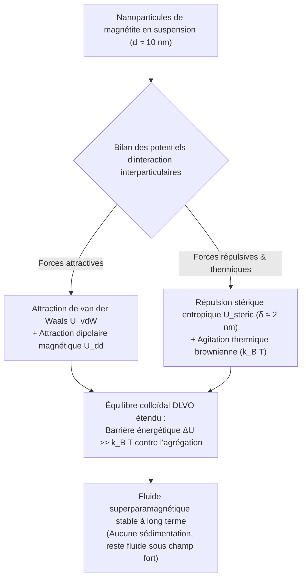
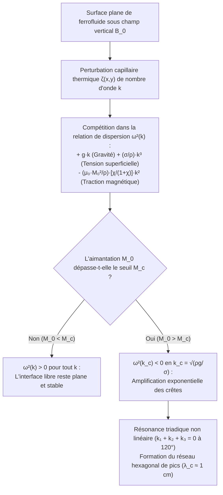

## 1. Pourquoi n'existe-t-il pas d'aimants liquides dans la nature ? — La barrière de la température de Curie

Lorsqu'on approche un aimant au néodyme d'une coupelle contenant un liquide noir d'encre et que l'on voit ce fluide défier instantanément la gravité pour se hérisser d'une forêt géométrique de pointes acérées, ce <strong>liquide magnétique (ferrofluide)</strong> semble tout droit sorti d'un film de science-fiction.

Mais pourquoi ne peut-on pas simplement faire fondre un aimant en fer dans un creuset pour obtenir un « aimant liquide » ? La réponse réside dans une limite fondamentale de la physique statistique et quantique : la <strong>température de Curie ($T_C$)</strong>.

Le ferromagnétisme provient de l'<strong>interaction d'échange quantique de Heisenberg (Exchange Interaction)</strong> qui aligne parallèlement les spins électroniques voisins $\mathbf{S}_i$ et $\mathbf{S}_j$ :

$$\mathcal{H}_{\text{ex}} = -2 J_{\text{ex}} \sum_{\langle i,j \rangle} \mathbf{S}_i \cdot \mathbf{S}_j \quad (J_{\text{ex}} > 0)$$

Ce couplage d'échange est extrêmement sensible à la distance interatomique et à l'agitation thermique. Dès que l'on chauffe un métal ferromagnétique au-dessus de sa température de Curie $T_C$, l'énergie thermique $k_B T$ l'emporte sur l'intégrale d'échange $J_{\text{ex}}$. L'alignement spontané des spins s'effondre et le matériau devient un simple <strong>paramagnétique</strong> désordonné.

Comme le montre le tableau suivant, la température de Curie $T_C$ de tous les éléments et oxydes ferromagnétiques connus est inférieure de plusieurs centaines de kelvins à leur température de fusion $T_m$ :

| Matériau | Température de Curie $T_C$ ($\text{K}$) | Point de fusion $T_m$ ($\text{K}$) | État à l'état liquide ($T > T_m$) |
| :--- | :--- | :--- | :--- |
| <strong>Fer ($\text{Fe}$)</strong> | $1043\,\text{K}$ ($770\,^\circ\text{C}$) | $1811\,\text{K}$ ($1538\,^\circ\text{C}$) | Liquide paramagnétique non magnétique |
| <strong>Cobalt ($\text{Co}$)</strong> | $1388\,\text{K}$ ($1115\,^\circ\text{C}$) | $1768\,\text{K}$ ($1495\,^\circ\text{C}$) | Liquide paramagnétique non magnétique |
| <strong>Nickel ($\text{Ni}$)</strong> | $627\,\text{K}$ ($354\,^\circ\text{C}$) | $1728\,\text{K}$ ($1455\,^\circ\text{C}$) | Liquide paramagnétique non magnétique |
| <strong>Gadolinium ($\text{Gd}$)</strong> | $292\,\text{K}$ ($19\,^\circ\text{C}$) | $1585\,\text{K}$ ($1312\,^\circ\text{C}$) | Liquide paramagnétique non magnétique |
| <strong>Magnétite ($\text{Fe}_3\text{O}_4$)</strong> | $858\,\text{K}$ ($585\,^\circ\text{C}$) | $1870\,\text{K}$ ($1597\,^\circ\text{C}$) | Liquide paramagnétique non magnétique |

Le fer fondu perd donc tout son ferromagnétisme $768\,\text{K}$ avant même de devenir liquide ($T_C \ll T_m$). Aucun fluide monophasique ferromagnétique n'existe dans la nature à température ambiante.

Comment l'ingénieur de la NASA <strong>Stephen Papell</strong> a-t-il alors réussi, en 1963, à inventer le premier ferrofluide pour orienter les ergols liquides des fusées en apesanteur à l'aide d'un champ magnétique ? L'idée géniale de Papell fut de contourner la barrière de Curie en créant une <strong>suspension colloïdale à trois composants</strong> :

1. <strong>Nanoparticules magnétiques ($\sim 5\%$ en volume)</strong> : Des nanocristaux solides de magnétite ($\text{Fe}_3\text{O}_4$) ou de maghémite ($\gamma\text{-Fe}_2\text{O}_3$) d'un diamètre typique $d \approx 10\,\text{nm}$, qui restent bien en dessous de leur point de Curie et conservent leur aimantation intense.
2. <strong>Couche de tensioactif / Surfactant ($\sim 10\%$ en volume)</strong> : Une enveloppe moléculaire d'environ $\delta \approx 2\,\text{nm}$ d'épaisseur (comme l'acide oléique, $\text{C}_{18}\text{H}_{34}\text{O}_2$), dont la tête polaire s'ancre chimiquement à la surface de l'oxyde de fer tandis que la queue carbonée se déploie dans le solvant.
3. <strong>Fluide porteur ($\sim 85\%$ en volume)</strong> : Un solvant organique (kérosène, huile synthétique, ester) ou de l'eau, dans lequel l'agitation brownienne maintient les nanoparticules indéfiniment en suspension.

---

## 2. Nanophysique du magnétisme : Limite monodomaine et superparamagnétisme de Langevin

Pourquoi le diamètre des nanoparticules doit-il impérativement avoisiner $d \approx 10\,\text{nm}$ ? Si l'on mélangeait simplement de la limaille de fer micrométrique ($d \approx 1\text{–}10\,\mu\text{m}$) dans de l'huile, la poudre sédimenterait rapidement et s'agglomérerait en un bloc rigide dès l'application d'un aimant.

### 2.1 Diamètre critique de Kittel pour les particules monodomaines

Dans un aimant macroscopique, le cristal se divise en de multiples <strong>domaines magnétiques de Weiss</strong> séparés par des parois de Bloch afin de minimiser l'énergie magnétostatique de champ démagnétisant ($\propto d^3$). Cependant, la création d'une paroi de domaine coûte une énergie d'échange et d'anisotropie proportionnelle à sa surface ($\propto d^2$). En dessous d'un diamètre critique $d_{\text{sd}}$ (établi par Charles Kittel), former une paroi coûte plus d'énergie qu'elle n'en économise :

$$d_{\text{sd}} = \frac{36 \sqrt{A_{\text{ex}} K}}{\mu_0 M_d^2}$$

où $A_{\text{ex}} \approx 10^{-11}\,\text{J/m}$ est la rigidité d'échange, $K \approx 1.35 \times 10^4\,\text{J/m}^3$ la constante d'anisotropie magnétocristalline et $M_d \approx 4.46 \times 10^5\,\text{A/m}$ l'aimantation à saturation du cristal massif de $\text{Fe}_3\text{O}_4$. Pour la magnétite, $d_{\text{sd}} \approx 25\text{–}30\,\text{nm}$. Une nanoparticule de $d = 10\,\text{nm}$ est donc strictement <strong>monodomaine (Single-Domain Particle)</strong> : ses $\sim 10^4$ spins atomiques sont verrouillés ensemble pour former un unique dipôle magnétique géant $m = M_d V = M_d \frac{\pi}{6}d^3 \approx 2.3 \times 10^{-19}\,\text{A}\cdot\text{m}^2$ (soit environ $25\,000$ magnétons de Bohr $\mu_B$).

### 2.2 Relaxations de Néel et de Brown, et superparamagnétisme

Ce moment géant $m$ reste-t-il figé le long de l'axe de facile aimantation du cristal ? Pour $d = 10\,\text{nm}$, le volume $V \approx 5.24 \times 10^{-25}\,\text{m}^3$ est si infime que la barrière d'énergie d'anisotropie $E_B = K V \approx 7 \times 10^{-21}\,\text{J}$ est du même ordre de grandeur que l'énergie thermique $k_B T \approx 4.14 \times 10^{-21}\,\text{J}$ à température ambiante ($T = 300\,\text{K}$) !

Par conséquent, le moment magnétique bascule sans cesse sous l'effet des fluctuations thermiques via deux mécanismes parallèles :
1. <strong>Relaxation de Néel ($\tau_N$)</strong> : Le vecteur aimantation tourne à l'intérieur du réseau cristallin en franchissant la barrière $K V$, sans que la particule ne bouge :
   $$\tau_N = \tau_0 \exp\left(\frac{K V}{k_B T}\right)$$
   Avec $\tau_0 \approx 10^{-9}\,\text{s}$, une particule de magnétite de $10\,\text{nm}$ présente un temps de relaxation ultra-court $\tau_N \approx 5 \times 10^{-9}\,\text{s}$ (quelques nanosecondes).
2. <strong>Relaxation de Brown ($\tau_B$)</strong> : La nanoparticule entière entourée de son tensioactif (volume hydrodynamique $V_H = \frac{\pi}{6}(d + 2\delta)^3$) pivote physiquement dans le fluide porteur de viscosité $\eta$ :
   $$\tau_B = \frac{3 \eta V_H}{k_B T}$$
   Le taux de relaxation global obéit à $\frac{1}{\tau_{\text{eff}}} = \frac{1}{\tau_N} + \frac{1}{\tau_B}$.

En l'absence de champ extérieur ($\mathbf{H} = \mathbf{0}$), l'orientation des moments est brouillée en quelques nanosecondes : le ferrofluide ne présente <strong>aucune aimantation rémanente ($M_r = 0$) ni aucun champ coercitif ($H_c = 0$)</strong> (absence totale d'hystérésis). Mais dès qu'un champ $\mathbf{H}$ est appliqué, chaque nanoparticule réagit avec son moment géant de $25\,000\,\mu_B$, conférant au fluide une susceptibilité magnétique initiale $\chi_i$ des milliers de fois supérieure à celle d'un paramagnétique ordinaire. C'est le <strong>superparamagnétisme</strong>, décrit exactement par la <strong>fonction de Langevin $\mathcal{L}(\xi)$</strong> :

$$M(H) = \phi M_d \mathcal{L}(\xi) = M_s \left( \coth \xi - \frac{1}{\xi} \right), \qquad \xi = \frac{\mu_0 m H}{k_B T} = \frac{\mu_0 M_d V H}{k_B T}$$

où $\phi$ est la fraction volumique solide et $M_s = \phi M_d$ l'aimantation à saturation du fluide. À faible champ ($\xi \ll 1$), le développement $\mathcal{L}(\xi) \approx \xi / 3$ donne la susceptibilité initiale $\chi_i = \frac{\mu_0 \phi M_d^2 V}{3 k_B T} \sim 1\text{–}5$.

---

## 3. Stabilité colloïdale : Théorie DLVO étendue et comparaison avec les fluides MR

Pour éviter que les nanoparticules ne coagulent de façon irréversible, le potentiel d'interaction total $U_{\text{total}}(l)$ entre deux sphères en fonction de leur distance de surface normalisée $l = 2s / d$ doit présenter une barrière répulsive $\Delta U \gg 15\,k_B T$ :

$$U_{\text{total}}(l) = U_{\text{vdW}}(l) + U_{\text{dd}}(l) + U_{\text{steric}}(l)$$

1. <strong>Attraction de London–van der Waals ($U_{\text{vdW}}$)</strong> : Attraction quantique à courte portée (constante de Hamaker $A_H \approx 10^{-19}\,\text{J}$) qui diverge vers $-\infty$ au contact ($l \to 0$) :
   $$U_{\text{vdW}}(l) = -\frac{A_H}{6}\left[ \frac{2}{l^2 + 4l} + \frac{2}{(l+2)^2} + \ln\left(\frac{l^2 + 4l}{(l+2)^2}\right) \right]$$
2. <strong>Interaction dipôle-dipôle magnétique ($U_{\text{dd}}$)</strong> : En configuration tête-à-queue, deux dipôles s'attirent avec une énergie $U_{\text{dd}}^{\text{min}}(s) = -\frac{\mu_0 m^2}{2\pi (d + s)^3}$.
3. <strong>Répulsion stérique de Mackor–Rosensweig ($U_{\text{steric}}$)</strong> : Lorsque $s < 2\delta$, les chaînes d'acide oléique (densité de greffage $\xi_s \approx 10^{18}\,\text{chaînes/m}^2$) s'interpénètrent. La perte d'entropie conformationnelle des chaînes polymères engendre une puissante répulsion entropique :
   $$U_{\text{steric}}(l) = \frac{\pi d^2 \xi_s k_B T}{2} \left[ 2 - \frac{l+2}{t}\ln\left(\frac{1+t}{1+l/2}\right) - \frac{l}{t} \right] \quad \left(\text{pour } l < 2t,\; t = \frac{2\delta}{d}\right)$$

Cette armure stérique de $\delta \approx 2\,\text{nm}$ empêche les cœurs magnétiques d'entrer en contact. C'est ce qui distingue fondamentalement un <strong>ferrofluide (FF)</strong> d'un <strong>fluide magnétorhéologique (MRF)</strong> :

| Caractéristique | Ferrofluide (FF) | Fluide Magnétorhéologique (MRF) |
| :--- | :--- | :--- |
| <strong>Diamètre des particules $d$</strong> | $5\text{–}15\,\text{nm}$ (nanoparticules) | $1\text{–}10\,\mu\text{m}$ ($1000\times$ plus grand, microparticules) |
| <strong>Régime magnétique</strong> | Monodomaine superparamagnétique | Multidomaine ferromagnétique |
| <strong>Énergie dominante</strong> | Agitation thermique ($k_B T > U_{\text{dd}}$) | Attraction dipolaire ($U_{\text{dd}} \gg k_B T$) |
| <strong>Réponse sous champ $\mathbf{H}$</strong> | <strong>Reste liquide !</strong> Forme des pics de Rosensweig | <strong>Se solidifie en millisecondes !</strong> Chaînes rigides |
| <strong>Applications typiques</strong> | Joints à vide, refroidissement audio, art | Amortisseurs actifs (MagneRide), freins, embrayages |

---

## 4. Ferrohydrodynamique (FHD) et l'instabilité de champ normal de Cowley–Rosensweig

Pourquoi la surface libre d'un ferrofluide se hérisse-t-elle soudainement d'un réseau régulier de cônes pointus lorsqu'on applique un champ magnétique vertical ? La réponse est fournie par la <strong>ferrohydrodynamique (FHD)</strong> développée par Ronald E. Rosensweig.

### 4.1 Force volumique de Kelvin et équation de Bernoulli généralisée

Dans un fluide magnétisable non conducteur soumis à un champ $\mathbf{H}$, chaque élément de volume d'aimantation $\mathbf{M}$ subit la <strong>densité de force magnétique de Kelvin</strong> :

$$\mathbf{f}_m = \mu_0 (\mathbf{M} \cdot \nabla)\mathbf{H}$$

En intégrant l'équation d'Euler-Navier-Stokes stationnaire et irrotationnelle d'un fluide incompressible le long d'une ligne de courant, on obtient l'<strong>équation de Bernoulli généralisée de la ferrohydrodynamique</strong> :

$$p^* + \frac{1}{2}\rho v^2 + \rho g z - \mu_0 \int_0^H M(H')\,dH' = \text{const}$$

De plus, à l'interface libre entre le ferrofluide et l'air, la discontinuité du tenseur des contraintes de Maxwell introduit une traction magnétique normale supplémentaire dans la loi de Young-Laplace :

$$p^* - p_0 = \sigma \kappa - \frac{1}{2}\mu_0 M_n^2$$

où $p_0$ est la pression atmosphérique, $\sigma$ la tension superficielle, $\kappa \approx -\nabla_\perp^2 \zeta$ la courbure moyenne de l'interface et $M_n = \mathbf{M} \cdot \mathbf{n}$ la composante normale de l'aimantation. Le terme $-\frac{1}{2}\mu_0 M_n^2$ agit comme une <strong>aspiration magnétique vers l'extérieur</strong> : toute petite bosse $\zeta(x,y) > 0$ à la surface concentre les lignes de champ magnétique (effet de pointe), ce qui accroît localement $M_n$ et tire encore plus le liquide vers le haut !

### 4.2 Analyse de stabilité linéaire et relation de dispersion (Cowley & Rosensweig, 1967)

En 1967, M. D. Cowley et R. E. Rosensweig ont étudié la stabilité linéaire d'une interface plane de ferrofluide soumise à un champ magnétique vertical uniforme $\mathbf{B}_0 = B_0 \hat{\mathbf{z}}$ face à une petite onde de surface $\zeta(\mathbf{r}_\perp, t) = \zeta_0 e^{i(\mathbf{k}\cdot\mathbf{r}_\perp - \omega t)}$ de nombre d'onde $k = |\mathbf{k}| = 2\pi / \lambda$.

Le couplage des équations de Maxwell ($\nabla \cdot \mathbf{B} = 0$, $\nabla \times \mathbf{H} = \mathbf{0}$) et de l'équation de Bernoulli FHD conduit à la célèbre <strong>relation de dispersion de Cowley–Rosensweig</strong> :

$$\omega^2(k) = g k + \frac{\sigma}{\rho} k^3 - \frac{\mu_0 M_0^2}{\rho}\left(\frac{\chi_{\text{eff}}}{1 + \chi_{\text{eff}}}\right) k^2$$

où $\chi_{\text{eff}}$ est la susceptibilité géométrique effective du fluide. Cette équation résume la compétition entre trois forces :
* $+g k$ (linéaire en $k$) : <strong>Rappel gravitationnel</strong> qui stabilise les grandes longueurs d'onde ($k \to 0$).
* $+\frac{\sigma}{\rho}k^3$ (cubique en $k$) : <strong>Rappel capillaire (tension superficielle)</strong> qui lisse les courtes longueurs d'onde ($k \to \infty$).
* $-\frac{\mu_0 M_0^2}{\rho}\frac{\chi_{\text{eff}}}{1+\chi_{\text{eff}}}k^2$ (quadratique en $k$, <strong>négatif !</strong>) : <strong>Terme déstabilisant magnétique</strong> aux longueurs d'onde intermédiaires !

Tant que l'aimantation $M_0$ est inférieure à un seuil critique $M_c$, on a $\omega^2(k) > 0$ pour tout $k$ : la surface reste parfaitement plane. Mais dès que $M_0$ dépasse $M_c$, $\omega^2(k)$ devient négatif autour d'un nombre d'onde critique $k_c$. La pulsation $\omega = \pm i \gamma$ devient purement imaginaire et l'amplitude $\zeta(t) \propto e^{+\gamma t}$ croît exponentiellement !

En posant simultanément $\omega^2(k_c) = 0$ et $\left.\frac{\partial (\omega^2)}{\partial k}\right|_{k = k_c} = 0$, on obtient exactement les paramètres critiques de l'<strong>instabilité de Rosensweig</strong> :

1. <strong>Nombre d'onde critique $k_c$ et longueur d'onde critique $\lambda_c$ (espacement des pics)</strong> :
   $$k_c = \sqrt{\frac{\rho g}{\sigma}} = \frac{1}{\ell_c} \implies \lambda_c = \frac{2\pi}{k_c} = 2\pi \sqrt{\frac{\sigma}{\rho g}}$$
   Pour un ferrofluide typique ($\rho \approx 1200\,\text{kg/m}^3$, $\sigma \approx 0.026\,\text{N/m}$, $g = 9.81\,\text{m/s}^2$), la longueur capillaire vaut $\ell_c \approx 1.5\,\text{mm}$ et la distance entre deux pics voisins est $\lambda_c \approx 9.3\,\text{mm}$ (environ $1\,\text{cm}$) !
2. <strong>Aimantation critique $M_c$ d'apparition des pointes</strong> :
   $$M_c^2 = \frac{2}{\mu_0}\left(1 + \frac{1}{\chi_{\text{eff}}}\right)\sqrt{\rho g \sigma}$$

### 4.3 Pourquoi un réseau hexagonal ? (Résonance triadique non linéaire)

La théorie linéaire fixe la norme $k_c$, mais pas l'orientation des vecteurs d'onde $\mathbf{k}$. Pourquoi les pics s'organisent-ils en un <strong>réseau hexagonal 2D</strong> parfait ?

Dans le développement non linéaire de l'énergie libre de surface $\mathcal{F}[\zeta]$, le champ magnétique vertical brise la symétrie d'inversion haut-bas ($\zeta \to -\zeta$, car la focalisation des lignes de champ est différente sur une crête et dans un creux). Cela autorise un terme cubique de couplage résonant entre trois modes d'amplitudes $A_{\mathbf{k}_i}$ :

$$\Delta \mathcal{F}_3 \propto - \sum_{\mathbf{k}_1 + \mathbf{k}_2 + \mathbf{k}_3 = \mathbf{0}} A_{\mathbf{k}_1} A_{\mathbf{k}_2} A_{\mathbf{k}_3}$$

Pour que trois vecteurs de même norme $|\mathbf{k}_1| = |\mathbf{k}_2| = |\mathbf{k}_3| = k_c$ vérifient $\mathbf{k}_1 + \mathbf{k}_2 + \mathbf{k}_3 = \mathbf{0}$, ils doivent former un triangle équilatéral, c'est-à-dire être orientés à $120^\circ$ les uns des autres ! La superposition de trois ondes planes à $120^\circ$ engendre exactement dans l'espace réel le <strong>réseau hexagonal de pics de Rosensweig</strong>.

---

## 5. Applications de pointe : Industrie, Biomédecine et Art Cinétique

Au-delà de leur beauté visuelle, les ferrofluides sont au cœur de technologies industrielles et médicales essentielles :

1. <strong>Joints d'étanchéité tournants sous vide (industrie des semi-conducteurs et disques durs)</strong> : Comment faire tourner un arbre mécanique à $10\,000\,\text{tr/min}$ à travers la paroi d'une chambre à ultravide sans fuite ni frottement ? Un aimant permanent annulaire maintient un anneau liquide de ferrofluide dans l'entrefer micrométrique autour de l'arbre. Ce joint liquide supporte plusieurs bars de différence de pression sans usure mécanique ni émission de poussières.
2. <strong>Refroidissement et amortissement des haut-parleurs haute-fidélité</strong> : Injecté dans l'entrefer magnétique autour de la bobine mobile (voice coil) des tweeters, le ferrofluide est maintenu en place par l'aimant du haut-parleur. Sa conductivité thermique ($5\times$ supérieure à celle de l'air) évacue la chaleur intense de la bobine tout en amortissant par viscosité les résonances parasites de la membrane.
3. <strong>Hyperthermie magnétique et ciblage médicamenteux en oncologie</strong> : Des nanoparticules de $\text{Fe}_3\text{O}_4$ biocompatibles peuvent être guidées par gradient magnétique jusqu'à une tumeur maligne. Soumises ensuite à un champ magnétique alternatif haute fréquence ($f \approx 100\text{–}500\,\text{kHz}$), elles dissipent de la chaleur par relaxations de Néel et de Brown, élevant localement la température tumorale à $42\text{–}45\,^\circ\text{C}$ pour détruire les cellules cancéreuses tout en épargnant les tissus sains.
4. <strong>Art cinétique (Sachiko Kodama)</strong> : La physicienne et artiste japonaise Sachiko Kodama (*Protrude, Flow*) sculpte des ferrofluides en temps réel grâce à des électroaimants pilotés par la musique, donnant naissance à des tours organiques hérissées de pointes qui dansent en parfaite harmonie avec le son.

Chaque épine dressée à la surface d'un ferrofluide est ainsi la matérialisation macroscopique d'un équilibre subtil entre l'interaction d'échange quantique, l'entropie colloïdale et les équations couplées de Maxwell et de Navier-Stokes.
