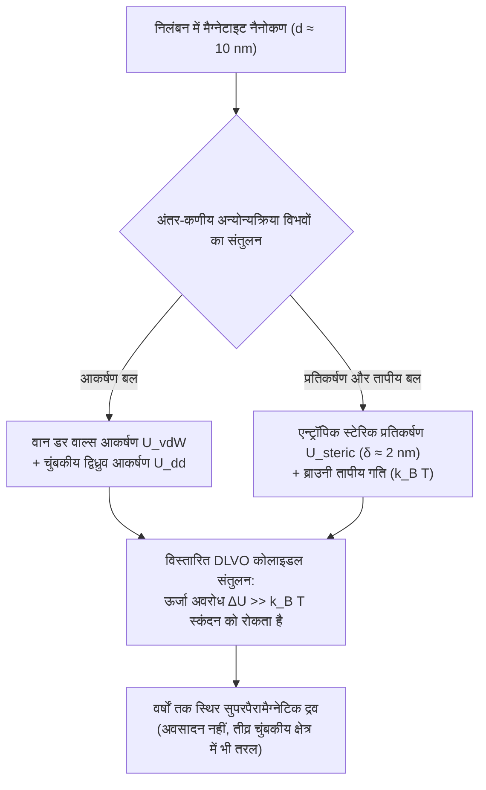
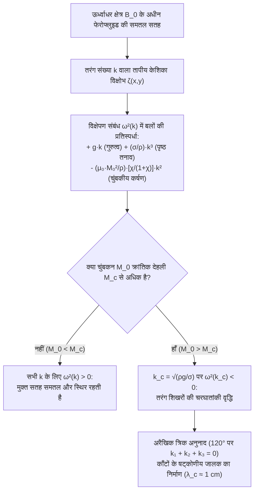

## 1. प्रकृति में प्राकृतिक 'द्रव चुंबक' क्यों नहीं पाए जाते? — क्यूरी तापमान (Curie Temperature) अवरोध

जब हम किसी गहरे काले द्रव से भरे पात्र के पास एक शक्तिशाली नियोडिमियम चुंबक लाते हैं और देखते हैं कि वह द्रव गुरुत्वाकर्षण को चुनौती देते हुए तुरंत नुकीले शंक्वाकार काँटों (Spikes) के एक सममित जंगल के रूप में खड़ा हो जाता है, तो यह <strong>चुंबकीय द्रव (Ferrofluid)</strong> किसी दूसरे ग्रह के जीवित प्राणी जैसा प्रतीत होता है।

परंतु हम किसी भट्टी में साधारण लोहे के चुंबक को पिघलाकर "द्रव चुंबक" क्यों नहीं बना सकते? इसका उत्तर क्वांटम और सांख्यिकीय भौतिकी के एक मौलिक नियम में छिपा है: <strong>क्यूरी तापमान ($T_C$)</strong>।

लौहचुंबकत्व (Ferromagnetism) क्वांटम-यांत्रिक <strong>हाइज़ेनबर्ग विनिमय अन्योन्यक्रिया (Exchange Interaction)</strong> से उत्पन्न होता है, जो पड़ोसी इलेक्ट्रॉन प्रचक्रणों (Spins) $\mathbf{S}_i$ और $\mathbf{S}_j$ को एक-दूसरे के समानांतर संरेखित करता है:

$$\mathcal{H}_{\text{ex}} = -2 J_{\text{ex}} \sum_{\langle i,j \rangle} \mathbf{S}_i \cdot \mathbf{S}_j \quad (J_{\text{ex}} > 0)$$

यह विनिमय युग्मन अंतर-परमाण्विक दूरी और तापीय कंपन के प्रति अत्यंत संवेदनशील होता है। जब किसी लौहचुंबकीय धातु को उसके क्यूरी तापमान $T_C$ से ऊपर गर्म किया जाता है, तो तापीय ऊर्जा $k_B T$ विनिमय ऊर्जा $J_{\text{ex}}$ पर भारी पड़ जाती है। स्वतःस्फूर्त प्रचक्रण संरेखण समाप्त हो जाता है और पदार्थ एक साधारण अव्यवस्थित <strong>अनुचुंबकीय (Paramagnetic)</strong> पदार्थ में बदल जाता है।

जैसा कि नीचे दी गई तालिका से स्पष्ट है, सभी ज्ञात लौहचुंबकीय तत्वों और ऑक्साइडों का क्यूरी तापमान $T_C$ उनके गलनांक (Melting Point) $T_m$ से सैकड़ों केल्विन <strong>कम</strong> होता है:

| पदार्थ | क्यूरी तापमान $T_C$ ($\text{K}$) | गलनांक $T_m$ ($\text{K}$) | पिघलने के बाद की अवस्था ($T > T_m$) |
| :--- | :--- | :--- | :--- |
| <strong>लोहा ($\text{Fe}$)</strong> | $1043\,\text{K}$ ($770\,^\circ\text{C}$) | $1811\,\text{K}$ ($1538\,^\circ\text{C}$) | अचुंबकीय पैरामैग्नेटिक द्रव |
| <strong>कोबाल्ट ($\text{Co}$)</strong> | $1388\,\text{K}$ ($1115\,^\circ\text{C}$) | $1768\,\text{K}$ ($1495\,^\circ\text{C}$) | अचुंबकीय पैरामैग्नेटिक द्रव |
| <strong>निकल ($\text{Ni}$)</strong> | $627\,\text{K}$ ($354\,^\circ\text{C}$) | $1728\,\text{K}$ ($1455\,^\circ\text{C}$) | अचुंबकीय पैरामैग्नेटिक द्रव |
| <strong>गैडोलिनियम ($\text{Gd}$)</strong> | $292\,\text{K}$ ($19\,^\circ\text{C}$) | $1585\,\text{K}$ ($1312\,^\circ\text{C}$) | अचुंबकीय पैरामैग्नेटिक द्रव |
| <strong>मैग्नेटाइट ($\text{Fe}_3\text{O}_4$)</strong> | $858\,\text{K}$ ($585\,^\circ\text{C}$) | $1870\,\text{K}$ ($1597\,^\circ\text{C}$) | अचुंबकीय पैरामैग्नेटिक द्रव |

पिघला हुआ लोहा द्रव बनने से $768\,\text{K}$ पहले ही अपना सारा लौहचुंबकत्व खो देता है ($T_C \ll T_m$)। प्रकृति में कमरे के तापमान पर कोई भी एकल-प्रावस्था लौहचुंबकीय द्रव मौजूद नहीं है।

तो फिर 1963 में नासा (NASA) के इंजीनियर <strong>स्टीफन पैपेल (Stephen Papell)</strong> ने अंतरिक्ष की शून्य गुरुत्वाकर्षण अवस्था में रॉकेट ईंधन को चुंबकीय क्षेत्र द्वारा पंप करने के लिए दुनिया का पहला फेरोफ्लुइड कैसे बनाया? पैपेल का प्रतिभाशाली समाधान क्यूरी अवरोध को चकमा देने के लिए एक <strong>त्रि-घटकीय कोलाइडल निलंबन (Three-Component Colloidal Suspension)</strong> तैयार करना था:

1. <strong>चुंबकीय नैनोकण ($\sim 5\%$ आयतन)</strong>: मैग्नेटाइट ($\text{Fe}_3\text{O}_4$) या मैगहेमाइट ($\gamma\text{-Fe}_2\text{O}_3$) के ठोस एकल-क्रिस्टल जिनका व्यास $d \approx 10\,\text{nm}$ होता है; ये अपने क्यूरी बिंदु से बहुत नीचे रहते हैं और तीव्र चुंबकन बनाए रखते हैं।
2. <strong>सर्फेक्टेंट / पृष्ठसक्रियक परत ($\sim 10\%$ आयतन)</strong>: लगभग $\delta \approx 2\,\text{nm}$ मोटा आणविक आवरण (जैसे ओलिक अम्ल, $\text{C}_{18}\text{H}_{34}\text{O}_2$), जिसका ध्रुवीय सिरा नैनोकण की सतह से रासायनिक रूप से जुड़ता है और हाइड्रोकार्बन पूँछ विलायक में फैली रहती है।
3. <strong>वाहक द्रव ($\sim 85\%$ आयतन)</strong>: एक कार्बनिक विलायक (केरोसिन, सिंथेटिक तेल, एस्टर) या जल, जिसमें ब्राउनी गति नैनोकणों को अनंत काल तक तैरता हुआ रखती है।

---

## 2. चुंबकत्व की नैनोभौतिकी: किट्टेल एकल-डोमेन सीमा और लैंगेविन सुपरपैरामैग्नेटिज़्म

मैग्नेटाइट नैनोकणों का आकार विशेष रूप से $d \approx 10\,\text{nm}$ ही क्यों होना चाहिए? यदि हम तेल में माइक्रोमीटर आकार ($d \approx 1\text{–}10\,\mu\text{m}$) का लोहे का बुरादा मिला दें, तो कण तुरंत तली में बैठ जाएंगे और चुंबक पास लाने पर जमकर एक ठोसढेला बन जाएंगे।

### 2.1 एकल-डोमेन कणों के लिए किट्टेल का क्रांतिक व्यास

एक बड़ा चुंबक विचुंबकन क्षेत्र की स्थिरचुंबकीय ऊर्जा ($\propto d^3$) को कम करने के लिए ब्लॉख दीवारों द्वारा अलग किए गए कई <strong>वाइस चुंबकीय डोमेन (Weiss Domains)</strong> में विभाजित हो जाता है। किंतु डोमेन दीवार बनाने में क्षेत्रफल के समानुपाती ($\propto d^2$) विनिमय और विषमदैशिकता ऊर्जा खर्च होती है। एक क्रांतिक व्यास $d_{\text{sd}}$ (चार्ल्स किट्टेल द्वारा परिकलित) से नीचे, डोमेन दीवार बनाना ऊर्जा की दृष्टि से घाटे का सौदा होता है:

$$d_{\text{sd}} = \frac{36 \sqrt{A_{\text{ex}} K}}{\mu_0 M_d^2}$$

जहाँ $A_{\text{ex}} \approx 10^{-11}\,\text{J/m}$ विनिमय कठोरता है, $K \approx 1.35 \times 10^4\,\text{J/m}^3$ चुंबकीय-क्रिस्टलीय विषमदैशिकता नियतांक है और $M_d \approx 4.46 \times 10^5\,\text{A/m}$ ठोस $\text{Fe}_3\text{O}_4$ का संतृप्ति चुंबकन है। मैग्नेटाइट के लिए $d_{\text{sd}} \approx 25\text{–}30\,\text{nm}$ होता है। अतः $d = 10\,\text{nm}$ का नैनोकण पूर्णतः एक <strong>एकल-डोमेन कण (Single-Domain Particle)</strong> होता है: इसके सभी $\sim 10^4$ परमाण्विक प्रचक्रण एक साथ लॉक होकर एक विशाल चुंबकीय द्विध्रुव $m = M_d V = M_d \frac{\pi}{6}d^3 \approx 2.3 \times 10^{-19}\,\text{A}\cdot\text{m}^2$ ($\sim 25\,000$ बोर मैग्नेटॉन $\mu_B$) बनाते हैं।

### 2.2 नील (Néel) और ब्राउनी विश्रांति तथा सुपरपैरामैग्नेटिज़्म

क्या यह विशाल आघूर्ण $m$ क्रिस्टल के सुगम अक्ष के अनुदिश स्थिर रहता है? $d = 10\,\text{nm}$ पर कण का आयतन $V \approx 5.24 \times 10^{-25}\,\text{m}^3$ इतना सूक्ष्म होता है कि विषमदैशिकता ऊर्जा अवरोध $E_B = K V \approx 7 \times 10^{-21}\,\text{J}$ कमरे के तापमान ($T = 300\,\text{K}$) पर तापीय ऊर्जा $k_B T \approx 4.14 \times 10^{-21}\,\text{J}$ के बराबर ही होता है!

परिणामस्वरूप, तापीय उतार-चढ़ाव के कारण चुंबकीय आघूर्ण दो समानांतर प्रक्रियाओं द्वारा स्वतः ही अपनी दिशा पलटता रहता है:
1. <strong>नील विश्रांति (Néel Relaxation, $\tau_N$)</strong>: चुंबकीय आघूर्ण सदिश स्थिर क्रिस्टल जालक के भीतर ही $K V$ अवरोध को पार करके घूम जाता है:
   $$\tau_N = \tau_0 \exp\left(\frac{K V}{k_B T}\right)$$
   $\tau_0 \approx 10^{-9}\,\text{s}$ लेने पर $10\,\text{nm}$ मैग्नेटाइट के लिए विश्रांति काल अत्यंत सूक्ष्म $\tau_N \approx 5 \times 10^{-9}\,\text{s}$ (कुछ नैनोसेकंड) प्राप्त होता है।
2. <strong>ब्राउनी विश्रांति (Brownian Relaxation, $\tau_B$)</strong>: पूरा नैनोकण अपने सर्फेक्टेंट आवरण सहित (हाइड्रोडायनामिक आयतन $V_H = \frac{\pi}{6}(d + 2\delta)^3$) श्यानता $\eta$ वाले द्रव में भौतिक रूप से घूमता है:
   $$\tau_B = \frac{3 \eta V_H}{k_B T}$$
   प्रभावी विश्रांति दर $\frac{1}{\tau_{\text{eff}}} = \frac{1}{\tau_N} + \frac{1}{\tau_B}$ द्वारा निर्धारित होती है।

बाह्य क्षेत्र की अनुपस्थिति ($\mathbf{H} = \mathbf{0}$) में, द्विध्रुव नैनोसेकंड के भीतर तापीय रूप से यादृच्छिक हो जाते हैं: फेरोफ्लुइड में <strong>न तो अवशिष्ट चुंबकन ($M_r = 0$) होता है और न ही निग्राहिता ($H_c = 0$)</strong> (शून्य शैथिल्य)। परंतु क्षेत्र $\mathbf{H}$ लगाने पर प्रत्येक कण अपने $25\,000\,\mu_B$ के विशाल आघूर्ण के साथ प्रतिक्रिया करता है, जिससे प्रारंभिक चुंबकीय प्रवृत्ति $\chi_i$ सामान्य पैरामैग्नेट से हजारों गुना अधिक होती है। इस परिघटना को <strong>सुपरपैरामैग्नेटिज़्म (Superparamagnetism)</strong> कहते हैं, जो <strong>लैंगेविन फलन $\mathcal{L}(\xi)$</strong> का पालन करती है:

$$M(H) = \phi M_d \mathcal{L}(\xi) = M_s \left( \coth \xi - \frac{1}{\xi} \right), \qquad \xi = \frac{\mu_0 m H}{k_B T} = \frac{\mu_0 M_d V H}{k_B T}$$

जहाँ $\phi$ चुंबकीय आयतन अंश है और $M_s = \phi M_d$ द्रव का संतृप्ति चुंबकन है। दुर्बल क्षेत्र ($\xi \ll 1$) में $\mathcal{L}(\xi) \approx \xi / 3$ से प्रारंभिक प्रवृत्ति $\chi_i = \frac{\mu_0 \phi M_d^2 V}{3 k_B T} \sim 1\text{–}5$ प्राप्त होती है।

---

## 3. कोलाइडल स्थिरता: विस्तारित DLVO सिद्धांत और MR तरल से तुलना

नैनोकणों को आपस में चिपकने (स्कंदन) से रोकने के लिए, सामान्यीकृत सतह दूरी $l = 2s / d$ के फलन के रूप में कुल अन्योन्यक्रिया विभव $U_{\text{total}}(l)$ में एक उच्च प्रतिकर्षण अवरोध $\Delta U \gg 15\,k_B T$ होना चाहिए:

$$U_{\text{total}}(l) = U_{\text{vdW}}(l) + U_{\text{dd}}(l) + U_{\text{steric}}(l)$$

1. <strong>लंदन–वान डर वाल्स आकर्षण ($U_{\text{vdW}}$)</strong>: लघु-परास क्वांटम आकर्षण (हैमेकर नियतांक $A_H \approx 10^{-19}\,\text{J}$) जो संपर्क ($l \to 0$) पर $-\infty$ हो जाता है:
   $$U_{\text{vdW}}(l) = -\frac{A_H}{6}\left[ \frac{2}{l^2 + 4l} + \frac{2}{(l+2)^2} + \ln\left(\frac{l^2 + 4l}{(l+2)^2}\right) \right]$$
2. <strong>चुंबकीय द्विध्रुव-द्विध्रुव आकर्षण ($U_{\text{dd}}$)</strong>: सिर-से-पूँछ संरेखण में दो द्विध्रुव $U_{\text{dd}}^{\text{min}}(s) = -\frac{\mu_0 m^2}{2\pi (d + s)^3}$ ऊर्जा से आकर्षित होते हैं।
3. <strong>मैकॉर–रोज़ेन्सविग स्टेरिक प्रतिकर्षण ($U_{\text{steric}}$)</strong>: जब $s < 2\delta$ होता है, तो सर्फेक्टेंट शृंखलाएँ (पृष्ठ घनत्व $\xi_s \approx 10^{18}\,\text{chains/m}^2$) संपीड़ित होती हैं। बहुलक पूँछों की संरूपण एन्ट्रॉपी घटने से तीव्र एन्ट्रॉपिक प्रतिकर्षण उत्पन्न होता है:
   $$U_{\text{steric}}(l) = \frac{\pi d^2 \xi_s k_B T}{2} \left[ 2 - \frac{l+2}{t}\ln\left(\frac{1+t}{1+l/2}\right) - \frac{l}{t} \right] \quad \left(l < 2t,\; t = \frac{2\delta}{d}\text{ के लिए}\right)$$

यही $\delta \approx 2\,\text{nm}$ का स्टेरिक कवच एक <strong>फेरोफ्लुइड (FF)</strong> को <strong>मैग्नेटोरियोलॉजिकल तरल (MRF)</strong> से मौलिक रूप से अलग करता है:

| विशेषता | फेरोफ्लुइड (FF) | मैग्नेटोरियोलॉजिकल तरल (MRF) |
| :--- | :--- | :--- |
| <strong>कण व्यास $d$</strong> | $5\text{–}15\,\text{nm}$ (नैनोकण) | $1\text{–}10\,\mu\text{m}$ ($1000\times$ बड़ा, माइक्रोकण) |
| <strong>चुंबकीय अवस्था</strong> | एकल-डोमेन सुपरपैरामैग्नेटिक | बहु-डोमेन फेरोमैग्नेटिक |
| <strong>प्रमुख ऊर्जा</strong> | तापीय गति ($k_B T > U_{\text{dd}}$) | द्विध्रुवीय आकर्षण ($U_{\text{dd}} \gg k_B T$) |
| <strong>क्षेत्र $\mathbf{H}$ में व्यवहार</strong> | <strong>द्रव बना रहता है!</strong> रोज़ेन्सविग काँटे बनाता है | <strong>मिलीसेकंड में ठोस बन जाता है!</strong> कठोर शृंखलाएँ |
| <strong>प्रमुख अनुप्रयोग</strong> | निर्वात सील, लाउडस्पीकर शीतलन, काइनेटिक कला | सक्रिय शॉक एब्जॉर्बर (MagneRide), ब्रेक, क्लच |

---

## 4. फेरोहाइड्रोडायनामिक्स (FHD) और काउली–रोज़ेन्सविग अभिलंब-क्षेत्र अस्थिरता

ऊर्ध्वाधर चुंबकीय क्षेत्र लगाने पर फेरोफ्लुइड की मुक्त सतह अचानक नुकीले काँटों के ज्यामितीय जाल में क्यों बदल जाती है? इसका उत्तर रोनाल्ड ई. रोज़ेन्सविग द्वारा प्रतिपादित <strong>फेरोहाइड्रोडायनामिक्स (FHD)</strong> में मिलता है।

### 4.1 केल्विन आयतन बल और सामान्यीकृत बरनौली समीकरण

चुंबकीय क्षेत्र $\mathbf{H}$ में रखे गए अचालक चुंबकनशील द्रव के प्रत्येक आयतन अल्पांश (चुंबकन $\mathbf{M}$) पर <strong>केल्विन चुंबकीय बल घनत्व</strong> कार्य करता है:

$$\mathbf{f}_m = \mu_0 (\mathbf{M} \cdot \nabla)\mathbf{H}$$

असंपीड्य द्रव के लिए स्थायी और अघूर्णी ऑयलर-नेवियर-स्टोक्स समीकरण को धारा-रेखा के अनुदिश समाकलित करने पर <strong>फेरोहाइड्रोडायनामिक्स का सामान्यीकृत बरनौली समीकरण</strong> प्राप्त होता है:

$$p^* + \frac{1}{2}\rho v^2 + \rho g z - \mu_0 \int_0^H M(H')\,dH' = \text{const}$$

इसके अतिरिक्त, फेरोफ्लुइड और वायु के मुक्त अंतरापृष्ठ पर मैक्सवेल प्रतिबल प्रदिश का उछाल यंग-लाप्लास परिसीमा शर्त में एक अभिलंब चुंबकीय कर्षण जोड़ता है:

$$p^* - p_0 = \sigma \kappa - \frac{1}{2}\mu_0 M_n^2$$

जहाँ $p_0$ वायुमंडलीय दाब है, $\sigma$ पृष्ठ तनाव है, $\kappa \approx -\nabla_\perp^2 \zeta$ सतह की माध्य वक्रता है और $M_n = \mathbf{M} \cdot \mathbf{n}$ चुंबकन का अभिलंब घटक है। पद $-\frac{1}{2}\mu_0 M_n^2$ बाहर की ओर <strong>चुंबकीय खिंचाव (Traction)</strong> के रूप में कार्य करता है: सतह पर कोई भी छोटा उभार $\zeta(x,y) > 0$ चुंबकीय बल रेखाओं को केंद्रित कर देता है (तड़ित चालक प्रभाव), जिससे $M_n$ बढ़ता है और द्रव को और ऊपर खींचता है!

### 4.2 रैखिक स्थिरता विश्लेषण और विक्षेपण संबंध (Cowley & Rosensweig, 1967)

1967 में, एम. डी. काउली और आर. ई. रोज़ेन्सविग ने एकसमान ऊर्ध्वाधर चुंबकीय क्षेत्र $\mathbf{B}_0 = B_0 \hat{\mathbf{z}}$ के अधीन समतल फेरोफ्लुइड परत पर तरंग संख्या $k = |\mathbf{k}| = 2\pi / \lambda$ वाली लघु पृष्ठ तरंग $\zeta(\mathbf{r}_\perp, t) = \zeta_0 e^{i(\mathbf{k}\cdot\mathbf{r}_\perp - \omega t)}$ का विश्लेषण किया।

मैक्सवेल समीकरणों ($\nabla \cdot \mathbf{B} = 0$, $\nabla \times \mathbf{H} = \mathbf{0}$) और FHD बरनौली समीकरण को हल करने पर प्रसिद्ध <strong>काउली–रोज़ेन्सविग विक्षेपण संबंध (Dispersion Relation)</strong> प्राप्त होता है:

$$\omega^2(k) = g k + \frac{\sigma}{\rho} k^3 - \frac{\mu_0 M_0^2}{\rho}\left(\frac{\chi_{\text{eff}}}{1 + \chi_{\text{eff}}}\right) k^2$$

जहाँ $\chi_{\text{eff}}$ प्रभावी ज्यामितीय प्रवृत्ति है। इसके तीन पद तीन बलों के संघर्ष को दर्शाते हैं:
* $+g k$ ($k$ में रैखिक): <strong>गुरुत्वीय प्रत्यानयन</strong> जो लंबी तरंगों ($k \to 0$) को स्थिर करता है।
* $+\frac{\sigma}{\rho}k^3$ ($k$ में त्रिघाती): <strong>केशिका प्रत्यानयन (पृष्ठ तनाव)</strong> जो छोटी तरंगों ($k \to \infty$) को समतल करता है।
* $-\frac{\mu_0 M_0^2}{\rho}\frac{\chi_{\text{eff}}}{1+\chi_{\text{eff}}}k^2$ ($k$ में द्विघाती, <strong>ऋणात्मक!</strong>): मध्यम तरंगदैर्घ्य पर <strong>अस्थिरकारी चुंबकीय कर्षण</strong>!

जब चुंबकन $M_0$ क्रांतिक देहली $M_c$ को पार करता है, तो क्रांतिक तरंग संख्या $k_c$ के पास $\omega^2(k)$ ऋणात्मक ($\omega^2 < 0$) हो जाता है। आवृत्ति $\omega = \pm i \gamma$ काल्पनिक हो जाती है और आयाम $\zeta(t) \propto e^{+\gamma t}$ चरघातांकी रूप से बढ़ता है!

देहली शर्तों $\omega^2(k_c) = 0$ और $\left.\frac{\partial (\omega^2)}{\partial k}\right|_{k = k_c} = 0$ से <strong>रोज़ेन्सविग अस्थिरता</strong> के क्रांतिक प्राचल प्राप्त होते हैं:

1. <strong>क्रांतिक तरंग संख्या $k_c$ और क्रांतिक तरंगदैर्घ्य $\lambda_c$ (काँटों के बीच की दूरी)</strong>:
   $$k_c = \sqrt{\frac{\rho g}{\sigma}} = \frac{1}{\ell_c} \implies \lambda_c = \frac{2\pi}{k_c} = 2\pi \sqrt{\frac{\sigma}{\rho g}}$$
   एक सामान्य फेरोफ्लुइड ($\rho \approx 1200\,\text{kg/m}^3$, $\sigma \approx 0.026\,\text{N/m}$, $g = 9.81\,\text{m/s}^2$) के लिए केशिका लंबाई $\ell_c \approx 1.5\,\text{mm}$ होती है और पड़ोसी काँटों के बीच की दूरी $\lambda_c \approx 9.3\,\text{mm}$ ($\sim 1\,\text{cm}$) होती है!
2. <strong>काँटे उत्पन्न होने का क्रांतिक चुंबकन $M_c$</strong>:
   $$M_c^2 = \frac{2}{\mu_0}\left(1 + \frac{1}{\chi_{\text{eff}}}\right)\sqrt{\rho g \sigma}$$

### 4.3 षट्कोणीय जालक (Hexagonal Lattice) क्यों बनता है? (अरैखिक त्रिक अनुनाद)

रैखिक सिद्धांत $k_c$ का परिमाण बताता है, किंतु $\mathbf{k}$ की दिशा नहीं। काँटे हमेशा एक आदर्श <strong>द्वि-विमीय षट्कोणीय जालक</strong> में ही क्यों सजते हैं?

पृष्ठ मुक्त ऊर्जा $\mathcal{F}[\zeta]$ के अरैखिक विस्तार में, ऊर्ध्वाधर चुंबकीय क्षेत्र शिखर-गर्त सममिति ($\zeta \to -\zeta$) को तोड़ देता है, जिससे तीन तरंग सदिशों के बीच एक त्रिघाती अनुनाद पद उत्पन्न होता है:

$$\Delta \mathcal{F}_3 \propto - \sum_{\mathbf{k}_1 + \mathbf{k}_2 + \mathbf{k}_3 = \mathbf{0}} A_{\mathbf{k}_1} A_{\mathbf{k}_2} A_{\mathbf{k}_3}$$

समान परिमाण $|\mathbf{k}_1| = |\mathbf{k}_2| = |\mathbf{k}_3| = k_c$ वाले तीन सदिशों का योग शून्य ($\mathbf{k}_1 + \mathbf{k}_2 + \mathbf{k}_3 = \mathbf{0}$) होने के लिए उन्हें एक समबाहु त्रिभुज बनाना चाहिए, अर्थात् एक-दूसरे से ठीक $120^\circ$ के कोण पर होना चाहिए! $120^\circ$ पर तीन समतल तरंगों का अध्यारोपण वास्तविक अंतरिक्ष में प्रसिद्ध <strong>षट्कोणीय रोज़ेन्सविग काँटों का जालक</strong> बनाता है।

---

## 5. उद्योग, चिकित्सा और कला में अत्याधुनिक अनुप्रयोग

फेरोफ्लुइड अनेक आधुनिक प्रौद्योगिकियों में अपरिहार्य भूमिका निभाते हैं:

1. <strong>अर्धचालक निर्माण और हार्ड डिस्क के लिए घूर्णी निर्वात सील (Rotary Vacuum Seals)</strong>: चिप निर्माण के अति-उच्च निर्वात (UHV) कक्षों में, एक वलयाकार चुंबक $10\,000\,\text{rpm}$ पर घूमने वाले शाफ्ट के चारों ओर सूक्ष्म अंतराल में फेरोफ्लुइड की एक द्रव ओ-रिंग को थामे रखता है, जो बिना किसी ठोस घर्षण या घिसावट के पूर्णतः वायुरुद्ध सील प्रदान करता है।
2. <strong>हाई-फाई लाउडस्पीकर शीतलन और अवमंदन</strong>: ट्वीटर के वॉयस कॉइल (Voice Coil) के चारों ओर चुंबकीय अंतराल में भरा फेरोफ्लुइड वायु की तुलना में $5\times$ तेजी से ऊष्मा बाहर निकालता है और डायाफ्राम के अवांछित अनुनादों को श्यानता द्वारा दबाता है।
3. <strong>चुंबकीय हाइपरथर्मिया और लक्षित औषधि वितरण</strong>: ट्यूमर तक पहुँचाए गए जैव-संगत $\text{Fe}_3\text{O}_4$ नैनोकणों पर जब उच्च-आवृत्ति प्रत्यावर्ती चुंबकीय क्षेत्र ($f \approx 100\text{–}500\,\text{kHz}$) लगाया जाता है, तो वे नील और ब्राउनी विश्रांति द्वारा ऊष्मा उत्पन्न कर कैंसर कोशिकाओं को $42\text{–}45\,^\circ\text{C}$ पर नष्ट कर देते हैं।
4. <strong>काइनेटिक कला (साचिको कोडामा - Sachiko Kodama)</strong>: जापानी भौतिक विज्ञानी और कलाकार साचिको कोडामा (*Protrude, Flow*) संगीत के साथ विद्युत-चुंबकों को सिंक्रनाइज़ करके फेरोफ्लुइड को जीवंत नृत्य करते काँटेदार स्तंभों में ढालती हैं।

फेरोफ्लुइड की सतह पर खड़ा प्रत्येक काँटा हाइज़ेनबर्ग क्वांटम विनिमय, कोलाइडल एन्ट्रॉपी तथा मैक्सवेल और नेवियर-स्टोक्स के युग्मित समीकरणों के बीच के सूक्ष्म संतुलन का साक्षात् दृश्य प्रमाण है।
