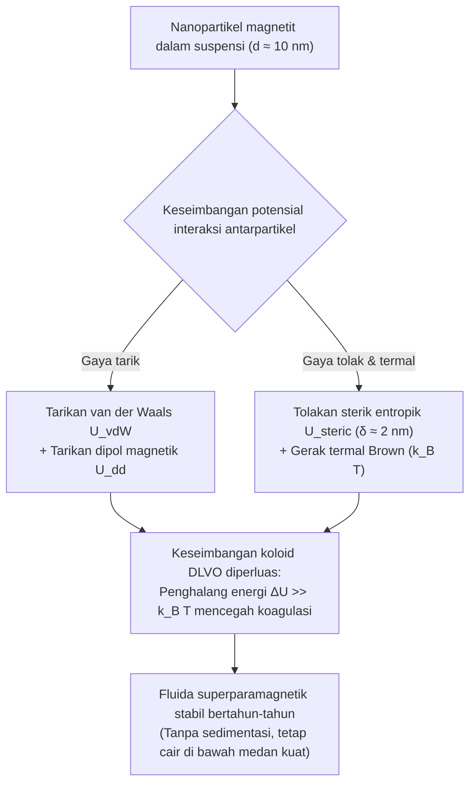
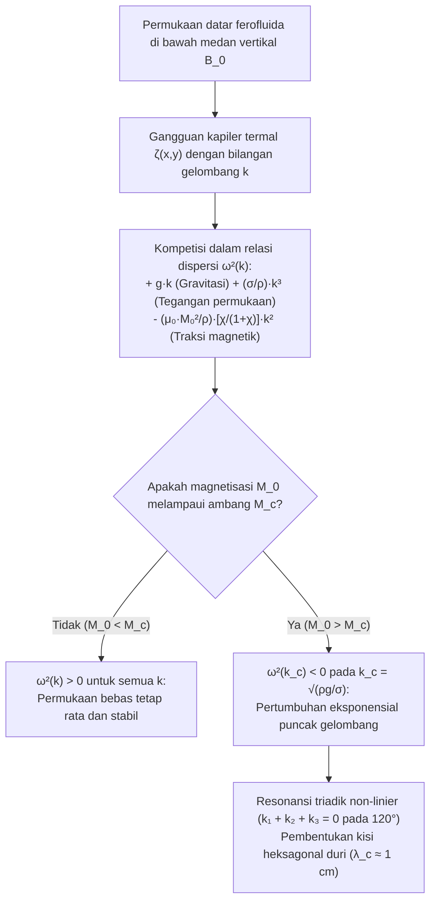

## 1. Mengapa Tidak Ada Magnet Cair Alami di Alam? — Penghalang Suhu Curie

Ketika kita mendekatkan magnet neodimium yang kuat ke wadah berisi cairan hitam pekat dan melihat cairan itu seketika melawan gravitasi—berdiri membentuk hutan duri kerucut yang sangat simetris—<strong>cairan magnetik (ferofluida / ferrofluid)</strong> ini tampak seperti organisme hidup dari planet lain.

Namun, mengapa kita tidak bisa melelehkan magnet besi biasa di dalam tungku untuk mendapatkan "magnet cair"? Jawabannya terletak pada batas fundamental fisika kuantum dan statistik: <strong>suhu Curie ($T_C$)</strong>.

Feromagnetisme berasal dari <strong>interaksi pertukaran kuantum Heisenberg (Exchange Interaction)</strong> yang menyejajarkan spin elektron tetangga $\mathbf{S}_i$ dan $\mathbf{S}_j$:

$$\mathcal{H}_{\text{ex}} = -2 J_{\text{ex}} \sum_{\langle i,j \rangle} \mathbf{S}_i \cdot \mathbf{S}_j \quad (J_{\text{ex}} > 0)$$

Kopling pertukaran ini sangat sensitif terhadap jarak antaratom dan agitasi termal. Jika logam feromagnetik dipanaskan melampaui suhu Curie $T_C$, energi termal $k_B T$ mengalahkan energi pertukaran $J_{\text{ex}}$. Keteraturan spin spontan runtuh, dan material berubah menjadi <strong>paramagnet</strong> biasa yang acak.

Seperti ditunjukkan pada tabel berikut, suhu Curie $T_C$ dari semua unsur dan oksida feromagnetik yang dikenal berada ratusan kelvin <strong>di bawah</strong> titik leburnya $T_m$:

| Material | Suhu Curie $T_C$ ($\text{K}$) | Titik Lebur $T_m$ ($\text{K}$) | Fase Saat Meleleh ($T > T_m$) |
| :--- | :--- | :--- | :--- |
| <strong>Besi ($\text{Fe}$)</strong> | $1043\,\text{K}$ ($770\,^\circ\text{C}$) | $1811\,\text{K}$ ($1538\,^\circ\text{C}$) | Cairan paramagnetik non-magnetik |
| <strong>Kobalt ($\text{Co}$)</strong> | $1388\,\text{K}$ ($1115\,^\circ\text{C}$) | $1768\,\text{K}$ ($1495\,^\circ\text{C}$) | Cairan paramagnetik non-magnetik |
| <strong>Nikel ($\text{Ni}$)</strong> | $627\,\text{K}$ ($354\,^\circ\text{C}$) | $1728\,\text{K}$ ($1455\,^\circ\text{C}$) | Cairan paramagnetik non-magnetik |
| <strong>Gadolinium ($\text{Gd}$)</strong> | $292\,\text{K}$ ($19\,^\circ\text{C}$) | $1585\,\text{K}$ ($1312\,^\circ\text{C}$) | Cairan paramagnetik non-magnetik |
| <strong>Magnetit ($\text{Fe}_3\text{O}_4$)</strong> | $858\,\text{K}$ ($585\,^\circ\text{C}$) | $1870\,\text{K}$ ($1597\,^\circ\text{C}$) | Cairan paramagnetik non-magnetik |

Besi cair kehilangan seluruh sifat feromagnetiknya $768\,\text{K}$ bahkan sebelum ia mencair ($T_C \ll T_m$). Tidak ada cairan feromagnetik satu fase di alam pada suhu ruang.

Lalu bagaimana insinyur NASA <strong>Stephen Papell</strong> pada tahun 1963 berhasil menemukan ferofluida pertama di dunia untuk memompa bahan bakar roket cair di ruang hampa gravitasi nol menggunakan medan magnet? Solusi jenius Papell adalah mengakali penghalang Curie dengan merancang <strong>suspensi koloid tiga komponen</strong>:

1. <strong>Nanopartikel magnetik ($\sim 5\%$ volume)</strong>: Nanokristal padat magnetit ($\text{Fe}_3\text{O}_4$) atau maghemit ($\gamma\text{-Fe}_2\text{O}_3$) berdiameter khas $d \approx 10\,\text{nm}$, yang berada jauh di bawah titik Curie sehingga mempertahankan magnetisasi kuatnya.
2. <strong>Lapisan surfaktan ($\sim 10\%$ volume)</strong>: Selubung molekuler setebal $\delta \approx 2\,\text{nm}$ (seperti asam oleat, $\text{C}_{18}\text{H}_{34}\text{O}_2$), yang kepala polarnya terikat secara kimiawi pada permukaan nanopartikel sementara ekor hidrokarbonnya menjulur ke pelarut.
3. <strong>Fluida pembawa ($\sim 85\%$ volume)</strong>: Pelarut organik (minyak tanah, minyak sintetis, ester) atau air, di mana gerak Brown menjaga nanopartikel tetap melayang selamanya.

---

## 2. Nanofisika Magnetisme: Batas Domain Tunggal Kittel dan Superparamagnetisme Langevin

Mengapa nanopartikel magnetit harus berukuran tepat sekitar $d \approx 10\,\text{nm}$? Jika kita hanya mencampurkan serbuk besi ukuran mikrometer ($d \approx 1\text{–}10\,\mu\text{m}$) ke dalam minyak, partikel akan langsung mengendap dan menggumpal menjadi bongkahan padat saat didekatkan pada magnet.

### 2.1 Diameter Kritis Kittel untuk Partikel Domain Tunggal

Magnet makroskopis terbagi menjadi banyak <strong>domain magnetik Weiss</strong> yang dipisahkan oleh dinding Bloch guna meminimalkan energi magnetostatik medan demagnetisasi ($\propto d^3$). Namun, pembentukan dinding domain membutuhkan energi pertukaran dan anisotropi yang sebanding dengan luas penampang ($\propto d^2$). Di bawah diameter kritis $d_{\text{sd}}$ (dihitung oleh Charles Kittel), membentuk dinding domain memakan energi lebih besar daripada yang dihemat:

$$d_{\text{sd}} = \frac{36 \sqrt{A_{\text{ex}} K}}{\mu_0 M_d^2}$$

di mana $A_{\text{ex}} \approx 10^{-11}\,\text{J/m}$ adalah kekakuan pertukaran, $K \approx 1.35 \times 10^4\,\text{J/m}^3$ konstanta anisotropi magnetokristalin, dan $M_d \approx 4.46 \times 10^5\,\text{A/m}$ magnetisasi saturasi magnetit masif $\text{Fe}_3\text{O}_4$. Untuk magnetit, $d_{\text{sd}} \approx 25\text{–}30\,\text{nm}$. Oleh karena itu, nanopartikel berukuran $d = 10\,\text{nm}$ adalah <strong>partikel domain tunggal (Single-Domain Particle)</strong> murni: seluruh $\sim 10^4$ spin atomnya terkunci bersama membentuk satu dipol magnetik raksasa $m = M_d V = M_d \frac{\pi}{6}d^3 \approx 2.3 \times 10^{-19}\,\text{A}\cdot\text{m}^2$ ($\sim 25\,000$ magneton Bohr $\mu_B$).

### 2.2 Relaksasi Néel dan Brown, serta Superparamagnetisme

Apakah momen raksasa $m$ ini terkunci вдоль sumbu mudah kristal? Untuk $d = 10\,\text{nm}$, volume partikel $V \approx 5.24 \times 10^{-25}\,\text{m}^3$ begitu kecil sehingga penghalang energi anisotropi $E_B = K V \approx 7 \times 10^{-21}\,\text{J}$ sebanding dengan energi termal $k_B T \approx 4.14 \times 10^{-21}\,\text{J}$ pada suhu ruang ($T = 300\,\text{K}$)!

Akibatnya, momen magnetik terus-menerus membalik arahnya secara spontan karena fluktuasi termal melalui dua mekanisme paralel:
1. <strong>Relaksasi Néel ($\tau_N$)</strong>: Vektor momen magnetik berputar secara internal di dalam kisi kristal melompati penghalang $K V$:
   $$\tau_N = \tau_0 \exp\left(\frac{K V}{k_B T}\right)$$
   Dengan $\tau_0 \approx 10^{-9}\,\text{s}$, partikel magnetit $10\,\text{nm}$ memiliki waktu relaksasi ultra-singkat $\tau_N \approx 5 \times 10^{-9}\,\text{s}$ (beberapa nanodetik).
2. <strong>Relaksasi Brown ($\tau_B$)</strong>: Seluruh nanopartikel beserta selubung surfaktannya (volume hidrodinamik $V_H = \frac{\pi}{6}(d + 2\delta)^3$) berputar secara fisik di dalam fluida berviskositas $\eta$:
   $$\tau_B = \frac{3 \eta V_H}{k_B T}$$
   Laju relaksasi efektif memenuhi $\frac{1}{\tau_{\text{eff}}} = \frac{1}{\tau_N} + \frac{1}{\tau_B}$.

Tanpa medan luar ($\mathbf{H} = \mathbf{0}$), orientasi dipol teracak secara termal dalam hitungan nanodetik: ferofluida memiliki <strong>remanensi nol ($M_r = 0$) dan koersivitas nol ($H_c = 0$)</strong> (tanpa histeresis). Namun saat medan $\mathbf{H}$ diberikan, setiap partikel merespons dengan momen raksasa $25\,000\,\mu_B$, menghasilkan suseptibilitas awal $\chi_i$ ribuan kali lebih besar daripada paramagnet biasa. Fenomena ini disebut <strong>superparamagnetisme</strong>, yang diatur oleh <strong>fungsi Langevin $\mathcal{L}(\xi)$</strong>:

$$M(H) = \phi M_d \mathcal{L}(\xi) = M_s \left( \coth \xi - \frac{1}{\xi} \right), \qquad \xi = \frac{\mu_0 m H}{k_B T} = \frac{\mu_0 M_d V H}{k_B T}$$

di mana $\phi$ adalah fraksi volume magnetik dan $M_s = \phi M_d$ adalah magnetisasi saturasi fluida. Untuk medan lemah ($\xi \ll 1$), $\mathcal{L}(\xi) \approx \xi / 3$ memberikan suseptibilitas awal $\chi_i = \frac{\mu_0 \phi M_d^2 V}{3 k_B T} \sim 1\text{–}5$.

---

## 3. Stabilitas Koloid: Teori DLVO Diperluas dan Perbandingan dengan Fluida MR

Agar nanopartikel tidak menggumpal secara ireversibel, potensial interaksi total $U_{\text{total}}(l)$ sebagai fungsi jarak permukaan ternormalisasi $l = 2s / d$ harus memiliki penghalang tolakan $\Delta U \gg 15\,k_B T$:

$$U_{\text{total}}(l) = U_{\text{vdW}}(l) + U_{\text{dd}}(l) + U_{\text{steric}}(l)$$

1. <strong>Tarikan London–van der Waals ($U_{\text{vdW}}$)</strong>: Tarikan kuantum jarak pendek (konstanta Hamaker $A_H \approx 10^{-19}\,\text{J}$) yang menuju $-\infty$ saat bersentuhan ($l \to 0$):
   $$U_{\text{vdW}}(l) = -\frac{A_H}{6}\left[ \frac{2}{l^2 + 4l} + \frac{2}{(l+2)^2} + \ln\left(\frac{l^2 + 4l}{(l+2)^2}\right) \right]$$
2. <strong>Interaksi dipol-dipol magnetik ($U_{\text{dd}}$)</strong>: Pada susunan kepala-ke-ekor, dua dipol saling menarik dengan $U_{\text{dd}}^{\text{min}}(s) = -\frac{\mu_0 m^2}{2\pi (d + s)^3}$.
3. <strong>Tolakan sterik Mackor–Rosensweig ($U_{\text{steric}}$)</strong>: Ketika $s < 2\delta$, rantai surfaktan (kerapatan permukaan $\xi_s \approx 10^{18}\,\text{rantai/m}^2$) terkompresi. Penurunan entropi konformasi ekor polimer menciptakan tolakan entropik yang kuat:
   $$U_{\text{steric}}(l) = \frac{\pi d^2 \xi_s k_B T}{2} \left[ 2 - \frac{l+2}{t}\ln\left(\frac{1+t}{1+l/2}\right) - \frac{l}{t} \right] \quad \left(\text{untuk } l < 2t,\; t = \frac{2\delta}{d}\right)$$

Perisai sterik setebal $\delta \approx 2\,\text{nm}$ inilah yang membedakan <strong>ferofluida (FF)</strong> secara mendasar dari <strong>fluida magnetoreologi (MRF)</strong>:

| Karakteristik | Ferofluida (FF) | Fluida Magnetoreologi (MRF) |
| :--- | :--- | :--- |
| <strong>Diameter partikel $d$</strong> | $5\text{–}15\,\text{nm}$ (nanopartikel) | $1\text{–}10\,\mu\text{m}$ ($1000\times$ lebih besar, mikropartikel) |
| <strong>Keadaan magnetik</strong> | Domain tunggal superparamagnetik | Multidomain feromagnetik |
| <strong>Energi dominan</strong> | Agitasi termal ($k_B T > U_{\text{dd}}$) | Tarikan dipol ($U_{\text{dd}} \gg k_B T$) |
| <strong>Perilaku di bawah medan $\mathbf{H}$</strong> | <strong>Tetap cair!</strong> Membentuk duri Rosensweig | <strong>Membeku dalam milidetik!</strong> Rantai kaku |
| <strong>Aplikasi utama</strong> | Segel vakum, pendingin speaker, seni kinetik | Suspensi aktif (MagneRide), rem, kopling |

---

## 4. Ferohidrodinamika (FHD) dan Instabilitas Medan Normal Cowley–Rosensweig

Mengapa permukaan bebas ferofluida tiba-tiba berdiri membentuk kisi duri geometris saat diberi medan magnet vertikal? Jawabannya diberikan oleh <strong>ferohidrodinamika (FHD)</strong> yang dirumuskan oleh Ronald E. Rosensweig.

### 4.1 Gaya Volume Kelvin dan Persamaan Bernoulli Diperluas

Di dalam fluida termagnetisasi non-konduktor yang berada dalam medan $\mathbf{H}$, setiap elemen volume dengan magnetisasi $\mathbf{M}$ mengalami <strong>rapat gaya magnetik Kelvin</strong>:

$$\mathbf{f}_m = \mu_0 (\mathbf{M} \cdot \nabla)\mathbf{H}$$

Dengan mengintegrasikan persamaan Euler-Navier-Stokes stasioner dan irrotasional untuk fluida tak-termampatkan di sepanjang garis arus, diperoleh <strong>persamaan Bernoulli diperluas untuk ferohidrodinamika</strong>:

$$p^* + \frac{1}{2}\rho v^2 + \rho g z - \mu_0 \int_0^H M(H')\,dH' = \text{const}$$

Selain itu, pada antarmuka bebas antara ferofluida dan udara, lompatan tensor tegangan Maxwell menambahkan traksi magnetik normal pada syarat batas Young-Laplace:

$$p^* - p_0 = \sigma \kappa - \frac{1}{2}\mu_0 M_n^2$$

di mana $p_0$ adalah tekanan atmosfer, $\sigma$ tegangan permukaan, $\kappa \approx -\nabla_\perp^2 \zeta$ kelengkungan rata-rata permukaan, dan $M_n = \mathbf{M} \cdot \mathbf{n}$ komponen normal magnetisasi. Suku $-\frac{1}{2}\mu_0 M_n^2$ bekerja sebagai <strong>hisapan magnetik ke arah luar</strong>: setiap gundukan kecil $\zeta(x,y) > 0$ di permukaan memfokuskan garis-garis medan magnet (efek penangkal petir), meningkatkan $M_n$ dan menarik cairan lebih tinggi lagi!

### 4.2 Analisis Stabilitas Linier dan Relasi Dispersi (Cowley & Rosensweig, 1967)

Pada tahun 1967, M. D. Cowley dan R. E. Rosensweig menganalisis lapisan datar ferofluida di bawah medan magnet vertikal seragam $\mathbf{B}_0 = B_0 \hat{\mathbf{z}}$ yang diganggu oleh gelombang permukaan kecil $\zeta(\mathbf{r}_\perp, t) = \zeta_0 e^{i(\mathbf{k}\cdot\mathbf{r}_\perp - \omega t)}$ dengan bilangan gelombang $k = |\mathbf{k}| = 2\pi / \lambda$.

Penyelesaian persamaan Maxwell ($\nabla \cdot \mathbf{B} = 0$, $\nabla \times \mathbf{H} = \mathbf{0}$) bersama persamaan Bernoulli FHD menghasilkan <strong>relasi dispersi Cowley–Rosensweig</strong>:

$$\omega^2(k) = g k + \frac{\sigma}{\rho} k^3 - \frac{\mu_0 M_0^2}{\rho}\left(\frac{\chi_{\text{eff}}}{1 + \chi_{\text{eff}}}\right) k^2$$

di mana $\chi_{\text{eff}}$ adalah suseptibilitas geometris efektif. Ketiga suku tersebut mencerminkan pertarungan tiga gaya:
* $+g k$ (linier terhadap $k$): <strong>Pemulihan gravitasi</strong> yang menstabilkan gelombang panjang ($k \to 0$).
* $+\frac{\sigma}{\rho}k^3$ (kubik terhadap $k$): <strong>Pemulihan kapiler (tegangan permukaan)</strong> yang menstabilkan gelombang pendek ($k \to \infty$).
* $-\frac{\mu_0 M_0^2}{\rho}\frac{\chi_{\text{eff}}}{1+\chi_{\text{eff}}}k^2$ (kuadratik terhadap $k$, <strong>negatif!</strong>): <strong>Traksi magnetik pendestabil</strong> pada panjang gelombang menengah.

Ketika magnetisasi $M_0$ melampaui ambang kritis $M_c$, kurva $\omega^2(k)$ menjadi negatif ($\omega^2 < 0$) di sekitar bilangan gelombang kritis $k_c$. Frekuensi $\omega = \pm i \gamma$ menjadi imajiner murni dan amplitudo $\zeta(t) \propto e^{+\gamma t}$ tumbuh secara eksponensial.

Dari syarat ambang $\omega^2(k_c) = 0$ dan $\left.\frac{\partial (\omega^2)}{\partial k}\right|_{k = k_c} = 0$, diperoleh parameter kritis <strong>instabilitas Rosensweig</strong>:

1. <strong>Bilangan gelombang kritis $k_c$ dan panjang gelombang kritis $\lambda_c$ (jarak antar duri)</strong>:
   $$k_c = \sqrt{\frac{\rho g}{\sigma}} = \frac{1}{\ell_c} \implies \lambda_c = \frac{2\pi}{k_c} = 2\pi \sqrt{\frac{\sigma}{\rho g}}$$
   Untuk ferofluida khas ($\rho \approx 1200\,\text{kg/m}^3$, $\sigma \approx 0.026\,\text{N/m}$, $g = 9.81\,\text{m/s}^2$), panjang kapiler adalah $\ell_c \approx 1.5\,\text{mm}$ dan jarak antar puncak duri tetangga adalah $\lambda_c \approx 9.3\,\text{mm}$ ($\sim 1\,\text{cm}$).
2. <strong>Magnetisasi kritis $M_c$ pemicu munculnya duri</strong>:
   $$M_c^2 = \frac{2}{\mu_0}\left(1 + \frac{1}{\chi_{\text{eff}}}\right)\sqrt{\rho g \sigma}$$

### 4.3 Mengapa Terbentuk Kisi Heksagonal? (Resonansi Triadik Non-Linier)

Teori linier menentukan besarnya $k_c$, tetapi tidak menentukan arah $\mathbf{k}$. Mengapa duri-duri tersebut tersusun membentuk <strong>kisi heksagonal 2D</strong> yang sempurna?

Dalam ekspansi non-linier energi bebas permukaan $\mathcal{F}[\zeta]$, medan magnet vertikal merusak simetri inversi puncak-lembah ($\zeta \to -\zeta$), menghasilkan suku kubik interaksi resonansi antara tiga vektor gelombang:

$$\Delta \mathcal{F}_3 \propto - \sum_{\mathbf{k}_1 + \mathbf{k}_2 + \mathbf{k}_3 = \mathbf{0}} A_{\mathbf{k}_1} A_{\mathbf{k}_2} A_{\mathbf{k}_3}$$

Agar tiga vektor dengan panjang sama $|\mathbf{k}_1| = |\mathbf{k}_2| = |\mathbf{k}_3| = k_c$ berjumlah nol ($\mathbf{k}_1 + \mathbf{k}_2 + \mathbf{k}_3 = \mathbf{0}$), ketiganya harus membentuk segitiga sama sisi, yakni terpisah tepat $120^\circ$ satu sama lain! Superposisi tiga gelombang datar pada sudut $120^\circ$ menghasilkan <strong>pola heksagonal duri Rosensweig</strong> di ruang nyata.

---

## 5. Aplikasi Mutakhir di Industri, Biomedis, dan Seni

Ferofluida memegang peranan tak tergantikan dalam berbagai teknologi modern:

1. <strong>Segel Vakum Putar untuk Semikonduktor dan Hard Disk</strong>: Pada ruang vakum ultra-tinggi (UHV) untuk manufaktur cip, magnet cincin menahan cincin cair ferofluida di celah mikrometer di sekeliling poros yang berputar $10\,000\,\text{rpm}$, menghasilkan penyegelan kedap udara tanpa gesekan padat maupun keausan.
2. <strong>Pendinginan dan Peredaman Loudspeaker Hi-Fi</strong>: Ditempatkan di celah magnetik di sekitar kumparan suara (voice coil) tweeter, ferofluida menghantarkan panas $5\times$ lebih cepat daripada udara sekaligus meredam resonansi mekanis diafragma yang tidak diinginkan.
3. <strong>Hipertermia Magnetik dan Penghantaran Obat Terarah</strong>: Nanopartikel biokompatibel $\text{Fe}_3\text{O}_4$ yang diarahkan ke tumor dan diberi medan magnet bolak-balik ($f \approx 100\text{–}500\,\text{kHz}$) melepaskan panas melalui relaksasi Néel dan Brown, menaikkan suhu lokal ke $42\text{–}45\,^\circ\text{C}$ untuk menghancurkan sel kanker secara selektif.
4. <strong>Seni Kinetik (Sachiko Kodama)</strong>: Fisikawan dan seniman Jepang Sachiko Kodama (*Protrude, Flow*) menyinkronkan elektromagnet dengan musik untuk memahat ferofluida menjadi menara duri organik yang menari secara real-time.

Setiap duri di permukaan ferofluida adalah manifestasi nyata dari keseimbangan antara interaksi pertukaran kuantum Heisenberg, entropi koloid, serta persamaan Maxwell dan Navier-Stokes yang saling terkopel.
