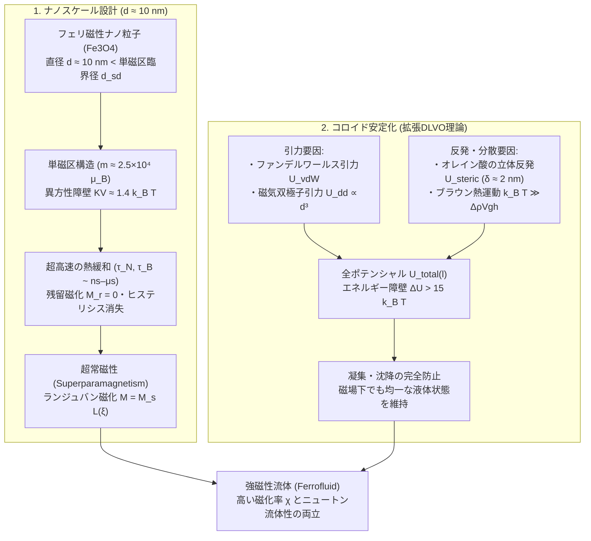
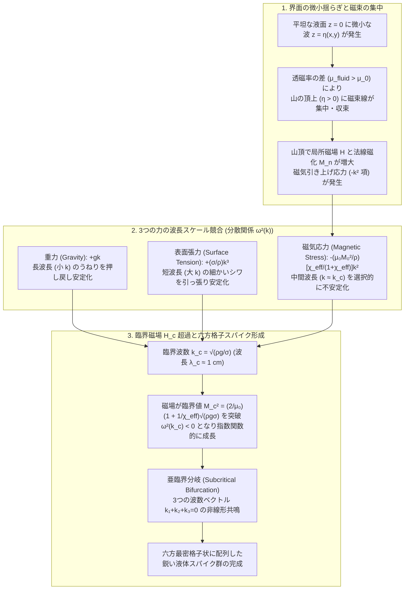

シャーレに満たされた漆黒の液体に下から強力なネオジム磁石を近づけると、平坦だった液面が一瞬にして盛り上がり、幾何学的に整然と並んだ無数の鋭い「トゲ（スパイク）」へと姿を変える。磁石を動かせばトゲの群れは生き物のように波打ち、磁場を遠ざければ何事もなかったかのように元の滑らかな液体へと戻る。科学館の展示やメディアアートでも圧倒的な視覚的インパクトを放つこの物質は、<strong>磁性流体（Ferrofluid）</strong>と呼ばれる機能性ソフトマターである。

しかし、物理学の基本原理に立ち返って考えると、「磁石に強く引き寄せられる液体」という存在そのものが一つの大きなパラドックスを孕んでいることに気づく。自然界には、常温はもちろん、いかなる温度領域においても「単一成分で強磁性を示す液体」は事実上存在しないからである。では、磁性流体はいかにして「液体としての流動性」と「固体強磁性体に匹敵する強い磁気応答」を両立させているのだろうか？ そして、磁場をかけたときに液面がただ全体的に盛り上がるのではなく、なぜ特定の波長をもった六方格子の鋭いトゲへと自発的に分裂するのか？

本稿では、固体物理学におけるキュリー温度の制約から出発し、1960年代のNASAにおける宇宙開発が生んだ「3成分ナノコロイド分散系」としての磁性流体の設計原理を紐解く。さらに、直径 $10\,\text{nm}$ の単磁区ナノ粒子が示す<strong>超常磁性（Superparamagnetism）</strong>の統計力学、ファンデルワールス引力や磁気双極子引力に打ち勝つ界面活性剤の<strong>エントロピー的立体反発（拡張DLVO理論）</strong>、<strong>強磁性流体力学（Ferrohydrodynamics: FHD）</strong>における拡張ベルヌーイ方程式とマクスウェル応力テンソル、そして重力・表面張力・磁気法線応力の三つ巴の競合から鋭いスパイクの臨界波長を導き出す<strong>ローゼンツヴァイク不安定性（Rosensweig Instability）</strong>の線形分散関係まで、第一原理から徹底的に解説する。後半では、半導体製造装置の回転真空シール、高級オーディオスピーカーのボイスコイル冷却・ダンピング、がんの温熱療法（磁気ハイパーサーミア）、そして児玉幸子らによるキネティック・アートに至る応用技術を俯瞰する。

---

## 1. なぜ自然界に「液体の磁石」は存在しないのか？——キュリー温度と融点の壁

### 1.1 強磁性秩序（ハイゼンベルク交換相互作用）の熱破壊

鉄（$\text{Fe}$）、コバルト（$\text{Co}$）、ニッケル（$\text{Ni}$）などの強磁性体（Ferromagnet）が外部磁場なしでも自発磁化（Spontaneous Magnetization）を持つ理由は、結晶格子内の隣接する原子の不対電子スピン $\mathbf{S}_i, \mathbf{S}_j$ 間に働く量子力学的な<strong>ハイゼンベルク交換相互作用（Heisenberg Exchange Interaction）</strong>にある。そのハミルトニアンは交換積分 $J_{\text{ex}}$ を用いて次のように表される。

$$\mathcal{H}_{\text{ex}} = -2 J_{\text{ex}} \sum_{\langle i,j \rangle} \mathbf{S}_i \cdot \mathbf{S}_j$$

強磁性体では $J_{\text{ex}} > 0$ であり、隣り合うスピンが平行に揃うことで系の静電的・量子力学的エネルギーが最小化される。しかし、温度 $T$ が上昇すると、熱揺らぎ（エネルギー尺度 $k_B T$、ここで $k_B = 1.380649 \times 10^{-23}\,\text{J/K}$ はボルツマン定数）がスピンの整列を乱し始める。

温度が物質固有の<strong>キュリー温度（Curie Temperature, $T_C$）</strong>に達すると、熱撹乱エネルギーが交換相互作用の結合エネルギーを完全に凌駕し、スピンの長距離秩序が崩壊する二次相転移が生じる。$T > T_C$ の領域では自発磁化は消失し、物質は磁場に対する応答が極めて微弱な<strong>常磁性体（Paramagnet）</strong>へと変化する。

### 1.2 融点 $T_m$ とキュリー温度 $T_C$ の決定的なギャップ

もし「天然の強磁性液体」を作ろうとして鉄の塊を坩堝（るつぼ）で加熱し、融解させたらどうなるだろうか。代表的な強磁性金属のキュリー温度 $T_C$ と融点（Melting Point, $T_m$）を比較すると、自然界の冷徹な法則が浮かび上がる。

| 強磁性元素 / 物質 | キュリー温度 $T_C$ ($\text{K}$ / ${}^\circ\text{C}$) | 融点 $T_m$ ($\text{K}$ / ${}^\circ\text{C}$) | 温度差 $T_m - T_C$ ($\text{K}$) | 融解状態（$T > T_m$）での磁気的性質 |
| :--- | :--- | :--- | :--- | :--- |
| <strong>鉄 ($\text{Fe}$)</strong> | $1043\,\text{K}$ ($770\,^\circ\text{C}$) | $1811\,\text{K}$ ($1538\,^\circ\text{C}$) | $+768\,\text{K}$ | 常磁性液体（強磁性消失） |
| <strong>コバルト ($\text{Co}$)</strong> | $1388\,\text{K}$ ($1115\,^\circ\text{C}$) | $1768\,\text{K}$ ($1495\,^\circ\text{C}$) | $+380\,\text{K}$ | 常磁性液体（強磁性消失） |
| <strong>ニッケル ($\text{Ni}$)</strong> | $627\,\text{K}$ ($354\,^\circ\text{C}$) | $1728\,\text{K}$ ($1455\,^\circ\text{C}$) | $+1101\,\text{K}$ | 常磁性液体（強磁性消失） |
| <strong>ガドリニウム ($\text{Gd}$)</strong> | $292\,\text{K}$ ($19\,^\circ\text{C}$) | $1585\,\text{K}$ ($1312\,^\circ\text{C}$) | $+1293\,\text{K}$ | 常磁性液体（強磁性消失） |
| <strong>マグネタイト ($\text{Fe}_3\text{O}_4$)</strong> | $858\,\text{K}$ ($585\,^\circ\text{C}$) | $1870\,\text{K}$ ($1597\,^\circ\text{C}$) | $+1012\,\text{K}$ | 常磁性液体（フェリ磁性消失） |

表から明らかなように、すべての強磁性金属およびフェリ磁性酸化物において、<strong>キュリー温度 $T_C$ は融点 $T_m$ よりも数百ケルビンから千ケルビン以上も低い</strong>（$T_C \ll T_m$）。結晶格子という強固な骨格を維持するのに必要な原子間結合エネルギーに比べて、スピン間の交換相互作用 $J_{\text{ex}}$ ははるかに繊細であり、結晶が融けて液体になるよりもずっと低い温度で磁気秩序が熱破壊されてしまうのである。（※過冷却状態のコバルト・パラジウム合金 $\text{Co}_{80}\text{Pd}_{20}$ などで融点直下に磁気秩序の兆候を観測した極限実験はあるものの、常温で安定に存在する単一相の強磁性液体は存在しない）。

一方、塩化鉄水溶液や液体酸素（$\text{O}_2$）のような常磁性液体は常温または低温で存在するが、それらの磁化率（Magnetic Susceptibility）$\chi$ は $\chi \sim 10^{-4} \text{〜} 10^{-3}$ 程度にすぎず、通常の永久磁石（磁束密度 $B \sim 0.5\,\text{T}$）を近づけても重力や表面張力に打ち勝って液面を隆起させることは到底できない。

### 1.3 1963年・NASAの挑戦：スティーヴン・パペルによる「3成分コロイド」の発明

この「液体でありながら強い磁性を持つ物質は存在しない」という物理学の壁を、発想の転換によって突破したのが、1963年のアメリカ航空宇宙局（NASA）ルイス研究センター（現グレン研究センター）のエンジニア、<strong>スティーヴン・パペル（Stephen S. Papell）</strong>であった。

当時の宇宙開発では、無重力（微小重力）空間にあるロケットの燃料タンク内で液体燃料が浮遊してしまい、エンジンの燃焼室へ送り出すポンプの吸い込み口に燃料を集められないという深刻な問題があった。パペルは、「もし液体燃料そのものに磁性を付与できれば、タンク外部から磁場をかけるだけで、可動部品を一切使わずに燃料を吸い込み口へ誘導・移送できるのではないか」と考えた。

単一の液体が強磁性を持てないならば、<strong>「常温で固体の強磁性体（フェリ磁性体）をナノメートルサイズまで微細化し、それを通常の液体（キャリア溶媒）の中に均一に分散させたコロイド懸濁液（Colloidal Suspension）を作ればよい」</strong>——これが磁性流体（Ferrofluid）の基本思想である。その後、ロナルド・ローゼンツヴァイク（Ronald E. Rosensweig）らが界面化学的安定化と流体力学の基礎理論（強磁性流体力学）を確立し、さらに磁性流体の工業化（Ferrofluidics社の設立）へと発展させた。

磁性流体は、以下の<strong>3つの必須成分</strong>から構成される精緻なナノ複合体である。

1. <strong>磁性ナノ粒子（Magnetic Nanoparticles, 体積分率 $\phi \approx 3\% \text{〜} 15\%$）</strong>
   主にスピネル型結晶構造をもつフェリ磁性酸化物である<strong>マグネタイト（四酸化三鉄, $\text{Fe}_3\text{O}_4$）</strong>または<strong>マグヘマイト（$\gamma\text{-Fe}_2\text{O}_3$）</strong>が用いられる。化学的共沈法（塩化鉄(II) $\text{FeCl}_2$ と塩化鉄(III) $\text{FeCl}_3$ の混合水溶液にアンモニア水などのアルカリを加えて析出させる反応：$\text{Fe}^{2+} + 2\text{Fe}^{3+} + 8\text{OH}^- \rightarrow \text{Fe}_3\text{O}_4\downarrow + 4\text{H}_2\text{O}$）などによって合成され、その粒径は<strong>直径 $d \approx 10\,\text{nm}$（$5 \text{〜} 15\,\text{nm}$）</strong>という極めて狭い範囲に制御される。
2. <strong>界面活性剤（Surfactant / 分散剤）</strong>
   ナノ粒子同士が凝集して沈殿するのを防ぐため、各粒子の表面を高密度に覆う両親媒性分子の被覆層（厚さ $\delta \approx 2\,\text{nm}$）。代表的なものに<strong>オレイン酸（Oleic Acid, $\text{CH}_3(\text{CH}_2)_7\text{CH}=\text{CH}(\text{CH}_2)_7\text{COOH}$）</strong>がある。カルボキシル基（$-\text{COOH}$）の極性頭部が酸化鉄粒子の表面に化学吸着し、長さ約 $2\,\text{nm}$ の炭化水素鎖（疎水性尾部）が外側（溶媒側）に向かってハリネズミのように突き出す構造をとる。
3. <strong>キャリア液体（Carrier Liquid / 分散媒, 体積分率 $80\% \text{〜} 90\%$）</strong>
   用途に応じて選択されるベース溶媒。炭化水素系オイル（ケロシン、鉱物油）、合成エステル、フッ素系オイル、シリコーンオイル、あるいは極性溶媒である水（水ベースの場合はオレイン酸などの二重層被覆やイオン性界面活性剤が用いられる）が使われる。蒸発しにくい高真空シール用途などでは、蒸気圧が極限まで低いパーフルオロポリエーテル（PFPE）やポリアルファオレフィン（PAO）が選ばれる。

---

## 2. ナノスケールの磁気物理学：単磁区構造と「超常磁性」

なぜ磁性ナノ粒子の直径は $1\,\mu\text{m}$ でも $100\,\text{nm}$ でもなく、必ず<strong>$10\,\text{nm}$ 前後</strong>でなければならないのか？ その理由は二つある。一つは重力や磁場勾配による沈降を防ぐ熱運動（ブラウン運動）の要請であり、もう一つは固体物理学における<strong>単磁区（Single-Domain）構造と超常磁性（Superparamagnetism）</strong>の発現である。

### 2.1 多磁区構造から単磁区ナノ粒子への遷移

マクロな大きさ（数 $\mu\text{m}$ 以上）の強磁性体は、内部が<strong>磁区（Magnetic Domain）</strong>と呼ばれる多数の小領域に分割されており、隣接する磁区の磁化ベクトルが互いに異なる方向を向くことで、外部空間に漏れる磁束（静磁エネルギー / 反磁場エネルギー $E_{\text{ms}} \propto M_s^2 V = M_s^2 d^3$）を最小化している。磁区と磁区の境界には、スピンが連続的に回転する<strong>磁壁（Domain Wall / ブロッホ壁）</strong>が存在する。

しかし、粒子の直径 $d$ をどんどん小さくしていくと、体積に比例する静磁エネルギーの減少分（$\propto d^3$）よりも、界面面積に比例する磁壁の形成エネルギー（$\propto \sigma_w d^2$、ここで $\sigma_w = \sqrt{A_{\text{ex}} K}$ は磁壁エネルギー密度、$A_{\text{ex}}$ は交換スティフネス定数、$K$ は磁気異方性定数）の方が大きくつくようになる。キッテル（Charles Kittel）の理論によれば、球形粒子が磁壁を作らずに粒子全体で一つの磁区となる<strong>単磁区臨界直径 $d_{\text{sd}}$</strong> は次のように評価される。

$$d_{\text{sd}} \approx \frac{36 \sqrt{A_{\text{ex}} K}}{\mu_0 M_s^2}$$

マグネタイト（$\text{Fe}_3\text{O}_4$、飽和磁化 $M_s \approx 4.46 \times 10^5\,\text{A/m}$、実効異方性定数 $K \approx 1.1 \times 10^4\,\text{J/m}^3$）の場合、この臨界サイズは以下の通りであり、直径 $d \approx 10\,\text{nm}$ のナノ粒子は完全に<strong>単磁区粒子（Single-Domain Particle）</strong>となっている。

すなわち、直径 $10\,\text{nm}$ のマグネタイト粒子1個の中には約 $10^4$ 個の鉄イオンが含まれているが、それらの磁気モーメントは粒子内で常に完全に一方向に揃っており、粒子1個が大きさ $m = M_s V = M_s \left(\frac{\pi}{6}d^3\right) \approx 2.3 \times 10^{-19}\,\text{A}\cdot\text{m}^2 \approx 2.5 \times 10^4\,\mu_B$（$\mu_B$ はボーア磁子）という<strong>「巨大な単一磁気双極子（ジャイアント・スピン）」</strong>として振る舞うのである。

### 2.2 ネール緩和とブラウン緩和：ヒステリシスの消失

単磁区粒子がそのまま「小さな永久磁石」として振る舞ってしまうと、外部磁場を切ったあとも粒子が残留磁化 $M_r$ を保ち続け、粒子同士がN極とS極で磁気的に吸着・凝集して巨大な塊（凝集体）となり、液体としての性質が失われてしまう。

ところが、粒径が $d \approx 10\,\text{nm}$ まで小さくなると、劇的な現象が起こる。結晶磁気異方性によって磁化ベクトルを特定の方向（磁化容易軸：Easy Axis）に束縛しているエネルギー障壁 $\Delta E = K V$（$V = \frac{\pi}{6}d^3$ は磁性コアの体積）が、室温（$T = 300\,\text{K}$）の熱エネルギー $k_B T \approx 4.14 \times 10^{-21}\,\text{J}$ と同程度かそれ以下になるのである。実際、$d = 10\,\text{nm}$、$K = 1.1 \times 10^4\,\text{J/m}^3$ とすると、

$$K V = \left(1.1 \times 10^4\,\text{J/m}^3\right) \times \left(\frac{\pi}{6}(10^{-8}\,\text{m})^3\right) \approx 5.76 \times 10^{-21}\,\text{J} \approx 1.4\,k_B T$$

となる。このとき、磁性流体中のナノ粒子の磁気モーメントは、以下の<strong>2つの独立な緩和機構</strong>によって極めて高速に方向を変化させる。

1. <strong>ネール緩和（Néel Relaxation）</strong>
   ナノ粒子自体は液体中で静止したまま、<strong>粒子内部の磁気モーメントの向きだけが熱揺らぎによって異方性エネルギー障壁 $K V$ を飛び越えて反転する</strong>現象。ルイ・ネール（Louis Néel, 1949年）が導いたネール緩和時間 $\tau_N$ はアレニウス型の指数関数に従う。
   $$\tau_N = \tau_0 \exp\left(\frac{K V}{k_B T}\right)$$
   ここで $\tau_0 \sim 10^{-9}\text{〜}10^{-10}\,\text{s}$ は歳差運動の試行時間（Larmor周波数に対応）である。$KV \approx 1.4\,k_B T$ のとき、$\tau_N \sim 10^{-9}\,\text{s}$（数ナノ秒）という超高速でスピンが熱反転を繰り返す。一方、もし粒径がわずか2倍の $d = 20\,\text{nm}$ になると、体積 $V$ は $2^3 = 8$ 倍になるため $KV \approx 11.2\,k_B T$ となり、指数関数の敏感さによって $\tau_N$ は一気に数桁跳ね上がる。さらに $d = 30\,\text{nm}$ になると $\tau_N$ は数年〜数億年に達し、磁気モーメントは事実上凍結（ブロッキング）されて永久磁石になってしまう。これが粒径を $10\,\text{nm}$ 前後に厳密に制御しなければならない理由である。
2. <strong>ブラウン緩和（Brownian Relaxation）</strong>
   磁気モーメントが粒子結晶格子に固定されたまま、<strong>ナノ粒子全体が周囲のキャリア液体の粘性抵抗に逆らいながら熱的な回転ブラウン運動によって物理的に回転する</strong>現象。界面活性剤層（厚さ $\delta$）を含めた流体力学的体積を $V_H = \frac{\pi}{6}(d + 2\delta)^3$、キャリア液体の粘度を $\eta$ とすると、ブラウン回転緩和時間 $\tau_B$ はアインシュタイン・デバイの式により与えられる。
   $$\tau_B = \frac{3 \eta V_H}{k_B T}$$
   水やケロシン（$\eta \sim 10^{-3}\,\text{Pa}\cdot\text{s}$）中での $d+2\delta \approx 14\,\text{nm}$ の粒子では、$\tau_B \sim 10^{-6}\text{〜}10^{-7}\,\text{s}$（サブマイクロ秒〜マイクロ秒）となる。

系全体の実効的な磁気緩和時間 $\tau_{\text{eff}}$ は、より速いプロセスが支配する並列和となる。

$$\frac{1}{\tau_{\text{eff}}} = \frac{1}{\tau_N} + \frac{1}{\tau_B} \implies \tau_{\text{eff}} = \frac{\tau_N \tau_B}{\tau_N + \tau_B}$$

通常の観測時間スケール（ミリ秒〜秒）は $\tau_{\text{eff}}$ よりも遥かに長いため、外部磁場 $\mathbf{H}$ をゼロにすると、ナノ粒子の磁気モーメントはナノ秒〜マイクロ秒のうちに熱運動によって完全にランダムな方向へとバラバラになり、<strong>残留磁化（Remanence, $M_r = 0$）も保磁力（Coercivity, $H_c = 0$）もゼロになる（磁気ヒステリシスが完全に消失する）</strong>。

### 2.3 ランジュバン常磁性理論と巨大磁化率

外部磁場 $H$ を印加したときの磁性流体の磁化曲線 $M(H)$ は、古典的な常磁性気体の統計力学である<strong>ランジュバン理論（Langevin Theory of Paramagnetism）</strong>によって驚くほど正確に記述される。

各ナノ粒子が大きさ $m = M_{d} V$（$M_d$ はバルク強磁性コアの自発磁化）の磁気モーメントを持ち、磁場 $\mathbf{H}$ とのなす角を $\theta$ とすると、ゼーマン磁気ポテンシャルエネルギーは $U_m = -\mu_0 \mathbf{m}\cdot\mathbf{H} = -\mu_0 m H \cos\theta$ となる。ボルツマン分布 $\exp(-U_m / k_B T)$ に従って全立体角で熱統計平均をとると、流体のマクロな磁化 $M(H)$ は<strong>ランジュバン関数 $\mathcal{L}(\xi)$</strong> で与えられる。

$$M(H) = n m \langle \cos\theta \rangle = \phi M_d \mathcal{L}(\xi) = M_s \left( \coth\xi - \frac{1}{\xi} \right)$$

ここで、$n$ は粒子の数密度、$\phi = n V$ は磁性コアの体積分率、$M_s = \phi M_d$ は磁性流体全体の飽和磁化であり、無次元パラメータ $\xi$ はゼーマンエネルギーと熱エネルギーの比を表す<strong>ランジュバン・パラメータ</strong>である。

$$\xi \equiv \frac{\mu_0 m H}{k_B T} = \frac{\mu_0 M_d \left(\frac{\pi}{6}d^3\right) H}{k_B T}$$

ランジュバン関数 $\mathcal{L}(\xi) = \coth\xi - \frac{1}{\xi}$ の漸近展開から、以下の2つの極限領域が導かれる。

- <strong>弱磁場極限（$\xi \ll 1$）</strong>：$\mathcal{L}(\xi) \approx \frac{\xi}{3} - \frac{\xi^3}{45} + \cdots$ より、磁化は磁場に比例する線形応答 $M \approx \chi_i H$ を示す。このときの初期磁化率（Initial Susceptibility）$\chi_i$ はキュリーの法則の形をとる。
  $$\chi_i = \left.\frac{\partial M}{\partial H}\right|_{H\to 0} = \frac{\mu_0 n m^2}{3 k_B T} = \frac{\mu_0 \phi M_d^2 V}{3 k_B T}$$
  通常の常磁性体（原子1個のスピン $m \sim 1\,\mu_B$）に比べ、磁性流体のナノ粒子は $m \sim 10^4\,\mu_B$ という巨大な磁気モーメントを持つため、二乗 $m^2$ の効果によって初期磁化率 $\chi_i$ は通常の常磁性体よりも<strong>$10^4 \text{〜} 10^5$ 倍も大きくなる</strong>（実用的な磁性流体では $\chi_i \sim 0.5 \text{〜} 5.0$ に達する）。ヒステリシスを持たない常磁性と同じ統計力学に従いながら、強磁性体に迫る巨大な磁化応答を示すことから、この現象は<strong>超常磁性（Superparamagnetism）</strong>と呼ばれる。
- <strong>強磁場極限（$\xi \gg 1$）</strong>：$\mathcal{L}(\xi) \approx 1 - \frac{1}{\xi}$ より、すべてのナノ粒子の磁気モーメントが磁場方向に整列し、磁化は流体の飽和磁化 $M_s = \phi M_d$（通常 $\mu_0 M_s \approx 0.02 \text{〜} 0.09\,\text{T}$）へと漸近する。

---

## 3. コロイド分散系の安定化物理：拡張DLVO理論と立体反発

直径 $10\,\text{nm}$ の超常磁性ナノ粒子を作ったとしても、それをそのまま水や油に混ぜただけでは数秒〜数分で凝集して底に沈殿してしまう。磁性流体が何十年も分離せず、強力な磁石を近づけても粒子だけが吸い出されずに「液体全体」として動くためには、<strong>4つの過酷な物理的要請</strong>をすべて満たさなければならない。

### 3.1 沈降（重力および磁場勾配）に対する熱力学的安定性

第一に、重力場 $g$ の中で密度 $\rho_p \approx 5180\,\text{kg/m}^3$ のマグネタイト粒子が密度 $\rho_f \approx 800\,\text{kg/m}^3$ のオイル中で沈降しないためには、重力ポテンシャルエネルギー差 $\Delta\rho V g h$（$\Delta\rho = \rho_p - \rho_f$、$h$ は容器の高さ）よりも熱エネルギー $k_B T$ が十分に大きくなければならない。ボルツマン分布 $\rho(z) \propto \exp(-z / l_g)$ における重力沈降特性長 $l_g = \frac{k_B T}{\Delta\rho V g}$ を計算すると、$d = 10\,\text{nm}$ では $l_g \approx 0.18\,\text{m}$ となり、通常の容器スケールではブラウン運動による拡散が重力沈降に完全に打ち勝つ。

第二に、さらに厳しいのが<strong>不均一磁場（磁場勾配 $\nabla H$）中での磁気的沈降（Magnetic Sedimentation）</strong>である。磁石の近くでは粒子1個あたり $\mathbf{F}_m = \mu_0 (\mathbf{m}\cdot\nabla)\mathbf{H}$ の磁気吸引力が働く。高さ・距離 $L$ にわたる磁場差を $\Delta H$ とすると、磁気ポテンシャルエネルギー $\mu_0 m \Delta H$ が熱エネルギー $k_B T$ を超えない条件は、

$$d \lesssim \left( \frac{6 k_B T}{\pi \mu_0 M_d \Delta H} \right)^{1/3}$$

となり、典型的な強磁場勾配（$\Delta H \sim 4 \times 10^5\,\text{A/m}$）において $d \lesssim 8\text{〜}10\,\text{nm}$ が要求される。

### 3.2 粒子間引力（ファンデルワールス力・磁気双極子力）と立体反発の競合

第三、第四の危機は、ナノ粒子同士がブラウン運動で衝突した際に働く強力な<strong>短距離引力</strong>である。半径 $R = d/2$ の2つの球形磁性ナノ粒子が中心間距離 $r$（表面間距離 $s = r - d$、無次元表面間距離 $l \equiv \frac{2s}{d} = \frac{r - d}{R}$）にあるとき、以下のポテンシャルエネルギーが働く（<strong>拡張DLVO理論：Extended Derjaguin-Landau-Verwey-Overbeek Theory</strong>）。

1. <strong>ロンドン・ファンデルワールス引力ポテンシャル $U_{\text{vdW}}(l)$</strong>
   物質の量子的な電荷揺らぎ（分散力）に起因する普遍的な引力。ハメイカー（Hamaker）の厳密式により、
   $$U_{\text{vdW}}(l) = -\frac{A_H}{6} \left[ \frac{2}{l^2 + 4l} + \frac{2}{(l + 2)^2} + \ln\left(\frac{l^2 + 4l}{(l + 2)^2}\right) \right]$$
   ここで $A_H$ は実効ハメイカー定数（炭化水素または水中の酸化鉄では $A_H \approx 10^{-19}\,\text{J} \approx 24\,k_B T$）である。粒子表面が接触（$l \to 0$）すると、$U_{\text{vdW}} \to -\frac{A_H}{6 l} \to -\infty$ へと発散し、一度接触した裸のナノ粒子は二度と引き剥がせない不可逆な凝集（一次極小へのトラップ）を起こす。
2. <strong>磁気双極子・双極子引力ポテンシャル $U_{\text{dd}}(r)$</strong>
   2つの双極子 $\mathbf{m}_1, \mathbf{m}_2$ が頭尾配置（Head-to-Tail: $\rightarrow \rightarrow$）で並んだときに最大となる磁気引力。
   $$U_{\text{dd}}(l) = -\frac{\mu_0 m^2}{2\pi r^3} = -\frac{\mu_0 \pi M_d^2 d^3}{36 (l + 2)^3}$$
   興味深いことに、表面間距離 $l$ が一定のとき、ファンデルワールス引力は無次元距離 $l$ のみの関数（粒径 $d$ に無関係）であるのに対し、磁気双極子引力は<strong>体積（$d^3$）に比例する</strong>。$d = 10\,\text{nm}$ のマグネタイトでは接触時（$l=0$）でも $|U_{\text{dd}}| \approx 2.2\,k_B T$ 程度に抑えられており、実はナノスケールでは磁気引力よりもファンデルワールス引力の方がはるかに危険な凝集要因なのである。
3. <strong>マッカー・ローゼンツヴァイク立体反発ポテンシャル $U_{\text{steric}}(l)$（Entropic Steric Repulsion）</strong>
   この発散するファンデルワールス引力を防ぐ物理的バリアが、粒子表面に吸着した界面活性剤（オレイン酸など、鎖長 $\delta \approx 2\,\text{nm}$、単位面積あたりのグラフト密度 $\xi_{\text{surf}} \approx 2 \times 10^{18}\,\text{molecules/m}^2$）である。2つの粒子が表面間距離 $s < 2\delta$（すなわち無次元距離 $l < 2\delta/R$）まで接近すると、両粒子の表面から伸びた炭化水素鎖の層が重なり合い、高分子鎖が取り得る立体配座（コンフォメーション）の自由度が急激に制限される。
   熱力学の基本式 $\Delta F = \Delta U - T\Delta S$ において、配置エントロピー $\Delta S < 0$ が激減するため、自由エネルギー $\Delta F \approx -T\Delta S > 0$ が急上昇し、強力な<strong>エントロピー的弾性反発力（立体障害反発）</strong>が生まれる。マッカー（E. L. Mackor）とローゼンツヴァイクが導いた剛体棒近似モデルの立体反発ポテンシャルは次式で表される。
   $$U_{\text{steric}}(l) = \frac{\pi d^2 \xi_{\text{surf}} k_B T}{2} \left[ 2 - \frac{l + 2}{t}\ln\left(\frac{1 + t}{1 + l/2}\right) - \frac{l}{t} \right] \quad \left(\text{for } l \le 2t,\; t \equiv \frac{2\delta}{d}\right)$$
   （※水系磁性流体の場合は、これに加えて電気二重層の重なりによる静電反発ポテンシャル $U_{\text{el}} \propto \varepsilon \psi_0^2 \exp(-\kappa_D s)$ が寄与する）。

全相互作用ポテンシャル $U_{\text{total}}(l) = U_{\text{vdW}}(l) + U_{\text{dd}}(l) + U_{\text{steric}}(l)$ を描くと、厚さ $\delta \approx 2\,\text{nm}$ の界面活性剤層（$d = 10\,\text{nm}$ に対して被覆比 $t = 2\delta/d \approx 0.4$）が存在することで、粒子コア同士が $s < 2\delta = 4\,\text{nm}$ 以内に近づくことが物理的に阻止され、接触直前で $+15\,k_B T \text{〜} +25\,k_B T$ 以上の巨大な反発エネルギー障壁が形成される。熱運動エネルギー $1\,k_B T$ をもつ粒子はこの障壁を乗り越えることができず、ファンデルワールス引力の深い井戸に落ち込むことなく、半永久的に均一なコロイド分散状態を維持するのである。

### 3.3 磁性流体（FF）と磁気粘性流体（MR流体）の決定的な違い

ここで、しばしば混同される2種類の磁気応答性流体——<strong>磁性流体（Ferrofluid: FF）</strong>と<strong>磁気粘性流体（Magnetorheological Fluid: MR流体）</strong>——の物理的違いを明確にしておこう。両者を分ける最大の決定因子は、分散粒子の<strong>サイズ（ナノメートルかマイクロメートルか）</strong>と、それに伴う<strong>磁気双極子エネルギーと熱エネルギーの比（結合定数 $\lambda_{\text{dd}}$）</strong>である。

$$\lambda_{\text{dd}} \equiv \frac{|U_{\text{dd}}^{\text{max}}|}{k_B T} = \frac{\mu_0 \pi M_d^2 d^3}{36 k_B T (1 + 2\delta/d)^3}$$

| 比較項目 | 磁性流体 (Ferrofluid: FF) | 磁気粘性流体 (Magnetorheological Fluid: MR Fluid) |
| :--- | :--- | :--- |
| <strong>分散粒子の材質と粒径 $d$</strong> | マグネタイト ($\text{Fe}_3\text{O}_4$) 等、<strong>$d \approx 5\text{〜}15\,\text{nm}$</strong>（ナノ粒子） | カルボニル鉄 ($\text{Fe}$) 等、<strong>$d \approx 1\text{〜}10\,\mu\text{m}$</strong>（ミクロン粒子） |
| <strong>磁区構造と磁気特性</strong> | <strong>単磁区（超常磁性）</strong>、熱揺らぎが支配的 | <strong>多磁区（軟磁性）</strong>、高い飽和磁化 ($\mu_0 M_s \approx 2.1\,\text{T}$) |
| <strong>双極子結合定数 $\lambda_{\text{dd}}$</strong> | $\lambda_{\text{dd}} \lesssim 1$（熱運動 $k_B T$ が双極子引力を凌駕） | $\lambda_{\text{dd}} \sim 10^6 \text{〜} 10^9 \gg 1$（双極子引力が熱運動を圧倒） |
| <strong>磁場印加時のミクロ構造</strong> | 粒子は個別に分散したまま磁気モーメントのみが整列 | 粒子同士が磁場方向に強固な<strong>鎖状クラスター（カラム構造）</strong>を形成 |
| <strong>レオロジー（流動特性）の変化</strong> | 強磁場下でも<strong>サラサラの液体（ほぼニュートン流体）</strong>のまま | 数ミリ秒で<strong>半固体（ビンガム流体）へ相転移</strong>し、巨大な降伏応力 $\tau_y(H)$ を発生 |
| <strong>重力に対する長期安定性</strong> | ブラウン運動により<strong>半永久的に沈降しない</strong> | 重力により容易に沈降する（チキソトロピー添加剤や撹拌が必要） |
| <strong>主な工学的応用</strong> | 真空回転シール、スピーカー冷却、液面スパイクアート、医療 | 自動車の電子制御サスペンション（MRダンパー）、ブレーキ、クラッチ |

MR流体では粒径が $1\text{〜}10\,\mu\text{m}$（磁性流体の100〜1000倍）であるため、体積 $V \propto d^3$ は $10^6 \text{〜} 10^9$ 倍となり、磁場をかけると粒子間に $k_B T$ の数百万倍もの強烈な双極子引力が働いて、磁束線に沿った強固な鎖状柱（チェーン）を瞬時に形成する。この鎖を断ち切るには<strong>降伏応力（Yield Stress）$\tau_y(H)$</strong> 以上のせん断応力が必要となり、構成方程式はビンガム塑性流体（Bingham Plastic Fluid: $\tau = \tau_y(H) \operatorname{sgn}(\dot{\gamma}) + \eta \dot{\gamma}$）へと劇的に変化する。

対照的に、<strong>磁性流体（Ferrofluid）は $\lambda_{\text{dd}} \lesssim 1$ となるように意図的に設計されているため、どれほど強い磁場をかけても固化せず、液体としての自由な流動性と鋭い界面変形能力（トゲの形成）を保ち続ける</strong>のである。

---

## 4. 強磁性流体力学（FHD）：ケルビン磁気体積力と拡張ベルヌーイの定理

個々のナノ粒子のスケール（$\sim 10\,\text{nm}$）よりもはるかに大きなマクロな流体スケールでは、磁性流体は磁化ベクトル場 $\mathbf{M}(\mathbf{r}, t)$ を内部自由度として持つ連続体として扱うことができる。この体系を<strong>強磁性流体力学（Ferrohydrodynamics: FHD）</strong>と呼ぶ。

（※なお、太陽コロナのプラズマや地球外核の液体鉄のように、流体中に自由電流 $\mathbf{J}$ が流れてローレンツ力 $\mathbf{J} \times \mathbf{B}$ が働く「磁気流体力学（Magnetohydrodynamics: MHD）」とは異なり、磁性流体は通常電気絶縁体（$\mathbf{J} = \mathbf{0}$）であり、磁化の空間勾配による<strong>ケルビン力</strong>が支配する）。

### 4.1 静磁気学のマクスウェル方程式とケルビン磁気体積力

自由電流が存在しない準静的な磁気系において、磁場 $\mathbf{H}$ と磁束密度 $\mathbf{B}$ は次のマクスウェル方程式を満たす。

$$\nabla \times \mathbf{H} = \mathbf{0}, \qquad \nabla \cdot \mathbf{B} = 0, \qquad \mathbf{B} = \mu_0 (\mathbf{H} + \mathbf{M})$$

超常磁性体である磁性流体では、磁化の緩和時間 $\tau_{\text{eff}} \sim 10^{-6}\,\text{s}$ が流体運動の時間スケールよりも十分に短いため、磁化 $\mathbf{M}$ は常に局所的な磁場 $\mathbf{H}$ と平行（共線的：Collinear）であると近似できる（<strong>準平衡近似</strong>）。

$$\mathbf{M} = \frac{M(H)}{H}\mathbf{H} = \chi(H)\mathbf{H}$$

単位体積あたりの磁性流体に働く磁気体積力（<strong>ケルビン磁気力密度：Kelvin Body Force Density</strong>）$\mathbf{f}_m$ は、微小体積内の磁気双極子に働く力 $\mu_0(\mathbf{m}\cdot\nabla)\mathbf{H}$ の総和として次式で与えられる。

$$\mathbf{f}_m = \mu_0 (\mathbf{M} \cdot \nabla)\mathbf{H}$$

ここで、ベクトル解析の恒等式 $\nabla(\mathbf{H}\cdot\mathbf{H}) = 2(\mathbf{H}\cdot\nabla)\mathbf{H} + 2\mathbf{H}\times(\nabla\times\mathbf{H})$ に無回転条件 $\nabla \times \mathbf{H} = \mathbf{0}$ を代入すると、$(\mathbf{H}\cdot\nabla)\mathbf{H} = \frac{1}{2}\nabla(H^2) = H\nabla H$ が成り立つ。これと共線条件 $\mathbf{M} = \frac{M(H)}{H}\mathbf{H}$ を用いると、ケルビン力はスカラー場 $H = |\mathbf{H}|$ の勾配として極めて美しく書き換えられる。

$$\mathbf{f}_m = \mu_0 \frac{M(H)}{H}(\mathbf{H}\cdot\nabla)\mathbf{H} = \mu_0 M(H) \nabla H$$

さらに、等温過程において磁化 $M(H)$ が磁場の大きさ $H$ のみの関数であるとき、微分の連鎖律からこれを<strong>完全勾配（Gradient）</strong>の形にまとめることができる。

$$\mathbf{f}_m = \nabla \left( \mu_0 \int_0^H M(H')\,dH' \right) \equiv \nabla p_m$$

ここで定義された $p_m \equiv \mu_0 \int_0^H M(H')\,dH'$ は<strong>流体磁気圧力（Fluid-Magnetic Pressure）</strong>と呼ばれる。この式が意味する物理的本質は極めて重要である。すなわち、<strong>一様な磁場（$\nabla H = \mathbf{0}$）の中では磁性流体には一切の並進力は働かず、磁場の強い場所と弱い場所の差（磁場勾配 $\nabla H \neq \mathbf{0}$）が存在するときにのみ、流体は磁場が強い方向（$\nabla H$ の方向）へと吸い寄せられる</strong>のである。

### 4.2 強磁性流体力学の運動方程式と拡張ベルヌーイ方程式

非圧縮性（$\nabla \cdot \mathbf{v} = 0$、密度 $\rho = \text{const}$）の磁性流体に対するナビエ・ストークス方程式（ローゼンツヴァイク方程式）は、重力 $\rho\mathbf{g} = -\nabla(\rho g z)$ とケルビン力 $\mathbf{f}_m$ を加えて次のようになる。

$$\rho \left( \frac{\partial \mathbf{v}}{\partial t} + (\mathbf{v} \cdot \nabla)\mathbf{v} \right) = -\nabla p^* + \eta \nabla^2 \mathbf{v} + \mu_0 M(H) \nabla H - \rho g \mathbf{e}_z$$

（ここで $p^* = p + p_s$ は熱力学的圧力 $p$ と磁気歪み圧力 $p_s = -\mu_0 \int_0^H \rho\left(\frac{\partial M}{\partial \rho}\right)_{H,T} dH'$ の和である）。
定常（$\frac{\partial \mathbf{v}}{\partial t} = \mathbf{0}$）かつ渦なし（$\nabla \times \mathbf{v} = \mathbf{0}$）の非粘性流、あるいは静止流体（$\mathbf{v} = \mathbf{0}$）を考えると、運動方程式のすべての項がスカラーポテンシャルの勾配 $\nabla(\cdots) = \mathbf{0}$ となり、空間積分によって<strong>強磁性流体の拡張ベルヌーイ方程式（Generalized Ferrohydrodynamic Bernoulli Equation）</strong>が導かれる。

$$p^* + \frac{1}{2}\rho v^2 + \rho g z - \mu_0 \int_0^H M(H')\,dH' = \text{const}$$

通常の流体力学のベルヌーイの定理に、<strong>負の磁気エネルギー項 $-\mu_0 \int_0^H M(H')\,dH'$</strong> が追加されている点に注目してほしい。磁場 $H$ が強い場所ほどこの磁気項が大きな負の値をとるため、式全体の和を一定に保つためには、その場所の圧力 $p^*$ が増大するか、あるいは位置エネルギー $\rho g z$（液面の高さ $z$）が上昇しなければならない。下から磁石を近づけると磁性流体の山が重力に逆らって盛り上がるのは、まさにこの拡張ベルヌーイの定理の直接的な帰結である。

### 4.3 磁性流体・空気界面における応力境界条件（磁気法線応力ジャンプ）

しかし、液面が「ただの1つのなだらかな山」として盛り上がるのではなく、なぜ「多数の鋭いトゲ」に分裂するのかを理解するには、流体内部の体積力だけでなく、<strong>磁性流体と非磁性気体（空気）の界面（Interface）で働くマクスウェル応力テンソル（Maxwell Stress Tensor）の境界条件</strong>を導く必要がある。

磁性媒質中のマクスウェル磁気応力テンソル $\mathbf{T}_m$ をも含めた全応力テンソル $\mathbf{T}$ は、単位テンソルを $\mathbf{I}$ として次式で与えられる。

$$\mathbf{T} = -\left( p^* + \frac{1}{2}\mu_0 H^2 \right)\mathbf{I} + \mathbf{H}\mathbf{B}^T = -\left( p^* + \frac{1}{2}\mu_0 H^2 \right)\mathbf{I} + \mu_0 \mathbf{H}(\mathbf{H} + \mathbf{M})^T$$

磁性流体（領域1：磁化 $\mathbf{M}$）と空気（領域2：磁化 $\mathbf{M}_2 = \mathbf{0}$、大気圧 $p_0$）の自由界面において、界面の単位法線ベクトルを $\mathbf{n}$（流体から空気へ向かう向き）、単位接線ベクトルを $\mathbf{t}$ とする。静磁気学の境界条件より、界面を横切る際に<strong>磁場の接線成分 $H_t = \mathbf{H}\cdot\mathbf{t}$ は連続</strong>であり、<strong>磁束密度の法線成分 $B_n = \mathbf{B}\cdot\mathbf{n}$ も連続</strong>である。

$$\llbracket H_t \rrbracket = H_{1t} - H_{2t} = 0, \qquad \llbracket B_n \rrbracket = \mu_0(H_{1n} + M_n) - \mu_0 H_{2n} = 0 \implies H_{2n} = H_{1n} + M_n$$

この境界条件を界面での法線応力の釣り合い式 $\mathbf{n}\cdot(\mathbf{T}_2 - \mathbf{T}_1)\cdot\mathbf{n} = \sigma \kappa$（ここで $\sigma$ は表面張力係数、$\kappa = \nabla_s\cdot\mathbf{n}$ は界面の2倍平均曲率）に代入して整理すると、驚くべきことに $\frac{1}{2}\mu_0(H_{2}^2 - H_{1}^2)$ の項から<strong>界面法線方向の磁化成分 $M_n = \mathbf{M}\cdot\mathbf{n}$ の二乗に比例する磁気トラクション（引っ張り応力）</strong>が純粋に抽出される。

$$p^* - p_0 = \sigma \kappa - \frac{1}{2}\mu_0 M_n^2 \equiv \sigma \kappa - p_n$$

ここで $p_n \equiv \frac{1}{2}\mu_0 M_n^2 \ge 0$ は<strong>磁気法線応力（Magnetic Normal Stress）</strong>と呼ばれる。符号がマイナス（$-p_n$）であることは、磁化ベクトルが界面に対して垂直成分 $M_n$ を持つとき、<strong>界面には常に磁性流体側から空気側（外側）へ向かって液面をグイッと引っ張り出そうとする法線方向の牽引力（トラクション）が働く</strong>ことを意味している。

---

## 5. ローゼンツヴァイク不安定性の数理導出：なぜ液体はトゲになるのか？

以上の強磁性流体力学の道具立てを用いれば、磁性流体物理学の最高峰である<strong>ローゼンツヴァイク不安定性（Rosensweig Instability / 垂直磁場不安定性：Normal-Field Instability）</strong>——1967年にカウリー（M. D. Cowley）とローゼンツヴァイクによって理論・実験ともに解明された、平坦な液面から六方格子のスパイク群が自発的に立ち上がる現象——を厳密に導出することができる。

### 5.1 摂動展開と磁束線の「山頂への集中（集束効果）」

水平な $(x, y)$ 平面に無限に広がる深さ無限大（$z < 0$）の磁性流体を考え、鉛直方向（$z$ 軸方向）に一様な外部磁場（磁束密度 $\mathbf{B}_0 = B_0 \mathbf{e}_z$）を印加する。
液面が平坦（$z = 0$）な基本状態では、流体内部の磁場は一様（$\mathbf{H}_0 = H_0 \mathbf{e}_z$、磁化 $\mathbf{M}_0 = M_0 \mathbf{e}_z$）であり、空気側（$z > 0$）の磁場は $H_{2,0} = H_0 + M_0 = B_0/\mu_0$ である。

いま、平坦な液面に対して微小な正弦波状の凹凸（表面変位 $\eta(x, y, t)$、波数ベクトル $\mathbf{k} = (k_x, k_y)$、波数 $k = |\mathbf{k}| = \frac{2\pi}{\lambda}$）が生じたとしよう。

$$z = \eta(\mathbf{r}_\perp, t) = \hat{\eta} \, e^{i(\mathbf{k}\cdot\mathbf{r}_\perp - \omega t)}$$

液面がわずかに波打つと、何が起きるだろうか？ 磁性流体は空気よりも高い透磁率 $\mu = \mu_0(1 + \chi) > \mu_0$ を持っている。電磁気学の基本法則により、磁束線は透磁率の低い空気中よりも、透磁率の高い磁性流体の中を好んで通ろうとする（磁気抵抗最小の原理）。

その結果、液面が盛り上がった<strong>「山の頂上（Crest, $\eta > 0$）」には周囲から磁束線がギュッと集中（収束）し、局所的な磁場 $H$ と法線磁化 $M_n$ が増大する</strong>。逆に、液面がへこんだ<strong>「谷底（Trough, $\eta < 0$）」では磁束線が疎（発散）になり、磁場が弱まる</strong>。

すると、前節で導いた拡張ベルヌーイの定理と界面境界条件により、山の頂上では集中した磁場が流体をさらに強く上方へと引っ張り上げ、谷底では流体が押し下げられるという<strong>正のフィードバック（不安定化機構）</strong>が発動する！

### 5.2 線形分散関係 $\omega^2(k)$ の完全導出

この正のフィードバックと、液面を元の平らな状態に戻そうとする復元力（重力と表面張力）とのせめぎ合いを定量化するため、微小摂動展開を行おう。
非粘性・渦なし流の速度ポテンシャル $\Phi$（$\mathbf{v} = \nabla\Phi$、$z < 0$ で $\nabla^2\Phi = 0$）と、流体内部および空気中の磁気スカラーポテンシャル摂動 $\psi_1, \psi_2$（$\mathbf{h}_1 = -\nabla\psi_1, \mathbf{h}_2 = -\nabla\psi_2$）を導入する。

流体内部（$z < 0$）では、動作点 $(H_0, M_0)$ のまわりで磁化曲線を線形化すると、<strong>弦磁化率（Chord Susceptibility）</strong>$\chi_c \equiv \frac{M_0}{H_0}$ と<strong>接線磁化率（Differential / Tangent Susceptibility）</strong>$\chi_t \equiv \left.\frac{\partial M}{\partial H}\right|_{H_0}$ の2つの異方的な実効磁化率が現れる。マクスウェル方程式 $\nabla\cdot\mathbf{B} = 0$ より、内部磁気ポテンシャル $\psi_1$ は次の異方性ラプラス方程式を満たす。

$$(1 + \chi_c)\left(\frac{\partial^2 \psi_1}{\partial x^2} + \frac{\partial^2 \psi_1}{\partial y^2}\right) + (1 + \chi_t)\frac{\partial^2 \psi_1}{\partial z^2} = 0 \quad (z < 0)$$

一方、空気中（$z > 0$）では通常のラプラス方程式 $\nabla^2 \psi_2 = 0$ が成り立つ。
$z \to -\infty$ で摂動が消える流体側の解 $\Phi \propto e^{kz}e^{i(\mathbf{k}\cdot\mathbf{r}_\perp - \omega t)}$、$\psi_1 \propto e^{\tilde{k}z}e^{i(\mathbf{k}\cdot\mathbf{r}_\perp - \omega t)}$（ここで $\tilde{k} = k\sqrt{\frac{1+\chi_c}{1+\chi_t}}$）と、$z \to +\infty$ で消える空気側の解 $\psi_2 \propto e^{-kz}e^{i(\mathbf{k}\cdot\mathbf{r}_\perp - \omega t)}$ を、界面 $z = \eta$ での磁気境界条件および非定常拡張ベルヌーイ方程式（表面曲率 $\kappa \approx -\nabla_\perp^2 \eta = k^2 \eta$）に代入して連立方程式を解くと、表面波の角振動数 $\omega$ と波数 $k$ を結ぶ<strong>ローゼンツヴァイクの線形分散関係（Linear Dispersion Relation）</strong>が得られる。

$$\omega^2(k) = g k + \frac{\sigma}{\rho} k^3 - \frac{\mu_0 M_0^2}{\rho} \, \frac{\chi_{\text{eff}}}{1 + \chi_{\text{eff}}} \, k^2$$

ここで $\chi_{\text{eff}}$ は幾何平均によって定義される実効磁化率である（線形磁化 $\mathbf{M} = \chi\mathbf{H}$ の場合は単に $\chi_{\text{eff}} = \chi$ となる）。

$$\chi_{\text{eff}} \equiv \sqrt{(1 + \chi_c)(1 + \chi_t)} - 1$$

### 5.3 重力・表面張力・磁気応力の「三つ巴の競合」と臨界波長

導出された分散関係 $\omega^2(k)$ の右辺の3つの項は、波数 $k = \frac{2\pi}{\lambda}$ のべき乗（$k^1, k^3, k^2$）が見事に分かれており、物理学におけるスケール競合の最も美しい手本となっている。

$$\underbrace{\omega^2(k)}_{\text{復元力 (正なら安定)}} = \underbrace{g k}_{\substack{\text{① 重力項 } (\propto k^1) \\ \text{長波長を安定化}}} + \underbrace{\frac{\sigma}{\rho} k^3}_{\substack{\text{② 表面張力項 } (\propto k^3) \\ \text{短波長を安定化}}} - \underbrace{\frac{\mu_0 M_0^2}{\rho}\frac{\chi_{\text{eff}}}{1 + \chi_{\text{eff}}} k^2}_{\substack{\text{③ 磁気応力項 } (\propto -k^2) \\ \text{中間波長を不安定化}}}$$

- <strong>① 重力項（$+g k$、波数 $k$ の1乗に比例）</strong>：
  波長 $\lambda$ が非常に長い（波数 $k \to 0$ の）大きなうねりに対しては、高次の $k^2, k^3$ よりも1乗の $g k$ が支配的となる。すなわち、液面全体が大きく傾いたりうねったりしようとすると、重い流体を持ち上げる位置エネルギーが膨大になるため、<strong>重力が長波長の変形を強く抑え込む</strong>。
- <strong>② 表面張力項（$+\frac{\sigma}{\rho} k^3$、波数 $k$ の3乗に比例）</strong>：
  波長 $\lambda$ が非常に短い（波数 $k \to \infty$ の）細かいさざ波やシワに対しては、曲率 $\kappa \propto k^2$ が急増するため、3乗の $\frac{\sigma}{\rho}k^3$ が圧倒的に大きくなる。すなわち、表面積を最小化しようとする<strong>表面張力が短波長の細かい変形を強く引き戻して平滑化する</strong>。
- <strong>③ 磁気法線応力項（$-\propto M_0^2 k^2$、波数 $k$ の2乗に比例し、符号は負）</strong>：
  負の符号を持つこの項だけが、液面を不安定化させる駆動力である。そのべき乗がちょうど中間の $k^2$ であるため、磁場（磁化 $M_0$）を徐々に強くしていくと、重力が支配する低波数側でもなく、表面張力が支配する高波数側でもない、<strong>ちょうど中間の特定の波数 $k = k_c$ において $\omega^2(k)$ の曲線が最も深く落ち込み、最初にゼロを切って負（$\omega^2 < 0$）へと転じる</strong>のである！

### 5.4 臨界波数 $k_c$ と臨界磁化 $M_c$ の決定

波の表面変位は $\eta(t) \propto e^{-i\omega t}$ で時間発展するため、$\omega^2(k) > 0$（$\omega$ が実数）の間は微小な波が伝播するだけであるが、ある波数で $\omega^2(k) < 0$ になると、$\omega = i\gamma$（純虚数、成長率 $\gamma = \sqrt{-\omega^2} > 0$）となり、変位 $\eta(t) \propto e^{+\gamma t}$ は時間とともに<strong>指数関数的に爆発的成長</strong>を遂げる。

不安定性が最初に発生する臨界点 $(k_c, M_c)$ は、曲線 $\omega^2(k)$ の極小値がちょうどゼロに接する次の2つの条件から一意に決定される。

$$\left.\frac{\partial (\omega^2)}{\partial k}\right|_{k = k_c} = 0, \qquad \omega^2(k_c) = 0$$

第1式を計算すると、

$$g + \frac{3\sigma}{\rho}k_c^2 - 2\frac{\mu_0 M_c^2}{\rho}\frac{\chi_{\text{eff}}}{1+\chi_{\text{eff}}}k_c = 0$$

ここから磁気項を消去するために第2式 $\frac{\mu_0 M_c^2}{\rho}\frac{\chi_{\text{eff}}}{1+\chi_{\text{eff}}}k_c = g + \frac{\sigma}{\rho}k_c^2$ を代入すると、驚いたことに磁気パラメータが完全に消去され、<strong>臨界波数 $k_c$（およびトゲとトゲの間隔である臨界波長 $\lambda_c$）は重力加速度 $g$、流体密度 $\rho$、表面張力 $\sigma$ のみによって決まる毛管長（Capillary Length, $l_c = \sqrt{\sigma/\rho g}$）の逆数</strong>として求まる。

$$k_c = \sqrt{\frac{\rho g}{\sigma}} = \frac{1}{l_c} \implies \lambda_c = \frac{2\pi}{k_c} = 2\pi \sqrt{\frac{\sigma}{\rho g}}$$

典型的な炭化水素ベース磁性流体の物性値（密度 $\rho \approx 1.2 \times 10^3\,\text{kg/m}^3$、表面張力 $\sigma \approx 0.026\,\text{N/m}$、重力加速度 $g = 9.8\,\text{m/s}^2$）を代入してみよう。

$$l_c = \sqrt{\frac{0.026}{1200 \times 9.8}} \approx 1.49 \times 10^{-3}\,\text{m} = 1.49\,\text{mm} \implies \lambda_c = 2\pi l_c \approx 9.3\,\text{mm} \approx 1\,\text{cm}$$

私たちが磁性流体に磁石を近づけたとき、トゲとトゲの間隔が常に<strong>約 $1\,\text{cm}$（数ミリ〜1センチメートル）</strong>のスケールで並ぶのは、この毛管波長 $\lambda_c = 2\pi\sqrt{\sigma/\rho g}$ が直接目に見えているからなのである。

そして、この臨界波数 $k_c$ を $\omega^2(k_c) = 0$ に戻すことで、トゲが立ち上がるための<strong>臨界磁化 $M_c$（および臨界磁束密度 $B_c$）</strong>が導かれる。

$$M_c^2 = \frac{2}{\mu_0}\left(1 + \frac{1}{\chi_{\text{eff}}}\right)\sqrt{\rho g \sigma}$$

一般的な磁性流体では、この臨界条件は磁束密度にして $B_c = \mu_0(H_c + M_c) \approx 8 \text{〜} 15\,\text{mT}$（約 $80 \text{〜} 150\,\text{Gauss}$）程度に相当する。市販のフェライト磁石やネオジム磁石（表面磁束密度 $100 \text{〜} 500\,\text{mT}$）を近づければ、この臨界値 $B_c$ を容易に突破するため、誰が実験しても確実に美しいスパイクが形成されるのである。

### 5.5 非線形パターン形成：なぜ「六方格子」の鋭いトゲになり、ヒステリシスを示すのか？

線形安定性解析は「どの波長 $\lambda_c$ の波が最初に成長するか」は教えてくれるが、波数大きさ $|\mathbf{k}| = k_c$ を満たす波の方向は水平面内で全方位に縮退している。そのため、1方向の波だけが成長すれば「平行なロール（縞模様）」になり、直交する2方向が重なれば「正方格子（Square Lattice）」になり、$120^\circ$ ずつ交差する3つの波数ベクトル $\mathbf{k}_1, \mathbf{k}_2, \mathbf{k}_3$（$\mathbf{k}_1 + \mathbf{k}_2 + \mathbf{k}_3 = \mathbf{0}, |\mathbf{k}_i| = k_c$）が重なれば<strong>「六方格子（Hexagonal Lattice）」</strong>になる。

ゲイルブ（A. Gailitis, 1977年）やフリードリヒスらの非線形振幅方程式（自由エネルギー汎関数 $\mathcal{F}$ のランドウ展開）によれば、磁性流体の自由表面は上下対称性（$\eta \to -\eta$ の反転対称性）を持たない（山の頂上では磁束が集中して鋭く尖るのに対し、谷底は丸く広がる）ため、振幅 $A_i$ の自由エネルギー展開に<strong>3次の非線形共鳴項（Quadratic Nonlinearity in Equations / Cubic Term in Energy）</strong>が現れる。

$$\mathcal{F}(\{A_i\}) = \frac{1}{2}\epsilon \left(|A_1|^2 + |A_2|^2 + |A_3|^2\right) - \gamma_3 \left(A_1 A_2 A_3 + A_1^* A_2^* A_3^*\right) + \frac{1}{4}\sum_{i,j} g_{ij}|A_i|^2 |A_j|^2$$

（ここで $\epsilon \propto (M_c^2 - M_0^2)/M_c^2$ は制御パラメータ、$\gamma_3 > 0$ は3波結合定数である）。
$\mathbf{k}_1 + \mathbf{k}_2 + \mathbf{k}_3 = \mathbf{0}$ を満たす正三角形配置（$120^\circ$ 交差）の3つのモードが同時に成長するときにのみ、この負の3次項 $-\gamma_3 A_1 A_2 A_3$ が有効に働いて系の自由エネルギーを劇的に引き下げる。その結果、以下の2つの重要な非線形現象が生じる。

1. <strong>六方最密格子（Hexagonal Lattice）の選択</strong>：臨界磁場を超えた直後に現れるトゲは、最もエネルギー的に有利な正三角形・六方格子状に整然と配列する（さらに磁場をはるかに強くすると、4次の相互作用項のバランスにより正方格子へと二次転移することも知られている）。
2. <strong>亜臨界分岐（Subcritical Bifurcation / 第一種相転移的ジャンプ）</strong>：3次項が存在するため、磁場をゆっくり上げていって $H = H_c$ に達した瞬間、トゲの高さはゼロから連続的に立ち上がるのではなく、<strong>有限の高さへと不連続にパッと跳び上がる（ジャンプする）</strong>。さらに一度トゲが形成されると、磁場を $H_c$ より少し下げても（サドル・ノード分岐点 $H_{\text{sn}} < H_c$ に至るまで）トゲは消えずに維持されるという<strong>構造的ヒステリシス</strong>を示す。

そして、成長した各突起の先端では磁束線がさらに強く集中して局所曲率半径が小さくなり、その先端の強い表面張力（$\sigma \kappa$）と磁気法線応力（$\frac{1}{2}\mu_0 M_n^2$）および重力ヘッド（$\rho g z$）が完全に釣り合った非線形平衡形状として、あの特徴的な「円錐状に鋭く尖ったトゲ（スパイク）」が完成するのである。

---

## 6. 産業・医療・アートを支える磁性流体の最先端エンジニアリング

磁性流体は単なる物理実験室の珍品ではない。「磁場で自在に位置を固定・制御できる液体」という唯一無二の特性は、現代のハイテク産業や医療、さらには芸術表現において不可欠な基盤技術となっている。

### 6.1 半導体製造装置・HDDの「磁性流体真空回転シール（Ferrofluid Rotary Shaft Seal）」

磁性流体の最大の産業応用は、日本のフェローテック（Ferrotec）などが世界シェアを握る<strong>磁性流体真空シール（Magnetic Fluid Rotary Vacuum Seal）</strong>である。
半導体ウェハの製造プロセス（スパッタリング、CVD、エッチング、イオン注入など）では、チャンバー内部を $10^{-6}\,\text{Pa}$ 以下の超高真空や高純度ガス雰囲気に保ちながら、外部のモーターからチャンバー内部へ高速回転するシャフト（軸）の動力だけを導入しなければならない。

従来のゴム製Oリングやリップシールでは、回転軸との固体接触による摩擦熱、摩耗粉（パーティクル）の発生によるウェハ汚染、そしてわずかな隙間からの気体リークが避けられなかった。
これに対し、磁性流体シールでは、回転シャフトの周囲にリング状の永久磁石と歯車状の磁極片（ポールピース）を配置し、シャフト表面の微小な突起部（段差ギャップ $\sim 0.1\,\text{mm}$）に強い磁束を集中させる。そのギャップに低蒸気圧の磁性流体を注入すると、ケルビン磁気力によって磁性流体がギャップをぐるりと取り囲む<strong>「液体のOリング（Liquid O-Ring）」</strong>として空中に保持される。

先ほど導いた拡張ベルヌーイの定理より、1段の磁気シールが支えることができる最大圧力差（耐圧 $\Delta p_{\text{max}}$）は、磁極直下の最大磁場 $H_{\text{max}}$ と外部の磁場 $H_{\text{min}} \approx 0$ の積分差で与えられる。

$$\Delta p_{\text{max}} = \mu_0 \int_{H_{\text{min}}}^{H_{\text{max}}} M(H')\,dH' \approx \mu_0 M_s H_{\text{max}}$$

1段あたり約 $0.02\text{〜}0.05\,\text{MPa}$（約 $0.2\text{〜}0.5$ 気圧）の差圧を保持できるため、シャフトに沿って磁極の歯を10〜20段直列に設ける（多段シール構造）ことで、大気圧（$101.3\,\text{kPa}$）と超高真空（$10^{-6}\,\text{Pa}$）の間の $1\,\text{気圧}$ 以上の圧力差を<strong>リーク量ゼロ（ヘリウムリークディテクタの検出限界以下）、摩耗粉ゼロ、超低摩擦トルク、長寿命</strong>で完全に遮断しながら毎分数千回転の高速回転を伝達できる。ハードディスクドライブ（HDD）のスピンドルモーターの防塵シールとしても長年にわたり膨大な数が使用されてきた。

### 6.2 高級オーディオスピーカーのボイスコイル冷却・ダンピング

もう一つの身近かつ重要な応用が、Hi-Fiオーディオスピーカーの<strong>ツイーター（高音用スピーカーユニット）の磁気ギャップへの磁性流体充填</strong>である。
スピーカーは、永久磁石が作る狭い円筒状の磁気ギャップ（磁束密度 $B \sim 1\text{〜}1.5\,\text{T}$）の中にボイスコイルが浮いており、音声電流によって振動板を駆動する。しかし、電気入力エネルギーの $95\%$ 以上はボイスコイルのジュール熱として失われ、コイル温度が $200\,^\circ\text{C}$ 以上に上昇すると、銅線の電気抵抗が増加して音量が下がる<strong>パワーコンプレッション（熱圧縮）</strong>や、最悪の場合はコイルの焼損（断線）を引き起こす。従来の構造では、コイルと磁極の間の空気層（熱伝導率 $k_{\text{air}} \approx 0.026\,\text{W/(m}\cdot\text{K)}$）が断熱材となって放熱を妨げていた。

この磁気ギャップに磁性流体を注入すると、流体は強磁場によってギャップ内に自然に保持され、以下の<strong>3つの機能を同時に果たす</strong>。

1. <strong>熱伝導と熱磁気対流による劇的な冷却</strong>：空気の約5〜10倍の熱伝導率を持つ磁性流体がコイルと金属磁極を直接熱結合させ、熱抵抗を激減させる。さらに、コイル近傍の高温になった磁性流体は磁化 $M(T)$ が低下するため、周囲の冷たく磁化の強い流体が磁気ギャップ中心へ吸い込まれて高温流体を押し出す<strong>熱磁気対流（Thermomagnetic Convection）</strong>が自発的に発生し、放熱能力を3〜4倍に高める。
2. <strong>粘性ダンピング（制振）</strong>：流体の適切な粘性がボイスコイルの最低共振周波数（$f_0$）付近での過度な共振ピークを抑え、クロスオーバーネットワークの設計を容易にし、過渡応答（音の立ち上がりと収束）を滑らかにする。
3. <strong>センタリング効果</strong>：ボイスコイルが偏心しようとすると、排除された磁性流体による磁気復元圧力が働き、コイルが磁極に擦れる（ボイスコイル・ラブ）のを防ぐ。

### 6.3 医療応用（磁気ハイパーサーミア・DDS）とキネティック・アート

生体適合性のあるポリマー（デキストランやポリエチレングリコール：PEG）で被覆した酸化鉄超常磁性ナノ粒子（<strong>SPION: Superparamagnetic Iron Oxide Nanoparticles</strong>）の水分散液は、医療分野でも革新をもたらしている。
腫瘍組織に集積させた磁性ナノ粒子に対し、体外から周波数 $f \sim 100\text{〜}500\,\text{kHz}$ の交流磁場を印加すると、ネール緩和およびブラウン緩和の位相遅れ（複素磁化率の虚部 $\chi''(\omega)$）によって電磁エネルギーが熱エネルギーへと変換され（比吸収率 $\text{SAR} \propto \mu_0 \pi f \chi'' H_0^2$）、周囲の正常組織を傷つけることなく、熱に弱い<strong>がん細胞だけを $42\text{〜}45\,^\circ\text{C}$ に局所加熱して死滅させる「磁気ハイパーサーミア（Magnetic Hyperthermia：磁性温熱療法）」</strong>や、MRIのT2強調造影剤、外部磁場による標的指向型ドラッグデリバリーシステム（磁気DDS）として臨床応用が進められている。

そして科学と芸術の交差点においては、日本のメディアアーティストである<strong>児玉幸子（Sachiko Kodama）</strong>が2000年代初頭に発表した『突き出す、流れる（Protrude, Flow）』をはじめとする磁性流体彫刻が世界的な衝撃を与えた。コンピュータ制御された電磁石アレイと音声信号処理を組み合わせることで、ローゼンツヴァイク不安定性の臨界点近傍で磁性流体のスパイク群が音楽のリズムや人の声に呼応して有機的な塔へとせり上がり、呼吸するように脈動する姿は、数式で記述される非線形流体力学の法則そのものが持つ生命的な美しさを私たちに教えてくれる。

---

## 7. まとめ：ナノからマクロを貫く物理法則の交響曲

磁石を近づけたときに黒い液体が見せる「トゲ」の背後には、異なるスケールをまたぐ物理学の精妙な階層構造が隠されていた。

1. <strong>原子・結晶スケール（$\sim 0.1\,\text{nm}$）</strong>：強磁性体のキュリー温度 $T_C$ は融点 $T_m$ より常に低いため、単一成分の強磁性液体は存在しない。
2. <strong>ナノ粒子スケール（$d \approx 10\,\text{nm}$）</strong>：マグネタイトを単磁区臨界サイズ以下に微細化することで、熱エネルギー $k_B T$ による超高速のネール緩和・ブラウン緩和が実現し、ヒステリシスを持たずに巨大な磁化率を示す<strong>超常磁性（ランジュバン関数）</strong>が発現する。
3. <strong>界面・コロイドスケール（$\delta \approx 2\,\text{nm}$）</strong>：オレイン酸などの界面活性剤鎖がもたらす<strong>エントロピー的立体反発</strong>が、ファンデルワールス引力や磁気双極子引力を遮断し、強磁場下でも固化しない安定な液体状態を保証する。
4. <strong>マクロ連続体スケール（$\lambda_c \approx 1\,\text{cm}$）</strong>：垂直磁場下で界面の微小な山に磁束線が集中することで生じる負の磁気応力項（$-\propto k^2$）が、長波長を抑える重力項（$+\propto k$）と短波長を抑える表面張力項（$+\propto k^3$）の隙間を突き、臨界波数 $k_c = \sqrt{\rho g / \sigma}$ において<strong>ローゼンツヴァイク不安定性</strong>を引き起こし、非線形3波共鳴によって六方格子の鋭いスパイク群を生み出す。

わずか一滴の磁性流体が立ち上げる鋭いトゲの一本一本は、量子力学的なスピン交換相互作用、熱統計力学のボルツマン分布、界面化学のエントロピー反発、そしてマクスウェル電磁気学とナビエ・ストークス流体力学が完全に調和して奏でる、物理法則の目に見える交響曲なのである。
