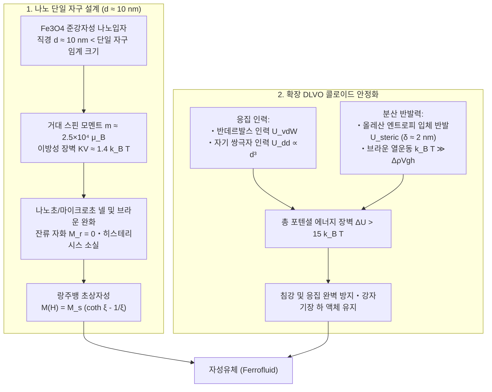
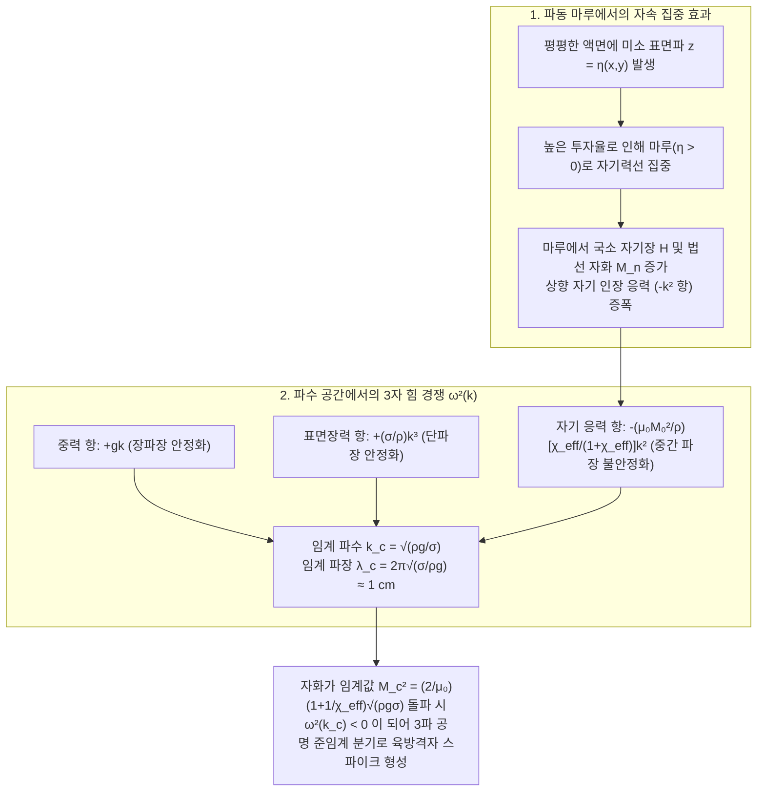

샬레에 담긴 칠흑 같은 검은 액체 아래로 강력한 네오디뮴 자석을 가까이 가져가면, 평평하던 액체 표면이 순식간에 솟아오르며 기하학적으로 정연한 육방격자 형태의 날카로운 '가시(스파이크, Spikes)' 배열로 변모한다. 자석을 움직이면 가시 숲은 살아있는 생명체처럼 물결치고, 자기장을 제거하면 아무 일도 없었다는 듯이 매끄러운 액체 상태로 되돌아간다. 과학관 전시와 미디어 아트에서 강렬한 시각적 충격을 선사하는 이 물질은 바로 <strong>자성유체(Ferrofluid)</strong>라 불리는 기능성 소프트 매터(Soft Matter)다.

그러나 응집물질물리학의 기본 원리로 돌아가 생각해 보면, '자석에 강하게 끌리는 액체'라는 존재 자체가 하나의 거대한 역설임을 깨닫게 된다. 자연계에는 상온은 물론 어떠한 온도 영역에서도 단일 성분으로 강자성(Ferromagnetism)을 띠는 액체가 존재하지 않기 때문이다. 왜 철을 용광로에서 녹이면 액체가 되기 전에 자성을 완전히 잃어버릴까? 1960년대 NASA 엔지니어들은 어떻게 3성분 나노 콜로이드 분산계를 설계하여 이 열역학적 장벽을 돌파했을까? 그리고 수직 자기장을 가했을 때 왜 액체 표면은 단순히 둥근 언덕처럼 부풀어 오르지 않고, 특정 임계 파장을 가진 육각형 가시 격자로 자발적으로 분열하는 것일까? 본고에서는 나노 스케일의 초상자성 통계역학부터 연속체 강자성 유체역학(Ferrohydrodynamics, FHD)과 로젠츠바이크 불안정성(Rosensweig Instability)의 수리적 유도까지 제1원리로부터 철저히 해부한다.

---

## 1. 왜 자연계에는 '액체 자석'이 존재하지 않는가? — 퀴리 온도와 녹는점의 벽

### 1.1 하이젠베르크 교환 상호작용과 열적 파괴

철($\text{Fe}$), 코발트($\text{Co}$), 니켈($\text{Ni}$)과 같은 고체 강자성체가 외부 자기장 없이도 자발 자화(Spontaneous Magnetization)를 유지하는 이유는 결정 격자 내 인접 원자의 홀전자 스핀 $\mathbf{S}_i, \mathbf{S}_j$ 사이에 작용하는 양자역학적 <strong>하이젠베르크 교환 상호작용(Heisenberg Exchange Interaction)</strong> 때문이다.

$$\mathcal{H}_{\text{ex}} = -2 J_{\text{ex}} \sum_{\langle i,j \rangle} \mathbf{S}_i \cdot \mathbf{S}_j$$

강자성체에서는 교환 적분 $J_{\text{ex}} > 0$ 이므로 인접 스핀이 평행하게 정렬될 때 에너지가 최소화된다. 그러나 절대 온도 $T$ 가 상승하면 열적 요동 에너지 $k_B T$ ($k_B = 1.380649 \times 10^{-23}\,\text{J/K}$ 는 볼츠만 상수)가 스핀 정렬을 교란한다. 온도가 물질 고유의 <strong>퀴리 온도(Curie Temperature, $T_C$)</strong>에 도달하면 열 에너지가 교환 결합을 완전히 압도하여 자발 자화가 사라지고, 물질은 2차 상전이를 거쳐 자기 감수율이 극히 미약한 <strong>상자성체(Paramagnet)</strong>로 변한다.

### 1.2 녹는점 $T_m$ 과 퀴리 온도 $T_C$ 의 결정적 격차

대표적인 강자성 금속 및 준강자성(Ferrimagnetic) 산화물의 퀴리 온도 $T_C$ 와 녹는점(Melting Point, $T_m$)을 비교해 보자.

| 강자성 / 준강자성 물질 | 퀴리 온도 $T_C$ ($\text{K}$ / ${}^\circ\text{C}$) | 녹는점 $T_m$ ($\text{K}$ / ${}^\circ\text{C}$) | 온도 격차 $T_m - T_C$ ($\text{K}$) | 용융 액체 상태($T > T_m$)에서의 자기적 성질 |
| :--- | :--- | :--- | :--- | :--- |
| <strong>철 ($\text{Fe}$)</strong> | $1043\,\text{K}$ ($770\,^\circ\text{C}$) | $1811\,\text{K}$ ($1538\,^\circ\text{C}$) | $+768\,\text{K}$ | 상자성 액체 (강자성 완전 소실) |
| <strong>코발트 ($\text{Co}$)</strong> | $1388\,\text{K}$ ($1115\,^\circ\text{C}$) | $1768\,\text{K}$ ($1495\,^\circ\text{C}$) | $+380\,\text{K}$ | 상자성 액체 (강자성 완전 소실) |
| <strong>니켈 ($\text{Ni}$)</strong> | $627\,\text{K}$ ($354\,^\circ\text{C}$) | $1728\,\text{K}$ ($1455\,^\circ\text{C}$) | $+1101\,\text{K}$ | 상자성 액체 (강자성 완전 소실) |
| <strong>가돌리늄 ($\text{Gd}$)</strong> | $292\,\text{K}$ ($19\,^\circ\text{C}$) | $1585\,\text{K}$ ($1312\,^\circ\text{C}$) | $+1293\,\text{K}$ | 상자성 액체 (강자성 완전 소실) |
| <strong>마그네타이트 ($\text{Fe}_3\text{O}_4$)</strong> | $858\,\text{K}$ ($585\,^\circ\text{C}$) | $1870\,\text{K}$ ($1597\,^\circ\text{C}$) | $+1012\,\text{K}$ | 상자성 액체 (준강자성 완전 소실) |

모든 강자성 물질에서 <strong>퀴리 온도 $T_C$ 는 녹는점 $T_m$ 보다 수백에서 천 켈빈 이상 낮다($T_C \ll T_m$)</strong>. 즉 결정 격자가 녹아 액체가 되기 훨씬 전에 스핀 질서가 열적으로 파괴되므로 단일 성분의 강자성 액체는 존재할 수 없다.

### 1.3 1963년 NASA의 발명: 3성분 나노 콜로이드 현탁액

1963년 NASA 루이스 연구센터의 엔지니어 <strong>스티븐 파펠(Stephen S. Papell)</strong>은 무중력 우주 공간에서 액체 로켓 연료를 자기장으로 펌프 흡입구까지 이송하기 위해 고체 자성 나노입자를 액체에 분산시킨 자성유체를 발명했고, 이후 <strong>로널드 로젠츠바이크(Ronald E. Rosensweig)</strong>가 강자성 유체역학 이론과 상용화를 확립했다. 자성유체는 다음 <strong>3가지 필수 성분</strong>으로 구성된다.

1. <strong>단일 자구 자성 나노입자(부피 분율 $\phi \approx 3\%\text{–}15\%$)</strong> : 화학적 공침법($\text{Fe}^{2+} + 2\text{Fe}^{3+} + 8\text{OH}^- \rightarrow \text{Fe}_3\text{O}_4\downarrow + 4\text{H}_2\text{O}$)으로 합성된 <strong>마그네타이트($\text{Fe}_3\text{O}_4$)</strong> 또는 마그헤마이트($\gamma\text{-Fe}_2\text{O}_3$) 나노입자로, 직경이 <strong>$d \approx 10\,\text{nm}$ ($5\text{–}15\,\text{nm}$)</strong> 로 정밀하게 제어된다.
2. <strong>양친매성 계면활성제 코팅층(두께 $\delta \approx 2\,\text{nm}$)</strong> : 대표적으로 <strong>올레산(Oleic Acid)</strong>이 사용되며, 극성 카르복실기($-\text{COOH}$) 머리는 산화철 표면에 화학 흡착되고 비극성 탄화수소 사슬 꼬리는 용매 쪽으로 뻗어 입자 간 응집을 막는 탄성 완충층을 형성한다.
3. <strong>캐리어 액체(분산매, 부피 분율 $80\%\text{–}90\%$)</strong> : 등유, 합성 에스테르, 불소계 오일(PFPE), 실리콘 오일 또는 물이 사용되어 거시적 유동성을 부여한다.

---

## 2. 나노스케일 자기 물리학: 단일 자구와 '초상자성(Superparamagnetism)'

### 2.1 단일 자구 임계 크기와 넬(Néel) 및 브라운(Brownian) 완화

강자성 입자의 직경 $d$ 가 키텔(Kittel)의 <strong>단일 자구 임계 직경 $d_{\text{sd}} \approx \frac{36\sqrt{A_{\text{ex}}K}}{\mu_0 M_d^2}$</strong> 이하로 작아지면 자구벽(Domain Wall)을 형성하는 에너지 비용이 정자기 에너지 감소분보다 커져 입자 전체가 하나의 자구가 된다. $d \approx 10\,\text{nm}$ 인 마그네타이트 나노입자는 약 $10^4$ 개의 철 이온 스핀이 한 방향으로 정렬된 거대 자기 쌍극자($m = M_d V = M_d\frac{\pi}{6}d^3 \approx 2.5 \times 10^4\,\mu_B$)로 작용한다.

입자 직경이 $d = 10\,\text{nm}$ 일 때 자기결정 이방성 에너지 장벽 $KV \approx 1.4\,k_B T$ 는 상온 열에너지와 비슷한 수준이 되며, 자기 모멘트는 두 가지 메커니즘으로 초고속 열적 완화를 겪는다.
1. <strong>넬 완화(Néel Relaxation)</strong> : 입자는 정지한 채 내부 스핀 방향만 열요동으로 이방성 장벽 $KV$ 를 넘어 반전되는 현상으로, 완화 시간은 $\tau_N = \tau_0 \exp\left(\frac{KV}{k_B T}\right) \sim 10^{-9}\,\text{s}$ (나노초 수준)이다.
2. <strong>브라운 완화(Brownian Relaxation)</strong> : 계면활성제 층을 포함한 입자 전체(유체역학적 부피 $V_H = \frac{\pi}{6}(d+2\delta)^3$)가 점도 $\eta$ 인 액체 내에서 회전 브라운 운동을 하는 현상으로, 완화 시간은 $\tau_B = \frac{3\eta V_H}{k_B T} \sim 10^{-6}\,\text{s}$ (마이크로초 수준)이다.

유효 완화율 $\frac{1}{\tau_{\text{eff}}} = \frac{1}{\tau_N} + \frac{1}{\tau_B}$ 이 극히 빠르므로 외부 자기장을 제거하면 자기 모멘트가 즉시 무작위화되어 <strong>잔류 자화($M_r = 0$)와 보자력($H_c = 0$), 즉 자기 히스테리시스가 완전히 사라진다</strong>.

### 2.2 랑주뱅 상자성 방정식과 거대 초기 자화율

외부 자기장 $H$ 하에서 자성유체의 거시적 자화 $M(H)$ 는 볼츠만 통계 평균에 의해 <strong>랑주뱅 함수(Langevin Function) $\mathcal{L}(\xi)$</strong> 로 기술된다.

$$M(H) = \phi M_d \mathcal{L}(\xi) = M_s \left(\coth\xi - \frac{1}{\xi}\right), \qquad \xi \equiv \frac{\mu_0 m H}{k_B T} = \frac{\mu_0 M_d \left(\frac{\pi}{6}d^3\right) H}{k_B T}$$

약자기장 극한($\xi \ll 1$)에서 $\mathcal{L}(\xi) \approx \frac{\xi}{3}$ 이므로 초기 자화율은 $\chi_i = \frac{\mu_0 \phi M_d^2 V}{3 k_B T} \propto m^2$ 이 된다. 거대 쌍극자 모멘트 $m \sim 10^4\,\mu_B$ 의 제곱 효과로 인해 일반 상자성체보다 자화율이 $10^4\text{–}10^5$ 배나 큰($\chi_i \sim 0.5\text{–}5.0$) <strong>초상자성(Superparamagnetism)</strong>이 발현된다.

---

## 3. 콜로이드 안정화(확장 DLVO 이론)와 자기유변유체(MR 유체) 비교

### 3.1 확장 DLVO 포텐셜과 맥커-로젠츠바이크 엔트로피 입체 반발

나노입자가 반데르발스 인력 $U_{\text{vdW}}(l)$ 과 자기 쌍극자 인력 $U_{\text{dd}}(l) = -\frac{\mu_0 m^2}{2\pi r^3} \propto d^3$ 에 의해 응집되는 것을 막기 위해, 표면에 코팅된 올레산 사슬(길이 $\delta \approx 2\,\text{nm}$, 표면 밀도 $\xi_{\text{surf}}$)이 입자 간 접근($s < 2\delta$, 무차원 거리 $l = 2s/d \le 2t, t = 2\delta/d$) 시 압축되면서 형태 엔트로피($\Delta S < 0$) 감소에 따른 강력한 <strong>맥커-로젠츠바이크(Mackor–Rosensweig) 입체 반발 포텐셜</strong>을 생성한다.

$$U_{\text{steric}}(l) = \frac{\pi d^2 \xi_{\text{surf}} k_B T}{2} \left[ 2 - \frac{l + 2}{t}\ln\left(\frac{1 + t}{1 + l/2}\right) - \frac{l}{t} \right]$$

이 입체 반발력이 $+15\text{–}25\,k_B T$ 이상의 에너지 장벽을 형성하여 반영구적인 콜로이드 분산 안정성을 보장한다.

### 3.2 자성유체(FF)와 자기유변유체(MR Fluid)의 결정적 차이

| 비교 항목 | 자성유체 (Ferrofluid: FF) | 자기유변유체 (Magnetorheological Fluid: MRF) |
| :--- | :--- | :--- |
| <strong>입자 재질 및 직경 $d$</strong> | $\text{Fe}_3\text{O}_4$ 등, <strong>$d \approx 5\text{–}15\,\text{nm}$</strong> (나노입자) | 카보닐 철($\text{Fe}$), <strong>$d \approx 1\text{–}10\,\mu\text{m}$</strong> (마이크로 입자) |
| <strong>쌍극자 결합 상수 $\lambda_{\text{dd}} = |U_{\text{dd}}|/k_B T$</strong> | $\lambda_{\text{dd}} \lesssim 1$ (열운동 지배, 개별 분산 유지) | $\lambda_{\text{dd}} \sim 10^6\text{–}10^9 \gg 1$ (사슬형 기둥 구조 형성) |
| <strong>자기장 인가 시 유변학적 거동</strong> | <strong>뉴턴 유체(액체) 상태 유지</strong>, 표면 스파이크 형성 | 수 밀리초 내 <strong>빙엄 소성 반고체로 상전이</strong>, 높은 항복응력 $\tau_y(H)$ 발생 |
| <strong>주요 공학적 응용</strong> | 반도체 진공 회전 씰, 스피커 보이스코일 냉각, 미디어 아트 | 자동차 전자제어 서스펜션(MR 댐퍼), 브레이크, 클러치 |

---

## 4. 강자성 유체역학(FHD)과 로젠츠바이크 불안정성 수리 유도

### 4.1 켈빈 자기 체적력, 일반화 베르누이 방정식 및 계면 법선 응력 점프

자유 전류가 없는($\nabla\times\mathbf{H} = \mathbf{0}, \nabla\cdot\mathbf{B} = 0$) 자성유체에서 단위 부피당 작용하는 <strong>켈빈 자기 체적력(Kelvin Body Force)</strong>은 $\mathbf{f}_m = \mu_0(\mathbf{M}\cdot\nabla)\mathbf{H} = \mu_0 M(H)\nabla H$ 이다. 이를 비압축성 무점성 유동의 운동 방정식에 대입하여 공간 적분하면 <strong>강자성 유체역학의 일반화 베르누이 방정식</strong>을 얻는다.

$$p^* + \frac{1}{2}\rho v^2 + \rho g z - \mu_0 \int_0^H M(H')\,dH' = \text{const}$$

또한 맥스웰 응력 텐서 $\mathbf{T} = -\left(p^* + \frac{1}{2}\mu_0 H^2\right)\mathbf{I} + \mathbf{H}\mathbf{B}^T$ 와 계면 경계 조건($H_t$ 연속, $B_n$ 연속)으로부터 자유 표면에서의 <strong>법선 응력 점프 조건</strong>이 유도된다.

$$p^* - p_0 = \sigma \kappa - \frac{1}{2}\mu_0 M_n^2$$

여기서 $p_n \equiv \frac{1}{2}\mu_0 M_n^2$ 은 계면에 수직한 자화 성분 $M_n = \mathbf{M}\cdot\mathbf{n}$ 이 액체 표면을 공기 쪽(바깥쪽)으로 잡아당기는 <strong>자기 법선 인장 응력</strong>이다.

### 4.2 로젠츠바이크(수직 자기장) 불안정성의 선형 분산 관계와 임계 파장

수직 균일 자기장 $\mathbf{B}_0 = B_0\mathbf{e}_z$ 하에 놓인 평평한 자성유체 표면($z = 0$)에 미소 정현파 섭동 $z = \hat{\eta}\,e^{i(\mathbf{k}\cdot\mathbf{r}_\perp - \omega t)}$ (파수 $k = |\mathbf{k}| = 2\pi/\lambda$)가 발생하면, 투자율이 높은 액체 마루(Crest, $\eta > 0$)로 자기력선이 집중되어 국소 자기장과 $M_n$ 이 증가하고 위로 끌어올리는 자기 인장력이 증폭된다. 선형 섭동 전개를 통해 유도되는 <strong>카울리-로젠츠바이크(Cowley–Rosensweig, 1967) 선형 분산 관계</strong>는 다음과 같다.

$$\omega^2(k) = g k + \frac{\sigma}{\rho} k^3 - \frac{\mu_0 M_0^2}{\rho}\,\frac{\chi_{\text{eff}}}{1 + \chi_{\text{eff}}}\,k^2$$

여기서 유효 자화율은 $\chi_{\text{eff}} = \sqrt{(1+\chi_c)(1+\chi_t)} - 1$ 이다. 우변의 세 항은 파수 $k$ 에 대해 완벽한 스케일 경쟁을 보여준다.
1. <strong>중력 항($+gk \propto k^1$)</strong> : 장파장(작은 $k$)의 거시적 출렁임을 안정화한다.
2. <strong>표면장력 항($+\frac{\sigma}{\rho}k^3 \propto k^3$)</strong> : 단파장(큰 $k$)의 미세한 주름을 팽팽하게 당겨 안정화한다.
3. <strong>자기 법선 응력 항($-\propto M_0^2 k^2$)</strong> : 음(-)의 부호를 가지며 <strong>중간 파수 $k_c$ 영역을 선택적으로 불안정화</strong>시킨다!

임계 조건 $\left.\frac{\partial(\omega^2)}{\partial k}\right|_{k_c} = 0$ 및 $\omega^2(k_c) = 0$ 을 풀면 <strong>임계 파수 $k_c$, 임계 파장 $\lambda_c$(스파이크 간격), 임계 자화 $M_c$</strong> 가 도출된다.

$$k_c = \sqrt{\frac{\rho g}{\sigma}}, \qquad \lambda_c = 2\pi\sqrt{\frac{\sigma}{\rho g}} \approx 1\,\text{cm}, \qquad M_c^2 = \frac{2}{\mu_0}\left(1 + \frac{1}{\chi_{\text{eff}}}\right)\sqrt{\rho g \sigma}$$

자기장이 임계값($B_c \approx 8\text{–}15\,\text{mT}$)을 넘으면 $\omega^2(k_c) < 0$ 이 되어 파동이 지수함수적으로 성장하며, 상하 반전 대칭성 깨짐으로 인해 자유 에너지의 3차 공명 항($\mathbf{k}_1 + \mathbf{k}_2 + \mathbf{k}_3 = \mathbf{0}$)이 활성화되어 <strong>준임계 분기(Subcritical Bifurcation)</strong>를 통해 에너지가 가장 낮은 <strong>육방 최밀 격자(Hexagonal Lattice)</strong> 스파이크 배열이 완성된다.

---

## 5. 첨단 산업·의료·예술 응용

1. <strong>반도체 제조 장비용 자성유체 진공 회전 씰(Ferrofluid Rotary Vacuum Seals)</strong> : 회전축 주위의 자극 편(Pole Piece) 톱니 끝에 집중된 자기장으로 저증기압 자성유체를 잡아두어 '액체 O-링'을 형성한다. 단당 내압 $\Delta p_{\text{max}} \approx \mu_0 M_s H_{\text{max}}$ 를 다단 직렬로 연결하여 대기압과 초고진공($10^{-6}\,\text{Pa}$) 사이를 리크 제로, 마모 입자 제로로 완벽히 밀봉한다.
2. <strong>하이파이 라우드스피커 보이스코일 냉각 및 댐핑</strong> : 트위터 자기 갭에 충전된 자성유체는 공기보다 5~10배 높은 열전도율과 자발적인 <strong>열자기 대류(Thermomagnetic Convection)</strong>로 코일의 줄열을 방출하여 열 압축(Power Compression)을 방지하고, 점성 감쇠로 공진 피크 $f_0$ 를 억제한다.
3. <strong>자성 온열 암 치료(Magnetic Hyperthermia)와 키네틱 아트</strong> : 생체 적합성 초상자성 산화철 나노입자(SPION)에 교번 자기장($100\text{–}500\,\text{kHz}$)을 가해 완화 손실열로 암세포만 $42\text{–}45\,^\circ\text{C}$ 로 선택적 사멸시키며, 일본의 미디어 아티스트 <strong>코다마 사치코(Sachiko Kodama)</strong>는 전자석 배열을 정밀 제어하여 음악에 맞춰 살아 움직이는 자성유체 조각 작품을 선보였다.
