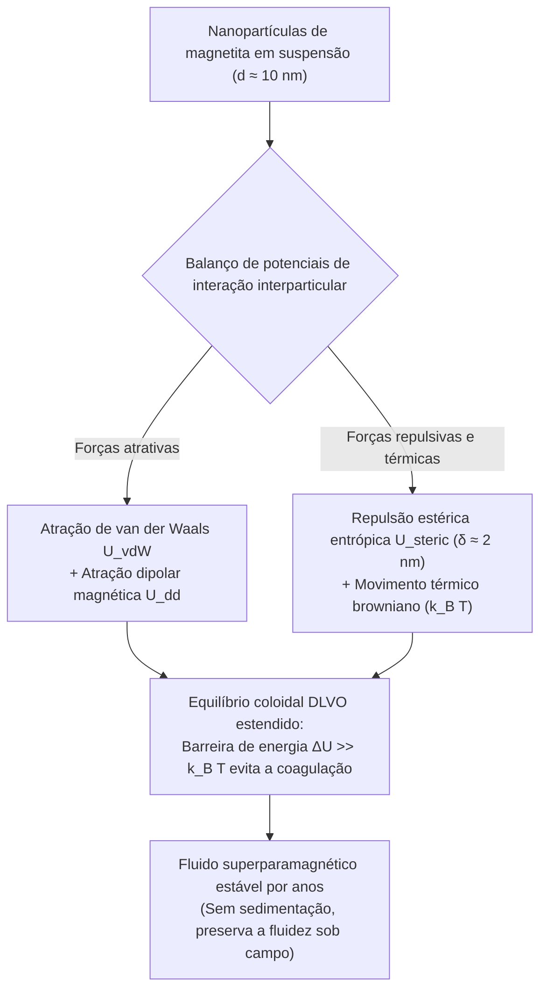
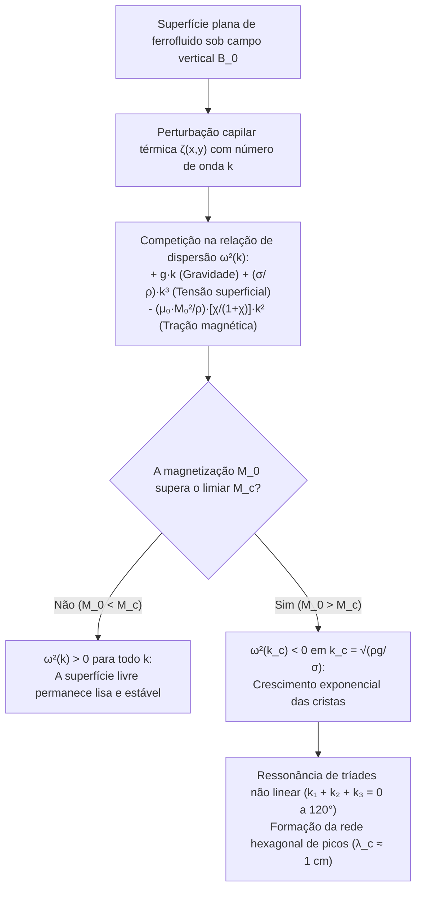

## 1. Por que não existem ímãs líquidos na natureza? — A Barreira da Temperatura de Curie

Quando aproximamos um ímã de neodímio de um recipiente com um líquido negro azeviche e vemos o fluido desafiar instantaneamente a gravidade, erguendo-se em uma floresta geométrica de pontas afiadas, esse <strong>líquido magnético (ferrofluido)</strong> parece ganhar vida própria.

Mas por que não podemos simplesmente derreter um ímã de ferro em um cadinho para obter um "ímã líquido"? A resposta reside em um limite fundamental da física quântica e estatística: a <strong>temperatura de Curie ($T_C$)</strong>.

O ferromagnetismo nasce da <strong>interação de troca quântica de Heisenberg (Exchange Interaction)</strong>, que alinha paralelamente os spins eletrônicos vizinhos $\mathbf{S}_i$ e $\mathbf{S}_j$:

$$\mathcal{H}_{\text{ex}} = -2 J_{\text{ex}} \sum_{\langle i,j \rangle} \mathbf{S}_i \cdot \mathbf{S}_j \quad (J_{\text{ex}} > 0)$$

Esse acoplamento de troca é extremamente sensível à distância interatômica e à agitação térmica. Quando aquecemos um metal ferromagnético acima de sua temperatura de Curie $T_C$, a energia térmica $k_B T$ supera a energia de troca $J_{\text{ex}}$. A ordem espontânea dos spins entra em colapso e o material torna-se um simples <strong>paramagneto</strong> desordenado.

Como mostra a tabela a seguir, a temperatura de Curie $T_C$ de todos os elementos e óxidos ferromagnéticos conhecidos situa-se centenas de kelvins <strong>abaixo</strong> de seu ponto de fusão $T_m$:

| Material | Temperatura de Curie $T_C$ ($\text{K}$) | Ponto de Fusão $T_m$ ($\text{K}$) | Estado após a fusão ($T > T_m$) |
| :--- | :--- | :--- | :--- |
| <strong>Ferro ($\text{Fe}$)</strong> | $1043\,\text{K}$ ($770\,^\circ\text{C}$) | $1811\,\text{K}$ ($1538\,^\circ\text{C}$) | Líquido paramagnético não magnético |
| <strong>Cobalto ($\text{Co}$)</strong> | $1388\,\text{K}$ ($1115\,^\circ\text{C}$) | $1768\,\text{K}$ ($1495\,^\circ\text{C}$) | Líquido paramagnético não magnético |
| <strong>Níquel ($\text{Ni}$)</strong> | $627\,\text{K}$ ($354\,^\circ\text{C}$) | $1728\,\text{K}$ ($1455\,^\circ\text{C}$) | Líquido paramagnético não magnético |
| <strong>Gadolínio ($\text{Gd}$)</strong> | $292\,\text{K}$ ($19\,^\circ\text{C}$) | $1585\,\text{K}$ ($1312\,^\circ\text{C}$) | Líquido paramagnético não magnético |
| <strong>Magnetita ($\text{Fe}_3\text{O}_4$)</strong> | $858\,\text{K}$ ($585\,^\circ\text{C}$) | $1870\,\text{K}$ ($1597\,^\circ\text{C}$) | Líquido paramagnético não magnético |

O ferro fundido perde todo o seu ferromagnetismo $768\,\text{K}$ antes mesmo de se tornar líquido ($T_C \ll T_m$). Não existe nenhum líquido monofásico ferromagnético na natureza à temperatura ambiente.

Como então o engenheiro da NASA <strong>Stephen Papell</strong> conseguiu, em 1963, inventar o primeiro ferrofluido do mundo para bombear combustível líquido de foguetes em gravidade zero usando campos magnéticos? A solução genial de Papell foi contornar a barreira de Curie criando uma <strong>suspensão coloidal de três componentes</strong>:

1. <strong>Nanopartículas magnéticas ($\sim 5\%$ em volume)</strong>: Nanocristais sólidos de magnetita ($\text{Fe}_3\text{O}_4$) ou maghemita ($\gamma\text{-Fe}_2\text{O}_3$) com diâmetro típico de $d \approx 10\,\text{nm}$, que permanecem muito abaixo do seu ponto de Curie e conservam sua forte magnetização.
2. <strong>Camada de surfactante / tensoativo ($\sim 10\%$ em volume)</strong>: Um revestimento molecular de $\delta \approx 2\,\text{nm}$ de espessura (como ácido oleico, $\text{C}_{18}\text{H}_{34}\text{O}_2$), cuja cabeça polar se liga quimicamente à superfície da nanopartícula enquanto a cauda apolar se estende para o solvente.
3. <strong>Fluido carreador ($\sim 85\%$ em volume)</strong>: Um solvente orgânico (querosene, óleo sintético, éster) ou água, onde o movimento browniano mantém as nanopartículas suspensas indefinidamente.

---

## 2. Nanofísica do Magnetismo: Limite Monodomínio e Superparamagnetismo de Langevin

Por que as nanopartículas precisam medir especificamente $d \approx 10\,\text{nm}$? Se simplesmente misturássemos pó de ferro micrométrico ($d \approx 1\text{–}10\,\mu\text{m}$) em óleo, as partículas sedimentariam rapidamente e se aglomerariam em um bloco rígido ao aproximar um ímã.

### 2.1 Diâmetro Crítico de Kittel para Partículas Monodomínio

Um ímã macroscópico divide-se em múltiplos <strong>domínios magnéticos de Weiss</strong> separados por paredes de Bloch para minimizar a energia magnetostática do campo desmagnetizante ($\propto d^3$). Contudo, criar uma parede de domínio custa energia de troca e anisotropia proporcional à área ($\propto d^2$). Abaixo de um diâmetro crítico $d_{\text{sd}}$ (calculado por Charles Kittel), criar uma parede custa mais energia do que economiza:

$$d_{\text{sd}} = \frac{36 \sqrt{A_{\text{ex}} K}}{\mu_0 M_d^2}$$

onde $A_{\text{ex}} \approx 10^{-11}\,\text{J/m}$ é a rigidez de troca, $K \approx 1.35 \times 10^4\,\text{J/m}^3$ a constante de anisotropia magnetocristalina e $M_d \approx 4.46 \times 10^5\,\text{A/m}$ a magnetização de saturação da magnetita maciça $\text{Fe}_3\text{O}_4$. Para a magnetita, $d_{\text{sd}} \approx 25\text{–}30\,\text{nm}$. Portanto, uma nanopartícula de $d = 10\,\text{nm}$ é estritamente uma <strong>partícula monodomínio (Single-Domain Particle)</strong>: seus $\sim 10^4$ spins atômicos giram em uníssono como um único dipolo magnético gigante $m = M_d V = M_d \frac{\pi}{6}d^3 \approx 2.3 \times 10^{-19}\,\text{A}\cdot\text{m}^2$ ($\sim 25\,000$ magnétons de Bohr $\mu_B$).

### 2.2 Relaxação de Néel e de Brown, e Superparamagnetismo

Esse momento gigante $m$ fica travado ao longo do eixo fácil do cristal? Para $d = 10\,\text{nm}$, o volume $V \approx 5.24 \times 10^{-25}\,\text{m}^3$ é tão diminuto que a barreira de energia de anisotropia $E_B = K V \approx 7 \times 10^{-21}\,\text{J}$ é comparável à energia térmica $k_B T \approx 4.14 \times 10^{-21}\,\text{J}$ à temperatura ambiente ($T = 300\,\text{K}$).

Como resultado, o momento magnético inverte-se espontaneamente por dois mecanismos paralelos:
1. <strong>Relaxação de Néel ($\tau_N$)</strong>: O vetor momento magnético gira internamente dentro da rede cristalina transpondo a barreira $K V$:
   $$\tau_N = \tau_0 \exp\left(\frac{K V}{k_B T}\right)$$
   Com $\tau_0 \approx 10^{-9}\,\text{s}$, para magnetita de $10\,\text{nm}$ obtém-se um tempo ultracurto $\tau_N \approx 5 \times 10^{-9}\,\text{s}$ (poucos nanossegundos).
2. <strong>Relaxação de Brown ($\tau_B$)</strong>: A nanopartícula inteira junto com sua camada de surfactante (volume hidrodinâmico $V_H = \frac{\pi}{6}(d + 2\delta)^3$) gira fisicamente dentro do fluido de viscosidade $\eta$:
   $$\tau_B = \frac{3 \eta V_H}{k_B T}$$
   A taxa efetiva obedece a $\frac{1}{\tau_{\text{eff}}} = \frac{1}{\tau_N} + \frac{1}{\tau_B}$.

Na ausência de campo externo ($\mathbf{H} = \mathbf{0}$), os momentos desordenam-se termicamente em nanossegundos: o ferrofluido não apresenta <strong>remanência ($M_r = 0$) nem coercitividade ($H_c = 0$)</strong> (histerese nula). Mas ao aplicar um campo $\mathbf{H}$, cada partícula responde com seu momento gigante de $25\,000\,\mu_B$, gerando uma suscetibilidade inicial $\chi_i$ milhares de vezes maior que a de um paramagneto comum. Esse fenômeno é o <strong>superparamagnetismo</strong>, descrito pela <strong>função de Langevin $\mathcal{L}(\xi)$</strong>:

$$M(H) = \phi M_d \mathcal{L}(\xi) = M_s \left( \coth \xi - \frac{1}{\xi} \right), \qquad \xi = \frac{\mu_0 m H}{k_B T} = \frac{\mu_0 M_d V H}{k_B T}$$

onde $\phi$ é a fração volumétrica magnética e $M_s = \phi M_d$ a magnetização de saturação do fluido. Para campos fracos ($\xi \ll 1$), $\mathcal{L}(\xi) \approx \xi / 3$ fornece a suscetibilidade inicial $\chi_i = \frac{\mu_0 \phi M_d^2 V}{3 k_B T} \sim 1\text{–}5$.

---

## 3. Estabilidade Coloidal: Teoria DLVO Estendida e Comparação com Fluidos MR

Para evitar que as nanopartículas coagulem irreversivelmente, o potencial de interação total $U_{\text{total}}(l)$ em função da separação superficial normalizada $l = 2s / d$ deve possuir uma barreira repulsiva $\Delta U \gg 15\,k_B T$:

$$U_{\text{total}}(l) = U_{\text{vdW}}(l) + U_{\text{dd}}(l) + U_{\text{steric}}(l)$$

1. <strong>Atração de London–van der Waals ($U_{\text{vdW}}$)</strong>: Atração quântica de curto alcance (constante de Hamaker $A_H \approx 10^{-19}\,\text{J}$) que diverge para $-\infty$ no contato ($l \to 0$):
   $$U_{\text{vdW}}(l) = -\frac{A_H}{6}\left[ \frac{2}{l^2 + 4l} + \frac{2}{(l+2)^2} + \ln\left(\frac{l^2 + 4l}{(l+2)^2}\right) \right]$$
2. <strong>Interação dipolo-dipolo magnético ($U_{\text{dd}}$)</strong>: Em alinhamento cabeça-cauda, dois dipolos atraem-se com $U_{\text{dd}}^{\text{min}}(s) = -\frac{\mu_0 m^2}{2\pi (d + s)^3}$.
3. <strong>Repulsão estérica de Mackor–Rosensweig ($U_{\text{steric}}$)</strong>: Quando $s < 2\delta$, as cadeias de surfactante (densidade superficial $\xi_s \approx 10^{18}\,\text{cadeias/m}^2$) comprimem-se. A redução da entropia conformacional das caudas poliméricas gera uma intensa repulsão entrópica:
   $$U_{\text{steric}}(l) = \frac{\pi d^2 \xi_s k_B T}{2} \left[ 2 - \frac{l+2}{t}\ln\left(\frac{1+t}{1+l/2}\right) - \frac{l}{t} \right] \quad \left(\text{para } l < 2t,\; t = \frac{2\delta}{d}\right)$$

Esse escudo estérico de $\delta \approx 2\,\text{nm}$ diferencia radicalmente um <strong>ferrofluido (FF)</strong> de um <strong>fluido magnetorreológico (MRF)</strong>:

| Característica | Ferrofluido (FF) | Fluido Magnetorreológico (MRF) |
| :--- | :--- | :--- |
| <strong>Diâmetro de partícula $d$</strong> | $5\text{–}15\,\text{nm}$ (nanopartículas) | $1\text{–}10\,\mu\text{m}$ ($1000\times$ maior, micropartículas) |
| <strong>Estado magnético</strong> | Monodomínio superparamagnético | Multidomínio ferromagnético |
| <strong>Energia dominante</strong> | Agitação térmica ($k_B T > U_{\text{dd}}$) | Atração dipolar ($U_{\text{dd}} \gg k_B T$) |
| <strong>Comportamento sob campo $\mathbf{H}$</strong> | <strong>Permanece líquido!</strong> Forma picos de Rosensweig | <strong>Solidifica em milissegundos!</strong> Cadeias rígidas |
| <strong>Aplicações típicas</strong> | Selos de vácuo, refrigeração de alto-falantes, arte | Amortecedores ativos (MagneRide), freios, embreagens |

---

## 4. Ferro-hidrodinâmica (FHD) e a Instabilidade de Campo Normal de Cowley–Rosensweig

Por que a superfície livre de um ferrofluido se eriça formando um padrão geométrico de espinhos ao aplicarmos um campo magnético vertical? A resposta vem da <strong>ferro-hidrodinâmica (FHD)</strong> formulada por Ronald E. Rosensweig.

### 4.1 Força Volumétrica de Kelvin e Equação de Bernoulli Generalizada

Em um fluido magnetizável não condutor imerso em um campo $\mathbf{H}$, cada elemento de volume com magnetização $\mathbf{M}$ experimenta a <strong>densidade de força magnética de Kelvin</strong>:

$$\mathbf{f}_m = \mu_0 (\mathbf{M} \cdot \nabla)\mathbf{H}$$

Integrando a equação de Euler-Navier-Stokes estacionária e irrotacional para um fluido incompressível ao longo de uma linha de corrente, obtém-se a <strong>equação de Bernoulli generalizada da ferro-hidrodinâmica</strong>:

$$p^* + \frac{1}{2}\rho v^2 + \rho g z - \mu_0 \int_0^H M(H')\,dH' = \text{const}$$

Além disso, na interface livre entre o ferrofluido e o ar, o salto do tensor de tensões de Maxwell adiciona uma tração magnética normal à condição de contorno de Young-Laplace:

$$p^* - p_0 = \sigma \kappa - \frac{1}{2}\mu_0 M_n^2$$

onde $p_0$ é a pressão atmosférica, $\sigma$ a tensão superficial, $\kappa \approx -\nabla_\perp^2 \zeta$ a curvatura média da superfície e $M_n = \mathbf{M} \cdot \mathbf{n}$ a componente normal da magnetização. O termo $-\frac{1}{2}\mu_0 M_n^2$ atua como uma <strong>sucção magnética para fora</strong>: qualquer pequena elevação $\zeta(x,y) > 0$ na superfície concentra as linhas de campo magnético (efeito para-raios), aumentando $M_n$ e puxando o líquido ainda mais para cima.

### 4.2 Análise de Estabilidade Linear e Relação de Dispersão (Cowley & Rosensweig, 1967)

Em 1967, M. D. Cowley e R. E. Rosensweig analisaram uma camada plana de ferrofluido sob um campo magnético vertical uniforme $\mathbf{B}_0 = B_0 \hat{\mathbf{z}}$ perturbada por uma onda superficial $\zeta(\mathbf{r}_\perp, t) = \zeta_0 e^{i(\mathbf{k}\cdot\mathbf{r}_\perp - \omega t)}$ de número de onda $k = |\mathbf{k}| = 2\pi / \lambda$.

Resolvendo as equações de Maxwell ($\nabla \cdot \mathbf{B} = 0$, $\nabla \times \mathbf{H} = \mathbf{0}$) junto com a equação de Bernoulli FHD, obtiveram a <strong>relação de dispersão de Cowley–Rosensweig</strong>:

$$\omega^2(k) = g k + \frac{\sigma}{\rho} k^3 - \frac{\mu_0 M_0^2}{\rho}\left(\frac{\chi_{\text{eff}}}{1 + \chi_{\text{eff}}}\right) k^2$$

onde $\chi_{\text{eff}}$ é a suscetibilidade geométrica efetiva. Os três termos refletem um duelo de forças:
* $+g k$ (linear em $k$): <strong>Restauração gravitacional</strong> que estabiliza ondas longas ($k \to 0$).
* $+\frac{\sigma}{\rho}k^3$ (cúbico em $k$): <strong>Restauração capilar (tensão superficial)</strong> que estabiliza ondas curtas ($k \to \infty$).
* $-\frac{\mu_0 M_0^2}{\rho}\frac{\chi_{\text{eff}}}{1+\chi_{\text{eff}}}k^2$ (quadrático em $k$, <strong>negativo!</strong>): <strong>Tração magnética desestabilizadora</strong> em comprimentos de onda intermediários.

Quando a magnetização $M_0$ supera um limiar crítico $M_c$, a curva $\omega^2(k)$ torna-se negativa ($\omega^2 < 0$) em torno de um número de onda crítico $k_c$. A frequência $\omega = \pm i \gamma$ passa a ser imaginária e a amplitude $\zeta(t) \propto e^{+\gamma t}$ cresce exponencialmente.

Impondo as condições de limiar $\omega^2(k_c) = 0$ e $\left.\frac{\partial (\omega^2)}{\partial k}\right|_{k = k_c} = 0$, obtêm-se os parâmetros críticos da <strong>instabilidade de Rosensweig</strong>:

1. <strong>Número de onda crítico $k_c$ e comprimento de onda crítico $\lambda_c$ (distância entre picos)</strong>:
   $$k_c = \sqrt{\frac{\rho g}{\sigma}} = \frac{1}{\ell_c} \implies \lambda_c = \frac{2\pi}{k_c} = 2\pi \sqrt{\frac{\sigma}{\rho g}}$$
   Para um ferrofluido típico ($\rho \approx 1200\,\text{kg/m}^3$, $\sigma \approx 0.026\,\text{N/m}$, $g = 9.81\,\text{m/s}^2$), o comprimento capilar é $\ell_c \approx 1.5\,\text{mm}$ e a distância entre picos vizinhos é $\lambda_c \approx 9.3\,\text{mm}$ ($\sim 1\,\text{cm}$).
2. <strong>Magnetização crítica $M_c$ de surgimento dos espinhos</strong>:
   $$M_c^2 = \frac{2}{\mu_0}\left(1 + \frac{1}{\chi_{\text{eff}}}\right)\sqrt{\rho g \sigma}$$

### 4.3 Por que uma Rede Hexagonal? (Ressonância de Tríades Não Linear)

A teoria linear determina o módulo $k_c$, mas não a direção de $\mathbf{k}$. Por que os espinhos se organizam formando uma <strong>rede hexagonal 2D</strong> perfeita?

Na expansão não linear da energia livre superficial $\mathcal{F}[\zeta]$, o campo magnético vertical quebra a simetria de inversão crista-vale ($\zeta \to -\zeta$), gerando um termo cúbico de interação ressonante entre três vetores de onda:

$$\Delta \mathcal{F}_3 \propto - \sum_{\mathbf{k}_1 + \mathbf{k}_2 + \mathbf{k}_3 = \mathbf{0}} A_{\mathbf{k}_1} A_{\mathbf{k}_2} A_{\mathbf{k}_3}$$

Para que três vetores de mesmo módulo $|\mathbf{k}_1| = |\mathbf{k}_2| = |\mathbf{k}_3| = k_c$ somem zero ($\mathbf{k}_1 + \mathbf{k}_2 + \mathbf{k}_3 = \mathbf{0}$), eles devem formar um triângulo equilátero, ou seja, estar separados exatamente por $120^\circ$ entre si. A superposição de três ondas planas a $120^\circ$ gera no espaço real o famoso <strong>padrão hexagonal de picos de Rosensweig</strong>.

---

## 5. Aplicações de Ponta na Indústria, Biomedicina e Arte

Os ferrofluidos desempenham um papel insubstituível em diversas tecnologias modernas:

1. <strong>Selos Rotativos de Vácuo para Semicondutores e Discos Rígidos</strong>: Nas câmaras de ultra-alto vácuo (UHV) para fabricação de chips, um ímã anelar mantém um anel líquido de ferrofluido na folga micrométrica ao redor de eixos que giram a $10\,000\,\text{rpm}$, garantindo vedação hermética sem atrito sólido nem desgaste.
2. <strong>Refrigeração e Amortecimento de Alto-Falantes de Alta Fidelidade</strong>: Alojado no entreferro magnético ao redor da bobina móvel (voice coil) dos tweeters, o ferrofluido dissipa o calor $5\times$ mais rápido que o ar e amortece viscosamente as ressonâncias indesejadas do diafragma.
3. <strong>Hipertermia Magnética e Liberação Direcionada de Fármacos</strong>: Nanopartículas biocompatíveis de $\text{Fe}_3\text{O}_4$ guiadas até um tumor e submetidas a um campo magnético alternado ($f \approx 100\text{–}500\,\text{kHz}$) dissipam calor por relaxação de Néel e Brown, elevando a temperatura local a $42\text{–}45\,^\circ\text{C}$ para destruir seletivamente as células cancerígenas.
4. <strong>Arte Cinética (Sachiko Kodama)</strong>: A física e artista japonesa Sachiko Kodama (*Protrude, Flow*) sincroniza eletroímãs com música para esculpir ferrofluidos em torres orgânicas de espinhos que dançam em tempo real.

Cada espinho na superfície de um ferrofluido é a manifestação visível do equilíbrio entre a interação de troca quântica de Heisenberg, a entropia coloidal e as equações acopladas de Maxwell e Navier-Stokes.
