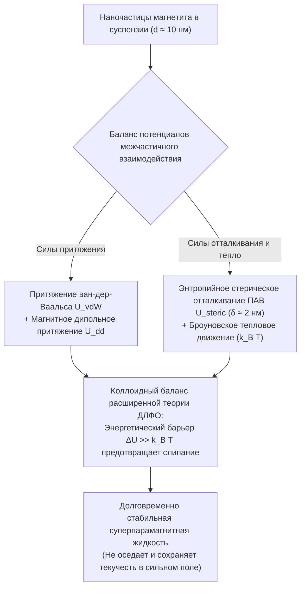
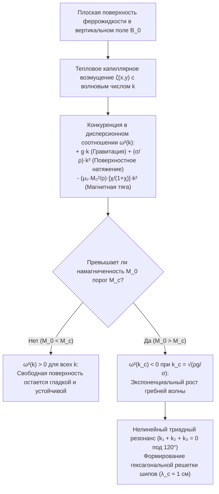

## 1. Почему в природе не существует жидких магнитов? — Барьер температуры Кюри

Когда к чашке с угольно-черной жидкостью подносят неодимовый магнит и жидкость внезапно, вопреки гравитации, вздымается симметричным лесом острых конических шипов, эта <strong>ферромагнитная жидкость (Ferrofluid)</strong> кажется живым инопланетным существом.

Но почему нельзя просто расплавить обычный железный магнит в печи, чтобы получить «жидкий магнит»? Ответ кроется в фундаментальном законе квантовой и статистической физики — <strong>температуре Кюри ($T_C$)</strong>.

Ферромагнетизм возникает благодаря квантово-механическому <strong>обменному взаимодействию Гейзенберга (Exchange Interaction)</strong>, которое выстраивает соседние спины электронов $\mathbf{S}_i$ и $\mathbf{S}_j$ параллельно друг другу:

$$\mathcal{H}_{\text{ex}} = -2 J_{\text{ex}} \sum_{\langle i,j \rangle} \mathbf{S}_i \cdot \mathbf{S}_j \quad (J_{\text{ex}} > 0)$$

Обменный интеграл $J_{\text{ex}}$ чрезвычайно чувствителен к межатомному расстоянию и тепловым колебаниям решетки. Если нагреть любой ферромагнетик выше его точки Кюри $T_C$, тепловая энергия $k_B T$ разрушает спонтанную спиновую упорядоченность, и металл превращается в обычный <strong>парамагнетик</strong>.

Как видно из таблицы ниже, у всех известных ферромагнитных металлов и оксидов температура Кюри $T_C$ лежит на сотни градусов <strong>ниже</strong> температуры плавления $T_m$:

| Материал | Температура Кюри $T_C$ ($\text{K}$) | Точка плавления $T_m$ ($\text{K}$) | Состояние расплава ($T > T_m$) |
| :--- | :--- | :--- | :--- |
| <strong>Железо ($\text{Fe}$)</strong> | $1043\,\text{K}$ ($770\,^\circ\text{C}$) | $1811\,\text{K}$ ($1538\,^\circ\text{C}$) | Немагнитный парамагнитный расплав |
| <strong>Кобальт ($\text{Co}$)</strong> | $1388\,\text{K}$ ($1115\,^\circ\text{C}$) | $1768\,\text{K}$ ($1495\,^\circ\text{C}$) | Немагнитный парамагнитный расплав |
| <strong>Никель ($\text{Ni}$)</strong> | $627\,\text{K}$ ($354\,^\circ\text{C}$) | $1728\,\text{K}$ ($1455\,^\circ\text{C}$) | Немагнитный парамагнитный расплав |
| <strong>Гадолиний ($\text{Gd}$)</strong> | $292\,\text{K}$ ($19\,^\circ\text{C}$) | $1585\,\text{K}$ ($1312\,^\circ\text{C}$) | Немагнитный парамагнитный расплав |
| <strong>Магнетит ($\text{Fe}_3\text{O}_4$)</strong> | $858\,\text{K}$ ($585\,^\circ\text{C}$) | $1870\,\text{K}$ ($1597\,^\circ\text{C}$) | Немагнитный парамагнитный расплав |

Расплавленное железо теряет свои ферромагнитные свойства за $768\,\text{K}$ до того, как начинает плавиться ($T_C \ll T_m$). Однофазной ферромагнитной жидкости при комнатной температуре в природе не существует.

Как же тогда в 1963 году инженер NASA <strong>Стивен Папелл (Stephen Papell)</strong> сумел создать первую в мире ферромагнитную жидкость для подачи ракетного топлива в камеру сгорания в условиях невесомости с помощью магнитного поля? Гениальное решение Папелла состояло в том, чтобы обойти барьер Кюри путем создания <strong>трехкомпонентной коллоидной суспензии</strong>:

1. <strong>Магнитные наночастицы ($\sim 5\%$ по объему)</strong>: Твердые монокристаллы магнетита ($\text{Fe}_3\text{O}_4$) или маггемита ($\gamma\text{-Fe}_2\text{O}_3$) характерным диаметром $d \approx 10\,\text{нм}$, которые находятся далеко ниже своей точки Кюри и сохраняют мощную спонтанную намагниченность.
2. <strong>Слой поверхностно-активного вещества / сурфактанта ($\sim 10\%$ по объему)</strong>: Молекулярная «шуба» толщиной $\delta \approx 2\,\text{нм}$ (например, олеиновая кислота $\text{C}_{18}\text{H}_{34}\text{O}_2$), полярная головка которой химически привязана к поверхности наночастицы, а углеводородный хвост направлен в растворитель.
3. <strong>Жидкость-носитель ($\sim 85\%$ по объему)</strong>: Органический растворитель (керосин, синтетическое масло, эфир) или вода, в которой броуновское тепловое движение удерживает наночастицы во взвешенном состоянии бесконечно долго.

---

## 2. Нанофизика магнетизма: однодоменный предел Киттеля и суперпарамагнетизм Ланжевена

Почему размер частиц магнетита должен составлять именно $d \approx 10\,\text{нм}$? Если просто размешать в масле микронный железный порошок ($d \approx 1\text{–}10\,\text{мкм}$), частицы быстро осядут на дно, а при поднесении магнита мгновенно слипнутся в твердый ком.

### 2.1 Критический диаметр однодоменности Киттеля

Макроскопический кристалл ферромагнетика разбивается на множество <strong>магнитных доменов Вейсса</strong>, разделенных доменными стенками Блоха, чтобы минимизировать магнитостатическую энергию размагничивающего поля ($\propto d^3$). Однако создание самой доменной стенки требует затрат обменной энергии и энергии анизотропии, пропорциональных площади сечения частицы ($\propto d^2$). Когда диаметр частицы $d$ становится меньше критического значения $d_{\text{sd}}$ (формула Чарльза Киттеля), образование стенки становится энергетически невыгодным:

$$d_{\text{sd}} = \frac{36 \sqrt{A_{\text{ex}} K}}{\mu_0 M_d^2}$$

где $A_{\text{ex}} \approx 10^{-11}\,\text{Дж/м}$ — константа обменной жесткости, $K \approx 1.35 \times 10^4\,\text{Дж/м}^3$ — константа магнитокристаллической анизотропии, а $M_d \approx 4.46 \times 10^5\,\text{А/м}$ — намагниченность насыщения массивного $\text{Fe}_3\text{O}_4$. Для магнетита $d_{\text{sd}} \approx 25\text{–}30\,\text{нм}$. Следовательно, наночастица диаметром $d = 10\,\text{нм}$ является строго <strong>однодоменной (Single-Domain Particle)</strong>: все $\sim 10^4$ атомных спинов внутри нее жестко сцеплены и образуют единый гигантский магнитный диполь $m = M_d V = M_d \frac{\pi}{6}d^3 \approx 2.3 \times 10^{-19}\,\text{А}\cdot\text{м}^2$ (около $25\,000$ магнетонов Бора $\mu_B$).

### 2.2 Неелевская и броуновская релаксация, суперпарамагнетизм

Остается ли этот гигантский момент $m$ заблокированным вдоль оси легкого намагничивания кристалла? При $d = 10\,\text{нм}$ объем частицы $V \approx 5.24 \times 10^{-25}\,\text{м}^3$ настолько мал, что энергетический барьер анизотропии $E_B = K V \approx 7 \times 10^{-21}\,\text{Дж}$ сопоставим с тепловой энергией $k_B T \approx 4.14 \times 10^{-21}\,\text{Дж}$ при комнатной температуре ($T = 300\,\text{K}$)!

В результате магнитный момент непрерывно и спонтанно переориентируется за счет тепловых флуктуаций посредством двух параллельных механизмов:
1. <strong>Неелевская релаксация ($\tau_N$)</strong>: Вектор магнитного момента поворачивается внутри неподвижной кристаллической решетки, преодолевая барьер $K V$:
   $$\tau_N = \tau_0 \exp\left(\frac{K V}{k_B T}\right)$$
   При $\tau_0 \approx 10^{-9}\,\text{с}$ для $10\,\text{нм}$ частицы магнетита время релаксации составляет всего $\tau_N \approx 5 \times 10^{-9}\,\text{с}$ (несколько наносекунд).
2. <strong>Броуновская релаксация ($\tau_B$)</strong>: Вся наночастица вместе с оболочкой ПАВ (гидродинамический объем $V_H = \frac{\pi}{6}(d + 2\delta)^3$) физически поворачивается в жидкости с вязкостью $\eta$:
   $$\tau_B = \frac{3 \eta V_H}{k_B T}$$
   Эффективное время релаксации определяется соотношением $\frac{1}{\tau_{\text{eff}}} = \frac{1}{\tau_N} + \frac{1}{\tau_B}$.

В отсутствие внешнего поля ($\mathbf{H} = \mathbf{0}$) ориентация диполей хаотизируется за наносекунды: феррожидкость не имеет <strong>ни остаточной намагниченности ($M_r = 0$), ни коэрцитивной силы ($H_c = 0$)</strong> (нулевой гистерезис). Но при включении поля $\mathbf{H}$ каждая частица откликается своим гигантским моментом в $25\,000\,\mu_B$, обеспечивая начальную магнитную восприимчивость $\chi_i$ в тысячи раз выше, чем у обычных парамагнетиков. Это явление называется <strong>суперпарамагнетизмом</strong> и описывается классической <strong>функцией Ланжевена $\mathcal{L}(\xi)$</strong>:

$$M(H) = \phi M_d \mathcal{L}(\xi) = M_s \left( \coth \xi - \frac{1}{\xi} \right), \qquad \xi = \frac{\mu_0 m H}{k_B T} = \frac{\mu_0 M_d V H}{k_B T}$$

где $\phi$ — объемная доля твердой магнитной фазы, а $M_s = \phi M_d$ — намагниченность насыщения жидкости. В слабых полях ($\xi \ll 1$) разложение $\mathcal{L}(\xi) \approx \xi / 3$ дает начальную восприимчивость $\chi_i = \frac{\mu_0 \phi M_d^2 V}{3 k_B T} \sim 1\text{–}5$.

---

## 3. Коллоидная устойчивость: обобщенная теория ДЛФО и сравнение с МР-жидкостями

Чтобы наночастицы не слипались (коагуляция), суммарный потенциал парного взаимодействия $U_{\text{total}}(l)$ как функция безразмерного зазора между поверхностями $l = 2s / d$ должен иметь высокий отталкивающий барьер $\Delta U \gg 15\,k_B T$:

$$U_{\text{total}}(l) = U_{\text{vdW}}(l) + U_{\text{dd}}(l) + U_{\text{steric}}(l)$$

1. <strong>Притяжение Лондона — ван-дер-Ваальса ($U_{\text{vdW}}$)</strong>: Короткодействующее квантовое притяжение (константа Гамакера $A_H \approx 10^{-19}\,\text{Дж}$), уходящее в $-\infty$ при прямом контакте ($l \to 0$):
   $$U_{\text{vdW}}(l) = -\frac{A_H}{6}\left[ \frac{2}{l^2 + 4l} + \frac{2}{(l+2)^2} + \ln\left(\frac{l^2 + 4l}{(l+2)^2}\right) \right]$$
2. <strong>Магнитное диполь-дипольное взаимодействие ($U_{\text{dd}}$)</strong>: При ориентации «голова к хвосту» два диполя притягиваются с энергией $U_{\text{dd}}^{\text{min}}(s) = -\frac{\mu_0 m^2}{2\pi (d + s)^3}$.
3. <strong>Стерическое отталкивание Маккора–Розенцвейга ($U_{\text{steric}}$)</strong>: При сближении на $s < 2\delta$ цепи олеиновой кислоты (плотность прививки $\xi_s \approx 10^{18}\,\text{цепей/м}^2$) сжимаются. Потеря конформационной энтропии полимерных хвостов порождает мощное осмотическое энтропийное отталкивание:
   $$U_{\text{steric}}(l) = \frac{\pi d^2 \xi_s k_B T}{2} \left[ 2 - \frac{l+2}{t}\ln\left(\frac{1+t}{1+l/2}\right) - \frac{l}{t} \right] \quad \left(\text{при } l < 2t,\; t = \frac{2\delta}{d}\right)$$

Именно этот стерический барьер толщиной $\delta \approx 2\,\text{нм}$ радикально отличает <strong>ферромагнитную жидкость (ФЖ / FF)</strong> от <strong>магнитореологической жидкости (МРЖ / MRF)</strong>:

| Характеристика | Ферромагнитная жидкость (FF) | Магнитореологическая жидкость (MRF) |
| :--- | :--- | :--- |
| <strong>Диаметр частиц $d$</strong> | $5\text{–}15\,\text{нм}$ (наночастицы) | $1\text{–}10\,\text{мкм}$ (в $1000$ раз крупнее, микрочастицы) |
| <strong>Магнитное состояние</strong> | Однодоменный суперпарамагнетик | Многодоменный ферромагнетик |
| <strong>Доминирующая энергия</strong> | Тепловое движение ($k_B T > U_{\text{dd}}$) | Дипольное притяжение ($U_{\text{dd}} \gg k_B T$) |
| <strong>Поведение в магнитном поле</strong> | <strong>Остается жидкой!</strong> Образует шипы Розенцвейга | <strong>Затвердевает за миллисекунды!</strong> Жесткие цепи |
| <strong>Типичные применения</strong> | Вакуумные уплотнения, охлаждение динамиков, арт | Активная подвеска авто (MagneRide), тормоза, муфты |

---

## 4. Феррогидродинамика (ФГД) и неустойчивость Каули–Розенцвейга в нормальном поле

Почему свободная поверхность феррожидкости внезапно покрывается регулярной решеткой конических пиков при включении вертикального магнитного поля? Ответ дает <strong>феррогидродинамика (FHD)</strong>, созданная Рональдом Розенцвейгом.

### 4.1 Объемная сила Кельвина и обобщенное уравнение Бернулли

В непроводящей намагничивающейся жидкости, помещенной в магнитное поле $\mathbf{H}$, на каждый элемент объема с намагниченностью $\mathbf{M}$ действует <strong>плотность магнитной силы Кельвина</strong>:

$$\mathbf{f}_m = \mu_0 (\mathbf{M} \cdot \nabla)\mathbf{H}$$

Интегрирование стационарного безвихревого уравнения Навье–Стокса несжимаемой жидкости вдоль линии тока приводит к <strong>обобщенному уравнению Бернулли феррогидродинамики</strong>:

$$p^* + \frac{1}{2}\rho v^2 + \rho g z - \mu_0 \int_0^H M(H')\,dH' = \text{const}$$

Кроме того, на свободной границе раздела между феррожидкостью и воздухом скачок максвелловского тензора натяжений добавляет нормальное магнитное растяжение в граничное условие Юнга–Лапласа:

$$p^* - p_0 = \sigma \kappa - \frac{1}{2}\mu_0 M_n^2$$

где $p_0$ — атмосферное давление, $\sigma$ — поверхностное натяжение, $\kappa \approx -\nabla_\perp^2 \zeta$ — средняя кривизна поверхности, а $M_n = \mathbf{M} \cdot \mathbf{n}$ — нормальная компонента намагниченности. Член $-\frac{1}{2}\mu_0 M_n^2$ действует как направленный наружу <strong>магнитный отсос (тяга)</strong>: любой случайный бугорок $\zeta(x,y) > 0$ на поверхности концентрирует силовые линии магнитного поля (эффект острия), что локально увеличивает $M_n$ и тянет жидкость вверх еще сильнее!

### 4.2 Линейный анализ устойчивости и дисперсионное соотношение (Каули и Розенцвейг, 1967)

В 1967 году М. Каули (M. D. Cowley) и Р. Розенцвейг (R. E. Rosensweig) исследовали устойчивость плоского слоя феррожидкости в однородном вертикальном поле $\mathbf{B}_0 = B_0 \hat{\mathbf{z}}$ относительно малой поверхностной волны $\zeta(\mathbf{r}_\perp, t) = \zeta_0 e^{i(\mathbf{k}\cdot\mathbf{r}_\perp - \omega t)}$ с волновым числом $k = |\mathbf{k}| = 2\pi / \lambda$.

Совместное решение уравнений Максвелла ($\nabla \cdot \mathbf{B} = 0$, $\nabla \times \mathbf{H} = \mathbf{0}$) и ФГД-уравнения Бернулли дает знаменитое <strong>дисперсионное соотношение Каули–Розенцвейга</strong>:

$$\omega^2(k) = g k + \frac{\sigma}{\rho} k^3 - \frac{\mu_0 M_0^2}{\rho}\left(\frac{\chi_{\text{eff}}}{1 + \chi_{\text{eff}}}\right) k^2$$

где $\chi_{\text{eff}}$ — эффективная геометрическая восприимчивость жидкости. Три слагаемых в правой части отражают борьбу трех физических сил:
* $+g k$ (линейный по $k$): <strong>Гравитационный возврат</strong>, стабилизирующий длинные волны ($k \to 0$).
* $+\frac{\sigma}{\rho}k^3$ (кубический по $k$): <strong>Капиллярный возврат (поверхностное натяжение)</strong>, сглаживающий короткие волны ($k \to \infty$).
* $-\frac{\mu_0 M_0^2}{\rho}\frac{\chi_{\text{eff}}}{1+\chi_{\text{eff}}}k^2$ (квадратичный по $k$, <strong>отрицательный!</strong>): <strong>Дестабилизирующая магнитная тяга</strong> на промежуточных длинах волн!

Когда намагниченность $M_0$ превышает критический порог $M_c$, кривая $\omega^2(k)$ опускается ниже нуля ($\omega^2 < 0$) в окрестности критического волнового числа $k_c$. Частота $\omega = \pm i \gamma$ становится чисто мнимой, и амплитуда волны $\zeta(t) \propto e^{+\gamma t}$ экспоненциально нарастает!

Из пороговых условий $\omega^2(k_c) = 0$ и $\left.\frac{\partial (\omega^2)}{\partial k}\right|_{k = k_c} = 0$ находим точные параметры <strong>неустойчивости Розенцвейга</strong>:

1. <strong>Критическое волновое число $k_c$ и критическая длина волны $\lambda_c$ (расстояние между шипами)</strong>:
   $$k_c = \sqrt{\frac{\rho g}{\sigma}} = \frac{1}{\ell_c} \implies \lambda_c = \frac{2\pi}{k_c} = 2\pi \sqrt{\frac{\sigma}{\rho g}}$$
   Для типичной феррожидкости ($\rho \approx 1200\,\text{кг/м}^3$, $\sigma \approx 0.026\,\text{Н/м}$, $g = 9.81\,\text{м/с}^2$) капиллярная длина составляет $\ell_c \approx 1.5\,\text{мм}$, а расстояние между соседними пиками равно $\lambda_c \approx 9.3\,\text{мм}$ (около $1\,\text{см}$)!
2. <strong>Критическая намагниченность $M_c$ рождения шипов</strong>:
   $$M_c^2 = \frac{2}{\mu_0}\left(1 + \frac{1}{\chi_{\text{eff}}}\right)\sqrt{\rho g \sigma}$$

### 4.3 Почему образуется гексагональная решетка? (Нелинейный триадный резонанс)

Линейная теория определяет модуль $k_c$, но не направление векторов $\mathbf{k}$. Почему шипы выстраиваются в правильную <strong>двумерную шестиугольную (гексагональную) решетку</strong>?

В нелинейном разложении поверхностной свободной энергии $\mathcal{F}[\zeta]$ вертикальное магнитное поле нарушает симметрию инверсии «гребень — впадина» ($\zeta \to -\zeta$), порождая кубический член резонансного взаимодействия трех волновых мод:

$$\Delta \mathcal{F}_3 \propto - \sum_{\mathbf{k}_1 + \mathbf{k}_2 + \mathbf{k}_3 = \mathbf{0}} A_{\mathbf{k}_1} A_{\mathbf{k}_2} A_{\mathbf{k}_3}$$

Чтобы три вектора одинаковой длины $|\mathbf{k}_1| = |\mathbf{k}_2| = |\mathbf{k}_3| = k_c$ давали в сумме нуль ($\mathbf{k}_1 + \mathbf{k}_2 + \mathbf{k}_3 = \mathbf{0}$), они должны образовывать равносторонний треугольник, то есть располагаться под углом ровно $120^\circ$ друг к другу! Суперпозиция трех плоских волн под углом $120^\circ$ в реальном пространстве формирует знаменитую <strong>гексагональную решетку пиков Розенцвейга</strong>.

---

## 5. Высокотехнологичные применения в индустрии, медицине и искусстве

Ферромагнитные жидкости незаменимы во множестве передовых технологий:

1. <strong>Вращающиеся вакуумные уплотнения в производстве полупроводников и жестких дисках</strong>: В камерах сверхвысокого вакуума (UHV) для литографии микросхем кольцевой магнит удерживает жидкое уплотнительное кольцо из феррожидкости в микронном зазоре вокруг вала, вращающегося со скоростью $10\,000\,\text{об/мин}$, обеспечивая абсолютную герметичность без сухого трения и износа.
2. <strong>Охлаждение и демпфирование Hi-Fi акустических систем</strong>: Заполняя магнитный зазор вокруг звуковой катушки (voice coil) высокочастотных динамиков, феррожидкость отводит тепло в $5$ раз эффективнее воздуха и вязко гасит паразитные механические резонансы диффузора.
3. <strong>Магнитная гипертермия и адресная доставка лекарств в онкологии</strong>: Биосовместимые наночастицы $\text{Fe}_3\text{O}_4$, доставленные в опухоль и помещенные в высокочастотное переменное магнитное поле ($f \approx 100\text{–}500\,\text{кГц}$), выделяют тепло за счет неелевской и броуновской релаксации, локально нагревая опухоль до $42\text{–}45\,^\circ\text{C}$ и избирательно уничтожая раковые клетки.
4. <strong>Кинетическое медиаискусство (Сатико Кодама)</strong>: Японский физик и медиахудожница Сатико Кодама (проект *Protrude, Flow*) синхронизирует электромагниты с музыкой, заставляя феррожидкость вырастать в пульсирующие органические башни и танцующие скульптуры из шипов.

Каждый отдельный шип на поверхности ферромагнитной жидкости — это зримое макроскопическое воплощение баланса между квантовым обменным взаимодействием Гейзенберга, коллоидной энтропией и совместными уравнениями Максвелла и Навье–Стокса.
