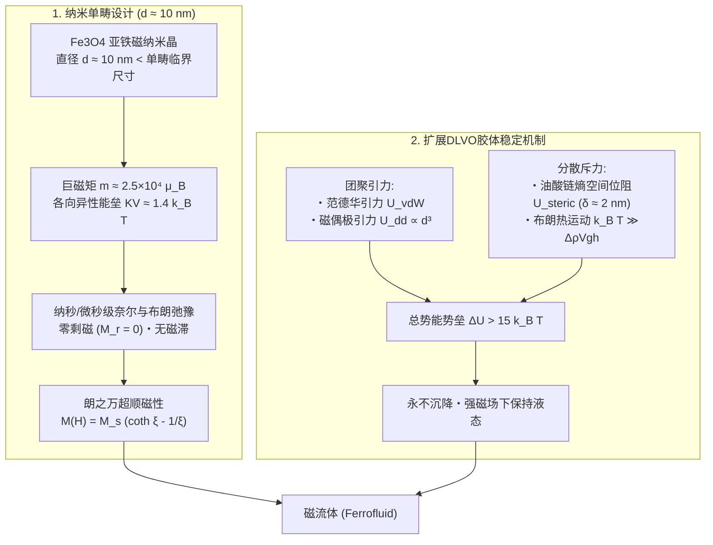
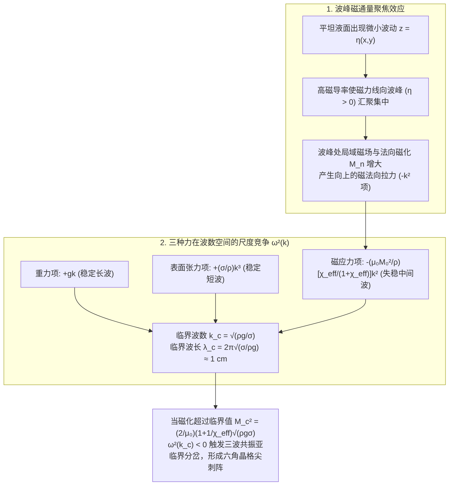

当一块强力钕铁硼磁铁从培养皿下方靠近一滩乌黑的液体时，原本平坦如镜的液面瞬间隆起，自发分裂成按六角晶格整齐排列的无数锋利“尖刺（Spikes）”。移动磁铁，尖刺群便如同有生命的生物般起伏律动；撤去磁场，尖刺又在瞬间消融，恢复成光滑的液面，不留下一丝固体残渣。这种在科技馆与媒体艺术中极具视觉冲击力的物质，就是被称为<strong>磁流体（Ferrofluid，又称铁磁流体）</strong>的功能性软物质。

然而从凝聚态物理的基本原理来看，“能被磁铁强烈吸引的液体”这一存在本身就蕴含着深刻的悖论：自然界中根本不存在任何常温（甚至任何温度）下的单组分铁磁性液体。为什么把铁块加热熔化后它的磁性会完全消失？1960年代的NASA工程师如何利用纳米胶体化学绕过这一热力学壁垒？而在垂直磁场下，为什么磁流体表面不会仅仅鼓起一个平滑的圆丘，而是选择特定波长分裂成尖锐的六角形刺阵？本文将从纳米尺度的统计力学到宏观连续介质的铁磁流体力学（FHD），为你完整推导磁流体尖刺背后的物理定律。

---

## 1. 为什么自然界没有“液态磁铁”？——居里温度与熔点的鸿沟

### 1.1 海森堡交换相互作用的热破坏

铁（$\text{Fe}$）、钴（$\text{Co}$）、镍（$\text{Ni}$）等固体铁磁体之所以具有自发磁化，源于晶格中相邻原子未配对电子自旋 $\mathbf{S}_i, \mathbf{S}_j$ 之间的量子力学<strong>海森堡交换相互作用（Heisenberg Exchange Interaction）</strong>：

$$\mathcal{H}_{\text{ex}} = -2 J_{\text{ex}} \sum_{\langle i,j \rangle} \mathbf{S}_i \cdot \mathbf{S}_j$$

当交换积分 $J_{\text{ex}} > 0$ 时，相邻自旋平行排列使系统能量最低。然而随着温度 $T$ 升高，热涨落能量 $k_B T$（$k_B = 1.380649 \times 10^{-23}\,\text{J/K}$ 为玻尔兹曼常数）剧烈扰动自旋取向。当温度达到<strong>居里温度（Curie Temperature, $T_C$）</strong>时，热运动彻底摧毁长程自旋有序，铁磁体发生二级相变转化为顺磁体（Paramagnet），自发磁化归零。

### 1.2 熔点 $T_m$ 远高于居里温度 $T_C$ 的普遍规律

对比所有典型铁磁性金属与亚铁磁性氧化物的居里温度 $T_C$ 和熔点 $T_m$，可以清楚看到自然界的严苛限制：

| 铁磁 / 亚铁磁物质 | 居里温度 $T_C$ ($\text{K}$ / ${}^\circ\text{C}$) | 熔点 $T_m$ ($\text{K}$ / ${}^\circ\text{C}$) | 温差 $T_m - T_C$ ($\text{K}$) | 熔融液态（$T > T_m$）下的磁性状态 |
| :--- | :--- | :--- | :--- | :--- |
| <strong>铁 ($\text{Fe}$)</strong> | $1043\,\text{K}$ ($770\,^\circ\text{C}$) | $1811\,\text{K}$ ($1538\,^\circ\text{C}$) | $+768\,\text{K}$ | 顺磁性液体（铁磁性完全消失） |
| <strong>钴 ($\text{Co}$)</strong> | $1388\,\text{K}$ ($1115\,^\circ\text{C}$) | $1768\,\text{K}$ ($1495\,^\circ\text{C}$) | $+380\,\text{K}$ | 顺磁性液体（铁磁性完全消失） |
| <strong>镍 ($\text{Ni}$)</strong> | $627\,\text{K}$ ($354\,^\circ\text{C}$) | $1728\,\text{K}$ ($1455\,^\circ\text{C}$) | $+1101\,\text{K}$ | 顺磁性液体（铁磁性完全消失） |
| <strong>钆 ($\text{Gd}$)</strong> | $292\,\text{K}$ ($19\,^\circ\text{C}$) | $1585\,\text{K}$ ($1312\,^\circ\text{C}$) | $+1293\,\text{K}$ | 顺磁性液体（铁磁性完全消失） |
| <strong>四氧化三铁 ($\text{Fe}_3\text{O}_4$)</strong> | $858\,\text{K}$ ($585\,^\circ\text{C}$) | $1870\,\text{K}$ ($1597\,^\circ\text{C}$) | $+1012\,\text{K}$ | 顺磁性液体（亚铁磁性完全消失） |

所有铁磁物质的<strong>居里温度 $T_C$ 都比其熔点 $T_m$ 低数百乃至上千开尔文（$T_C \ll T_m$）</strong>。这意味着在晶体熔化为液体之前，自旋有序早已被热运动彻底瓦解。而常温顺磁液体（如氯化铁水溶液）的磁化率仅为 $\chi \sim 10^{-4}\text{–}10^{-3}$，无法在普通磁铁下产生宏观液面变形。

### 1.3 1963年NASA的突破：三组分纳米胶体悬浮液

1963年，美国国家航空航天局（NASA）刘易斯研究中心的工程师<strong>斯蒂芬·帕佩尔（Stephen S. Papell）</strong>为了在失重太空中利用磁场将液态火箭燃料引导至泵吸入口，发明了磁流体。随后<strong>罗纳德·罗森茨威格（Ronald E. Rosensweig）</strong>奠定了铁磁流体力学（FHD）的理论基础并实现了工业化。磁流体由<strong>三大核心组分</strong>构成：

1. <strong>单畴铁磁/亚铁磁纳米颗粒（体积分数 $\phi \approx 3\%\text{–}15\%$）</strong>：通常为化学共沉淀法（$\text{Fe}^{2+} + 2\text{Fe}^{3+} + 8\text{OH}^- \rightarrow \text{Fe}_3\text{O}_4\downarrow + 4\text{H}_2\text{O}$）制备的<strong>四氧化三铁（磁铁矿, $\text{Fe}_3\text{O}_4$）</strong>或磁赤铁矿（$\gamma\text{-Fe}_2\text{O}_3$），粒径严格控制在<strong>直径 $d \approx 10\,\text{nm}$（$5\text{–}15\,\text{nm}$）</strong>。
2. <strong>表面活性剂单分子包覆层（厚度 $\delta \approx 2\,\text{nm}$）</strong>：如<strong>油酸（Oleic Acid）</strong>，其极性羧基头部（$-\text{COOH}$）化学吸附在氧化铁表面，非极性碳氢长链尾部伸入溶剂，形成弹性的空间位阻保护壳。
3. <strong>载液（基液，体积分数 $80\%\text{–}90\%$）</strong>：煤油、合成酯、全氟聚醚（PFPE）、硅油或水，赋予体系宏观流动性。

---

## 2. 纳米磁学：单畴结构与“超顺磁性（Superparamagnetism）”

### 2.1 单畴临界尺寸与奈尔/布朗弛豫

当铁磁颗粒直径小于基特尔（Kittel）<strong>单畴临界直径 $d_{\text{sd}} \approx \frac{36\sqrt{A_{\text{ex}}K}}{\mu_0 M_d^2}$</strong>（对 $\text{Fe}_3\text{O}_4$ 约为 $80\text{–}120\,\text{nm}$）时，形成磁畴壁的能量代价超过静磁能的降低，因此直径 $d \approx 10\,\text{nm}$ 的纳米颗粒内部所有约 $10^4$ 个铁离子自旋完全同向对齐，形成一个磁矩高达 $m = M_d V = M_d\left(\frac{\pi}{6}d^3\right) \approx 2.3 \times 10^{-19}\,\text{A}\cdot\text{m}^2 \approx 2.5 \times 10^4\,\mu_B$ 的<strong>“巨自旋（Giant Spin）”单畴颗粒</strong>。

对于 $d = 10\,\text{nm}$ 的 $\text{Fe}_3\text{O}_4$ 颗粒，磁晶各向异性能垒 $K V \approx 1.4\,k_B T$ 与室温热能相当，磁矩通过两种极快机制发生热弛豫：
1. <strong>奈尔弛豫（Néel Relaxation）</strong>：颗粒不转，内部磁矩跨越各向异性能垒 $KV$ 翻转，弛豫时间 $\tau_N = \tau_0 \exp\left(\frac{KV}{k_B T}\right) \sim 10^{-9}\,\text{s}$（纳秒级）。
2. <strong>布朗弛豫（Brownian Relaxation）</strong>：整个包覆颗粒（流体力学体积 $V_H = \frac{\pi}{6}(d+2\delta)^3$）在粘度为 $\eta$ 的载液中作旋转布朗运动，弛豫时间 $\tau_B = \frac{3\eta V_H}{k_B T} \sim 10^{-6}\,\text{s}$（微秒级）。

总有效弛豫率 $\frac{1}{\tau_{\text{eff}}} = \frac{1}{\tau_N} + \frac{1}{\tau_B}$。一旦撤去外磁场，磁矩在纳秒至微秒内随机化，因此<strong>剩磁 $M_r = 0$、矫顽力 $H_c = 0$（完全无磁滞）</strong>。

### 2.2 朗之万顺磁方程与巨大初始磁化率

在外磁场 $H$ 下，巨磁矩 $m$ 的热统计平均服从<strong>朗之万函数（Langevin Function）$\mathcal{L}(\xi)$</strong>：

$$M(H) = \phi M_d \mathcal{L}(\xi) = M_s \left(\coth\xi - \frac{1}{\xi}\right), \qquad \xi \equiv \frac{\mu_0 m H}{k_B T} = \frac{\mu_0 M_d \left(\frac{\pi}{6}d^3\right) H}{k_B T}$$

弱场下（$\xi \ll 1$），$\mathcal{L}(\xi) \approx \frac{\xi}{3}$，初始磁化率 $\chi_i = \frac{\mu_0 \phi M_d^2 V}{3 k_B T} \propto m^2$。由于单畴颗粒磁矩 $m$ 是单个原子的 $10^4$ 倍，磁流体的磁化率比普通顺磁液体高出 $10^4\text{–}10^5$ 倍（达 $\chi_i \sim 0.5\text{–}5.0$），故称为<strong>超顺磁性（Superparamagnetism）</strong>。

---

## 3. 胶体稳定性（扩展DLVO理论）与磁流变液（MRF）对比

### 3.1 扩展DLVO势能与Mackor–Rosensweig熵空间位阻排斥

为防止纳米颗粒在重力场（$k_B T \gg \Delta\rho V g h$）和强磁场梯度（$k_B T > \mu_0 m \Delta H$）下沉降，并阻止颗粒碰撞时发生不可逆团聚，表面包覆的油酸分子层提供了关键的<strong>熵空间位阻排斥（Entropic Steric Repulsion）</strong>。设两球心距为 $r$，表面间距 $s = r - d$，无量纲距离 $l = 2s/d$，涂层比 $t = 2\delta/d$，则总相互作用势为：

$$U_{\text{total}}(l) = U_{\text{vdW}}(l) + U_{\text{dd}}(l) + U_{\text{steric}}(l)$$

- <strong>伦敦-范德华引力</strong>：$U_{\text{vdW}}(l) = -\frac{A_H}{6}\left[\frac{2}{l^2+4l} + \frac{2}{(l+2)^2} + \ln\frac{l^2+4l}{(l+2)^2}\right]$（哈梅克常数 $A_H \approx 10^{-19}\,\text{J}$，在接触 $l\to 0$ 时发散至 $-\infty$）。
- <strong>磁偶极-偶极引力</strong>：$U_{\text{dd}}(l) = -\frac{\mu_0 m^2}{2\pi r^3} = -\frac{\mu_0 \pi M_d^2 d^3}{36(l+2)^3} \propto d^3$（在 $d=10\,\text{nm}$ 时仅为 $\sim 1\,k_B T$）。
- <strong>Mackor–Rosensweig空间位阻排斥势</strong>：当 $s < 2\delta$（$l \le 2t$）时，两颗粒表面的油酸链相互压缩，构象熵 $\Delta S < 0$ 剧减，导致自由能 $\Delta F = -T\Delta S > 0$ 陡增：
  $$U_{\text{steric}}(l) = \frac{\pi d^2 \xi_{\text{surf}} k_B T}{2} \left[ 2 - \frac{l + 2}{t}\ln\left(\frac{1 + t}{1 + l/2}\right) - \frac{l}{t} \right]$$
  这在 $s \approx 2\delta$ 处筑起高达 $+15\text{–}25\,k_B T$ 的势垒，彻底阻断范德华团聚。

### 3.2 磁流体（FF）与磁流变液（MR Fluid）的本质区别

| 物理特性 | 磁流体 (Ferrofluid: FF) | 磁流变液 (Magnetorheological Fluid: MRF) |
| :--- | :--- | :--- |
| <strong>颗粒材质与直径 $d$</strong> | $\text{Fe}_3\text{O}_4$ 等，<strong>$d \approx 5\text{–}15\,\text{nm}$</strong>（纳米级） | 羰基铁粉（$\text{Fe}$），<strong>$d \approx 1\text{–}10\,\mu\text{m}$</strong>（微米级） |
| <strong>偶极耦合常数 $\lambda_{\text{dd}} = |U_{\text{dd}}|/k_B T$</strong> | $\lambda_{\text{dd}} \lesssim 1$（热运动占主导，颗粒独立分散） | $\lambda_{\text{dd}} \sim 10^6\text{–}10^9 \gg 1$（偶极引力压倒热运动，形成刚性链柱） |
| <strong>磁场下的流变响应</strong> | <strong>始终保持牛顿流体液态</strong>，形成界面尖刺 | 毫秒内相变为<strong>宾汉塑性半固体</strong>，产生巨大屈服应力 $\tau_y(H)$ |
| <strong>典型工程应用</strong> | 超高真空旋转轴密封、扬声器音圈散热、艺术雕塑 | 汽车电磁主动悬架阻尼器（MagneRide）、离合器、制动器 |

---

## 4. 铁磁流体力学（FHD）与罗森茨威格尖刺不稳定性推导

### 4.1 开尔文磁体积力、广义伯努利方程与界面法向应力跳变

在无自由电流（$\nabla\times\mathbf{H} = \mathbf{0}, \nabla\cdot\mathbf{B} = 0$）且磁化与磁场共线（$\mathbf{M} = \frac{M(H)}{H}\mathbf{H}$）的磁流体中，单位体积所受<strong>开尔文磁体积力（Kelvin Body Force）</strong>为：

$$\mathbf{f}_m = \mu_0(\mathbf{M}\cdot\nabla)\mathbf{H} = \mu_0 M(H)\nabla H = \nabla\left(\mu_0 \int_0^H M(H')\,dH'\right)$$

将其代入不可压缩无粘无旋流动的动量方程，空间积分即得<strong>广义铁磁流体力学伯努利方程</strong>：

$$p^* + \frac{1}{2}\rho v^2 + \rho g z - \mu_0 \int_0^H M(H')\,dH' = \text{const}$$

同时，由麦克斯韦应力张量 $\mathbf{T} = -\left(p^* + \frac{1}{2}\mu_0 H^2\right)\mathbf{I} + \mathbf{H}\mathbf{B}^T$ 及界面电磁边界条件（切向 $H_t$ 连续、法向 $B_n$ 连续），可导出磁流体与空气自由界面上的<strong>法向应力平衡条件</strong>：

$$p^* - p_0 = \sigma \kappa - \frac{1}{2}\mu_0 M_n^2$$

其中 $\sigma$ 为表面张力，$\kappa$ 为界面曲率，$p_n \equiv \frac{1}{2}\mu_0 M_n^2$ 为<strong>磁法向牵引应力</strong>——只要存在垂直于界面的磁化分量 $M_n = \mathbf{M}\cdot\mathbf{n}$，磁场就会像无形的手一样将液面向空气侧向外拉扯！

### 4.2 罗森茨威格（法向场）不稳定性的色散关系与临界波长

设占据 $z < 0$ 半空间的磁流体处于竖直均匀外磁场 $\mathbf{B}_0 = B_0\mathbf{e}_z$ 中，平坦液面 $z = 0$ 发生微幅正弦表面波扰动 $z = \eta(\mathbf{r}_\perp, t) = \hat{\eta}\,e^{i(\mathbf{k}\cdot\mathbf{r}_\perp - \omega t)}$（波数 $k = |\mathbf{k}| = 2\pi/\lambda$）。

由于磁流体磁导率高于空气（$\mu > \mu_0$），磁力线会自动向波峰（$\eta > 0$）汇聚集中，使波峰处局域磁场 $H$ 和法向磁化 $M_n$ 增强，产生更强的向上拉力；波谷（$\eta < 0$）处磁力线发散，磁场减弱。联立速度势 $\nabla^2\Phi = 0$ 与各向异性磁标势方程 $(1+\chi_c)\nabla_\perp^2\psi_1 + (1+\chi_t)\partial_z^2\psi_1 = 0$，可严格导出<strong>Cowley–Rosensweig线性色散关系（1967）</strong>：

$$\omega^2(k) = g k + \frac{\sigma}{\rho} k^3 - \frac{\mu_0 M_0^2}{\rho}\,\frac{\chi_{\text{eff}}}{1 + \chi_{\text{eff}}}\,k^2$$

其中有效磁化率 $\chi_{\text{eff}} = \sqrt{(1+\chi_c)(1+\chi_t)} - 1$。右端三项展现了完美的尺度竞争：
1. <strong>重力项（$+g k \propto k^1$）</strong>：抑制长波长（小 $k$）液面起伏；
2. <strong>表面张力项（$+\frac{\sigma}{\rho}k^3 \propto k^3$）</strong>：抑制短波长（大 $k$）微细皱褶；
3. <strong>磁法向应力项（$-\propto M_0^2 k^2$）</strong>：具有负号，专门在<strong>中间波数 $k_c$</strong> 处破坏液面稳定性！

令 $\left.\frac{\partial(\omega^2)}{\partial k}\right|_{k_c} = 0$ 且 $\omega^2(k_c) = 0$，即可解出失稳的<strong>临界波数 $k_c$、临界波长 $\lambda_c$（尖刺间距）与临界磁化强度 $M_c$</strong>：

$$k_c = \sqrt{\frac{\rho g}{\sigma}}, \qquad \lambda_c = \frac{2\pi}{k_c} = 2\pi\sqrt{\frac{\sigma}{\rho g}} \approx 1\,\text{cm}, \qquad M_c^2 = \frac{2}{\mu_0}\left(1 + \frac{1}{\chi_{\text{eff}}}\right)\sqrt{\rho g \sigma}$$

当外磁场超过临界值（$M_0 > M_c$，对应磁感应强度 $B_c \approx 8\text{–}15\,\text{mT}$）时，$\omega^2(k_c) < 0$，表面扰动按 $e^{+\gamma t}$ 指数增长。由于自由表面缺乏上下反演对称性（$\eta \leftrightarrow -\eta$），自由能朗道展开中存在三次三波共振项 $-\gamma_3 A_1 A_2 A_3$（满足 $\mathbf{k}_1 + \mathbf{k}_2 + \mathbf{k}_3 = \mathbf{0}$，夹角 $120^\circ$），从而通过<strong>亚临界分岔（Subcritical Bifurcation）</strong>优先选择能量最低的<strong>六角密排晶格（Hexagonal Lattice）</strong>尖刺图案，并在升降磁场时表现出结构滞后效应。

---

## 5. 工业、生物医学与艺术应用

1. <strong>半导体制造与硬盘的零泄漏磁流体旋转真空密封（Ferrofluid Rotary Vacuum Seals）</strong>：在反应离子刻蚀、CVD及分子束外延设备的旋转轴周围设置环形永磁体与齿状极靴，磁流体在齿尖强磁场梯度下形成悬浮的“液态O型圈”。单级耐压 $\Delta p_{\text{max}} = \mu_0 \int_{H_{\text{min}}}^{H_{\text{max}}} M\,dH' \approx 0.03\text{–}0.05\,\text{MPa}$，多级串联即可承受超过1个大气压的压差，实现零泄漏、零磨损颗粒、超长寿命的高速旋转真空密封。
2. <strong>高保真扬声器音圈散热与阻尼（Loudspeaker Cooling & Damping）</strong>：将磁流体注入高音扬声器（Tweeter）的磁气隙中，其导热系数是空气的5〜10倍，并利用居里温度附近的磁化率温度梯度产生自发<strong>热磁对流（Thermomagnetic Convection）</strong>，消除音圈热压缩（Power Compression），同时提供粘性阻尼以平滑谐振峰 $f_0$ 并保持音圈居中。
3. <strong>肿瘤磁热疗（Magnetic Hyperthermia）与动态艺术</strong>：生物相容性超顺磁氧化铁纳米颗粒（SPION）在 $100\text{–}500\,\text{kHz}$ 交变磁场下通过奈尔与布朗弛豫耗散产热（$P = \mu_0 \pi f H_0^2 \chi''$），可将肿瘤局部加热至 $42\text{–}45\,^\circ\text{C}$ 精准杀灭癌细胞。而在新媒体艺术领域，日本艺术家<strong>儿玉幸子（Sachiko Kodama）</strong>创作的《突出，流动（Protrude, Flow）》利用计算机控制电磁铁阵列，让磁流体尖刺随音乐与人声实时律动生长，将非线性铁磁流体力学方程化作了震撼人心的生命雕塑。
