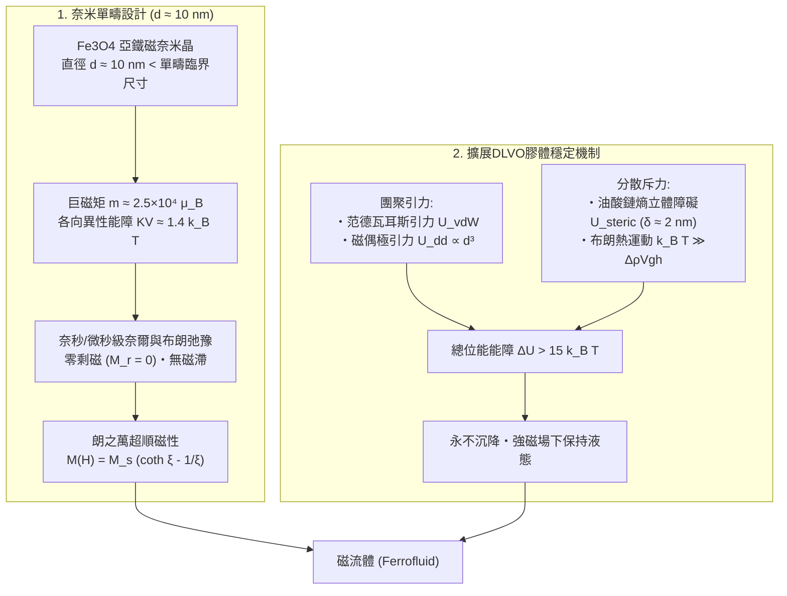
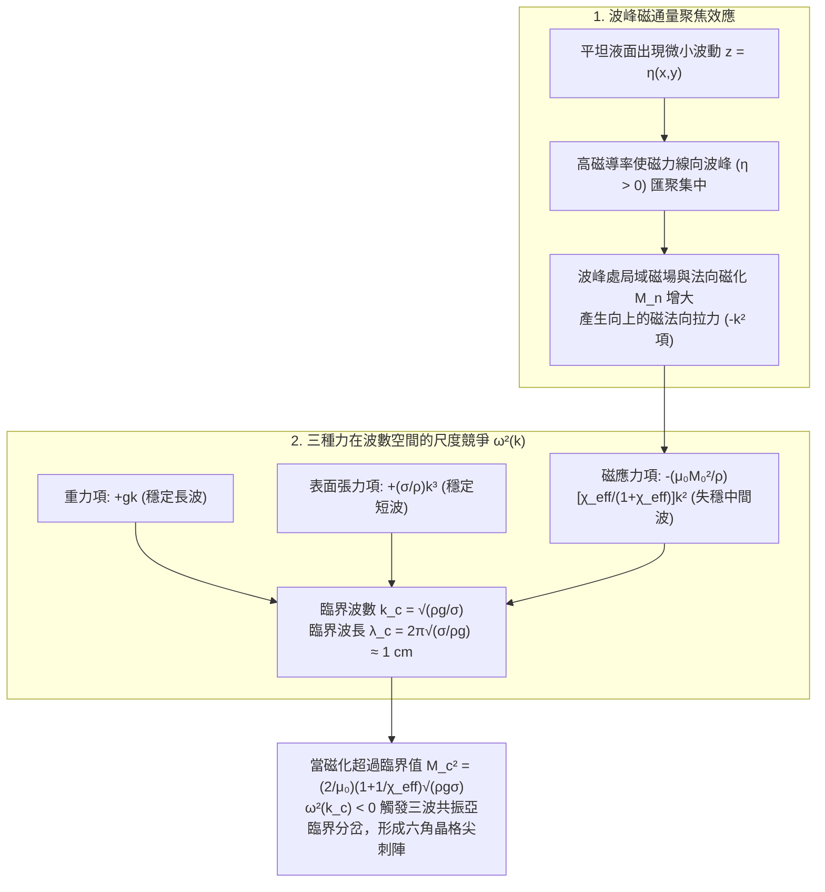

當一塊強力釹鐵硼磁鐵從培養皿下方靠近一灘烏黑的液體時，原本平坦如鏡的液面瞬間隆起，自發分裂成按六角晶格整齊排列的無數鋒利「尖刺（Spikes）」。移動磁鐵，尖刺群便如同有生命的生物般起伏律動；撤去磁場，尖刺又在瞬間消融，恢復成光滑的液面，不留下一絲固體殘渣。這種在科學館與新媒體藝術中極具視覺衝擊力的物質，就是被稱為<strong>磁流體（Ferrofluid，又稱鐵磁流體）</strong>的功能性軟物質。

然而從凝聚態物理的基本原理來看，「能被磁鐵強烈吸引的液體」這一存在本身就蘊含著深刻的悖論：自然界中根本不存在任何常溫（甚至任何溫度）下的單組分鐵磁性液體。為什麼把鐵塊加熱熔化後它的磁性會完全消失？1960年代的NASA工程師如何利用奈米膠體化學繞過這一熱力學壁壘？而在垂直磁場下，為什麼磁流體表面不會僅僅鼓起一個平滑的圓丘，而是選擇特定波長分裂成尖銳的六角形刺陣？本文將從奈米尺度的統計力學到巨觀連續介質的鐵磁流體力學（FHD），為你完整推導磁流體尖刺背後的物理定律。

---

## 1. 為什麼自然界沒有「液態磁鐵」？——居禮溫度與熔點的鴻溝

### 1.1 海森堡交換交互作用的熱破壞

鐵（$\text{Fe}$）、鈷（$\text{Co}$）、鎳（$\text{Ni}$）等固體鐵磁體之所以具有自發磁化，源於晶格中相鄰原子未配對電子自旋 $\mathbf{S}_i, \mathbf{S}_j$ 之間的量子力學<strong>海森堡交換交互作用（Heisenberg Exchange Interaction）</strong>：

$$\mathcal{H}_{\text{ex}} = -2 J_{\text{ex}} \sum_{\langle i,j \rangle} \mathbf{S}_i \cdot \mathbf{S}_j$$

當交換積分 $J_{\text{ex}} > 0$ 時，相鄰自旋平行排列使系統能量最低。然而隨著溫度 $T$ 升高，熱漲落能量 $k_B T$（$k_B = 1.380649 \times 10^{-23}\,\text{J/K}$ 為波茲曼常數）劇烈擾動自旋取向。當溫度達到<strong>居禮溫度（Curie Temperature, $T_C$）</strong>時，熱運動徹底摧毀長程自旋有序，鐵磁體發生二級相變轉化為順磁體（Paramagnet），自發磁化歸零。

### 1.2 熔點 $T_m$ 遠高於居禮溫度 $T_C$ 的普遍規律

對比所有典型鐵磁性金屬與亞鐵磁性氧化物的居禮溫度 $T_C$ 和熔點 $T_m$，可以清楚看到自然界的嚴苛限制：

| 鐵磁 / 亞鐵磁物質 | 居禮溫度 $T_C$ ($\text{K}$ / ${}^\circ\text{C}$) | 熔點 $T_m$ ($\text{K}$ / ${}^\circ\text{C}$) | 溫差 $T_m - T_C$ ($\text{K}$) | 熔融液態（$T > T_m$）下的磁性狀態 |
| :--- | :--- | :--- | :--- | :--- |
| <strong>鐵 ($\text{Fe}$)</strong> | $1043\,\text{K}$ ($770\,^\circ\text{C}$) | $1811\,\text{K}$ ($1538\,^\circ\text{C}$) | $+768\,\text{K}$ | 順磁性液體（鐵磁性完全消失） |
| <strong>鈷 ($\text{Co}$)</strong> | $1388\,\text{K}$ ($1115\,^\circ\text{C}$) | $1768\,\text{K}$ ($1495\,^\circ\text{C}$) | $+380\,\text{K}$ | 順磁性液體（鐵磁性完全消失） |
| <strong>鎳 ($\text{Ni}$)</strong> | $627\,\text{K}$ ($354\,^\circ\text{C}$) | $1728\,\text{K}$ ($1455\,^\circ\text{C}$) | $+1101\,\text{K}$ | 順磁性液體（鐵磁性完全消失） |
| <strong>釓 ($\text{Gd}$)</strong> | $292\,\text{K}$ ($19\,^\circ\text{C}$) | $1585\,\text{K}$ ($1312\,^\circ\text{C}$) | $+1293\,\text{K}$ | 順磁性液體（鐵磁性完全消失） |
| <strong>四氧化三鐵 ($\text{Fe}_3\text{O}_4$)</strong> | $858\,\text{K}$ ($585\,^\circ\text{C}$) | $1870\,\text{K}$ ($1597\,^\circ\text{C}$) | $+1012\,\text{K}$ | 順磁性液體（亞鐵磁性完全消失） |

所有鐵磁物質的<strong>居禮溫度 $T_C$ 都比其熔點 $T_m$ 低數百乃至上千開爾文（$T_C \ll T_m$）</strong>。這意味著在晶體熔化為液體之前，自旋有序早已因熱擾動而瓦解。

### 1.3 1963年NASA的突破：三組分奈米膠體懸浮液

1963年，美國國家航空暨太空總署（NASA）工程師<strong>史蒂芬·帕佩爾（Stephen S. Papell）</strong>為了在無重力太空中利用磁場引導液態火箭燃料，發明了磁流體；隨後<strong>羅納德·羅森茨威格（Ronald E. Rosensweig）</strong>建立了鐵磁流體力學（FHD）理論。磁流體由<strong>三大核心組分</strong>構成：

1. <strong>單疇亞鐵磁奈米顆粒（體積分率 $\phi \approx 3\%\text{–}15\%$）</strong>：以化學共沉澱法合成的<strong>四氧化三鐵（磁鐵礦, $\text{Fe}_3\text{O}_4$）</strong>或 $\gamma\text{-Fe}_2\text{O}_3$，直徑嚴格控制在 <strong>$d \approx 10\,\text{nm}$（$5\text{–}15\,\text{nm}$）</strong>。
2. <strong>界面活性劑單分子包覆層（厚度 $\delta \approx 2\,\text{nm}$）</strong>：如<strong>油酸（Oleic Acid）</strong>，極性羧基頭端化學吸附於顆粒表面，非極性碳氫長鏈伸入溶劑形成彈性保護層。
3. <strong>載液（基液，體積分率 $80\%\text{–}90\%$）</strong>：煤油、合成酯、全氟聚醚（PFPE）、矽油或水，提供巨觀流動性。

---

## 2. 奈米磁學：單疇結構與「超順磁性（Superparamagnetism）」

### 2.1 單疇臨界尺寸與奈爾/布朗弛豫

當顆粒直徑小於<strong>單疇臨界直徑 $d_{\text{sd}} \approx \frac{36\sqrt{A_{\text{ex}}K}}{\mu_0 M_d^2}$</strong> 時，顆粒內部不形成磁疇壁。直徑 $d \approx 10\,\text{nm}$ 的 $\text{Fe}_3\text{O}_4$ 顆粒是一個磁矩高達 $m = M_d V = M_d\left(\frac{\pi}{6}d^3\right) \approx 2.5 \times 10^4\,\mu_B$ 的<strong>「巨自旋（Giant Spin）」單疇顆粒</strong>。此時磁晶各向異性能障 $KV \approx 1.4\,k_B T$ 與室溫熱能相當，磁矩透過兩種機制快速弛豫：
1. <strong>奈爾弛豫（Néel Relaxation）</strong>：內部自旋跨越各向異性能障翻轉，$\tau_N = \tau_0 \exp\left(\frac{KV}{k_B T}\right) \sim 10^{-9}\,\text{s}$（奈秒級）。
2. <strong>布朗弛豫（Brownian Relaxation）</strong>：顆粒整體在黏度為 $\eta$ 的載液中作旋轉布朗運動，$\tau_B = \frac{3\eta V_H}{k_B T} \sim 10^{-6}\,\text{s}$（微秒級）。

總弛豫率 $\frac{1}{\tau_{\text{eff}}} = \frac{1}{\tau_N} + \frac{1}{\tau_B}$。撤去外磁場後，磁矩在微秒內完全隨機化，呈現<strong>零剩磁（$M_r = 0$）與無磁滯現象</strong>。

### 2.2 朗之萬順磁方程式

外磁場 $H$ 下的宏觀磁化強度服從<strong>朗之萬函數（Langevin Function）$\mathcal{L}(\xi)$</strong>：

$$M(H) = \phi M_d \mathcal{L}(\xi) = M_s \left(\coth\xi - \frac{1}{\xi}\right), \qquad \xi \equiv \frac{\mu_0 m H}{k_B T}$$

弱場下初始磁化率 $\chi_i = \frac{\mu_0 \phi M_d^2 V}{3 k_B T} \propto m^2$ 比一般順磁體高出 $10^4\text{–}10^5$ 倍（$\chi_i \sim 0.5\text{–}5.0$），故稱為<strong>超順磁性</strong>。

---

## 3. 膠體穩定性（擴展DLVO理論）與磁流變液（MRF）對比

### 3.1 擴展DLVO位能與Mackor–Rosensweig熵立體障礙排斥

為抵抗范德瓦耳斯引力 $U_{\text{vdW}}(l)$ 與磁偶極引力 $U_{\text{dd}}(l) = -\frac{\mu_0 m^2}{2\pi r^3} \propto d^3$，表面油酸鏈在兩顆粒接近至 $s < 2\delta$（無因次距離 $l = 2s/d \le 2t, t = 2\delta/d$）時受到壓縮，構象熵 $\Delta S < 0$ 驟減，產生強大的<strong>Mackor–Rosensweig熵立體障礙排斥位能</strong>：

$$U_{\text{steric}}(l) = \frac{\pi d^2 \xi_{\text{surf}} k_B T}{2} \left[ 2 - \frac{l + 2}{t}\ln\left(\frac{1 + t}{1 + l/2}\right) - \frac{l}{t} \right]$$

這在顆粒間形成 $>15\,k_B T$ 的排斥能障，確保磁流體在強磁場下永不凝集沉澱。

### 3.2 磁流體（FF）與磁流變液（MR Fluid）的差異

| 物理特性 | 磁流體 (Ferrofluid: FF) | 磁流變液 (Magnetorheological Fluid: MRF) |
| :--- | :--- | :--- |
| <strong>顆粒材質與粒徑 $d$</strong> | $\text{Fe}_3\text{O}_4$ 等，<strong>$d \approx 5\text{–}15\,\text{nm}$</strong>（奈米級） | 羰基鐵粉（$\text{Fe}$），<strong>$d \approx 1\text{–}10\,\mu\text{m}$</strong>（微米級） |
| <strong>偶極耦合常數 $\lambda_{\text{dd}}$</strong> | $\lambda_{\text{dd}} \lesssim 1$（熱運動主導，顆粒獨立分散） | $\lambda_{\text{dd}} \sim 10^6\text{–}10^9 \gg 1$（形成剛性鏈狀結構） |
| <strong>磁場下的流變行為</strong> | <strong>保持牛頓流體液態</strong>，展現液面尖刺不穩定性 | 毫秒內轉變為<strong>賓漢塑性半固體</strong>，具高降伏應力 $\tau_y(H)$ |
| <strong>主要工程應用</strong> | 半導體真空旋轉軸密封、揚聲器音圈散熱、動態藝術 | 汽車主動懸吊阻尼器（MR Damper）、煞車與離合器 |

---

## 4. 鐵磁流體力學（FHD）與羅森茨威格尖刺不穩定性推導

### 4.1 開爾文磁體積力、廣義白努利方程式與界面法向應力跳變

在無自由電流且 $\mathbf{M} \parallel \mathbf{H}$ 的磁流體中，單位體積所受<strong>開爾文磁體積力（Kelvin Body Force）</strong>為 $\mathbf{f}_m = \mu_0(\mathbf{M}\cdot\nabla)\mathbf{H} = \mu_0 M(H)\nabla H$。對不可壓縮無黏流體積分動量方程式，可得<strong>廣義鐵磁流體力學白努利方程式</strong>：

$$p^* + \frac{1}{2}\rho v^2 + \rho g z - \mu_0 \int_0^H M(H')\,dH' = \text{const}$$

結合馬克士威應力張量與界面電磁邊界條件（$H_t$ 連續、$B_n$ 連續），自由表面上的法向應力跳變為：

$$p^* - p_0 = \sigma \kappa - \frac{1}{2}\mu_0 M_n^2$$

其中 $-\frac{1}{2}\mu_0 M_n^2$ 為向外拉扯液面的<strong>磁法向應力</strong>。

### 4.2 羅森茨威格（法向場）不穩定性的色散關係與臨界波長

當垂直外磁場 $\mathbf{B}_0 = B_0\mathbf{e}_z$ 作用於平坦液面時，微幅表面波 $z = \hat{\eta}\,e^{i(\mathbf{k}\cdot\mathbf{r}_\perp - \omega t)}$ 的波峰處因高磁導率而使磁力線匯聚集中，增強局域磁場與法向拉力。線性微擾分析給出<strong>Cowley–Rosensweig色散關係（1967）</strong>：

$$\omega^2(k) = g k + \frac{\sigma}{\rho} k^3 - \frac{\mu_0 M_0^2}{\rho}\,\frac{\chi_{\text{eff}}}{1 + \chi_{\text{eff}}}\,k^2$$

其中有效磁化率 $\chi_{\text{eff}} = \sqrt{(1+\chi_c)(1+\chi_t)} - 1$。右端三項形成三方尺度競爭：重力（$+gk \propto k^1$）穩定長波長，表面張力（$+\frac{\sigma}{\rho}k^3 \propto k^3$）穩定短波長，而磁法向應力（$-\propto M_0^2 k^2$）專門在中間波數 $k_c$ 造成不穩定！

由 $\left.\frac{\partial(\omega^2)}{\partial k}\right|_{k_c} = 0$ 與 $\omega^2(k_c) = 0$，可導出臨界波數 $k_c$、臨界波長 $\lambda_c$ 與臨界磁化強度 $M_c$：

$$k_c = \sqrt{\frac{\rho g}{\sigma}}, \qquad \lambda_c = 2\pi\sqrt{\frac{\sigma}{\rho g}} \approx 1\,\text{cm}, \qquad M_c^2 = \frac{2}{\mu_0}\left(1 + \frac{1}{\chi_{\text{eff}}}\right)\sqrt{\rho g \sigma}$$

當 $M_0 > M_c$ 時，$\omega^2(k_c) < 0$，三個夾角 $120^\circ$ 的波向量（$\mathbf{k}_1 + \mathbf{k}_2 + \mathbf{k}_3 = \mathbf{0}$）透過自由能中的三次共振項發生<strong>亞臨界分岔</strong>，自發形成<strong>六角最密晶格（Hexagonal Lattice）</strong>的尖刺陣列。

---

## 5. 工業、生物醫學與藝術應用

1. <strong>半導體設備之磁流體真空旋轉密封（Ferrofluid Rotary Vacuum Seals）</strong>：利用極靴齒尖強磁場將低蒸氣壓磁流體固定為「液態O型環」，單級耐壓 $\Delta p_{\text{max}} \approx \mu_0 M_s H_{\text{max}}$，多級串聯可在零洩漏、零磨耗微粒下維持超高真空。
2. <strong>高傳真揚聲器音圈冷卻與阻尼</strong>：填充於高音單體磁隙中的磁流體透過高熱傳導與<strong>熱磁對流（Thermomagnetic Convection）</strong>大幅提升承受功率，並提供黏性阻尼抑制諧振峰。
3. <strong>腫瘤磁熱療（Magnetic Hyperthermia）與動態雕塑</strong>：超順磁氧化鐵奈米顆粒（SPION）在交變磁場下藉由弛豫損耗將癌細胞加熱至 $42\text{–}45\,^\circ\text{C}$；日本媒體藝術家<strong>兒玉幸子（Sachiko Kodama）</strong>則以電腦控制電磁鐵讓磁流體尖刺隨音樂起舞，展現非線性流體物理之美。
