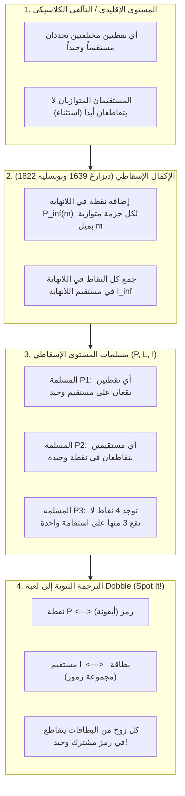
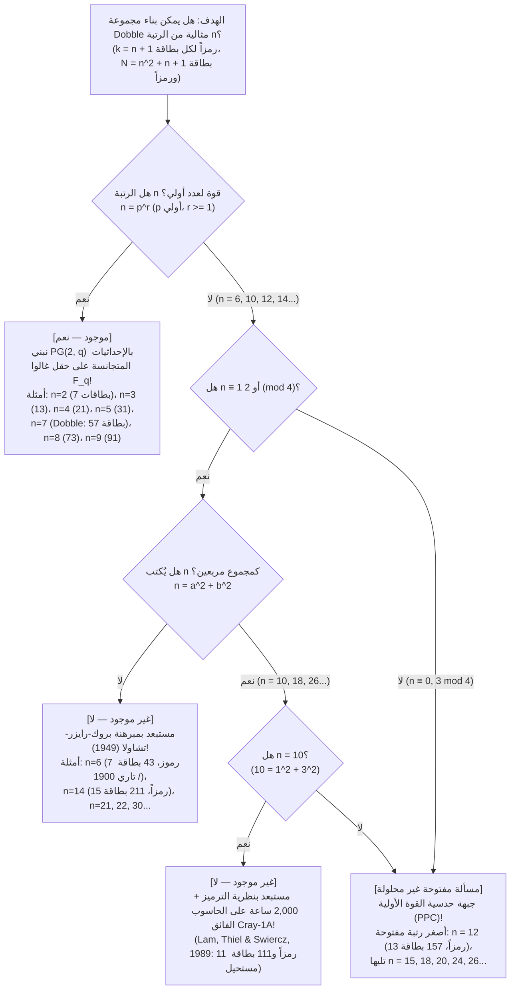

إذا سبق لك أن فتحت العلبة المعدنية الدائرية للعبة الجماعية الشهيرة عالمياً <strong>«دوبل» (Dobble / Spot It!)</strong>، فأنت تعرف قاعدتها البسيطة للغاية: تحمل كل بطاقة دائرية <strong>ثمانية رموز مختلفة</strong>. وعند قلب أي بطاقتين على الطاولة، يتسابق اللاعبون لاكتشاف الرمز المشترك ونطق اسمه أولاً.

كل من يلعب هذه اللعبة لبضع دقائق يلاحظ خاصية رياضية ساحرة: <strong>بغض النظر عن البطاقتين اللتين تختارهما من المجموعة بأكملها، فإنهما تشتركان دائماً في رمز واحد — ولا تشتركان أبداً في أكثر من رمز واحد!</strong>

في داخل هذه العلبة الصغيرة يكمن أحد كنوز الرياضيات البحتة الحديثة: التقاء <strong>الهندسة الإسقاطية المنتهية (Finite Projective Geometry)</strong>، و<strong>حقول غالوا المنتهية ($\mathbb{F}_q$)</strong>، و<strong>نظرية التصميم التوافقي</strong>. والأدهى من ذلك أنه بمجرد أن نتساءل: «ماذا يحدث لو وضعنا $k$ من الرموز على كل بطاقة بدلاً من $8$؟» نجد أنفسنا أمام <strong>مسألة الضباط الـ 36 لليونهارد أويلر (1782)</strong>، و<strong>مبرهنة بروك-رايزر-تشاولا (1949)</strong>، و<strong>برهان الحاسوب الفائق Cray-1 الذي استغرق 2,000 ساعة عمل في عام 1989</strong> لحسم حالة $k = 11$ رمزاً، وأحد أعظم الألغاز غير المحلولة في الرياضيات المتقطعة المعاصرة: <strong>هل يوجد مستوى إسقاطي منتهٍ من الرتبة $12$ ($13$ رمزاً لكل بطاقة، و$157$ بطاقة)؟</strong>

---

## الفصل 1: ثلاثة ألغاز رياضية داخل علبة Dobble

تحتوي علبة Dobble التجارية على <strong>55 بطاقة</strong>، في كل منها <strong>8 رموز</strong> مأخوذة من رصيد يضم $57$ رمزاً مختلفاً. إن محاولة تصميم هذه المجموعة يدوياً بالتجربة والخطأ تصطدم فوراً بالانفجار التوافقي الهائل لعدد البطاقات الممكنة:

$$\binom{57}{8} = \frac{57 \times 56 \times 55 \times 54 \times 53 \times 52 \times 51 \times 50}{8!} = 1,652,411,475$$

إن البحث بالقوة الغاشمة بين <strong>1.65 مليار بطاقة محتملة</strong> مستحيل حسابياً دون مخطط جبري. وهذا يطرح ثلاثة ألغاز:
1. <strong>الحد الأقصى لعدد البطاقات والبطاقتان المفقودتان</strong>: عند وضع $k = 8$ رموز في كل بطاقة، يبلغ السقف الرياضي النظري <strong>57 بطاقة</strong> (و57 رمزاً). فلماذا تحتوي العلبة التجارية على <strong>55 بطاقة</strong> فقط؟
2. <strong>المخطط الجبري</strong>: كيف نكتب جميع البطاقات الـ 57 دفعة واحدة دون أي تجربة وخطأ باستخدام الجبر؟
3. <strong>المجموعات المحظورة</strong>: لماذا يمكن بناء لعبة Dobble مثالية بـ $k = 3$ (7 بطاقات)، أو $k = 4$ (13 بطاقة)، أو $k = 5$ (21 بطاقة)، أو $k = 6$ (31 بطاقة)، أو $k = 8$ (57 بطاقة)، بينما يستحيل رياضياً على أي إنسان أو حاسوب فائق في الكون بناء مجموعة كاملة بـ <strong>$k = 7$ رموز (43 بطاقة)</strong> أو <strong>$k = 11$ رمزاً (111 بطاقة)</strong>؟

---

## الفصل 2: من الهندسة الإقليدية إلى الهندسة الإسقاطية — النقاط في اللانهاية ومبدأ الثنوية

في المستوى الإقليدي الكلاسيكي ($\mathbb{R}^2$)، تحدد أي نقطتين مختلفتين مستقيماً وحيداً، لكن أي مستقيمين مختلفين يتقاطعان في نقطة وحيدة <em>إلا إذا كانا متوازيين</em>. وفي القرنين السابع عشر والتاسع عشر، أزال <strong>جيرار ديزارغ (1639)</strong> و<strong>جان فيكتور بونسليه (1822)</strong> هذا الاستثناء عبر استلهام نقطة التلاشي في الرسم المنظوري لعصر النهضة:
1. لكل حزمة من المستقيمات المتوازية ذات الميل $m$ نضيف <strong>نقطة في اللانهاية $P_\infty(m)$</strong> تمر بها جميع المستقيمات ذات الميل $m$.
2. نجمع كل النقاط في اللانهاية $\{P_\infty(m)\}$ على مستقيم جديد واحد هو <strong>المستقيم في اللانهاية $\ell_\infty$</strong> (خط الأفق).

بذلك نحصل على <strong>المستوى الإسقاطي $(\mathcal{P}, \mathcal{L}, \mathcal{I})$</strong> الذي تحكمه ثلاث مسلمات:
- <strong>المسلمة P1</strong>: يمر بأي نقطتين مختلفتين $P \neq Q$ مستقيم <strong>وحيد</strong> $\ell$.
- <strong>المسلمة P2</strong>: يتقاطع أي مستقيمين مختلفين $\ell_1 \neq \ell_2$ في نقطة <strong>وحيدة</strong> $P$.
- <strong>المسلمة P3 (عدم التدهور)</strong>: توجد على الأقل <strong>أربع نقاط في وضع عام</strong> (لا تقع أي ثلاث منها على مستقيم واحد).

إن تبديل كلمتي «نقطة» و«مستقيم» يحافظ على المسلمات (<strong>مبدأ الثنوية / Duality</strong>)، مما يمنحنا قاموس الترجمة المباشر إلى لعبة Dobble:

| مفهوم الهندسة الإسقاطية | التفسير أ (القاموس القياسي) | التفسير ب (القاموس الثنوي) |
| :--- | :--- | :--- |
| <strong>نقطة $P \in \mathcal{P}$</strong> | <strong>رمز (أيقونة)</strong> | <strong>بطاقة</strong> |
| <strong>مستقيم $\ell \in \mathcal{L}$</strong> | <strong>بطاقة (مجموعة جزئية من الرموز)</strong> | <strong>رمز (مجموعة البطاقات التي يظهر عليها)</strong> |
| <strong>الوقوع $(P, \ell) \in \mathcal{I}$</strong> | الرمز $P$ مطبوع على البطاقة $\ell$ | البطاقة $P$ تعرض الرمز $\ell$ |
| <strong>معنى المسلمة P2</strong> | <strong>أي بطاقتين تشتركان في رمز وحيد فقط</strong> | أي رمزين يظهران معاً على بطاقة وحيدة فقط |

---

## الفصل 3: مبرهنة العد للرتبة $n$ ومستوى فانو $PG(2, 2)$

> <strong>مبرهنة 3.1 (مبرهنة العد للمستويات الإسقاطية المنتهية)</strong>:
> في أي مستوى إسقاطي منتهٍ $(\mathcal{P}, \mathcal{L}, \mathcal{I})$ يوجد عدد صحيح $n \ge 2$ (يُسمى <strong>رتبة</strong> المستوى) بحيث يحوي كل مستقيم $k = n + 1$ من النقاط، وتمر بكل نقطة $r = n + 1$ من المستقيمات، ويكون العدد الكلي للنقاط والمستقيمات متساوياً ويعطى بالعلاقة:
> $$|\mathcal{P}| = |\mathcal{L}| = N = n^2 + n + 1$$

<strong>البرهان</strong>: بتثبيت نقطة مرجعية $P_0$، فإن أي نقطة أخرى $Q \neq P_0$ تقع (بموجب P1 وP2) على واحد فقط من المستقيمات الـ $n + 1$ المارة بـ $P_0$. ولأن كل مستقيم منها يحوي $n$ من النقاط غير $P_0$، نجد $|\mathcal{P}| = 1 + (n + 1)n = n^2 + n + 1$. وفي لعبة Dobble ($k = 8 \implies n = 7$)، يكون الحد الأقصى النظري هو $N = 7^2 + 7 + 1 = 57$ بطاقة و57 رمزاً.

### أصغر هندسة منتهية: مستوى فانو $PG(2, 2)$ ($n = 2$)

عند $n = 2$ ($k = 3$ رموز لكل بطاقة، و$N = 7$ بطاقات)، اكتشف العالم الإيطالي <strong>جينو فانو (1892)</strong> <strong>مستوى فانو $PG(2, 2)$</strong>. تقابل نقاطه السبع المتجهات الثنائية السبعة غير الصفرية في $\mathbb{F}_2^3 \setminus \{\mathbf{0}\}$ (حيث تشكل ثلاث نقاط مستقيماً إذا وفقط إذا كان مجموعها الثنائي $u \oplus v \oplus w = \mathbf{0}$)، أو الإزاحات الدورية <strong>لمجموعة الفروق التامة $\{1, 2, 4\} \pmod 7$</strong>:

| البطاقة | الإزاحة الدورية $\ell_i = \{1+i, 2+i, 4+i\} \pmod 7$ | الرموز الـ 3 على البطاقة | الدور الهندسي في مخطط فانو |
| :---: | :---: | :---: | :--- |
| <strong>البطاقة $\ell_0$</strong> | $+0$ | $\{1, 2, 4\}$ | الضلع الخارجي 1 للمثلث المتساوي الأضلاع |
| <strong>البطاقة $\ell_1$</strong> | $+1$ | $\{2, 3, 5\}$ | الضلع الخارجي 2 للمثلث المتساوي الأضلاع |
| <strong>البطاقة $\ell_2$</strong> | $+2$ | $\{3, 4, 6\}$ | الضلع الخارجي 3 للمثلث المتساوي الأضلاع |
| <strong>البطاقة $\ell_3$</strong> | $+3$ | $\{4, 5, 0\}$ | المتوسط 1 (من الرأس إلى منتصف الضلع المقابل) |
| <strong>البطاقة $\ell_4$</strong> | $+4$ | $\{5, 6, 1\}$ | المتوسط 2 (من الرأس إلى منتصف الضلع المقابل) |
| <strong>البطاقة $\ell_5$</strong> | $+5$ | $\{6, 0, 2\}$ | المتوسط 3 (من الرأس إلى منتصف الضلع المقابل) |
| <strong>البطاقة $\ell_6$</strong> | $+6$ | $\{0, 1, 3\}$ | <strong>الدائرة المرسومة داخل المثلث والمارة بمنتصفات الأضلاع الـ 3!</strong> |

---

## الفصل 4: الإحداثيات المتجانسة على حقول غالوا $\mathbb{F}_q$ وتصميم الـ 57 بطاقة ($n = 7$)

يوجد <strong>حقل منتهٍ (حقل غالوا) $\mathbb{F}_q$</strong> يضم $q$ عنصراً <strong>إذا وفقط إذا كان $q = p^r$ قوة لعدد أولي $p$</strong>. وفي الفضاء المتجهي $\mathbb{F}_q^3 \setminus \{\mathbf{0}\}$، تشكل صفوف التكافؤ $[x : y : z] \sim [\lambda x : \lambda y : \lambda z]$ ($\lambda \in \mathbb{F}_q^\times$) عدداً من النقاط الإسقاطية قدره $\frac{q^3-1}{q-1} = q^2 + q + 1$، وتحدد المعادلات الخطية $ax + by + cz = 0$ المستقيمات الـ $q^2 + q + 1$ في <strong>المستوى الديزارغي $PG(2, q)$</strong>.

بالنسبة إلى Dobble ($q = 7$، الحساب بقياس $7$ في $\mathbb{F}_7 = \{0,\dots,6\}$)، تنقسم الرموز الـ 57 إلى <strong>49 نقطة شبكية تآلفية</strong> $P_{x,y} = [x : y : 1]$ و<strong>8 نقاط في اللانهاية</strong> $I_m = [1 : m : 0]$ و$I_\infty = [0 : 1 : 0]$. وتنقسم البطاقات الـ 57 إلى:
1. <strong>49 بطاقة للمستقيمات المائلة والأفقية $L_{m,b}$</strong>: النقاط الـ 7 $\{(x, mx+b \bmod 7)\}$ مضافاً إليها نقطة اللانهاية $I_m$.
2. <strong>7 بطاقات للمستقيمات الشاقولية $V_c$</strong>: النقاط الـ 7 $\{(c, y)\}$ مضافاً إليها النقطة الشاقولية $I_\infty$.
3. <strong>بطاقة واحدة لخط الأفق $L_\infty$</strong>: تضم جميع النقاط الثماني في اللانهاية $\{I_0, \dots, I_6, I_\infty\}$.

وبدلاً من ذلك، تتيح <strong>مبرهنة سينغر (1938)</strong> توليد جميع البطاقات الـ 57 بإزاحة مجموعة الفروق الدورية $D = \{0, 1, 3, 13, 32, 36, 43, 52\} \pmod{57}$ بمقدار $+i \pmod{57}$. أما اكتفاء العلبة التجارية بـ 55 بطاقة بدلاً من 57 فيعود لأسباب تتعلق بتقطيع ألواح الطباعة الصناعية ($55 = 5 \times 11$) وتوزيع البطاقات بالتساوي بين اللاعبين، دون الإخلال بالمسلمة P2.

---

## الفصل 5: ضباط أويلر الـ 36، ومبرهنة بروك-رايزر-تشاولا، وحدود المعرفة عند $n = 10$ و$n = 12$

إن المستوى الإسقاطي من الرتبة $n$ هو تصميم كتل متناظر $(n^2+n+1, n+1, 1)$-BIBD (يحقق المساواة $b = v$ في متباينة فيشر)، وبموجب <strong>مبرهنة التكافؤ لـ R. C. Bose (1938)</strong> فإنه يوجد إذا وفقط إذا وجد <strong>$n - 1$ من المربعات اللاتينية المتعامدة مثنى مثنى (MOLS) من الرتبة $n$</strong>.

- <strong>الرتبة $n = 6$ ($7$ رموز، $43$ بطاقة)</strong>: تتطلب وجود $5$ مربعات لاتينية متعامدة من الرتبة $6$. غير أن الفرنسي <strong>غاستون تاري (Gaston Tarry)</strong> أثبت عام 1900 عدم وجود حل <strong>لمسألة ضباط أويلر الـ 36 (1782)</strong>، إذ لا يوجد حتى زوج واحد ($2$) من المربعات اللاتينية المتعامدة من الرتبة $6$، مما يجعل $n = 6$ مستحيلاً!
- <strong>مبرهنة بروك-رايزر-تشاولا (1949)</strong>: إذا وجد مستوى إسقاطي منتهٍ من الرتبة $n$ وكان $n \equiv 1 \text{ أو } 2 \pmod 4$، فيجب أن يُكتب $n$ على شكل <strong>مجموع مربعين كاملين</strong>:
  $$n = a^2 + b^2 \quad (a, b \in \mathbb{Z})$$
  وهذه المبرهنة تستبعد فوراً $n = 6, 14, 21, 22, 30, \dots$!
- <strong>الرتبة $n = 10$ ($11$ رمزاً، $111$ بطاقة) وبرهان Cray-1 (1989)</strong>: بما أن $10 = 1^2 + 3^2$، فإن مبرهنة بروك-رايزر-تشاولا لا تستبعد $n = 10$. وفي عام 1989، تمكن <strong>كليمنت لام (Clement W. H. Lam) وزملاؤه</strong> عبر نظرية الترميز الثنائي وبعد <strong>2,000 ساعة حساب على الحاسوب الفائق Cray-1A</strong> من إثبات عدم وجود مستوى إسقاطي من الرتبة $10$.
- <strong>الرتبة $n = 12$ ($13$ رمزاً، $157$ بطاقة)</strong>: بما أن $12 \equiv 0 \pmod 4$، فلا تنطبق مبرهنة بروك-رايزر-تشاولا، كما أن فضاء البحث يفوق قدرة جميع الحواسيب الفائقة الحالية. وهكذا يظل وجود مستوى من الرتبة $12$ (<strong>حدسية القوة الأولية / PPC</strong>) لغزاً رياضياً مفتوحاً!

| الرتبة $n$ | الرموز لكل بطاقة $k = n+1$ | البطاقات والرموز $N = n^2+n+1$ | هل يوجد؟ | البناء الرياضي أو برهان عدم الوجود |
| :---: | :---: | :---: | :---: | :--- |
| <strong>$n = 2$</strong> | $3$ | <strong>$7$</strong> | <strong>نعم (وحيد)</strong> | أولي $2$: أصغر مستوى إسقاطي <strong>مستوى فانو $PG(2, 2)$</strong> |
| <strong>$n = 3, 4, 5$</strong> | $4, 5, 6$ | <strong>$13, 21, 31$</strong> | <strong>نعم (وحيد)</strong> | قوى أولية $3, 2^2, 5$: $PG(2, q)$ على الحقل $\mathbb{F}_q$ |
| <strong>$n = 6$</strong> | $7$ | $43$ | <strong>لا (مستحيل)</strong> | $6 \equiv 2 \pmod 4$ و$6 \neq a^2+b^2$. <strong>ضباط أويلر الـ 36 / تاري (1900) / بروك-رايزر (1949)</strong> |
| <strong>$n = 7$</strong> | <strong>$8$</strong> | <strong>$57$</strong> | <strong>نعم (وحيد)</strong> | أولي $7$: $PG(2, 7)$ على $\mathbb{F}_7$. <strong>لعبة Dobble التجارية (55 بطاقة في العلبة)</strong> |
| <strong>$n = 8, 9$</strong> | $9, 10$ | <strong>$73, 91$</strong> | <strong>نعم ($1$ و$4$ أنواع)</strong> | قوى أولية $2^3, 3^2$: عند $n=9$ يوجد $PG(2,9)$ و3 مستويات غير ديزارغية |
| <strong>$n = 10$</strong> | $11$ | $111$ | <strong>لا (مستحيل)</strong> | $10 = 1^2+3^2$، لكن <strong>أثبت لام وزملاؤه (1989) عدم وجوده بعد 2,000 ساعة على Cray-1A</strong> |
| <strong>$n = 11, 13$</strong> | $12, 14$ | <strong>$133, 183$</strong> | <strong>نعم</strong> | أوليان $11, 13$: $PG(2, 11)$ و$PG(2, 13)$ |
| <strong>$n = 12$</strong> | $13$ | $157$ | <strong>[مسألة مفتوحة]</strong> | $12 \equiv 0 \pmod 4$: مبرهنة بروك-رايزر لا تنطبق. <strong>أصغر رتبة غير محلولة!</strong> |
| <strong>$n = 14$</strong> | $15$ | $211$ | <strong>لا (مستحيل)</strong> | $14 \equiv 2 \pmod 4$ و$14 \neq a^2+b^2$. <strong>مستبعد بمبرهنة بروك-رايزر-تشاولا</strong> |
