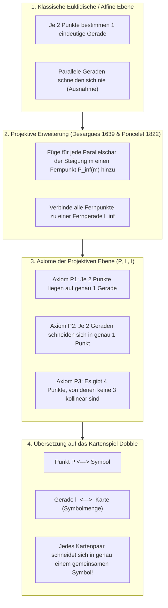
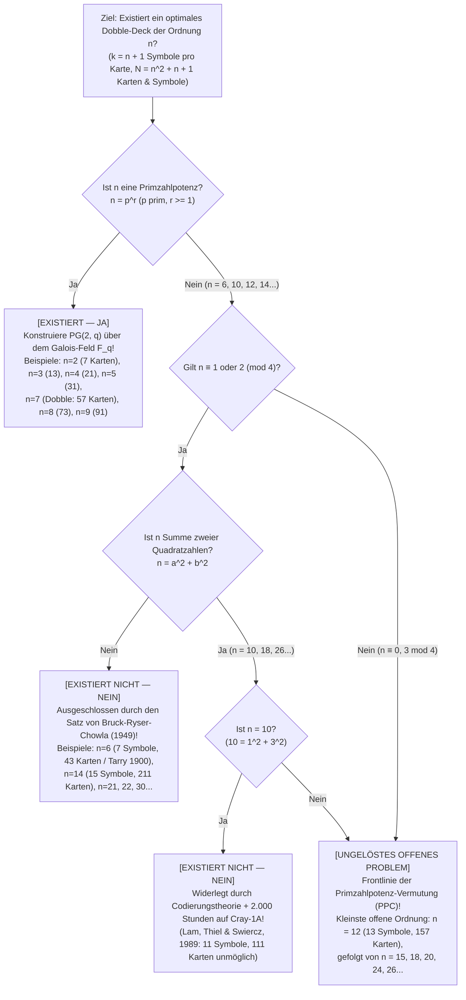

Wer schon einmal die kleine runde Blechdose des weltweit erfolgreichen Partyspiels <strong>Dobble</strong> (in Nordamerika <strong>Spot It!</strong>) geöffnet hat, kennt das verblüffend einfache Spielprinzip: Auf jeder runden Karte befinden sich <strong>acht verschiedene Symbole</strong>. Deckt man zwei beliebige Karten auf, gilt es so schnell wie möglich das gemeinsame Symbol zu entdecken.

Jeder Spieler bemerkt sofort eine fast magische mathematische Eigenschaft: <strong>Egal welche zwei Karten man aus dem gesamten Stapel zieht – sie haben immer ein gemeinsames Symbol, und zwar immer genau eines!</strong> Es gibt niemals ein Kartenpaar ohne Übereinstimmung und niemals eines mit zwei gemeinsamen Symbolen.

In dieser unscheinbaren Spielzeugdose verbirgt sich ein Juwel der modernen reinen Mathematik: das Zusammenspiel von <strong>endlicher projektiver Geometrie (Finite Projective Geometry)</strong>, <strong>Galois-Feldern ($\mathbb{F}_q$)</strong> und <strong>kombinatorischer Designtheorie</strong>. Und sobald man fragt: „Was passiert, wenn wir $k$ Symbole statt $8$ auf jede Karte drucken?“, landet man mitten in <strong>Leonhard Eulers Problem der 36 Offiziere (1782)</strong>, dem <strong>Satz von Bruck-Ryser-Chowla (1949)</strong>, einer <strong>2.000-stündigen Berechnung auf einem Cray-1-Supercomputer (1989)</strong> für $k = 11$ Symbole und einem der größten ungelösten Probleme der Diskreten Mathematik: <strong>Existiert eine endliche projektive Ebene der Ordnung $12$ ($13$ Symbole pro Karte, $157$ Karten)?</strong>

---

## Kapitel 1: Drei mathematische Rätsel in der Dobble-Dose

In einer handelsüblichen Dobble-Dose befinden sich <strong>55 Karten</strong> mit jeweils <strong>8 Symbolen</strong>. Versucht man per Hand und Ausprobieren ein solches Deck aus insgesamt $57$ verschiedenen Symbolen zu konstruieren, scheitert man bereits nach wenigen Karten an der gigantischen Anzahl möglicher 8er-Kombinationen:

$$\binom{57}{8} = \frac{57 \times 56 \times 55 \times 54 \times 53 \times 52 \times 51 \times 50}{8!} = 1.652.411.475$$

Unter über <strong>1,65 Milliarden möglichen Karten</strong> per Brute-Force-Suche über fünfzig paarweise kompatible Karten zu finden, ist aussichtslos. Daraus ergeben sich drei Fragen:
1. <strong>Maximale Deckgröße und die fehlenden 2 Karten</strong>: Bei $k = 8$ Symbolen pro Karte liegt das theoretische Maximum bei <strong>57 Karten</strong> (und 57 Symbolen). Warum enthält die Verkaufsversion nur <strong>55 Karten</strong>?
2. <strong>Der algebraische Bauplan</strong>: Wie lassen sich alle 57 Karten ohne jedes Ausprobieren direkt per Formel erzeugen?
3. <strong>Die verbotenen Decks</strong>: Warum lassen sich perfekte Spiele mit $k = 3$ (7 Karten), $k = 4$ (13 Karten), $k = 5$ (21 Karten), $k = 6$ (31 Karten) und $k = 8$ (57 Karten) bauen, während ein vollständiges Spiel mit <strong>$k = 7$ Symbolen (43 Karten)</strong> oder <strong>$k = 11$ Symbolen (111 Karten)</strong> mathematisch unmöglich ist?

---

## Kapitel 2: Von der euklidischen zur projektiven Geometrie — Fernpunkte und Dualität

In der gewöhnlichen euklidischen Ebene ($\mathbb{R}^2$) bestimmen zwei verschiedene Punkte genau eine Gerade, aber zwei verschiedene Geraden schneiden sich in genau einem Punkt – <em>außer wenn sie parallel sind</em>. Im 17. und 19. Jahrhundert beseitigten <strong>Girard Desargues (1639)</strong> und <strong>Jean-Victor Poncelet (1822)</strong> diese Ausnahme durch die <strong>projektive Vervollständigung</strong>:
1. Jede Schar paralleler Geraden mit gleicher Steigung $m$ erhält einen gemeinsamen <strong>Fernpunkt (Punkt im Unendlichen) $P_\infty(m)$</strong>.
2. Alle Fernpunkte $\{P_\infty(m)\}$ liegen gemeinsam auf einer einzigen neuen Gerade, der <strong>Ferngerade $\ell_\infty$</strong> (dem Horizont).

Damit gilt für eine <strong>projektive Ebene $(\mathcal{P}, \mathcal{L}, \mathcal{I})$</strong> aus Punkten $\mathcal{P}$ und Geraden $\mathcal{L}$ das aus drei Axiomen bestehende System:
- <strong>Axiom P1</strong>: Durch je zwei verschiedene Punkte $P \neq Q$ geht <strong>genau eine</strong> Gerade $\ell$.
- <strong>Axiom P2</strong>: Je zwei verschiedene Geraden $\ell_1 \neq \ell_2$ schneiden sich in <strong>genau einem</strong> Punkt $P$.
- <strong>Axiom P3 (Nicht-Entartung)</strong>: Es existieren mindestens <strong>vier Punkte in allgemeiner Lage</strong>, von denen keine drei auf derselben Gerade liegen.

Vertauscht man die Begriffe „Punkt“ und „Gerade“, gehen P1 und P2 ineinander über (<strong>Dualitätsprinzip</strong>). Übersetzt auf Dobble bedeutet dies:

| Begriff der projektiven Geometrie | Interpretation A (Standard) | Interpretation B (Dual) |
| :--- | :--- | :--- |
| <strong>Punkt $P \in \mathcal{P}$</strong> | <strong>Symbol (Figur)</strong> | <strong>Karte</strong> |
| <strong>Gerade $\ell \in \mathcal{L}$</strong> | <strong>Karte (Teilmenge von Symbolen)</strong> | <strong>Symbol (Menge der Karten, auf denen es liegt)</strong> |
| <strong>Inzidenz $(P, \ell) \in \mathcal{I}$</strong> | Symbol $P$ ist auf Karte $\ell$ gedruckt | Karte $P$ zeigt Symbol $\ell$ |
| <strong>Bedeutung von Axiom P2</strong> | <strong>Je zwei Karten teilen genau ein Symbol</strong> | Je zwei Symbole erscheinen zusammen auf genau einer Karte |

---

## Kapitel 3: Der Abzählsatz für die Ordnung $n$ und die Fano-Ebene $PG(2, 2)$

> <strong>Satz 3.1 (Abzählsatz für endliche projektive Ebenen)</strong>:
> Besitzt eine endliche projektive Ebene die <strong>Ordnung $n \ge 2$</strong>, so enthält jede Gerade genau <strong>$k = n + 1$ Punkte</strong>, durch jeden Punkt gehen genau <strong>$r = n + 1$ Geraden</strong>, und die Gesamtzahl der Punkte sowie der Geraden beträgt:
> $$|\mathcal{P}| = |\mathcal{L}| = N = n^2 + n + 1$$

<strong>Beweisidee</strong>: Fixiert man einen Referenzpunkt $P_0$, so liegt jeder andere Punkt $Q \neq P_0$ wegen Axiom P1 und P2 auf genau einer der $n + 1$ Geraden durch $P_0$. Da jede dieser Geraden neben $P_0$ noch $n$ weitere Punkte enthält, folgt $|\mathcal{P}| = 1 + (n + 1)n = n^2 + n + 1$. Für Dobble ($k = 8 \implies n = 7$) ergibt sich $N = 7^2 + 7 + 1 = 57$ Karten und 57 Symbole.

### Die kleinste endliche Geometrie: Die Fano-Ebene $PG(2, 2)$ ($n = 2$)

Für $n = 2$ ($k = 3$ Symbole pro Karte, $N = 7$ Karten) entdeckte <strong>Gino Fano (1892)</strong> die <strong>Fano-Ebene $PG(2, 2)$</strong>. Ihre 7 Punkte entsprechen den 7 von Null verschiedenen 3-Bit-Vektoren $(x,y,z) \in \mathbb{F}_2^3 \setminus \{\mathbf{0}\}$ (wobei drei Punkte genau dann eine Gerade bilden, wenn ihre bitweise XOR-Summe $u \oplus v \oplus w = \mathbf{0}$ ergibt) oder zyklischen Verschiebungen der <strong>perfekten Differenzmenge $\{1, 2, 4\} \pmod 7$</strong>:

| Kartenname | Zyklischer Shift $\ell_i = \{1+i, 2+i, 4+i\} \pmod 7$ | Die 3 Symbole auf der Karte | Geometrische Rolle im Fano-Diagramm |
| :---: | :---: | :---: | :--- |
| <strong>Karte $\ell_0$</strong> | $+0$ | $\{1, 2, 4\}$ | Äußere Dreiecksseite 1 |
| <strong>Karte $\ell_1$</strong> | $+1$ | $\{2, 3, 5\}$ | Äußere Dreiecksseite 2 |
| <strong>Karte $\ell_2$</strong> | $+2$ | $\{3, 4, 6\}$ | Äußere Dreiecksseite 3 |
| <strong>Karte $\ell_3$</strong> | $+3$ | $\{4, 5, 0\}$ | Seitenhalbierende 1 |
| <strong>Karte $\ell_4$</strong> | $+4$ | $\{5, 6, 1\}$ | Seitenhalbierende 2 |
| <strong>Karte $\ell_5$</strong> | $+5$ | $\{6, 0, 2\}$ | Seitenhalbierende 3 |
| <strong>Karte $\ell_6$</strong> | $+6$ | $\{0, 1, 3\}$ | <strong>Inkreis durch die 3 Seitenmittelpunkte (7. Gerade!)</strong> |

---

## Kapitel 4: Homogene Koordinaten über Galois-Feldern $\mathbb{F}_q$ und das 57-Karten-Dobble ($n = 7$)

Ein <strong>endlicher Körper (Galois-Feld) $\mathbb{F}_q$</strong> mit $q$ Elementen existiert genau dann, wenn $q = p^r$ eine <strong>Primzahlpotenz</strong> ist ($p$ prim, $r \ge 1$). Im dreidimensionalen Vektorraum $\mathbb{F}_q^3 \setminus \{\mathbf{0}\}$ bilden die Äquivalenzklassen $[x : y : z] \sim [\lambda x : \lambda y : \lambda z]$ ($\lambda \in \mathbb{F}_q^\times$) genau $\frac{q^3-1}{q-1} = q^2 + q + 1$ projektive Punkte, und lineare Gleichungen $ax + by + cz = 0$ definieren die $q^2 + q + 1$ Geraden der <strong>Desarguesschen Ebene $PG(2, q)$</strong>.

Für Dobble ($q = 7$, Rechnen modulo $7$ in $\mathbb{F}_7 = \{0,\dots,6\}$) zerfallen die 57 Symbole in <strong>49 Gitterpunkte</strong> $P_{x,y} = [x : y : 1]$ und <strong>8 Fernpunkte</strong> $I_m = [1 : m : 0]$ sowie $I_\infty = [0 : 1 : 0]$. Die 57 Karten bestehen aus:
1. <strong>49 Geradenkarten $L_{m,b}$</strong>: die 7 Punkte $\{(x, mx+b \bmod 7)\}$ plus der Fernpunkt $I_m$.
2. <strong>7 vertikalen Karten $V_c$</strong>: die 7 Punkte $\{(c, y)\}$ plus der vertikale Fernpunkt $I_\infty$.
3. <strong>1 Horizontkarte $L_\infty$</strong>: alle 8 Fernpunkte $\{I_0, \dots, I_6, I_\infty\}$.

Alternativ liefert <strong>Singers Satz (1938)</strong> die zyklische Differenzmenge $D = \{0, 1, 3, 13, 32, 36, 43, 52\} \pmod{57}$, deren 57 Verschiebungen $D + i \pmod{57}$ sofort alle 57 Karten erzeugen! Dass in der Verkaufsdose 2 Karten fehlen (55 statt 57), hat rein produktionstechnische Gründe ($55 = 5 \times 11$ passt optimal auf Stanzbögen und lässt sich gut auf Spieler aufteilen), während Axiom P2 für jede Teilmenge der 57 Karten erhalten bleibt.

---

## Kapitel 5: Eulers 36 Offiziere, der Satz von Bruck-Ryser-Chowla und die Grenzen bei $n = 10$ und $n = 12$

Eine projektive Ebene der Ordnung $n$ ist zugleich ein symmetrischer $(n^2+n+1, n+1, 1)$-Blockplan (BIBD mit Fishers Ungleichung $b \ge v$) und nach dem <strong>Äquivalenzsatz von R. C. Bose (1938)</strong> genau dann existent, wenn es <strong>$n - 1$ paarweise orthogonale lateinische Quadrate (MOLS) der Ordnung $n$</strong> gibt.

- <strong>Ordnung $n = 6$ ($7$ Symbole, $43$ Karten)</strong>: Erfordert $5$ MOLS der Größe $6 \times 6$. Doch schon <strong>Eulers Problem der 36 Offiziere (1782)</strong> (die Suche nach nur $2$ orthogonalen lateinischen $6 \times 6$-Quadraten) wurde 1900 von <strong>Gaston Tarry</strong> durch vollständige Fallunterscheidung negativ entschieden – $n = 6$ ist unmöglich!
- <strong>Satz von Bruck-Ryser-Chowla (1949)</strong>: Existiert eine projektive Ebene der Ordnung $n$ und gilt $n \equiv 1 \text{ oder } 2 \pmod 4$, so muss $n$ als <strong>Summe zweier Quadratzahlen</strong> darstellbar sein:
  $$n = a^2 + b^2 \quad (a, b \in \mathbb{Z})$$
  Dies schließt $n = 6, 14, 21, 22, 30, \dots$ sofort aus!
- <strong>Ordnung $n = 10$ ($11$ Symbole, $111$ Karten) und der Cray-1-Beweis (1989)</strong>: Wegen $10 = 1^2 + 3^2$ wird $n = 10$ nicht durch Bruck-Ryser-Chowla ausgeschlossen. Erst 1989 bewiesen <strong>Clement W. H. Lam, Larry Thiel und Stanley Swiercz</strong> über den binären Fehlerkorrekturcode der $111 \times 111$-Inzidenzmatrix und nach <strong>2.000 Rechenstunden auf einem Cray-1A-Supercomputer</strong>, dass keine projektive Ebene der Ordnung $10$ existiert.
- <strong>Ordnung $n = 12$ ($13$ Symbole, $157$ Karten)</strong>: Da $12 \equiv 0 \pmod 4$ gilt, greift Bruck-Ryser-Chowla nicht, und der Suchraum sprengt jeden Supercomputer. Ob eine Ebene der Ordnung $12$ existiert (<strong>Primzahlpotenz-Vermutung / PPC</strong>), ist bis heute eines der größten ungelösten Probleme der Mathematik!

| Ordnung $n$ | Symbole pro Karte $k = n+1$ | Karten & Symbole $N = n^2+n+1$ | Existenz? | Mathematische Konstruktion bzw. Nichtexistenzbeweis |
| :---: | :---: | :---: | :---: | :--- |
| <strong>$n = 2$</strong> | $3$ | <strong>$7$</strong> | <strong>Ja (eindeutig)</strong> | Primzahl $2$: kleinste projektive Ebene <strong>Fano-Ebene $PG(2, 2)$</strong> |
| <strong>$n = 3, 4, 5$</strong> | $4, 5, 6$ | <strong>$13, 21, 31$</strong> | <strong>Ja (eindeutig)</strong> | Primzahlpotenzen $3, 2^2, 5$: $PG(2, q)$ über $\mathbb{F}_q$ |
| <strong>$n = 6$</strong> | $7$ | $43$ | <strong>Nein (unmöglich)</strong> | $6 \equiv 2 \pmod 4$, $6 \neq a^2+b^2$. <strong>Eulers 36 Offiziere / Tarry (1900) / Bruck-Ryser (1949)</strong> |
| <strong>$n = 7$</strong> | <strong>$8$</strong> | <strong>$57$</strong> | <strong>Ja (eindeutig)</strong> | Primzahl $7$: $PG(2, 7)$ über $\mathbb{F}_7$. <strong>Kommerzielles Dobble (55 Karten in der Dose)</strong> |
| <strong>$n = 8, 9$</strong> | $9, 10$ | <strong>$73, 91$</strong> | <strong>Ja ($1$ bzw. $4$ Typen)</strong> | Primzahlpotenzen $2^3, 3^2$: für $n=9$ existieren neben $PG(2,9)$ auch 3 nicht-Desarguessche Ebenen |
| <strong>$n = 10$</strong> | $11$ | $111$ | <strong>Nein (unmöglich)</strong> | $10 = 1^2+3^2$, aber <strong>1989 von Lam et al. nach 2.000 h auf Cray-1A widerlegt</strong> |
| <strong>$n = 11, 13$</strong> | $12, 14$ | <strong>$133, 183$</strong> | <strong>Ja</strong> | Primzahlen $11, 13$: $PG(2, 11)$ und $PG(2, 13)$ |
| <strong>$n = 12$</strong> | $13$ | $157$ | <strong>[Offenes Problem]</strong> | $12 \equiv 0 \pmod 4$: Bruck-Ryser-Chowla nicht anwendbar. <strong>Kleinste ungelöste Ordnung!</strong> |
| <strong>$n = 14$</strong> | $15$ | $211$ | <strong>Nein (unmöglich)</strong> | $14 \equiv 2 \pmod 4$ und $14 \neq a^2+b^2$. <strong>Ausgeschlossen durch Bruck-Ryser-Chowla</strong> |
