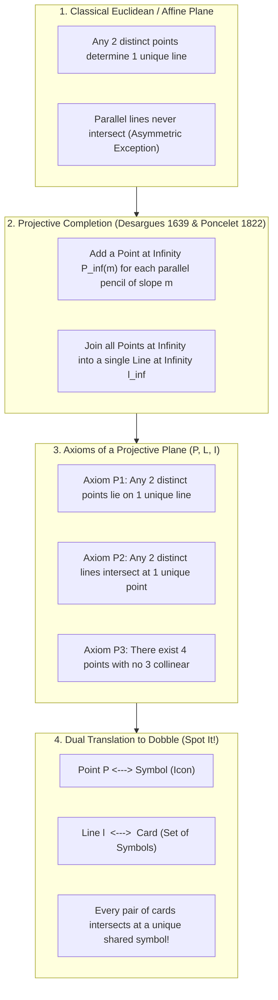
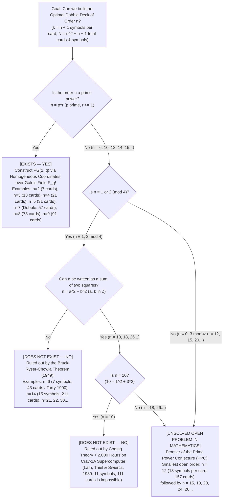

If you have ever opened the small circular tin of the worldwide bestselling party game <strong>Dobble</strong> (sold in North America as <strong>Spot It!</strong>), you already know how deceptively simple its premise is. Inside the tin is a deck of circular cards. Printed on the face of every card are <strong>eight distinct icons (symbols)</strong>—a snowman, a key, a pair of sunglasses, an anchor, a heart, a dinosaur, a lightning bolt—drawn at various sizes and orientations. When any two cards from the deck are flipped face-up on the table, players race to spot the matching icon and shout its name first.

Anyone who plays the game for more than a few minutes is struck by an eerie, almost magical mathematical property: <strong>no matter which two cards you pick from the entire deck, they always share a symbol in common—and they never share more than one</strong>. There is never a pair of cards with zero matches, and there is never a pair of cards with two matches. Every single pair of cards in the deck is linked by a unique, unambiguous bridge.

Locked inside this unassuming toy tin is one of the crown jewels of modern pure mathematics: the intersection of <strong>Finite Projective Geometry</strong>, <strong>Galois Fields ($\mathbb{F}_q$)</strong>, and <strong>Combinatorial Design Theory</strong>. Even more remarkably, the moment you ask a natural generalization of the game's design—"What happens if we put $k$ symbols on each card instead of $8$?"—you are catapulted straight into <strong>Leonhard Euler's 1782 Problem of the 36 Officers</strong>, the <strong>Bruck-Ryser-Chowla Theorem</strong>, a monumental <strong>2,000-hour Cray-1 supercomputer calculation that settled the case of $11$ symbols per card in 1989</strong>, and one of the greatest unsolved problems in all of 21st-century discrete mathematics: <strong>Does a finite projective plane of order $12$ ($13$ symbols per card, $157$ cards) exist?</strong>

In this article, we will journey from the parlor puzzle of Dobble to Renaissance perspective painting, build the axiomatic foundations of projective planes, construct Gino Fano's 7-point geometry and the full 57-card Dobble deck using linear algebra over finite fields, and explore why certain card decks are forbidden by the deepest laws of number theory and coding theory.

---

## Chapter 1: Three Mathematical Mysteries Inside the Dobble Tin

Let us begin by inspecting a commercial Dobble deck with the eyes of a mathematician. When you count the cards in a standard retail tin, you find <strong>55 circular cards</strong>, each displaying <strong>8 distinct symbols</strong>.

Suppose you were hired as a game designer and asked to construct such a deck from scratch: each card must contain $8$ symbols, and every pair of cards must intersect in exactly $1$ symbol. If you attempt to assign symbols to cards by hand through trial and error, you will hit a brick wall before you even reach card #12. Every time you try to assemble a new card of $8$ symbols that shares one symbol with each previous card, you inadvertently create a double collision with an earlier card or run out of compatible combinations.

In fact, as we will prove shortly, the natural pool of distinct symbols for an 8-symbol-per-card game is $57$ symbols. The total number of possible 8-symbol cards you could form from $57$ symbols is given by the binomial coefficient:

$$\binom{57}{8} = \frac{57 \times 56 \times 55 \times 54 \times 53 \times 52 \times 51 \times 50}{8!} = 1,652,411,475$$

There are over <strong>1.65 billion candidate cards</strong>! Searching through $1.65 \times 10^9$ subsets by brute force to find a mutually compatible family of over fifty cards is computationally hopeless without an underlying structural blueprint.

This confronts us with <strong>three fundamental mysteries</strong>:

1. <strong>Mystery 1 (The Maximum Deck Size and the Missing Two Cards)</strong>: When each card holds $k = 8$ symbols, what is the absolute theoretical maximum number of cards the deck can contain? As we shall prove, the exact mathematical ceiling is <strong>57 cards</strong> (using <strong>57 distinct symbols</strong>). Why, then, does the commercial Dobble tin contain only <strong>55 cards</strong>?
2. <strong>Mystery 2 (The Algebraic Blueprint)</strong>: How can we write down all $57$ cards and their $8$ symbols each in a single stroke—with zero trial and error—using algebra?
3. <strong>Mystery 3 (The Forbidden Decks)</strong>: What if we change the number of symbols per card, $k$? It turns out that you can build a perfect mini-Dobble with $k = 3$ symbols per card ($7$ cards), $k = 4$ ($13$ cards), $k = 5$ ($21$ cards), $k = 6$ ($31$ cards), or $k = 8$ ($57$ cards). Yet <strong>nobody in the universe—and no supercomputer that will ever be built—can construct a complete deck with $k = 7$ symbols per card ($43$ cards) or $k = 11$ symbols per card ($111$ cards)</strong>. Why does mathematics permit $k = 6$ and $k = 8$, while strictly outlawing $k = 7$ and $k = 11$?

The key that unlocks all three mysteries is a geometric revolution that began during the Italian Renaissance: <strong>Projective Geometry</strong>.

---

## Chapter 2: From Euclidean Geometry to Projective Geometry — Points at Infinity and Duality

### 2.1 Eliminating the "Parallel Exception"

In the classical Euclidean plane geometry ($\mathbb{R}^2$) taught in school, points and lines obey two foundational incidence rules:

- <strong>Rule A</strong>: Any two distinct points lie on a <strong>unique</strong> line.
- <strong>Rule B'</strong>: Any two distinct lines intersect at a <strong>unique</strong> point—<em>unless the two lines are parallel, in which case they never intersect at all</em>.

To a geometer, that trailing caveat—"unless they are parallel"—is an annoying blemish that ruins the symmetry between points and lines. If only parallel lines also intersected at a unique point, Rule A and Rule B' would be mirror images of each other!

The inspiration for healing this asymmetry came not from pure algebra, but from 15th-century Renaissance masters of <strong>linear perspective</strong> such as Filippo Brunelleschi, Leon Battista Alberti, and Albrecht Dürer. When an artist paints a straight railroad track or a colonnade receding into the distance, the two parallel rails do not remain separated on the canvas; they converge and meet at a single <strong>vanishing point</strong> on the horizon line.

In 1639, the French architect and mathematician <strong>Girard Desargues (1591–1661)</strong>—followed in 1822 by <strong>Jean-Victor Poncelet (1788–1867)</strong>, who developed his ideas while imprisoned in Russia after Napoleon's retreat from Moscow—turned the artist's horizon into rigorous mathematics. We can surgically "complete" the ordinary affine plane $\mathbb{A}^2$ into a <strong>Projective Plane</strong> in three steps:

1. <strong>Parallel Pencils and Points at Infinity</strong>: Group all lines in the ordinary plane into families of mutually parallel lines (called <em>parallel pencils</em>), indexed by their slope $m$ (with $m = \infty$ for vertical lines). For each slope $m$, create one new ideal point $P_\infty(m)$, called a <strong>Point at Infinity</strong>, and declare that every line of slope $m$ passes through $P_\infty(m)$.
2. <strong>Distinct Slopes</strong>: Two lines with different slopes $m_1 \neq m_2$ already intersect at a unique ordinary point in the plane, and since their slopes differ, they do not share a point at infinity.
3. <strong>The Line at Infinity</strong>: Collect all the newly created points at infinity $\{P_\infty(m)\}$ and declare that they all lie on a single new line $\ell_\infty$, called the <strong>Line at Infinity</strong> (the mathematical horizon).

Look at what this surgery achieves. Two parallel lines of slope $m$ now intersect at the unique point $P_\infty(m)$. An ordinary line of slope $m$ and the horizon line $\ell_\infty$ also intersect at the unique point $P_\infty(m)$. <strong>In the resulting projective plane, parallel lines no longer exist—every pair of distinct lines intersects at one and only one point, without exception!</strong>

### 2.2 The Three Axioms of a Projective Plane and the Principle of Duality

Abstracting away coordinates and distances, we define an incidence structure $(\mathcal{P}, \mathcal{L}, \mathcal{I})$ consisting of a set of <strong>points</strong> $\mathcal{P}$, a set of <strong>lines</strong> $\mathcal{L}$, and an incidence relation $\mathcal{I} \subset \mathcal{P} \times \mathcal{L}$ ("point $P$ lies on line $\ell$", or "line $\ell$ passes through point $P$"). The triple $(\mathcal{P}, \mathcal{L}, \mathcal{I})$ is called a <strong>Projective Plane</strong> if it satisfies three axioms:

- <strong>Axiom P1 (Unique Line Through Two Points)</strong>: For any two distinct points $P, Q \in \mathcal{P}$ ($P \neq Q$), there exists a <strong>unique line</strong> $\ell \in \mathcal{L}$ incident with both $P$ and $Q$.
- <strong>Axiom P2 (Unique Intersection of Two Lines)</strong>: For any two distinct lines $\ell_1, \ell_2 \in \mathcal{L}$ ($\ell_1 \neq \ell_2$), there exists a <strong>unique point</strong> $P \in \mathcal{P}$ incident with both $\ell_1$ and $\ell_2$.
- <strong>Axiom P3 (Non-Degeneracy / Four-Point Axiom)</strong>: There exist at least <strong>four points in general position</strong>—that is, four points in $\mathcal{P}$ such that no three of them lie on the same line.

(Axiom P3 rules out trivial "degenerate" geometries, such as all points lying on a single line, or a "near-pencil" where $N-1$ points lie on one line and all other lines fan out from a single external point.)

Notice the breathtaking symmetry between Axiom P1 and Axiom P2: if you swap the words <strong>"Point"</strong> and <strong>"Line"</strong> (and swap "lies on" $\leftrightarrow$ "passes through", "collinear" $\leftrightarrow$ "concurrent") in any theorem proved from Axioms P1–P3, the resulting statement is automatically another valid theorem! This metamathematical superpower is called the <strong>Principle of Duality</strong>.

Now let us open a translation dictionary between Projective Geometry and the game of Dobble:

| Projective Geometry Concept | Interpretation A (Standard Dictionary) | Interpretation B (Dual Dictionary) |
| :--- | :--- | :--- |
| <strong>Point $P \in \mathcal{P}$</strong> | <strong>A Symbol (Icon)</strong> | <strong>A Card</strong> |
| <strong>Line $\ell \in \mathcal{L}$</strong> | <strong>A Card (a subset of symbols)</strong> | <strong>A Symbol (the set of cards it appears on)</strong> |
| <strong>Incidence $(P, \ell) \in \mathcal{I}$</strong> | Symbol $P$ is printed on Card $\ell$ | Card $P$ displays Symbol $\ell$ |
| <strong>Meaning of Axiom P2</strong> | <strong>Any two distinct cards share a unique symbol in common</strong> | Any two distinct symbols appear together on a unique card |
| <strong>Meaning of Axiom P1</strong> | Any two distinct symbols appear together on a unique card | <strong>Any two distinct cards share a unique symbol in common</strong> |

The revelation is immediate: <strong>an optimal Dobble deck is literally a Finite Projective Plane in disguise!</strong>

---

## Chapter 3: The Counting Theorem for Order $n$ and Gino Fano's 7-Point Plane $PG(2, 2)$

### 3.1 Deriving the Exact Formula $N = n^2 + n + 1$

In the real projective plane $\mathbb{RP}^2$, there are infinitely many points and lines. What happens when the set of points $\mathcal{P}$ and the set of lines $\mathcal{L}$ are <strong>finite</strong>? Remarkably, Axioms P1–P3 force the entire geometry to be rigidly uniform.

> <strong>Theorem 3.1 (Counting Theorem for Finite Projective Planes)</strong>:
> For any finite projective plane $(\mathcal{P}, \mathcal{L}, \mathcal{I})$, there exists an integer $n \ge 2$, called the <strong>order</strong> of the projective plane, such that:
> 1. Every line $\ell \in \mathcal{L}$ contains exactly <strong>$k = n + 1$ points</strong> (every card has $n+1$ symbols).
> 2. Every point $P \in \mathcal{P}$ lies on exactly <strong>$r = n + 1$ lines</strong> (every symbol appears on $n+1$ cards).
> 3. The total number of points in $\mathcal{P}$ is <strong>$N = n^2 + n + 1$</strong>.
> 4. The total number of lines in $\mathcal{L}$ is also <strong>$N = n^2 + n + 1$</strong>.

Let us prove this theorem from scratch using nothing more than elementary bijections and counting.

<strong>Proof — Step 1 (Every line contains the same number of points $k = n + 1$):</strong>
Let $\ell_1, \ell_2 \in \mathcal{L}$ be any two distinct lines. Using Axiom P3 (four points with no three collinear), one readily verifies that there exists a point $O \in \mathcal{P}$ that lies on neither $\ell_1$ nor $\ell_2$.
Think of $O$ as a center of perspective projection. For every point $X \in \ell_1$, Axiom P1 guarantees a unique line $OX$ connecting $O$ and $X$. By Axiom P2, this line $OX$ must intersect the second line $\ell_2$ at a unique point $Y \in \ell_2$.
Conversely, for any point $Y \in \ell_2$, the unique line $OY$ intersects $\ell_1$ at a unique point $X \in \ell_1$. Thus the map $X \mapsto Y$ via lines through $O$ is a <strong>bijection (one-to-one correspondence)</strong> between the points of $\ell_1$ and the points of $\ell_2$!
Consequently, every line in $\mathcal{L}$ contains the exact same number of points, which we denote by $k = n + 1$ (with $n \ge 2$ forced by Axiom P3). By the Principle of Duality, every point lies on the exact same number of lines, and applying the same projection argument between the points of a line $\ell$ and the pencil of lines through $O$ shows that $r = k = n + 1$.

<strong>Proof — Step 2 (Counting all points in the plane: $|\mathcal{P}| = n^2 + n + 1$):</strong>
Fix a single reference point $P_0 \in \mathcal{P}$. We can partition all points of $\mathcal{P}$ as follows:
1. First, we have the reference point $P_0$ itself (<strong>$1$ point</strong>).
2. Consider any other point $Q \in \mathcal{P} \setminus \{P_0\}$. By Axiom P1, there is a <strong>unique</strong> line passing through both $P_0$ and $Q$. Thus, every point $Q \neq P_0$ lies on one and only one of the lines passing through $P_0$ (if $Q$ lay on two such lines, those two lines would share two points $P_0$ and $Q$, violating Axiom P2).
3. By Step 1, there are exactly <strong>$n + 1$ lines</strong> radiating out from $P_0$.
4. Each of those $n + 1$ lines contains $n + 1$ points in total; one of them is $P_0$ itself, leaving <strong>$n$ points other than $P_0$</strong> on each line.

Since those $n + 1$ sets of $n$ points are pairwise disjoint and exhaust $\mathcal{P} \setminus \{P_0\}$, we obtain:

$$|\mathcal{P}| = \underbrace{1}_{\text{Point } P_0} + \underbrace{(n + 1)}_{\text{Lines through } P_0} \times \underbrace{n}_{\text{Other points per line}} = n^2 + n + 1$$

By the Principle of Duality, swapping points and lines immediately gives the total number of lines (cards):

$$|\mathcal{L}| = |\mathcal{P}| = N = n^2 + n + 1 \quad \blacksquare$$

Look how effortlessly this solves Mystery 1 for Dobble! In a standard Dobble deck, every card displays $k = 8$ symbols. Therefore, the order of the underlying projective plane is

$$n = k - 1 = 8 - 1 = 7$$

and the theoretical maximum number of cards (as well as the total number of distinct symbols required) is:

$$N = 7^2 + 7 + 1 = 49 + 7 + 1 = 57 \text{ cards (and } 57 \text{ symbols)}$$

### 3.2 The Smallest Finite Geometry: Gino Fano's 7-Point Plane $PG(2, 2)$ ($n = 2$)

Before building the 57-card Dobble deck ($n = 7$), let us examine the smallest possible finite projective plane allowed by Axiom P3: the case of order <strong>$n = 2$</strong>, discovered in 1892 by the Italian geometer <strong>Gino Fano (1871–1952)</strong> and universally known as the <strong>Fano Plane $PG(2, 2)$</strong>.

Plugging $n = 2$ into Theorem 3.1 gives:
- Number of symbols per card: $k = n + 1 = 3$ symbols
- Number of cards each symbol appears on: $r = n + 1 = 3$ cards
- Total number of symbols $=$ Total number of cards: $N = 2^2 + 2 + 1 = 7$

Let us construct this "7-card Mini-Dobble" using two complementary algebraic methods.

#### Method A: Non-Zero 3-Bit Binary Vectors in $\mathbb{F}_2^3 \setminus \{\mathbf{0}\}$
Work over the binary field $\mathbb{F}_2 = \{0, 1\}$, where addition is modulo $2$ (bitwise XOR $\oplus$, so $1 \oplus 1 = 0$). There are $2^3 = 8$ three-bit vectors $(x, y, z) \in \mathbb{F}_2^3$. Discarding the zero vector $(0,0,0)$ leaves exactly $2^3 - 1 = 7$ non-zero vectors, which serve as our $7$ points (symbols):

$$\begin{aligned}
P_1 &= (0,0,1), & P_2 &= (0,1,0), & P_3 &= (0,1,1), & P_4 &= (1,0,0), \\
P_5 &= (1,0,1), & P_6 &= (1,1,0), & P_7 &= (1,1,1)
\end{aligned}$$

We define three distinct points $\{u, v, w\}$ to form a <strong>line (card)</strong> if and only if their bitwise XOR sum is zero:

$$u \oplus v \oplus w = (0, 0, 0) \iff w = u \oplus v$$

Because any two distinct non-zero vectors $u \neq v$ determine a unique third non-zero vector $w = u \oplus v$, every pair of symbols lies on a unique 3-symbol card!

#### Method B: The Cyclic Difference Set $\{1, 2, 4\} \pmod 7$
Even simpler: label the $7$ symbols with the residues $\{0, 1, 2, 3, 4, 5, 6\} \pmod 7$. Choose our first card $\ell_0$ to be the powers of two modulo $7$:

$$\ell_0 = \{1, 2, 4\} \pmod 7$$

Why $\{1, 2, 4\}$? Look at all $3 \times 2 = 6$ ordered differences $x - y \pmod 7$ between distinct elements of $\ell_0$:

$$\begin{aligned}
2 - 1 &\equiv 1 \pmod 7, & 1 - 2 &\equiv 6 \pmod 7, \\
4 - 2 &\equiv 2 \pmod 7, & 2 - 4 &\equiv 5 \pmod 7, \\
4 - 1 &\equiv 3 \pmod 7, & 1 - 4 &\equiv 4 \pmod 7
\end{aligned}$$

Every non-zero residue $\{1, 2, 3, 4, 5, 6\} \pmod 7$ appears as a difference <strong>once and only once</strong>! In combinatorics, such a subset is called a <strong>$(7, 3, 1)$ Cyclic Perfect Difference Set</strong>. Because every shift difference occurs uniquely, we can generate all $7$ cards simply by adding $+i \pmod 7$ ($i = 0, 1, \dots, 6$) to $\{1, 2, 4\}$:

| Card Label | Cyclic Shift $\ell_i = \{1+i, 2+i, 4+i\} \pmod 7$ | The 3 Symbols on the Card | Geometric Role in the Standard Fano Diagram |
| :---: | :---: | :---: | :--- |
| <strong>Card $\ell_0$</strong> | $+0$ | $\{1, 2, 4\}$ | Outer side 1 of the equilateral triangle |
| <strong>Card $\ell_1$</strong> | $+1$ | $\{2, 3, 5\}$ | Outer side 2 of the equilateral triangle |
| <strong>Card $\ell_2$</strong> | $+2$ | $\{3, 4, 6\}$ | Outer side 3 of the equilateral triangle |
| <strong>Card $\ell_3$</strong> | $+3$ | $\{4, 5, 0\}$ | Median 1 (vertex to opposite midpoint) |
| <strong>Card $\ell_4$</strong> | $+4$ | $\{5, 6, 1\}$ | Median 2 (vertex to opposite midpoint) |
| <strong>Card $\ell_5$</strong> | $+5$ | $\{6, 0, 2\}$ | Median 3 (vertex to opposite midpoint) |
| <strong>Card $\ell_6$</strong> | $+6$ | $\{0, 1, 3\}$ | <strong>The inscribed circle through the 3 midpoints!</strong> |

Pick any two rows in this table—say $\ell_1 = \{2, 3, 5\}$ and $\ell_5 = \{6, 0, 2\}$—and you will see they share the single symbol $2$. In the famous visual diagram of the Fano plane, six of the lines can be drawn as straight Euclidean segments (three sides and three medians of a triangle), while the seventh line $\{0, 1, 3\}$ must be drawn as an <strong>inscribed circle</strong> passing through the three midpoints, vividly illustrating that a "line" in incidence geometry is defined purely by set membership, not by Euclidean straightness.

---

## Chapter 4: Homogeneous Coordinates over Galois Fields $\mathbb{F}_q$ and the Full Anatomy of Dobble ($n = 7$)

### 4.1 Galois Fields $\mathbb{F}_q$ and the Prime Power Law

How do we generalize the coordinate construction of the Fano plane to higher orders $n = q$? To do linear algebra—solving linear equations $ax + by + cz = 0$ and normalizing slopes—we need our coordinates $(x, y, z)$ to belong to a finite number system where addition, subtraction, multiplication, and <strong>division by any non-zero element</strong> obey all the usual laws of arithmetic. Such a structure is called a <strong>Finite Field</strong> or <strong>Galois Field $\mathbb{F}_q$ (also written $GF(q)$)</strong>, named after the brilliant French mathematician <strong>Évariste Galois (1811–1832)</strong>.

A cornerstone theorem of abstract algebra completely classifies all finite fields:

> <strong>Theorem 4.1 (Classification of Finite Fields / Galois Fields)</strong>:
> A finite field $\mathbb{F}_q$ with $q$ elements exists <strong>if and only if $q$ is a prime power</strong>:
> $$q = p^r \quad (\text{where } p \text{ is a prime number and } r \in \{1, 2, 3, \dots\})$$
> Moreover, for any prime power $q = p^r$, the field $\mathbb{F}_q$ is unique up to isomorphism.

Two algebraic subtleties deserve special emphasis:

1. <strong>When $q = p$ is a prime number itself ($r = 1$)</strong>:
   For $q \in \{2, 3, 5, 7, 11, 13, \dots\}$, the Galois field $\mathbb{F}_p$ is simply modular arithmetic <strong>$\mathbb{Z}/p\mathbb{Z}$ (integers modulo $p$)</strong>. Because $p$ is prime, Bézout's identity ($ax + py = 1$) guarantees that every non-zero residue $a \in \{1, \dots, p-1\}$ has a unique multiplicative inverse $a^{-1} \pmod p$.
2. <strong>When $q = p^r$ is a composite prime power ($r \ge 2$)</strong>:
   For $q \in \{4 = 2^2, \, 8 = 2^3, \, 9 = 3^2, \, 16 = 2^4, \, 25 = 5^2, \, 27 = 3^3, \dots\}$, the field $\mathbb{F}_q$ is <strong>NOT</strong> the ring of integers modulo $q$ ($\mathbb{Z}/q\mathbb{Z}$)! Indeed, in $\mathbb{Z}/4\mathbb{Z}$, $2 \times 2 \equiv 0 \pmod 4$, so $2$ is a zero divisor and has no multiplicative inverse. Instead, $\mathbb{F}_{p^r}$ is constructed as the quotient ring of polynomials $\mathbb{F}_p[x] / (f(x))$, where $f(x)$ is an irreducible polynomial of degree $r$ over $\mathbb{F}_p$. For example, $\mathbb{F}_4 = \{0, 1, \alpha, \alpha+1\}$ is built using the rule $\alpha^2 + \alpha + 1 = 0$ over $\mathbb{F}_2$.
3. <strong>When $q$ is NOT a prime power ($q \in \{6, 10, 12, 14, 15, 18, 20, \dots\}$)</strong>:
   If $q$ is divisible by two or more distinct primes, <strong>no finite field of size $q$ can ever exist</strong>, because the characteristic of any field must be a single prime $p$, forcing its size to be a power of $p$.

### 4.2 Constructing $PG(2, q)$ via Homogeneous Coordinates $[x : y : z]$

Given any Galois field $\mathbb{F}_q$ ($q = p^r$), we construct the <strong>Desarguesian Finite Projective Plane $PG(2, q)$</strong> of order $q$ using 3-dimensional linear algebra over $\mathbb{F}_q$:

1. Start with the 3-dimensional vector space $V = \mathbb{F}_q^3$, which contains $q^3$ vectors $(x, y, z)$. Remove the origin $\mathbf{0} = (0, 0, 0)$ to obtain $q^3 - 1$ non-zero vectors.
2. Define two non-zero vectors to be equivalent if one is a non-zero scalar multiple of the other:
   $$(x, y, z) \sim (\lambda x, \lambda y, \lambda z) \quad \text{for any } \lambda \in \mathbb{F}_q^\times = \mathbb{F}_q \setminus \{0\}$$
   Each equivalence class is a 1-dimensional subspace (a line through the origin in $\mathbb{F}_q^3$) and is written in <strong>homogeneous coordinates</strong> as <strong>$[x : y : z]$</strong>.
3. <strong>Points of $PG(2, q)$</strong>: Each equivalence class $[x : y : z]$ is a projective point. Since $\mathbb{F}_q^\times$ has $q - 1$ non-zero scalars, each class bundles together $q - 1$ non-zero vectors, yielding:
   $$|\mathcal{P}| = \frac{q^3 - 1}{q - 1} = q^2 + q + 1 \text{ points}$$
4. <strong>Lines of $PG(2, q)$</strong>: Each dual homogeneous triple $[a : b : c]$ defines a projective line $\ell_{[a:b:c]}$ consisting of all points $[x : y : z]$ satisfying the homogeneous linear equation:
   $$a x + b y + c z = 0 \quad (\text{in } \mathbb{F}_q)$$
   Geometrically, $\ell_{[a:b:c]}$ is a 2-dimensional subspace (a plane through the origin) in $\mathbb{F}_q^3$, which contains $\frac{q^2 - 1}{q - 1} = q + 1$ projective points.

Why do Axioms P1 and P2 hold automatically? By Grassmann's dimension formula in $\mathbb{F}_q^3$, any two distinct 1-dimensional subspaces span a unique 2-dimensional subspace ($\dim(U_1 + U_2) = 1 + 1 - 0 = 2$, proving Axiom P1), and any two distinct 2-dimensional subspaces $W_1, W_2$ intersect in a unique 1-dimensional subspace:

$$\dim(W_1 \cap W_2) = \dim W_1 + \dim W_2 - \dim(W_1 + W_2) = 2 + 2 - 3 = 1$$

proving Axiom P2!

### 4.3 Explicit Recipe for the 57-Card Dobble Deck ($q = 7$)

Let us apply this machinery to $q = 7$, where $\mathbb{F}_7 = \mathbb{Z}/7\mathbb{Z} = \{0, 1, 2, 3, 4, 5, 6\}$ with all arithmetic performed modulo $7$. This gives the complete 57-symbol, 57-card Dobble deck!

#### Partitioning the 57 Symbols (Points $[x : y : z]$)
Depending on whether the third coordinate $z$ is non-zero or zero, the $57$ points split cleanly into two groups:

1. <strong>49 Affine Grid Points ($z \neq 0$)</strong>:
   When $z \neq 0$, we divide by $z \pmod 7$ to normalize the third coordinate to $1$, obtaining points of the form <strong>$P_{x, y} = [x : y : 1]$</strong> for $(x, y) \in \{0, 1, 2, 3, 4, 5, 6\}^2$ ($7 \times 7 = 49$ symbols).
2. <strong>8 Points at Infinity ($z = 0$)</strong>:
   When $z = 0$, the point has the form $[x : y : 0]$.
   - If $x \neq 0$, normalize $x$ to $1$ to get <strong>$I_m = [1 : m : 0]$</strong> for each of the $7$ slopes $m \in \{0, 1, 2, 3, 4, 5, 6\}$.
   - If $x = 0$, normalize $y$ to $1$ to get <strong>$I_\infty = [0 : 1 : 0]$</strong> (representing vertical slope $\infty$).

Total symbols: $49 + 7 + 1 = 57$ symbols!

#### Partitioning the 57 Cards (Lines $\ell$)
Correspondingly, the $57$ cards of $8$ symbols each decompose into three explicit families:

- <strong>Family 1: 49 Sloped & Horizontal Affine Line Cards ($L_{m, b}$)</strong>
  For each slope $m \in \{0, 1, 2, 3, 4, 5, 6\}$ and each $y$-intercept $b \in \{0, 1, 2, 3, 4, 5, 6\}$ ($7 \times 7 = 49$ cards), form the card:
  $$L_{m, b} = \bigl\{ P_{x, (mx + b \bmod 7)} \;\big|\; x \in \{0, 1, 2, 3, 4, 5, 6\} \bigr\} \cup \{ I_m \}$$
  That is, take the $7$ grid points on the line $y \equiv mx + b \pmod 7$, and adjoin the slope's Point at Infinity $I_m$ as the $8$-th symbol!

- <strong>Family 2: 7 Vertical Affine Line Cards ($V_c$)</strong>
  For each $x$-intercept $c \in \{0, 1, 2, 3, 4, 5, 6\}$ ($7$ cards), form the vertical line $x \equiv c \pmod 7$:
  $$V_c = \bigl\{ P_{c, y} \;\big|\; y \in \{0, 1, 2, 3, 4, 5, 6\} \bigr\} \cup \{ I_\infty \}$$
  Take the $7$ grid points in column $c$, and adjoin the vertical Point at Infinity $I_\infty$ as the $8$-th symbol.

- <strong>Family 3: 1 Line at Infinity Card ($L_\infty$)</strong>
  Finally, form the single horizon card ($z = 0$) containing all $8$ Points at Infinity:
  $$L_\infty = \{ I_0, I_1, I_2, I_3, I_4, I_5, I_6, I_\infty \}$$

Total cards: $49 + 7 + 1 = 57$ cards!

Alternatively, by <strong>James Singer's 1938 Theorem</strong>, every Desarguesian plane $PG(2, q)$ admits a cyclic difference set! If you number the $57$ symbols $0, 1, \dots, 56 \pmod{57}$ and define Card $0$ as the 8-element difference set:

$$D = \{0, 1, 3, 13, 32, 36, 43, 52\} \pmod{57}$$

then simply shifting $D + i \pmod{57}$ for $i = 0, 1, \dots, 56$ generates all $57$ Dobble cards in a single line of code! (Every non-zero residue $1, \dots, 56 \pmod{57}$ appears once among the $8 \times 7 = 56$ pairwise differences of $D$.)

### 4.4 Why Does the Commercial Dobble Tin Have 55 Cards Instead of 57?

We can now completely resolve Mystery 1. In the commercial Dobble game, <strong>all 57 distinct symbols</strong> from $PG(2, 7)$ actually appear across the deck, yet the tin contains only <strong>55 cards</strong>—two cards have been left out at the factory!

First, notice that removing any $2$ cards from the $57$-card deck of $PG(2, 7)$ <strong>does not break the golden rule of the game (Axiom P2)</strong>: every pair of cards among the remaining $55$ cards still intersects in a unique symbol! What is lost is only full Axiom P1 completeness (certain pairs of symbols—namely those that co-occurred on the two discarded cards—never appear together on any single card in the tin), which players never notice because the game only compares pairs of cards, not pairs of symbols.

Why did the publisher omit two cards? The reasons are practical manufacturing and game design ergonomics:
1. <strong>Die-Cut Printing Sheet Layout</strong>: The number $57 = 3 \times 19$ is prime-factored in an awkward way for rectangular printing press sheets, whereas $55 = 5 \times 11$ (or $110 = 10 \times 11$ for two decks on a master sheet) packs cleanly onto standard industrial die-cutting grids.
2. <strong>Player Division in Mini-Games</strong>: Many of Dobble's official rulebook mini-games deal cards evenly among players after placing one or more starter cards in the center. With $55$ cards, leaving $5$ cards in the center leaves $50$ cards (divisible by $2, 5,$ or $10$ players), or placing $1$ card in the center leaves $54$ cards (divisible by $2, 3, 6,$ or $9$ players).

---

## Chapter 5: Combinatorial Designs, Euler's 36 Officers, Bruck-Ryser-Chowla, and the Frontiers of $n = 10$ and $n = 12$

Now we confront Mystery 3: <strong>What happens when the order $n$ is NOT a prime power ($n = 6, 10, 12, 14, \dots$)?</strong> Why is a 43-card deck with $7$ symbols per card ($n = 6$) or a 111-card deck with $11$ symbols per card ($n = 10$) impossible?

### 5.1 Balanced Incomplete Block Designs (BIBD) and Fisher's Inequality

In the 1930s, the British statistician and geneticist <strong>Ronald A. Fisher (1890–1962)</strong> and Frank Yates developed the mathematical theory of <strong>Experimental Design</strong> to test agricultural crop varieties across soil blocks without bias.

A <strong>$(v, b, r, k, \lambda)$-Balanced Incomplete Block Design (BIBD)</strong> consists of $v$ points (varieties/symbols) and $b$ blocks (cards) such that:
- Every block contains exactly $k$ points.
- Every point belongs to exactly $r$ blocks.
- Every pair of distinct points belongs together to exactly $\lambda$ blocks.

Double-counting incidences yields the two fundamental parameter identities:

$$v r = b k, \qquad r(k - 1) = \lambda (v - 1)$$

Let $M \in \{0, 1\}^{v \times b}$ be the $v \times b$ <strong>incidence matrix</strong> ($m_{ij} = 1$ if point $i$ lies in block $j$, and $0$ otherwise). Multiplying $M$ by its transpose $M^\top$ gives a $v \times v$ matrix whose diagonal entries equal $r$ and whose off-diagonal entries equal $\lambda$:

$$M M^\top = (r - \lambda) I_v + \lambda J_v$$

where $I_v$ is the $v \times v$ identity matrix and $J_v$ is the all-ones matrix. Subtracting the first row from all other rows and adding all columns to the first column readily yields its determinant:

$$\det(M M^\top) = (r - \lambda)^{v - 1} \bigl(r + \lambda (v - 1)\bigr) = (r - \lambda)^{v - 1} r k$$

For any non-trivial design ($k < v$), we have $r > \lambda$, so $\det(M M^\top) > 0$. This means the $v \times v$ matrix $M M^\top$ has full rank $v$. Since $\operatorname{rank}(M M^\top) \le \operatorname{rank}(M) \le \min(v, b)$, we immediately deduce:

> <strong>Theorem 5.1 (Fisher's Inequality, 1940)</strong>:
> In any $(v, b, r, k, \lambda)$-BIBD with $k < v$, the number of blocks (cards) is at least the number of points (symbols):
> $$b \ge v$$

A BIBD achieving the extremal equality $b = v$ (and hence $r = k$) is called a <strong>Symmetric $(v, k, \lambda)$-BIBD</strong>. When $\lambda = 1$ and $k = n + 1$, we get $v = b = n^2 + n + 1$: <strong>a finite projective plane of order $n$ is identically a Symmetric $(n^2+n+1, n+1, 1)$-BIBD, and also a Steiner System $S(2, n+1, n^2+n+1)$!</strong>

### 5.2 Mutually Orthogonal Latin Squares (MOLS) and Euler's 36 Officers Problem ($n = 6$)

The smallest integer $n \ge 2$ that is not a prime power is <strong>$n = 6$</strong> ($k = 7$ symbols per card, $N = 6^2 + 6 + 1 = 43$ cards). Even though no Galois field $\mathbb{F}_6$ exists, could we still arrange $43$ symbols onto $43$ cards of size $7$ by some clever non-algebraic combinatorial construction?

This question connects directly to the famous <strong>Thirty-Six Officers Problem</strong> posed by <strong>Leonhard Euler in 1782</strong>:
*Can $36$ officers, drawn from $6$ different regiments and holding $6$ different ranks (one officer of each rank per regiment), be arranged in a $6 \times 6$ square formation so that every row and every column contains one officer of each regiment and one officer of each rank?*

A $n \times n$ grid filled with $n$ symbols such that each symbol appears once in every row and once in every column is a <strong>Latin Square of order $n$</strong>. Two Latin squares $L^{(1)}, L^{(2)}$ are <strong>orthogonal</strong> if, when superimposed, every ordered pair of symbols $(a, b) \in \{1, \dots, n\}^2$ occurs exactly once among the $n^2$ cells. A family of Latin squares that are pairwise orthogonal is called a set of <strong>Mutually Orthogonal Latin Squares (MOLS)</strong>.

In 1938, <strong>Raj Chandra Bose (1901–1987)</strong> proved a fundamental equivalence linking projective geometry and Latin squares:

> <strong>Theorem 5.2 (Bose's Equivalence Theorem for Projective Planes and MOLS, 1938)</strong>:
> Deleting one line ($\ell_\infty$) and its $n + 1$ points from a projective plane of order $n$ leaves an <strong>Affine Plane of order $n$</strong> consisting of $n^2$ points and $n + 1$ parallel classes of $n$ lines each. Using the first two parallel classes to define the row and column coordinates of an $n \times n$ grid, the remaining $n - 1$ parallel classes correspond bijectively to a complete set of $n - 1$ Mutually Orthogonal Latin Squares of order $n$:
> $$\text{A projective plane of order } n \text{ exists} \iff \text{There exist } n - 1 \text{ MOLS of order } n$$

Now look at $n = 6$. For a projective plane of order $6$ (a 43-card Dobble deck with $7$ symbols per card) to exist, there would have to exist <strong>$6 - 1 = 5$ Mutually Orthogonal Latin Squares of order $6$</strong>.
Yet in 1900, the French mathematician <strong>Gaston Tarry (1843–1913)</strong> carried out a monumental exhaustive case analysis of all $9,408$ reduced $6 \times 6$ Latin squares by hand and proved that <strong>Euler's 36 Officers Problem has no solution—not even $2$ orthogonal Latin squares of order $6$ exist, let alone $5$!</strong>
Consequently, <strong>no projective plane of order $n = 6$ ($7$ symbols per card, $43$ cards) can exist!</strong>

*(Historical footnote: Euler conjectured in 1782 that no pair of orthogonal Latin squares exists for any $n \equiv 2 \pmod 4$, i.e., $n = 6, 10, 14, 18, \dots$. In 1959–1960, Bose, S. S. Shrikhande, and E. T. Parker stunned the mathematical world—earning the nickname the "Euler Spoilers" on the front page of the New York Times—by proving that pairs of orthogonal Latin squares DO exist for every $n \ge 10$ with $n \equiv 2 \pmod 4$! Thus the "100 Officers Problem" for $n = 10$ is solvable. However, building a full projective plane of order $10$ requires $10 - 1 = 9$ MOLS of order $10$, not just $2$!)*

### 5.3 The Bruck-Ryser-Chowla Theorem (1949): Ruling Out Infinitely Many Orders at Once

Must we perform an exhaustive search like Tarry's for every non-prime-power $n$? In 1949, <strong>Richard H. Bruck</strong> and <strong>Herbert J. Ryser</strong> (generalized to all symmetric BIBDs with <strong>Sarvadaman Chowla</strong> in 1950) discovered a breathtaking shortcut using the arithmetic theory of quadratic forms over $\mathbb{Q}$.

Starting from the incidence matrix identity $M M^\top = n I_N + J_N$ where $N = n^2 + n + 1$, they interpreted $M M^\top$ as changing variables in a sum of $N$ squares and applied Lagrange's Four-Square Theorem together with Witt's Cancellation Theorem (Hasse-Minkowski invariants). The result is one of the most celebrated theorems in all of combinatorics:

> <strong>Theorem 5.3 (The Bruck-Ryser-Chowla Theorem, 1949)</strong>:
> If a finite projective plane of order $n$ exists and $n \equiv 1 \text{ or } 2 \pmod 4$, then $n$ must be expressible as the <strong>sum of two integer squares</strong>:
> $$n = a^2 + b^2 \quad \text{for some integers } a, b \in \mathbb{Z}$$

By Fermat's theorem on sums of two squares, a positive integer $n$ can be written as $a^2 + b^2$ if and only if every prime factor $p \equiv 3 \pmod 4$ divides $n$ to an <em>even</em> power. With a single line of arithmetic, the Bruck-Ryser-Chowla theorem annihilates infinitely many candidate orders $n$:

- <strong>$n = 6$ ($7$ symbols, $43$ cards)</strong>: $6 \equiv 2 \pmod 4$, and $6 = 2 \times 3^1$ cannot be written as $a^2 + b^2$. <strong>Impossible!</strong> (Tarry's 9,408-case hand proof is bypassed in two seconds!)
- <strong>$n = 14$ ($15$ symbols, $211$ cards)</strong>: $14 \equiv 2 \pmod 4$, and $14 = 2 \times 7^1 \neq a^2 + b^2$. <strong>Impossible!</strong>
- <strong>$n = 21$ ($22$ symbols, $463$ cards)</strong>: $21 \equiv 1 \pmod 4$, and $21 = 3^1 \times 7^1 \neq a^2 + b^2$. <strong>Impossible!</strong>
- <strong>$n = 22, 30, 33, 38, 42, 46, \dots$</strong>: All ruled out immediately!

Now what about the next composite non-prime-power after $6$, namely <strong>$n = 10$ ($k = 11$ symbols per card, $N = 10^2 + 10 + 1 = 111$ cards)</strong>?
Here $10 \equiv 2 \pmod 4$, so the Bruck-Ryser-Chowla condition applies. Does $10$ fail the sum-of-two-squares test?

$$10 = 1^2 + 3^2 = 1 + 9$$

It <strong>passes</strong>! Because $10$ is the sum of two squares, the Bruck-Ryser-Chowla theorem does not rule out $n = 10$. For forty years after 1949, the existence of a projective plane of order $10$ stood as the most famous open question in finite geometry.

### 5.4 Clement Lam's 2,000-Hour Cray-1 Supercomputer Proof for $n = 10$ (1989) and the Open Mystery of $n = 12$

How could anyone possibly test whether a $111 \times 111$ binary incidence matrix $M$ exists for $n = 10$? Naive backtracking over $111$ cards of $11$ symbols is utterly out of reach.

The breakthrough came from bridging projective geometry to <strong>Algebraic Coding Theory (Error-Correcting Codes)</strong>. Consider the binary linear code $\mathcal{C} \subset \mathbb{F}_2^{111}$ spanned by the $111$ rows of the incidence matrix $M$ modulo $2$. In 1970, <strong>F. J. MacWilliams, N. J. A. Sloane, and J. G. Thompson</strong> proved that $\mathcal{C}$ has dimension $56$, its dual code $\mathcal{C}^\perp$ is contained in $\mathcal{C}$, and by the MacWilliams Identity, the entire weight enumerator polynomial of $\mathcal{C}$ (which records how many codewords have each Hamming weight $w$) is uniquely determined once you know just <strong>three numbers</strong>: the counts $\omega_{12}, \omega_{15}, \omega_{16}$ of codewords of weights $12, 15,$ and $16$! Even better, if a plane of order $10$ exists, at least one of $\omega_{12}, \omega_{15}, \omega_{16}$ must be strictly positive.

A worldwide mathematical relay race ensued:
1. <strong>Weight 15 ($\omega_{15} = 0$, 1973)</strong>: MacWilliams, Sloane, and Thompson analyzed the geometric configuration of a weight-15 codeword and proved by computer search that $\omega_{15} = 0$.
2. <strong>Weight 16 ($\omega_{16} = 0$, 1986)</strong>: <strong>Clement W. H. Lam, Larry Thiel, and Stanley Swiercz</strong> at Concordia University in Montreal, building on work by Carter (1974), proved that $\omega_{16} = 0$ (and eliminated weight-19 words).
3. <strong>Weight 12 ($\omega_{12} = 0$, 1989)</strong>: Everything came down to weight-12 codewords, which correspond geometrically to <strong>ovals</strong> ($12$ points in $PG(2,10)$ with no three collinear). Symmetries reduced the problem to $66$ non-isomorphic starter configurations of $12$ lines, which expanded into hundreds of thousands of partial incidence matrices. Running for several years on a VAX-11/780 and approximately <strong>2,000 CPU hours on a Cray-1A supercomputer</strong> at the Institute for Defense Analyses, Lam, Thiel, and Swiercz announced in 1989 that not a single configuration could be completed to a full $111 \times 111$ plane!

> <strong>Theorem 5.4 (Lam, Thiel, and Swiercz, 1989)</strong>:
> <strong>No finite projective plane of order $n = 10$ exists.</strong> Equivalently, it is impossible to construct a 111-card Dobble deck with $11$ symbols per card.

And what happens when we move two steps higher to <strong>$n = 12$ ($k = 13$ symbols per card, $N = 12^2 + 12 + 1 = 157$ cards)</strong>?
1. $12 = 2^2 \times 3$ is not a prime power, so no Galois field $\mathbb{F}_{12}$ exists.
2. $12 \equiv 0 \pmod 4$, so the Bruck-Ryser-Chowla theorem imposes <strong>no condition whatsoever</strong> on $n = 12$.
3. The combinatorial search space for a $157 \times 157$ incidence matrix is so vastly larger than $n = 10$ that even today's fastest supercomputers cannot make a dent in it.

Thus, <strong>whether a Dobble deck with $13$ symbols per card and $157$ cards ($n = 12$) exists remains completely unsolved!</strong> Most mathematicians believe the <strong>Prime Power Conjecture (PPC)</strong>—which asserts that a finite projective plane of order $n$ exists *if and only if* $n = p^r$ is a prime power—is true, meaning $n = 12$ should not exist. Yet proving the Prime Power Conjecture (or settling $n = 12$) awaits a future mathematical breakthrough.

### 5.5 Complete Classification Table of Finite Projective Planes for Orders $n = 2$ to $14$

The table below summarizes the status of generalized Dobble decks (finite projective planes of order $n$) from $n = 2$ through $n = 14$. Note that for composite prime powers starting at $n = 9 = 3^2$, in addition to the classical Galois-field plane $PG(2, q)$, there also exist <strong>non-Desarguesian projective planes</strong> (such as the Hall planes and Hughes planes) that satisfy Axioms P1–P3 even though Desargues' theorem fails inside them!

| Order $n$ | Symbols per Card $k = n+1$ | Max Cards & Symbols $N = n^2+n+1$ | Does It Exist? | Mathematical Construction or Proof of Non-Existence (Isomorphism Classes) |
| :---: | :---: | :---: | :---: | :--- |
| <strong>$n = 2$</strong> | $3$ | <strong>$7$</strong> | <strong>Yes (Unique)</strong> | Prime $2$: The <strong>Fano Plane $PG(2, 2)$</strong> (Gino Fano, 1892) |
| <strong>$n = 3$</strong> | $4$ | <strong>$13$</strong> | <strong>Yes (Unique)</strong> | Prime $3$: Desarguesian plane $PG(2, 3)$ over $\mathbb{F}_3$ |
| <strong>$n = 4$</strong> | $5$ | <strong>$21$</strong> | <strong>Yes (Unique)</strong> | Prime power $2^2$: $PG(2, 4)$ over the extension field $\mathbb{F}_4$ |
| <strong>$n = 5$</strong> | $6$ | <strong>$31$</strong> | <strong>Yes (Unique)</strong> | Prime $5$: $PG(2, 5)$ over $\mathbb{F}_5$ |
| <strong>$n = 6$</strong> | $7$ | $43$ | <strong>No (Impossible)</strong> | $6 \equiv 2 \pmod 4$ and $6 \neq a^2+b^2$. <strong>Euler's 36 Officers / Gaston Tarry (1900) / Bruck-Ryser (1949)</strong> |
| <strong>$n = 7$</strong> | <strong>$8$</strong> | <strong>$57$</strong> | <strong>Yes (Unique)</strong> | Prime $7$: $PG(2, 7)$ over $\mathbb{F}_7$. <strong>Commercial Dobble / Spot It! ($55$ cards in retail tin)</strong> |
| <strong>$n = 8$</strong> | $9$ | <strong>$73$</strong> | <strong>Yes (Unique)</strong> | Prime power $2^3$: $PG(2, 8)$ over the extension field $\mathbb{F}_8$ |
| <strong>$n = 9$</strong> | $10$ | <strong>$91$</strong> | <strong>Yes (4 Planes)</strong> | Prime power $3^2$: $PG(2, 9)$ plus 3 non-Desarguesian planes (Hall plane, Dual Hall, Hughes plane) |
| <strong>$n = 10$</strong> | $11$ | $111$ | <strong>No (Impossible)</strong> | Passes Bruck-Ryser ($10 = 1^2+3^2$), but ruled out by <strong>Lam et al. (1989) via 2,000 hrs on Cray-1A</strong> |
| <strong>$n = 11$</strong> | $12$ | <strong>$133$</strong> | <strong>Yes</strong> | Prime $11$: $PG(2, 11)$ over $\mathbb{F}_{11}$ (uniqueness up to isomorphism still open) |
| <strong>$n = 12$</strong> | $13$ | $157$ | <strong>[OPEN PROBLEM]</strong> | $12 \equiv 0 \pmod 4$, so Bruck-Ryser-Chowla does not apply. <strong>Smallest unsolved order in mathematics!</strong> |
| <strong>$n = 13$</strong> | $14$ | <strong>$183$</strong> | <strong>Yes</strong> | Prime $13$: $PG(2, 13)$ over $\mathbb{F}_{13}$ |
| <strong>$n = 14$</strong> | $15$ | $211$ | <strong>No (Impossible)</strong> | $14 \equiv 2 \pmod 4$ and $14 \neq a^2+b^2$. Ruled out by the <strong>Bruck-Ryser-Chowla Theorem (1949)</strong> |

---

## Epilogue: Deep Mathematics Hiding in Plain Sight

Whenever children and adults gather around a table, flip over two circular cards, and shout *"Snowman!"* or *"Sunglasses!"*, they are physically experiencing the incidence axioms of Girard Desargues and Jean-Victor Poncelet, tracing points along the horizon line at infinity, and navigating the homogeneous coordinate space of Évariste Galois's finite field $\mathbb{F}_7$.

A single, innocent combinatorial rule—*every pair of cards shares one and only one symbol*—erases parallel lines from geometry, weaves a symmetric duality between symbols and cards, links Latin squares to quadratic forms, pushes supercomputers to their limits, and leaves humanity staring at the unsolved summit of order $12$. The next time you pick up a tin of Dobble, take a moment to imagine the two missing cards that complete the $57$-line projective plane, and marvel at how the deepest structures of pure mathematics can hide inside the palm of your hand.
