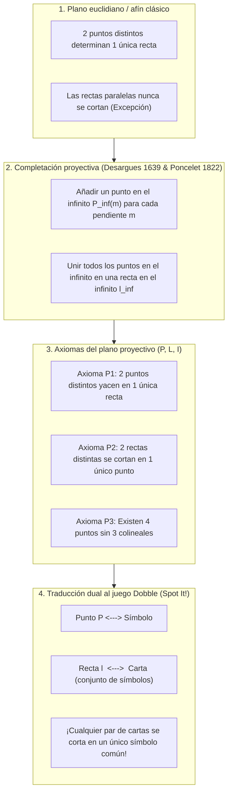
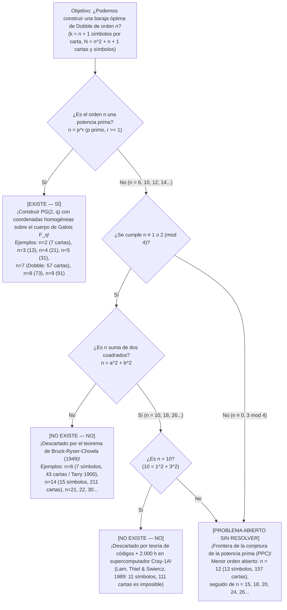

Si alguna vez has abierto la pequeña lata circular del famoso juego de mesa <strong>Dobble</strong> (llamado <strong>Spot It!</strong> en Norteamérica), ya conoces su mecánica engañosamente sencilla: cada carta redonda muestra <strong>ocho símbolos distintos</strong>. Al voltear dos cartas cualesquiera sobre la mesa, los jugadores compiten por encontrar y nombrar primero el símbolo repetido.

Cualquiera que juegue unos minutos percibe de inmediato una propiedad matemática casi mágica: <strong>no importa qué dos cartas elijas de toda la baraja, siempre comparten un símbolo en común, y nunca comparten más de uno</strong>.

Oculta dentro de esta lata de juguete se encuentra una de las joyas de la matemática pura moderna: la intersección entre la <strong>geometría proyectiva finita</strong>, los <strong>cuerpos finitos de Galois ($\mathbb{F}_q$)</strong> y la <strong>teoría del diseño combinatorio</strong>. Más aún, en cuanto planteamos la generalización natural —«¿Qué sucede si colocamos $k$ símbolos por carta en lugar de $8$?»— nos adentramos directamente en el <strong>problema de los 36 oficiales de Leonhard Euler (1782)</strong>, el <strong>teorema de Bruck-Ryser-Chowla (1949)</strong>, una monumental <strong>demostración de 2.000 horas en un supercomputador Cray-1 (1989)</strong> para $k = 11$ símbolos, y uno de los mayores problemas abiertos de la matemática discreta actual: <strong>¿existe un plano proyectivo finito de orden $12$ ($13$ símbolos por carta, $157$ cartas)?</strong>

---

## Capítulo 1: Tres misterios matemáticos dentro de la lata de Dobble

Una lata comercial de Dobble contiene <strong>55 cartas</strong> con <strong>8 símbolos</strong> cada una, extraídos de un repertorio total de $57$ símbolos. Intentar construir una baraja así por tanteo choca de frente con la explosión combinatoria de posibles cartas:

$$\binom{57}{8} = \frac{57 \times 56 \times 55 \times 54 \times 53 \times 52 \times 51 \times 50}{8!} = 1.652.411.475$$

Buscar por fuerza bruta entre <strong>1.650 millones de subconjuntos</strong> más de cincuenta cartas mutuamente compatibles es computacionalmente imposible sin un plano algebraico. Esto plantea tres grandes misterios:
1. <strong>El tamaño máximo y las 2 cartas ausentes</strong>: Con $k = 8$ símbolos por carta, el máximo matemático exacto es de <strong>57 cartas</strong> (y 57 símbolos). ¿Por qué entonces la lata comercial trae solo <strong>55 cartas</strong>?
2. <strong>El plano algebraico</strong>: ¿Cómo escribir las 57 cartas de un solo trazo, sin prueba y error, mediante álgebra?
3. <strong>Las barajas prohibidas</strong>: ¿Por qué es posible construir un Dobble perfecto con $k = 3$ (7 cartas), $k = 4$ (13 cartas), $k = 5$ (21 cartas), $k = 6$ (31 cartas) o $k = 8$ (57 cartas), pero es matemáticamente imposible para cualquier ser humano o supercomputador construir una baraja completa con <strong>$k = 7$ símbolos (43 cartas)</strong> o <strong>$k = 11$ símbolos (111 cartas)</strong>?

---

## Capítulo 2: De la geometría euclidiana a la geometría proyectiva — Puntos en el infinito y dualidad

En el plano euclidiano clásico ($\mathbb{R}^2$), dos puntos distintos determinan una única recta, pero dos rectas distintas se cortan en un único punto <em>salvo cuando son paralelas</em>. En los siglos XVII y XIX, <strong>Girard Desargues (1639)</strong> y <strong>Jean-Victor Poncelet (1822)</strong> eliminaron esa excepción inspirándose en el punto de fuga de la perspectiva renacentista:
1. A cada haz de rectas paralelas con pendiente $m$ se le añade un <strong>punto en el infinito $P_\infty(m)$</strong> por el que pasan todas las rectas de pendiente $m$.
2. Todos los puntos en el infinito $\{P_\infty(m)\}$ se agrupan sobre una única recta nueva, la <strong>recta en el infinito $\ell_\infty$</strong> (el horizonte).

Surge así un <strong>plano proyectivo $(\mathcal{P}, \mathcal{L}, \mathcal{I})$</strong> definido por tres axiomas:
- <strong>Axioma P1</strong>: Por cada dos puntos distintos $P \neq Q$ pasa <strong>una única</strong> recta $\ell$.
- <strong>Axioma P2</strong>: Cada dos rectas distintas $\ell_1 \neq \ell_2$ se cortan en <strong>un único</strong> punto $P$.
- <strong>Axioma P3 (No degeneración)</strong>: Existen al menos <strong>cuatro puntos en posición general</strong> (ningún trío de ellos colineal).

Al intercambiar las palabras «Punto» y «Recta», los axiomas P1 y P2 se transforman uno en otro (<strong>Principio de Dualidad</strong>), lo que nos da el diccionario exacto hacia el juego Dobble:

| Concepto de geometría proyectiva | Interpretación A (Diccionario estándar) | Interpretación B (Diccionario dual) |
| :--- | :--- | :--- |
| <strong>Punto $P \in \mathcal{P}$</strong> | <strong>Un símbolo (icono)</strong> | <strong>Una carta</strong> |
| <strong>Recta $\ell \in \mathcal{L}$</strong> | <strong>Una carta (subconjunto de símbolos)</strong> | <strong>Un símbolo (conjunto de cartas donde aparece)</strong> |
| <strong>Incidencia $(P, \ell) \in \mathcal{I}$</strong> | El símbolo $P$ está impreso en la carta $\ell$ | La carta $P$ muestra el símbolo $\ell$ |
| <strong>Significado del Axioma P2</strong> | <strong>Cualquier par de cartas comparte un único símbolo</strong> | Cualquier par de símbolos coincide en una única carta |

---

## Capítulo 3: El teorema de conteo de orden $n$ y el plano de Fano $PG(2, 2)$

> <strong>Teorema 3.1 (Teorema de conteo para planos proyectivos finitos)</strong>:
> En todo plano proyectivo finito $(\mathcal{P}, \mathcal{L}, \mathcal{I})$ existe un entero $n \ge 2$ (el <strong>orden</strong> del plano) tal que cada recta contiene exactamente $k = n + 1$ puntos, por cada punto pasan exactamente $r = n + 1$ rectas, y el número total de puntos y de rectas es:
> $$|\mathcal{P}| = |\mathcal{L}| = N = n^2 + n + 1$$

<strong>Demostración</strong>: Fijado un punto de referencia $P_0$, todo otro punto $Q \neq P_0$ pertenece (por P1 y P2) a una y solo una de las $n + 1$ rectas que pasan por $P_0$. Como cada una de esas $n + 1$ rectas contiene otros $n$ puntos además de $P_0$, el total es $|\mathcal{P}| = 1 + (n + 1)n = n^2 + n + 1$. Para Dobble ($k = 8 \implies n = 7$), el techo teórico es $N = 7^2 + 7 + 1 = 57$ cartas y 57 símbolos.

### La geometría finita más pequeña: el plano de Fano $PG(2, 2)$ ($n = 2$)

Para $n = 2$ ($k = 3$ símbolos por carta, $N = 7$ cartas), el geómetra italiano <strong>Gino Fano (1892)</strong> descubrió el <strong>plano de Fano $PG(2, 2)$</strong>. Sus 7 puntos corresponden a los 7 vectores binarios no nulos de $\mathbb{F}_2^3 \setminus \{\mathbf{0}\}$ (donde tres puntos forman una recta si y solo si su suma XOR bit a bit es $u \oplus v \oplus w = \mathbf{0}$) o a los desplazamientos cíclicos del <strong>conjunto de diferencias perfecto $\{1, 2, 4\} \pmod 7$</strong>:

| Carta | Desplazamiento $\ell_i = \{1+i, 2+i, 4+i\} \pmod 7$ | Los 3 símbolos de la carta | Función geométrica en el diagrama de Fano |
| :---: | :---: | :---: | :--- |
| <strong>Carta $\ell_0$</strong> | $+0$ | $\{1, 2, 4\}$ | Lado exterior 1 del triángulo equilátero |
| <strong>Carta $\ell_1$</strong> | $+1$ | $\{2, 3, 5\}$ | Lado exterior 2 del triángulo equilátero |
| <strong>Carta $\ell_2$</strong> | $+2$ | $\{3, 4, 6\}$ | Lado exterior 3 del triángulo equilátero |
| <strong>Carta $\ell_3$</strong> | $+3$ | $\{4, 5, 0\}$ | Mediana 1 (vértice a punto medio opuesto) |
| <strong>Carta $\ell_4$</strong> | $+4$ | $\{5, 6, 1\}$ | Mediana 2 (vértice a punto medio opuesto) |
| <strong>Carta $\ell_5$</strong> | $+5$ | $\{6, 0, 2\}$ | Mediana 3 (vértice a punto medio opuesto) |
| <strong>Carta $\ell_6$</strong> | $+6$ | $\{0, 1, 3\}$ | <strong>¡El círculo inscrito que pasa por los 3 puntos medios!</strong> |

---

## Capítulo 4: Coordenadas homogéneas sobre cuerpos de Galois $\mathbb{F}_q$ y la baraja de 57 cartas ($n = 7$)

Un <strong>cuerpo finito (cuerpo de Galois) $\mathbb{F}_q$</strong> de $q$ elementos existe <strong>si y solo si $q = p^r$ es una potencia de un número primo $p$</strong>. En el espacio vectorial $\mathbb{F}_q^3 \setminus \{\mathbf{0}\}$, las clases de equivalencia por múltiplos escalares $[x : y : z] \sim [\lambda x : \lambda y : \lambda z]$ ($\lambda \in \mathbb{F}_q^\times$) forman $\frac{q^3-1}{q-1} = q^2 + q + 1$ puntos proyectivos, y las ecuaciones lineales $ax + by + cz = 0$ definen las $q^2 + q + 1$ rectas del <strong>plano desarguesiano $PG(2, q)$</strong>.

Para Dobble ($q = 7$, aritmética módulo $7$ en $\mathbb{F}_7 = \{0,\dots,6\}$), los 57 símbolos se dividen en <strong>49 puntos de cuadrícula afín</strong> $P_{x,y} = [x : y : 1]$ y <strong>8 puntos en el infinito</strong> $I_m = [1 : m : 0]$ más $I_\infty = [0 : 1 : 0]$. Las 57 cartas se descomponen en:
1. <strong>49 cartas de rectas afines $L_{m,b}$</strong>: los 7 puntos $\{(x, mx+b \bmod 7)\}$ junto con el punto en el infinito $I_m$.
2. <strong>7 cartas verticales $V_c$</strong>: los 7 puntos $\{(c, y)\}$ junto con el punto en el infinito vertical $I_\infty$.
3. <strong>1 carta de horizonte $L_\infty$</strong>: los 8 puntos en el infinito $\{I_0, \dots, I_6, I_\infty\}$.

Alternativamente, por el <strong>teorema de Singer (1938)</strong>, basta tomar el conjunto de diferencias $D = \{0, 1, 3, 13, 32, 36, 43, 52\} \pmod{57}$ y desplazarlo cíclicamente $D + i \pmod{57}$ ($i = 0, \dots, 56$) para generar las 57 cartas al instante. La lata comercial incluye 55 cartas en lugar de 57 por razones de troquelado industrial ($55 = 5 \times 11$) y reparto entre jugadores, conservando intacto el axioma P2.

---

## Capítulo 5: Los 36 oficiales de Euler, Bruck-Ryser-Chowla y las fronteras de $n = 10$ y $n = 12$

Un plano proyectivo de orden $n$ es un diseño por bloques simétrico $(n^2+n+1, n+1, 1)$-BIBD (que satura la desigualdad de Fisher $b \ge v$) y, por el <strong>teorema de equivalencia de R. C. Bose (1938)</strong>, existe si y solo si existen <strong>$n - 1$ cuadrados latinos mutuamente ortogonales (MOLS) de orden $n$</strong>.

- <strong>Orden $n = 6$ ($7$ símbolos, $43$ cartas)</strong>: Requeriría $5$ MOLS de orden $6$. Sin embargo, en 1900 el francés <strong>Gaston Tarry</strong> demostró exhaustivamente que el <strong>problema de los 36 oficiales de Euler (1782)</strong> no tiene solución: no existen ni siquiera $2$ cuadrados latinos ortogonales de orden $6$, por lo que $n = 6$ es imposible.
- <strong>Teorema de Bruck-Ryser-Chowla (1949)</strong>: Si existe un plano proyectivo finito de orden $n$ con $n \equiv 1 \text{ o } 2 \pmod 4$, entonces $n$ debe poder expresarse como la <strong>suma de dos cuadrados enteros</strong>:
  $$n = a^2 + b^2 \quad (a, b \in \mathbb{Z})$$
  ¡Esto descarta de golpe $n = 6, 14, 21, 22, 30, \dots$!
- <strong>Orden $n = 10$ ($11$ símbolos, $111$ cartas) y el supercomputador Cray-1 (1989)</strong>: Como $10 = 1^2 + 3^2$, Bruck-Ryser-Chowla no descarta $n = 10$. En 1989, <strong>Clement W. H. Lam, Larry Thiel y Stanley Swiercz</strong> analizaron el código corrector binario asociado a la matriz de incidencia $111 \times 111$ y, tras <strong>2.000 horas de cálculo en un supercomputador Cray-1A</strong>, demostraron que no existe ningún plano proyectivo de orden $10$.
- <strong>Orden $n = 12$ ($13$ símbolos, $157$ cartas)</strong>: Como $12 \equiv 0 \pmod 4$, Bruck-Ryser-Chowla no impone restricción alguna y el espacio combinatorio desborda cualquier supercomputador actual. ¡Saber si existe un plano proyectivo de orden $12$ (<strong>conjetura de la potencia prima / PPC</strong>) sigue siendo uno de los grandes problemas abiertos de las matemáticas!

| Orden $n$ | Símbolos por carta $k = n+1$ | Cartas y símbolos $N = n^2+n+1$ | ¿Existe? | Construcción matemática o prueba de inexistencia |
| :---: | :---: | :---: | :---: | :--- |
| <strong>$n = 2$</strong> | $3$ | <strong>$7$</strong> | <strong>Sí (único)</strong> | Primo $2$: menor plano proyectivo <strong>plano de Fano $PG(2, 2)$</strong> |
| <strong>$n = 3, 4, 5$</strong> | $4, 5, 6$ | <strong>$13, 21, 31$</strong> | <strong>Sí (único)</strong> | Potencias primas $3, 2^2, 5$: $PG(2, q)$ sobre $\mathbb{F}_q$ |
| <strong>$n = 6$</strong> | $7$ | $43$ | <strong>No (imposible)</strong> | $6 \equiv 2 \pmod 4$, $6 \neq a^2+b^2$. <strong>36 oficiales de Euler / Tarry (1900) / Bruck-Ryser (1949)</strong> |
| <strong>$n = 7$</strong> | <strong>$8$</strong> | <strong>$57$</strong> | <strong>Sí (único)</strong> | Primo $7$: $PG(2, 7)$ sobre $\mathbb{F}_7$. <strong>Dobble comercial (55 cartas en la lata)</strong> |
| <strong>$n = 8, 9$</strong> | $9, 10$ | <strong>$73, 91$</strong> | <strong>Sí ($1$ y $4$ tipos)</strong> | Potencias primas $2^3, 3^2$: para $n=9$ existen $PG(2,9)$ y 3 planos no desarguesianos |
| <strong>$n = 10$</strong> | $11$ | $111$ | <strong>No (imposible)</strong> | $10 = 1^2+3^2$, pero <strong>refutado en 1989 por Lam et al. tras 2.000 h en Cray-1A</strong> |
| <strong>$n = 11, 13$</strong> | $12, 14$ | <strong>$133, 183$</strong> | <strong>Sí</strong> | Primos $11, 13$: $PG(2, 11)$ y $PG(2, 13)$ |
| <strong>$n = 12$</strong> | $13$ | $157$ | <strong>[Problema abierto]</strong> | $12 \equiv 0 \pmod 4$: Bruck-Ryser-Chowla no aplicable. <strong>¡Menor orden sin resolver!</strong> |
| <strong>$n = 14$</strong> | $15$ | $211$ | <strong>No (imposible)</strong> | $14 \equiv 2 \pmod 4$ y $14 \neq a^2+b^2$. <strong>Descartado por Bruck-Ryser-Chowla</strong> |
