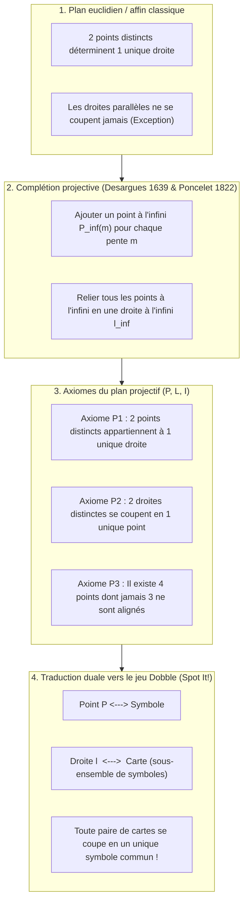
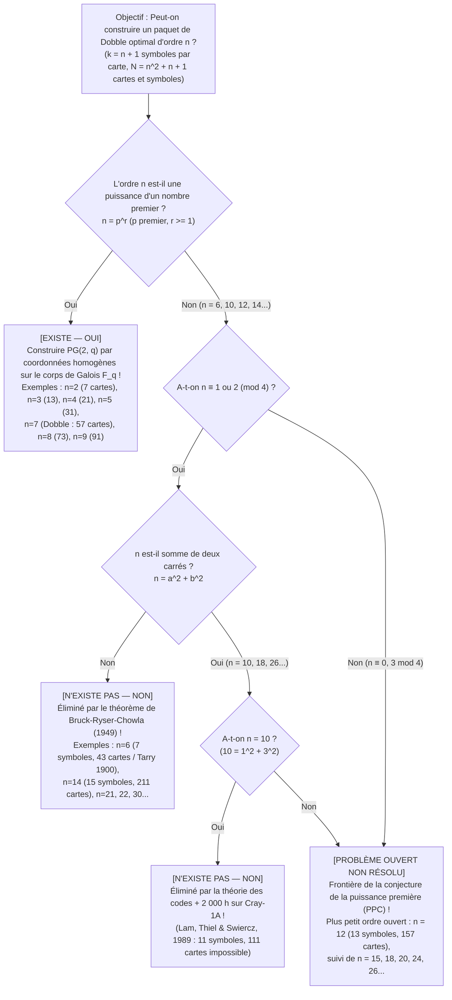

Si vous avez déjà ouvert la petite boîte ronde du célèbre jeu de société <strong>Dobble</strong> (vendu en Amérique du Nord sous le nom de <strong>Spot It!</strong>), vous connaissez sa règle d'une simplicité désarmante : chaque carte ronde comporte <strong>huit symboles différents</strong>. Dès que l'on retourne deux cartes sur la table, les joueurs s'affrontent pour nommer en premier le symbole identique.

Quiconque y joue quelques minutes est frappé par une propriété mathématique fascinante : <strong>quelles que soient les deux cartes choisies dans le paquet, elles possèdent toujours un symbole en commun — et jamais plus d'un seul !</strong>

Derrière ce jeu familial se cache l'un des joyaux des mathématiques pures modernes : la rencontre entre la <strong>géométrie projective finie</strong>, les <strong>corps finis de Galois ($\mathbb{F}_q$)</strong> et la <strong>théorie des plans d'expériences (designs combinatoires)</strong>. Mieux encore : dès que l'on demande ce qui se passe si l'on place $k$ symboles par carte au lieu de $8$, on est propulsé vers le <strong>problème des 36 officiers de Leonhard Euler (1782)</strong>, le <strong>théorème de Bruck-Ryser-Chowla (1949)</strong>, une <strong>preuve assistée par supercalculateur Cray-1 ayant nécessité 2 000 heures de calcul en 1989</strong> pour $k = 11$, et l'une des grandes énigmes ouvertes des mathématiques contemporaines : <strong>existe-t-il un plan projectif fini d'ordre $12$ ($13$ symboles par carte, $157$ cartes) ?</strong>

---

## Chapitre 1 : Trois mystères mathématiques dans la boîte de Dobble

Une boîte commerciale de Dobble contient <strong>55 cartes</strong> portant chacune <strong>8 symboles</strong> pris parmi un répertoire de $57$ symboles. Essayer de construire un tel jeu par tâtonnements se heurte immédiatement à l'explosion combinatoire du nombre de cartes candidates :

$$\binom{57}{8} = \frac{57 \times 56 \times 55 \times 54 \times 53 \times 52 \times 51 \times 50}{8!} = 1\,652\,411\,475$$

Chercher à la main une famille de plus de cinquante cartes mutuellement compatibles parmi <strong>1,65 milliard de combinaisons</strong> est sans espoir. Cela soulève trois mystères :
1. <strong>La taille maximale et les 2 cartes manquantes</strong> : Avec $k = 8$ symboles par carte, le plafond théorique absolu est de <strong>57 cartes</strong> (et 57 symboles). Pourquoi la boîte commerciale n'en contient-elle que <strong>55</strong> ?
2. <strong>L'algorithme algébrique</strong> : Comment générer d'un seul coup les 57 cartes sans aucun essai-erreur ?
3. <strong>Les paquets interdits</strong> : Pourquoi peut-on fabriquer un Dobble parfait avec $k = 3$ (7 cartes), $k = 4$ (13 cartes), $k = 5$ (21 cartes), $k = 6$ (31 cartes) ou $k = 8$ (57 cartes), alors qu'il est mathématiquement impossible à tout être humain ou supercalculateur de construire un paquet complet avec <strong>$k = 7$ symboles (43 cartes)</strong> ou <strong>$k = 11$ symboles (111 cartes)</strong> ?

---

## Chapitre 2 : De la géométrie euclidienne à la géométrie projective — Points à l'infini et dualité

Dans le plan euclidien classique ($\mathbb{R}^2$), deux points distincts déterminent une unique droite, mais deux droites distinctes se coupent en un unique point — <em>sauf si elles sont parallèles</em>. Aux XVIIe et XIXe siècles, les mathématiciens français <strong>Girard Desargues (1639)</strong> et <strong>Jean-Victor Poncelet (1822)</strong> ont éliminé cette exception en formalisant le point de fuite des peintres de la Renaissance :
1. À chaque faisceau de droites parallèles de pente $m$, on adjoint un <strong>point à l'infini $P_\infty(m)$</strong> par lequel passent toutes les droites de pente $m$.
2. Tous les points à l'infini $\{P_\infty(m)\}$ sont réunis sur une unique droite nouvelle, la <strong>droite à l'infini $\ell_\infty$</strong> (l'horizon).

On obtient ainsi un <strong>plan projectif $(\mathcal{P}, \mathcal{L}, \mathcal{I})$</strong> régi par trois axiomes :
- <strong>Axiome P1</strong> : Par deux points distincts $P \neq Q$ passe <strong>une unique</strong> droite $\ell$.
- <strong>Axiome P2</strong> : Deux droites distinctes $\ell_1 \neq \ell_2$ se coupent en <strong>un unique</strong> point $P$.
- <strong>Axiome P3 (Non-dégénérescence)</strong> : Il existe au moins <strong>quatre points en position générale</strong> (aucun triplet n'étant aligné).

L'échange des mots « Point » et « Droite » laisse le système d'axiomes invariant : c'est le <strong>principe de dualité</strong>, qui fournit le dictionnaire exact du jeu Dobble :

| Concept de géométrie projective | Interprétation A (Dictionnaire standard) | Interprétation B (Dictionnaire dual) |
| :--- | :--- | :--- |
| <strong>Point $P \in \mathcal{P}$</strong> | <strong>Un symbole (icône)</strong> | <strong>Une carte</strong> |
| <strong>Droite $\ell \in \mathcal{L}$</strong> | <strong>Une carte (ensemble de symboles)</strong> | <strong>Un symbole (ensemble des cartes où il figure)</strong> |
| <strong>Incidence $(P, \ell) \in \mathcal{I}$</strong> | Le symbole $P$ est imprimé sur la carte $\ell$ | La carte $P$ affiche le symbole $\ell$ |
| <strong>Sens de l'axiome P2</strong> | <strong>Deux cartes distinctes partagent un unique symbole</strong> | Deux symboles distincts figurent ensemble sur une unique carte |

---

## Chapitre 3 : Le théorème de comptage d'ordre $n$ et le plan de Fano $PG(2, 2)$

> <strong>Théorème 3.1 (Comptage d'un plan projectif fini d'ordre $n$)</strong> :
> Pour tout plan projectif fini $(\mathcal{P}, \mathcal{L}, \mathcal{I})$, il existe un entier $n \ge 2$ (l'<strong>ordre</strong> du plan) tel que chaque droite contient $k = n + 1$ points, chaque point appartient à $r = n + 1$ droites, et le nombre total de points et de droites vaut :
> $$|\mathcal{P}| = |\mathcal{L}| = N = n^2 + n + 1$$

<strong>Démonstration</strong> : En fixant un point de référence $P_0$, tout autre point $Q \neq P_0$ appartient (par P1 et P2) à l'une et une seule des $n + 1$ droites passant par $P_0$. Comme chacune de ces $n + 1$ droites porte $n$ points distincts de $P_0$, on compte $|\mathcal{P}| = 1 + (n + 1)n = n^2 + n + 1$. Pour Dobble ($k = 8 \implies n = 7$), le maximum théorique est donc $N = 7^2 + 7 + 1 = 57$ cartes et 57 symboles.

### La plus petite géométrie finie : le plan de Fano $PG(2, 2)$ ($n = 2$)

Pour $n = 2$ ($k = 3$ symboles par carte, $N = 7$ cartes), le géomètre italien <strong>Gino Fano (1892)</strong> découvrit le <strong>plan de Fano $PG(2, 2)$</strong>. Ses 7 points correspondent aux 7 vecteurs binaires non nuls de $\mathbb{F}_2^3 \setminus \{\mathbf{0}\}$ (trois points formant une droite si et seulement si leur somme XOR vaut $u \oplus v \oplus w = \mathbf{0}$), ou aux translatés cycliques de l'<strong>ensemble à différences parfaites $\{1, 2, 4\} \pmod 7$</strong> :

| Carte | Décalage cyclique $\ell_i = \{1+i, 2+i, 4+i\} \pmod 7$ | Les 3 symboles de la carte | Rôle géométrique dans le diagramme de Fano |
| :---: | :---: | :---: | :--- |
| <strong>Carte $\ell_0$</strong> | $+0$ | $\{1, 2, 4\}$ | Côté extérieur 1 du triangle équilatéral |
| <strong>Carte $\ell_1$</strong> | $+1$ | $\{2, 3, 5\}$ | Côté extérieur 2 du triangle équilatéral |
| <strong>Carte $\ell_2$</strong> | $+2$ | $\{3, 4, 6\}$ | Côté extérieur 3 du triangle équilatéral |
| <strong>Carte $\ell_3$</strong> | $+3$ | $\{4, 5, 0\}$ | Médiane 1 (sommet vers milieu opposé) |
| <strong>Carte $\ell_4$</strong> | $+4$ | $\{5, 6, 1\}$ | Médiane 2 (sommet vers milieu opposé) |
| <strong>Carte $\ell_5$</strong> | $+5$ | $\{6, 0, 2\}$ | Médiane 3 (sommet vers milieu opposé) |
| <strong>Carte $\ell_6$</strong> | $+6$ | $\{0, 1, 3\}$ | <strong>Le cercle inscrit passant par les 3 milieux !</strong> |

---

## Chapitre 4 : Coordonnées homogènes sur les corps de Galois $\mathbb{F}_q$ et anatomie du Dobble ($n = 7$)

Un <strong>corps fini (corps de Galois) $\mathbb{F}_q$</strong> à $q$ éléments existe <strong>si et seulement si $q = p^r$ est une puissance d'un nombre premier $p$</strong>. Dans l'espace vectoriel $\mathbb{F}_q^3 \setminus \{\mathbf{0}\}$, les classes de proportionnalité $[x : y : z] \sim [\lambda x : \lambda y : \lambda z]$ ($\lambda \in \mathbb{F}_q^\times$) forment $\frac{q^3-1}{q-1} = q^2 + q + 1$ points projectifs, et les plans vectoriels d'équation $ax + by + cz = 0$ définissent les $q^2 + q + 1$ droites du <strong>plan arguésien $PG(2, q)$</strong>.

Pour Dobble ($q = 7$, arithmétique modulo $7$ dans $\mathbb{F}_7 = \{0,\dots,6\}$), les 57 symboles se divisent en <strong>49 points affines</strong> $P_{x,y} = [x : y : 1]$ et <strong>8 points à l'infini</strong> $I_m = [1 : m : 0]$ ainsi que $I_\infty = [0 : 1 : 0]$. Les 57 cartes se répartissent en :
1. <strong>49 cartes de droites affines $L_{m,b}$</strong> : les 7 points $\{(x, mx+b \bmod 7)\}$ complétés par le point à l'infini $I_m$.
2. <strong>7 cartes verticales $V_c$</strong> : les 7 points $\{(c, y)\}$ complétés par le point à l'infini vertical $I_\infty$.
3. <strong>1 carte d'horizon $L_\infty$</strong> : les 8 points à l'infini $\{I_0, \dots, I_6, I_\infty\}$.

Par ailleurs, le <strong>théorème de Singer (1938)</strong> permet d'engendrer les 57 cartes par simple décalage cyclique $D + i \pmod{57}$ de l'ensemble à différences $D = \{0, 1, 3, 13, 32, 36, 43, 52\} \pmod{57}$. Si l'éditeur a retiré 2 cartes dans la boîte commerciale (55 au lieu de 57), c'est uniquement pour optimiser les planches de découpe industrielle ($55 = 5 \times 11$) sans jamais altérer la propriété d'intersection unique entre les cartes restantes.

---

## Chapitre 5 : Les 36 officiers d'Euler, Bruck-Ryser-Chowla et les frontières $n = 10$ et $n = 12$

Un plan projectif d'ordre $n$ est un plan en blocs symétrique $(n^2+n+1, n+1, 1)$-BIBD (atteignant l'égalité $b = v$ de l'inégalité de Fisher) et, d'après le <strong>théorème de R. C. Bose (1938)</strong>, il existe si et seulement s'il existe <strong>$n - 1$ carrés latins mutuellement orthogonaux (MOLS) d'ordre $n$</strong>.

- <strong>Ordre $n = 6$ ($7$ symboles, $43$ cartes)</strong> : Exigerait $5$ MOLS d'ordre $6$. Or, dès 1900, le mathématicien français <strong>Gaston Tarry</strong> résolut par la négative le <strong>problème des 36 officiers d'Euler (1782)</strong> en prouvant qu'il n'existe même pas $2$ carrés latins orthogonaux d'ordre $6$ — le Dobble à 43 cartes est donc impossible !
- <strong>Théorème de Bruck-Ryser-Chowla (1949)</strong> : Si un plan projectif fini d'ordre $n$ existe avec $n \equiv 1 \text{ ou } 2 \pmod 4$, alors $n$ doit être la <strong>somme de deux carrés d'entiers</strong> :
  $$n = a^2 + b^2 \quad (a, b \in \mathbb{Z})$$
  Ce théorème foudroie instantanément $n = 6, 14, 21, 22, 30, \dots$ !
- <strong>Ordre $n = 10$ ($11$ symboles, $111$ cartes) et le supercalculateur Cray-1 (1989)</strong> : Comme $10 = 1^2 + 3^2$, le théorème de Bruck-Ryser-Chowla n'élimine pas $n = 10$. Ce n'est qu'en 1989 que <strong>Clement W. H. Lam, Larry Thiel et Stanley Swiercz</strong>, en étudiant le code correcteur binaire engendré par la matrice d'incidence $111 \times 111$ et après <strong>2 000 heures de calcul sur un supercalculateur Cray-1A</strong>, démontrèrent qu'aucun plan projectif d'ordre $10$ n'existe.
- <strong>Ordre $n = 12$ ($13$ symboles, $157$ cartes)</strong> : Comme $12 \equiv 0 \pmod 4$, Bruck-Ryser-Chowla ne s'applique pas, et l'espace de recherche dépasse les capacités de tous les supercalculateurs actuels. Savoir s'il existe un plan projectif d'ordre $12$ (<strong>conjecture de la puissance première / PPC</strong>) demeure l'un des plus célèbres problèmes ouverts des mathématiques !

| Ordre $n$ | Symboles par carte $k = n+1$ | Cartes & symboles $N = n^2+n+1$ | Existe-t-il ? | Construction mathématique ou preuve de non-existence |
| :---: | :---: | :---: | :---: | :--- |
| <strong>$n = 2$</strong> | $3$ | <strong>$7$</strong> | <strong>Oui (unique)</strong> | Premier $2$ : plus petit plan projectif <strong>plan de Fano $PG(2, 2)$</strong> |
| <strong>$n = 3, 4, 5$</strong> | $4, 5, 6$ | <strong>$13, 21, 31$</strong> | <strong>Oui (unique)</strong> | Puissances premières $3, 2^2, 5$ : $PG(2, q)$ sur $\mathbb{F}_q$ |
| <strong>$n = 6$</strong> | $7$ | $43$ | <strong>Non (impossible)</strong> | $6 \equiv 2 \pmod 4$, $6 \neq a^2+b^2$. <strong>36 officiers d'Euler / Tarry (1900) / Bruck-Ryser (1949)</strong> |
| <strong>$n = 7$</strong> | <strong>$8$</strong> | <strong>$57$</strong> | <strong>Oui (unique)</strong> | Premier $7$ : $PG(2, 7)$ sur $\mathbb{F}_7$. <strong>Jeu Dobble commercial (55 cartes dans la boîte)</strong> |
| <strong>$n = 8, 9$</strong> | $9, 10$ | <strong>$73, 91$</strong> | <strong>Oui ($1$ et $4$ types)</strong> | Puissances premières $2^3, 3^2$ : pour $n=9$, $PG(2,9)$ + 3 plans non arguésiens (Hall, Hughes) |
| <strong>$n = 10$</strong> | $11$ | $111$ | <strong>Non (impossible)</strong> | $10 = 1^2+3^2$, mais <strong>réfuté en 1989 par Lam et al. après 2 000 h sur Cray-1A</strong> |
| <strong>$n = 11, 13$</strong> | $12, 14$ | <strong>$133, 183$</strong> | <strong>Oui</strong> | Nombres premiers $11, 13$ : $PG(2, 11)$ et $PG(2, 13)$ |
| <strong>$n = 12$</strong> | $13$ | $157$ | <strong>[Problème ouvert]</strong> | $12 \equiv 0 \pmod 4$ : hors de portée de Bruck-Ryser-Chowla. <strong>Plus petit ordre non résolu !</strong> |
| <strong>$n = 14$</strong> | $15$ | $211$ | <strong>Non (impossible)</strong> | $14 \equiv 2 \pmod 4$ et $14 \neq a^2+b^2$. <strong>Éliminé par Bruck-Ryser-Chowla</strong> |
