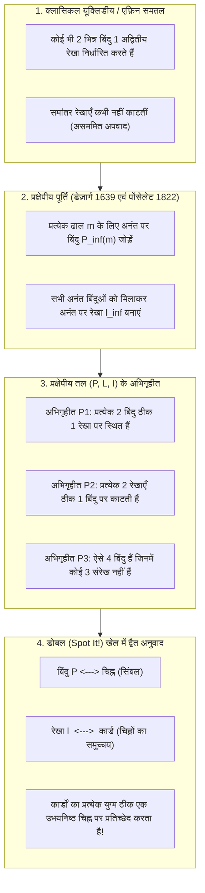
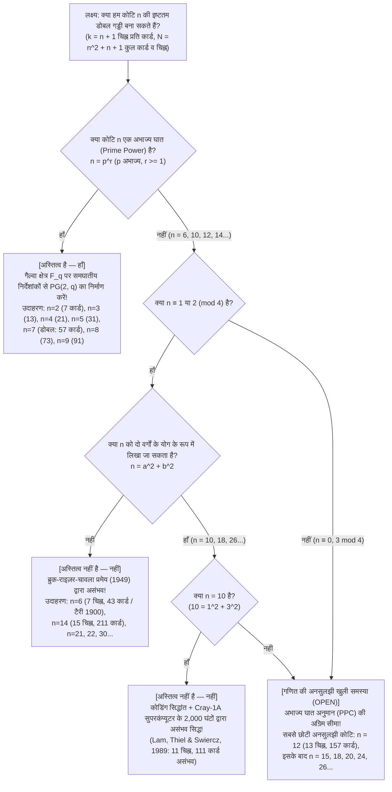

यदि आपने कभी विश्व प्रसिद्ध पार्टी गेम <strong>डोबल (Dobble, उत्तरी अमेरिका में Spot It!)</strong> का छोटा गोल टिन का डिब्बा खोला है, तो आप इसका अत्यंत सरल नियम जानते होंगे: प्रत्येक गोल कार्ड पर <strong>आठ अलग-अलग चिह्न (प्रतीक)</strong> छपे होते हैं। जब मेज़ पर कोई भी दो कार्ड पलटे जाते हैं, तो खिलाड़ी सबसे पहले दोनों कार्डों में मौजूद उस एकमात्र समान चिह्न को ढूँढ़कर उसका नाम पुकारने की होड़ करते हैं।

इस खेल को कुछ मिनट खेलने वाला हर व्यक्ति एक जादुई गणितीय गुण से चकित रह जाता है: <strong>पूरी गड्डी में से आप चाहे कोई भी दो कार्ड उठा लें, उनमें हमेशा एक चिह्न समान होता है — और कभी भी एक से अधिक चिह्न समान नहीं होता!</strong>

इस छोटे से खिलौने के डिब्बे में आधुनिक शुद्ध गणित का एक अनमोल रत्न छिपा है: <strong>परिमित प्रक्षेपीय ज्यामिति (Finite Projective Geometry)</strong>, <strong>गैल्वा क्षेत्र (Galois Fields $\mathbb{F}_q$)</strong>, और <strong>सांयोगिक डिज़ाइन सिद्धांत (Combinatorial Design Theory)</strong> का संगम। और जैसे ही हम यह स्वाभाविक प्रश्न पूछते हैं कि «यदि हम प्रत्येक कार्ड पर $8$ के बजाय $k$ चिह्न रखें तो क्या होगा?», हम सीधे <strong>लियोनहार्ड यूलर की 36 अधिकारियों की समस्या (1782)</strong>, <strong>ब्रुक-राइज़र-चावला प्रमेय (1949)</strong>, $k = 11$ चिह्नों के लिए <strong>Cray-1 सुपरकंप्यूटर पर 2,000 घंटे चली ऐतिहासिक गणना (1989)</strong>, और 21वीं सदी के विविक्त गणित (Discrete Mathematics) की सबसे बड़ी अनसुलझी पहेलियों में से एक पर पहुँच जाते हैं: <strong>क्या कोटि $12$ का परिमित प्रक्षेपीय तल (प्रत्येक कार्ड पर $13$ चिह्न, कुल $157$ कार्ड) अस्तित्व में है?</strong>

---

## अध्याय 1: डोबल (Dobble) के डिब्बे में छिपे तीन गणितीय रहस्य

बाज़ार में मिलने वाले डोबल के डिब्बे में <strong>55 कार्ड</strong> होते हैं और प्रत्येक कार्ड पर कुल $57$ चिह्नों में से <strong>8 चिह्न</strong> बने होते हैं। यदि कोई डिज़ाइनर बिना बीजगणितीय सूत्र के अनुमान और प्रयास (trial and error) से ऐसी गड्डी बनाना चाहे, तो $57$ में से $8$ चिह्न चुनने के संभावित कार्डों की संख्या होगी:

$$\binom{57}{8} = \frac{57 \times 56 \times 55 \times 54 \times 53 \times 52 \times 51 \times 50}{8!} = 1,652,411,475$$

<strong>1.65 अरब से अधिक संभावित कार्डों</strong> में से पचास से अधिक परस्पर संगत कार्डों को ब्रूट-फोर्स (brute force) से खोजना असंभव है। यहाँ तीन मुख्य रहस्य उभरते हैं:
1. <strong>अधिकतम कार्ड संख्या और गायब 2 कार्ड</strong>: जब प्रत्येक कार्ड पर $k = 8$ चिह्न हों, तो गणितीय रूप से अधिकतम <strong>57 कार्ड</strong> (और 57 चिह्न) बनाए जा सकते हैं। फिर व्यावसायिक डिब्बे में केवल <strong>55 कार्ड</strong> ही क्यों होते हैं?
2. <strong>बीजगणितीय ब्लूप्रिंट</strong>: बिना किसी तुक्के के एक ही बार में पूरे 57 कार्डों की सूची बीजगणित से कैसे लिखी जा सकती है?
3. <strong>वर्जित गड्डियाँ</strong>: $k = 3$ (7 कार्ड), $k = 4$ (13 कार्ड), $k = 5$ (21 कार्ड), $k = 6$ (31 कार्ड), या $k = 8$ (57 कार्ड) वाला डोबल आसानी से बनाया जा सकता है, किंतु <strong>$k = 7$ चिह्नों (43 कार्ड)</strong> या <strong>$k = 11$ चिह्नों (111 कार्ड)</strong> वाली पूर्ण गड्डी ब्रह्मांड का कोई भी गणितज्ञ या सुपरकंप्यूटर कभी नहीं बना सकता। क्यों?

---

## अध्याय 2: यूक्लिडीय ज्यामिति से प्रक्षेपीय ज्यामिति तक — अनंत पर बिंदु और द्वैत सिद्धांत

क्लासिकल यूक्लिडीय समतल ($\mathbb{R}^2$) में दो भिन्न बिंदु एक अद्वितीय रेखा निर्धारित करते हैं, किंतु दो भिन्न रेखाएँ एक अद्वितीय बिंदु पर तभी काटती हैं <em>जब वे समांतर न हों</em>। 17वीं और 19वीं शताब्दी में <strong>गिरार्ड डेज़ार्ग (1639)</strong> और <strong>जीन-विक्टर पोंसेलेट (1822)</strong> ने पुनर्जागरण काल की चित्रकला के 'लोप बिंदु' (vanishing point) को गणितीय रूप देकर समांतर रेखाओं के इस अपवाद को समाप्त कर दिया:
1. ढाल (slope) $m$ वाली समांतर रेखाओं के प्रत्येक कुल के लिए एक नया आदर्श बिंदु <strong>अनंत पर बिंदु $P_\infty(m)$</strong> जोड़ा जाता है जिससे ढाल $m$ वाली सभी रेखाएँ गुज़रती हैं।
2. अनंत पर स्थित सभी बिंदुओं $\{P_\infty(m)\}$ को मिलाकर एक नई रेखा <strong>अनंत पर रेखा $\ell_\infty$</strong> (क्षितिज रेखा) घोषित की जाती है।

इस प्रकार तीन अभिगृहीतों (Axioms) वाला <strong>प्रक्षेपीय तल $(\mathcal{P}, \mathcal{L}, \mathcal{I})$</strong> प्राप्त होता है:
- <strong>अभिगृहीत P1</strong>: किन्हीं भी दो भिन्न बिंदुओं $P \neq Q$ से होकर <strong>ठीक एक</strong> रेखा $\ell$ गुज़रती है।
- <strong>अभिगृहीत P2</strong>: कोई भी दो भिन्न रेखाएँ $\ell_1 \neq \ell_2$ <strong>ठीक एक</strong> बिंदु $P$ पर प्रतिच्छेद करती हैं।
- <strong>अभिगृहीत P3 (अपभ्रष्टता-निषेध)</strong>: कम से कम <strong>चार ऐसे बिंदु</strong> अस्तित्व में हैं जिनमें से कोई भी तीन एक ही रेखा पर नहीं हैं।

'बिंदु' और 'रेखा' शब्दों को आपस में बदलने पर P1 और P2 एक-दूसरे में बदल जाते हैं (<strong>द्वैत सिद्धांत / Principle of Duality</strong>), जो डोबल खेल का सटीक शब्दकोश प्रदान करता है:

| प्रक्षेपीय ज्यामिति की संकल्पना | व्याख्या A (मानक शब्दकोश) | व्याख्या B (द्वैत शब्दकोश) |
| :--- | :--- | :--- |
| <strong>बिंदु $P \in \mathcal{P}$</strong> | <strong>एक चिह्न (आइकन)</strong> | <strong>एक कार्ड</strong> |
| <strong>रेखा $\ell \in \mathcal{L}$</strong> | <strong>एक कार्ड (चिह्नों का समुच्चय)</strong> | <strong>एक चिह्न (उन कार्डों का समुच्चय जिन पर वह छपा है)</strong> |
| <strong>आपतन $(P, \ell) \in \mathcal{I}$</strong> | चिह्न $P$ कार्ड $\ell$ पर छपा है | कार्ड $P$ पर चिह्न $\ell$ मौजूद है |
| <strong>अभिगृहीत P2 का अर्थ</strong> | <strong>किन्हीं भी दो कार्डों में ठीक एक चिह्न उभयनिष्ठ होता है</strong> | कोई भी दो चिह्न ठीक एक कार्ड पर एक साथ दिखते हैं |

---

## अध्याय 3: कोटि $n$ का गणना प्रमेय और फ़ानो तल $PG(2, 2)$

> <strong>प्रमेय 3.1 (परिमित प्रक्षेपीय तलों का गणना प्रमेय)</strong>:
> किसी भी परिमित प्रक्षेपीय तल $(\mathcal{P}, \mathcal{L}, \mathcal{I})$ के लिए एक पूर्णांक $n \ge 2$ (तल की <strong>कोटि / Order</strong>) अस्तित्व में होता है जिसके लिए प्रत्येक रेखा पर ठीक $k = n + 1$ बिंदु होते हैं, प्रत्येक बिंदु से ठीक $r = n + 1$ रेखाएँ गुज़रती हैं, तथा बिंदुओं और रेखाओं की कुल संख्या बराबर होती है:
> $$|\mathcal{P}| = |\mathcal{L}| = N = n^2 + n + 1$$

<strong>उपपत्ति</strong>: एक संदर्भ बिंदु $P_0$ स्थिर करें। कोई भी अन्य बिंदु $Q \neq P_0$ (P1 और P2 के अनुसार) $P_0$ से गुज़रने वाली $n + 1$ रेखाओं में से ठीक एक पर स्थित होता है। चूँकि प्रत्येक ऐसी रेखा पर $P_0$ के अतिरिक्त $n$ अन्य बिंदु होते हैं, कुल बिंदु $|\mathcal{P}| = 1 + (n + 1)n = n^2 + n + 1$ होंगे। डोबल ($k = 8 \implies n = 7$) के लिए अधिकतम कार्ड और चिह्न $N = 7^2 + 7 + 1 = 57$ हैं।

### सबसे छोटी परिमित ज्यामिति: फ़ानो तल $PG(2, 2)$ ($n = 2$)

$n = 2$ ($k = 3$ चिह्न प्रति कार्ड, $N = 7$ कार्ड) के लिए इतालवी गणितज्ञ <strong>जीनो फ़ानो (1892)</strong> ने <strong>फ़ानो तल $PG(2, 2)$</strong> की खोज की। इसके 7 बिंदु $\mathbb{F}_2^3 \setminus \{\mathbf{0}\}$ के 7 अशून्य 3-बिट बाइनरी सदिशों के संगत हैं (जहाँ तीन बिंदु एक रेखा बनाते हैं यदि और केवल यदि उनका बिटवाइज़ XOR योग $u \oplus v \oplus w = \mathbf{0}$ हो), अथवा <strong>चक्रीय अंतर समुच्चय $\{1, 2, 4\} \pmod 7$</strong> के चक्रीय विस्थापन से प्राप्त होते हैं:

| कार्ड | चक्रीय विस्थापन $\ell_i = \{1+i, 2+i, 4+i\} \pmod 7$ | कार्ड पर छपे 3 चिह्न | फ़ानो आरेख में ज्यामितीय भूमिका |
| :---: | :---: | :---: | :--- |
| <strong>कार्ड $\ell_0$</strong> | $+0$ | $\{1, 2, 4\}$ | समबाहु त्रिभुज की बाहरी भुजा 1 |
| <strong>कार्ड $\ell_1$</strong> | $+1$ | $\{2, 3, 5\}$ | समबाहु त्रिभुज की बाहरी भुजा 2 |
| <strong>कार्ड $\ell_2$</strong> | $+2$ | $\{3, 4, 6\}$ | समबाहु त्रिभुज की बाहरी भुजा 3 |
| <strong>कार्ड $\ell_3$</strong> | $+3$ | $\{4, 5, 0\}$ | माध्यिका 1 (शीर्ष से सम्मुख मध्यबिंदु तक) |
| <strong>कार्ड $\ell_4$</strong> | $+4$ | $\{5, 6, 1\}$ | माध्यिका 2 (शीर्ष से सम्मुख मध्यबिंदु तक) |
| <strong>कार्ड $\ell_5$</strong> | $+5$ | $\{6, 0, 2\}$ | माध्यिका 3 (शीर्ष से सम्मुख मध्यबिंदु तक) |
| <strong>कार्ड $\ell_6$</strong> | $+6$ | $\{0, 1, 3\}$ | <strong>तीनों भुजाओं के मध्यबिंदुओं से गुज़रने वाला अंतःवृत्त!</strong> |

---

## अध्याय 4: गैल्वा क्षेत्रों $\mathbb{F}_q$ पर समघातीय निर्देशांक और 57-कार्ड डोबल ($n = 7$) की संरचना

$q$ अवयवों वाला <strong>परिमित क्षेत्र (गैल्वा क्षेत्र) $\mathbb{F}_q$</strong> तभी और केवल तभी अस्तित्व में होता है जब <strong>$q = p^r$ किसी अभाज्य संख्या $p$ की घात (Prime Power)</strong> हो। सदिश समष्टि $\mathbb{F}_q^3 \setminus \{\mathbf{0}\}$ में अदिश गुणज तुल्यता वर्ग $[x : y : z] \sim [\lambda x : \lambda y : \lambda z]$ ($\lambda \in \mathbb{F}_q^\times$) कुल $\frac{q^3-1}{q-1} = q^2 + q + 1$ प्रक्षेपीय बिंदु बनाते हैं, और रैखिक समीकरण $ax + by + cz = 0$ <strong>डेज़ार्गीय तल $PG(2, q)$</strong> की $q^2 + q + 1$ रेखाएँ परिभाषित करते हैं।

डोबल ($q = 7$, $\mathbb{F}_7 = \{0,\dots,6\}$ में मॉड्यूलो $7$ अंकगणित) के 57 चिह्न <strong>49 एफ़िन ग्रिड बिंदुओं</strong> $P_{x,y} = [x : y : 1]$ और <strong>8 अनंत बिंदुओं</strong> $I_m = [1 : m : 0]$ तथा $I_\infty = [0 : 1 : 0]$ में बँटते हैं। 57 कार्ड इस प्रकार बनते हैं:
1. <strong>49 तिर्यक एवं क्षैतिज रेखा कार्ड $L_{m,b}$</strong>: रेखा $y \equiv mx+b \pmod 7$ के 7 ग्रिड बिंदु + अनंत बिंदु $I_m$।
2. <strong>7 ऊर्ध्वाधर रेखा कार्ड $V_c$</strong>: रेखा $x \equiv c \pmod 7$ के 7 ग्रिड बिंदु + ऊर्ध्वाधर अनंत बिंदु $I_\infty$।
3. <strong>1 क्षितिज रेखा कार्ड $L_\infty$</strong>: सभी 8 अनंत बिंदु $\{I_0, \dots, I_6, I_\infty\}$।

वैकल्पिक रूप से, <strong>सिंगर के प्रमेय (1938)</strong> के अनुसार चक्रीय अंतर समुच्चय $D = \{0, 1, 3, 13, 32, 36, 43, 52\} \pmod{57}$ में $+i \pmod{57}$ जोड़कर सीधे सभी 57 कार्ड प्राप्त किए जा सकते हैं। व्यावसायिक डिब्बे में 57 के बजाय 55 कार्ड केवल प्रिंटिंग शीट की डाई-कटिंग ($55 = 5 \times 11$) और खिलाड़ियों में बराबर बँटवारे की सुविधा के लिए रखे जाते हैं।

---

## अध्याय 5: यूलर के 36 अधिकारी, ब्रुक-राइज़र-चावला प्रमेय और $n = 10$ व $n = 12$ की सीमाएं

कोटि $n$ का प्रक्षेपीय तल एक सममित $(n^2+n+1, n+1, 1)$-ब्लॉक डिज़ाइन (BIBD, जहाँ फिशर असमिका $b \ge v$ में समता $b = v$ लागू होती है) है, और <strong>आर. सी. बोस (R. C. Bose, 1938) के तुल्यता प्रमेय</strong> के अनुसार इसका अस्तित्व तभी और केवल तभी होता है जब कोटि $n$ के <strong>$n - 1$ परस्पर लांबिक लैटिन वर्ग (MOLS)</strong> मौजूद हों।

- <strong>कोटि $n = 6$ ($7$ चिह्न, $43$ कार्ड)</strong>: इसके लिए कोटि $6$ के $5$ MOLS आवश्यक हैं। किंतु 1900 में फ्रांसीसी गणितज्ञ <strong>गैस्टन टैरी (Gaston Tarry)</strong> ने सिद्ध किया कि <strong>यूलर की 36 अधिकारियों की समस्या (1782)</strong> का कोई हल नहीं है — कोटि $6$ के $2$ लांबिक लैटिन वर्ग भी संभव नहीं हैं, अतः $n = 6$ असंभव है!
- <strong>ब्रुक-राइज़र-चावला प्रमेय (1949)</strong>: यदि कोटि $n$ का परिमित प्रक्षेपीय तल अस्तित्व में है और $n \equiv 1 \text{ या } 2 \pmod 4$, तो $n$ अनिवार्य रूप से <strong>दो पूर्णांकों के वर्गों का योग</strong> होना चाहिए:
  $$n = a^2 + b^2 \quad (a, b \in \mathbb{Z})$$
  यह प्रमेय एक ही झटके में $n = 6, 14, 21, 22, 30, \dots$ को असंभव घोषित कर देता है!
- <strong>कोटि $n = 10$ ($11$ चिह्न, $111$ कार्ड) और Cray-1 सुपरकंप्यूटर प्रमाण (1989)</strong>: चूँकि $10 = 1^2 + 3^2$, ब्रुक-राइज़र-चावला प्रमेय $n = 10$ को खारिज नहीं कर पाता। अंततः 1989 में <strong>क्लेमेंट लैम (Clement W. H. Lam), लैरी थील और स्टेनली स्विएर्ज़</strong> ने कोडिंग सिद्धांत और <strong>Cray-1A सुपरकंप्यूटर पर 2,000 घंटे की गणना</strong> से सिद्ध किया कि कोटि $10$ का कोई प्रक्षेपीय तल अस्तित्व में नहीं है।
- <strong>कोटि $n = 12$ ($13$ चिह्न, $157$ कार्ड)</strong>: चूँकि $12 \equiv 0 \pmod 4$, ब्रुक-राइज़र-चावला प्रमेय यहाँ कोई शर्त नहीं लगाता और इसकी खोज समष्टि आधुनिक सुपरकंप्यूटरों की क्षमता से भी परे है। क्या कोटि $12$ का प्रक्षेपीय तल अस्तित्व में है (<strong>अभाज्य घात अनुमान / PPC</strong>), यह आज भी गणित की सबसे प्रसिद्ध अनसुलझी समस्याओं में से एक है!

| कोटि $n$ | प्रति कार्ड चिह्न $k = n+1$ | कुल कार्ड व चिह्न $N = n^2+n+1$ | क्या अस्तित्व है? | गणितीय संरचना अथवा अनस्तित्व का प्रमाण |
| :---: | :---: | :---: | :---: | :--- |
| <strong>$n = 2$</strong> | $3$ | <strong>$7$</strong> | <strong>हाँ (अद्वितीय)</strong> | अभाज्य $2$: सबसे छोटा प्रक्षेपीय तल <strong>फ़ानो तल $PG(2, 2)$</strong> |
| <strong>$n = 3, 4, 5$</strong> | $4, 5, 6$ | <strong>$13, 21, 31$</strong> | <strong>हाँ (अद्वितीय)</strong> | अभाज्य घातें $3, 2^2, 5$: $\mathbb{F}_q$ पर $PG(2, q)$ |
| <strong>$n = 6$</strong> | $7$ | $43$ | <strong>नहीं (असंभव)</strong> | $6 \equiv 2 \pmod 4$, $6 \neq a^2+b^2$। <strong>यूलर के 36 अधिकारी / टैरी (1900) / ब्रुक-राइज़र (1949)</strong> |
| <strong>$n = 7$</strong> | <strong>$8$</strong> | <strong>$57$</strong> | <strong>हाँ (अद्वितीय)</strong> | अभाज्य $7$: $\mathbb{F}_7$ पर $PG(2, 7)$। <strong>व्यावसायिक डोबल खेल (डिब्बे में 55 कार्ड)</strong> |
| <strong>$n = 8, 9$</strong> | $9, 10$ | <strong>$73, 91$</strong> | <strong>हाँ ($1$ व $4$ प्रकार)</strong> | अभाज्य घातें $2^3, 3^2$: $n=9$ के लिए $PG(2,9)$ तथा 3 गैर-डेज़ार्गीय तल |
| <strong>$n = 10$</strong> | $11$ | $111$ | <strong>नहीं (असंभव)</strong> | $10 = 1^2+3^2$, किंतु <strong>लैम आदि (1989) द्वारा Cray-1A पर 2,000 घंटे की गणना से असंभव सिद्ध</strong> |
| <strong>$n = 11, 13$</strong> | $12, 14$ | <strong>$133, 183$</strong> | <strong>हाँ</strong> | अभाज्य $11, 13$: $PG(2, 11)$ और $PG(2, 13)$ |
| <strong>$n = 12$</strong> | $13$ | $157$ | <strong>[अनसुलझी समस्या]</strong> | $12 \equiv 0 \pmod 4$: ब्रुक-राइज़र प्रमेय लागू नहीं। <strong>मानवता के सामने सबसे छोटी अनसुलझी कोटि!</strong> |
| <strong>$n = 14$</strong> | $15$ | $211$ | <strong>नहीं (असंभव)</strong> | $14 \equiv 2 \pmod 4$ और $14 \neq a^2+b^2$। <strong>ब्रुक-राइज़र-चावला प्रमेय द्वारा असंभव</strong> |
