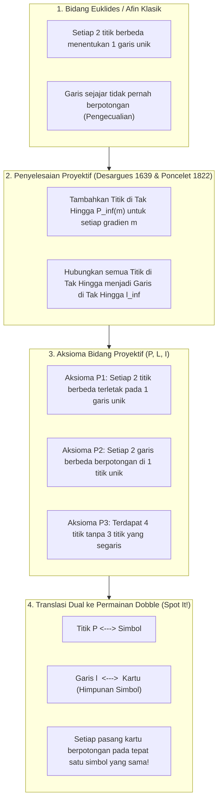
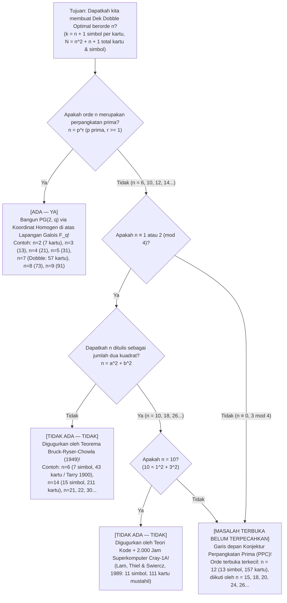

Jika Anda pernah membuka kaleng bundar permainan pesta terlaris di dunia <strong>Dobble</strong> (dijual di Amerika Utara dengan nama <strong>Spot It!</strong>), Anda tentu tahu aturannya yang tampak sangat sederhana: pada setiap kartu bundar tercetak <strong>delapan simbol berbeda</strong>. Saat dua kartu dibuka di atas meja, para pemain berlomba menemukan dan meneriakkan nama simbol yang sama terlebih dahulu.

Siapa pun yang memainkannya selama beberapa menit akan terpukau oleh sifat matematika yang nyaris ajaib: <strong>tidak peduli dua kartu mana pun yang Anda ambil dari seluruh tumpukan, keduanya selalu memiliki satu simbol yang sama — dan tidak pernah lebih dari satu!</strong>

Di balik kaleng mainan sederhana ini tersimpan salah satu mahakarya matematika murni modern: perpaduan antara <strong>Geometri Proyektif Hingga (Finite Projective Geometry)</strong>, <strong>Lapangan Hingga Galois ($\mathbb{F}_q$)</strong>, dan <strong>Teori Desain Kombinatorial</strong>. Lebih menakjubkan lagi, begitu kita bertanya «Apa yang terjadi jika kita meletakkan $k$ simbol pada setiap kartu, bukan $8$?», kita langsung dibawa menuju <strong>Masalah 36 Perwira Leonhard Euler (1782)</strong>, <strong>Teorema Bruck-Ryser-Chowla (1949)</strong>, <strong>perhitungan 2.000 jam pada superkomputer Cray-1 (1989)</strong> untuk $k = 11$ simbol, serta salah satu masalah belum terpecahkan terbesar dalam matematika diskrit: <strong>Apakah bidang proyektif hingga berorde $12$ ($13$ simbol per kartu, $157$ kartu) ada?</strong>

---

## Bab 1: Tiga Misteri Matematika di Dalam Kaleng Dobble

Kaleng komersial Dobble berisi <strong>55 kartu</strong> dengan masing-masing <strong>8 simbol</strong> dari total $57$ jenis simbol. Mencoba menyusun dek seperti itu secara manual dengan coba-coba (*trial and error*) akan langsung terbentur ledakan kombinatorial jumlah kandidat kartu:

$$\binom{57}{8} = \frac{57 \times 56 \times 55 \times 54 \times 53 \times 52 \times 51 \times 50}{8!} = 1.652.411.475$$

Mencari lebih dari lima puluh kartu yang saling kompatibel di antara <strong>1,65 miliar kemungkinan</strong> secara *brute force* adalah mustahil. Hal ini memunculkan tiga misteri:
1. <strong>Ukuran Dek Maksimum dan 2 Kartu yang Hilang</strong>: Dengan $k = 8$ simbol per kartu, batas maksimum teoretisnya adalah tepat <strong>57 kartu</strong> (dan 57 simbol). Mengapa kaleng komersial hanya berisi <strong>55 kartu</strong>?
2. <strong>Cetak Biru Aljabar</strong>: Bagaimana cara menuliskan seluruh 57 kartu sekaligus tanpa coba-coba menggunakan aljabar?
3. <strong>Dek yang Terlarang</strong>: Mengapa kita bisa membuat Dobble sempurna dengan $k = 3$ (7 kartu), $k = 4$ (13 kartu), $k = 5$ (21 kartu), $k = 6$ (31 kartu), atau $k = 8$ (57 kartu), tetapi mustahil secara matematis bagi manusia atau superkomputer mana pun untuk membuat dek lengkap dengan <strong>$k = 7$ simbol (43 kartu)</strong> atau <strong>$k = 11$ simbol (111 kartu)</strong>?

---

## Bab 2: Dari Geometri Euklides ke Geometri Proyektif — Titik di Tak Hingga dan Dualitas

Pada bidang Euklides klasik ($\mathbb{R}^2$), dua titik berbeda menentukan satu garis lurus unik, tetapi dua garis berbeda berpotongan di satu titik unik <em>kecuali jika kedua garis tersebut sejajar</em>. Pada abad ke-17 dan ke-19, <strong>Girard Desargues (1639)</strong> dan <strong>Jean-Victor Poncelet (1822)</strong> menghapus pengecualian garis sejajar ini dengan memformalkan titik hilang (*vanishing point*) pada lukisan perspektif Renaisans:
1. Setiap berkas garis sejajar bergradien $m$ diberi satu <strong>Titik di Tak Hingga $P_\infty(m)$</strong> yang dilalui oleh semua garis bergradien $m$.
2. Seluruh titik di tak hingga $\{P_\infty(m)\}$ dihimpun pada satu garis baru, yaitu <strong>Garis di Tak Hingga $\ell_\infty$</strong> (cakrawala).

Lahirlah <strong>Bidang Proyektif $(\mathcal{P}, \mathcal{L}, \mathcal{I})$</strong> yang memenuhi tiga aksioma:
- <strong>Aksioma P1</strong>: Melalui setiap dua titik berbeda $P \neq Q$ terdapat <strong>tepat satu</strong> garis $\ell$.
- <strong>Aksioma P2</strong>: Setiap dua garis berbeda $\ell_1 \neq \ell_2$ berpotongan di <strong>tepat satu</strong> titik $P$.
- <strong>Aksioma P3 (Non-Degenerasi)</strong>: Terdapat sedikitnya <strong>empat titik dalam posisi umum</strong> (tidak ada tiga titik yang segaris).

Menukar kata «Titik» dan «Garis» mempertahankan seluruh aksioma (<strong>Prinsip Dualitas</strong>), yang memberikan kamus penerjemahan langsung ke permainan Dobble:

| Konsep Geometri Proyektif | Interpretasi A (Kamus Standar) | Interpretasi B (Kamus Dual) |
| :--- | :--- | :--- |
| <strong>Titik $P \in \mathcal{P}$</strong> | <strong>Simbol (Gambar)</strong> | <strong>Kartu</strong> |
| <strong>Garis $\ell \in \mathcal{L}$</strong> | <strong>Kartu (Himpunan simbol)</strong> | <strong>Simbol (Himpunan kartu tempat ia muncul)</strong> |
| <strong>Insidensi $(P, \ell) \in \mathcal{I}$</strong> | Simbol $P$ tercetak pada Kartu $\ell$ | Kartu $P$ menampilkan Simbol $\ell$ |
| <strong>Makna Aksioma P2</strong> | <strong>Setiap pasang kartu berbagi tepat satu simbol</strong> | Setiap pasang simbol muncul bersama pada tepat satu kartu |

---

## Bab 3: Teorema Pencacahan Orde $n$ dan Bidang Fano $PG(2, 2)$

> <strong>Teorema 3.1 (Teorema Pencacahan Bidang Proyektif Hingga)</strong>:
> Untuk setiap bidang proyektif hingga $(\mathcal{P}, \mathcal{L}, \mathcal{I})$, terdapat bilangan bulat $n \ge 2$ (disebut <strong>orde</strong> bidang) sedemikian sehingga setiap garis memuat tepat $k = n + 1$ titik, setiap titik dilalui tepat $r = n + 1$ garis, dan jumlah total titik maupun garis adalah:
> $$|\mathcal{P}| = |\mathcal{L}| = N = n^2 + n + 1$$

<strong>Bukti</strong>: Pilih satu titik acuan $P_0$. Setiap titik lain $Q \neq P_0$ (menurut P1 dan P2) terletak pada tepat satu dari $n + 1$ garis yang melalui $P_0$. Karena masing-masing garis tersebut memuat $n$ titik selain $P_0$, diperoleh $|\mathcal{P}| = 1 + (n + 1)n = n^2 + n + 1$. Untuk Dobble ($k = 8 \implies n = 7$), jumlah maksimum kartu dan simbol adalah $N = 7^2 + 7 + 1 = 57$.

### Geometri Hingga Terkecil: Bidang Fano $PG(2, 2)$ ($n = 2$)

Untuk $n = 2$ ($k = 3$ simbol per kartu, $N = 7$ kartu), matematikawan Italia <strong>Gino Fano (1892)</strong> menemukan <strong>Bidang Fano $PG(2, 2)$</strong>. Ketujuh titiknya bersesuaian dengan 7 vektor biner tak-nol di $\mathbb{F}_2^3 \setminus \{\mathbf{0}\}$ (tiga titik membentuk satu garis jika dan hanya jika jumlah XOR-nya $u \oplus v \oplus w = \mathbf{0}$) atau pergeseran siklik dari <strong>himpunan selisih sempurna $\{1, 2, 4\} \pmod 7$</strong>:

| Kartu | Geseran Siklik $\ell_i = \{1+i, 2+i, 4+i\} \pmod 7$ | 3 Simbol pada Kartu | Peran Geometris pada Diagram Fano |
| :---: | :---: | :---: | :--- |
| <strong>Kartu $\ell_0$</strong> | $+0$ | $\{1, 2, 4\}$ | Sisi luar 1 segitiga sama sisi |
| <strong>Kartu $\ell_1$</strong> | $+1$ | $\{2, 3, 5\}$ | Sisi luar 2 segitiga sama sisi |
| <strong>Kartu $\ell_2$</strong> | $+2$ | $\{3, 4, 6\}$ | Sisi luar 3 segitiga sama sisi |
| <strong>Kartu $\ell_3$</strong> | $+3$ | $\{4, 5, 0\}$ | Garis berat 1 (titik sudut ke titik tengah) |
| <strong>Kartu $\ell_4$</strong> | $+4$ | $\{5, 6, 1\}$ | Garis berat 2 (titik sudut ke titik tengah) |
| <strong>Kartu $\ell_5$</strong> | $+5$ | $\{6, 0, 2\}$ | Garis berat 3 (titik sudut ke titik tengah) |
| <strong>Kartu $\ell_6$</strong> | $+6$ | $\{0, 1, 3\}$ | <strong>Lingkaran dalam melalui 3 titik tengah sisi!</strong> |

---

## Bab 4: Koordinat Homogen di Atas Lapangan Galois $\mathbb{F}_q$ dan Resep 57 Kartu Dobble ($n = 7$)

Sebuah <strong>lapangan hingga (lapangan Galois) $\mathbb{F}_q$</strong> dengan $q$ elemen ada <strong>jika dan hanya jika $q = p^r$ adalah perpangkatan bilangan prima $p$</strong>. Dalam ruang vektor $\mathbb{F}_q^3 \setminus \{\mathbf{0}\}$, kelas ekuivalensi kelipatan skalar $[x : y : z] \sim [\lambda x : \lambda y : \lambda z]$ ($\lambda \in \mathbb{F}_q^\times$) membentuk $\frac{q^3-1}{q-1} = q^2 + q + 1$ titik proyektif, dan persamaan linier $ax + by + cz = 0$ mendefinisikan $q^2 + q + 1$ garis pada <strong>bidang Desarguesian $PG(2, q)$</strong>.

Untuk Dobble ($q = 7$, aritmetika modulo $7$ di $\mathbb{F}_7 = \{0,\dots,6\}$), 57 simbol terbagi menjadi <strong>49 titik kisi afin</strong> $P_{x,y} = [x : y : 1]$ dan <strong>8 titik di tak hingga</strong> $I_m = [1 : m : 0]$ serta $I_\infty = [0 : 1 : 0]$. Ke-57 kartu terdiri atas:
1. <strong>49 kartu garis miring/horizontal $L_{m,b}$</strong>: 7 titik $\{(x, mx+b \bmod 7)\}$ ditambah titik $I_m$.
2. <strong>7 kartu garis vertikal $V_c$</strong>: 7 titik $\{(c, y)\}$ ditambah titik vertikal $I_\infty$.
3. <strong>1 kartu garis cakrawala $L_\infty$</strong>: seluruh 8 titik di tak hingga $\{I_0, \dots, I_6, I_\infty\}$.

Atau melalui <strong>Teorema Singer (1938)</strong>, himpunan selisih siklik $D = \{0, 1, 3, 13, 32, 36, 43, 52\} \pmod{57}$ menghasilkan ke-57 kartu lewat pergeseran $D + i \pmod{57}$. Kaleng komersial hanya menyertakan 55 kartu demi efisiensi tata letak cetak industri ($55 = 5 \times 11$) dan pembagian kartu antar pemain, tanpa melanggar aksioma P2.

---

## Bab 5: 36 Perwira Euler, Bruck-Ryser-Chowla, dan Batas Pengetahuan pada $n = 10$ serta $n = 12$

Bidang proyektif berorde $n$ merupakan desain blok simetris $(n^2+n+1, n+1, 1)$-BIBD (memenuhi kesamaan $b = v$ pada pertidaksamaan Fisher) dan menurut <strong>Teorema Ekuivalensi R. C. Bose (1938)</strong> ada jika dan hanya jika terdapat <strong>$n - 1$ Bujursangkar Latin Saling Ortogonal (MOLS) berorde $n$</strong>.

- <strong>Orde $n = 6$ ($7$ simbol, $43$ kartu)</strong>: Membutuhkan $5$ MOLS berorde $6$. Namun pada tahun 1900 <strong>Gaston Tarry</strong> membuktikan bahwa <strong>Masalah 36 Perwira Euler (1782)</strong> tidak memiliki solusi — bahkan $2$ bujursangkar Latin ortogonal berorde $6$ pun tidak ada, sehingga $n = 6$ mustahil!
- <strong>Teorema Bruck-Ryser-Chowla (1949)</strong>: Jika bidang proyektif hingga berorde $n$ ada dan $n \equiv 1 \text{ atau } 2 \pmod 4$, maka $n$ harus dapat dinyatakan sebagai <strong>jumlah dua bilangan kuadrat bulat</strong>:
  $$n = a^2 + b^2 \quad (a, b \in \mathbb{Z})$$
  Teorema ini langsung menggugurkan $n = 6, 14, 21, 22, 30, \dots$!
- <strong>Orde $n = 10$ ($11$ simbol, $111$ kartu) dan Superkomputer Cray-1 (1989)</strong>: Karena $10 = 1^2 + 3^2$, Bruck-Ryser-Chowla tidak menggugurkan $n = 10$. Baru pada tahun 1989 <strong>Clement W. H. Lam, Larry Thiel, dan Stanley Swiercz</strong> menggunakan teori pengkodean biner dan <strong>2.000 jam komputasi pada superkomputer Cray-1A</strong> untuk membuktikan bahwa bidang proyektif berorde $10$ tidak ada.
- <strong>Orde $n = 12$ ($13$ simbol, $157$ kartu)</strong>: Karena $12 \equiv 0 \pmod 4$, teorema Bruck-Ryser-Chowla tidak berlaku, dan ruang pencariannya melampaui kemampuan superkomputer modern. Apakah orde $12$ ada (<strong>Konjektur Perpangkatan Prima / PPC</strong>) tetap menjadi salah satu masalah terbuka terbesar dalam matematika!

| Orde $n$ | Simbol per Kartu $k = n+1$ | Kartu & Simbol $N = n^2+n+1$ | Apakah Ada? | Konstruksi Matematika atau Bukti Ketidakadaan |
| :---: | :---: | :---: | :---: | :--- |
| <strong>$n = 2$</strong> | $3$ | <strong>$7$</strong> | <strong>Ada (unik)</strong> | Prima $2$: bidang proyektif terkecil <strong>Bidang Fano $PG(2, 2)$</strong> |
| <strong>$n = 3, 4, 5$</strong> | $4, 5, 6$ | <strong>$13, 21, 31$</strong> | <strong>Ada (unik)</strong> | Perpangkatan prima $3, 2^2, 5$: $PG(2, q)$ di atas $\mathbb{F}_q$ |
| <strong>$n = 6$</strong> | $7$ | $43$ | <strong>Tidak ada (mustahil)</strong> | $6 \equiv 2 \pmod 4$, $6 \neq a^2+b^2$. <strong>36 Perwira Euler / Tarry (1900) / Bruck-Ryser (1949)</strong> |
| <strong>$n = 7$</strong> | <strong>$8$</strong> | <strong>$57$</strong> | <strong>Ada (unik)</strong> | Prima $7$: $PG(2, 7)$ di atas $\mathbb{F}_7$. <strong>Permainan Dobble komersial (55 kartu di kaleng)</strong> |
| <strong>$n = 8, 9$</strong> | $9, 10$ | <strong>$73, 91$</strong> | <strong>Ada ($1$ & $4$ tipe)</strong> | Perpangkatan prima $2^3, 3^2$: untuk $n=9$ ada $PG(2,9)$ & 3 bidang non-Desarguesian |
| <strong>$n = 10$</strong> | $11$ | $111$ | <strong>Tidak ada (mustahil)</strong> | $10 = 1^2+3^2$, tetapi <strong>dibuktikan tidak ada oleh Lam dkk. (1989) lewat 2.000 jam Cray-1A</strong> |
| <strong>$n = 11, 13$</strong> | $12, 14$ | <strong>$133, 183$</strong> | <strong>Ada</strong> | Prima $11, 13$: $PG(2, 11)$ dan $PG(2, 13)$ |
| <strong>$n = 12$</strong> | $13$ | $157$ | <strong>[Masalah Terbuka]</strong> | $12 \equiv 0 \pmod 4$: Bruck-Ryser-Chowla tidak berlaku. <strong>Orde terbuka terkecil!</strong> |
| <strong>$n = 14$</strong> | $15$ | $211$ | <strong>Tidak ada (mustahil)</strong> | $14 \equiv 2 \pmod 4$ dan $14 \neq a^2+b^2$. <strong>Digugurkan oleh Bruck-Ryser-Chowla</strong> |
