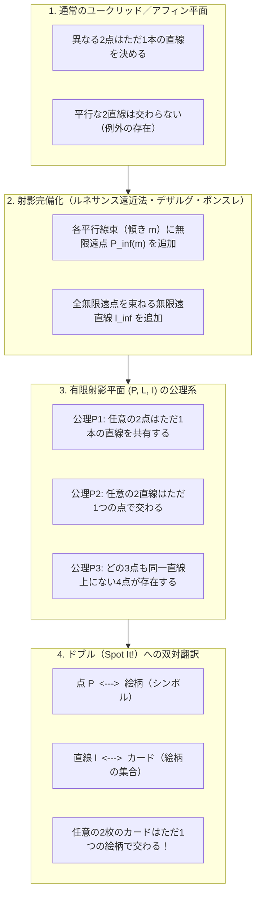
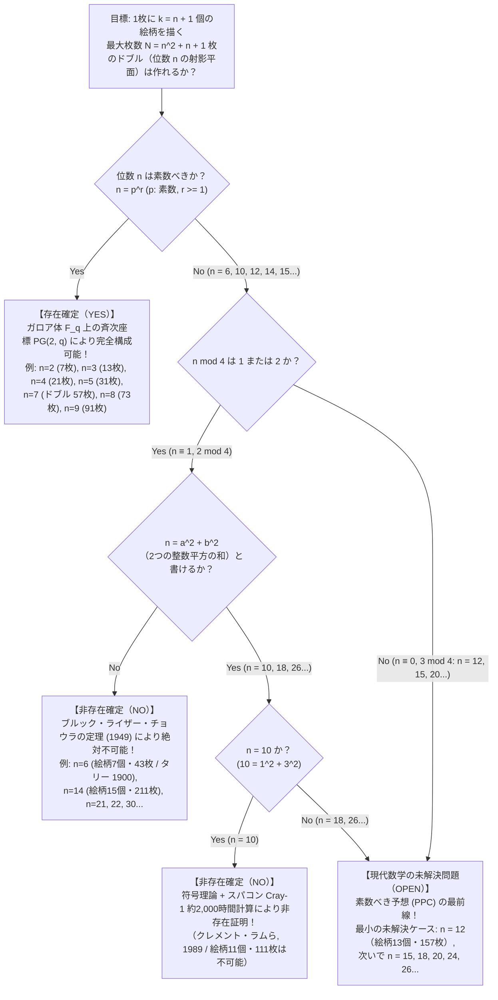

丸い缶に入った世界的な大ヒットカードゲーム<strong>『ドブル（Dobble / 北米名：Spot It!）』</strong>をご存じだろうか。ルールは驚くほど単純である。丸いカードの表面には、雪だるま、鍵、サングラス、錨、ハート、恐竜といったカラフルな絵柄（シンボル）が<strong>1枚につき8個ずつ</strong>、大きさや向きをランダムに変えて描かれている。山札から任意の2枚のカードを表向きに並べたとき、プレイヤーは2枚のカードを見比べて「両方に共通して描かれている絵柄」をいち早く見つけ出し、その名前を叫ぶ。

このゲームを初めて遊んだ人が必ず抱く強烈な違和感と驚きがある。それは、<strong>「山札からどの2枚のカードを抜き出しても、共通する絵柄が必ず存在し、しかも絶対に1個しか存在しない」</strong>という事実である。2個以上ダブることもなければ、1個も見つからないということも絶対に起きない。すべてのカードのペアが、ただ1つの絵柄だけによって精密に結ばれているのだ。

この小さな丸い缶の中には、19世紀から20世紀にかけて発展した純粋数学の結晶――<strong>有限射影幾何学（Finite Projective Geometry）</strong>、<strong>ガロア体（有限体 $\mathbb{F}_q$）</strong>、そして<strong>組合せデザイン理論（Combinatorial Design Theory）</strong>――がそのまま封入されている。さらに驚くべきことに、このカードゲームの設計原理をほんの少し一般化して「1枚に描く絵柄の数を $k$ 個にしたらどうなるか？」と問いかけた途端、私たちは<strong>レオンハルト・オイラーが挑んだ「36人の士官問題」</strong>、<strong>スーパーコンピュータCray-1が2,000時間を費やして決着をつけた「位数10の非存在証明」</strong>、そして現代のいかなる数学者も未だに解くことができない<strong>「位数12の有限射影平面は存在するか？」という未解決問題</strong>の最前線へと引きずり込まれるのである。

本稿では、素朴なカードゲームのパズルから出発し、ルネサンス遠近法に端を発する射影幾何学の公理系、最小の有限幾何である「ファノ平面」、素数べきのガロア体を用いたドブルの完全な代数構造、そして現代数学の深淵に横たわる存在・非存在定理までを一気に駆け抜ける。

---

## 第1章：『ドブル（Spot It!）』の缶に秘められた3つの数学的謎

まず、手元にあるドブルの製品仕様を数学的な眼差しで観察してみよう。市販されているドブルの缶を開けると、そこには<strong>55枚のカード</strong>が入っており、各カードには<strong>8個の絵柄</strong>が描かれている。

もしあなたがゲームデザイナーであり、「1枚につき8個の絵柄を描き、どの2枚のカードにも共通する絵柄がちょうど1個だけあるようなカードセットを、できるだけたくさん作りたい」と考えたとしよう。素朴に1枚目、2枚目、3枚目……と手作業で絵柄を割り当てていくと、10枚目を超えたあたりでたちまち激しい組合せ爆発と矛盾に突き当たる。新しいカードを追加しようとすると、既存のカードのどれかと絵柄が2個重なってしまったり、逆に使える絵柄が足りなくなったりするのだ。

事実、後に証明するように、57種類の絵柄から8個を選ぶ組合せの総数は

$$\binom{57}{8} = \frac{57 \times 56 \times 55 \times 54 \times 53 \times 52 \times 51 \times 50}{8!} = 1,652,411,475 \text{ 通り}$$

実に<strong>約16億5,241万通り</strong>も存在する。この広大な組合せの海の中から、「どの2枚もただ1つの絵柄だけを共有する」という厳しい制約を同時に満たすカード群を力任せ（ブルートフォース）で探索することは到底不可能である。

ここで、私たちの前には<strong>3つの根本的な謎</strong>が浮かび上がる。

1. <strong>第1の謎（最大枚数と55枚の謎）</strong>：1枚に8個の絵柄を描くとき、数学的に作成可能なカードの最大枚数は何枚なのか？ 実は理論上の最大値は<strong>57枚</strong>（絵柄の総数も<strong>57種類</strong>）である。では、なぜ市販のドブルには57枚ではなく<strong>55枚</strong>しか入っていないのか？
2. <strong>第2の謎（構成アルゴリズムの謎）</strong>：16億通り以上の候補の中から、互いにちょうど1個ずつ絵柄を共有する57枚のカードを、一切の試行錯誤なしに一発で書き下す代数的アルゴリズムとはどのようなものか？
3. <strong>第3の謎（禁止された絵柄数の謎）</strong>：1枚あたりの絵柄の数 $k$ を変えてみよう。$k=3$（7枚）、$k=4$（13枚）、$k=5$（21枚）、$k=6$（31枚）、$k=8$（57枚）のドブルは完璧に作ることができる。ところが、その間にある<strong>「1枚に7個の絵柄を描いた43枚のドブル（$k=7$）」</strong>や<strong>「1枚に11個の絵柄を描いた111枚のドブル（$k=11$）」</strong>は、全宇宙のどんな天才やスーパーコンピュータをもってしても<strong>絶対に作ることができない</strong>。なぜ特定の個数だけが数学の法則によって厳格に禁じられているのか？

この3つの謎を解き明かす鍵こそが、私たちが学校で習うユークリッド幾何を拡張した<strong>「射影幾何学（Projective Geometry）」</strong>の概念である。

---

## 第2章：ユークリッド幾何から射影幾何へ —— 無限遠点と双対性の魔法

### 2.1 平行線という「例外」を消去する

私たちが慣れ親しんでいるユークリッド平面幾何学（$\mathbb{R}^2$）において、「点」と「直線」の間には次の基本的な性質が成り立っている。

- <strong>性質A</strong>：異なる2つの点を通る直線は、<strong>ただ1本</strong>存在する。
- <strong>性質B'</strong>：異なる2本の直線は、<strong>高々1つ</strong>の点で交わる（ただし、<strong>平行な2直線は交わらない</strong>）。

数学者にとって、この性質B'の末尾にある<strong>「ただし、平行な2直線は交わらない」という例外規定</strong>はきわめて不格好で非対称なものに見える。もし「平行線もどこかで必ず1点で交わる」と言い切ることができれば、性質Aと性質B'は「点」と「直線」という言葉を入れ替えただけの、完全に美しい対称性（双対性）を獲得するはずである。

この発想は、15世紀イタリア・ルネサンスの絵画における<strong>透視図法（線遠近法）</strong>から生まれた。フィリッポ・ブルネレスキやレオン・バッティスタ・アルベルティ、アルブレヒト・デューラーらが描いた遠近法の世界では、地面の上をどこまでも平行に伸びる2本の鉄道のレールや並木道は、キャンバス上の地平線（水平線）にある1つの点――<strong>消失点（Vanishing Point）</strong>――においてぴったりと交わる。

17世紀フランスの建築家・数学者<strong>ジラール・デザルグ（Girard Desargues, 1591–1661）</strong>と、19世紀にナポレオン戦争のロシア捕虜収容所で研究を深めた<strong>ジャン＝ヴィクトル・ポンスレ（Jean-Victor Poncelet, 1788–1867）</strong>は、この絵画の消失点を数学的に厳密な概念へと昇華させた。それが<strong>「無限遠点（Point at Infinity）」</strong>と<strong>「無限遠直線（Line at Infinity）」</strong>の導入である。

通常の平面（アフィン平面 $\mathbb{A}^2$）に対して、次の外科手術を施そう。

1. 同じ傾き $m$ を持つすべての平行線の束（平行線束）に対して、その束専用の新しい点 $P_\infty(m)$（<strong>無限遠点</strong>）を1つ追加し、傾き $m$ のすべての直線はこの点 $P_\infty(m)$ を通ると約束する。（鉛直な直線群には $P_\infty(\infty)$ を対応させる。）
2. 異なる傾き $m_1 \neq m_2$ を持つ2本の直線は、通常の平面内の1点で交わるため、同じ無限遠点は共有しない。
3. 最後に、あらゆる方向に対応するすべての無限遠点 $\{P_\infty(m)\}$ を一斉に通るただ1本の新しい直線 $\ell_\infty$（<strong>無限遠直線</strong>）を地平線として追加する。

するとどうだろう。これまで交わらなかった傾き $m$ の平行な2直線は、無限遠点 $P_\infty(m)$ というただ1つの点で交わるようになる。さらに、通常の直線 $\ell$（傾き $m$）と無限遠直線 $\ell_\infty$ もまた、ちょうど $P_\infty(m)$ というただ1つの点で交わる。<strong>この拡張された平面（射影平面）からは、「平行」という概念そのものが完全に消滅し、すべての2直線が例外なくただ1点で交わるようになるのである！</strong>

### 2.2 射影平面の3つの公理と「双対原理」

点全体の集合を $\mathcal{P}$、直線全体の集合を $\mathcal{L}$、そして点 $P \in \mathcal{P}$ が直線 $\ell \in \mathcal{L}$ の上にあるという「接続関係（Incidence Relation）」を $\mathcal{I} \subset \mathcal{P} \times \mathcal{L}$ と書くことにしよう。三つ組 $(\mathcal{P}, \mathcal{L}, \mathcal{I})$ が以下の3つの公理を満たすとき、これを<strong>射影平面（Projective Plane）</strong>と呼ぶ。

- <strong>公理 P1（2点を通る直線の唯一性）</strong>：任意の異なる2点 $P, Q \in \mathcal{P}$ （$P \neq Q$）に対して、$P$ と $Q$ の両方を通る直線 $\ell \in \mathcal{L}$ が<strong>ただ1本</strong>存在する。
- <strong>公理 P2（2直線の交点の唯一性）</strong>：任意の異なる2直線 $\ell_1, \ell_2 \in \mathcal{L}$ （$\ell_1 \neq \ell_2$）に対して、$\ell_1$ と $\ell_2$ の両方の線上にある点 $P \in \mathcal{P}$ が<strong>ただ1つ</strong>存在する。
- <strong>公理 P3（非退化公理 / 4点公理）</strong>：<strong>どの3点も同一直線上にはない4つの点</strong>（一般の位置にある4点）が少なくとも1組存在する。

（公理P3は、「すべての点が1本の直線上に並んでいるだけ」といった自明で退化した図形を排除するための重要な条件である。）

ここで公理P1と公理P2を見比べてほしい。「点（Point）」という単語と「直線（Line）」という単語、「通る（passes through）」と「上にある（lies on）」をそっくりそのまま入れ替えても、公理の文章は全く変わらない（公理P3からも同様に、どの3本も1点で交わらない4直線が存在することが直ちに導かれる）。これを射影幾何学における<strong>双対原理（Principle of Duality）</strong>と呼ぶ。

そして今、この射影平面の語彙を『ドブル』の語彙へと翻訳する辞書を開いてみよう。

| 射影幾何学の概念 | 解釈A（標準的な対応） | 解釈B（双対な対応） |
| :--- | :--- | :--- |
| <strong>点 $P \in \mathcal{P}$</strong> | <strong>絵柄（シンボル）</strong> | <strong>カード</strong> |
| <strong>直線 $\ell \in \mathcal{L}$</strong> | <strong>カード（描かれた絵柄の集合）</strong> | <strong>絵柄（その絵柄が描かれたカードの集合）</strong> |
| <strong>接続 $(P, \ell) \in \mathcal{I}$</strong> | 絵柄 $P$ がカード $\ell$ に描かれている | カード $P$ に絵柄 $\ell$ が描かれている |
| <strong>公理 P2 の意味</strong> | <strong>どの2枚のカードも、共通する絵柄をただ1つだけ持つ</strong> | どの2つの絵柄も、両方描かれたカードがただ1枚だけある |
| <strong>公理 P1 の意味</strong> | どの2つの絵柄も、それらが共演するカードがただ1枚だけある | <strong>どの2枚のカードも、共通する絵柄をただ1つだけ持つ</strong> |

なんということだろう！ <strong>『ドブル』のルールそのものが、有限個の点と直線からなる「有限射影平面（Finite Projective Plane）」の公理系と1対1に完全一致している</strong>のである。

---

## 第3章：位数 $n$ の有限射影平面の数え上げ定理と「ファノ平面 $PG(2,2)$」

### 3.1 位数 $n$ と総カード枚数の公式 $N = n^2 + n + 1$ の厳密な導出

通常のユークリッド平面や実射影平面 $\mathbb{RP}^2$ には無限個の点と直線があるが、私たちが知りたいのは<strong>「点の数も直線の数も有限であるような射影平面（有限射影平面）」</strong>である。

有限射影平面 $(\mathcal{P}, \mathcal{L}, \mathcal{I})$ において、まず次の基本定理が成り立つ。

> <strong>定理 3.1（有限射影平面の正則性）</strong>：
> 任意の有限射影平面にはある自然数 $n \ge 2$ が存在し、以下の4つの性質を同時に満たす。この整数 $n$ をその射影平面の<strong>位数（Order）</strong>と呼ぶ。
> 1. すべての直線は、ちょうど <strong>$k = n + 1$ 個の点</strong>を含む（＝すべてのカードには $n+1$ 個の絵柄が描かれる）。
> 2. すべての点は、ちょうど <strong>$r = n + 1$ 本の直線</strong>上にある（＝すべての絵柄はちょうど $n+1$ 枚のカードに登場する）。
> 3. 平面全体の点の総数 $|\mathcal{P}|$ は <strong>$N = n^2 + n + 1$ 個</strong>である。
> 4. 平面全体の直線の総数 $|\mathcal{L}|$ も <strong>$N = n^2 + n + 1$ 本</strong>である。

なぜすべての直線上の点の数が一致し、全体のカード枚数が必ず $n^2 + n + 1$ という美しい二次式になるのか？ その証明は、高校生でも追えるほどエレガントな一対一対応（全単射）と分割の議論で完結する。

<strong>【証明：ステップ1（すべての直線は同じ個数の点を持つ）】</strong>
任意の2本の直線 $\ell_1, \ell_2 \in \mathcal{L}$ をとる。公理P3（非退化公理）を用いると、$\ell_1$ 上にも $\ell_2$ 上にもない外部の点 $O \in \mathcal{P}$ が必ず存在することがわかる。
この点 $O$ を「光源（射影の中心）」と考えよう。直線 $\ell_1$ 上の任意の点 $X \in \ell_1$ に対して、2点 $O$ と $X$ を結ぶ直線 $OX$ が公理P1によりただ1本引ける。そしてこの直線 $OX$ は、公理P2によりもう一方の直線 $\ell_2$ とただ1つの点 $Y \in \ell_2$ で交わる。
逆に、$\ell_2$ 上の任意の点 $Y$ からも、直線 $OY$ と $\ell_1$ の交点として $X \in \ell_1$ がただ1つ定まる。したがって、写像 $X \mapsto Y$ は直線 $\ell_1$ 上の点集合と直線 $\ell_2$ 上の点集合の間の<strong>完全な1対1対応（全単射）</strong>を与える！
ゆえに、どの直線も同数の点を含む。この共通の点数を $k = n + 1$ （$n \ge 2$）と定義する。双対原理により、任意の点を通る直線の本数もすべて一定であり、かつ $r = n + 1$ 本となる。

<strong>【証明：ステップ2（点の総数 $|\mathcal{P}| = n^2 + n + 1$ の導出）】</strong>
平面内の1つの基準点 $P_0 \in \mathcal{P}$ を固定して、平面内のすべての点を漏れなく重複なく数え上げよう。
1. まず、基準点 $P_0$ 自身で <strong>$1$ 個</strong>。
2. $P_0$ 以外の任意の点 $Q \in \mathcal{P} \setminus \{P_0\}$ をとると、公理P1により、2点 $P_0$ と $Q$ を通る直線が<strong>ただ1本</strong>存在する。つまり、$P_0$ 以外のすべての点は、「点 $P_0$ を通る直線群」のどれか1本の上に必ず乗っており、かつ2本以上の直線に同時に乗ることは絶対にない（もし2本に乗っていれば、その2直線が $P_0$ と $Q$ の2点で交わってしまい、公理P2に矛盾する）。
3. ステップ1より、基準点 $P_0$ を通る直線は全部で <strong>$n + 1$ 本</strong>放射状に伸びている。
4. その $n + 1$ 本の各直線には全部で $n + 1$ 個の点が乗っているが、そのうち1個は基準点 $P_0$ 自身であるから、各直線上には <strong>$P_0$ 以外の点がちょうど $n$ 個ずつ</strong>並んでいる。

以上より、点の総数 $|\mathcal{P}|$ は次のように決定される。

$$|\mathcal{P}| = \underbrace{1}_{\text{基準点 } P_0} + \underbrace{(n + 1)}_{\text{点 } P_0 \text{ を通る直線の本数}} \times \underbrace{n}_{\text{各直線上の } P_0 \text{ 以外の点の数}} = n^2 + n + 1$$

双対原理により、点と直線の役割を入れ替えれば、直線の総数 $|\mathcal{L}|$ もまったく同じ式で与えられ、

$$|\mathcal{L}| = |\mathcal{P}| = N = n^2 + n + 1 \quad \blacksquare$$

この公式こそがドブルの設計図の心臓部である！
市販のドブルでは、1枚のカードに描かれている絵柄の数は <strong>$k = 8$ 個</strong>であった。したがって、対応する有限射影平面の位数 $n$ は

$$n = k - 1 = 8 - 1 = 7$$

であり、理論上作成可能なカードの最大枚数（および必要な絵柄の総数）$N$ は

$$N = 7^2 + 7 + 1 = 49 + 7 + 1 = 57 \text{ 枚（絵柄も57種類）}$$

と一瞬にして求まるのである！

### 3.2 最小の有限幾何：ファノ平面 $PG(2, 2)$（$n = 2$、7枚のミニ・ドブル）

いきなり57枚のドブル（$n = 7$）を書き下す前に、公理P3が許す世界最小の有限射影平面である <strong>$n = 2$</strong> のケースを完全に解剖しよう。1892年にイタリアの数学者<strong>ジーノ・ファノ（Gino Fano, 1871–1952）</strong>が発見したこの幾何構造は、彼の名を冠して<strong>ファノ平面（Fano Plane, $PG(2, 2)$）</strong>と呼ばれている。

位数 $n = 2$ を先ほどの公式に代入すると：
- 1枚のカードに描かれる絵柄の数：$k = n + 1 = 2 + 1 = 3$ 個
- 1つの絵柄が登場するカードの枚数：$r = n + 1 = 3$ 枚
- 絵柄の総数＝カードの総枚数：$N = 2^2 + 2 + 1 = 7$ 枚（7種類）

この「7枚のミニ・ドブル」を具体的に構成する方法を2通り紹介しよう。どちらも息を呑むほど美しい。

#### 構成法A：2進数3ビットの非ゼロベクトル $\mathbb{F}_2^3 \setminus \{\mathbf{0}\}$ による構成
2元体 $\mathbb{F}_2 = \{0, 1\}$（足し算を $1 + 1 = 0$、すなわち排他的論理和 XOR $\oplus$ で行う世界）の上の3次元ベクトル $(x, y, z)$ を考える。すべてが $0$ である原点 $(0, 0, 0)$ を除くと、残りの非ゼロベクトルはちょうど $2^3 - 1 = 7$ 個存在する。これを7つの絵柄 $P_1, \dots, P_7$ としよう。

- $P_1 = (0, 0, 1)$
- $P_2 = (0, 1, 0)$
- $P_3 = (0, 1, 1)$
- $P_4 = (1, 0, 0)$
- $P_5 = (1, 0, 1)$
- $P_6 = (1, 1, 0)$
- $P_7 = (1, 1, 1)$

このとき、「3つの点 $u, v, w$ が1本の直線上にある（＝1枚のカードに一緒に描かれる）」という条件を、<strong>「3つのベクトルのビットごとのXOR和がゼロベクトルになること（$u \oplus v \oplus w = (0, 0, 0)$、すなわち $w = u \oplus v$）」</strong>と定めるのだ！
任意の異なる2点 $u, v$ を選ぶと、第3の点 $w = u \oplus v$ がただ1つ自動的に決まるため、公理P1とP2が自動的に満たされる。

#### 構成法B：巡回差集合（Cyclic Difference Set）$\{1, 2, 4\} \pmod 7$ による構成
さらに手軽な方法がある。7つの絵柄に $\{0, 1, 2, 3, 4, 5, 6\}$（$\bmod 7$ の剰余類 $\mathbb{Z}/7\mathbb{Z}$）と番号を振る。
まず1枚目のカード $\ell_0$ として、2のべき乗である3つの数字 <strong>$\{1, 2, 4\}$</strong> を選ぶ。なぜ $\{1, 2, 4\}$ かというと、この集合の中から異なる2つの要素を取り出して差（引き算 $\bmod 7$）を計算すると、

$$\begin{aligned}
2 - 1 &\equiv 1 \pmod 7, & 1 - 2 &\equiv 6 \pmod 7 \\
4 - 2 &\equiv 2 \pmod 7, & 2 - 4 &\equiv 5 \pmod 7 \\
4 - 1 &\equiv 3 \pmod 7, & 1 - 4 &\equiv 4 \pmod 7
\end{aligned}$$

となり、<strong>$1$ から $6$ までのすべての非ゼロ剰余がちょうど1回ずつ現れる</strong>からである！ このような魔法の部分集合を組合せ論で<strong>完全差集合（Perfect Difference Set）</strong>と呼ぶ。
1枚目のカード $\{1, 2, 4\}$ が決まれば、残りの6枚のカードは、すべての数字に $+1 \pmod 7$ を順々に足していく（巡回シフトする）だけで完成する。

| カード番号 | 巡回シフト $\ell_i = \{1+i, 2+i, 4+i\} \pmod 7$ | 描かれる3つの絵柄 | 対応する斉次双対方程式 $ax+by+cz \equiv 0 \pmod 2$ |
| :---: | :---: | :---: | :--- |
| <strong>カード $\ell_0$</strong> | $+0$ | $\{1, 2, 4\}$ | 三角形の外周辺1 |
| <strong>カード $\ell_1$</strong> | $+1$ | $\{2, 3, 5\}$ | 三角形の外周辺2 |
| <strong>カード $\ell_2$</strong> | $+2$ | $\{3, 4, 6\}$ | 三角形の外周辺3 |
| <strong>カード $\ell_3$</strong> | $+3$ | $\{4, 5, 0\}$ | 頂点と対辺の中点を結ぶ中線1 |
| <strong>カード $\ell_4$</strong> | $+4$ | $\{5, 6, 1\}$ | 頂点と対辺の中点を結ぶ中線2 |
| <strong>カード $\ell_5$</strong> | $+5$ | $\{6, 0, 2\}$ | 頂点と対辺の中点を結ぶ中線3 |
| <strong>カード $\ell_6$</strong> | $+6$ | $\{0, 1, 3\}$ | <strong>3つの中点を通る内接円（第7の直線！）</strong> |

この表からどの2枚のカードを選んで見比べても（例えば $\ell_0 = \{1, 2, 4\}$ と $\ell_4 = \{5, 6, 1\}$）、共通する数字は $\{1\}$ のただ1個だけである。
よく知られたファノ平面の図では、6本の直線は正三角形の3辺と3本の中線として真っ直ぐ描かれるが、最後の7本目の直線（例えば $\{0, 1, 3\}$）だけは、ユークリッド平面上ではどうしても真っ直ぐな線分として描くことができず、<strong>三角形の内接円</strong>として描かれる。これは、射影幾何学における「直線」とは「定規で引いた真っ直ぐな線」ではなく、公理P1〜P3を満たす「点の集合（カード）」に他ならないことを鮮やかに象徴している。

---

## 第4章：ガロア体 $\mathbb{F}_q$ 上の斉次座標と『ドブル（$n = 7$）』の完全構成

### 4.1 有限体（ガロア体）$\mathbb{F}_q$ と素数べきの法則

では、一般の位数 $n = q$ の有限射影平面 $PG(2, q)$ はどうすれば作れるのだろうか？
第2章や第3章で見た座標のアイデアを一般化するには、座標 $(x, y, z)$ の成分として「足し算・引き算・掛け算・そして<strong>0以外の任意の元による割り算（逆元）</strong>が自由にできる有限個の数の体系」が必要になる。代数学において、四則演算が完全に閉じた有限集合のことを<strong>有限体（Finite Field）</strong>、あるいは19世紀フランスの天才数学者エヴァリスト・ガロア（Évariste Galois, 1811–1832）に因んで<strong>ガロア体 $\mathbb{F}_q$ （または $GF(q)$）</strong>と呼ぶ。

代数学の基本定理として、ガロア体が存在するための必要十分条件は完全に解明されている。

> <strong>定理 4.1（ガロア体の存在定理）</strong>：
> 要素数 $q$ の有限体（ガロア体）$\mathbb{F}_q$ が存在するための必要十分条件は、$q$ が<strong>素数 $p$ の自然数べき（Prime Power）</strong>で表されることである。
> $$q = p^r \quad （p \text{ は素数}, \; r \in \{1, 2, 3, \dots\}）$$
> さらに、同じ要素数 $q = p^r$ を持つ有限体は、同型を除いて<strong>ただ1つ</strong>しか存在しない。

ここで極めて重要な注意点が2つある。

1. <strong>$q = p$ が素数そのものである場合（$r = 1$）</strong>：
   $q = 2, 3, 5, 7, 11, 13, \dots$ のとき、ガロア体 $\mathbb{F}_p$ は私たちがよく知る<strong>「$\bmod p$ の剰余演算（時計の算数）」$\mathbb{Z}/p\mathbb{Z}$</strong> そのものである。素数 $p$ で割った余りの世界では、フェルマーの小定理やユークリッドの互除法によって、$0$ 以外のすべての数 $a \in \{1, \dots, p-1\}$ に逆元 $a^{-1} \pmod p$ が存在する。
2. <strong>$q = p^r$ が合成数の素数べきである場合（$r \ge 2$）</strong>：
   例えば $q = 4 = 2^2$、$q = 8 = 2^3$、$q = 9 = 3^2$ のとき、ガロア体 $\mathbb{F}_q$ は<strong>単なる $\bmod q$ の剰余環 $\mathbb{Z}/q\mathbb{Z}$ ではない！</strong> 実際、$\bmod 4$ の世界では $2 \times 2 \equiv 0 \pmod 4$ となってしまい（零因子の存在）、$2$ で割る割り算ができない。その代わり、$\mathbb{F}_p$ 係数の $r$ 次既約多項式 $f(x)$ を用いた<strong>多項式剰余体 $\mathbb{F}_p[x]/(f(x))$</strong> を構成することで、要素数 $q = p^r$ の完璧なガロア体 $\mathbb{F}_q$ を作ることができる（例えば $\mathbb{F}_4 = \mathbb{F}_2[x]/(x^2 + x + 1)$）。
3. <strong>$q$ が素数べきではない場合（$q = 6, 10, 12, 14, 15, \dots$）</strong>：
   異なる2つ以上の素因数を持つ数（$6 = 2 \times 3$、$10 = 2 \times 5$、$12 = 2^2 \times 3$ など）に対しては、どのような演算規則を定義しようとも、<strong>有限体 $\mathbb{F}_q$ は絶対に存在しない</strong>。

### 4.2 斉次座標 $[x : y : z]$ による射影平面 $PG(2, q)$ の代数構成

要素数 $q = p^r$ のガロア体 $\mathbb{F}_q$ が手に入れば、位数 $q$ の有限射影平面 $PG(2, q)$ は線形代数によって一瞬で構築できる。

ガロア体 $\mathbb{F}_q$ 上の3次元ベクトル空間 $V = \mathbb{F}_q^3$ を考えよう。各成分 $x, y, z \in \mathbb{F}_q$ はそれぞれ $q$ 通りの値をとるため、$V$ には全部で $q^3$ 個のベクトルが存在する。ここから原点 $\mathbf{0} = (0, 0, 0)$ を除いた非ゼロベクトルの集合 $V \setminus \{\mathbf{0}\}$ には <strong>$q^3 - 1$ 個</strong>のベクトルがある。

ここで、「原点を通る同じ1次元部分空間（直線）に乗っている非ゼロベクトル同士を同一視する」という同値関係 $\sim$ を導入する。すなわち、非ゼロのスカラー $\lambda \in \mathbb{F}_q^\times = \mathbb{F}_q \setminus \{0\}$ に対して

$$(x, y, z) \sim (\lambda x, \lambda y, \lambda z)$$

と定義し、その同値類を<strong>斉次座標（Homogeneous Coordinates）</strong>を用いて <strong>$[x : y : z]$</strong> と表記する。

- <strong>射影平面の「点」</strong>：各同値類 $[x : y : z]$ を射影平面 $PG(2, q)$ の1つの「点」と定める。非ゼロのスカラー $\lambda \in \mathbb{F}_q^\times$ は全部で $q - 1$ 個あるため、$q^3 - 1$ 個の非ゼロベクトルは $q - 1$ 個ずつのグループに均等に束ねられる。したがって、点の総数は

$$|\mathcal{P}| = \frac{q^3 - 1}{q - 1} = q^2 + q + 1$$

となり、第3章の数え上げ公式と完全に一致する！

- <strong>射影平面の「直線」</strong>：同様に、すべてが $0$ ではない係数 $[a : b : c]$ を固定したとき、斉次1次方程式

$$a x + b y + c z = 0 \quad (\text{in } \mathbb{F}_q)$$

を満たす点 $[x : y : z]$ の集合を1本の「直線」$\ell_{[a:b:c]}$ と定める（これは $\mathbb{F}_q^3$ の2次元部分空間に対応する）。方程式の両辺を $\lambda \neq 0$ 倍しても解集合は変わらないため、直線もまた双対な斉次座標 $[a : b : c]$ で一意にラベル付けされ、直線の総数も $|\mathcal{L}| = q^2 + q + 1$ 本となる。

線形代数の次元公式（グラスマンの公式）より、3次元空間 $\mathbb{F}_q^3$ 内の任意の異なる2つの2次元部分空間 $W_1, W_2$ の交わりの次元は

$$\dim(W_1 \cap W_2) = \dim W_1 + \dim W_2 - \dim(W_1 + W_2) = 2 + 2 - 3 = 1$$

となるため、2本の直線は必ずただ1つの1次元部分空間（すなわち射影平面上のただ1つの点）で交わる。これにより、公理P1〜P3が代数的に完全証明された！

### 4.3 『ドブル（$q = 7$）』の全57枚・57絵柄の完全生成レシピ

いよいよ、『ドブル』の位数 $q = 7$（素数なので $\mathbb{F}_7 = \mathbb{Z}/7\mathbb{Z} = \{0, 1, 2, 3, 4, 5, 6\}$、すべての計算は $\bmod 7$）にこの構成を適用し、<strong>57個の絵柄と57枚のカードの完全な内訳</strong>を書き下そう。

#### 57個の絵柄（点 $[x : y : z]$）の分類
斉次座標 $[x : y : z]$ は、第3成分 $z$ が $0$ でないか $0$ であるかによって、2つのグループに美しく分かれる。

1. <strong>49個の通常点（アフィン平面の点：$z \neq 0$）</strong>：
   $z \neq 0$ のときは、全体を $z^{-1} \pmod 7$ 倍することで第3成分を $1$ に正規化できる。つまり、<strong>$[x : y : 1]$ （ただし $x, y \in \{0, 1, 2, 3, 4, 5, 6\}$）</strong>という形の点であり、$7 \times 7 = 49$ 個の格子点に対応する。これを絵柄 $P_{x, y}$ と呼ぼう。
2. <strong>8個の無限遠点（地平線上の点：$z = 0$）</strong>：
   $z = 0$ のときは $[x : y : 0]$ となる。
   - $x \neq 0$ ならば、$x^{-1} \pmod 7$ 倍して第1成分を $1$ に正規化でき、<strong>$[1 : m : 0]$ （ただし傾き $m \in \{0, 1, 2, 3, 4, 5, 6\}$）</strong>という7個の無限遠点が得られる。これを絵柄 $I_m$ と呼ぼう。
   - $x = 0$ ならば、$y \neq 0$ を正規化して <strong>$[0 : 1 : 0]$ （傾き $\infty$ に対応する無限遠点）</strong>がただ1つ得られる。これを絵柄 $I_\infty$ と呼ぼう。

合計：$49 + 7 + 1 = 57$ 個の絵柄！

#### 57枚のカード（直線 $\ell$）の分類
同様に、57枚のカードも3つのグループに分けて機械的にすべて生成できる。

- <strong>グループ1：傾き $m$、切片 $b$ の斜め・水平直線カード（49枚）</strong>
  各 $m \in \{0, 1, 2, 3, 4, 5, 6\}$ と各 $b \in \{0, 1, 2, 3, 4, 5, 6\}$ のペア（$7 \times 7 = 49$ 通り）に対して、1枚のカード $L_{m, b}$ を次のように作る。
  $$L_{m, b} = \bigl\{ P_{x, (mx + b \bmod 7)} \;\big|\; x \in \{0, 1, 2, 3, 4, 5, 6\} \bigr\} \cup \{ I_m \}$$
  つまり、7個の格子点 $y \equiv mx + b \pmod 7$ に加えて、その傾き専用の無限遠点 $I_m$ を8個目の絵柄として添えるのである！

- <strong>グループ2：鉛直直線カード（7枚）</strong>
  各 $c \in \{0, 1, 2, 3, 4, 5, 6\}$（7通り）に対して、直線 $x \equiv c \pmod 7$ に対応するカード $V_c$ を作る。
  $$V_c = \bigl\{ P_{c, y} \;\big|\; y \in \{0, 1, 2, 3, 4, 5, 6\} \bigr\} \cup \{ I_\infty \}$$
  7個の格子点 $(c, y)$ に加えて、鉛直方向専用の無限遠点 $I_\infty$ を8個目の絵柄として添える。

- <strong>グループ3：無限遠直線カード（1枚）</strong>
  最後に、8個の無限遠点だけを一堂に集めた特別な1枚のカード $L_\infty$（方程式 $z = 0$）を作る。
  $$L_\infty = \{ I_0, I_1, I_2, I_3, I_4, I_5, I_6, I_\infty \}$$

合計：$49 + 7 + 1 = 57$ 枚のカード！

さらに別法として、1938年にジェームズ・シンガー（James Singer）が証明した<strong>シンガーの定理（Singer's Theorem）</strong>によれば、任意のガロア体上の射影平面 $PG(2, q)$ は巡回差集合を持つ。位数 $q = 7$（57枚）の場合、57個の絵柄に $0$ から $56$ までの通し番号を振り、1枚目のカードを

$$D = \{0, 1, 3, 13, 32, 36, 43, 52\} \pmod{57}$$

と定義すれば、あとはすべての要素に $+1, +2, \dots, +56 \pmod{57}$ を足していくだけで、57枚のドブルのカードが1行のプログラムで出力できる！（実際、$D$ の異なる2要素の差 $x - y \pmod{57}$ は $8 \times 7 = 56$ 通りあり、$1$ から $56$ までのすべての数をちょうど1回ずつ尽くしている。）

### 4.4 なぜ市販の『ドブル』は57枚ではなく「55枚」なのか？

ここで第1章の最初の謎に戻ろう。数学的には57枚のカードが作れる（そして実際にドブルで使われている絵柄の種類は<strong>57種類すべて</strong>存在している！）にもかかわらず、なぜ市販の缶には<strong>55枚</strong>しかカードが入っていないのか？

まず数学的な事実として、57枚の完全な射影平面 $PG(2, 7)$ から<strong>任意の2枚のカードを抜き取って捨てたとしても、「残りの55枚のどの2枚を選んでも共通する絵柄がちょうど1個だけある」というゲームのルール（公理P2）は一切傷つかない</strong>。失われるのは公理P1の側、すなわち「ある特定の絵柄のペア（例えば雪だるまとサングラス）が一緒に描かれたカードが山札に存在しなくなる」という点だけだが、プレイヤーは「2枚のカード間の共通絵柄」を探すだけなので、ゲームプレイ上の支障はゼロである。

では、なぜ製造元（Asmodee / Play Factory）はあえて2枚を減らして55枚にしたのか？ 主な理由は<strong>印刷工場の面付け（シートレイアウト）とゲームバランスの実用上の都合</strong>にある。
素因数分解すると $57 = 3 \times 19$ という扱いにくい数であるのに対し、$55 = 5 \times 11$（あるいは2セット分で $110 = 10 \times 11$）は、大型の印刷用厚紙シートから丸型カードを打ち抜く際のグリッド配置（面付け）において無駄が出にくい。また、ドブルに収録されている複数のミニゲームでは、最初に中央に1枚置き、残りのカードをプレイヤー全員に均等に配るルールがあるが、55枚であれば「中央に5枚置いて残り50枚を2人・5人・10人で均等に割り切る」といった人数調整がはるかに容易になるのである。

---

## 第5章：組合せデザイン理論・オイラーの36士官問題・そして未解決の最前線へ

ここからは、第1章で掲げた最大の数学的ミステリー――<strong>「なぜ1枚に7個の絵柄を描いた43枚のドブル（位数 $n = 6$）や、11個の絵柄を描いた111枚のドブル（位数 $n = 10$）は、宇宙のどこにも存在し得ないのか？」</strong>――の核心へと踏み込もう。

### 5.1 均衡不完全ブロックデザイン（BIBD）とフィッシャーの不等式

20世紀前半、イギリスの統計学者・遺伝学者<strong>ロナルド・フィッシャー（Ronald A. Fisher, 1890–1962）</strong>とフランク・イェーツらは、農業試験において「限られた広さの畑（ブロック）に複数品種の小麦（点）をどのように植えれば、土壌の偏りを排除してすべての品種ペアを公平に比較できるか？」という実験計画法（Design of Experiments）の問題から、<strong>ブロックデザイン理論</strong>を創始した。

一般に、$v$ 個の点（Varieties / 絵柄）と $b$ 個のブロック（Blocks / カード）からなる構造が以下の条件を満たすとき、これを <strong>$(v, b, r, k, \lambda)$-BIBD（Balanced Incomplete Block Design：均衡不完全ブロックデザイン）</strong>と呼ぶ。

- 各ブロック（カード）はちょうど $k$ 個の点を含む。
- 各点（絵柄）はちょうど $r$ 個のブロックに含まれる。
- 任意の異なる2つの点は、ちょうど $\lambda$ 個のブロックに共通して含まれる。

このとき、接続行列 $M = (m_{ij}) \in \{0, 1\}^{v \times b}$（点 $i$ がブロック $j$ に含まれれば $1$、そうでなければ $0$）を定義すると、行と列の1の個数を二重に数え上げることで次の2つの基本恒等式が成り立つ。

$$v r = b k, \qquad r(k - 1) = \lambda (v - 1)$$

さらに、行列 $M$ とその転置行列 $M^\top$ の積 $M M^\top \in \mathbb{R}^{v \times v}$ を計算すると、対角成分は各点が属するブロック数 $r$、非対角成分は任意の2点が共有するブロック数 $\lambda$ となるため、単位行列 $I_v$ と全成分が $1$ の行列 $J_v$ を用いて次のように書ける。

$$M M^\top = (r - \lambda) I_v + \lambda J_v$$

この行列の行列式を計算すると $\det(M M^\top) = (r - \lambda)^{v-1} (r + \lambda(v-1)) = (r - \lambda)^{v-1} r k$ となる。$k < v$ のとき $r > \lambda$ であるため $\det(M M^\top) > 0$ となり、$M M^\top$ は正則行列（ランク $v$）である。一方で、$v \times b$ 行列 $M$ のランクは $\min(v, b)$ 以下でなければならないから、直ちに次の有名な不等式が導かれる。

> <strong>定理 5.1（フィッシャーの不等式 / Fisher's Inequality, 1940）</strong>：
> 任意の非自明な $(v, b, r, k, \lambda)$-BIBD において、ブロックの総数（カードの枚数）$b$ は必ず点の総数（絵柄の種類数）$v$ 以上である。
> $$b \ge v$$

特に、フィッシャーの不等号で等号 $b = v$（したがって $r = k$）が達成される極限のケースを<strong>対称BIBD（Symmetric BIBD）</strong>と呼ぶ。そして、対称BIBDにおいて $\lambda = 1$（どの2点もただ1つのブロックだけを共有する）、$k = n + 1$、$v = b = n^2 + n + 1$ と置いたもの（<strong>シュタイナーシステム $S(2, n+1, n^2+n+1)$</strong> とも呼ばれる）こそが、<strong>位数 $n$ の有限射影平面</strong>に他ならない！

### 5.2 直交ラテン方陣（MOLS）とオイラーの「36人の士官問題」（$n = 6$ の崩壊）

第4章で私たちは、「位数 $n$ が素数べき $q = p^r$ であれば、ガロア体 $\mathbb{F}_q$ を使って射影平面 $PG(2, q)$ が作れる」ことを見た。では、<strong>最初の非素数べきである $n = 6$（1枚に $k = 7$ 個の絵柄、全 $N = 6^2 + 6 + 1 = 43$ 枚のドブル）</strong>はどうだろうか？ ガロア体 $\mathbb{F}_6$ は存在しないが、ガロア体を使わない何か別の巧妙な組合せ的トリックで43枚のカードを作ることはできないのだろうか？

この問いは、実は1782年に大数学者<strong>レオンハルト・オイラー（Leonhard Euler, 1707–1783）</strong>が提起した有名なパズル<strong>「36人の士官問題（Thirty-Six Officers Problem）」</strong>と直結している。

オイラーの問題とはこうである。「6つの連隊（A〜F）から、それぞれ6つの階級（1〜6）の士官を1人ずつ、合計36人集める。この36人を $6 \times 6$ の縦横のマス目に並べて、どの行・どの列を見ても、6つの連隊すべてと6つの階級すべてが1回ずつ現れるように配置できるか？」

各マスに「連隊」を配置した $6 \times 6$ の表と、「階級」を配置した $6 \times 6$ の表は、それぞれ各行・各列に同じ記号が重複しない<strong>ラテン方陣（Latin Square）</strong>である。そして、2つのラテン方陣を重ね合わせたときに、36通りのペア $(a, b)$ がすべて1回ずつ現れるとき、この2つは<strong>互いに直交するラテン方陣（Mutually Orthogonal Latin Squares: MOLS）</strong>（またはオイラー方陣／グレコ・ラテン方陣）と呼ばれる。

実は、幾何学とラテン方陣の間には次の完璧な同値定理が存在する（ラジ・チャンドラ・ボース, 1938）。

> <strong>定理 5.2（射影平面と直交ラテン方陣 MOLS の同値定理）</strong>：
> 位数 $n$ の有限射影平面から無限遠直線 $\ell_\infty$ とその上の $n+1$ 個の無限遠点を削除すると、$n^2$ 個の点と $n+1$ 組の平行線束からなる「位数 $n$ のアフィン平面」が残る。最初の2組の平行線束を $n \times n$ グリッドの「行」と「列」の座標として使うと、残りの $n - 1$ 組の平行線束は、互いに直交する $n - 1$ 個のラテン方陣と1対1に対応する。すなわち：
> $$\text{位数 } n \text{ の有限射影平面が存在する} \iff \text{位数 } n \text{ の互いに直交するラテン方陣（MOLS）が } n - 1 \text{ 個存在する}$$

これぞ驚異の架け橋である！
もし位数 $n = 6$ の射影平面（1枚に7個の絵柄がある43枚のドブル）が存在するならば、この定理によって、<strong>$6 \times 6$ の互いに直交するラテン方陣が $6 - 1 = 5$ 個も同時に存在しなければならない</strong>。
ところが1900年、フランスの数学者<strong>ガストン・タリー（Gaston Tarry, 1843–1913）</strong>は、位数6のラテン方陣の標準形全9,408通りを執念の手計算で徹底的に分類し、<strong>「位数6においては、互いに直交するラテン方陣は5個どころか、たった2個（オイラーの36人の士官の配置）すら絶対に存在しない！」</strong>ことを完全に証明したのである。

これにより、<strong>「1枚に7個の絵柄を描いたドブル（$n = 6$、43枚）は数学的に絶対不可能である」</strong>ことが歴史上初めて確定した。（なお、オイラー自身は「$n \equiv 2 \pmod 4$ のときは常に2個の直交ラテン方陣すら存在しないだろう」と予想したが、このオイラー予想は1959〜1960年にボース、シュリカンデ、パーカーの3人組――通称「オイラー・スポイラーズ（Euler Spoilers）」――によって $n = 10$ 以上のすべてのケースで劇的に反証された。つまり $10 \times 10$ の100人の士官問題は解ける！ しかし、射影平面に必要な「9個の直交ラテン方陣」はまた別次元の壁であった。）

### 5.3 ブルック・ライザー・チョウラの定理（1949年）：無限個の位数を一刀両断する

タリーの力技から半世紀後の1949年、リチャード・ブルック（Richard H. Bruck）とハーバート・ライザー（Herbert J. Ryser）は（翌1950年にサルヴァダマン・チョウラが対称BIBD全体へと一般化し）、二次形式の有理同値理論（ハッセ・ミンコフスキーの定理とラグランジュの四平方定理）を接続行列の式 $M M^\top = n I_N + J_N$ に適用することで、有限幾何学史上最も強力で美しい非存在定理を打ち立てた。

> <strong>定理 5.3（ブルック・ライザー・チョウラの定理 / Bruck-Ryser-Chowla Theorem, 1949）</strong>：
> もし位数 $n$ の有限射影平面が存在し、かつ $n$ を $4$ で割った余りが $1$ または $2$ であるならば（すなわち $n \equiv 1 \text{ or } 2 \pmod 4$）、位数 $n$ は必ず<strong>2つの整数の2乗の和</strong>として表されなければならない。
> $$n = a^2 + b^2 \quad (a, b \in \mathbb{Z})$$

この定理の破壊力は凄まじい。わずか1行の算術チェックで、無限個の位数 $n$ の存在可能性が次々と葬り去られるのである。

- <strong>$n = 6$（絵柄7個、43枚）</strong>：$6 \equiv 2 \pmod 4$ である。しかし $6$ を2つの平方数の和 $a^2 + b^2$ で表すことはできない（$0+6, 1+5, 4+2$ のいずれも不可）。よって、タリーの9,408通りの場合分けを一切行うことなく、<strong>わずか3秒で $n = 6$ の非存在が証明される！</strong>
- <strong>$n = 14$（絵柄15個、211枚）</strong>：$14 \equiv 2 \pmod 4$ であるが、$14$ も2つの平方数の和では表せない（素因数分解に $7 \equiv 3 \pmod 4$ が奇数乗で含まれるため）。よって<strong>絶対不可能！</strong>
- <strong>$n = 21$（絵柄22個、463枚）</strong>：$21 \equiv 1 \pmod 4$ であるが、$21 = 3 \times 7$ も平方数の和では表せない。よって<strong>絶対不可能！</strong>
- <strong>$n = 22, 30, 33, 38, 42, 46, \dots$</strong>：すべて同様に一瞬で却下される！

では、$n = 6$ の次に小さい非素数べきである <strong>$n = 10$（1枚に11個の絵柄、全 $N = 10^2 + 10 + 1 = 111$ 枚のドブル）</strong>にこの定理を適用してみよう。
$10 \equiv 2 \pmod 4$ であるから、定理の対象となる。ところが、$10$ はどうだろうか？

$$10 = 1^2 + 3^2 = 1 + 9$$

なんと、$10$ は2つの平方数の和で表せてしまうのである！ そのため、ブルック・ライザー・チョウラの定理をもってしても、<strong>位数 $n = 10$ の射影平面の存在を否定することはできなかった</strong>。ここから、20世紀後半の離散数学における最大の追跡劇が始まった。

### 5.4 スーパーコンピュータCray-1による「位数10」の完全決着（1989年）と「位数12」の未解決問題

「位数 $n = 10$ の有限射影平面（111個の点と111本の直線、各直線に11個の点）は存在するのか？」
1949年から40年間、この問題は世界中の数学者と初期のコンピュータ科学者を虜にした。111次の接続行列 $M$ を直接探索しようにも、その組合せ空間は宇宙の原子の数を遥かに超えており、単純なバックトラック法では太陽系が滅びても終わらない。

突破口を開いたのは、数学の全く別の分野である<strong>「誤り訂正符号理論（Error-Correcting Coding Theory）」</strong>との融合であった。
1970年、F. J. マックウィリアムズ（MacWilliams）、N. J. A. スローン（Sloane）、J. G. トンプソン（Thompson）らは、もし位数10の射影平面が存在するならば、その $111 \times 111$ の接続行列 $M$ の行ベクトルが $\mathbb{F}_2$ 上で張る2元線形符号 $\mathcal{C} \subset \mathbb{F}_2^{111}$ の<strong>重み分布多項式（Weight Enumerator Polynomial）</strong>が、マックウィリアムズ恒等式によって完全に3つの未知パラメータ（ハミング重み $12, 15, 16$ の符号語の数 $\omega_{12}, \omega_{15}, \omega_{16}$）だけに縛られることを示した。

この符号理論の武器を手に、カナダ・コンコルディア大学の<strong>クレメント・ラム（Clement W. H. Lam）</strong>、ラリー・ティール（Larry Thiel）、スタンリー・スウィエルツ（Stanley Swiercz）らの研究チームは、十数年にわたる理論的圧縮とプログラミングの末、当時世界最速を誇ったスーパーコンピュータ<strong>Cray-1A</strong>を動員した。
1973年にマックウィリアムズらが $\omega_{15} = 0$ を示した後、ラムらのチームは重み19、重み16、そして最後に残った最も巨大なケースである「重み12の符号語（オーバル配置）」の探索を敢行した。VAX-11/780で数年間、さらに<strong>Cray-1Aスーパーコンピュータで約2,000時間（約83日間の連続CPU稼働）</strong>に及ぶ壮絶な計算の果てに、1989年、ついにすべての候補が矛盾に突き当たることが確認された。

> <strong>定理 5.4（ラム・ティール・スウィエルツの定理, 1989）</strong>：
> 位数 $n = 10$ の有限射影平面（1枚に11個の絵柄を描いた111枚のドブル）は<strong>存在しない</strong>。

この歴史的成果は『ニューヨーク・タイムズ』紙でも大きく報じられ、計算機援用証明（Computer-Assisted Proof）の金字塔となった（さらに近年ではSATソルバーを用いた独立検証も進んでいる）。

では、<strong>$n = 12$（1枚に $k = 13$ 個の絵柄、全 $N = 12^2 + 12 + 1 = 157$ 枚のドブル）</strong>はどうだろうか？
1. $12 = 2^2 \times 3$ は素数べきではないため、ガロア体 $\mathbb{F}_{12}$ は存在せず、代数的な構成法は使えない。
2. $12 \equiv 0 \pmod 4$ であるため、ブルック・ライザー・チョウラの定理の条件（$n \equiv 1, 2 \pmod 4$）に該当せず、数論的な障害も一切かからない。
3. 探索空間の規模は $n = 10$ の比ではなく、現代のエクサスケール・スーパーコンピュータをもってしても手も足も出ない。

そのため、<strong>「1枚に13個の絵柄を描いた157枚のドブル（位数 $n = 12$ の有限射影平面）が作れるかどうか」は、人類が未だに答えを知らない現代数学の重大な未解決問題</strong>なのである！ 多くの数学者は「有限射影平面の位数 $n$ は必ず素数べき $p^r$ でなければならない」という<strong>素数べき予想（Prime Power Conjecture）</strong>が正しいと信じているが、その証明には全く新しい数学的革命が必要とされている。

### 5.5 位数 $n = 2 \sim 14$ における有限射影平面（ドブル一般化）の完全分類表

最後に、位数 $n = 2$ から $n = 14$ までのすべてのケースについて、1枚あたりの絵柄数 $k = n + 1$、理論上の最大カード枚数 $N = n^2 + n + 1$、存在の可否、およびその数学的根拠を一覧表にまとめよう。（なお、$n = 9 = 3^2$ 以上の合成素数べきでは、ガロア体から作られる標準的な平面 $PG(2, q)$ 以外にも、デザルグの定理が成り立たない「非デザルグ平面（ヒューズ平面やホール平面など）」という異種の射影平面が複数共存することも知られている。）

| 位数 $n$ | 1枚の絵柄数 $k = n+1$ | 最大カード枚数（絵柄総数） $N = n^2+n+1$ | 存在の可否 | 数学的構造・証明の根拠（同型類の数） |
| :---: | :---: | :---: | :---: | :--- |
| <strong>$n = 2$</strong> | $3$ 個 | <strong>$7$ 枚</strong> | <strong>存在する（一意）</strong> | 素数 $2$：最小の射影平面<strong>「ファノ平面 $PG(2, 2)$」</strong> |
| <strong>$n = 3$</strong> | $4$ 個 | <strong>$13$ 枚</strong> | <strong>存在する（一意）</strong> | 素数 $3$：$\mathbb{F}_3$ 上の射影平面 $PG(2, 3)$ |
| <strong>$n = 4$</strong> | $5$ 個 | <strong>$21$ 枚</strong> | <strong>存在する（一意）</strong> | 素数べき $2^2$：拡大ガロア体 $\mathbb{F}_4$ 上の $PG(2, 4)$ |
| <strong>$n = 5$</strong> | $6$ 個 | <strong>$31$ 枚</strong> | <strong>存在する（一意）</strong> | 素数 $5$：$\mathbb{F}_5$ 上の射影平面 $PG(2, 5)$ |
| <strong>$n = 6$</strong> | $7$ 個 | $43$ 枚 | <strong>存在しない（不可能）</strong> | $6 \equiv 2 \pmod 4$ かつ $6 \neq a^2+b^2$。<strong>オイラーの36士官問題／タリー(1900)／ブルック・ライザー(1949)</strong> |
| <strong>$n = 7$</strong> | <strong>$8$ 個</strong> | <strong>$57$ 枚</strong> | <strong>存在する（一意）</strong> | 素数 $7$：$\mathbb{F}_7$ 上の $PG(2, 7)$。<strong>市販ゲーム『ドブル』（製品版は55枚収録）</strong> |
| <strong>$n = 8$</strong> | $9$ 個 | <strong>$73$ 枚</strong> | <strong>存在する（一意）</strong> | 素数べき $2^3$：拡大ガロア体 $\mathbb{F}_8$ 上の $PG(2, 8)$ |
| <strong>$n = 9$</strong> | $10$ 個 | <strong>$91$ 枚</strong> | <strong>存在する（4種類）</strong> | 素数べき $3^2$：$PG(2, 9)$ に加え、3種類の非デザルグ平面（ホール平面・双対・ヒューズ平面）が存在 |
| <strong>$n = 10$</strong> | $11$ 個 | $111$ 枚 | <strong>存在しない（不可能）</strong> | $10 = 1^2+3^2$ で定理5.3は通過するが、<strong>ラムらがCray-1スパコン約2,000時間で非存在証明 (1989)</strong> |
| <strong>$n = 11$</strong> | $12$ 個 | <strong>$133$ 枚</strong> | <strong>存在する（一意か未詳）</strong> | 素数 $11$：$\mathbb{F}_{11}$ 上の $PG(2, 11)$ が存在（非デザルグ平面の有無は未解決） |
| <strong>$n = 12$</strong> | $13$ 個 | $157$ 枚 | <strong>【未解決問題】</strong> | $12 \equiv 0 \pmod 4$ のため定理5.3の対象外。<strong>人類が直面する最小の未解決位数！</strong> |
| <strong>$n = 13$</strong> | $14$ 個 | <strong>$183$ 枚</strong> | <strong>存在する</strong> | 素数 $13$：$\mathbb{F}_{13}$ 上の $PG(2, 13)$ が存在 |
| <strong>$n = 14$</strong> | $15$ 個 | $211$ 枚 | <strong>存在しない（不可能）</strong> | $14 \equiv 2 \pmod 4$ かつ $14 \neq a^2+b^2$。<strong>ブルック・ライザー・チョウラの定理により不可能</strong> |

---

## おわりに：玩具箱の中に息づく数学の普遍性

パーティーのテーブルの上で、子どもたちや大人たちが歓声を上げながら2枚の丸いカードを見比べ、「あった！ 雪だるまだ！」と指差すその瞬間、彼らが実際に触れているのは、ルネサンスの画家たちが地平線の彼方に見た「無限遠直線」であり、20歳で決闘に散ったエヴァリスト・ガロアが遺した「有限体 $\mathbb{F}_7$」の美しい対称性である。

「どの2枚のカードにも共通する絵柄がただ1つだけある」というたった1行のシンプルな要請が、ユークリッド幾何学の平行線の概念を書き換え、点と直線の双対性を呼び覚まし、ついには二次形式の数論やスーパーコンピュータの極限計算、さらには現代数学の未解決問題へと私たちを導いていく。もし次に『ドブル』の丸い缶を手に取る機会があれば、ぜひその55枚のカードの向こう側に、隠されたあと2枚のカードと、無限遠点で交差する57本の美しい射影直線たちの姿を思い描いてみてほしい。
