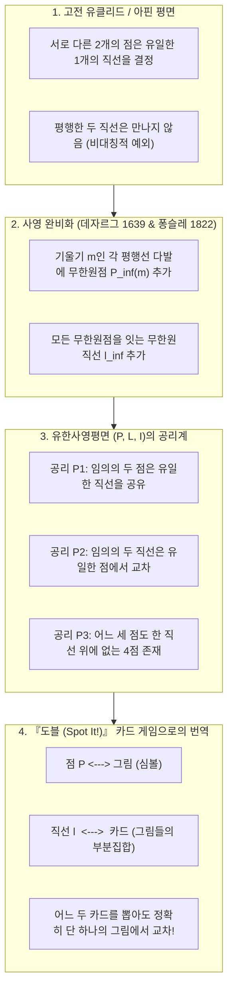
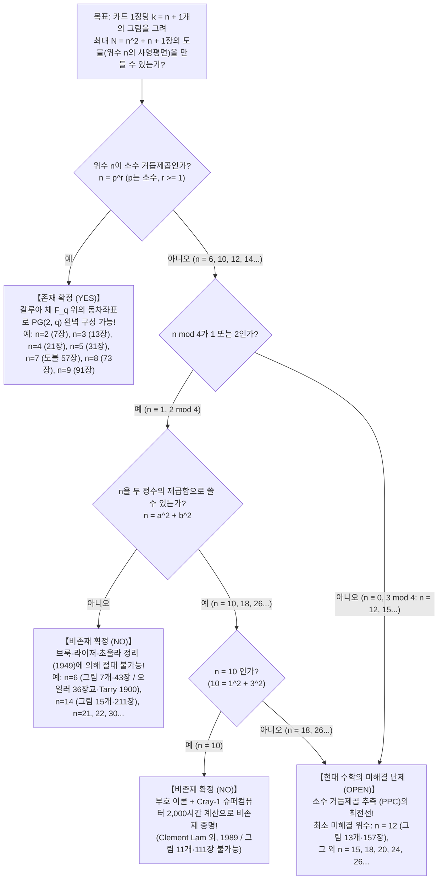

동그란 틴케이스에 담긴 세계적인 베스트셀러 파티 게임 <strong>『도블(Dobble, 북미명: Spot It!)』</strong>을 해본 적이 있는가? 규칙은 놀라울 정도로 간단하다. 둥근 카드마다 눈사람, 열쇠, 선글라스, 닻, 하트, 공룡 같은 다채로운 그림(기호)이 <strong>한 장당 8개씩</strong> 서로 다른 크기와 각도로 그려져 있다. 카드 더미에서 임의의 두 장을 뒤집어 놓았을 때, 두 카드에 공통으로 그려진 그림을 가장 먼저 찾아 이름을 외치는 사람이 승리한다.

이 게임을 처음 접한 사람들은 누구나 강렬한 수학적 경이로움을 느낀다. 바로 <strong>"카드 더미에서 어떤 두 장을 뽑아 비교하더라도 공통된 그림이 반드시 존재하며, 그것도 정확히 단 1개만 존재한다"</strong>는 사실이다. 공통 그림이 2개 이상 겹치는 일도 없고, 아예 없는 일도 절대 일어나지 않는다.

이 작은 장난감 통 속에는 19세기부터 20세기에 걸쳐 완성된 순수수학의 결정체——<strong>유한사영기하학(Finite Projective Geometry)</strong>, <strong>갈루아 체(유한체 $\mathbb{F}_q$)</strong>, 그리고 <strong>조합 디자인 이론(Combinatorial Design Theory)</strong>——이 고스란히 봉인되어 있다. 더욱 놀라운 사실은 "카드 한 장당 그림 수를 $k$개로 바꾸면 어떨까?"라고 묻는 순간, 우리는 <strong>레온하르트 오일러의 '36인의 장교 문제(1782)'</strong>, <strong>브룩-라이저-초울라 정리(1949)</strong>, <strong>크레이-1(Cray-1) 슈퍼컴퓨터로 2,000시간 동안 계산해 증명한 '위수 10의 비존재 정리(1989)'</strong>, 그리고 현대 수학 최대의 미해결 난제 중 하나인 <strong>'위수 12의 유한사영평면(카드당 그림 13개, 총 157장)은 존재하는가?'</strong>의 최전선으로 직행하게 된다는 점이다.

---

## 제1장: 『도블(Spot It!)』 틴케이스 속에 숨겨진 3가지 수학적 미스터리

시중에서 판매되는 도블의 틴케이스를 열어보면 <strong>55장의 카드</strong>가 들어 있고, 각 카드에는 <strong>8개의 그림</strong>이 인쇄되어 있다. 만약 게임 디자이너가 아무런 대수적 설계도 없이 수작업으로 이 카드를 만들려고 한다면 어떻게 될까? 57종류의 그림 중 8개를 고르는 조합의 수는 다음과 같다.

$$\binom{57}{8} = \frac{57 \times 56 \times 55 \times 54 \times 53 \times 52 \times 51 \times 50}{8!} = 1,652,411,475$$

무려 <strong>약 16억 5,241만 가지</strong>의 후보 중에서 '어느 두 장도 정확히 1개의 그림만 공유한다'는 제약 조건을 만족하는 카드 묶음을 무차별 대입(Brute Force)으로 찾는 것은 불가능하다. 여기서 세 가지 근본적인 수수께끼가 떠오른다.

1. <strong>첫 번째 수수께끼(최대 카드 매수와 사라진 2장)</strong>: 카드 한 장에 $k = 8$개의 그림을 그릴 때, 수학적으로 만들 수 있는 최대 카드 수는 몇 장일까? 정답은 <strong>57장</strong>(그림 종류도 <strong>57종</strong>)이다. 그렇다면 왜 시판용 도블에는 57장이 아니라 <strong>55장</strong>만 들어 있을까?
2. <strong>두 번째 수수께끼(대수적 설계 알고리즘)</strong>: 시행착오 없이 단번에 57장의 카드 구성을 뽑아내는 대수적 공식은 무엇인가?
3. <strong>세 번째 수수께끼(금지된 그림의 개수)</strong>: 카드당 그림 수 $k$를 바꿔보자. $k=3$(7장), $k=4$(13장), $k=5$(21장), $k=6$(31장), $k=8$(57장)짜리 도블은 완벽하게 만들 수 있다. 그런데 그 사이에 있는 <strong>$k=7$(카드당 그림 7개, 43장)</strong>이나 <strong>$k=11$(카드당 그림 11개, 111장)</strong>짜리 도블은 우주 전체의 어떤 천재나 슈퍼컴퓨터도 <strong>절대로 만들 수 없다</strong>. 왜 특정 숫자만 수학의 법칙에 의해 엄격히 금지되어 있을까?

---

## 제2장: 유클리드 기하학에서 사영기하학으로 —— 무한원점과 쌍대성의 마법

### 2.1 평행선이라는 '예외'를 제거하다

우리가 학교에서 배우는 유클리드 평면 기하학($\mathbb{R}^2$)에서는 다음 두 성질이 성립한다.
- <strong>성질 A</strong>: 서로 다른 두 점을 지나는 직선은 <strong>오직 하나</strong> 존재한다.
- <strong>성질 B'</strong>: 서로 다른 두 직선은 <strong>오직 한 점</strong>에서 만난다——<em>단, 두 직선이 평행할 때는 만나지 않는다.</em>

15세기 르네상스 시대의 원근법 화가들과 17세기 프랑스 수학자 <strong>지라르 데자르그(Girard Desargues)</strong>, 19세기의 <strong>장빅토르 퐁슬레(Jean-Victor Poncelet)</strong>는 지평선 위의 <strong>소실점(Vanishing Point)</strong> 개념을 수학으로 끌어올려 평행선의 예외를 제거했다.

1. <strong>무한원점(Point at Infinity)의 추가</strong>: 같은 기울기 $m$을 갖는 모든 평행선 다발에 대해 새로운 이상점 $P_\infty(m)$을 하나씩 추가하고, 기울기 $m$인 모든 직선이 $P_\infty(m)$을 지난다고 약속한다(수직선 다발은 $P_\infty(\infty)$를 지난다).
2. <strong>무한원직선(Line at Infinity)의 추가</strong>: 모든 방향의 무한원점 $\{P_\infty(m)\}$을 하나로 묶어 지나는 새로운 직선 $\ell_\infty$(지평선)를 한 줄 추가한다.

이제 평행했던 두 직선도 무한원점 $P_\infty(m)$에서 정확히 한 번 만나며, <strong>'평행'이라는 예외가 완전히 사라져 모든 두 직선이 예외 없이 단 한 점에서 교차하게 된다!</strong>

### 2.2 사영평면의 3가지 공리와 쌍대 원리(Principle of Duality)

점의 집합 $\mathcal{P}$, 직선의 집합 $\mathcal{L}$, 결합 관계 $\mathcal{I} \subset \mathcal{P} \times \mathcal{L}$로 이루어진 구조 $(\mathcal{P}, \mathcal{L}, \mathcal{I})$가 다음 세 공리를 만족할 때 이를 <strong>사영평면(Projective Plane)</strong>이라 부른다.

- <strong>공리 P1</strong>: 임의의 서로 다른 두 점 $P, Q \in \mathcal{P}$를 동시에 지나는 직선 $\ell \in \mathcal{L}$이 <strong>유일하게</strong> 존재한다.
- <strong>공리 P2</strong>: 임의의 서로 다른 두 직선 $\ell_1, \ell_2 \in \mathcal{L}$이 동시에 지나는 교점 $P \in \mathcal{P}$가 <strong>유일하게</strong> 존재한다.
- <strong>공리 P3(비퇴화 4점 공리)</strong>: 어느 세 점도 한 직선 위에 있지 않은 <strong>일반 위치의 점 4개</strong>가 적어도 한 쌍 존재한다.

공리 P1과 P2에서 '점'과 '직선'이라는 단어를 서로 맞바꾸어도 명제가 그대로 성립하는데, 이를 <strong>쌍대 원리(Principle of Duality)</strong>라고 한다. 이를 도블에 그대로 번역하면 놀라운 일치가 드러난다.

| 사영기하학의 개념 | 해석 A (표준 번역) | 해석 B (쌍대 번역) |
| :--- | :--- | :--- |
| <strong>점 $P \in \mathcal{P}$</strong> | <strong>그림(기호)</strong> | <strong>카드</strong> |
| <strong>직선 $\ell \in \mathcal{L}$</strong> | <strong>카드(그림들의 집합)</strong> | <strong>그림(그 그림이 그려진 카드들의 집합)</strong> |
| <strong>결합 $(P, \ell) \in \mathcal{I}$</strong> | 그림 $P$가 카드 $\ell$에 그려져 있다 | 카드 $P$에 그림 $\ell$이 그려져 있다 |
| <strong>공리 P2의 의미</strong> | <strong>임의의 두 카드는 공통 그림을 정확히 1개만 공유한다</strong> | 임의의 두 그림은 함께 그려진 카드가 정확히 1장뿐이다 |
| <strong>공리 P1의 의미</strong> | 임의의 두 그림은 함께 그려진 카드가 정확히 1장뿐이다 | <strong>임의의 두 카드는 공통 그림을 정확히 1개만 공유한다</strong> |

---

## 제3장: 위수 $n$의 유한사영평면 개수 정리와 '파노 평면 $PG(2,2)$'

### 3.1 총 카드 수 공식 $N = n^2 + n + 1$의 엄밀한 유도

> <strong>정리 3.1 (유한사영평면의 개수 정리)</strong>:
> 임의의 유한사영평면 $(\mathcal{P}, \mathcal{L}, \mathcal{I})$에는 <strong>위수(Order)</strong>라 불리는 자연수 $n \ge 2$가 존재하여 다음을 만족한다.
> 1. 모든 직선은 정확히 <strong>$k = n + 1$개의 점</strong>을 포함한다(카드 한 장당 $n+1$개의 그림).
> 2. 모든 점은 정확히 <strong>$r = n + 1$개의 직선</strong> 위에 놓인다(그림 하나당 $n+1$장의 카드에 등장).
> 3. 전체 점의 개수와 전체 직선의 개수는 같으며 다음과 같다.
> $$|\mathcal{P}| = |\mathcal{L}| = N = n^2 + n + 1$$

<strong>【증명 핵심】</strong>:
두 직선 $\ell_1, \ell_2$ 밖의 한 점 $O$를 중심으로 사영 대응 $X \mapsto Y$를 잡으면 전단사(일대일 대응)가 되어 모든 직선 위의 점의 개수가 $k = n + 1$로 일정함을 알 수 있다.
이제 기준점 $P_0 \in \mathcal{P}$ 하나를 고정하자. 평면 위의 $P_0$가 아닌 모든 점 $Q$는 공리 P1, P2에 의해 '$P_0$를 지나는 $n + 1$개의 직선' 중 정확히 하나 위에만 놓인다. 각 직선에는 $P_0$를 제외하고 $n$개의 점이 있으므로, 전체 점의 개수는 다음과 같이 분할된다.

$$|\mathcal{P}| = \underbrace{1}_{\text{기준점 } P_0} + \underbrace{(n + 1)}_{P_0\text{를 지나는 직선 수}} \times \underbrace{n}_{\text{각 직선 위 } P_0 \text{ 이외의 점 수}} = n^2 + n + 1 \quad \blacksquare$$

도블은 한 장에 $k = 8$개의 그림이 있으므로 위수는 $n = k - 1 = 7$이며, 최대 카드 매수와 총 그림 수는 즉시 다음과 같이 계산된다.

$$N = 7^2 + 7 + 1 = 49 + 7 + 1 = 57\text{장 (57종류의 그림)}$$

### 3.2 최소의 유한기하: 파노 평면 $PG(2, 2)$ ($n = 2$, 7장짜리 미니 도블)

$n = 2$일 때 우리는 1892년 이탈리아 수학자 <strong>지노 파노(Gino Fano)</strong>가 발견한 세계 최소의 사영평면 <strong>파노 평면(Fano Plane, $PG(2, 2)$)</strong>을 얻는다($k = 3$개 그림, 총 $N = 2^2 + 2 + 1 = 7$장).
- <strong>방법 A (3비트 이진 벡터 $\mathbb{F}_2^3 \setminus \{\mathbf{0}\}$)</strong>: 영벡터 $(0,0,0)$을 제외한 7개의 3비트 이진 벡터를 점으로 두고, 세 벡터의 비트 XOR 합이 $u \oplus v \oplus w = (0,0,0)$이 되는 세 점을 한 장의 카드로 묶는다.
- <strong>방법 B (순환 차집합 $\{1, 2, 4\} \pmod 7$)</strong>: 7개의 그림에 $0 \sim 6$ 번호를 붙이고 첫 번째 카드를 $\ell_0 = \{1, 2, 4\}$로 잡는다. $\{1, 2, 4\}$의 두 원소 차 $\pmod 7$이 $1 \sim 6$을 정확히 한 번씩 덮으므로, $+i \pmod 7$씩 순환 이동하면 7장의 카드가 완성된다.

| 카드 번호 | 순환 이동 $\ell_i = \{1+i, 2+i, 4+i\} \pmod 7$ | 카드에 그려진 3개 그림 | 파노 평면 다이어그램에서의 기하학적 형태 |
| :---: | :---: | :---: | :--- |
| <strong>카드 $\ell_0$</strong> | $+0$ | $\{1, 2, 4\}$ | 정삼각형의 외곽 변 1 |
| <strong>카드 $\ell_1$</strong> | $+1$ | $\{2, 3, 5\}$ | 정삼각형의 외곽 변 2 |
| <strong>카드 $\ell_2$</strong> | $+2$ | $\{3, 4, 6\}$ | 정삼각형의 외곽 변 3 |
| <strong>카드 $\ell_3$</strong> | $+3$ | $\{4, 5, 0\}$ | 꼭짓점과 대변 중점을 잇는 중선 1 |
| <strong>카드 $\ell_4$</strong> | $+4$ | $\{5, 6, 1\}$ | 꼭짓점과 대변 중점을 잇는 중선 2 |
| <strong>카드 $\ell_5$</strong> | $+5$ | $\{6, 0, 2\}$ | 꼭짓점과 대변 중점을 잇는 중선 3 |
| <strong>카드 $\ell_6$</strong> | $+6$ | $\{0, 1, 3\}$ | <strong>세 변의 중점을 지나는 내접원 (일곱 번째 직선!)</strong> |

---

## 제4장: 갈루아 체 $\mathbb{F}_q$ 위의 동차좌표와 57장 『도블($n=7$)』의 완전 설계

### 4.1 갈루아 체(유한체) $\mathbb{F}_q$와 소수 거듭제곱 법칙

일반적인 위수 $n = q$에서 사영평면 $PG(2, q)$를 대수적으로 건설하려면 사칙연산(0이 아닌 원소의 나눗셈 포함)이 닫혀 있는 유한 집합, 즉 <strong>에바리스트 갈루아(Évariste Galois)</strong>의 이름을 딴 <strong>갈루아 체 $\mathbb{F}_q = GF(q)$</strong>가 필요하다.

> <strong>정리 4.1 (갈루아 체의 존재 정리)</strong>:
> 원소 개수가 $q$개인 유한체 $\mathbb{F}_q$가 존재할 필요충분조건은 $q$가 <strong>소수 $p$의 거듭제곱(Prime Power)</strong>인 것이다.
> $$q = p^r \quad (p\text{는 소수}, \; r \in \{1, 2, 3, \dots\})$$
> $q = p$가 소수일 때는 $\mathbb{F}_p = \mathbb{Z}/p\mathbb{Z}$(모듈러 $p$ 연산)이고, $q = 4, 8, 9$ 같은 합성 소수 거듭제곱일 때는 기약다항식 몫환 $\mathbb{F}_p[x]/(f(x))$로 구성된다. 반면 $q = 6, 10, 12, 14, \dots$처럼 소수 거듭제곱이 아닐 때는 유한체 $\mathbb{F}_q$가 <strong>절대로 존재하지 않는다!</strong>

### 4.2 동차좌표 $[x : y : z]$와 도블($q = 7$)의 57장 완전 레시피

3차원 벡터 공간 $\mathbb{F}_q^3 \setminus \{\mathbf{0}\}$에서 상수배 동치관계 $(x,y,z) \sim (\lambda x, \lambda y, \lambda z)$($\lambda \in \mathbb{F}_q^\times$)로 묶은 <strong>동차좌표 $[x : y : z]$</strong>는 총 $\frac{q^3-1}{q-1} = q^2 + q + 1$개의 점을 만들고, 선형방정식 $ax + by + cz = 0$은 $q^2 + q + 1$개의 직선(카드)을 만든다.

도블($q = 7$, $\mathbb{F}_7 = \{0, 1, 2, 3, 4, 5, 6\} \pmod 7$)의 57개 그림과 57장 카드는 다음과 같이 완벽히 분해된다.
- <strong>57개의 그림(점)</strong>: $z \neq 0$을 정규화한 <strong>49개의 아핀 격자점</strong> $P_{x,y} = [x : y : 1]$ ($x, y \in \mathbb{F}_7$) + $z = 0$인 <strong>8개의 무한원점</strong> $I_m = [1 : m : 0]$ ($m \in \mathbb{F}_7$) 및 $I_\infty = [0 : 1 : 0]$.
- <strong>57장의 카드(직선)</strong>:
  1. <strong>49장의 사선·수평선 카드 $L_{m,b}$</strong>: 직선 $y \equiv mx + b \pmod 7$ 위의 격자점 7개 + 무한원점 $I_m$ (총 8개 그림).
  2. <strong>7장의 수직선 카드 $V_c$</strong>: 직선 $x \equiv c \pmod 7$ 위의 격자점 7개 + 수직 무한원점 $I_\infty$ (총 8개 그림).
  3. <strong>1장의 무한원직선 카드 $L_\infty$</strong>: 8개의 무한원점 $\{I_0, \dots, I_6, I_\infty\}$를 모두 모은 지평선 카드.

(또는 <strong>싱어의 정리(Singer's Theorem, 1938)</strong>에 의해 모듈러 57의 순환 차집합 $D = \{0, 1, 3, 13, 32, 36, 43, 52\} \pmod{57}$에 $+1 \pmod{57}$씩 더해 57장을 즉시 생성할 수도 있다!)

<strong>왜 시판용 도블은 57장이 아니라 55장일까?</strong>
57장의 사영평면에서 임의의 2장을 빼도 나머지 55장 사이의 '임의의 두 카드는 단 하나의 그림만 공유한다(공리 P2)'는 규칙은 완벽히 유지된다. $57 = 3 \times 19$보다 $55 = 5 \times 11$(또는 2세트 $110 = 10 \times 11$)이 인쇄소의 대형 다이커팅 시트 배열에 훨씬 경제적이며, 플레이어 간 카드 균등 분배에도 유리하기 때문에 제조사가 의도적으로 2장을 제외한 것이다.

---

## 제5장: 조합 디자인, 오일러의 36장교 문제, 브룩-라이저-초울라 정리와 미해결 난제

### 5.1 균형 불완전 블록 디자인(BIBD), 직교 라틴 방진(MOLS)과 $n = 6$의 붕괴

로널드 피셔(Ronald Fisher)의 블록 디자인 이론에서 유한사영평면은 <strong>피셔 부등식($b \ge v$)</strong>의 등호가 성립하는 <strong>대칭 $(n^2+n+1, n+1, 1)$-BIBD</strong>이자 <strong>슈타이너 시스템 $S(2, n+1, n^2+n+1)$</strong>이다. 또한 <strong>보스(R. C. Bose, 1938)의 동치 정리</strong>에 의해 다음이 성립한다.

> <strong>정리 5.1 (사영평면과 상호 직교 라틴 방진 MOLS의 동치성)</strong>:
> 위수 $n$의 유한사영평면이 존재할 필요충분조건은 <strong>위수 $n$의 상호 직교 라틴 방진(MOLS)이 $n - 1$개 존재하는 것</strong>이다.

최초의 비(非)소수 거듭제곱인 <strong>$n = 6$(카드당 그림 $k = 7$개, 총 $N = 43$장)</strong>을 보자. 위수 6의 사영평면이 존재하려면 5개의 상호 직교 라틴 방진이 필요하지만, 1782년 <strong>오일러의 '36인의 장교 문제'</strong>(단 2개의 직교 6차 라틴 방진을 찾는 문제)를 1900년 프랑스의 <strong>가스통 타리(Gaston Tarry)</strong>가 9,408가지 경우의 수를 전수 조사하여 <strong>"단 2개의 직교 라틴 방진조차 존재하지 않는다"</strong>고 증명함으로써 $n = 6$의 불가능성이 확정되었다.

### 5.2 브룩-라이저-초울라 정리(1949)와 크레이-1 슈퍼컴퓨터의 $n = 10$ 해결(1989)

1949년 리처드 브룩(Bruck), 허버트 라이저(Ryser), 사르바다만 초울라(Chowla)는 결합행렬 항등식 $M M^\top = n I_N + J_N$에 유리수 이차형식 이론을 적용해 역사적인 비존재 정리를 증명했다.

> <strong>정리 5.2 (브룩-라이저-초울라 정리, 1949)</strong>:
> 위수 $n$의 유한사영평면이 존재하고 $n \equiv 1 \text{ 또는 } 2 \pmod 4$이면, $n$은 반드시 <strong>두 정수의 제곱합</strong>으로 표현되어야 한다.
> $$n = a^2 + b^2 \quad (a, b \in \mathbb{Z})$$

이 정리는 $n = 6$ ($6 \neq a^2+b^2$), $n = 14$ ($14 \neq a^2+b^2$), $n = 21, 22, 30, \dots$을 단숨에 불가능으로 판정한다!
그러나 <strong>$n = 10$(카드당 그림 11개, 총 111장)</strong>은 $10 \equiv 2 \pmod 4$이면서 동시에

$$10 = 1^2 + 3^2 = 1 + 9$$

를 만족하여 정리 5.2를 통과해 버렸다! 이 난제를 풀기 위해 MacWilliams, Sloane, Thompson(1970)은 $111 \times 111$ 결합행렬이 생성하는 이진 선형 부호 $\mathcal{C} \subset \mathbb{F}_2^{111}$의 무게 다항식을 분석했고, 마침내 캐나다 콩코디아 대학교의 <strong>클레멘트 람(Clement W. H. Lam)</strong> 연구팀이 <strong>크레이-1A(Cray-1A) 슈퍼컴퓨터로 약 2,000시간 동안 탐색</strong>한 끝에 1989년 <strong>"위수 10의 유한사영평면은 존재하지 않는다"</strong>는 사실을 최종 증명했다.

반면 그 다음 비소수 거듭제곱인 <strong>$n = 12$(카드당 그림 13개, 총 157장)</strong>는 $12 \equiv 0 \pmod 4$이므로 브룩-라이저-초울라 정리의 제약도 받지 않으며, 탐색 공간이 너무나 거대해 현존하는 모든 슈퍼컴퓨터로도 접근이 불가능하다. 따라서 <strong>위수 12의 유한사영평면 존재 여부는 현대 수학의 가장 유명한 미해결 문제(소수 거듭제곱 추측 PPC)로 남아 있다!</strong>

### 5.3 위수 $n = 2 \sim 14$ 유한사영평면(일반화 도블) 완전 분류표

| 위수 $n$ | 카드당 그림 수 $k = n+1$ | 최대 카드 및 총 그림 수 $N = n^2+n+1$ | 존재 여부 | 수학적 구조 및 존재/비존재 증명 근거 |
| :---: | :---: | :---: | :---: | :--- |
| <strong>$n = 2$</strong> | $3$ | <strong>$7$</strong> | <strong>존재 (유일)</strong> | 소수 $2$: 최소 사영평면 <strong>'파노 평면 $PG(2, 2)$'</strong> |
| <strong>$n = 3$</strong> | $4$ | <strong>$13$</strong> | <strong>존재 (유일)</strong> | 소수 $3$: $\mathbb{F}_3$ 위의 사영평면 $PG(2, 3)$ |
| <strong>$n = 4$</strong> | $5$ | <strong>$21$</strong> | <strong>존재 (유일)</strong> | 소수 거듭제곱 $2^2$: 확대체 $\mathbb{F}_4$ 위의 $PG(2, 4)$ |
| <strong>$n = 5$</strong> | $6$ | <strong>$31$</strong> | <strong>존재 (유일)</strong> | 소수 $5$: $\mathbb{F}_5$ 위의 $PG(2, 5)$ |
| <strong>$n = 6$</strong> | $7$ | $43$ | <strong>비존재 (불가능)</strong> | $6 \equiv 2 \pmod 4$ 및 $6 \neq a^2+b^2$. <strong>오일러 36장교 문제 / Tarry (1900) / Bruck-Ryser (1949)</strong> |
| <strong>$n = 7$</strong> | <strong>$8$</strong> | <strong>$57$</strong> | <strong>존재 (유일)</strong> | 소수 $7$: $\mathbb{F}_7$ 위의 $PG(2, 7)$. <strong>시판 게임 『도블』(제품판은 55장 수록)</strong> |
| <strong>$n = 8$</strong> | $9$ | <strong>$73$</strong> | <strong>존재 (유일)</strong> | 소수 거듭제곱 $2^3$: 확대체 $\mathbb{F}_8$ 위의 $PG(2, 8)$ |
| <strong>$n = 9$</strong> | $10$ | <strong>$91$</strong> | <strong>존재 (총 4종)</strong> | 소수 거듭제곱 $3^2$: $PG(2, 9)$ 외 3종의 비(非)데자르그 평면(Hall, 쌍대 Hall, Hughes 평면) |
| <strong>$n = 10$</strong> | $11$ | $111$ | <strong>비존재 (불가능)</strong> | $10 = 1^2+3^2$를 만족하나, <strong>Lam 연구팀(1989)이 Cray-1 슈퍼컴퓨터 2,000시간 계산으로 비존재 증명</strong> |
| <strong>$n = 11$</strong> | $12$ | <strong>$133$</strong> | <strong>존재</strong> | 소수 $11$: $\mathbb{F}_{11}$ 위의 $PG(2, 11)$ |
| <strong>$n = 12$</strong> | $13$ | $157$ | <strong>【미해결 난제】</strong> | $12 \equiv 0 \pmod 4$이므로 정리 5.2 적용 불가. <strong>인류가 직면한 최소의 미해결 위수!</strong> |
| <strong>$n = 13$</strong> | $14$ | <strong>$183$</strong> | <strong>존재</strong> | 소수 $13$: $\mathbb{F}_{13}$ 위의 $PG(2, 13)$ |
| <strong>$n = 14$</strong> | $15$ | $211$ | <strong>비존재 (불가능)</strong> | $14 \equiv 2 \pmod 4$ 및 $14 \neq a^2+b^2$. <strong>브룩-라이저-초울라 정리에 의해 불가능</strong> |
