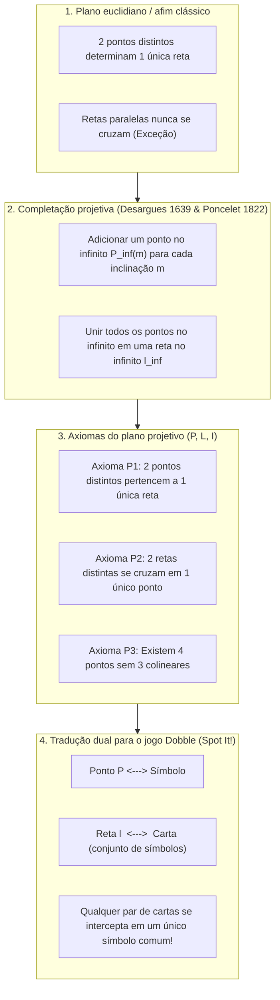
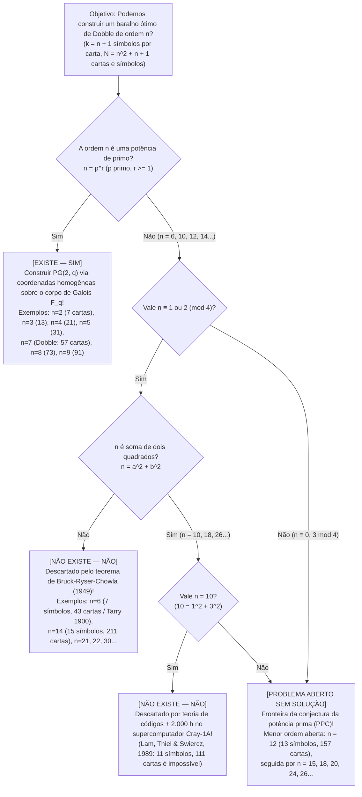

Se você já abriu a pequena lata redonda do famoso jogo de festa <strong>Dobble</strong> (vendido na América do Norte como <strong>Spot It!</strong>), conhece sua regra de simplicidade enganosa: cada carta circular exibe <strong>oito símbolos distintos</strong>. Quando duas cartas quaisquer são viradas na mesa, os jogadores disputam quem encontra e grita primeiro o símbolo em comum.

Quem joga por alguns minutos logo nota uma propriedade matemática quase mágica: <strong>não importa quais duas cartas você escolha em todo o baralho, elas sempre compartilham um símbolo em comum — e nunca mais de um!</strong>

Escondida dentro dessa lata de brinquedo está uma das joias da matemática pura moderna: a interseção entre a <strong>geometria projetiva finita</strong>, os <strong>corpos finitos de Galois ($\mathbb{F}_q$)</strong> e a <strong>teoria de designs combinatórios</strong>. Mais surpreendente ainda: no instante em que perguntamos «O que acontece se colocarmos $k$ símbolos por carta em vez de $8$?», somos lançados diretamente ao <strong>problema dos 36 oficiais de Leonhard Euler (1782)</strong>, ao <strong>teorema de Bruck-Ryser-Chowla (1949)</strong>, a uma <strong>prova de 2.000 horas em um supercomputador Cray-1 (1989)</strong> para $k = 11$ símbolos, e a um dos maiores problemas em aberto da matemática discreta: <strong>existe um plano projetivo finito de ordem $12$ ($13$ símbolos por carta, $157$ cartas)?</strong>

---

## Capítulo 1: Três mistérios matemáticos dentro da lata de Dobble

Uma lata comercial de Dobble contém <strong>55 cartas</strong>, cada uma com <strong>8 símbolos</strong> escolhidos de um conjunto de $57$ símbolos. Tentar montar tal baralho manualmente por tentativa e erro esbarra imediatamente na explosão combinatória de cartas candidatas:

$$\binom{57}{8} = \frac{57 \times 56 \times 55 \times 54 \times 53 \times 52 \times 51 \times 50}{8!} = 1.652.411.475$$

Procurar por força bruta entre <strong>1,65 bilhão de combinações</strong> mais de cinquenta cartas mutuamente compatíveis é impossível sem uma estrutura algébrica. Isso levanta três mistérios:
1. <strong>O tamanho máximo e as 2 cartas ausentes</strong>: Com $k = 8$ símbolos por carta, o teto matemático exato é de <strong>57 cartas</strong> (e 57 símbolos). Por que a lata comercial traz apenas <strong>55 cartas</strong>?
2. <strong>A receita algébrica</strong>: Como gerar todas as 57 cartas de uma só vez, sem tentativa e erro, usando álgebra?
3. <strong>Os baralhos proibidos</strong>: Por que é possível construir um Dobble perfeito com $k = 3$ (7 cartas), $k = 4$ (13 cartas), $k = 5$ (21 cartas), $k = 6$ (31 cartas) ou $k = 8$ (57 cartas), mas é matematicamente impossível para qualquer ser humano ou supercomputador construir um baralho completo com <strong>$k = 7$ símbolos (43 cartas)</strong> ou <strong>$k = 11$ símbolos (111 cartas)</strong>?

---

## Capítulo 2: Da geometria euclidiana à geometria projetiva — Pontos no infinito e dualidade

No plano euclidiano clássico ($\mathbb{R}^2$), dois pontos distintos determinam uma única reta, mas duas retas distintas se cruzam em um único ponto <em>exceto quando são paralelas</em>. Nos séculos XVII e XIX, <strong>Girard Desargues (1639)</strong> e <strong>Jean-Victor Poncelet (1822)</strong> eliminaram essa exceção inspirando-se no ponto de fuga da pintura renascentista:
1. Para cada feixe de retas paralelas de inclinação $m$, adiciona-se um <strong>ponto no infinito $P_\infty(m)$</strong> pelo qual passam todas as retas de inclinação $m$.
2. Todos os pontos no infinito $\{P_\infty(m)\}$ são reunidos sobre uma única reta nova, a <strong>reta no infinito $\ell_\infty$</strong> (o horizonte).

Surge assim um <strong>plano projetivo $(\mathcal{P}, \mathcal{L}, \mathcal{I})$</strong> governado por três axiomas:
- <strong>Axioma P1</strong>: Por quaisquer dois pontos distintos $P \neq Q$ passa <strong>uma única</strong> reta $\ell$.
- <strong>Axioma P2</strong>: Quaisquer duas retas distintas $\ell_1 \neq \ell_2$ se interceptam em <strong>um único</strong> ponto $P$.
- <strong>Axioma P3 (Não degenerescência)</strong>: Existem pelo menos <strong>quatro pontos em posição geral</strong> (nenhum trio deles colinear).

Trocar as palavras «Ponto» e «Reta» preserva todos os axiomas (<strong>Princípio da Dualidade</strong>), fornecendo o dicionário exato para o Dobble:

| Conceito de geometria projetiva | Interpretação A (Dicionário padrão) | Interpretação B (Dicionário dual) |
| :--- | :--- | :--- |
| <strong>Ponto $P \in \mathcal{P}$</strong> | <strong>Um símbolo (ícone)</strong> | <strong>Uma carta</strong> |
| <strong>Reta $\ell \in \mathcal{L}$</strong> | <strong>Uma carta (subconjunto de símbolos)</strong> | <strong>Um símbolo (conjunto de cartas onde aparece)</strong> |
| <strong>Incidência $(P, \ell) \in \mathcal{I}$</strong> | O símbolo $P$ está impresso na carta $\ell$ | A carta $P$ exibe o símbolo $\ell$ |
| <strong>Significado do Axioma P2</strong> | <strong>Quaisquer duas cartas compartilham um único símbolo</strong> | Quaisquer dois símbolos aparecem juntos em uma única carta |

---

## Capítulo 3: O teorema de contagem de ordem $n$ e o plano de Fano $PG(2, 2)$

> <strong>Teorema 3.1 (Teorema de contagem para planos projetivos finitos)</strong>:
> Em qualquer plano projetivo finito $(\mathcal{P}, \mathcal{L}, \mathcal{I})$, existe um inteiro $n \ge 2$ (a <strong>ordem</strong> do plano) tal que cada reta contém exatamente $k = n + 1$ pontos, cada ponto pertence a exatamente $r = n + 1$ retas, e o número total de pontos e de retas é:
> $$|\mathcal{P}| = |\mathcal{L}| = N = n^2 + n + 1$$

<strong>Demonstração</strong>: Fixando um ponto de referência $P_0$, qualquer outro ponto $Q \neq P_0$ pertence (por P1 e P2) a uma e apenas uma das $n + 1$ retas que passam por $P_0$. Como cada uma dessas $n + 1$ retas contém $n$ outros pontos além de $P_0$, temos $|\mathcal{P}| = 1 + (n + 1)n = n^2 + n + 1$. Para o Dobble ($k = 8 \implies n = 7$), o máximo teórico é $N = 7^2 + 7 + 1 = 57$ cartas e 57 símbolos.

### A menor geometria finita: o plano de Fano $PG(2, 2)$ ($n = 2$)

Para $n = 2$ ($k = 3$ símbolos por carta, $N = 7$ cartas), o geômetra italiano <strong>Gino Fano (1892)</strong> descobriu o <strong>plano de Fano $PG(2, 2)$</strong>. Seus 7 pontos correspondem aos 7 vetores binários não nulos de $\mathbb{F}_2^3 \setminus \{\mathbf{0}\}$ (onde três pontos formam uma reta se e somente se sua soma XOR bit a bit for $u \oplus v \oplus w = \mathbf{0}$) ou aos deslocamentos cíclicos do <strong>conjunto de diferenças perfeito $\{1, 2, 4\} \pmod 7$</strong>:

| Carta | Deslocamento $\ell_i = \{1+i, 2+i, 4+i\} \pmod 7$ | Os 3 símbolos na carta | Papel geométrico no diagrama de Fano |
| :---: | :---: | :---: | :--- |
| <strong>Carta $\ell_0$</strong> | $+0$ | $\{1, 2, 4\}$ | Lado externo 1 do triângulo equilátero |
| <strong>Carta $\ell_1$</strong> | $+1$ | $\{2, 3, 5\}$ | Lado externo 2 do triângulo equilátero |
| <strong>Carta $\ell_2$</strong> | $+2$ | $\{3, 4, 6\}$ | Lado externo 3 do triângulo equilátero |
| <strong>Carta $\ell_3$</strong> | $+3$ | $\{4, 5, 0\}$ | Mediana 1 (vértice ao ponto médio oposto) |
| <strong>Carta $\ell_4$</strong> | $+4$ | $\{5, 6, 1\}$ | Mediana 2 (vértice ao ponto médio oposto) |
| <strong>Carta $\ell_5$</strong> | $+5$ | $\{6, 0, 2\}$ | Mediana 3 (vértice ao ponto médio oposto) |
| <strong>Carta $\ell_6$</strong> | $+6$ | $\{0, 1, 3\}$ | <strong>O círculo inscrito passando pelos 3 pontos médios!</strong> |

---

## Capítulo 4: Coordenadas homogêneas sobre corpos de Galois $\mathbb{F}_q$ e o baralho de 57 cartas ($n = 7$)

Um <strong>corpo finito (corpo de Galois) $\mathbb{F}_q$</strong> com $q$ elementos existe <strong>se e somente se $q = p^r$ for uma potência de primo</strong>. No espaço vetorial $\mathbb{F}_q^3 \setminus \{\mathbf{0}\}$, as classes de equivalência $[x : y : z] \sim [\lambda x : \lambda y : \lambda z]$ ($\lambda \in \mathbb{F}_q^\times$) formam $\frac{q^3-1}{q-1} = q^2 + q + 1$ pontos projetivos, e as equações lineares $ax + by + cz = 0$ definem as $q^2 + q + 1$ retas do <strong>plano desarguesiano $PG(2, q)$</strong>.

Para o Dobble ($q = 7$, aritmética módulo $7$ em $\mathbb{F}_7 = \{0,\dots,6\}$), os 57 símbolos dividem-se em <strong>49 pontos afins</strong> $P_{x,y} = [x : y : 1]$ e <strong>8 pontos no infinito</strong> $I_m = [1 : m : 0]$ mais $I_\infty = [0 : 1 : 0]$. As 57 cartas dividem-se em:
1. <strong>49 cartas de retas afins $L_{m,b}$</strong>: os 7 pontos $\{(x, mx+b \bmod 7)\}$ mais o ponto no infinito $I_m$.
2. <strong>7 cartas verticais $V_c$</strong>: os 7 pontos $\{(c, y)\}$ mais o ponto no infinito vertical $I_\infty$.
3. <strong>1 carta de horizonte $L_\infty$</strong>: todos os 8 pontos no infinito $\{I_0, \dots, I_6, I_\infty\}$.

Alternativamente, pelo <strong>teorema de Singer (1938)</strong>, o conjunto de diferenças cíclico $D = \{0, 1, 3, 13, 32, 36, 43, 52\} \pmod{57}$ gera todas as 57 cartas via $D + i \pmod{57}$. A lata comercial vem com 55 cartas em vez de 57 apenas por conveniência de corte industrial ($55 = 5 \times 11$) e divisão entre jogadores, mantendo o axioma P2 intacto.

---

## Capítulo 5: Os 36 oficiais de Euler, Bruck-Ryser-Chowla e as fronteiras de $n = 10$ e $n = 12$

Um plano projetivo de ordem $n$ é um design em blocos simétrico $(n^2+n+1, n+1, 1)$-BIBD (igualdade $b = v$ na desigualdade de Fisher) e, pelo <strong>teorema de equivalência de R. C. Bose (1938)</strong>, existe se e somente se existirem <strong>$n - 1$ quadrados latinos mutuamente ortogonais (MOLS) de ordem $n$</strong>.

- <strong>Ordem $n = 6$ ($7$ símbolos, $43$ cartas)</strong>: Exigiria $5$ MOLS de ordem $6$. Porém, em 1900 <strong>Gaston Tarry</strong> provou que o <strong>problema dos 36 oficiais de Euler (1782)</strong> não tem solução — não existem sequer $2$ quadrados latinos ortogonais de ordem $6$, tornando $n = 6$ impossível!
- <strong>Teorema de Bruck-Ryser-Chowla (1949)</strong>: Se um plano projetivo finito de ordem $n$ existe e $n \equiv 1 \text{ ou } 2 \pmod 4$, então $n$ deve ser a <strong>soma de dois quadrados inteiros</strong>:
  $$n = a^2 + b^2 \quad (a, b \in \mathbb{Z})$$
  Isso elimina imediatamente $n = 6, 14, 21, 22, 30, \dots$!
- <strong>Ordem $n = 10$ ($11$ símbolos, $111$ cartas) e o supercomputador Cray-1 (1989)</strong>: Como $10 = 1^2 + 3^2$, Bruck-Ryser-Chowla não descarta $n = 10$. Em 1989, <strong>Clement W. H. Lam, Larry Thiel e Stanley Swiercz</strong> usaram teoria de códigos corretores de erros e <strong>2.000 horas em um supercomputador Cray-1A</strong> para provar que não existe plano projetivo de ordem $10$.
- <strong>Ordem $n = 12$ ($13$ símbolos, $157$ cartas)</strong>: Como $12 \equiv 0 \pmod 4$, Bruck-Ryser-Chowla não se aplica, e o espaço de busca supera qualquer supercomputador. A existência de $n = 12$ (<strong>conjectura da potência prima / PPC</strong>) permanece um dos maiores problemas abertos da matemática!

| Ordem $n$ | Símbolos por carta $k = n+1$ | Cartas e símbolos $N = n^2+n+1$ | Existe? | Construção matemática ou prova de inexistência |
| :---: | :---: | :---: | :---: | :--- |
| <strong>$n = 2$</strong> | $3$ | <strong>$7$</strong> | <strong>Sim (único)</strong> | Primo $2$: menor plano projetivo <strong>plano de Fano $PG(2, 2)$</strong> |
| <strong>$n = 3, 4, 5$</strong> | $4, 5, 6$ | <strong>$13, 21, 31$</strong> | <strong>Sim (único)</strong> | Potências primas $3, 2^2, 5$: $PG(2, q)$ sobre $\mathbb{F}_q$ |
| <strong>$n = 6$</strong> | $7$ | $43$ | <strong>Não (impossível)</strong> | $6 \equiv 2 \pmod 4$, $6 \neq a^2+b^2$. <strong>36 oficiais de Euler / Tarry (1900) / Bruck-Ryser (1949)</strong> |
| <strong>$n = 7$</strong> | <strong>$8$</strong> | <strong>$57$</strong> | <strong>Sim (único)</strong> | Primo $7$: $PG(2, 7)$ sobre $\mathbb{F}_7$. <strong>Dobble comercial (55 cartas na lata)</strong> |
| <strong>$n = 8, 9$</strong> | $9, 10$ | <strong>$73, 91$</strong> | <strong>Sim ($1$ e $4$ tipos)</strong> | Potências primas $2^3, 3^2$: para $n=9$ existem $PG(2,9)$ e 3 planos não desarguesianos |
| <strong>$n = 10$</strong> | $11$ | $111$ | <strong>Não (impossível)</strong> | $10 = 1^2+3^2$, mas <strong>refutado em 1989 por Lam et al. após 2.000 h no Cray-1A</strong> |
| <strong>$n = 11, 13$</strong> | $12, 14$ | <strong>$133, 183$</strong> | <strong>Sim</strong> | Primos $11, 13$: $PG(2, 11)$ e $PG(2, 13)$ |
| <strong>$n = 12$</strong> | $13$ | $157$ | <strong>[Problema aberto]</strong> | $12 \equiv 0 \pmod 4$: Bruck-Ryser-Chowla inaplicável. <strong>Menor ordem em aberto!</strong> |
| <strong>$n = 14$</strong> | $15$ | $211$ | <strong>Não (impossível)</strong> | $14 \equiv 2 \pmod 4$ e $14 \neq a^2+b^2$. <strong>Descartado por Bruck-Ryser-Chowla</strong> |
